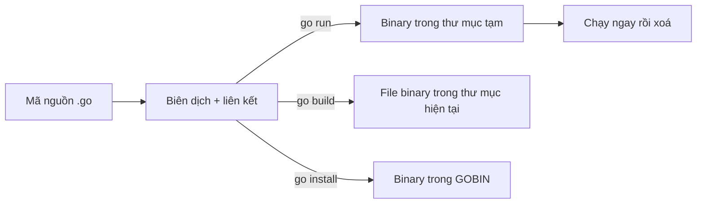

# Cài đặt và Hello World

Bài này dựng môi trường Go từ đầu: cài toolchain, hiểu sự khác nhau giữa GOPATH và module, đọc `go env`, viết chương trình Hello World đầu tiên, phân biệt `go run` với `go build`, cấu hình VS Code/GoLand với `gopls`, và điểm qua các lệnh `go` hay dùng. Làm xong bài này bạn có một dự án Go chạy được và editor hỗ trợ đầy đủ.

---

:::note[Ghi nhớ nhanh]

- ⭐ **Luôn bắt đầu bằng `go mod init <module-path>`** — mọi dự án hiện đại là một module, đặt ở thư mục nào cũng được, không cần GOPATH.
- ⭐ **`go run` để chạy thử, `go build` để ra binary** — `go run` biên dịch vào thư mục tạm rồi chạy; `go build` tạo file thực thi.
- **Chương trình chạy được = `package main` + `func main()`** — không tham số, không giá trị trả về.
- **`gopls` là language server chính thức** — VS Code (extension Go) và nhiều editor dùng nó cho autocomplete, go to definition, refactor.
- **`go env` xem cấu hình**; `go env -w KEY=value` để ghi đè lâu dài.

:::

---

## Mục lục

- [Vì sao cần hiểu môi trường Go?](#vì-sao-cần-hiểu-môi-trường-go)
- [Cài đặt Go](#cài-đặt-go)
- [GOPATH và module](#gopath-và-module)
- [Biến môi trường và go env](#biến-môi-trường-và-go-env)
- [Hello World](#hello-world)
- [go run và go build](#go-run-và-go-build)
- [Cấu hình editor](#cấu-hình-editor)
- [Tổng quan lệnh go](#tổng-quan-lệnh-go)

---

## Vì sao cần hiểu môi trường Go?

**Vấn đề:** Người mới hay copy hướng dẫn cũ trên mạng (trước 2019) và gặp những lỗi khó hiểu:

```text
$ go run main.go
main.go:3:8: package github.com/google/uuid is not in std

$ go build
go: go.mod file not found in current directory or any parent directory;
	see 'go help modules'
```

Nguyên nhân: hướng dẫn cũ bảo đặt code trong `$GOPATH/src` và chạy `go get`, trong khi Go hiện đại làm việc theo **module** — thiếu `go.mod` thì lệnh `go` không biết dự án là gì.

**Giải pháp:** khởi tạo module trước, thêm dependency bằng `go get` hoặc `go mod tidy`:

```bash
mkdir hello && cd hello
go mod init example.com/hello     # tạo go.mod
go get github.com/google/uuid     # thêm dependency vào go.mod và go.sum
go run .                           # chạy package trong thư mục hiện tại
```

:::tip[Dùng thực tế]

- **Dự án mới** — `go mod init github.com/<tên-tài-khoản>/<tên-dự-án>` để sau này publish được ngay.
- **Clone dự án có sẵn** — chỉ cần `go mod download` (hoặc `go build`, Go tự tải dependency).
- **CI/CD** — dùng image `golang:1.2x` để build, rồi copy binary sang image nhỏ (`distroless`, `alpine`, `scratch`).
- **Nhiều phiên bản Go** — dòng `toolchain` trong `go.mod` hoặc `GOTOOLCHAIN` giúp tự tải đúng phiên bản.

:::

:::tip[Ví dụ đời thường]

`go.mod` giống **sổ hộ khẩu** của dự án: ghi rõ dự án tên gì (module path), cần Go bản nào, và các "thành viên" (dependency) là ai, phiên bản nào. Không có sổ thì đi làm thủ tục ở đâu cũng bị hỏi "anh ở đâu?" — y như lỗi `go.mod file not found`.

:::

---

## Cài đặt Go

### Cách 1: Bộ cài chính thức (khuyến nghị)

Tải tại [go.dev/dl](https://go.dev/dl/):

- **macOS**: file `.pkg` → cài vào `/usr/local/go`.
- **Windows**: file `.msi` → cài vào `C:\Program Files\Go`, tự thêm vào `PATH`.
- **Linux**: file `.tar.gz`:

```bash
# Xoá bản cũ (nếu có) rồi giải nén bản mới vào /usr/local
sudo rm -rf /usr/local/go
sudo tar -C /usr/local -xzf go1.26.0.linux-amd64.tar.gz

# Thêm vào PATH (đặt trong ~/.bashrc hoặc ~/.zshrc)
export PATH=$PATH:/usr/local/go/bin:$(go env GOPATH)/bin
```

### Cách 2: Trình quản lý gói

```bash
brew install go                 # macOS (Homebrew)
sudo apt install golang-go      # Ubuntu — thường là bản cũ, nên dùng cách 1
winget install GoLang.Go        # Windows
```

### Kiểm tra

```bash
go version
# go version go1.26.0 darwin/arm64
```

:::warning[Lỗi hay gặp]

- **`go: command not found`** — chưa thêm `/usr/local/go/bin` vào `PATH`, hoặc chưa mở terminal mới sau khi sửa `~/.zshrc`.
- **Công cụ cài bằng `go install` không chạy được** — chưa thêm `$(go env GOPATH)/bin` (mặc định `~/go/bin`) vào `PATH`.
- **`apt` cài bản Go quá cũ** — không hỗ trợ cú pháp mới (`for i := range 10`, generics...).

:::

---

## GOPATH và module

| | GOPATH mode (cũ) | Module mode (hiện tại) |
|---|------------------|-------------------------|
| Vị trí code | Bắt buộc trong `$GOPATH/src/...` | Ở bất kỳ đâu |
| Phiên bản dependency | Không có, luôn lấy mới nhất | Ghi trong `go.mod`, khoá checksum trong `go.sum` |
| Nơi lưu dependency | `$GOPATH/src` | Module cache `$GOPATH/pkg/mod` (chỉ đọc) |
| Bật bằng | `GO111MODULE=off` | Mặc định từ Go 1.16 |
| Dùng hôm nay? | Không | Có |

**GOPATH vẫn tồn tại**, nhưng vai trò đã đổi: nó chỉ là nơi Go lưu **module cache** (`~/go/pkg/mod`) và binary cài bằng `go install` (`~/go/bin`). Bạn **không** đặt code dự án vào đó nữa.

```text
~/go/                      # GOPATH mặc định
├── bin/                   # binary từ go install (gopls, golangci-lint...)
└── pkg/mod/               # module cache — dependency đã tải

~/projects/hello/          # dự án của bạn: ở đâu cũng được
├── go.mod
└── main.go
```

File `go.mod` sau khi `go mod init`:

```text
module example.com/hello

go 1.26
```

- **`module`** — đường dẫn module (module path), là tiền tố cho mọi import trong dự án. Nếu định publish, dùng đường dẫn repo thật như `github.com/toi/hello`.
- **`go`** — phiên bản Go tối thiểu và quyết định ngữ nghĩa ngôn ngữ (ví dụ vòng lặp 1.22).

---

## Biến môi trường và go env

```bash
go env                  # in toàn bộ cấu hình
go env GOPATH GOROOT    # in vài biến cụ thể
go env -w GOPROXY=https://proxy.golang.org,direct   # ghi đè lâu dài (lưu vào file cấu hình của go)
go env -u GOPROXY       # bỏ ghi đè, trở về mặc định
```

| Biến | Ý nghĩa | Mặc định thường gặp |
|------|---------|---------------------|
| `GOROOT` | Nơi cài toolchain Go (compiler, thư viện chuẩn) | `/usr/local/go` — gần như không cần đặt tay |
| `GOPATH` | Module cache và thư mục `bin` | `~/go` |
| `GOBIN` | Nơi `go install` đặt binary | `$GOPATH/bin` nếu để trống |
| `GOPROXY` | Proxy tải module | `https://proxy.golang.org,direct` |
| `GOPRIVATE` | Module riêng tư, không đi qua proxy/checksum DB | Rỗng; vd `github.com/congty/*` |
| `GOOS`, `GOARCH` | Hệ điều hành và kiến trúc đích khi build | Theo máy hiện tại |
| `CGO_ENABLED` | Cho phép gọi code C | `1` (thường đặt `0` để build binary tĩnh hoàn toàn) |
| `GOTOOLCHAIN` | Cách chọn phiên bản toolchain | `auto` |
| `GOFLAGS` | Cờ mặc định cho mọi lệnh `go` | Rỗng |

:::warning[Lỗi hay gặp]

Làm việc với **repo nội bộ công ty** (GitLab self-hosted) mà quên `GOPRIVATE` → `go get` cố tải qua `proxy.golang.org` và báo `404 Not Found` hoặc lỗi checksum. Sửa:

```bash
go env -w GOPRIVATE=gitlab.congty.vn/*
```

:::

---

## Hello World

```bash
mkdir hello && cd hello
go mod init example.com/hello
```

Tạo `main.go`:

```go
// Mỗi file Go bắt đầu bằng khai báo package.
// Package tên "main" là đặc biệt: nó được biên dịch thành chương trình chạy được.
package main

// import các package cần dùng; "fmt" là package định dạng & in ra của thư viện chuẩn
import "fmt"

// main là điểm bắt đầu của chương trình: không tham số, không giá trị trả về
func main() {
	fmt.Println("Xin chào, Gopher!")
}
```

```bash
go run .
# Xin chào, Gopher!
```

### Các quy tắc cần biết ngay

- **`package main` + `func main()`** — thiếu một trong hai thì không tạo được chương trình chạy được. Package tên khác (`package utils`) là thư viện, chỉ dùng để import.
- **Tham số dòng lệnh và mã thoát** không đi qua `main` như C/Java mà qua package `os`:

```go
package main

import (
	"fmt"
	"os"
)

func main() {
	if len(os.Args) < 2 { // os.Args[0] là tên chương trình
		fmt.Fprintln(os.Stderr, "cách dùng: hello <tên>")
		os.Exit(1) // mã thoát khác 0 báo lỗi
	}
	fmt.Printf("Xin chào, %s!\n", os.Args[1])
}
```

```bash
go run . Lan
# Xin chào, Lan!
```

- **Dấu `{` phải nằm cùng dòng** với `func`, `if`, `for` — Go tự chèn dấu `;` ở cuối dòng, nên xuống dòng trước `{` gây lỗi cú pháp.
- **Không cần dấu chấm phẩy** cuối câu lệnh.
- **Chữ hoa đầu tên = exported** (dùng được từ package khác): `fmt.Println` viết hoa vì được export.
- **Import hoặc biến cục bộ không dùng = lỗi biên dịch**.

```go
func main()
{ // LỖI: syntax error: unexpected semicolon or newline before {
	fmt.Println("sai")
}
```

### Nhiều file trong cùng package

```text
hello/
├── go.mod
├── main.go        // package main — gọi greet()
└── greet.go       // package main — định nghĩa greet()
```

```go
// greet.go
package main

func greet(name string) string {
	return "Xin chào, " + name
}
```

```go
// main.go
package main

import "fmt"

func main() {
	fmt.Println(greet("Gopher")) // dùng hàm ở file khác cùng package, không cần import
}
```

:::warning[Lỗi hay gặp]

`go run main.go` khi package có nhiều file → `undefined: greet`, vì chỉ biên dịch đúng file `main.go`. Dùng **`go run .`** để biên dịch cả package.

:::

---

## go run và go build



| Lệnh | Kết quả | Dùng khi |
|------|---------|----------|
| `go run .` | Biên dịch vào thư mục tạm và chạy ngay | Phát triển, thử nhanh |
| `go build` | Tạo binary `hello` (hoặc `hello.exe`) trong thư mục hiện tại | Đóng gói để triển khai |
| `go build -o bin/app ./cmd/api` | Chỉ định tên và vị trí output | Dự án nhiều binary |
| `go install` | Build và đặt binary vào `GOBIN` | Cài công cụ dùng hằng ngày |
| `go install golang.org/x/tools/gopls@latest` | Cài công cụ từ module bên ngoài | Cài gopls, linter... |

```bash
go build -o hello .
./hello Lan
ls -lh hello       # binary vài MB, không cần cài Go trên máy chạy

# Cross-compile: build cho Linux ARM64 từ máy macOS
GOOS=linux GOARCH=arm64 go build -o hello-linux-arm64 .

# Build binary nhỏ hơn: bỏ bảng symbol và thông tin debug
go build -ldflags="-s -w" -o hello .

# Binary tĩnh hoàn toàn (không phụ thuộc libc) — hợp với image FROM scratch
CGO_ENABLED=0 go build -o hello .
```

:::tip[Dùng thực tế]

Dockerfile multi-stage điển hình cho service Go:

```text
FROM golang:1.26 AS build
WORKDIR /src
COPY go.mod go.sum ./
RUN go mod download            # cache layer dependency
COPY . .
RUN CGO_ENABLED=0 go build -ldflags="-s -w" -o /app ./cmd/api

FROM gcr.io/distroless/static
COPY --from=build /app /app
ENTRYPOINT ["/app"]
```

Image cuối chỉ khoảng 10–20 MB.

:::

---

## Cấu hình editor

### gopls là gì?

**gopls** (đọc là "go please") là **language server** (máy chủ ngôn ngữ — chương trình chạy nền cung cấp autocomplete, kiểm tra lỗi, điều hướng code cho editor qua giao thức LSP) chính thức của Go. Hầu hết editor dùng nó: VS Code, Neovim, Zed, Sublime, Emacs.

### VS Code

1. Cài extension **Go** (của Go Team at Google).
2. Mở thư mục dự án, nhấn `Cmd/Ctrl + Shift + P` → **Go: Install/Update Tools** → chọn tất cả (gopls, dlv debugger, staticcheck...).
3. Cấu hình gợi ý trong `settings.json`:

```json
{
  "[go]": {
    "editor.formatOnSave": true,
    "editor.codeActionsOnSave": {
      "source.organizeImports": "explicit"
    }
  },
  "go.lintTool": "golangci-lint",
  "gopls": {
    "ui.semanticTokens": true
  }
}
```

### GoLand

IDE thương mại của JetBrains, hỗ trợ Go sẵn (không dùng gopls mà dùng engine phân tích riêng). Mạnh về refactor, debug, tích hợp database. Miễn phí cho sinh viên và dự án phi thương mại theo chính sách của JetBrains.

| | VS Code + gopls | GoLand |
|---|-----------------|--------|
| Chi phí | Miễn phí | Trả phí (có bản miễn phí cho một số đối tượng) |
| Cài đặt | Cần cài extension + tools | Dùng ngay |
| Refactor nâng cao | Cơ bản–khá | Rất mạnh |
| Nhẹ | Có | Nặng hơn |

:::warning[Lỗi hay gặp]

- **gopls báo lỗi đỏ khắp nơi dù `go build` vẫn chạy** — thường do mở **thư mục cha** chứa nhiều module. Hãy mở đúng thư mục có `go.mod`, hoặc tạo `go.work` liệt kê các module.
- **Không tự format khi lưu** — kiểm tra `editor.formatOnSave` và default formatter là extension Go.

:::

---

## Tổng quan lệnh go

```bash
go help            # danh sách lệnh
go help build      # chi tiết một lệnh
```

| Nhóm | Lệnh | Làm gì |
|------|------|--------|
| Chạy/build | `go run`, `go build`, `go install` | Chạy, tạo binary, cài binary |
| Module | `go mod init` | Tạo `go.mod` |
| | `go mod tidy` | Thêm dependency thiếu, xoá dependency thừa |
| | `go get pkg@v1.2.3` | Thêm/nâng/hạ phiên bản dependency |
| | `go mod download`, `go mod vendor`, `go mod why` | Tải, chép vào `vendor/`, giải thích vì sao cần |
| | `go work init` | Workspace nhiều module |
| Chất lượng | `go fmt ./...` | Định dạng code (gọi `gofmt`) |
| | `go vet ./...` | Phát hiện lỗi đáng ngờ (Printf sai định dạng, copy lock...) |
| | `go test ./...` | Chạy test; thêm `-race` để bắt data race, `-cover` xem coverage |
| Thông tin | `go version`, `go env`, `go list -m all` | Phiên bản, cấu hình, danh sách module |
| | `go doc fmt.Println` | Xem tài liệu ngay trong terminal |
| Khác | `go generate`, `go clean -cache`, `go tool pprof` | Sinh code, xoá cache, profiling |

`./...` nghĩa là "package hiện tại và mọi package con".

```bash
# Vòng làm việc hằng ngày
go fmt ./...
go vet ./...
go test ./...
go build ./...
```
