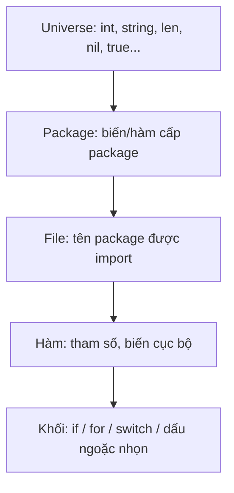

# Biến và hằng số

Biến và hằng là thứ đầu tiên viết trong mọi chương trình, nhưng Go có vài điểm khác hẳn ngôn ngữ khác: hai cách khai báo (`var` và `:=`), **zero value** thay cho "chưa khởi tạo", hằng số **không có kiểu** (untyped constant), và `iota` để tạo dãy hằng. Bài này cũng nói kỹ về scope và **shadowing** — nguồn gốc của một bug kinh điển với biến `err` mà gần như ai viết Go cũng từng dính.

---

:::note[Ghi nhớ nhanh]

- ⭐ **`:=` chỉ dùng trong hàm, `var` dùng được mọi nơi** — `:=` vừa khai báo vừa suy luận kiểu; cấp package bắt buộc dùng `var`.
- ⭐ **Cẩn thận shadowing với `:=` trong khối con** — `err := ...` bên trong `if`/`for` tạo biến `err` **mới**, biến bên ngoài không đổi.
- **Mọi biến đều có zero value** — `0`, `""`, `false`, `nil`; không bao giờ có giá trị rác hay "undefined".
- **Hằng số untyped có độ chính xác cao và linh hoạt kiểu** — `const x = 10` dùng được như `int`, `float64`, `time.Duration`...
- **`iota` đếm từ 0 trong mỗi khối `const`** — dùng làm enum, bit flag, đơn vị (KB, MB, GB).

:::

---

## Mục lục

- [Vì sao cần hiểu cách khai báo của Go?](#vì-sao-cần-hiểu-cách-khai-báo-của-go)
- [Khai báo biến với var](#khai-báo-biến-với-var)
- [Khai báo ngắn với :=](#khai-báo-ngắn-với-)
- [Zero value](#zero-value)
- [Khai báo nhiều biến](#khai-báo-nhiều-biến)
- [Hằng số với const](#hằng-số-với-const)
- [Untyped constant](#untyped-constant)
- [iota](#iota)
- [Scope và shadowing](#scope-và-shadowing)

---

## Vì sao cần hiểu cách khai báo của Go?

**Vấn đề:** Ở nhiều ngôn ngữ, biến chưa khởi tạo là nguồn bug lớn:

```javascript
// JavaScript: biến chưa gán là undefined, cộng vào thành NaN mà không báo lỗi
let total;
total += 100;
console.log(total); // NaN
```

```c
// C: biến cục bộ chưa khởi tạo chứa giá trị rác
int count;
printf("%d", count); // in ra số bất kỳ
```

**Giải pháp:** Go đảm bảo **mọi biến luôn có giá trị xác định** (zero value), kiểu được kiểm tra lúc biên dịch, và biến khai báo mà không dùng là lỗi biên dịch:

```go
package main

import "fmt"

func main() {
	var total int // zero value: 0
	total += 100
	fmt.Println(total) // 100

	count := 0 // khai báo ngắn, kiểu int được suy luận
	count++
	fmt.Println(count) // 1
}
```

:::tip[Dùng thực tế]

- **Struct dùng được ngay với zero value** — `var mu sync.Mutex`, `var buf bytes.Buffer` không cần constructor.
- **Hằng cấu hình** — `const defaultTimeout = 30 * time.Second`, `const maxRetry = 3`.
- **Enum trạng thái đơn hàng** — `const ( Pending OrderStatus = iota; Paid; Shipped )`.
- **Pattern `if v, err := f(); err != nil`** — giới hạn scope của biến trong câu lệnh `if`.

:::

:::tip[Ví dụ đời thường]

Zero value giống **phiếu khám bệnh in sẵn**: ô nào chưa điền thì mặc định là "không" (0, rỗng), bác sĩ đọc vẫn hiểu — không có chuyện ô trống chứa nét chữ nguệch ngoạc của bệnh nhân trước (giá trị rác như C). Còn shadowing giống **hai người cùng tên "Nam" trong một phòng**: gọi "Nam ơi" thì người đứng gần (scope trong) trả lời, người ngồi xa không biết gì.

:::

---

## Khai báo biến với var

```go
var name string            // khai báo, nhận zero value ""
var age int = 30           // khai báo + khởi tạo, ghi rõ kiểu
var city = "Hà Nội"        // bỏ kiểu, suy luận là string
var price float64 = 19     // 19 được hiểu là float64
```

Cú pháp đầy đủ: `var <tên> <kiểu> = <giá trị>` — **kiểu đứng sau tên**, ngược với C/Java. Lý do: đọc từ trái sang phải tự nhiên hơn, đặc biệt với kiểu phức tạp:

```go
var handlers map[string]func(int) error // "handlers là map từ string sang hàm nhận int trả error"
```

`var` dùng được ở **cấp package** (ngoài mọi hàm):

```go
package config

var Version = "1.0.0"      // exported: package khác dùng config.Version
var debugMode = false      // unexported: chỉ dùng trong package config

// Cấp package KHÔNG được dùng :=
// port := 8080 // LỖI: syntax error: non-declaration statement outside function body
```

---

## Khai báo ngắn với :=

```go
func main() {
	name := "Lan"           // string
	age := 25               // int
	height := 1.65          // float64
	active := true          // bool
	fmt.Println(name, age, height, active)
}
```

Quy tắc của `:=`:

1. **Chỉ dùng trong hàm.**
2. **Phải có ít nhất một biến mới ở vế trái.** Biến đã có thì được **gán lại** (không khai báo lại):

```go
f, err := os.Open("a.txt")   // f và err đều mới
g, err := os.Open("b.txt")   // g mới, err được GÁN LẠI (cùng scope) → hợp lệ
// f, err := os.Open("c.txt") // LỖI: no new variables on left side of :=
```

3. **Kiểu suy luận từ giá trị**: số nguyên → `int`, số thực → `float64`, chuỗi → `string`, ký tự `'a'` → `rune`.

### Khi nào dùng var, khi nào dùng :=

| Tình huống | Nên dùng | Ví dụ |
|------------|----------|-------|
| Có giá trị khởi tạo, trong hàm | `:=` | `count := 0` |
| Muốn zero value có chủ đích | `var` | `var buf bytes.Buffer` |
| Cần kiểu khác kiểu mặc định | `var` | `var ratio float32 = 0.5` |
| Cấp package | `var` | `var ErrNotFound = errors.New("not found")` |
| Nhận nhiều giá trị trả về | `:=` | `user, err := repo.Find(id)` |

---

## Zero value

| Kiểu | Zero value |
|------|-----------|
| `bool` | `false` |
| `int`, `float64`, các kiểu số | `0` |
| `string` | `""` (chuỗi rỗng) |
| Con trỏ, slice, map, channel, function, interface | `nil` |
| Array | Mọi phần tử là zero value của kiểu phần tử |
| Struct | Mọi field là zero value của field đó |

```go
package main

import "fmt"

type User struct {
	Name  string
	Age   int
	Admin bool
	Tags  []string
}

func main() {
	var u User
	fmt.Printf("%+v\n", u)     // {Name: Age:0 Admin:false Tags:[]}
	fmt.Println(u.Tags == nil) // true
	fmt.Println(len(u.Tags))   // 0 — len của slice nil là 0, an toàn

	var arr [3]int
	fmt.Println(arr) // [0 0 0]
}
```

Thư viện chuẩn thiết kế để **zero value dùng được ngay** ("make the zero value useful"):

```go
var mu sync.Mutex      // mutex chưa khoá, dùng được ngay
var sb strings.Builder // builder rỗng
sb.WriteString("xin chào")
var wg sync.WaitGroup  // bộ đếm = 0
```

:::warning[Lỗi hay gặp]

**Map nil đọc được nhưng ghi thì panic:**

```go
var scores map[string]int
fmt.Println(scores["an"]) // 0 — đọc map nil an toàn
scores["an"] = 10         // panic: assignment to entry in nil map
```

Phải khởi tạo trước khi ghi: `scores := make(map[string]int)` hoặc `` `map[string]int{}` ``. Slice nil thì khác: `append` vào slice nil hoạt động bình thường.

:::

---

## Khai báo nhiều biến

```go
// Nhiều biến cùng kiểu
var x, y, z int

// Nhiều biến, nhiều giá trị
var a, b = 1, "hai"

// Khối var — gọn khi khai báo nhiều biến cấp package
var (
	host    = "localhost"
	port    = 8080
	verbose bool
)

// Khai báo ngắn nhiều biến
name, age := "Minh", 28

// Hoán đổi giá trị không cần biến tạm
x, y = y, x

// Bỏ qua giá trị không cần bằng blank identifier _
_, err := fmt.Println("chỉ cần err")
```

Phép gán nhiều biến **tính hết vế phải trước rồi mới gán**, nên `x, y = y, x` hoán đổi đúng.

Biến `_` (**blank identifier** — định danh trống) dùng để bỏ qua giá trị. Nó không phải biến thật: không đọc được, không bị lỗi "declared and not used".

---

## Hằng số với const

```go
const Pi = 3.14159
const AppName string = "shop-api" // hằng có kiểu tường minh

const (
	MaxRetry       = 3
	DefaultTimeout = 30 * time.Second
	BaseURL        = "https://api.example.com"
)
```

Đặc điểm của hằng trong Go:

- Giá trị phải **xác định lúc biên dịch**: số, chuỗi, bool, rune, hoặc biểu thức của chúng.
- **Không** có hằng kiểu slice, map, struct, hay kết quả gọi hàm thường.
- Một số built-in được dùng trong hằng: `len` của chuỗi hằng, `min`, `max`, `complex`, `real`, `imag`...

```go
const greeting = "xin chào"
const n = len(greeting) // hợp lệ: len của chuỗi hằng là hằng → 9 (byte, vì "à" chiếm 2 byte UTF-8)

// const now = time.Now()          // LỖI: time.Now() không phải hằng
// const primes = []int{2, 3, 5}   // LỖI: slice không thể là hằng
```

Muốn "hằng" kiểu slice/map thì dùng `var` cấp package (và quy ước không sửa), hoặc hàm trả về bản sao.

---

## Untyped constant

Hằng không ghi kiểu là **untyped constant** (hằng chưa định kiểu). Nó có một **kiểu mặc định** (default type) nhưng chỉ "chốt" kiểu khi được dùng trong ngữ cảnh cần kiểu cụ thể.

```go
package main

import (
	"fmt"
	"time"
)

const timeout = 5 // untyped integer constant

func main() {
	var a int = timeout                // dùng như int
	var b float64 = timeout            // dùng như float64
	var c time.Duration = timeout      // dùng như time.Duration (kiểu riêng!)
	d := timeout * time.Second         // 5s

	fmt.Println(a, b, c, d) // 5 5 5ns 5s
}
```

Nếu `timeout` là **typed** (`const timeout int = 5`), dòng `timeout * time.Second` sẽ **lỗi** vì `int` và `time.Duration` là hai kiểu khác nhau:

```go
const typedTimeout int = 5
// d := typedTimeout * time.Second // LỖI: mismatched types int and time.Duration
d := time.Duration(typedTimeout) * time.Second // phải chuyển kiểu tường minh
```

### Độ chính xác cao

Hằng untyped được tính với độ chính xác rất cao (ít nhất 256 bit) lúc biên dịch, chỉ bị giới hạn khi gán vào biến:

```go
const huge = 1 << 100           // hợp lệ: hằng có thể vượt quá int64
const small = huge >> 98        // 4 — tính lúc biên dịch, kết quả vừa int
fmt.Println(small)              // 4
// fmt.Println(huge)            // LỖI: cannot use huge (untyped int constant ...) as int value (overflows)
```

| Loại untyped constant | Ví dụ | Kiểu mặc định |
|-----------------------|-------|---------------|
| Integer | `42` | `int` |
| Floating-point | `3.14` | `float64` |
| Rune | `'A'` | `rune` (`int32`) |
| Complex | `2i` | `complex128` |
| String | `"go"` | `string` |
| Boolean | `true` | `bool` |

---

## iota

`iota` là bộ đếm đặc biệt trong khối `const`: bắt đầu từ **0** và **tăng 1 mỗi dòng** (mỗi ConstSpec). Dòng không ghi biểu thức sẽ **lặp lại biểu thức của dòng trước**.

### Enum cơ bản

```go
type OrderStatus int

const (
	StatusPending   OrderStatus = iota // 0
	StatusPaid                         // 1
	StatusShipped                      // 2
	StatusCancelled                    // 3
)

// String giúp in ra tên thay vì số (thoả mãn fmt.Stringer)
func (s OrderStatus) String() string {
	switch s {
	case StatusPending:
		return "pending"
	case StatusPaid:
		return "paid"
	case StatusShipped:
		return "shipped"
	case StatusCancelled:
		return "cancelled"
	default:
		return fmt.Sprintf("OrderStatus(%d)", int(s))
	}
}
```

:::tip[Dùng thực tế]

Nhiều đội để giá trị 0 là **"không xác định"** để phân biệt với trạng thái hợp lệ, vì zero value của struct sẽ là 0:

```go
const (
	StatusUnknown OrderStatus = iota // 0 — chưa được gán
	StatusPending                    // 1
	StatusPaid                       // 2
)
```

Công cụ `stringer` (`go install golang.org/x/tools/cmd/stringer@latest`) có thể sinh hàm `String()` tự động qua `go generate`.

:::

### Bỏ qua giá trị, biểu thức với iota

```go
type ByteSize int64

const (
	_           = iota             // bỏ qua 0
	KB ByteSize = 1 << (10 * iota) // 1 << 10 = 1024
	MB                             // 1 << 20
	GB                             // 1 << 30
	TB                             // 1 << 40
)
```

### Bit flag

```go
type Permission uint8

const (
	PermRead    Permission = 1 << iota // 1  (001)
	PermWrite                          // 2  (010)
	PermExecute                        // 4  (100)
)

func main() {
	p := PermRead | PermWrite         // 3: có quyền đọc và ghi
	fmt.Println(p&PermWrite != 0)     // true
	fmt.Println(p&PermExecute != 0)   // false
	p &^= PermWrite                   // bỏ quyền ghi (toán tử AND NOT)
	fmt.Println(p)                    // 1
}
```

### iota tính theo dòng, reset theo khối

```go
const (
	A, B = iota, iota * 10 // 0, 0   — cùng dòng nên cùng iota
	C, D                   // 1, 10
)

const (
	X = iota // 0 — khối const mới, iota reset về 0
)
```

:::warning[Lỗi hay gặp]

Chèn một hằng vào **giữa** khối `iota` sẽ **đổi giá trị của mọi hằng phía sau**. Nếu giá trị đã được lưu vào database hoặc gửi qua API, dữ liệu cũ sẽ bị hiểu sai. Với giá trị được lưu trữ/lưu chuyển, hãy gán số tường minh hoặc chỉ thêm hằng mới vào **cuối** khối.

:::

---

## Scope và shadowing

### Các tầng scope



Biến khai báo ở scope trong **che khuất** (shadow) biến cùng tên ở scope ngoài:

```go
package main

import "fmt"

var x = "package"

func main() {
	fmt.Println(x) // package
	x := "hàm"     // shadow biến cấp package
	fmt.Println(x) // hàm
	{
		x := "khối" // shadow biến của hàm
		fmt.Println(x) // khối
	}
	fmt.Println(x) // hàm — biến trong khối đã hết scope
}
```

### Biến khai báo trong if, for, switch

Biến khai báo trong câu lệnh khởi tạo của `if`/`for`/`switch` chỉ sống trong câu lệnh đó (kể cả các nhánh `else`):

```go
if n, err := strconv.Atoi("42"); err != nil {
	fmt.Println("lỗi:", err)
} else {
	fmt.Println("số:", n) // n vẫn dùng được trong else
}
// fmt.Println(n) // LỖI: undefined: n
```

### Bẫy err bị shadow

Đây là bug **rất hay gặp**: dùng `:=` trong khối con khiến biến `err` bên ngoài không bao giờ được gán.

```go
package main

import (
	"errors"
	"fmt"
)

func step(ok bool) (int, error) {
	if !ok {
		return 0, errors.New("bước thất bại")
	}
	return 1, nil
}

func process(retry bool) error {
	var err error
	if retry {
		result, err := step(false) // ⚠️ := tạo err MỚI trong khối if
		fmt.Println("kết quả:", result)
		_ = err                     // lỗi bị "nuốt" ở đây
	}
	return err // luôn trả nil — lỗi thật đã bị mất!
}

func main() {
	fmt.Println(process(true)) // <nil>
}
```

**Cách sửa**: khai báo biến cần dùng trước, rồi dùng `=`:

```go
func process(retry bool) error {
	var err error
	if retry {
		var result int
		result, err = step(false) // = : gán vào err bên ngoài
		fmt.Println("kết quả:", result)
	}
	return err // bước thất bại
}
```

Hoặc tốt hơn — **xử lý lỗi ngay tại chỗ** và return sớm, không để lỗi "đi qua" nhiều khối:

```go
func process(retry bool) error {
	if retry {
		result, err := step(false)
		if err != nil {
			return fmt.Errorf("process: %w", err)
		}
		fmt.Println("kết quả:", result)
	}
	return nil
}
```

:::warning[Lỗi hay gặp]

- **Shadow tên package**: `url := url.Parse(...)` → sau dòng này `url` là biến, không gọi được `url.QueryEscape` nữa. Đặt tên khác: `u`, `parsed`.
- **Shadow built-in**: `len := 5`, `new := ...`, `string := "a"` hợp lệ về cú pháp nhưng che built-in, gây lỗi khó hiểu phía sau.
- **Bắt shadowing tự động**: công cụ `shadow` (`golang.org/x/tools/go/analysis/passes/shadow`) hoặc `govet` với `shadow` bật trong `golangci-lint`.

:::
