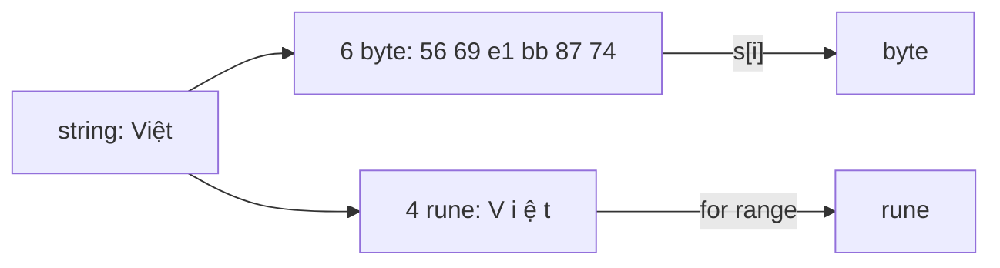

# Kiểu dữ liệu cơ bản

Go là ngôn ngữ kiểu tĩnh với một bộ kiểu cơ bản nhỏ nhưng rất tường minh: bool, các kiểu số nguyên có/không dấu với kích thước cụ thể, số thực, số phức và string. Bài này đi qua từng nhóm, chỉ ra những điểm dễ sai — `int` có kích thước phụ thuộc nền tảng, tràn số không báo lỗi, `float64` không cộng chính xác tiền tệ, và string là **dãy byte UTF-8 bất biến** chứ không phải dãy ký tự. Hiểu rõ `byte` và `rune` là điều kiện để xử lý đúng tiếng Việt.

---

:::note[Ghi nhớ nhanh]

- ⭐ **String là dãy byte bất biến, mã hoá UTF-8** — `len(s)` trả số **byte**, không phải số ký tự; `len("Việt")` là 5.
- ⭐ **`byte` = `uint8` (một byte), `rune` = `int32` (một Unicode code point)** — duyệt `for range` trên string cho ra rune, truy cập `s[i]` cho ra byte.
- **Dùng `int` cho số nguyên thông thường** — 64 bit trên hệ 64 bit; chỉ dùng `int32`, `uint8`... khi cần kích thước cố định (giao thức, file nhị phân).
- **Tràn số nguyên không panic** — giá trị quay vòng (wrap around) âm thầm.
- **Không dùng `float64` cho tiền** — dùng số nguyên đơn vị nhỏ nhất (đồng, xu) hoặc thư viện decimal.

:::

---

## Mục lục

- [Vì sao cần hiểu rõ kiểu dữ liệu?](#vì-sao-cần-hiểu-rõ-kiểu-dữ-liệu)
- [Tổng quan các kiểu cơ bản](#tổng-quan-các-kiểu-cơ-bản)
- [bool](#bool)
- [Số nguyên](#số-nguyên)
- [Tràn số](#tràn-số)
- [Số thực float32 và float64](#số-thực-float32-và-float64)
- [Số phức](#số-phức)
- [String](#string)
- [byte và rune](#byte-và-rune)
- [Raw string và interpreted string](#raw-string-và-interpreted-string)

---

## Vì sao cần hiểu rõ kiểu dữ liệu?

**Vấn đề:** Người đến từ JavaScript/Python quen với "string là dãy ký tự", nên viết code cắt chuỗi tiếng Việt kiểu này:

```go
package main

import "fmt"

func main() {
	name := "Đặng"
	fmt.Println(len(name))   // 7 — không phải 4! ("Đ" 2 byte, "ặ" 3 byte)
	fmt.Println(name[:2])    // "Đ" — 2 byte đầu chỉ là chữ Đ
	fmt.Println(name[:3])    // "Đ\xe1" — cắt ngang giữa ký tự "ặ", ra byte lỗi
}
```

Hiển thị tên khách hàng bị lỗi font, cắt chuỗi "Xem thêm..." ra ký tự rác — bug rất phổ biến ở hệ thống có dữ liệu tiếng Việt.

**Giải pháp:** hiểu string là **byte UTF-8**, khi cần thao tác theo ký tự thì chuyển sang `[]rune` hoặc dùng `for range`:

```go
package main

import (
	"fmt"
	"unicode/utf8"
)

func main() {
	name := "Đặng"
	fmt.Println(utf8.RuneCountInString(name)) // 4 ký tự

	runes := []rune(name)
	fmt.Println(string(runes[:2])) // "Đặ" — cắt theo ký tự, đúng
}
```

:::tip[Dùng thực tế]

- **Đếm ký tự cho validate form** (tên tối đa 50 ký tự) — dùng `utf8.RuneCountInString`, không dùng `len`.
- **Tiền tệ** — lưu `int64` đơn vị đồng (VND không có phần lẻ) hoặc cent; tránh `float64`.
- **ID, timestamp** — `int64` (Unix milli/nano giây), `uint64` cho ID dạng Snowflake.
- **Đọc/ghi giao thức nhị phân** — `uint8`, `uint16`, `uint32` với `encoding/binary`.

:::

:::tip[Ví dụ đời thường]

String trong Go giống **chuỗi hạt vòng tay**: mỗi hạt là một **byte**. Chữ cái Latin như "a" chỉ cần 1 hạt, nhưng chữ "ặ" phải xâu **3 hạt** liền nhau mới thành. Đếm số hạt (`len`) khác đếm số chữ (`RuneCount`). Cắt sợi dây giữa 3 hạt của chữ "ặ" thì chữ đó vỡ — đó là ký tự lỗi khi cắt string bằng chỉ số byte.

:::

---

## Tổng quan các kiểu cơ bản

| Nhóm | Kiểu | Kích thước | Zero value |
|------|------|-----------|------------|
| Logic | `bool` | 1 byte | `false` |
| Số nguyên có dấu | `int8`, `int16`, `int32`, `int64` | 1, 2, 4, 8 byte | `0` |
| Số nguyên không dấu | `uint8`, `uint16`, `uint32`, `uint64` | 1, 2, 4, 8 byte | `0` |
| Phụ thuộc nền tảng | `int`, `uint`, `uintptr` | 4 hoặc 8 byte | `0` |
| Bí danh (alias) | `byte` (= `uint8`), `rune` (= `int32`) | 1, 4 byte | `0` |
| Số thực | `float32`, `float64` | 4, 8 byte | `0` |
| Số phức | `complex64`, `complex128` | 8, 16 byte | `0` |
| Chuỗi | `string` | 16 byte header (con trỏ + độ dài, trên 64 bit) | `""` |

---

## bool

```go
var done bool          // false
isAdult := age >= 18   // kết quả so sánh là bool
canBuy := isAdult && balance > price
```

- Chỉ có `true` và `false`. **Không** chuyển ngầm từ số: `if 1 { }` là lỗi biên dịch, phải viết `if n != 0`.
- `&&` và `||` **đánh giá ngắn mạch** (short-circuit): vế phải chỉ được tính khi cần.

```go
// An toàn: nếu user == nil thì không tính user.Active
if user != nil && user.Active {
	fmt.Println("hoạt động")
}
```

---

## Số nguyên

### Có dấu và không dấu

| Kiểu | Khoảng giá trị |
|------|----------------|
| `int8` | -128 → 127 |
| `int16` | -32 768 → 32 767 |
| `int32` | khoảng ±2,1 tỷ |
| `int64` | khoảng ±9,2 × 10^18 |
| `uint8` | 0 → 255 |
| `uint16` | 0 → 65 535 |
| `uint32` | 0 → khoảng 4,29 tỷ |
| `uint64` | 0 → khoảng 1,8 × 10^19 |

Package `math` có hằng giới hạn: `math.MaxInt8`, `math.MinInt64`, `math.MaxUint32`, `math.MaxInt`...

### Kích thước theo nền tảng

`int` và `uint` có kích thước **bằng độ rộng word của kiến trúc**: 32 bit trên hệ 32 bit (vd `GOARCH=386`, `arm`), 64 bit trên hệ 64 bit (`amd64`, `arm64`). `uintptr` đủ lớn để chứa địa chỉ bộ nhớ, chỉ dùng với `unsafe`.

```go
package main

import (
	"fmt"
	"math"
	"strconv"
	"unsafe"
)

func main() {
	fmt.Println(strconv.IntSize)          // 64 trên máy 64 bit
	fmt.Println(unsafe.Sizeof(int(0)))    // 8
	fmt.Println(math.MaxInt)              // 9223372036854775807
}
```

**`int` và `int64` là hai kiểu khác nhau** dù trên máy 64 bit cùng kích thước — không gán trực tiếp cho nhau được:

```go
var a int = 10
var b int64 = 20
// c := a + b       // LỖI: mismatched types int and int64
c := int64(a) + b  // phải chuyển tường minh
```

### Viết literal số

```go
dec := 1_000_000      // dấu _ phân tách cho dễ đọc (Go 1.13+)
hex := 0xFF           // 255
oct := 0o755          // 493 — quyền file Unix (tiền tố 0o từ Go 1.13; 0755 kiểu cũ vẫn hợp lệ)
bin := 0b1010         // 10
```

### Nên chọn kiểu nào?

| Tình huống | Kiểu |
|------------|------|
| Đếm, chỉ số, độ dài, vòng lặp | `int` (len, cap, index đều là `int`) |
| ID database, timestamp, tiền | `int64` |
| Dữ liệu nhị phân, byte thô | `byte` / `[]byte` |
| Giao thức/file có định dạng cố định | `uint16`, `uint32`... đúng spec |
| Bit flag | `uint8`, `uint32`, `uint64` |

:::warning[Lỗi hay gặp]

**Dùng `uint` cho số lượng để "không bao giờ âm"** — phép trừ sẽ quay vòng thành số cực lớn:

```go
var stock uint = 2
stock -= 3
fmt.Println(stock) // 18446744073709551615 — không phải -1!
```

Go khuyên dùng `int` cho số đếm thông thường và tự kiểm tra điều kiện, chỉ dùng `uint` khi thật sự cần thao tác bit hoặc biểu diễn dữ liệu không dấu.

:::

---

## Tràn số

Phép toán số nguyên **không kiểm tra tràn** lúc chạy: kết quả quay vòng theo modulo 2^n.

```go
package main

import (
	"fmt"
	"math"
)

func main() {
	var x int8 = 127
	x++
	fmt.Println(x) // -128

	var y uint8 = 0
	y--
	fmt.Println(y) // 255

	big := math.MaxInt64
	big++
	fmt.Println(big) // -9223372036854775808
}
```

Ngược lại, **tràn hằng số lúc biên dịch thì bị bắt**:

```go
// var z int8 = 200 // LỖI: cannot use 200 (untyped int constant) as int8 value in variable declaration (overflows)
```

Khi cần phát hiện tràn (vd tính tiền, cộng số lượng lớn), kiểm tra trước phép toán hoặc dùng `math/bits`:

```go
import "math/bits"

func safeAdd(a, b uint64) (uint64, bool) {
	sum, carry := bits.Add64(a, b, 0)
	return sum, carry == 0 // carry != 0 nghĩa là tràn
}

func safeAddInt(a, b int64) (int64, bool) {
	if (b > 0 && a > math.MaxInt64-b) || (b < 0 && a < math.MinInt64-b) {
		return 0, false
	}
	return a + b, true
}
```

### Chia số nguyên

```go
fmt.Println(7 / 2)   // 3 — chia nguyên cắt phần thập phân (về phía 0)
fmt.Println(-7 / 2)  // -3
fmt.Println(-7 % 2)  // -1 — dấu của % theo số bị chia
fmt.Println(7.0 / 2) // 3.5 — hằng untyped float

var zero int
// fmt.Println(7 / zero) // panic lúc chạy: integer divide by zero
```

---

## Số thực float32 và float64

| | `float32` | `float64` |
|---|-----------|-----------|
| Kích thước | 4 byte | 8 byte |
| Độ chính xác | ~7 chữ số thập phân | ~15–16 chữ số thập phân |
| Mặc định cho literal `3.14` | | ✅ |
| Dùng khi | Đồ hoạ, ML, tiết kiệm bộ nhớ mảng lớn | Hầu hết trường hợp |

Cả hai theo chuẩn **IEEE 754**, nên có những đặc điểm:

```go
package main

import (
	"fmt"
	"math"
)

func main() {
	fmt.Println(0.1 + 0.2)            // 0.3 — hằng untyped, tính chính xác lúc biên dịch

	a, b := 0.1, 0.2
	fmt.Println(a + b)                // 0.30000000000000004 — phép cộng float64 lúc chạy
	fmt.Println(a+b == 0.3)           // false
	fmt.Println(math.Abs(a+b-0.3) < 1e-9) // true — so sánh với sai số epsilon

	var zero float64
	fmt.Println(1 / zero)             // +Inf — chia 0 với float KHÔNG panic
	fmt.Println(zero / zero)          // NaN
	nan := math.NaN()
	fmt.Println(nan == nan)           // false — NaN không bằng chính nó
	fmt.Println(math.IsNaN(nan))      // true
}
```

:::warning[Lỗi hay gặp]

- **Hằng và biến cho kết quả khác nhau**: `0.1 + 0.2` viết thẳng là hằng untyped, được tính chính xác rồi mới làm tròn → in `0.3`; còn `a + b` với hai biến `float64` thì sai số làm tròn của từng số cộng dồn → `0.30000000000000004`. Bài học: **không so sánh `==` trên float**, hãy so với sai số epsilon.
- **Tính tiền bằng `float64`** → sai lệch tích luỹ. Dùng `int64` đơn vị nhỏ nhất (`amount := int64(150000)` đồng) hoặc thư viện như `github.com/shopspring/decimal`.

:::

---

## Số phức

Go hỗ trợ số phức ngay trong ngôn ngữ — hiếm gặp trong backend, chủ yếu dùng cho tính toán khoa học, xử lý tín hiệu.

```go
package main

import (
	"fmt"
	"math/cmplx"
)

func main() {
	c := 3 + 4i                  // complex128
	fmt.Println(real(c), imag(c)) // 3 4
	fmt.Println(cmplx.Abs(c))     // 5 — độ lớn
	d := complex(1, 2)            // tạo từ phần thực, phần ảo
	fmt.Println(c * d)            // (-5+10i)
}
```

---

## String

### Bản chất: dãy byte bất biến

Một `string` gồm **con trỏ tới mảng byte** và **độ dài**. Nội dung thường là UTF-8 (mã nguồn Go bắt buộc là UTF-8), nhưng về nguyên tắc string có thể chứa byte bất kỳ.

```go
s := "Go"
// s[0] = 'g' // LỖI: cannot assign to s[0] (neither addressable nor a map index expression)

s = "go" // được: gán biến s sang string MỚI, không sửa string cũ
```

Vì bất biến nên:

- Gán, truyền string vào hàm **rẻ** — chỉ copy header (con trỏ + độ dài), không copy nội dung.
- Cắt chuỗi `s[a:b]` dùng chung mảng byte gốc, không cấp phát mới.
- Nối chuỗi `+` **luôn tạo string mới** → nối nhiều lần trong vòng lặp thì dùng `strings.Builder`.

```go
// Chậm: mỗi lần += tạo string mới, copy toàn bộ nội dung cũ → O(n²)
result := ""
for i := range 1000 {
	result += strconv.Itoa(i)
}

// Nhanh: Builder gom vào buffer, chỉ cấp phát khi cần
var sb strings.Builder
for i := range 1000 {
	sb.WriteString(strconv.Itoa(i))
}
result = sb.String()
```

### Thao tác thường dùng

```go
s := "Xin chào Gopher"
len(s)                          // 16 (byte)
s[0]                            // 88 — byte 'X'
s[4:8]                          // "chà" (cẩn thận: chỉ số byte)
strings.Contains(s, "Go")       // true
strings.ToUpper(s)              // "XIN CHÀO GOPHER"
strings.Split("a,b,c", ",")     // [a b c]
strings.Fields("  a  b ")       // [a b]
strings.TrimSpace("  hi  ")     // "hi"
strings.Repeat("ab", 3)         // "ababab"
fmt.Sprintf("%s có %d tuổi", "An", 30)
s == "Xin chào Gopher"          // so sánh nội dung bằng ==
"apple" < "banana"              // true — so sánh theo thứ tự byte
```

---

## byte và rune

| | `byte` | `rune` |
|---|--------|--------|
| Bí danh của | `uint8` | `int32` |
| Biểu diễn | 1 byte | 1 Unicode code point (mã điểm Unicode) |
| Literal | `byte('A')` | `'A'`, `'ặ'`, `'😀'` |
| Lấy từ string bằng | `s[i]` | `for _, r := range s`, `[]rune(s)` |

UTF-8 mã hoá mỗi code point bằng **1–4 byte**: ASCII 1 byte, chữ có dấu tiếng Việt 2–3 byte, emoji 4 byte.

```go
package main

import (
	"fmt"
	"unicode/utf8"
)

func main() {
	s := "Việt"

	// Duyệt theo byte
	for i := 0; i < len(s); i++ {
		fmt.Printf("%d:%x ", i, s[i])
	}
	fmt.Println() // 0:56 1:69 2:e1 3:bb 4:87 5:74 — "ệ" chiếm 3 byte

	// Duyệt theo rune: i là vị trí BYTE bắt đầu của rune
	for i, r := range s {
		fmt.Printf("%d:%c ", i, r)
	}
	fmt.Println() // 0:V 1:i 2:ệ 5:t

	fmt.Println(len(s), utf8.RuneCountInString(s)) // 6 4
	fmt.Println(len([]rune(s)))                    // 4
}
```



### Xử lý byte không hợp lệ

```go
bad := string([]byte{0xff, 'a'})
for _, r := range bad {
	fmt.Printf("%U ", r) // U+FFFD U+0061 — byte lỗi thành ký tự thay thế
}
fmt.Println(utf8.ValidString(bad)) // false
```

:::warning[Lỗi hay gặp]

- **Đảo ngược chuỗi theo byte** làm vỡ ký tự có dấu → chuyển sang `[]rune`, đảo, rồi `string(...)`.
- **Ngay cả rune cũng chưa chắc là "ký tự nhìn thấy"**: "ệ" có thể được biểu diễn dạng tổ hợp `e` + dấu mũ + dấu nặng (3 rune) nếu dữ liệu chưa chuẩn hoá Unicode (NFC/NFD). Dữ liệu tiếng Việt nhập từ nhiều nguồn nên chuẩn hoá bằng `golang.org/x/text/unicode/norm` trước khi so sánh.

:::

---

## Raw string và interpreted string

Go có hai cách viết string literal:

| | Interpreted string `"..."` | Raw string `` `...` `` |
|---|----------------------------|------------------------|
| Escape sequence (`\n`, `\t`, `\"`, `\u1EC7`) | ✅ được xử lý | ❌ giữ nguyên ký tự |
| Viết nhiều dòng | ❌ (phải dùng `\n`) | ✅ |
| Chứa dấu backtick | ✅ | ❌ |
| Dùng cho | Chuỗi thông thường | Regex, JSON mẫu, SQL, đường dẫn Windows, template |

```go
package main

import (
	"fmt"
	"regexp"
)

func main() {
	a := "Dòng 1\nDòng 2\tTab \"trích dẫn\" \u1EC7"
	fmt.Println(a)
	// Dòng 1
	// Dòng 2	Tab "trích dẫn" ệ

	b := `Dòng 1\nvẫn dòng 1`
	fmt.Println(b) // Dòng 1\nvẫn dòng 1 — \n không được xử lý

	// Regex: raw string tránh phải escape gấp đôi
	phone := regexp.MustCompile(`^0\d{9}$`)        // thay vì "^0\\d{9}$"
	fmt.Println(phone.MatchString("0912345678"))   // true

	query := `
		SELECT id, name
		FROM users
		WHERE status = $1
	`
	fmt.Println(query)

	path := `C:\Users\lan\data.txt` // không cần \\
	fmt.Println(path)
}
```

:::tip[Dùng thực tế]

Struct tag (thẻ metadata gắn vào field) luôn viết bằng raw string vì chứa dấu nháy kép:

```go
type User struct {
	ID    int64  `json:"id" db:"id"`
	Email string `json:"email" validate:"required,email"`
}
```

:::
