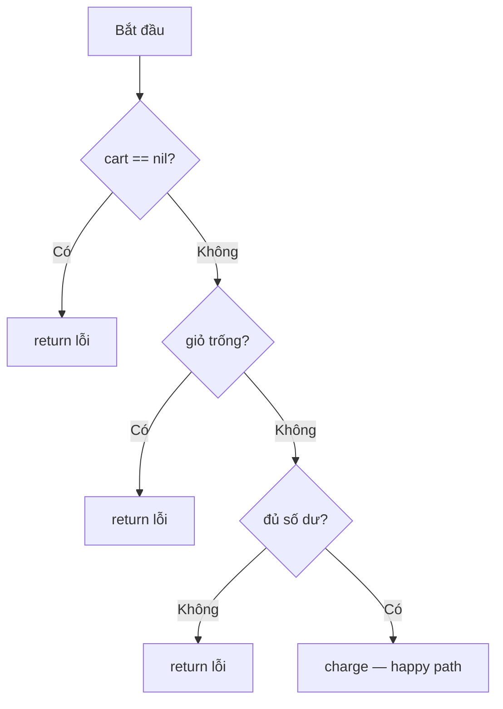

# Câu lệnh điều kiện

Go chỉ có hai câu lệnh rẽ nhánh: `if` và `switch` — không có toán tử 3 ngôi `a ? b : c`. Nhưng cả hai đều có những điểm khác với C/Java khiến code gọn hơn: `if` có **câu lệnh khởi tạo** để giới hạn scope biến, `switch` **không cần `break`**, một `case` nhận nhiều giá trị, và `switch` không biểu thức thay được chuỗi `if-else if` dài. Bài này cũng nói về phong cách "return sớm" (early return) mà mọi code Go đều theo.

---

:::note[Ghi nhớ nhanh]

- ⭐ **`if v, err := f(); err != nil { ... }`** — câu lệnh khởi tạo giới hạn `v`, `err` trong khối `if/else`; pattern xử lý lỗi dùng hằng ngày.
- ⭐ **`switch` tự dừng sau mỗi `case`** — không cần `break`; muốn rơi xuống case sau phải viết `fallthrough` tường minh.
- **Điều kiện phải là `bool`** — không có "truthy/falsy": `if n` hay `if ptr` là lỗi biên dịch.
- **`switch` không biểu thức = `switch true`** — thay chuỗi `if-else if` dài, mỗi `case` là một điều kiện.
- **Ưu tiên return sớm, tránh `else` lồng nhau** — đường đi "thành công" nằm thẳng ở lề trái.

:::

---

## Mục lục

- [Vì sao cần hiểu if và switch của Go?](#vì-sao-cần-hiểu-if-và-switch-của-go)
- [Câu lệnh if](#câu-lệnh-if)
- [If với câu lệnh khởi tạo](#if-với-câu-lệnh-khởi-tạo)
- [If-else và phong cách return sớm](#if-else-và-phong-cách-return-sớm)
- [Câu lệnh switch](#câu-lệnh-switch)
- [Nhiều giá trị trong một case](#nhiều-giá-trị-trong-một-case)
- [Switch không biểu thức](#switch-không-biểu-thức)
- [fallthrough](#fallthrough)
- [break trong switch](#break-trong-switch)
- [Câu hỏi phỏng vấn](#câu-hỏi-phỏng-vấn)

---

## Vì sao cần hiểu if và switch của Go?

**Vấn đề:** Ở C/Java, `switch` quên `break` là bug kinh điển — code "rơi" xuống case tiếp theo:

```java
switch (role) {
    case "admin":
        grantAll();
        // quên break → chạy tiếp grantRead() của case "viewer"
    case "viewer":
        grantRead();
        break;
}
```

Còn ở JavaScript/Python, điều kiện "truthy" khiến số 0 hay chuỗi rỗng bị xử lý như `false` ngoài ý muốn:

```javascript
const quantity = 0;
if (quantity) {           // 0 là falsy → bỏ qua, dù 0 là số lượng hợp lệ
  updateStock(quantity);
}
```

**Giải pháp:** Go loại bỏ cả hai nguồn bug — `switch` mặc định không rơi, điều kiện bắt buộc là `bool`:

```go
package main

import "fmt"

func permissions(role string) []string {
	switch role {
	case "admin":
		return []string{"read", "write", "delete"} // tự dừng, không rơi xuống
	case "editor":
		return []string{"read", "write"}
	case "viewer":
		return []string{"read"}
	default:
		return nil
	}
}

func main() {
	quantity := 0
	if quantity >= 0 { // phải viết điều kiện rõ ràng
		fmt.Println("cập nhật kho:", quantity)
	}
	fmt.Println(permissions("editor")) // [read write]
}
```

:::tip[Dùng thực tế]

- **Xử lý lỗi** — `if err := svc.Save(ctx, order); err != nil { return err }` xuất hiện ở hầu hết hàm.
- **Kiểm tra map** — `if v, ok := cache[key]; ok { return v }`.
- **Định tuyến theo method/lệnh** — `switch r.Method { case http.MethodGet: ... }`, `switch os.Args[1] { case "serve": ... }`.
- **Phân loại theo khoảng** — tính phí ship theo cân nặng, xếp loại học lực bằng `switch` không biểu thức.

:::

:::tip[Ví dụ đời thường]

`switch` của Go giống **thang máy toà nhà văn phòng**: bấm tầng 5 thì thang dừng đúng tầng 5 và mở cửa — không tự động dừng thêm tầng 6, 7 (không fallthrough). Còn `switch` của C giống **thang máy bị lỗi**: bấm tầng 5 xong cứ thế dừng ở mọi tầng phía sau cho tới khi gặp ai bấm "dừng" (`break`).

:::

---

## Câu lệnh if

```go
if score >= 50 {
	fmt.Println("Đạt")
}
```

Điểm khác C/Java:

- **Không có ngoặc tròn** quanh điều kiện (viết thì `gofmt` sẽ bỏ đi).
- **Ngoặc nhọn bắt buộc**, kể cả khi chỉ có một câu lệnh.
- `{` phải **cùng dòng** với `if`; `else` phải **cùng dòng** với `}` đóng của khối trước.
- Điều kiện **phải là kiểu `bool`**.

```go
n := 5
// if n { }            // LỖI: non-boolean condition in if statement
if n != 0 { }          // đúng

var p *User
// if p { }            // LỖI
if p != nil { }        // đúng

// if score >= 50
//     fmt.Println("Đạt")   // LỖI: thiếu ngoặc nhọn

// }
// else {               // LỖI: else phải cùng dòng với }
```

---

## If với câu lệnh khởi tạo

Cú pháp: `if <câu lệnh ngắn>; <điều kiện> { ... }`. Biến khai báo trong câu lệnh ngắn chỉ sống trong `if` và các nhánh `else if`/`else` của nó.

```go
package main

import (
	"fmt"
	"os"
	"strconv"
)

func main() {
	// Kiểm tra lỗi: err chỉ tồn tại trong khối if
	if err := os.Setenv("APP_ENV", "dev"); err != nil {
		fmt.Println("lỗi:", err)
		return
	}

	// Tra map với comma-ok idiom
	prices := map[string]int{"phở": 45000, "bún chả": 40000}
	if price, ok := prices["phở"]; ok {
		fmt.Println("giá phở:", price)
	} else {
		fmt.Println("không có món này")
	}

	// Parse + kiểm tra phạm vi; n vẫn dùng được trong else
	if n, err := strconv.Atoi("150"); err != nil {
		fmt.Println("không phải số:", err)
	} else if n > 100 {
		fmt.Println("quá lớn:", n)
	} else {
		fmt.Println("hợp lệ:", n)
	}
	// fmt.Println(n) // LỖI: undefined: n
}
```

Lợi ích: biến tạm **không rò rỉ** ra phần còn lại của hàm, tránh dùng nhầm và tránh xung đột tên `err` giữa các bước.

:::warning[Lỗi hay gặp]

Dùng câu lệnh khởi tạo cho giá trị **cần dùng sau `if`** → phải khai báo lại hoặc code lồng sâu:

```go
// Không tốt: user chỉ dùng được bên trong else
if user, err := repo.Find(id); err != nil {
	return err
} else {
	process(user) // logic chính bị đẩy vào trong else
}

// Tốt: khai báo bên ngoài khi kết quả cần dùng tiếp
user, err := repo.Find(id)
if err != nil {
	return err
}
process(user)
```

Quy tắc ngón tay cái: dùng `if x := ...; cond` khi `x` **chỉ** cần trong khối `if`, điển hình là `err` của hàm chỉ trả về `error`.

:::

---

## If-else và phong cách return sớm

```go
if score >= 85 {
	grade = "Giỏi"
} else if score >= 70 {
	grade = "Khá"
} else if score >= 50 {
	grade = "Trung bình"
} else {
	grade = "Yếu"
}
```

Go **không có toán tử 3 ngôi**. Thay vì `x := cond ? a : b`, viết:

```go
status := "inactive"
if user.Active {
	status = "active"
}
```

### Return sớm (early return / guard clause)

Code Go idiomatic giữ **đường đi thành công (happy path) ở lề trái**, xử lý lỗi và trường hợp đặc biệt bằng `return` sớm:

```go
// Không idiomatic: lồng nhau, khó đọc
func checkout(cart *Cart, user *User) error {
	if cart != nil {
		if len(cart.Items) > 0 {
			if user.Balance >= cart.Total() {
				return charge(user, cart)
			} else {
				return errors.New("không đủ số dư")
			}
		} else {
			return errors.New("giỏ hàng trống")
		}
	} else {
		return errors.New("giỏ hàng nil")
	}
}

// Idiomatic: guard clause, mỗi điều kiện xử lý xong là return
func checkout(cart *Cart, user *User) error {
	if cart == nil {
		return errors.New("giỏ hàng nil")
	}
	if len(cart.Items) == 0 {
		return errors.New("giỏ hàng trống")
	}
	if user.Balance < cart.Total() {
		return errors.New("không đủ số dư")
	}
	return charge(user, cart)
}
```

Linter như `revive` và `golangci-lint` có quy tắc **indent-error-flow** báo khi `if` kết thúc bằng `return` mà vẫn có `else` — vì `else` thừa.



---

## Câu lệnh switch

```go
switch day {
case "Thứ Bảy", "Chủ Nhật":
	fmt.Println("Cuối tuần")
case "Thứ Hai":
	fmt.Println("Đầu tuần")
default:
	fmt.Println("Ngày thường")
}
```

Đặc điểm của `switch` trong Go:

| Đặc điểm | Go | C/Java (cổ điển) |
|----------|----|------------------|
| Tự dừng sau mỗi case | ✅ | ❌ cần `break` |
| Rơi xuống case sau | Chỉ khi viết `fallthrough` | Mặc định |
| Giá trị case | Biểu thức bất kỳ (không cần là hằng) | Hằng số |
| Nhiều giá trị một case | `case 1, 2, 3:` | Xếp nhiều nhãn `case` liên tiếp |
| Kiểu so sánh | Mọi kiểu so sánh được (string, struct...) | Hạn chế (Java 7+ có String) |
| Không có biểu thức | ✅ `switch { ... }` | ❌ |
| Câu lệnh khởi tạo | ✅ `switch x := f(); x { }` | ❌ |

Các `case` được **đánh giá từ trên xuống, từ trái sang phải**, dừng ở case khớp đầu tiên. `default` có thể đặt ở bất kỳ vị trí nào và chỉ chạy khi không case nào khớp.

### Switch với câu lệnh khởi tạo

```go
package main

import (
	"fmt"
	"runtime"
)

func main() {
	switch os := runtime.GOOS; os {
	case "darwin":
		fmt.Println("macOS")
	case "linux":
		fmt.Println("Linux")
	case "windows":
		fmt.Println("Windows")
	default:
		fmt.Printf("%s\n", os)
	}
}
```

### Case là biểu thức, không cần hằng

```go
func classify(n, threshold int) string {
	switch n {
	case 0:
		return "không"
	case threshold:            // biến cũng được
		return "đúng ngưỡng"
	case threshold * 2:
		return "gấp đôi ngưỡng"
	}
	return "khác"
}
```

:::warning[Lỗi hay gặp]

**Trùng giá trị hằng** trong các case là lỗi biên dịch (`duplicate case "a" (constant of type string) in expression switch`). Nhưng nếu case là **biến**, Go không phát hiện trùng — case đứng trước luôn thắng, case sau không bao giờ chạy.

:::

---

## Nhiều giá trị trong một case

```go
package main

import "fmt"

func shippingZone(province string) string {
	switch province {
	case "Hà Nội", "Bắc Ninh", "Hải Phòng", "Hưng Yên":
		return "Miền Bắc — nội vùng"
	case "TP.HCM", "Bình Dương", "Đồng Nai":
		return "Miền Nam — nội vùng"
	case "Đà Nẵng", "Huế", "Quảng Nam":
		return "Miền Trung"
	default:
		return "Liên vùng"
	}
}

func isVowel(r rune) bool {
	switch r {
	case 'a', 'e', 'i', 'o', 'u', 'A', 'E', 'I', 'O', 'U':
		return true
	}
	return false
}

func main() {
	fmt.Println(shippingZone("Hải Phòng")) // Miền Bắc — nội vùng
	fmt.Println(isVowel('e'))              // true
}
```

---

## Switch không biểu thức

`switch` không có biểu thức tương đương `switch true`: mỗi `case` là một **điều kiện `bool`**, case đầu tiên đúng sẽ chạy. Đây là cách idiomatic thay cho chuỗi `if-else if` dài.

```go
package main

import "fmt"

func shippingFee(weightKg float64) int {
	switch {
	case weightKg <= 0:
		return 0
	case weightKg <= 1:
		return 20000
	case weightKg <= 5:
		return 35000
	case weightKg <= 20:
		return 60000
	default:
		return 60000 + int(weightKg-20)*3000
	}
}

func main() {
	for _, w := range []float64{0.5, 3, 25} {
		fmt.Printf("%.1f kg → %d đ\n", w, shippingFee(w))
	}
	// 0.5 kg → 20000 đ
	// 3.0 kg → 35000 đ
	// 25.0 kg → 75000 đ
}
```

Thứ tự case quan trọng: kiểm tra `weightKg <= 1` trước `weightKg <= 5`, nếu đảo ngược thì gói 0,5 kg sẽ rơi vào nhóm 5 kg.

:::tip[Dùng thực tế]

Ngoài switch giá trị và switch không biểu thức, Go còn có **type switch** — `switch v := x.(type) { case string: ... case int: ... }` — để rẽ nhánh theo kiểu động của interface. Phần này sẽ học kỹ ở nhóm Method và Interface.

:::

---

## fallthrough

`fallthrough` buộc chạy **thân của case kế tiếp** mà **không kiểm tra điều kiện** của case đó.

```go
package main

import "fmt"

func main() {
	level := 2
	switch level {
	case 3:
		fmt.Println("quyền xoá")
		fallthrough
	case 2:
		fmt.Println("quyền sửa")
		fallthrough
	case 1:
		fmt.Println("quyền xem")
	default:
		fmt.Println("không có quyền")
	}
	// level = 2 in ra:
	// quyền sửa
	// quyền xem
}
```

Quy tắc:

- `fallthrough` phải là **câu lệnh cuối cùng** trong case.
- **Không dùng được** ở case cuối cùng của `switch`, và **không dùng** trong type switch.
- Nó **bỏ qua** điều kiện của case kế tiếp — dễ gây hiểu nhầm.

:::warning[Lỗi hay gặp]

Nghĩ rằng `fallthrough` sẽ "kiểm tra tiếp case sau":

```go
x := 5
switch {
case x > 3:
	fmt.Println("lớn hơn 3")
	fallthrough
case x > 100:
	fmt.Println("lớn hơn 100") // VẪN in ra dù x = 5!
}
```

Trong thực tế, `fallthrough` hiếm khi cần. Code dễ đọc hơn nếu dùng nhiều giá trị trong một case hoặc tách logic thành hàm.

:::

---

## break trong switch

Vì `switch` tự dừng, `break` trong `switch` chỉ dùng để **thoát sớm khỏi case**. Cần chú ý: `break` trong `switch` nằm trong vòng lặp chỉ thoát **switch**, không thoát vòng lặp.

```go
package main

import "fmt"

func main() {
	commands := []string{"start", "ping", "quit", "ping"}

loop: // nhãn (label) gắn cho vòng for
	for _, cmd := range commands {
		switch cmd {
		case "quit":
			fmt.Println("thoát")
			break loop // thoát cả vòng for; chỉ "break" thì chỉ thoát switch
		case "ping":
			fmt.Println("pong")
		default:
			fmt.Println("lệnh:", cmd)
		}
	}
	// lệnh: start
	// pong
	// thoát
}
```

Cũng có thể tránh nhãn bằng cách tách thân vòng lặp thành hàm và dùng `return`. Chi tiết về nhãn có ở bài vòng lặp.

---

## Câu hỏi phỏng vấn

**1. Câu lệnh khởi tạo trong `if` có tác dụng gì? Cho ví dụ.**

<details className="qa">
<summary>Xem đáp án</summary>

`if init; cond { }` cho phép khai báo biến chỉ sống trong khối `if` và các nhánh `else if`/`else`. Lợi ích: giới hạn scope, tránh biến tạm rò rỉ và xung đột tên (nhất là `err`). Ví dụ: `if err := db.Ping(); err != nil { return err }` hoặc `if v, ok := m[k]; ok { use(v) }`. Không nên dùng khi giá trị cần dùng tiếp sau `if` — khi đó khai báo bên ngoài để tránh dồn logic vào `else`.

</details>

**2. `switch` trong Go khác C/Java thế nào?**

<details className="qa">
<summary>Xem đáp án</summary>

Go tự `break` sau mỗi case (muốn rơi xuống phải dùng `fallthrough`); case có thể là biểu thức bất kỳ, không cần hằng; một case nhận nhiều giá trị phân tách bằng dấu phẩy; có câu lệnh khởi tạo; có dạng không biểu thức (`switch { case cond: }`) thay cho `if-else` dài; có type switch để rẽ nhánh theo kiểu. So sánh được với mọi kiểu comparable (string, struct...).

</details>

**3. `fallthrough` hoạt động thế nào? Có kiểm tra điều kiện của case kế tiếp không?**

<details className="qa">
<summary>Xem đáp án</summary>

`fallthrough` chuyển điều khiển sang **thân** của case kế tiếp **mà không đánh giá điều kiện** của case đó. Nó phải là câu lệnh cuối trong case, không dùng ở case cuối cùng và không dùng trong type switch. Vì dễ gây hiểu nhầm nên ít được dùng; thường thay bằng nhiều giá trị trong một case hoặc tách hàm.

</details>

**4. Trong vòng `for` có `switch`, `break` thoát khỏi đâu? Làm sao thoát cả vòng lặp?**

<details className="qa">
<summary>Xem đáp án</summary>

`break` thoát khỏi câu lệnh `for`, `switch` hoặc `select` **trong cùng nhất** — tức chỉ thoát `switch`, vòng lặp vẫn chạy tiếp. Muốn thoát vòng lặp: gắn nhãn cho `for` và dùng `break label`, hoặc tách thân vòng lặp vào hàm và `return`, hoặc dùng biến cờ. Lỗi này rất hay gặp với `select` trong vòng lặp đọc channel.

</details>

**5. Go không có toán tử 3 ngôi — vì sao? Viết thay thế thế nào?**

<details className="qa">
<summary>Xem đáp án</summary>

FAQ của Go giải thích: toán tử 3 ngôi hay bị lạm dụng tạo ra biểu thức lồng nhau khó đọc; `if-else` dài hơn một chút nhưng rõ ràng hơn, và ngôn ngữ chỉ cần **một** cấu trúc rẽ nhánh. Thay thế: gán giá trị mặc định rồi `if` ghi đè (`s := "b"; if cond { s = "a" }`), hoặc viết hàm nhỏ. Từ Go 1.18 có thể viết hàm generic `func If[T any](c bool, a, b T) T`, nhưng lưu ý cả `a` và `b` đều được tính trước khi gọi (không short-circuit).

</details>

**6. Phong cách "return sớm" là gì và vì sao code Go ưa chuộng?**

<details className="qa">
<summary>Xem đáp án</summary>

Xử lý lỗi và trường hợp đặc biệt ở đầu hàm bằng `if ... { return }`, để luồng chính (happy path) chạy thẳng ở mức thụt lề ngoài cùng, không bị bọc trong `else`. Vì Go xử lý lỗi bằng giá trị trả về, nếu không return sớm thì code sẽ lồng sâu theo số bước có thể lỗi. Return sớm giúp đọc từ trên xuống thấy ngay mọi điều kiện thoát, và linter (indent-error-flow) khuyến khích phong cách này.

</details>
