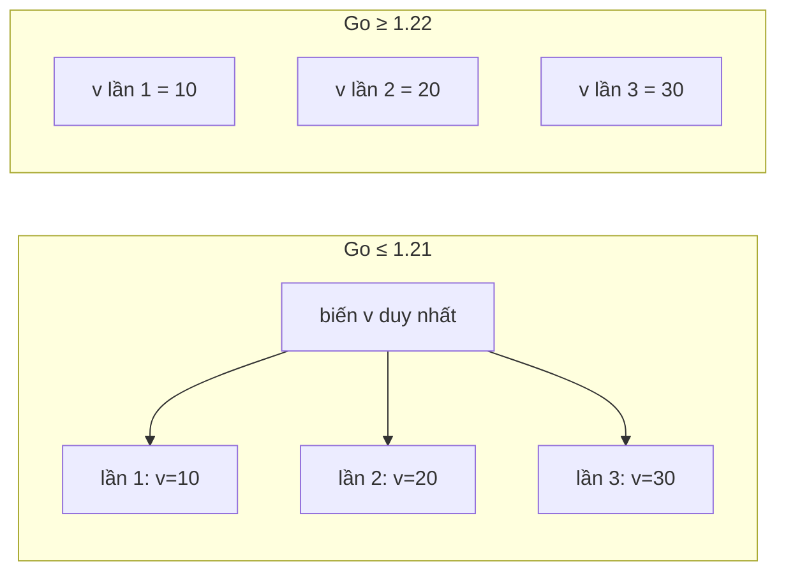

# Vòng lặp

Go chỉ có **một** từ khoá vòng lặp: `for`. Không có `while`, `do-while`, `foreach` — tất cả đều viết bằng `for` ở các dạng khác nhau. Bài này đi qua ba dạng `for`, `for range` trên slice, map, string, channel, số nguyên (Go 1.22) và hàm iterator (Go 1.23), thứ tự duyệt map ngẫu nhiên, thay đổi quan trọng về **biến vòng lặp per-iteration** từ Go 1.22, cùng `break`/`continue` với nhãn và `goto`.

---

:::note[Ghi nhớ nhanh]

- ⭐ **Từ Go 1.22, mỗi lần lặp có biến mới** — closure/goroutine bắt giữ `i`, `v` thấy đúng giá trị của lần lặp đó; trước 1.22 tất cả dùng chung một biến.
- ⭐ **Thứ tự duyệt map là ngẫu nhiên** — cần thứ tự ổn định thì lấy key ra, sort (`slices.Sorted(maps.Keys(m))`) rồi duyệt.
- **`for` có 3 dạng** — đầy đủ `for init; cond; post`, chỉ điều kiện (thay `while`), vô hạn `for { }`.
- **`for i, v := range s` copy phần tử vào `v`** — sửa `v` không đổi slice; muốn sửa phải dùng `s[i]`.
- **`break`/`continue` có nhãn** để thoát/nhảy vòng ngoài khi lồng nhau hoặc khi có `switch`/`select` bên trong.

:::

---

## Mục lục

- [Vì sao Go chỉ có một vòng lặp?](#vì-sao-go-chỉ-có-một-vòng-lặp)
- [Ba dạng của for](#ba-dạng-của-for)
- [for range](#for-range)
- [Range trên slice và array](#range-trên-slice-và-array)
- [Range trên map](#range-trên-map)
- [Range trên string](#range-trên-string)
- [Range trên channel](#range-trên-channel)
- [Range trên số nguyên và hàm](#range-trên-số-nguyên-và-hàm)
- [Biến vòng lặp per-iteration từ Go 1.22](#biến-vòng-lặp-per-iteration-từ-go-122)
- [break, continue và label](#break-continue-và-label)
- [goto](#goto)
- [Câu hỏi phỏng vấn](#câu-hỏi-phỏng-vấn)

---

## Vì sao Go chỉ có một vòng lặp?

**Vấn đề:** Nhiều ngôn ngữ có 4–5 loại vòng lặp làm gần như cùng một việc, mỗi người dùng một kiểu:

```java
// Java: 4 cách lặp qua danh sách
for (int i = 0; i < list.size(); i++) { ... }
for (String s : list) { ... }
while (it.hasNext()) { ... }
do { ... } while (cond);
list.forEach(s -> { ... });
```

**Giải pháp:** Go dùng một từ khoá `for` cho mọi trường hợp, khác nhau ở phần đầu vòng lặp:

```go
package main

import "fmt"

func main() {
	// Kiểu C
	for i := 0; i < 3; i++ {
		fmt.Print(i, " ")
	}
	fmt.Println()

	// Kiểu while
	n := 1
	for n < 100 {
		n *= 2
	}
	fmt.Println(n) // 128

	// Kiểu foreach
	for i, fruit := range []string{"cam", "xoài", "ổi"} {
		fmt.Println(i, fruit)
	}

	// Đếm số lần (Go 1.22+)
	for i := range 3 {
		fmt.Print(i, " ") // 0 1 2
	}
	fmt.Println()
}
```

:::tip[Dùng thực tế]

- **Duyệt dữ liệu** — `for _, order := range orders` để tính tổng, lọc, chuyển đổi.
- **Retry có giới hạn** — `for attempt := range maxRetry { if err = call(); err == nil { break } }`.
- **Worker đọc hàng đợi** — `for job := range jobs { process(job) }` tự dừng khi channel đóng.
- **Vòng lặp sự kiện của server** — `for { select { case msg := <-in: ...; case <-ctx.Done(): return } }`.

:::

:::tip[Ví dụ đời thường]

Một từ khoá `for` cho mọi kiểu lặp giống **chìa khoá vạn năng của bác bảo vệ chung cư**: thay vì đeo cả chùm chìa (while, do-while, foreach...), bác chỉ cần một chìa, cắm vào ổ nào thì xoay kiểu đó — vẫn mở được mọi cửa, mà người mới đến trực thay ca không phải học thuộc chìa nào mở cửa nào.

:::

---

## Ba dạng của for

### 1. Dạng đầy đủ: init; condition; post

```go
for i := 0; i < 5; i++ {
	fmt.Println(i)
}

// Nhiều biến: dùng phép gán song song (Go không có toán tử phẩy như C)
for i, j := 0, 10; i < j; i, j = i+1, j-1 {
	fmt.Println(i, j)
}
```

- `init` chạy một lần trước vòng lặp; biến khai báo ở đây chỉ sống trong vòng lặp.
- `condition` kiểm tra trước mỗi lần lặp.
- `post` chạy sau mỗi lần lặp; `i++` trong Go là **câu lệnh**, không phải biểu thức (không viết được `x = i++` hay `++i`).
- Cả ba phần đều có thể bỏ trống: `for ; i < 5; { }` (gofmt sẽ rút gọn thành `for i < 5 { }`).

### 2. Chỉ có điều kiện (thay cho while)

```go
balance := 1_000_000
months := 0
for balance < 2_000_000 {
	balance += balance * 8 / 100 // lãi 8% mỗi kỳ (chia nguyên cho gọn ví dụ)
	months++
}
fmt.Println(months) // 10
```

Muốn kiểu `do-while` (chạy ít nhất một lần):

```go
for {
	input := readInput()
	if isValid(input) {
		break
	}
	fmt.Println("nhập lại")
}
```

### 3. Vòng lặp vô hạn

```go
for {
	conn, err := listener.Accept()
	if err != nil {
		log.Println("accept:", err)
		continue
	}
	go handle(conn) // mỗi kết nối một goroutine
}
```

Thoát bằng `break`, `return`, `os.Exit`, hoặc `panic`.

---

## for range

`range` duyệt qua phần tử của một tập hợp. Giá trị trả về tuỳ kiểu:

| Kiểu | Giá trị thứ 1 | Giá trị thứ 2 |
|------|---------------|---------------|
| Slice, array, con trỏ tới array | Chỉ số `int` | Bản sao phần tử |
| String | Vị trí **byte** bắt đầu | `rune` (đã giải mã UTF-8) |
| Map | Key | Value (bản sao) |
| Channel | Phần tử nhận được | — (không có) |
| Số nguyên `n` (Go 1.22+) | `0` đến `n-1` | — |
| Hàm iterator (Go 1.23+) | Theo kiểu `iter.Seq`/`iter.Seq2` | Theo kiểu iterator |

Có thể bỏ bớt giá trị:

```go
for i := range s { }       // chỉ lấy chỉ số
for _, v := range s { }    // chỉ lấy giá trị
for range s { }            // chỉ lặp len(s) lần
```

---

## Range trên slice và array

```go
package main

import "fmt"

type Product struct {
	Name  string
	Price int
}

func main() {
	products := []Product{{"Áo", 200000}, {"Quần", 350000}}

	// v là BẢN SAO — sửa v không ảnh hưởng slice
	for _, p := range products {
		p.Price = 0
	}
	fmt.Println(products) // [{Áo 200000} {Quần 350000}] — không đổi

	// Sửa qua chỉ số
	for i := range products {
		products[i].Price = products[i].Price * 90 / 100 // giảm 10%
	}
	fmt.Println(products) // [{Áo 180000} {Quần 315000}]
}
```

### Biểu thức range chỉ được tính một lần

`range` đánh giá biểu thức **một lần trước khi bắt đầu**; độ dài slice được "chốt" lúc đó:

```go
nums := []int{1, 2, 3}
for _, n := range nums {
	nums = append(nums, n*10) // không gây lặp vô hạn
}
fmt.Println(nums) // [1 2 3 10 20 30]
```

:::warning[Lỗi hay gặp]

- **Copy struct lớn mỗi lần lặp** — `for _, v := range bigStructs` copy toàn bộ struct; với struct lớn trong vòng lặp nóng, dùng `for i := range bigStructs` và truy cập `bigStructs[i]` (hoặc lấy `p := &bigStructs[i]`).
- **Range trên array (không phải slice) copy cả array** trước khi lặp: `for _, v := range arr` với `arr [1_000_000]int`. Dùng `range &arr` hoặc `range arr[:]` để tránh.

:::

---

## Range trên map

```go
package main

import (
	"fmt"
	"maps"
	"slices"
)

func main() {
	stock := map[string]int{"táo": 10, "lê": 5, "cam": 8, "nho": 0}

	// Thứ tự KHÔNG xác định — mỗi lần chạy có thể khác
	for name, qty := range stock {
		fmt.Println(name, qty)
	}

	// Cần thứ tự ổn định: lấy key, sắp xếp, rồi duyệt (Go 1.23+)
	for _, name := range slices.Sorted(maps.Keys(stock)) {
		fmt.Println(name, stock[name])
	}
	// cam 8
	// lê 5
	// nho 0
	// táo 10
}
```

**Vì sao thứ tự ngẫu nhiên?** Đặc tả Go không quy định thứ tự duyệt map, và runtime **cố ý xáo trộn** điểm bắt đầu để lập trình viên không vô tình phụ thuộc vào một thứ tự cài đặt cụ thể (thứ tự có thể đổi khi map giãn hoặc khi đổi phiên bản Go).

Với Go trước 1.21/1.23, cách lấy key đã sắp xếp:

```go
keys := make([]string, 0, len(stock))
for k := range stock {
	keys = append(keys, k)
}
sort.Strings(keys) // hoặc slices.Sort(keys) từ Go 1.21
```

### Sửa map trong khi duyệt

```go
// Xoá phần tử trong lúc duyệt: AN TOÀN, phần tử đã xoá sẽ không được duyệt tới
for name, qty := range stock {
	if qty == 0 {
		delete(stock, name)
	}
}

// Thêm phần tử trong lúc duyệt: hợp lệ nhưng phần tử mới CÓ THỂ được duyệt hoặc không
```

Go 1.21 có thêm `maps.DeleteFunc(stock, func(k string, v int) bool { return v == 0 })` cho trường hợp này.

:::warning[Lỗi hay gặp]

- **Viết test so sánh output của vòng lặp map** → test lúc pass lúc fail (flaky). Sắp xếp key trước khi so sánh, hoặc so sánh map bằng `maps.Equal`.
- **Duyệt map khi goroutine khác đang ghi** → runtime phát hiện và dừng chương trình với `fatal error: concurrent map iteration and map write`. Dùng `sync.RWMutex` hoặc `sync.Map`.

:::

---

## Range trên string

`range` trên string **giải mã UTF-8**: mỗi lần lặp trả một `rune` và vị trí **byte** bắt đầu của nó.

```go
package main

import "fmt"

func main() {
	for i, r := range "Hà Nội" {
		fmt.Printf("%d:%c ", i, r)
	}
	fmt.Println()
	// 0:H 1:à 3:  4:N 5:ộ 8:i — chỉ số nhảy cóc vì "à" 2 byte, "ộ" 3 byte

	// Duyệt theo byte thì dùng chỉ số
	s := "Hà"
	for i := 0; i < len(s); i++ {
		fmt.Printf("%x ", s[i]) // 48 c3 a0
	}
	fmt.Println()
}
```

Byte không hợp lệ UTF-8 được trả về dưới dạng rune `U+FFFD` (ký tự thay thế), mỗi lần tiến 1 byte.

---

## Range trên channel

`range` trên channel nhận từng giá trị cho tới khi channel **được đóng và đã rỗng**:

```go
package main

import "fmt"

func produce(n int) <-chan int {
	ch := make(chan int)
	go func() {
		defer close(ch) // BẮT BUỘC đóng, nếu không vòng range chờ mãi
		for i := range n {
			ch <- i * i
		}
	}()
	return ch
}

func main() {
	for v := range produce(4) {
		fmt.Println(v) // 0 1 4 9
	}
	fmt.Println("xong")
}
```

:::warning[Lỗi hay gặp]

Quên `close(ch)` ở phía gửi → vòng `for range` bên nhận chờ mãi. Nếu mọi goroutine đều bị chặn, runtime báo `fatal error: all goroutines are asleep - deadlock!`; nếu còn goroutine khác chạy (như server), goroutine đó **rò rỉ** (goroutine leak) âm thầm. Quy tắc: **bên gửi chịu trách nhiệm đóng channel**.

:::

---

## Range trên số nguyên và hàm

### Range trên số nguyên (Go 1.22)

```go
for i := range 5 {
	fmt.Print(i, " ") // 0 1 2 3 4
}

for range 3 {
	fmt.Println("lặp lại") // in 3 lần, không cần biến
}

var n int64 = 3
for i := range n { // i có kiểu int64 theo kiểu của n
	fmt.Printf("%T ", i) // int64
}
```

Nếu `n <= 0` thì vòng lặp không chạy lần nào. Cần module khai báo `go 1.22` trở lên trong `go.mod`.

### Range trên hàm iterator (Go 1.23)

Từ Go 1.23, `range` chấp nhận hàm có dạng `func(yield func(K, V) bool)` (kiểu `iter.Seq2[K, V]`), `func(yield func(V) bool)` (`iter.Seq[V]`), hoặc `func(yield func() bool)`:

```go
package main

import (
	"fmt"
	"iter"
	"maps"
	"slices"
	"strings"
)

// Fibonacci sinh dãy Fibonacci không giới hạn — người dùng tự break
func Fibonacci() iter.Seq[int] {
	return func(yield func(int) bool) {
		a, b := 0, 1
		for {
			if !yield(a) { // yield trả false khi vòng range bị break
				return
			}
			a, b = b, a+b
		}
	}
}

func main() {
	for n := range Fibonacci() {
		if n > 50 {
			break
		}
		fmt.Print(n, " ") // 0 1 1 2 3 5 8 13 21 34
	}
	fmt.Println()

	// Thư viện chuẩn trả iterator ở nhiều nơi
	for i, v := range slices.Backward([]string{"a", "b", "c"}) {
		fmt.Print(i, v, " ") // 2c 1b 0a
	}
	fmt.Println()

	for part := range strings.SplitSeq("a,b,c", ",") { // Go 1.24
		fmt.Print(part, " ")
	}
	fmt.Println()

	m := map[string]int{"x": 1}
	for k, v := range maps.All(m) {
		fmt.Println(k, v)
	}
}
```

Iterator sẽ được học kỹ ở nhóm Generics/Thư viện chuẩn; ở đây chỉ cần biết `for range` dùng được với chúng.

---

## Biến vòng lặp per-iteration từ Go 1.22

### Trước Go 1.22: một biến dùng chung

Biến khai báo bởi vòng `for` (cả dạng 3 phần lẫn `range`) là **một biến duy nhất**, được gán lại mỗi lần lặp. Closure hoặc con trỏ trỏ tới nó sẽ thấy giá trị **cuối cùng**:

```go
// Với go.mod khai báo "go 1.21" trở xuống
var prints []func()
for i := 0; i < 3; i++ {
	prints = append(prints, func() { fmt.Print(i, " ") })
}
for _, p := range prints {
	p() // Go ≤ 1.21: 3 3 3   |   Go ≥ 1.22: 0 1 2
}

var ptrs []*int
for _, v := range []int{10, 20, 30} {
	ptrs = append(ptrs, &v)
}
for _, p := range ptrs {
	fmt.Print(*p, " ") // Go ≤ 1.21: 30 30 30   |   Go ≥ 1.22: 10 20 30
}
```

Bug kinh điển với goroutine:

```go
// Go ≤ 1.21: các goroutine thường cùng in giá trị cuối, hoặc lẫn lộn
for _, user := range users {
	go func() {
		sendEmail(user) // gửi trùng cho một người, bỏ sót người khác!
	}()
}
```

Cách chữa thời trước — vẫn gặp trong code cũ:

```go
for _, user := range users {
	user := user // tạo biến mới che biến vòng lặp
	go func() { sendEmail(user) }()
}

// hoặc truyền qua tham số
for _, user := range users {
	go func(u User) { sendEmail(u) }(user)
}
```

### Từ Go 1.22: mỗi lần lặp một biến mới



- Áp dụng cho **cả** `for i := ...; ...; ...` và `for ... := range`.
- Với dạng 3 phần, giá trị cuối lần lặp trước được **copy** sang biến mới trước khi chạy `post` (`i++`), nên `i++` vẫn hoạt động như mong đợi.
- **Phụ thuộc dòng `go` trong `go.mod`**, không phải phiên bản toolchain: module khai báo `go 1.21` biên dịch bằng Go 1.26 vẫn theo ngữ nghĩa cũ.
- Dòng `x := x` trong code mới là thừa; `go vet` không báo lỗi nhưng công cụ `copyloopvar` (trong `golangci-lint`) và modernizer của `go fix` có thể gợi ý xoá.

:::warning[Lỗi hay gặp]

Thư viện hoặc dự án cũ có `go.mod` ghi `go 1.20` — bạn nâng toolchain lên 1.26 nhưng **bug vòng lặp vẫn còn**. Kiểm tra và nâng dòng `go` trong `go.mod`:

```bash
go mod edit -go=1.22
```

Trước khi nâng, chạy test với `-race`; Go cung cấp công cụ `bisect` để tìm vòng lặp nào thay đổi hành vi nếu có test hỏng.

:::

---

## break, continue và label

```go
for i := range 10 {
	if i%2 == 0 {
		continue // bỏ qua phần còn lại, sang lần lặp kế
	}
	if i > 7 {
		break // thoát vòng lặp
	}
	fmt.Print(i, " ") // 1 3 5 7
}
```

### Label với vòng lặp lồng nhau

`break` và `continue` mặc định chỉ tác động vòng lặp **trong cùng**. Gắn **nhãn** (label) để chỉ định vòng ngoài:

```go
package main

import "fmt"

func main() {
	matrix := [][]int{
		{1, 2, 3},
		{4, -1, 6},
		{7, 8, 9},
	}

	// Tìm số âm đầu tiên, thoát cả 2 vòng khi tìm thấy
search:
	for r, row := range matrix {
		for c, v := range row {
			if v < 0 {
				fmt.Printf("số âm tại [%d][%d]\n", r, c)
				break search
			}
		}
	}

	// Bỏ qua cả hàng nếu gặp số âm
rows:
	for _, row := range matrix {
		sum := 0
		for _, v := range row {
			if v < 0 {
				continue rows // nhảy sang hàng kế tiếp của vòng ngoài
			}
			sum += v
		}
		fmt.Println("tổng hàng:", sum)
	}
	// tổng hàng: 6
	// tổng hàng: 24
}
```

### Label với select trong vòng lặp

Đây là chỗ label **bắt buộc** hay gặp nhất — `break` trong `select` chỉ thoát `select`:

```go
loop:
	for {
		select {
		case msg, ok := <-messages:
			if !ok {
				break loop // channel đã đóng → thoát vòng for
			}
			handle(msg)
		case <-ctx.Done():
			break loop
		}
	}
	cleanup()
```

Quy tắc về label:

- Label đặt **ngay trước** câu lệnh `for`/`switch`/`select`; tên theo quy ước viết thường hoặc camelCase.
- Label khai báo mà không dùng là **lỗi biên dịch** (`label search defined and not used`).
- `continue label` chỉ dùng với label của vòng `for`.

:::tip[Dùng thực tế]

Khi cần label trong vòng lặp lồng nhau phức tạp, thường tách vòng trong thành **hàm riêng** và dùng `return` — code dễ đọc và dễ test hơn:

```go
func findNegative(matrix [][]int) (int, int, bool) {
	for r, row := range matrix {
		for c, v := range row {
			if v < 0 {
				return r, c, true
			}
		}
	}
	return 0, 0, false
}
```

:::

---

## goto

Go **có** `goto`, nhảy tới một label trong **cùng hàm**, với các ràng buộc:

- Không được nhảy **qua khai báo biến** (làm biến tồn tại mà chưa khởi tạo).
- Không được nhảy **vào trong** một khối từ bên ngoài.

```go
func parse(data []byte) error {
	if len(data) == 0 {
		goto fail
	}
	if data[0] != '{' {
		goto fail
	}
	fmt.Println("hợp lệ")
	return nil

fail:
	return errors.New("dữ liệu không hợp lệ")
}
```

```go
	goto end
	x := 1 // LỖI: goto end jumps over declaration of x
	_ = x
end:
```

Trong thực tế `goto` **rất hiếm** — chủ yếu xuất hiện trong code sinh tự động (parser) hoặc vài chỗ tối ưu trong thư viện chuẩn. Code ứng dụng nên dùng `return`, `break`/`continue` có nhãn, hoặc tách hàm.

---

## Câu hỏi phỏng vấn

**1. Go có `while` không? Viết vòng lặp `while` và `do-while` thế nào?**

<details className="qa">
<summary>Xem đáp án</summary>

Không có từ khoá `while`; Go chỉ có `for`. `while (cond)` viết thành `for cond { }`; vòng vô hạn `for { }`. `do-while` (chạy ít nhất một lần) viết bằng `for { ...; if !cond { break } }`. Lý do: một cấu trúc lặp duy nhất giúp ngôn ngữ nhỏ và code đồng nhất.

</details>

**2. Thay đổi về biến vòng lặp trong Go 1.22 là gì? Đoạn code sau in gì với Go 1.21 và 1.22?**

```go
var fs []func()
for i := 0; i < 3; i++ {
	fs = append(fs, func() { fmt.Print(i) })
}
for _, f := range fs { f() }
```

<details className="qa">
<summary>Xem đáp án</summary>

Go 1.21 (hoặc module khai báo `go 1.21` trở xuống): in `333` — `i` là một biến dùng chung, các closure đều thấy giá trị cuối là 3. Go 1.22+: in `012` — mỗi lần lặp có biến `i` riêng. Thay đổi áp dụng cho cả `for` 3 phần và `for range`, kích hoạt theo dòng `go` trong `go.mod`. Trước đây phải viết `i := i` hoặc truyền tham số vào closure.

</details>

**3. Vì sao thứ tự duyệt map trong Go là ngẫu nhiên? Muốn duyệt có thứ tự thì làm sao?**

<details className="qa">
<summary>Xem đáp án</summary>

Đặc tả không đảm bảo thứ tự; runtime cố ý chọn điểm bắt đầu ngẫu nhiên mỗi lần duyệt để lập trình viên không phụ thuộc vào thứ tự cài đặt (vốn có thể đổi khi map giãn hoặc khi Go đổi cài đặt — như chuyển sang Swiss table ở 1.24). Muốn có thứ tự: lấy danh sách key, sắp xếp rồi duyệt — `for _, k := range slices.Sorted(maps.Keys(m))` (Go 1.23+), hoặc append key vào slice và `sort.Strings`/`slices.Sort`.

</details>

**4. Trong `for _, v := range items { v.Price = 0 }`, slice `items` có bị thay đổi không?**

<details className="qa">
<summary>Xem đáp án</summary>

Không (với `items` là slice struct). `v` là **bản sao** của phần tử, sửa `v` không ảnh hưởng slice. Muốn sửa phải dùng chỉ số: `for i := range items { items[i].Price = 0 }`, hoặc lấy con trỏ `p := &items[i]`. Nếu `items` là slice con trỏ (`[]*Item`) thì `v` là bản sao con trỏ, `v.Price = 0` sửa được object gốc.

</details>

**5. `break` trong `select` nằm trong vòng `for` thoát khỏi đâu? Xử lý thế nào?**

<details className="qa">
<summary>Xem đáp án</summary>

`break` chỉ thoát câu lệnh `select` (cũng như `switch`) trong cùng nhất, vòng `for` tiếp tục chạy — bug hay gặp khi muốn dừng worker. Cách xử lý: gắn label cho vòng `for` và dùng `break label`; hoặc dùng `return` nếu vòng lặp nằm trong hàm riêng (cách được ưa chuộng vì dễ đọc).

</details>

**6. `for range ch` kết thúc khi nào? Rủi ro gì nếu quên `close`?**

<details className="qa">
<summary>Xem đáp án</summary>

Vòng lặp kết thúc khi channel **đã đóng và hết dữ liệu trong buffer**. Nếu bên gửi quên `close`, bên nhận chặn mãi: nếu không còn goroutine nào chạy được, runtime báo `all goroutines are asleep - deadlock!`; nếu chương trình còn goroutine khác (server), goroutine nhận bị rò rỉ âm thầm, tốn bộ nhớ. Quy tắc: bên gửi (owner) đóng channel, thường bằng `defer close(ch)`.

</details>
