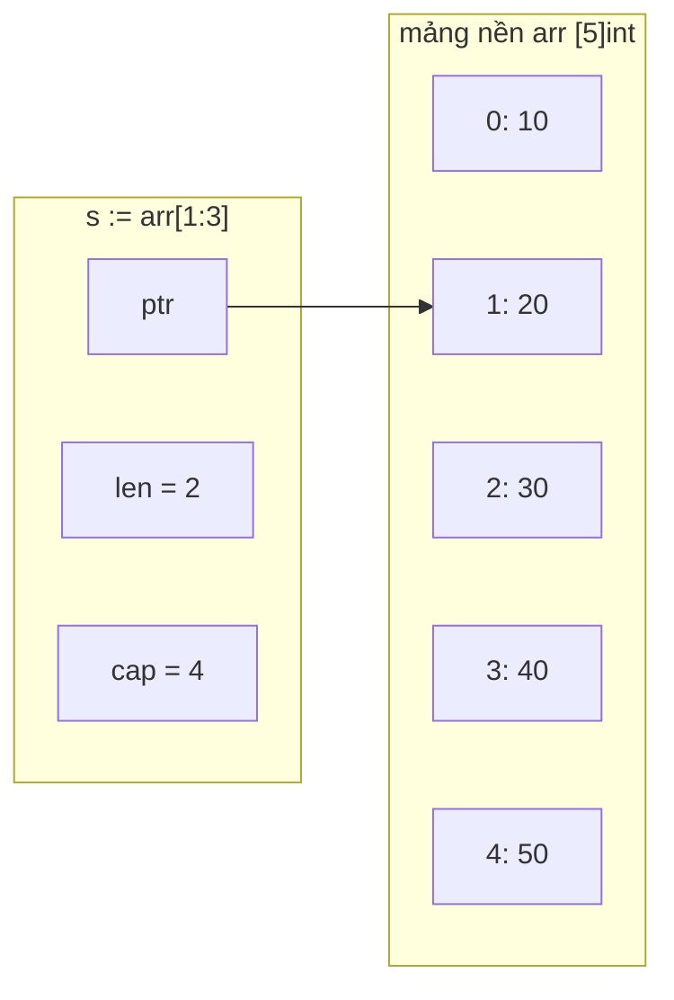

# Array và Slice

Array (mảng) và slice (lát cắt) là hai cách lưu một dãy phần tử cùng kiểu trong Go. Array có độ dài cố định và là **giá trị**; slice là một "cửa sổ" co giãn được trỏ vào một array bên dưới — và là kiểu bạn dùng trong 99% trường hợp. Hiểu cấu trúc bên trong của slice (con trỏ, `len`, `cap`) là chìa khoá để tránh những bug "sửa chỗ này, chỗ kia đổi theo" và là câu hỏi phỏng vấn Go kinh điển.

---

:::note[Ghi nhớ nhanh]

- ⭐ **Slice = header 3 trường (ptr, len, cap) trỏ vào mảng nền** — copy slice chỉ copy header, hai slice vẫn dùng chung dữ liệu.
- ⭐ **Luôn gán lại kết quả `append`**: `s = append(s, x)` — khi hết `cap`, `append` cấp mảng mới và trả về header mới.
- **Array là giá trị** — gán hoặc truyền vào hàm sẽ copy toàn bộ phần tử; độ dài là một phần của kiểu (`[3]int` khác `[4]int`).
- **Slicing `s[a:b]` không copy** — muốn tách biệt dữ liệu dùng `copy`, `slices.Clone` hoặc full slice expression `s[a:b:b]`.
- **nil slice và empty slice** đều có `len == 0` và dùng được với `append`/`range`, nhưng JSON ra `null` và `[]` khác nhau.

:::

---

## Mục lục

- [Vì sao cần slice?](#vì-sao-cần-slice)
- [Array — dãy cố định và là giá trị](#array--dãy-cố-định-và-là-giá-trị)
- [Slice header: ptr, len, cap](#slice-header-ptr-len-cap)
- [Tạo slice: literal, make, slicing](#tạo-slice-literal-make-slicing)
- [append và tăng trưởng capacity](#append-và-tăng-trưởng-capacity)
- [Slicing chia sẻ mảng nền](#slicing-chia-sẻ-mảng-nền)
- [copy, chuyển slice sang array](#copy-chuyển-slice-sang-array)
- [nil slice và empty slice](#nil-slice-và-empty-slice)
- [Package slices](#package-slices)
- [Câu hỏi phỏng vấn](#câu-hỏi-phỏng-vấn)

---

## Vì sao cần slice?

**Vấn đề:** Array trong Go có độ dài cố định ngay lúc biên dịch, và độ dài là một phần của kiểu. Hàm nhận `[5]int` thì không nhận được `[10]int`, và mỗi lần truyền là copy toàn bộ:

```go
func sum(a [5]int) int { // chỉ nhận đúng mảng 5 phần tử
	total := 0
	for _, v := range a {
		total += v
	}
	return total
}

func main() {
	nums := [5]int{1, 2, 3, 4, 5}
	fmt.Println(sum(nums)) // OK

	more := [6]int{1, 2, 3, 4, 5, 6}
	// sum(more) // lỗi biên dịch: cannot use more (type [6]int) as [5]int
	_ = more
}
```

Đọc dữ liệu từ database, file, request — bạn không biết trước có bao nhiêu phần tử. Array không đáp ứng được.

**Giải pháp:** Slice — một "view" động lên mảng, độ dài không thuộc kiểu, tự nới rộng khi `append`:

```go
func sum(nums []int) int { // nhận slice với độ dài bất kỳ
	total := 0
	for _, v := range nums {
		total += v
	}
	return total
}

func main() {
	var orders []int // ban đầu rỗng
	for i := range 10 {
		orders = append(orders, i*1000)
	}
	fmt.Println(sum(orders), len(orders)) // 45000 10
}
```

:::tip[Dùng thực tế]

- **Kết quả truy vấn database** — `[]User` được `append` dần khi duyệt `rows.Next()`.
- **Body JSON dạng mảng** — `json.Unmarshal` vào `[]Item`, không cần biết trước số phần tử.
- **Buffer đọc/ghi** — `make([]byte, 4096)` làm bộ đệm cho `io.Reader`.
- **Array vẫn có chỗ dùng** — giá trị kích thước cố định như hash `[32]byte` (SHA-256), địa chỉ IPv4 `[4]byte`, làm key của map.

:::

:::tip[Ví dụ đời thường]

Array giống **dãy ghế cố định trong rạp** — 10 ghế là 10 ghế, không thêm được. Slice giống **tấm vé nhóm** ghi "từ ghế số 3, đi 4 người, dãy còn trống tới ghế 8": nhóm có thể kéo thêm bạn ngồi vào ghế trống (trong `cap`), hết ghế thì cả nhóm phải chuyển sang dãy mới rộng hơn (cấp mảng mới).

:::

---

## Array — dãy cố định và là giá trị

```go
var a [3]int               // [0 0 0] — zero value
b := [3]string{"Hà Nội", "Huế", "Sài Gòn"}
c := [...]int{10, 20, 30, 40} // trình biên dịch tự đếm: [4]int
d := [5]int{1: 100, 4: 400}   // chỉ định index: [0 100 0 0 400]

fmt.Println(len(c)) // 4
```

**Array là giá trị** — khác Java/JavaScript nơi mảng là tham chiếu:

```go
x := [3]int{1, 2, 3}
y := x       // copy toàn bộ 3 phần tử
y[0] = 99
fmt.Println(x, y) // [1 2 3] [99 2 3]

func reset(arr [3]int) { arr[0] = 0 } // sửa bản copy, không ảnh hưởng bên ngoài
```

Hệ quả:

- Array cùng kiểu **so sánh được** bằng `==` (nếu phần tử so sánh được), nên dùng được làm key map: `map[[2]int]string`.
- Truyền array lớn vào hàm tốn chi phí copy — thường truyền slice hoặc con trỏ `*[N]T` thay thế.

:::warning[Độ dài là một phần của kiểu]

`[3]int` và `[4]int` là **hai kiểu khác nhau**, không gán cho nhau được. Đây là lý do array hiếm khi xuất hiện trong chữ ký hàm.

:::

---

## Slice header: ptr, len, cap

Bên trong, một slice là struct nhỏ 3 trường (gọi là **slice header**):

```go
// Mô phỏng cấu trúc runtime (không phải code thật bạn viết)
type sliceHeader struct {
	ptr *T  // trỏ tới phần tử đầu tiên trong mảng nền
	len int // số phần tử đang dùng
	cap int // số phần tử tối đa tính từ ptr tới hết mảng nền
}
```



```go
arr := [5]int{10, 20, 30, 40, 50}
s := arr[1:3]
fmt.Println(s, len(s), cap(s)) // [20 30] 2 4
```

- `len(s)` — số phần tử truy cập được bằng index `s[i]`.
- `cap(s)` — từ `ptr` tới cuối mảng nền; `append` dùng phần dư này trước khi phải cấp phát mới.

Vì header chỉ 24 byte (trên máy 64-bit), **truyền slice vào hàm rất rẻ** — nhưng hàm nhận được bản copy của header, dùng chung mảng nền với bên gọi.

---

## Tạo slice: literal, make, slicing

```go
// 1. Slice literal
langs := []string{"Go", "Java", "Rust"}

// 2. make(kiểu, len) hoặc make(kiểu, len, cap)
buf := make([]byte, 1024)     // len 1024, cap 1024, toàn 0
ids := make([]int, 0, 100)    // len 0, cap 100 — chuẩn bị append 100 phần tử

// 3. Slicing từ array hoặc slice khác
arr := [5]int{1, 2, 3, 4, 5}
mid := arr[1:4] // [2 3 4]
head := arr[:2] // [1 2]
tail := arr[3:] // [4 5]
all := arr[:]   // toàn bộ, kiểu []int
```

:::tip[Biết trước số lượng thì cấp sẵn cap]

```go
users := make([]User, 0, len(rows)) // tránh cấp phát lại nhiều lần khi append
for _, r := range rows {
	users = append(users, toUser(r))
}
```

Cẩn thận nhầm `make([]T, n)` (đã có n phần tử zero) với `make([]T, 0, n)` — append vào cái đầu sẽ ra `n` số 0 rồi mới tới dữ liệu thật.

:::

---

## append và tăng trưởng capacity

`append` thêm phần tử vào cuối và **trả về slice mới**:

```go
s := make([]int, 0, 2)
s = append(s, 1)       // còn chỗ trong cap → ghi vào mảng nền hiện tại
s = append(s, 2)
s = append(s, 3)       // hết cap → cấp mảng mới lớn hơn, copy dữ liệu sang
s = append(s, 4, 5, 6) // thêm nhiều phần tử
other := []int{7, 8}
s = append(s, other...) // nối slice khác bằng toán tử ...
```

Khi `len == cap`, runtime cấp mảng mới. Chiến lược tăng (từ Go 1.18, hàm `growslice`):

| Capacity hiện tại | Capacity mới (xấp xỉ) |
|---|---|
| Dưới 256 | Gấp đôi |
| Từ 256 trở lên | Tăng dần từ ~2x về ~1.25x: `newcap += (newcap + 3*256) / 4` |

Sau đó con số được **làm tròn lên theo size class** của bộ cấp phát, nên cap thực tế có thể lớn hơn công thức. Chạy thử với `[]int` trên Go 1.26:

```go
var s []int
prev := -1
for i := range 2000 {
	s = append(s, i)
	if cap(s) != prev {
		fmt.Print(cap(s), " ")
		prev = cap(s)
	}
}
// Một lần chạy cho ra: 4 8 16 32 64 128 256 512 848 1280 1792 2560
```

:::warning[Không dựa vào con số cap cụ thể]

Thuật toán tăng trưởng là chi tiết hiện thực, đã đổi qua nhiều phiên bản (trước 1.18 ngưỡng là 1024). Code đúng không bao giờ giả định "sau append cap sẽ bằng X" — nếu cần kiểm soát thì tự `make` với cap mong muốn.

:::

:::danger[Quên gán lại kết quả append]

```go
func addItem(items []string, x string) {
	items = append(items, x) // chỉ đổi header cục bộ
}

func main() {
	list := []string{"a"}
	addItem(list, "b")
	fmt.Println(list) // [a] — "b" không xuất hiện
}
```

Hàm muốn thêm phần tử phải **trả về slice mới** (`func addItem(...) []string`) hoặc nhận `*[]string`. `go vet` không bắt lỗi này, nhưng trình biên dịch báo nếu bạn viết `append(s, x)` mà không dùng kết quả.

:::

---

## Slicing chia sẻ mảng nền

Đây là nguồn bug số một với slice. Slicing **không copy** — slice con và slice cha nhìn vào cùng vùng nhớ:

```go
orig := []int{1, 2, 3, 4, 5}
t := orig[1:3]                 // [2 3], len 2, cap 4
t[0] = 20
fmt.Println(orig)              // [1 20 3 4 5] — orig bị sửa theo

t = append(t, 99)              // cap còn chỗ → ghi đè orig[3]!
fmt.Println(orig)              // [1 20 3 99 5]
```

Lần `append` thứ hai là bẫy nguy hiểm nhất: bạn chỉ "thêm vào t" nhưng lại **ghi đè dữ liệu của orig** vì `t` còn cap.

### Full slice expression `s[a:b:c]`

Cú pháp ba chỉ số giới hạn cap của slice con: `cap = c - a`. Khi cap bằng len, `append` buộc phải cấp mảng mới, không đụng tới slice cha:

```go
orig := []int{1, 2, 3, 4, 5}
u := orig[1:3:3]          // [2 3], len 2, cap 2
u = append(u, 100)        // hết cap → mảng mới
fmt.Println(orig, u)      // [1 2 3 4 5] [2 3 100] — orig an toàn
```

Thường dùng khi viết hàm trả về một phần slice nội bộ cho bên ngoài, tránh caller `append` làm hỏng dữ liệu của bạn.

### Bẫy sửa chéo khi hai slice cùng append

```go
base := make([]int, 3, 10)
a := append(base, 1) // dùng chung mảng nền với base (cap 10)
b := append(base, 2) // ghi đè đúng vị trí a vừa ghi
fmt.Println(a[3], b[3]) // 2 2 — a "bị đổi" dù không ai đụng vào a
```

:::warning[Quy tắc an toàn]

- Một slice nên có **một chủ sở hữu** gọi `append`.
- Cần bản độc lập: `clone := slices.Clone(s)` (Go 1.21) hoặc `append([]int(nil), s...)`.
- Trả slice con ra ngoài: dùng `s[a:b:b]` hoặc clone.

:::

---

## copy, chuyển slice sang array

### `copy(dst, src)`

Copy `min(len(dst), len(src))` phần tử, trả về số phần tử đã copy. Hai slice có thể chồng lấn nhau:

```go
src := []int{1, 2, 3, 4}
dst := make([]int, 2)
n := copy(dst, src)
fmt.Println(n, dst) // 2 [1 2]

// Xoá phần tử index i bằng copy (cách cổ điển)
s := []int{10, 20, 30, 40}
i := 1
s = s[:i+copy(s[i:], s[i+1:])]
fmt.Println(s) // [10 30 40]
```

:::warning[dst phải có len, không phải chỉ cap]

`copy` dựa vào `len(dst)`. `dst := make([]int, 0, 10)` có len 0 → `copy` không copy gì cả.

:::

### Slice sang array (Go 1.20)

```go
s := []int{1, 2, 3, 4, 5}

arr := [3]int(s)      // Go 1.20: copy 3 phần tử đầu thành array
p := (*[3]int)(s)     // Go 1.17: con trỏ tới array, DÙNG CHUNG mảng nền
p[0] = 100
fmt.Println(arr, s[0]) // [1 2 3] 100

// _ = [10]int(s) // panic lúc chạy: len(s) = 5 nhỏ hơn 10
```

Hữu ích khi API cần array cố định, ví dụ key `[16]byte` từ một UUID dạng slice.

---

## nil slice và empty slice

```go
var a []int  // nil slice: ptr = nil, len 0, cap 0
b := []int{} // empty slice: ptr khác nil, len 0, cap 0

fmt.Println(a == nil, b == nil) // true false
fmt.Println(len(a), len(b))     // 0 0

a = append(a, 1) // append vào nil slice hoàn toàn hợp lệ
for range b {}   // range trên nil/empty đều chạy 0 lần
```

Khác biệt lộ ra khi **serialize JSON**:

```go
type Resp struct {
	Items []string `json:"items"`
}

x, _ := json.Marshal(Resp{Items: nil})        // {"items":null}
y, _ := json.Marshal(Resp{Items: []string{}}) // {"items":[]}
```

| | nil slice | empty slice |
|---|---|---|
| `s == nil` | `true` | `false` |
| `len`, `cap` | 0, 0 | 0, 0 |
| `append`, `range` | dùng bình thường | dùng bình thường |
| `json.Marshal` | `null` | `[]` |

:::tip[Nên dùng cái nào?]

- Trong code nội bộ: khai báo `var s []T` (nil) là idiom chuẩn — kiểm tra rỗng bằng `len(s) == 0`, **đừng** so `s == nil`.
- Trong response API mà frontend mong mảng: khởi tạo `[]T{}` hoặc `make([]T, 0)` để tránh `null` làm vỡ `items.map(...)` phía client.

:::

---

## Package slices

Từ Go 1.21, package chuẩn [`slices`](https://pkg.go.dev/slices) (dùng generics) gom các thao tác hay viết tay:

```go
import "slices"

nums := []int{5, 2, 8, 2, 9}

slices.Sort(nums)                        // [2 2 5 8 9] — sắp xếp tại chỗ
i, found := slices.BinarySearch(nums, 8) // 3 true
fmt.Println(slices.Contains(nums, 5))    // true
fmt.Println(slices.Index(nums, 9))       // 4
fmt.Println(slices.Max(nums))            // 9

nums = slices.Compact(nums)              // bỏ phần tử trùng liền kề: [2 5 8 9]
nums = slices.Insert(nums, 1, 3)         // [2 3 5 8 9]
nums = slices.Delete(nums, 0, 1)         // xoá index [0,1): [3 5 8 9]

c := slices.Clone(nums)                  // bản copy độc lập
fmt.Println(slices.Equal(c, nums))       // true

// Sắp xếp theo tiêu chí riêng
type User struct {
	Name string
	Age  int
}
users := []User{{"An", 30}, {"Bình", 25}}
slices.SortFunc(users, func(a, b User) int {
	return a.Age - b.Age // âm: a đứng trước
})
idx := slices.IndexFunc(users, func(u User) bool { return u.Name == "An" })
_ = i
_ = found
_ = idx
```

Với Go 1.23 (iterator), có thêm `slices.All`, `slices.Values`, `slices.Collect`, `slices.Sorted`... để kết hợp với `range over func`:

```go
for i, v := range slices.All([]string{"a", "b"}) {
	fmt.Println(i, v)
}
```

:::note

`slices.Delete` từ Go 1.22 sẽ **gán zero** cho các phần tử bị dồn ra cuối mảng nền (giúp GC thu hồi con trỏ). Luôn dùng giá trị trả về: `s = slices.Delete(s, i, j)`.

:::

---

## Câu hỏi phỏng vấn

**1. Array và slice trong Go khác nhau thế nào?**

<details className="qa">
<summary>Xem đáp án</summary>

- **Array** có độ dài cố định, độ dài là một phần của kiểu (`[3]int` khác `[4]int`), là **giá trị** — gán/truyền là copy toàn bộ, so sánh được bằng `==`.
- **Slice** là header 3 trường (con trỏ tới mảng nền, `len`, `cap`), độ dài động, gán/truyền chỉ copy header nên dùng chung dữ liệu; không so sánh bằng `==` được (chỉ so với `nil`).

Thực tế hầu như luôn dùng slice; array dùng cho dữ liệu kích thước cố định như hash, key của map.

</details>

**2. Đoạn code sau in ra gì? Vì sao?**

```go
a := []int{1, 2, 3, 4}
b := a[:2]
b = append(b, 9)
fmt.Println(a)
```

<details className="qa">
<summary>Xem đáp án</summary>

In `[1 2 9 4]`. `b` có len 2 nhưng cap 4 (dùng chung mảng nền với `a`). `append` còn chỗ trong cap nên ghi `9` vào vị trí index 2 của mảng nền — chính là `a[2]`. Muốn tránh: `b := a[:2:2]` (giới hạn cap) hoặc `b := slices.Clone(a[:2])`.

</details>

**3. `append` hoạt động thế nào khi hết capacity? Vì sao phải viết `s = append(s, x)`?**

<details className="qa">
<summary>Xem đáp án</summary>

Khi `len == cap`, runtime cấp một mảng nền mới lớn hơn (gấp đôi khi cap nhỏ hơn 256, sau đó hệ số giảm dần về khoảng 1.25x, rồi làm tròn theo size class), copy các phần tử cũ sang, ghi phần tử mới và trả về header mới trỏ tới mảng mới. Vì `append` có thể trả về header khác (ptr khác, len luôn khác), bắt buộc phải gán lại; nếu không, biến cũ vẫn giữ len cũ và có thể trỏ vào mảng cũ.

</details>

**4. nil slice và empty slice khác nhau ở đâu? Khi nào cần quan tâm?**

<details className="qa">
<summary>Xem đáp án</summary>

nil slice (`var s []int`) có ptr = nil; empty slice (`[]int{}`) có ptr khác nil. Cả hai `len == 0`, đều `append`, `range` bình thường. Khác biệt: `s == nil` cho kết quả khác, `json.Marshal` cho `null` và `[]`, một số thư viện (như `reflect.DeepEqual`) coi chúng khác nhau. Kiểm tra rỗng nên dùng `len(s) == 0`; với response API nên trả `[]` để client không phải xử lý `null`.

</details>

**5. Làm sao để slice con không ảnh hưởng tới slice gốc?**

<details className="qa">
<summary>Xem đáp án</summary>

- Copy dữ liệu: `slices.Clone(s[a:b])`, hoặc `dst := make([]T, b-a); copy(dst, s[a:b])`.
- Nếu chỉ cần chặn `append` ghi đè: full slice expression `s[a:b:b]` khiến cap = len, lần `append` đầu tiên sẽ cấp mảng mới. Lưu ý gán `t[0] = x` vẫn sửa slice gốc vì chưa tách mảng nền.

</details>

**6. Vì sao giữ một sub-slice nhỏ của slice lớn có thể gây tốn bộ nhớ?**

<details className="qa">
<summary>Xem đáp án</summary>

Sub-slice giữ con trỏ tới mảng nền gốc, nên GC không thể thu hồi cả mảng lớn dù bạn chỉ dùng vài phần tử. Ví dụ đọc file 100MB vào `[]byte` rồi giữ lại `data[:10]` làm header → 100MB vẫn sống. Cách xử lý: copy phần cần giữ ra slice mới (`slices.Clone`, `bytes.Clone`) để mảng gốc được giải phóng.

</details>
