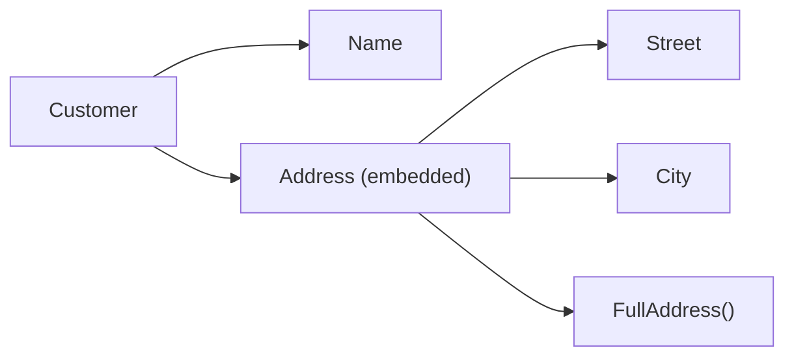

# Struct

Struct là kiểu gom nhiều trường (field) có tên lại thành một đơn vị — tương đương "class chỉ có dữ liệu" trong Java hay object literal có kiểu trong TypeScript. Go không có class và không có kế thừa; struct kết hợp với method, interface và **embedding** (nhúng) là toàn bộ công cụ để mô hình hoá dữ liệu. Bài này đi qua cách khai báo, khởi tạo, so sánh struct, struct tag cho JSON, embedding và struct rỗng `struct{}`.

---

:::note[Ghi nhớ nhanh]

- ⭐ **Struct là giá trị** — gán và truyền vào hàm sẽ copy toàn bộ trường; muốn sửa bản gốc thì dùng con trỏ `*T`.
- ⭐ **Trường viết hoa mới được export** — `encoding/json` chỉ nhìn thấy trường exported; trường viết thường bị bỏ qua khi marshal.
- **Struct tag `json:"name,omitempty"`** — đổi tên key JSON và bỏ trường khi là zero value; `json:"-"` để loại hẳn.
- **Embedding là composition, không phải kế thừa** — trường và method của struct nhúng được "promote" lên struct ngoài.
- **Struct so sánh được bằng `==`** nếu mọi trường đều comparable; `struct{}` chiếm 0 byte, dùng cho set và tín hiệu channel.

:::

---

## Mục lục

- [Vì sao cần struct?](#vì-sao-cần-struct)
- [Khai báo và khởi tạo](#khai-báo-và-khởi-tạo)
- [Struct là giá trị](#struct-là-giá-trị)
- [Struct ẩn danh](#struct-ẩn-danh)
- [So sánh struct](#so-sánh-struct)
- [Struct tag và JSON](#struct-tag-và-json)
- [Embedding và promoted field](#embedding-và-promoted-field)
- [Struct rỗng `struct{}`](#struct-rỗng-struct)
- [Câu hỏi phỏng vấn](#câu-hỏi-phỏng-vấn)

---

## Vì sao cần struct?

**Vấn đề:** Dữ liệu của một thực thể nằm rải rác ở nhiều biến hoặc nhét vào `map[string]any` — dễ sai chính tả key, không có kiểm tra kiểu, hàm nhận cả chục tham số:

```go
func createOrder(id string, customer string, total int, paid bool, note string) {
	// 5 tham số, dễ truyền nhầm thứ tự customer và note (cùng kiểu string)
}

order := map[string]any{
	"id":    "DH001",
	"totel": 500000, // gõ sai key, trình biên dịch không phát hiện
}
total := order["total"].(int) // panic: key không tồn tại → nil, type assertion thất bại
```

**Giải pháp:** Định nghĩa struct — trình biên dịch kiểm tra tên trường và kiểu:

```go
type Order struct {
	ID       string
	Customer string
	Total    int
	Paid     bool
	Note     string
}

func createOrder(o Order) {
	fmt.Println(o.ID, o.Total)
}

func main() {
	createOrder(Order{
		ID:       "DH001",
		Customer: "Nguyễn Văn An",
		Total:    500_000,
	}) // gõ sai tên trường → lỗi biên dịch ngay
}
```

:::tip[Dùng thực tế]

- **Model dữ liệu** — `User`, `Order`, `Product` ánh xạ bảng database hoặc document.
- **Request/response DTO** — struct có JSON tag để decode body HTTP và encode response.
- **Cấu hình** — `Config` đọc từ YAML/ENV với tag `yaml:"..."`, `env:"..."`.
- **Options cho hàm** — gom tham số tuỳ chọn vào một struct thay vì hàm có 8 tham số.

:::

:::tip[Ví dụ đời thường]

Struct giống **mẫu phiếu khai báo tạm trú** in sẵn các ô: họ tên, ngày sinh, số CCCD, địa chỉ. Ai điền cũng theo đúng các ô đó, cán bộ biết chắc ô nào chứa gì. Dùng `map[string]any` giống **viết tay lên giấy trắng** — mỗi người ghi một kiểu, có người ghi "Ngày sinh", người ghi "DOB", có người quên luôn.

:::

---

## Khai báo và khởi tạo

```go
type User struct {
	ID        int64
	Name      string
	Email     string
	Age       int
	CreatedAt time.Time
}

// Trường cùng kiểu có thể gộp trên một dòng
type Point struct {
	X, Y float64
}
```

Các cách tạo giá trị:

```go
// 1. Zero value: mọi trường nhận zero value của kiểu
var u1 User // ID 0, Name "", CreatedAt là time.Time zero

// 2. Literal có tên trường (khuyến nghị)
u2 := User{
	ID:    1,
	Name:  "An",
	Email: "an@example.com",
	// Age, CreatedAt bỏ qua → zero value
}

// 3. Literal theo vị trí — phải đủ mọi trường, đúng thứ tự
p := Point{3, 4}

// 4. Con trỏ tới struct
u3 := &User{ID: 2, Name: "Bình"} // kiểu *User
u3.Age = 30                      // tự dereference, không cần (*u3).Age

fmt.Println(u1.ID, u2.Name, p.X, u3.Age)
```

:::warning[Tránh literal theo vị trí với struct của package khác]

`Point{3, 4}` gọn nhưng gãy ngay khi ai đó thêm hoặc đổi thứ tự trường. `go vet` cảnh báo "composite literal uses unkeyed fields" khi dùng kiểu struct của package khác. Chỉ dùng cho struct nhỏ, ổn định trong cùng package.

:::

### Hàm khởi tạo `NewXxx`

Go không có constructor. Quy ước là viết hàm `NewXxx` khi cần giá trị mặc định hoặc kiểm tra đầu vào:

```go
func NewUser(name, email string) (*User, error) {
	if name == "" {
		return nil, errors.New("name không được rỗng")
	}
	return &User{
		Name:      name,
		Email:     email,
		CreatedAt: time.Now(),
	}, nil
}
```

---

## Struct là giá trị

```go
a := Point{1, 2}
b := a      // copy toàn bộ
b.X = 100
fmt.Println(a.X, b.X) // 1 100

func moveWrong(p Point)  { p.X += 10 } // sửa bản copy
func moveRight(p *Point) { p.X += 10 } // sửa bản gốc qua con trỏ

moveWrong(a)
fmt.Println(a.X) // 1
moveRight(&a)
fmt.Println(a.X) // 11
```

:::warning[Copy nông]

Copy struct chỉ copy **giá trị các trường**. Nếu trường là slice, map hoặc con trỏ, hai bản copy vẫn dùng chung dữ liệu bên dưới:

```go
type Team struct {
	Name    string
	Members []string
}

t1 := Team{Name: "A", Members: []string{"An"}}
t2 := t1
t2.Members[0] = "Bình" // sửa mảng nền dùng chung
fmt.Println(t1.Members) // [Bình]
```

:::

---

## Struct ẩn danh

Struct không cần đặt tên kiểu — hữu ích cho dữ liệu dùng một lần:

```go
// Biến cấu hình tạm
server := struct {
	Host string
	Port int
}{
	Host: "localhost",
	Port: 8080,
}
fmt.Println(server.Host, server.Port)

// Table-driven test — cách dùng phổ biến nhất
tests := []struct {
	name string
	in   int
	want int
}{
	{"số dương", 2, 4},
	{"số âm", -3, 9},
	{"số không", 0, 0},
}
for _, tt := range tests {
	if got := tt.in * tt.in; got != tt.want {
		fmt.Printf("%s: got %d, want %d\n", tt.name, got, tt.want)
	}
}

// Decode JSON chỉ lấy vài trường cần thiết
var resp struct {
	Data struct {
		Token string `json:"token"`
	} `json:"data"`
}
_ = json.Unmarshal([]byte(`{"data":{"token":"abc"}}`), &resp)
fmt.Println(resp.Data.Token) // abc
```

---

## So sánh struct

Struct **comparable** khi mọi trường đều comparable. Hai giá trị bằng nhau khi từng trường bằng nhau:

```go
p1 := Point{1, 2}
p2 := Point{1, 2}
fmt.Println(p1 == p2) // true

// Comparable → dùng được làm key map
dist := map[Point]float64{{0, 0}: 0, {3, 4}: 5}
fmt.Println(dist[Point{3, 4}]) // 5
```

Struct có trường slice, map hoặc func thì **không** dùng `==` được:

```go
type Cart struct {
	Items []string
}
// Cart{} == Cart{} // lỗi biên dịch: struct containing []string cannot be compared
```

Khi đó tự viết hàm `Equal`, dùng `slices.Equal` cho từng trường, hoặc `reflect.DeepEqual` (chậm, chủ yếu dùng trong test).

:::note

So sánh con trỏ `&p1 == &p2` là so sánh **địa chỉ**, không phải nội dung — luôn `false` với hai biến khác nhau.

:::

---

## Struct tag và JSON

**Struct tag** là chuỗi metadata đặt sau kiểu của trường, được đọc qua reflection bởi các thư viện như `encoding/json`, ORM, validator:

```go
type Product struct {
	ID       int64    `json:"id"`
	Name     string   `json:"name"`
	Price    int      `json:"price"`
	Discount int      `json:"discount,omitempty"` // bỏ qua khi bằng 0
	Tags     []string `json:"tags,omitempty"`     // bỏ qua khi nil hoặc rỗng
	Secret   string   `json:"-"`                  // không bao giờ xuất ra JSON
	internal string   // viết thường → json không thấy
}

p := Product{ID: 1, Name: "Áo thun", Price: 150000, Secret: "x", internal: "y"}
data, _ := json.Marshal(p)
fmt.Println(string(data))
// {"id":1,"name":"Áo thun","price":150000}
```

| Tag | Ý nghĩa |
|---|---|
| `json:"name"` | Đổi tên key |
| `json:"name,omitempty"` | Bỏ trường khi là zero value (`0`, `""`, `false`, `nil`, slice/map rỗng) |
| `json:",omitempty"` | Giữ tên trường gốc, chỉ thêm `omitempty` |
| `json:"-"` | Luôn bỏ qua |
| `json:"id,string"` | Encode số thành chuỗi (`"id":"123"`) — hữu ích với int64 lớn cho JavaScript |

Một trường có thể mang nhiều tag, cách nhau bằng dấu cách:

```go
type Account struct {
	Email string `json:"email" db:"email" validate:"required,email"`
}
```

:::warning[Những lỗi hay gặp với tag]

- **Viết sai cú pháp** — `json: "name"` (thừa dấu cách) hoặc `json:name` (thiếu nháy) khiến tag bị bỏ qua; `go vet` phát hiện được lỗi này.
- **`omitempty` không áp dụng cho struct** — trường kiểu `time.Time` hay struct lồng nhau không bao giờ bị coi là "empty". Go 1.24 thêm tuỳ chọn `omitzero` để bỏ trường khi là zero value (kể cả struct, và dùng method `IsZero()` nếu có).
- **Quên export** — `name string` với tag `json:"name"` vẫn bị bỏ qua vì viết thường.

:::

Decode JSON ngược lại:

```go
var in Product
err := json.Unmarshal([]byte(`{"id":2,"name":"Quần","price":200000,"extra":1}`), &in)
if err != nil {
	log.Fatal(err)
}
fmt.Println(in.Name) // Quần — key "extra" không có trường tương ứng nên bị bỏ qua
```

---

## Embedding và promoted field

Go không có kế thừa. Thay vào đó, bạn **nhúng** (embed) một kiểu vào struct bằng cách khai báo trường **chỉ có kiểu, không có tên**:

```go
type Address struct {
	Street string
	City   string
}

func (a Address) FullAddress() string {
	return a.Street + ", " + a.City
}

type Customer struct {
	Name    string
	Address // embedded — tên trường ngầm định là "Address"
}

c := Customer{
	Name:    "Chi",
	Address: Address{Street: "12 Lý Thường Kiệt", City: "Hà Nội"},
}

fmt.Println(c.City)          // promoted field — viết tắt của c.Address.City
fmt.Println(c.FullAddress()) // promoted method — gọi như method của Customer
fmt.Println(c.Address.City)  // truy cập đầy đủ vẫn được
```



### Ứng dụng: gom trường chung

```go
type BaseModel struct {
	ID        int64
	CreatedAt time.Time
	UpdatedAt time.Time
}

type Post struct {
	BaseModel
	Title string
}

type Comment struct {
	BaseModel
	Content string
}

post := Post{Title: "Học Go"}
post.ID = 10 // promoted từ BaseModel
```

Với JSON, trường embedded (không có tag) được **"làm phẳng"** — các trường của nó nằm ngang hàng với trường của struct ngoài:

```go
type Base struct {
	ID int `json:"id"`
}
type Tag struct {
	Base
	Label string `json:"label"`
}
out, _ := json.Marshal(Tag{Base: Base{ID: 1}, Label: "go"})
fmt.Println(string(out)) // {"id":1,"label":"go"}
```

### Xung đột tên và shadowing

```go
type A struct{ Name string }
type B struct{ Name string }

type C struct {
	A
	B
	Name string // trường của C che (shadow) trường cùng tên ở A, B
}

var c C
c.Name = "c"   // trường của chính C
c.A.Name = "a" // phải ghi rõ
// Nếu C không có Name riêng: c.Name sẽ báo lỗi "ambiguous selector"
```

:::warning[Embedding không phải kế thừa]

- `Customer` **không phải** là `Address` — không truyền `Customer` vào hàm nhận `Address` được. Phải truyền `c.Address`.
- Method được promote vẫn có receiver là `Address`, nó **không biết** gì về `Customer` bao ngoài — không có "override" hay "virtual method" kiểu Java.
- Embedding ảnh hưởng tới **method set** và do đó tới việc struct thoả mãn interface nào — sẽ bàn kỹ ở bài Method và Interface.

:::

---

## Struct rỗng `struct{}`

`struct{}` không có trường nào và **chiếm 0 byte**. Mọi giá trị `struct{}{}` đều như nhau.

```go
fmt.Println(unsafe.Sizeof(struct{}{})) // 0
```

Ba cách dùng phổ biến:

```go
// 1. Set — chỉ quan tâm key
roles := map[string]struct{}{
	"admin":  {},
	"editor": {},
}
if _, ok := roles["admin"]; ok {
	fmt.Println("có quyền admin")
}

// 2. Tín hiệu qua channel — không cần gửi dữ liệu
done := make(chan struct{})
go func() {
	// ... làm việc
	close(done) // báo xong
}()
<-done

// 3. Kiểu chỉ để gắn method (không cần trạng thái)
type NoopLogger struct{}

func (NoopLogger) Info(msg string) {}
```

---

## Câu hỏi phỏng vấn

**1. Go không có class và kế thừa, vậy mô hình hoá đối tượng thế nào?**

<details className="qa">
<summary>Xem đáp án</summary>

Dùng struct cho dữ liệu, method gắn lên kiểu cho hành vi, interface (thoả mãn ngầm định) cho đa hình, và embedding cho tái sử dụng (composition). Embedding promote trường và method của kiểu nhúng lên kiểu ngoài nhưng không tạo quan hệ "is-a": không thể dùng struct ngoài ở chỗ cần kiểu nhúng, không có override/virtual dispatch.

</details>

**2. Khi nào hai struct so sánh được bằng `==`?**

<details className="qa">
<summary>Xem đáp án</summary>

Khi mọi trường đều thuộc kiểu comparable (không chứa slice, map, func). Hai giá trị bằng nhau khi từng trường tương ứng bằng nhau. Struct comparable dùng được làm key của map. Nếu struct chứa slice/map thì `==` là lỗi biên dịch; phải tự viết hàm so sánh hoặc dùng `reflect.DeepEqual` (thường chỉ trong test).

</details>

**3. Vì sao trường của struct không xuất hiện khi `json.Marshal`?**

<details className="qa">
<summary>Xem đáp án</summary>

Các nguyên nhân thường gặp: trường viết thường (unexported) — `encoding/json` dùng reflection và không truy cập được; tag là `json:"-"`; có `omitempty` và giá trị đang là zero value; tag sai cú pháp (thừa dấu cách sau dấu hai chấm) khiến tên bị hiểu sai. Kiểm tra bằng `go vet` để bắt lỗi tag.

</details>

**4. `omitempty` hoạt động thế nào? Có bỏ được trường kiểu `time.Time` không?**

<details className="qa">
<summary>Xem đáp án</summary>

`omitempty` bỏ trường khi giá trị là `false`, `0`, `""`, con trỏ/interface `nil`, slice/map/array có len 0. Struct (kể cả `time.Time`) không bao giờ được coi là empty nên vẫn xuất ra. Cách xử lý: dùng con trỏ `*time.Time` (nil thì bị bỏ), hoặc từ Go 1.24 dùng tag `omitzero` — bỏ trường khi là zero value, gọi `IsZero()` nếu kiểu có method này.

</details>

**5. Embedding khác kế thừa ở điểm nào?**

<details className="qa">
<summary>Xem đáp án</summary>

- Embedding là **has-a** được viết tắt: struct ngoài chứa một trường kiểu nhúng, compiler cho phép truy cập trực tiếp trường/method của nó.
- Không có quan hệ kiểu: `Customer` không gán được cho biến `Address`.
- Không có override thực sự: method của kiểu nhúng gọi method khác thì luôn gọi phiên bản của chính nó, không gọi phiên bản "ghi đè" ở struct ngoài.
- Nhờ promote method, struct ngoài có thể thoả mãn interface mà kiểu nhúng thoả mãn — đây là cách "tái sử dụng" chính trong Go.

</details>

**6. `struct{}` dùng để làm gì?**

<details className="qa">
<summary>Xem đáp án</summary>

`struct{}` chiếm 0 byte, dùng khi chỉ cần sự tồn tại chứ không cần dữ liệu: value của map làm set (`map[string]struct{}`), tín hiệu qua channel (`chan struct{}` với `close(done)`), hoặc kiểu không trạng thái chỉ để gắn method thoả mãn interface.

</details>
