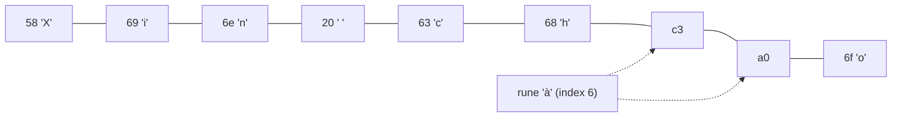

# String và Rune

String trong Go là **dãy byte bất biến** (immutable), quy ước chứa văn bản mã hoá UTF-8. Với tiếng Anh, một ký tự là một byte nên mọi thứ "trông có vẻ đúng"; nhưng với tiếng Việt có dấu, một ký tự như "ệ" chiếm tới 3 byte — `len`, cắt chuỗi bằng index, đảo chuỗi đều có thể cho kết quả sai nếu không hiểu khái niệm **rune**. Bài này giải thích string, byte, rune, cách duyệt chuỗi đúng, các package `strings`, `unicode/utf8` và cách nối chuỗi hiệu quả bằng `strings.Builder`.

---

:::note[Ghi nhớ nhanh]

- ⭐ **`len(s)` đếm byte, không đếm ký tự** — `len("Việt")` là 6; đếm ký tự dùng `utf8.RuneCountInString(s)`.
- ⭐ **`for i, r := range s` duyệt theo rune** (giải mã UTF-8), còn `s[i]` trả về **byte** — xử lý văn bản có dấu luôn dùng `range` hoặc `[]rune`.
- **String bất biến** — không gán được `s[0] = 'x'`; muốn sửa thì chuyển sang `[]byte` hoặc `[]rune` rồi chuyển ngược.
- **rune = int32 = một Unicode code point**; byte = uint8.
- **Nối nhiều chuỗi trong vòng lặp dùng `strings.Builder`** — `s += x` tạo chuỗi mới mỗi lần, độ phức tạp O(n²).

:::

---

## Mục lục

- [Vì sao cần hiểu rune?](#vì-sao-cần-hiểu-rune)
- [String là dãy byte bất biến](#string-là-dãy-byte-bất-biến)
- [byte, rune và UTF-8](#byte-rune-và-utf-8)
- [Duyệt chuỗi: index và for range](#duyệt-chuỗi-index-và-for-range)
- [Chuyển đổi string, byte và rune](#chuyển-đổi-string-byte-và-rune)
- [Package strings](#package-strings)
- [Package unicode/utf8 và unicode](#package-unicodeutf8-và-unicode)
- [Nối chuỗi hiệu quả với strings.Builder](#nối-chuỗi-hiệu-quả-với-stringsbuilder)

---

## Vì sao cần hiểu rune?

**Vấn đề:** Viết hàm cắt tên hiển thị tối đa 6 ký tự theo kiểu "một ký tự = một byte" sẽ cắt đôi ký tự tiếng Việt:

```go
name := "Xin chào"
fmt.Println(len(name))  // 9 — không phải 8
fmt.Println(name[:7])   // "Xin ch\xc3" → hiển thị "Xin ch�" (vỡ chữ "à")

// Đảo chuỗi theo byte
b := []byte("Việt")
for i, j := 0, len(b)-1; i < j; i, j = i+1, j-1 {
	b[i], b[j] = b[j], b[i]
}
fmt.Println(string(b)) // ký tự rác — các byte của "ệ" bị đảo thứ tự
```

**Giải pháp:** Làm việc ở mức **rune** (ký tự Unicode):

```go
name := "Xin chào"
fmt.Println(utf8.RuneCountInString(name)) // 8

r := []rune(name)
fmt.Println(string(r[:7]))                // "Xin chà" — cắt theo ký tự

func reverse(s string) string {
	r := []rune(s)
	for i, j := 0, len(r)-1; i < j; i, j = i+1, j-1 {
		r[i], r[j] = r[j], r[i]
	}
	return string(r)
}
fmt.Println(reverse("Việt Nam")) // "maN tệiV"
```

:::tip[Dùng thực tế]

- **Validate độ dài tên, mật khẩu** — "tối đa 50 ký tự" phải đếm rune, không đếm byte.
- **Cắt preview bài viết** — "hiển thị 100 ký tự đầu..." cắt theo rune để không vỡ dấu.
- **Giới hạn kích thước lưu trữ** — cột `VARCHAR` của một số DB, payload SMS, header HTTP tính theo byte → lúc này `len` mới là con số đúng.
- **Xây dựng chuỗi lớn** — sinh CSV, SQL, HTML trong vòng lặp bằng `strings.Builder`.

:::

:::tip[Ví dụ đời thường]

Chuỗi UTF-8 giống **dãy toa tàu chở khách**: khách Tây ngồi 1 toa ("a"), khách Việt có dấu mang nhiều hành lý nên chiếm 2–3 toa liền ("à", "ệ"). `len` đếm **số toa**, `range` đếm **số khách**. Cắt đoàn tàu theo số toa (`s[:7]`) có thể tách một khách ra làm đôi — nửa người ở toa trước, nửa ở toa sau.

:::

---

## String là dãy byte bất biến

Bên trong, string là header 2 trường: con trỏ tới dãy byte và độ dài (giống slice nhưng không có `cap`):

```go
s := "hello"
fmt.Println(len(s), s[0]) // 5 104 — s[0] là byte 'h' (104)

// s[0] = 'H' // lỗi biên dịch: cannot assign to s[0] (neither addressable nor a map index expression)

s = "Hello" // gán chuỗi mới cho biến thì được — biến đổi, chuỗi cũ không đổi
```

Vì bất biến, string **an toàn để chia sẻ** giữa các goroutine, và substring `s[a:b]` không copy — chỉ tạo header mới trỏ vào cùng vùng byte.

Hai dạng literal:

```go
interpreted := "Dòng 1\nDòng 2\t\"có nháy\""   // xử lý escape: \n, \t, \", \u00e0
raw := `C:\path\n
nhiều dòng, không escape`                      // raw string: giữ nguyên ký tự, viết được nhiều dòng
```

Raw string (backtick) rất tiện cho regex, JSON mẫu, SQL nhiều dòng.

:::note

Go không ép string phải là UTF-8 hợp lệ — string có thể chứa byte bất kỳ (`"a\xffb"`). Quy ước "string là UTF-8" đến từ việc mã nguồn Go luôn là UTF-8 và `range` giải mã theo UTF-8.

:::

---

## byte, rune và UTF-8

| Kiểu | Bản chất | Ý nghĩa |
|---|---|---|
| `byte` | alias của `uint8` | Một byte dữ liệu |
| `rune` | alias của `int32` | Một Unicode code point (mã ký tự) |
| `string` | dãy byte bất biến | Thường là văn bản UTF-8 |

**UTF-8** mã hoá mỗi code point bằng 1–4 byte:

| Ký tự | Code point | Số byte UTF-8 |
|---|---|---|
| `A` | U+0041 | 1 |
| `à` | U+00E0 | 2 |
| `ệ` | U+1EC7 | 3 |
| `😀` | U+1F600 | 4 |

```go
var b byte = 'A' // rune literal gán vào byte được vì 'A' < 256
var r rune = 'ệ' // rune literal: dấu nháy đơn
fmt.Println(b, r)                 // 65 7879
fmt.Printf("%c %U\n", r, r)       // ệ U+1EC7
fmt.Println(utf8.RuneLen(r))      // 3
```

:::warning[Một "chữ" có thể là nhiều rune]

Tiếng Việt có thể được gõ ở dạng **dựng sẵn** (NFC: "ệ" là 1 rune U+1EC7) hoặc **tổ hợp** (NFD: "e" + dấu mũ + dấu nặng = 3 rune). Văn bản copy từ macOS hay một số bộ gõ có thể ở dạng tổ hợp, khiến đếm rune và so sánh chuỗi lệch nhau. Khi cần chuẩn hoá dùng package `golang.org/x/text/unicode/norm` (ngoài thư viện chuẩn).

:::

---

## Duyệt chuỗi: index và for range

```go
s := "Xin chào"

// Cách 1: theo index → từng BYTE
for i := 0; i < len(s); i++ {
	fmt.Printf("%d:%x ", i, s[i])
}
// 0:58 1:69 2:6e 3:20 4:63 5:68 6:c3 7:a0 8:6f   ← "à" = c3 a0

// Cách 2: for range → từng RUNE, i là vị trí BYTE bắt đầu của rune
for i, r := range s {
	fmt.Printf("%d:%c ", i, r)
}
// 0:X 1:i 2:n 3:  4:c 5:h 6:à 8:o   ← nhảy từ 6 sang 8
```



:::warning[Byte không hợp lệ khi range]

Gặp byte không phải UTF-8 hợp lệ, `range` trả về `utf8.RuneError` (U+FFFD, ký tự "�") và tiến **1 byte**:

```go
for i, r := range "a\xffb" {
	fmt.Println(i, r == utf8.RuneError) // 0 false / 1 true / 2 false
}
```

Kiểm tra trước bằng `utf8.ValidString(s)` khi nhận dữ liệu từ bên ngoài.

:::

---

## Chuyển đổi string, byte và rune

```go
s := "Việt"

bs := []byte(s)        // copy ra slice byte (6 phần tử)
rs := []rune(s)        // giải mã ra slice rune (4 phần tử)

bs[0] = 'v'            // sửa được vì là slice
fmt.Println(string(bs)) // "việt"

rs[1] = 'I'
fmt.Println(string(rs)) // "VIệt"

fmt.Println(string(rune(65))) // "A" — chuyển code point sang chuỗi
fmt.Println(strconv.Itoa(65)) // "65" — chuyển SỐ sang chuỗi
```

:::danger[`string(65)` không phải "65"]

`string(i)` với `i` là số nguyên sẽ hiểu `i` là **code point** → ra `"A"`. `go vet` cảnh báo "conversion from int to string yields a string of one rune". Chuyển số sang chuỗi thập phân phải dùng `strconv.Itoa` hoặc `fmt.Sprint`.

:::

:::note[Chi phí chuyển đổi]

Mỗi lần `[]byte(s)` hay `string(b)` thường **copy** dữ liệu (vì string bất biến còn slice thì sửa được). Trình biên dịch tối ưu bỏ copy ở một số trường hợp như `m[string(b)]` khi tra map, hay so sánh `string(b) == "x"`. Trong code nóng (hot path), hạn chế chuyển qua lại; nhiều hàm có bản cho cả hai kiểu (`strings.Contains` và `bytes.Contains`).

:::

---

## Package strings

Package [`strings`](https://pkg.go.dev/strings) có hầu hết thao tác bạn cần:

```go
import "strings"

s := "  Go là ngôn ngữ của Google  "

strings.TrimSpace(s)                     // "Go là ngôn ngữ của Google"
strings.ToUpper("đường")                 // "ĐƯỜNG" — hiểu Unicode
strings.Contains(s, "ngôn ngữ")          // true
strings.HasPrefix("v1.2.3", "v")         // true
strings.HasSuffix("report.pdf", ".pdf")  // true
strings.Index("go gopher", "go")         // 0 — vị trí BYTE, -1 nếu không thấy
strings.Count("cheese", "e")             // 3
strings.Replace("a-b-c", "-", "+", 1)    // "a+b-c" — thay n lần
strings.ReplaceAll("a-b-c", "-", "+")    // "a+b+c"
strings.Repeat("ab", 3)                  // "ababab"
strings.EqualFold("Go", "GO")            // true — so sánh không phân biệt hoa thường
strings.TrimPrefix("v1.2", "v")          // "1.2"
strings.Trim("--x--", "-")               // "x" — bỏ các ký tự trong tập "-" ở hai đầu
```

Tách và ghép:

```go
strings.Split("a,b,,c", ",")        // ["a" "b" "" "c"] — giữ phần rỗng
strings.Fields("  a  b c ")         // ["a" "b" "c"] — tách theo khoảng trắng, bỏ rỗng
strings.Join([]string{"a", "b"}, "-") // "a-b"

// strings.Cut (Go 1.18) — tách tại lần xuất hiện đầu tiên
key, value, found := strings.Cut("host=localhost", "=")
fmt.Println(key, value, found) // host localhost true
```

Go 1.24 thêm các hàm trả về iterator, tránh cấp phát slice trung gian:

```go
for part := range strings.SplitSeq("a,b,c", ",") {
	fmt.Println(part)
}
for line := range strings.Lines("dòng 1\ndòng 2\n") {
	fmt.Print(line) // mỗi phần tử giữ nguyên ký tự xuống dòng
}
```

:::tip

Đọc văn bản từ file/network theo dòng dùng `bufio.Scanner`; xử lý `[]byte` trực tiếp dùng package `bytes` (API gần như giống hệt `strings`) để khỏi chuyển đổi qua lại.

:::

---

## Package unicode/utf8 và unicode

```go
import (
	"unicode"
	"unicode/utf8"
)

s := "Đà Lạt"

utf8.RuneCountInString(s)        // 6 — số ký tự
utf8.ValidString("a\xffb")       // false
utf8.RuneLen('ệ')                // 3

r, size := utf8.DecodeRuneInString("ệt") // giải mã rune đầu tiên
fmt.Println(string(r), size)     // ệ 3

unicode.IsUpper('Đ')             // true
unicode.IsLetter('ệ')            // true
unicode.IsDigit('٣')             // true — chữ số Ả Rập cũng là digit
unicode.IsSpace('\t')            // true
unicode.ToLower('Đ')             // 'đ'
```

Ví dụ: cắt chuỗi an toàn theo số ký tự mà không cần chuyển cả chuỗi sang `[]rune`:

```go
// truncate cắt s còn tối đa n ký tự, thêm "..." nếu bị cắt
func truncate(s string, n int) string {
	count := 0
	for i := range s { // i là vị trí byte đầu mỗi rune
		if count == n {
			return s[:i] + "..."
		}
		count++
	}
	return s
}

fmt.Println(truncate("Học lập trình Go", 7)) // "Học lập..."
```

---

## Nối chuỗi hiệu quả với strings.Builder

**Vấn đề:** Vì string bất biến, mỗi lần `s += x` tạo một chuỗi mới và copy toàn bộ nội dung cũ sang. Lặp n lần → tổng copy O(n²):

```go
// Chậm với n lớn
csv := ""
for _, row := range rows {
	csv += row.ID + "," + row.Name + "\n"
}
```

**Giải pháp:** `strings.Builder` giữ một `[]byte` bên trong và nới rộng như `append`:

```go
var sb strings.Builder
sb.Grow(len(rows) * 32) // tuỳ chọn: cấp sẵn nếu ước lượng được kích thước

for _, row := range rows {
	sb.WriteString(row.ID)
	sb.WriteByte(',')
	sb.WriteString(row.Name)
	sb.WriteRune('\n')
}
csv := sb.String() // không copy thêm lần nào
```

`strings.Builder` implement `io.Writer`, nên dùng được với `fmt.Fprintf`:

```go
var sb strings.Builder
for i := range 3 {
	fmt.Fprintf(&sb, "dòng %d;", i)
}
fmt.Println(sb.String(), sb.Len()) // "dòng 0;dòng 1;dòng 2;" và số BYTE
```

| Cách nối | Khi nào dùng |
|---|---|
| `a + b` | Nối vài chuỗi cố định, đơn giản |
| `fmt.Sprintf` | Cần định dạng, không nằm trong vòng lặp nóng |
| `strings.Join` | Đã có sẵn `[]string` |
| `strings.Builder` | Nối nhiều lần trong vòng lặp |
| `bytes.Buffer` | Cần cả đọc lẫn ghi, hoặc làm việc với `[]byte` |

:::warning[Không copy strings.Builder sau khi đã ghi]

`strings.Builder` chứa con trỏ tới chính nó để phát hiện copy; copy một Builder đã có dữ liệu rồi ghi tiếp sẽ **panic**. Truyền vào hàm thì dùng con trỏ `*strings.Builder`.

:::
