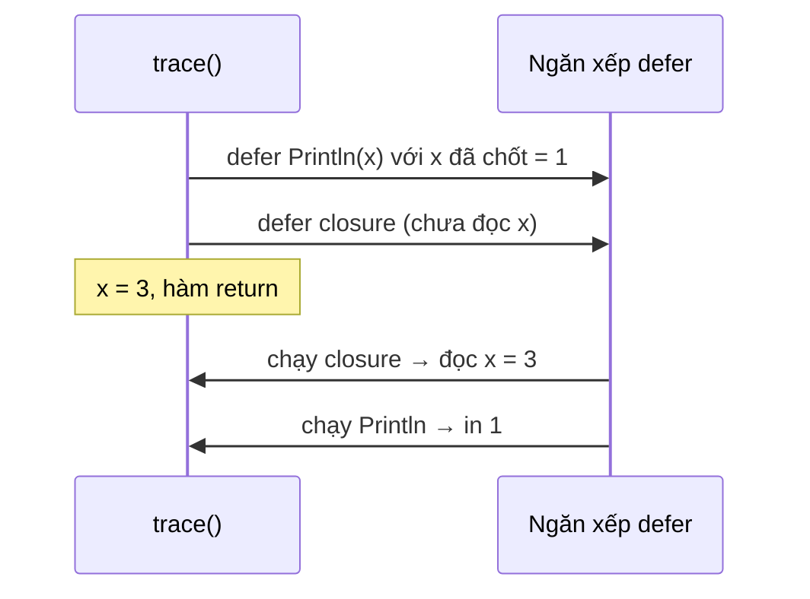

# Hàm

Hàm (function) trong Go đơn giản về cú pháp nhưng có vài đặc điểm khác hẳn Java hay JavaScript: trả về **nhiều giá trị** (thường là kết quả kèm `error`), có **named return value**, tham số **variadic**, hàm là **giá trị hạng nhất** (first-class value) và từ khoá **`defer`** để dọn dẹp tài nguyên. Bài này đi qua từng đặc điểm, kèm những bẫy về `defer` hay bị hỏi khi phỏng vấn.

---

:::note[Ghi nhớ nhanh]

- ⭐ **Trả về `(kết quả, error)` là idiom chuẩn** — caller kiểm tra `if err != nil` ngay sau lời gọi; `error` luôn đứng cuối.
- ⭐ **`defer` chạy theo thứ tự LIFO khi hàm return, nhưng tham số được đánh giá ngay lúc gặp `defer`** — muốn lấy giá trị cuối cùng thì dùng closure.
- **Named return value** giúp tài liệu hoá và cho phép `defer` sửa kết quả; tránh **naked return** (`return` trống) trong hàm dài.
- **Variadic `...T`** — bên trong hàm là `[]T`; truyền slice có sẵn bằng `s...`.
- **Hàm là giá trị** — gán vào biến, truyền làm tham số, trả về từ hàm khác; zero value là `nil`.

:::

---

## Mục lục

- [Vì sao hàm Go trả về nhiều giá trị?](#vì-sao-hàm-go-trả-về-nhiều-giá-trị)
- [Khai báo hàm](#khai-báo-hàm)
- [Nhiều giá trị trả về](#nhiều-giá-trị-trả-về)
- [Named return value](#named-return-value)
- [Variadic function](#variadic-function)
- [Hàm là first-class value](#hàm-là-first-class-value)
- [defer](#defer)
- [Câu hỏi phỏng vấn](#câu-hỏi-phỏng-vấn)

---

## Vì sao hàm Go trả về nhiều giá trị?

**Vấn đề:** Ở nhiều ngôn ngữ, hàm chỉ trả về một giá trị nên lỗi phải đi đường khác — exception (dễ quên bắt, luồng điều khiển "nhảy" khó đoán) hoặc giá trị đặc biệt như `-1`, `null` (dễ nhầm với kết quả hợp lệ):

```java
// Java: không nhìn chữ ký thì không biết hàm có thể ném lỗi gì
int port = Integer.parseInt(config.get("port")); // NumberFormatException nếu sai định dạng
```

```c
// C: -1 vừa là lỗi vừa có thể là giá trị hợp lệ trong ngữ cảnh khác
int idx = find(arr, x); // -1 = không thấy
```

**Giải pháp:** Go cho hàm trả về nhiều giá trị, lỗi là một giá trị bình thường đi kèm kết quả:

```go
port, err := strconv.Atoi(os.Getenv("PORT"))
if err != nil {
	log.Fatalf("PORT không hợp lệ: %v", err)
}
fmt.Println("Lắng nghe cổng", port)
```

Chữ ký `func Atoi(s string) (int, error)` nói rõ: hàm này **có thể thất bại**, và bạn buộc phải nhận biến `err` (hoặc cố ý bỏ bằng `_`).

:::tip[Dùng thực tế]

- **Gọi DB, HTTP, đọc file** — mọi thao tác I/O đều trả `(kết quả, error)`.
- **Tra cứu có/không** — `v, ok := cache.Get(key)` theo mẫu comma-ok.
- **Dọn tài nguyên** — `defer file.Close()`, `defer mu.Unlock()`, `defer rows.Close()` ngay sau khi mở.
- **Middleware, callback, strategy** — truyền hàm làm tham số thay cho interface một method.

:::

:::tip[Ví dụ đời thường]

Hàm trả nhiều giá trị giống **bưu tá giao hàng kèm phiếu báo**: lúc nào cũng đưa bạn hai thứ — gói hàng và tờ phiếu. Phiếu ghi "giao thành công" thì mở gói; phiếu ghi "hàng vỡ" thì đừng mở. Exception giống bưu tá **thỉnh thoảng không đến** mà chẳng báo gì — bạn phải tự đoán chuyện gì đã xảy ra.

:::

---

## Khai báo hàm

```go
// func tên(tham số) kiểu_trả_về { thân }
func greet(name string) string {
	return "Xin chào, " + name
}

// Tham số cùng kiểu đứng cạnh nhau có thể gộp kiểu
func add(a, b int) int {
	return a + b
}

// Không trả về gì
func logInfo(msg string) {
	fmt.Println("[INFO]", msg)
}
```

Một số điểm khác biệt so với ngôn ngữ khác:

- **Không có overloading** — không thể có hai hàm `add(int, int)` và `add(float64, float64)` cùng tên. Đặt tên khác (`addInt`, `addFloat`) hoặc dùng generics.
- **Không có tham số mặc định** và **không có named argument** khi gọi. Dùng struct options hoặc functional options pattern.
- **Hàm viết hoa** (`Greet`) được export ra ngoài package; viết thường chỉ dùng trong package.
- Thứ tự khai báo hàm trong file **không quan trọng** — gọi hàm khai báo phía dưới vẫn được.

---

## Nhiều giá trị trả về

```go
func divide(a, b float64) (float64, error) {
	if b == 0 {
		return 0, errors.New("chia cho 0")
	}
	return a / b, nil
}

func minMax(nums []int) (int, int) {
	lo, hi := nums[0], nums[0]
	for _, n := range nums[1:] {
		lo = min(lo, n) // min, max built-in từ Go 1.21
		hi = max(hi, n)
	}
	return lo, hi
}

func main() {
	q, err := divide(10, 3)
	if err != nil {
		fmt.Println("lỗi:", err)
		return
	}
	fmt.Println(q)

	lo, _ := minMax([]int{3, 1, 4}) // bỏ qua giá trị không cần bằng blank identifier
	fmt.Println(lo)
}
```

Quy ước:

- `error` luôn là giá trị **cuối cùng**.
- Khi `err != nil`, các giá trị còn lại thường là zero value và **không nên dùng** (trừ khi tài liệu nói khác, như `io.Reader.Read` trả `n > 0` kèm `io.EOF`).
- Truyền thẳng kết quả nhiều giá trị vào hàm khác được nếu khớp số lượng: `fmt.Println(divide(10, 0))`.

:::warning[Đừng bỏ qua error bằng `_` một cách tuỳ tiện]

`data, _ := os.ReadFile(path)` chạy được nhưng khi file không tồn tại, `data` rỗng và chương trình đi tiếp với dữ liệu sai — lỗi lộ ra ở chỗ khác, rất khó truy vết. Chỉ dùng `_` khi chắc chắn lỗi không thể xảy ra hoặc không quan trọng, và nên ghi comment giải thích.

:::

---

## Named return value

Đặt tên cho giá trị trả về — chúng trở thành biến cục bộ, khởi tạo bằng zero value:

```go
// Tên giúp đọc chữ ký dễ hơn: hàm trả về vĩ độ và kinh độ
func geocode(address string) (lat, lng float64, err error) {
	if address == "" {
		err = errors.New("địa chỉ rỗng")
		return // naked return: trả về lat=0, lng=0, err
	}
	lat, lng = 21.0285, 105.8542
	return lat, lng, nil // trả rõ ràng vẫn được
}
```

### Công dụng thật sự: `defer` sửa kết quả

Named return là cách duy nhất để `defer` thay đổi giá trị trả về — thường dùng để bọc lỗi hoặc xử lý `panic`:

```go
func parsePort(s string) (port int, err error) {
	defer func() {
		if err != nil {
			err = fmt.Errorf("parsePort %q: %w", s, err) // thêm ngữ cảnh cho mọi đường lỗi
		}
	}()

	port, err = strconv.Atoi(s)
	if err != nil {
		return 0, err
	}
	if port < 1 || port > 65535 {
		return 0, errors.New("ngoài khoảng 1-65535")
	}
	return port, nil
}
```

:::warning[Tránh naked return trong hàm dài]

`return` trống buộc người đọc phải cuộn lên đầu hàm để biết đang trả về gì, và dễ trả nhầm giá trị đã bị gán lại giữa chừng. Theo Go Code Review Comments: naked return chỉ chấp nhận được trong hàm **rất ngắn**. Ngoài ra, named return còn có bẫy shadowing:

```go
func load() (n int, err error) {
	if true {
		n, err := strconv.Atoi("x") // := tạo biến MỚI che biến trả về
		_ = n
		_ = err
	}
	return // trả về n=0, err=nil — lỗi bị nuốt mất
}
```

:::

---

## Variadic function

Tham số cuối có dạng `...T` nhận **không hoặc nhiều** giá trị kiểu `T`; bên trong hàm nó là `[]T`:

```go
func sum(nums ...int) int {
	total := 0
	for _, n := range nums {
		total += n
	}
	return total
}

fmt.Println(sum())        // 0 — nums là nil slice
fmt.Println(sum(1, 2, 3)) // 6

prices := []int{4, 5}
fmt.Println(sum(prices...)) // 9 — "rải" slice thành các đối số
```

Ví dụ quen thuộc trong thư viện chuẩn: `fmt.Println(a ...any)`, `append(s []T, x ...T)`, `errors.Join(errs ...error)`.

Kết hợp tham số thường và variadic:

```go
func logf(level string, format string, args ...any) {
	fmt.Printf("["+level+"] "+format+"\n", args...) // chuyển tiếp args xuống Printf
}

logf("WARN", "user %d đăng nhập sai %d lần", 42, 3)
```

:::warning[Truyền `s...` thì hàm dùng chung mảng nền]

Khi gọi `f(s...)`, Go **không copy** slice — hàm nhận đúng slice `s`. Nếu hàm sửa `nums[0]`, slice của caller cũng đổi. Còn khi gọi `f(1, 2, 3)`, Go tạo slice mới.

:::

---

## Hàm là first-class value

Hàm có kiểu (function type) và dùng được như mọi giá trị khác:

```go
// Khai báo kiểu hàm để code dễ đọc
type Op func(int, int) int

func apply(a, b int, op Op) int {
	return op(a, b)
}

func main() {
	add := func(a, b int) int { return a + b } // gán hàm vào biến
	fmt.Println(apply(2, 3, add))              // 5 — truyền hàm làm tham số

	ops := map[string]Op{ // lưu hàm trong map
		"+": add,
		"*": func(a, b int) int { return a * b },
	}
	fmt.Println(ops["*"](4, 5)) // 20

	var f func()
	fmt.Println(f == nil) // true — zero value của kiểu hàm là nil
	// f() // panic: nil pointer dereference
}
```

Hàm trả về hàm:

```go
func multiplier(factor int) func(int) int {
	return func(x int) int { return x * factor }
}

double := multiplier(2)
fmt.Println(double(21)) // 42
```

Ứng dụng phổ biến: hàm so sánh cho `slices.SortFunc`, handler `http.HandlerFunc`, hàm retry nhận `func() error`. Hàm chỉ so sánh được với `nil`, không so sánh hai hàm với nhau được.

---

## defer

`defer` hoãn lời gọi hàm tới khi **hàm bao ngoài kết thúc** — dù kết thúc bằng `return` bình thường hay do `panic`. Dùng để đặt code dọn dẹp ngay cạnh code mở tài nguyên:

```go
func readConfig(path string) ([]byte, error) {
	f, err := os.Open(path)
	if err != nil {
		return nil, err
	}
	defer f.Close() // chắc chắn đóng file ở mọi đường return phía dưới

	return io.ReadAll(f)
}
```

### Quy tắc 1: thứ tự LIFO

Nhiều `defer` được đẩy vào một ngăn xếp, chạy theo thứ tự **vào sau ra trước**:

```go
func main() {
	for i := range 3 {
		defer fmt.Print(i, " ")
	}
	fmt.Println("bắt đầu")
}
// bắt đầu
// 2 1 0
```

Thứ tự này hợp lý: tài nguyên mở sau thường phụ thuộc tài nguyên mở trước (mở DB → mở transaction), nên phải đóng ngược lại.

### Quy tắc 2: tham số được đánh giá ngay

Đối số của hàm bị defer được tính **tại thời điểm gặp `defer`**, không phải lúc chạy:

```go
func trace() {
	x := 1
	defer fmt.Println("defer thấy x =", x) // x được chốt = 1 ngay bây giờ
	x = 2
	defer func() { fmt.Println("closure thấy x =", x) }() // closure đọc x lúc chạy
	x = 3
}
// closure thấy x = 3
// defer thấy x = 1
```



### Quy tắc 3: defer có thể sửa named return

```go
func double() (result int) {
	defer func() { result *= 2 }()
	return 21 // gán result = 21, rồi defer chạy, rồi mới thật sự trả về
}

fmt.Println(double()) // 42
```

`return 21` thực chất gồm hai bước: gán `result = 21`, chạy các defer, rồi trả về `result`.

### defer với recover

`recover` chỉ có tác dụng khi được gọi **trực tiếp trong hàm bị defer**:

```go
func safeRun(task func()) (err error) {
	defer func() {
		if r := recover(); r != nil {
			err = fmt.Errorf("task panic: %v", r) // chuyển panic thành error
		}
	}()
	task()
	return nil
}
```

:::warning[Bẫy defer trong vòng lặp]

`defer` chỉ chạy khi **hàm** kết thúc, không phải khi vòng lặp kết thúc:

```go
// SAI: mở 10.000 file, chỉ đóng khi processAll return → có thể hết file descriptor
func processAll(paths []string) error {
	for _, p := range paths {
		f, err := os.Open(p)
		if err != nil {
			return err
		}
		defer f.Close()
		// ... xử lý f
	}
	return nil
}

// ĐÚNG: tách thân vòng lặp ra hàm riêng
func processOne(p string) error {
	f, err := os.Open(p)
	if err != nil {
		return err
	}
	defer f.Close() // đóng ngay khi xử lý xong file này
	// ... xử lý f
	return nil
}
```

:::

:::note[Lỗi của Close khi ghi file]

Với file mở để **ghi**, `Close` có thể trả lỗi (dữ liệu chưa flush xuống đĩa). `defer f.Close()` bỏ qua lỗi đó. Khi dữ liệu quan trọng, gọi `f.Close()` tường minh và kiểm tra lỗi, hoặc gộp lỗi trong defer bằng named return và `errors.Join`.

:::

Chi phí của `defer` từng là lý do để tránh dùng trong code nóng; từ Go 1.14 (open-coded defer) chi phí gần như bằng gọi hàm thường, nên cứ dùng `defer` cho rõ ràng.

---

## Câu hỏi phỏng vấn

**1. Vì sao Go dùng nhiều giá trị trả về thay vì exception để báo lỗi?**

<details className="qa">
<summary>Xem đáp án</summary>

Lỗi là giá trị bình thường, xuất hiện ngay trong chữ ký hàm, nên người gọi thấy rõ hàm nào có thể thất bại và phải xử lý tại chỗ. Luồng điều khiển tường minh, không có "nhảy" ngầm qua nhiều tầng như exception. Đổi lại code dài hơn vì nhiều `if err != nil`. `panic` vẫn tồn tại nhưng chỉ dành cho lỗi lập trình hoặc tình huống không thể phục hồi.

</details>

**2. Đoạn code sau in ra gì?**

```go
func main() {
	for i := range 3 {
		defer fmt.Println(i)
	}
}
```

<details className="qa">
<summary>Xem đáp án</summary>

In `2`, `1`, `0` (mỗi số một dòng). Các defer được đẩy vào ngăn xếp và chạy theo LIFO khi `main` kết thúc. Giá trị `i` được đánh giá ngay lúc gặp `defer` nên mỗi lời gọi giữ đúng giá trị của lần lặp đó.

</details>

**3. Tham số của hàm bị defer được đánh giá khi nào? Làm sao để defer dùng giá trị mới nhất của biến?**

<details className="qa">
<summary>Xem đáp án</summary>

Được đánh giá ngay tại câu lệnh `defer`. `defer fmt.Println(x)` sẽ in giá trị `x` tại thời điểm đó dù sau này `x` đổi. Muốn dùng giá trị lúc hàm kết thúc thì defer một closure: `defer func() { fmt.Println(x) }()` — closure đọc biến `x` khi chạy. Lưu ý receiver của method cũng được đánh giá ngay: `defer obj.Method()` chốt `obj` lúc gặp defer.

</details>

**4. Named return value có tác dụng gì? Vì sao nên tránh naked return?**

<details className="qa">
<summary>Xem đáp án</summary>

Named return tài liệu hoá ý nghĩa giá trị trả về (`(lat, lng float64, err error)`) và cho phép `defer` đọc/sửa kết quả — ví dụ bọc thêm ngữ cảnh cho lỗi hoặc chuyển `panic` thành `error` qua `recover`. Naked return (`return` trống) làm hàm dài khó đọc vì không thấy đang trả về gì, và dễ bị bẫy shadowing khi `:=` trong block con tạo biến mới cùng tên. Chỉ nên dùng naked return trong hàm rất ngắn.

</details>

**5. Variadic function hoạt động thế nào? Truyền slice vào variadic có copy không?**

<details className="qa">
<summary>Xem đáp án</summary>

Tham số cuối `...T` nhận 0..n đối số; bên trong hàm là `[]T` (nil nếu không truyền gì). Truyền slice có sẵn bằng `f(s...)` — khi đó Go **không** copy, hàm nhận chính slice `s`, sửa phần tử sẽ ảnh hưởng caller. Gọi `f(a, b, c)` thì Go tạo slice mới.

</details>

**6. Vì sao không nên `defer f.Close()` trong vòng lặp?**

<details className="qa">
<summary>Xem đáp án</summary>

`defer` chạy khi hàm bao ngoài kết thúc, không phải cuối mỗi vòng lặp. Mở nhiều file trong vòng lặp sẽ giữ tất cả mở tới cuối hàm → có thể cạn file descriptor hoặc giữ khoá/kết nối quá lâu. Cách sửa: tách thân vòng lặp ra một hàm riêng có `defer`, hoặc dùng hàm ẩn danh gọi ngay trong vòng lặp, hoặc đóng tường minh.

</details>
