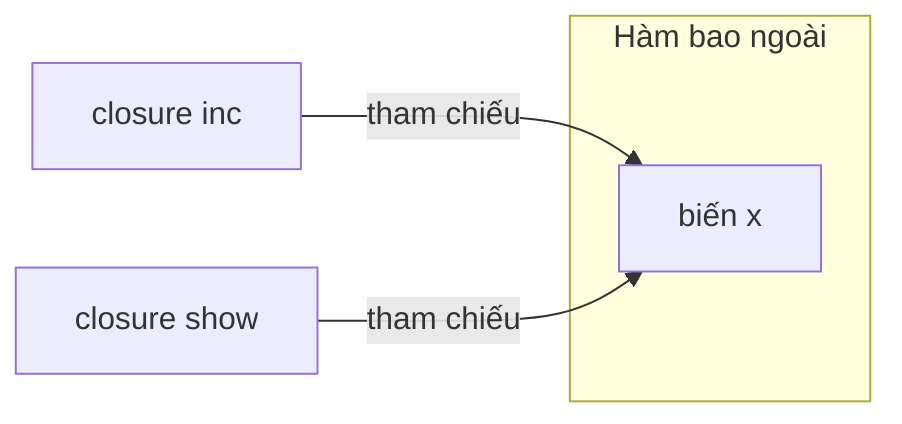
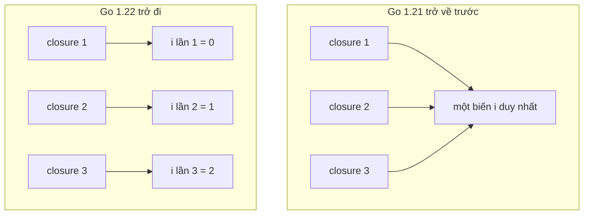

# Hàm ẩn danh và Closure

Hàm ẩn danh (anonymous function — hàm không có tên) và closure (bao đóng — hàm "nhớ" các biến ở phạm vi bên ngoài nơi nó được tạo) là nền tảng cho rất nhiều pattern trong Go: chạy goroutine, viết middleware HTTP, callback cho `sort`, generator và iterator. Bài này giải thích closure bắt biến như thế nào, các ứng dụng thực tế, và cái bẫy kinh điển "closure trong vòng lặp" — đã được Go 1.22 thay đổi hành vi.

---

:::note[Ghi nhớ nhanh]

- ⭐ **Closure bắt biến theo tham chiếu, không copy giá trị** — closure đọc/ghi chính biến bên ngoài; biến đổi sau khi tạo closure thì closure thấy giá trị mới.
- ⭐ **Từ Go 1.22, biến vòng lặp `for` được tạo mới mỗi lần lặp** — bẫy "goroutine trong vòng lặp in toàn giá trị cuối" không còn, nhưng chỉ khi `go.mod` khai báo `go 1.22` trở lên.
- **Hàm ẩn danh gọi ngay** (IIFE): `func() { ... }()` — hay dùng với `go` và `defer`.
- **Biến được closure bắt sẽ sống tới khi closure không còn được tham chiếu** — thường bị đẩy lên heap (escape).
- **Ứng dụng chính**: counter/state riêng tư, middleware, generator, callback, functional options.

:::

---

## Mục lục

- [Vì sao cần closure?](#vì-sao-cần-closure)
- [Hàm ẩn danh](#hàm-ẩn-danh)
- [Closure bắt biến theo tham chiếu](#closure-bắt-biến-theo-tham-chiếu)
- [Ứng dụng: counter, middleware, generator](#ứng-dụng-counter-middleware-generator)
- [Bẫy closure trong vòng lặp](#bẫy-closure-trong-vòng-lặp)
- [Closure và hiệu năng](#closure-và-hiệu-năng)

---

## Vì sao cần closure?

**Vấn đề:** Muốn đo thời gian và ghi log cho mọi HTTP handler. Không có closure, bạn phải chèn cùng một đoạn code vào từng handler:

```go
func listUsers(w http.ResponseWriter, r *http.Request) {
	start := time.Now()
	// ... logic lấy danh sách user
	log.Printf("%s %s %v", r.Method, r.URL.Path, time.Since(start)) // lặp lại
}

func getOrder(w http.ResponseWriter, r *http.Request) {
	start := time.Now()
	// ... logic lấy đơn hàng
	log.Printf("%s %s %v", r.Method, r.URL.Path, time.Since(start)) // lặp lại
}
```

**Giải pháp:** Viết một hàm nhận handler và trả về handler mới — hàm trả về là closure "nhớ" `next`:

```go
func logging(next http.HandlerFunc) http.HandlerFunc {
	return func(w http.ResponseWriter, r *http.Request) {
		start := time.Now()
		next(w, r) // next được closure bắt từ tham số của logging
		log.Printf("%s %s %v", r.Method, r.URL.Path, time.Since(start))
	}
}

func main() {
	mux := http.NewServeMux()
	mux.HandleFunc("GET /users", logging(listUsers))
	mux.HandleFunc("GET /orders/{id}", logging(getOrder))
	log.Fatal(http.ListenAndServe(":8080", mux))
}
```

:::tip[Dùng thực tế]

- **Middleware HTTP** — logging, auth, recover panic, CORS bọc quanh handler.
- **Goroutine** — `go func() { ... }()` chạy một khối code đồng thời, dùng biến của hàm bao ngoài.
- **Callback** — hàm so sánh cho `slices.SortFunc`, hàm lọc, hàm retry.
- **Trạng thái riêng tư** — counter, rate limiter, cache memoize mà không cần struct.

:::

:::tip[Ví dụ đời thường]

Closure giống **nhân viên giao hàng được phát một chiếc ba lô** trước khi rời kho. Ba lô (biến bị bắt) đi theo nhân viên tới mọi nơi, kể cả khi kho (hàm bao ngoài) đã đóng cửa. Quan trọng là ba lô là **đồ thật chứ không phải ảnh chụp**: ai nhét thêm hàng vào ba lô thì nhân viên cũng mang theo phần hàng mới đó.

:::

---

## Hàm ẩn danh

Hàm không có tên, có thể gán vào biến, truyền làm tham số, hoặc gọi ngay:

```go
// Gán vào biến
square := func(x int) int { return x * x }
fmt.Println(square(5)) // 25

// Truyền làm tham số
nums := []int{3, 1, 2}
slices.SortFunc(nums, func(a, b int) int { return b - a }) // sắp xếp giảm dần
fmt.Println(nums) // [3 2 1]
```

### Gọi ngay (IIFE)

IIFE (Immediately Invoked Function Expression — biểu thức hàm gọi ngay) là hàm ẩn danh được định nghĩa và gọi luôn bằng `()` ở cuối:

```go
result := func(a, b int) int {
	return a * b
}(3, 4)
fmt.Println(result) // 12
```

Trong Go, IIFE xuất hiện chủ yếu ở ba chỗ:

```go
// 1. Chạy goroutine
go func() {
	sendEmail(user)
}()

// 2. Defer nhiều câu lệnh / recover
defer func() {
	if r := recover(); r != nil {
		log.Println("phục hồi:", r)
	}
}()

// 3. Khởi tạo biến phức tạp ở package level
var allowedRoles = func() map[string]bool {
	m := make(map[string]bool)
	for _, r := range []string{"admin", "editor"} {
		m[r] = true
	}
	return m
}()
```

:::warning[Quên dấu `()` cuối]

`go func() { ... }` (thiếu `()`) là lỗi biên dịch: "expression in go must be function call". Với `defer` cũng vậy. Dấu `()` mới là thứ thực sự **gọi** hàm.

:::

---

## Closure bắt biến theo tham chiếu

Closure không copy giá trị của biến lúc tạo — nó **dùng chung** chính biến đó với phạm vi bên ngoài:

```go
x := 10
inc := func() { x++ } // closure bắt biến x

inc()
inc()
fmt.Println(x) // 12 — closure sửa trực tiếp x bên ngoài

x = 100
show := func() { fmt.Println(x) }
x = 200
show() // 200 — đọc giá trị tại thời điểm gọi, không phải lúc tạo
```



Hai closure cùng bắt một biến thì **thấy thay đổi của nhau**. Muốn "chụp" giá trị tại thời điểm tạo closure, truyền qua tham số hoặc tạo biến mới:

```go
x := 1
snapshot := x                           // copy giá trị
f := func() { fmt.Println(snapshot) }
g := func(v int) func() {               // hoặc truyền qua tham số
	return func() { fmt.Println(v) }
}(x)
x = 99
f() // 1
g() // 1
```

### Biến sống lâu hơn hàm tạo ra nó

```go
func counter() func() int {
	count := 0 // biến cục bộ của counter
	return func() int {
		count++
		return count
	}
}

c1 := counter()
c2 := counter()
fmt.Println(c1(), c1(), c2()) // 1 2 1
```

`counter()` đã return nhưng `count` vẫn tồn tại vì closure còn tham chiếu. Mỗi lần gọi `counter()` tạo một biến `count` **mới** — `c1` và `c2` độc lập nhau. Trình biên dịch phát hiện điều này qua escape analysis và đặt `count` lên heap.

---

## Ứng dụng: counter, middleware, generator

### 1. Trạng thái riêng tư

```go
// Rate limiter đơn giản: cho phép tối đa n lần gọi
func limiter(n int) func() bool {
	used := 0
	return func() bool {
		if used >= n {
			return false
		}
		used++
		return true
	}
}

allow := limiter(3)
for range 5 {
	fmt.Print(allow(), " ") // true true true false false
}
```

`used` không thể bị truy cập từ bên ngoài — đóng gói mà không cần struct. Lưu ý: closure này **không an toàn** khi gọi từ nhiều goroutine; cần thêm `sync.Mutex` nếu dùng đồng thời.

### 2. Middleware có cấu hình

```go
func requireRole(role string) func(http.HandlerFunc) http.HandlerFunc {
	return func(next http.HandlerFunc) http.HandlerFunc {
		return func(w http.ResponseWriter, r *http.Request) {
			if r.Header.Get("X-Role") != role { // role được bắt từ lớp ngoài cùng
				http.Error(w, "forbidden", http.StatusForbidden)
				return
			}
			next(w, r)
		}
	}
}

mux.HandleFunc("DELETE /users/{id}", requireRole("admin")(deleteUser))
```

### 3. Generator

```go
func fib() func() int {
	a, b := 0, 1
	return func() int {
		r := a
		a, b = b, a+b
		return r
	}
}

next := fib()
for range 6 {
	fmt.Print(next(), " ") // 0 1 1 2 3 5
}
```

Từ Go 1.23, cách idiomatic hơn là trả về **iterator** (`iter.Seq`) để dùng trực tiếp với `for range` — bản chất vẫn là closure:

```go
import "iter"

func Fib() iter.Seq[int] {
	return func(yield func(int) bool) {
		a, b := 0, 1
		for {
			if !yield(a) { // caller break → yield trả false → dừng
				return
			}
			a, b = b, a+b
		}
	}
}

for v := range Fib() {
	if v > 50 {
		break
	}
	fmt.Print(v, " ") // 0 1 1 2 3 5 8 13 21 34
}
```

### 4. Functional options

```go
type Server struct {
	port    int
	timeout time.Duration
}

type Option func(*Server)

func WithPort(p int) Option {
	return func(s *Server) { s.port = p } // closure bắt p
}

func WithTimeout(d time.Duration) Option {
	return func(s *Server) { s.timeout = d }
}

func NewServer(opts ...Option) *Server {
	s := &Server{port: 8080, timeout: 30 * time.Second} // giá trị mặc định
	for _, opt := range opts {
		opt(s)
	}
	return s
}

srv := NewServer(WithPort(9000))
```

---

## Bẫy closure trong vòng lặp

### Trước Go 1.22: một biến dùng chung cho mọi lần lặp

Với Go 1.21 trở về trước, biến khai báo trong `for` (cả `for i := 0; ...` và `for _, v := range`) chỉ có **một** cho cả vòng lặp, mỗi lần lặp gán lại giá trị. Mọi closure bắt cùng một biến:

```go
// go.mod: go 1.21
var funcs []func()
for i := 0; i < 3; i++ {
	funcs = append(funcs, func() { fmt.Print(i, " ") })
}
for _, f := range funcs {
	f()
}
// Go 1.21: 3 3 3   ← cả ba closure thấy cùng biến i, giá trị cuối là 3
```

Với goroutine còn tệ hơn — kết quả phụ thuộc thời điểm goroutine chạy:

```go
// go.mod: go 1.21
for _, v := range []string{"a", "b", "c"} {
	wg.Add(1)
	go func() {
		defer wg.Done()
		fmt.Print(v, " ") // thường in "c c c"
	}()
}
wg.Wait()
```

Cách sửa kinh điển trước 1.22:

```go
for _, v := range items {
	v := v // tạo biến mới che biến vòng lặp
	go func() { use(v) }()
}

// hoặc truyền qua tham số
for _, v := range items {
	go func(v string) { use(v) }(v)
}
```

### Từ Go 1.22: mỗi lần lặp một biến mới

Go 1.22 đổi ngữ nghĩa: **mỗi lần lặp tạo một biến mới**. Cùng đoạn code trên giờ in đúng:

```go
// go.mod: go 1.22 trở lên
var funcs []func()
for i := 0; i < 3; i++ {
	funcs = append(funcs, func() { fmt.Print(i, " ") })
}
for _, f := range funcs {
	f()
}
// 0 1 2
```



:::warning[Hành vi phụ thuộc dòng `go` trong go.mod, không phải phiên bản compiler]

Ngữ nghĩa mới chỉ áp dụng cho package thuộc module có `go 1.22` (hoặc cao hơn) trong `go.mod`. Dùng compiler Go 1.26 nhưng `go.mod` ghi `go 1.21` thì vẫn chạy theo **ngữ nghĩa cũ**. Khi nâng dòng `go` trong module cũ, bạn có thể xoá các dòng `v := v` — chúng vô hại nhưng thừa. `go vet` (analyzer `loopclosure`) cảnh báo bẫy này ở module cũ.

:::

:::note

Thay đổi chỉ áp dụng cho **biến khai báo trong mệnh đề `for`**. Closure bắt biến khai báo **bên ngoài** vòng lặp vẫn dùng chung một biến như bình thường:

```go
total := 0
for i := range 3 {
	defer func() { total += i }() // tất cả closure dùng chung total — đúng ý đồ
}
```

:::

---

## Closure và hiệu năng

- Biến bị closure bắt mà sống lâu hơn hàm (closure được return, lưu vào struct, chạy trong goroutine) sẽ **escape lên heap** → thêm một lần cấp phát và việc cho GC.
- Closure chỉ dùng tại chỗ (truyền vào `slices.SortFunc`, gọi ngay) thường được trình biên dịch giữ trên stack hoặc inline.
- Gọi closure qua biến kiểu hàm là **gọi gián tiếp**, khó inline hơn gọi hàm trực tiếp — chỉ đáng bận tâm trong vòng lặp cực nóng.

Kiểm tra bằng escape analysis:

```bash
go build -gcflags=-m ./...
# ./main.go:6:2: moved to heap: count
# ./main.go:7:9: func literal escapes to heap
```

:::warning[Closure giữ tham chiếu ngoài ý muốn]

Closure bắt cả biến lớn (một slice 100MB, một struct to) sẽ giữ nó sống chừng nào closure còn sống — ví dụ closure được đăng ký làm callback toàn cục. Chỉ bắt đúng phần cần dùng (copy ra biến nhỏ trước khi tạo closure).

:::
