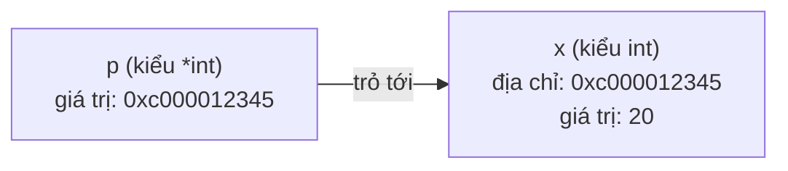

# Con trỏ

Con trỏ (pointer) là biến chứa **địa chỉ bộ nhớ** của một biến khác. Go có con trỏ như C nhưng an toàn hơn nhiều: không có phép tính số học trên con trỏ (pointer arithmetic), không phải tự giải phóng bộ nhớ, và trình biên dịch tự quyết định đặt biến ở stack hay heap. Hiểu con trỏ là bắt buộc để trả lời câu hỏi thường gặp nhất của người mới học Go: "vì sao hàm của tôi sửa struct mà bên ngoài không thấy đổi?".

---

:::note[Ghi nhớ nhanh]

- ⭐ **Go luôn truyền theo giá trị (call by value)** — hàm nhận bản copy của đối số; muốn hàm sửa được biến của caller thì truyền con trỏ.
- ⭐ **`&x` lấy địa chỉ, `*p` đọc/ghi giá trị tại địa chỉ** — với struct, `p.Field` tự dereference, không cần `(*p).Field`.
- **Slice, map, channel đã chứa con trỏ bên trong** — thường không cần `*[]T` hay `*map[K]V`; chỉ cần khi hàm phải thay cả header (như `append` làm đổi len).
- **Dereference con trỏ `nil` gây panic** — kiểm tra `p != nil` với con trỏ có thể rỗng.
- **Trả về con trỏ tới biến cục bộ là an toàn** — escape analysis sẽ đưa biến lên heap; không có dangling pointer như C.

:::

---

## Mục lục

- [Vì sao cần con trỏ?](#vì-sao-cần-con-trỏ)
- [Toán tử `&` và `*`](#toán-tử--và-)
- [Mọi thứ đều truyền theo giá trị](#mọi-thứ-đều-truyền-theo-giá-trị)
- [Con trỏ với struct](#con-trỏ-với-struct)
- [Con trỏ với slice và map](#con-trỏ-với-slice-và-map)
- [Hàm new và con trỏ tới giá trị](#hàm-new-và-con-trỏ-tới-giá-trị)
- [nil pointer](#nil-pointer)
- [Go không có pointer arithmetic](#go-không-có-pointer-arithmetic)
- [Câu hỏi phỏng vấn](#câu-hỏi-phỏng-vấn)

---

## Vì sao cần con trỏ?

**Vấn đề:** Go copy đối số khi gọi hàm. Hàm nhận struct sẽ sửa trên bản copy, thay đổi biến mất khi hàm return:

```go
type Account struct {
	Owner   string
	Balance int
}

func deposit(a Account, amount int) {
	a.Balance += amount // sửa bản copy
}

func main() {
	acc := Account{Owner: "An", Balance: 100_000}
	deposit(acc, 50_000)
	fmt.Println(acc.Balance) // 100000 — tiền "nạp" biến mất!
}
```

Ngoài ra, struct lớn (vài KB) bị copy ở mỗi lần gọi hàm cũng tốn chi phí.

**Giải pháp:** Truyền **địa chỉ** của biến — hàm sửa trực tiếp vùng nhớ gốc:

```go
func deposit(a *Account, amount int) {
	a.Balance += amount // sửa trên vùng nhớ của acc
}

func main() {
	acc := Account{Owner: "An", Balance: 100_000}
	deposit(&acc, 50_000)
	fmt.Println(acc.Balance) // 150000
}
```

:::tip[Dùng thực tế]

- **Method sửa trạng thái** — `func (s *Service) SetTimeout(d time.Duration)` dùng pointer receiver.
- **Struct lớn hoặc chứa mutex** — truyền `*T` để tránh copy (và vì `sync.Mutex` không được copy).
- **Biểu diễn "không có giá trị"** — trường `*int`, `*string` trong JSON/DB để phân biệt `null` với `0`/`""`.
- **Decode/scan vào biến** — `json.Unmarshal(data, &v)`, `rows.Scan(&id, &name)` cần địa chỉ để ghi kết quả.

:::

:::tip[Ví dụ đời thường]

Truyền giá trị giống **photo hồ sơ** đưa cho người khác: họ gạch xoá trên bản photo thì bản gốc của bạn vẫn nguyên. Truyền con trỏ giống **đưa địa chỉ nhà**: người thợ tới đúng địa chỉ đó sơn lại tường thì chính ngôi nhà của bạn đổi màu. Con trỏ `nil` là **tờ giấy ghi địa chỉ để trống** — thợ cầm tới thì không biết đi đâu (panic).

:::

---

## Toán tử `&` và `*`

```go
x := 10
p := &x            // & lấy địa chỉ của x; p có kiểu *int ("con trỏ tới int")

fmt.Println(p)     // 0xc000012345 — một địa chỉ bộ nhớ
fmt.Println(*p)    // 10 — * "dereference": đọc giá trị tại địa chỉ

*p = 20            // ghi giá trị qua con trỏ
fmt.Println(x)     // 20 — x đổi theo
```

| Ký hiệu | Vị trí | Ý nghĩa |
|---|---|---|
| `*T` | trong kiểu | Kiểu "con trỏ tới T" |
| `&x` | trong biểu thức | Lấy địa chỉ của biến `x` |
| `*p` | trong biểu thức | Giá trị tại địa chỉ `p` trỏ tới |



Con trỏ tới con trỏ cũng hợp lệ nhưng hiếm dùng:

```go
pp := &p     // kiểu **int
**pp = 99
fmt.Println(x) // 99
```

Có thể lấy địa chỉ của biến, trường struct, phần tử slice/array và composite literal (`&User{}`). **Không** lấy được địa chỉ của hằng, kết quả hàm, phần tử map:

```go
// &10           // lỗi: không lấy địa chỉ hằng
// &getValue()   // lỗi: không lấy địa chỉ kết quả hàm
// &m["key"]     // lỗi: phần tử map không addressable
u := &User{Name: "An"} // OK — composite literal là ngoại lệ được phép
_ = u
```

---

## Mọi thứ đều truyền theo giá trị

Đây là quy tắc **không có ngoại lệ** trong Go: khi gọi hàm, mỗi đối số được copy vào tham số. Điều khác nhau chỉ là "giá trị" của từng kiểu chứa gì:

| Kiểu | Thứ được copy | Hàm sửa phần tử, caller thấy? |
|---|---|---|
| `int`, `string`, `bool` | Bản thân giá trị | Không |
| struct, array | Toàn bộ các trường/phần tử | Không |
| `*T` | Địa chỉ (8 byte) | **Có** — qua `*p` |
| slice | Header (ptr, len, cap) | **Có** với phần tử; không với len/cap |
| map, channel | Con trỏ tới cấu trúc runtime | **Có** |
| func, interface | Con trỏ/cặp con trỏ | Tuỳ giá trị bên trong |

Ngay cả con trỏ cũng được truyền theo giá trị — hàm nhận bản copy của **địa chỉ**. Gán con trỏ mới cho tham số không ảnh hưởng caller:

```go
func reassign(p *int) {
	n := 999
	p = &n // chỉ đổi bản copy của địa chỉ
}

func modify(p *int) {
	*p = 999 // sửa giá trị tại địa chỉ gốc
}

x := 1
reassign(&x)
fmt.Println(x) // 1
modify(&x)
fmt.Println(x) // 999
```

:::note

Go không có "call by reference" như `ref` trong C# hay `&` trong C++. Câu nói "slice/map là kiểu tham chiếu" chỉ là cách nói tắt: thứ được truyền là một giá trị **chứa** con trỏ.

:::

---

## Con trỏ với struct

Truy cập trường qua con trỏ **tự động dereference** — viết `p.Name` thay vì `(*p).Name`:

```go
type User struct {
	Name string
	Age  int
}

func birthday(u *User) {
	u.Age++ // tương đương (*u).Age++
}

u := User{Name: "An", Age: 30}
birthday(&u)
fmt.Println(u.Age) // 31

// Tạo struct và lấy con trỏ luôn — cách viết phổ biến nhất
p := &User{Name: "Bình", Age: 25}
p.Name = "Bình Nguyễn"
```

Method cũng vậy: gọi method có pointer receiver trên biến addressable, Go tự lấy địa chỉ (`u.SetName("x")` thành `(&u).SetName("x")`). Chi tiết value receiver và pointer receiver sẽ nằm ở bài Method.

### Khi nào truyền `*T`, khi nào truyền `T`?

| Dùng `*T` khi | Dùng `T` khi |
|---|---|
| Hàm cần **sửa** giá trị | Hàm chỉ đọc và struct nhỏ |
| Struct lớn (nhiều trường, array lớn) | Kiểu bất biến nhỏ: `time.Time`, `Point`, tiền tệ |
| Struct chứa `sync.Mutex` hoặc không được copy | Muốn đảm bảo hàm không vô tình sửa dữ liệu gốc |
| Cần biểu diễn "không có" bằng `nil` | Giá trị luôn tồn tại |

:::warning[Con trỏ không phải lúc nào cũng nhanh hơn]

Copy một struct vài chục byte rất rẻ và nằm trên stack. Con trỏ có thể khiến biến **escape lên heap**, tăng việc cho GC và giảm cache locality. Chọn `*T` vì **ngữ nghĩa** (cần sửa, cần nil, không được copy) trước, hiệu năng sau — và đo bằng benchmark.

:::

---

## Con trỏ với slice và map

Vì header slice đã chứa con trỏ tới mảng nền, và biến map đã là con trỏ, nên **thường không cần** truyền `*[]T` hay `*map[K]V`:

```go
func resetFirst(s []int) {
	s[0] = 0 // sửa mảng nền dùng chung → caller thấy
}

func setKey(m map[string]int) {
	m["a"] = 1 // sửa hash table dùng chung → caller thấy
}

s := []int{1, 2, 3}
resetFirst(s)
fmt.Println(s) // [0 2 3]

m := map[string]int{}
setKey(m)
fmt.Println(m) // map[a:1]
```

Nhưng **thay đổi header** (len/cap qua `append`, gán slice/map mới) thì caller không thấy:

```go
func grow(s []int) {
	s = append(s, 4) // header mới chỉ tồn tại trong hàm
}

func replace(m map[string]int) {
	m = map[string]int{"z": 9} // gán map mới cho biến cục bộ
}

grow(s)
fmt.Println(s) // [0 2 3] — không có 4

replace(m)
fmt.Println(m) // map[a:1] — không đổi
```

Hai cách sửa:

```go
// Cách 1 (idiomatic): trả về slice mới, giống append
func grow(s []int) []int {
	return append(s, 4)
}
s = grow(s)

// Cách 2: nhận con trỏ tới slice — dùng khi là method hoặc cần sửa nhiều slice
func growPtr(s *[]int) {
	*s = append(*s, 4)
}
growPtr(&s)
```

:::tip

Hầu hết API thư viện chuẩn theo cách 1 (`append`, `slices.Insert`, `slices.Delete`). Cách 2 thường thấy khi slice là trường của struct và method có pointer receiver — `func (q *Queue) Push(x int) { q.items = append(q.items, x) }`.

:::

---

## Hàm new và con trỏ tới giá trị

`new(T)` cấp phát một giá trị zero của kiểu `T` và trả về `*T`:

```go
n := new(int)    // *int trỏ tới 0
*n = 42

u := new(User)   // tương đương &User{}
u.Name = "Chi"
```

Trong thực tế `&T{...}` phổ biến hơn vì khởi tạo trường được luôn. `new` hữu ích với kiểu không có literal, như `new(int)`, `new(sync.WaitGroup)`.

### Con trỏ tới giá trị có sẵn

Trường kiểu `*int`, `*string` rất hay gặp (JSON optional, PATCH request, AWS SDK). Trước đây không thể viết `&30` nên phải tạo biến trung gian hoặc viết hàm helper generic:

```go
type Config struct {
	Timeout *int `json:"timeout,omitempty"` // nil = không cấu hình
}

// Helper generic phổ biến (Go 1.18+)
func ptr[T any](v T) *T { return &v }

c := Config{Timeout: ptr(30)}
```

Từ **Go 1.26**, `new` nhận được một **biểu thức**, cấp phát biến mới và khởi tạo bằng giá trị đó:

```go
c := Config{Timeout: new(30)} // Go 1.26+: *int trỏ tới 30
```

:::note

Module có `go.mod` khai báo phiên bản thấp hơn 1.26 thì vẫn phải dùng helper `ptr`. `new(T)` với một **kiểu** thì hoạt động như cũ ở mọi phiên bản.

:::

---

## nil pointer

Zero value của mọi kiểu con trỏ là `nil`. Dereference `nil` gây panic:

```go
var u *User
fmt.Println(u == nil) // true
fmt.Println(u.Name)   // panic: runtime error: invalid memory address or nil pointer dereference
```

Nguồn nil pointer phổ biến:

```go
// 1. Hàm trả về (nil, err) nhưng caller không kiểm tra err
user, err := repo.FindByID(ctx, id)
fmt.Println(user.Name) // panic nếu err != nil và user == nil

// 2. Trường con trỏ trong struct chưa được khởi tạo
type Service struct {
	db *sql.DB
}
s := Service{}
s.db.Ping() // panic

// 3. Map lưu con trỏ, key không tồn tại → nil
cache := map[string]*User{}
cache["x"].Name = "a" // panic
```

Cách phòng tránh:

- **Luôn kiểm tra `err`** trước khi dùng giá trị trả về.
- Dùng **hàm khởi tạo** `NewService(db *sql.DB)` để trường bắt buộc không bao giờ nil.
- Với dữ liệu có thể vắng mặt, kiểm tra `if p != nil` hoặc dùng comma-ok với map.

:::tip[Method trên nil receiver]

Method có pointer receiver vẫn **gọi được** trên con trỏ nil — panic chỉ xảy ra khi method truy cập trường. Một số kiểu tận dụng điều này để nil là giá trị hợp lệ:

```go
type Tree struct {
	Left, Right *Tree
	Val         int
}

func (t *Tree) Sum() int {
	if t == nil { // nil tree có tổng = 0
		return 0
	}
	return t.Val + t.Left.Sum() + t.Right.Sum()
}
```

:::

---

## Go không có pointer arithmetic

Trong C, `p++` dịch con trỏ sang phần tử kế tiếp — nguồn gốc của vô số lỗi tràn bộ đệm (buffer overflow). Go **cấm** điều này:

```go
arr := [3]int{1, 2, 3}
p := &arr[0]
// p++      // lỗi biên dịch: invalid operation: p++ (non-numeric type *int)
// p + 1    // lỗi biên dịch
```

Muốn duyệt phần tử thì dùng index hoặc slice — có kiểm tra biên (bounds check), truy cập ngoài phạm vi sẽ panic thay vì đọc rác bộ nhớ.

| | C | Go |
|---|---|---|
| Pointer arithmetic | Có | Không (trừ `unsafe`) |
| Giải phóng bộ nhớ | `free` thủ công | Garbage collector |
| Trả con trỏ tới biến cục bộ | Dangling pointer, lỗi | An toàn (escape lên heap) |
| Ép kiểu con trỏ tuỳ ý | Có | Không (trừ `unsafe`) |

```go
// An toàn trong Go — trình biên dịch tự đặt u trên heap
func NewUser(name string) *User {
	u := User{Name: name}
	return &u
}
```

:::warning[Package unsafe]

`unsafe.Pointer` và `unsafe.Add` cho phép thao tác địa chỉ như C, bỏ qua mọi đảm bảo an toàn kiểu và có thể không tương thích giữa các phiên bản Go. Chỉ thấy trong thư viện tối ưu hiệu năng cấp thấp hoặc khi gọi C (cgo); code ứng dụng gần như không bao giờ cần.

:::

---

## Câu hỏi phỏng vấn

**1. Go truyền tham số theo giá trị hay tham chiếu?**

<details className="qa">
<summary>Xem đáp án</summary>

Luôn theo giá trị — mọi đối số được copy vào tham số. Với con trỏ, thứ được copy là địa chỉ, nên hàm sửa được giá trị qua `*p`. Slice, map, channel "trông như" tham chiếu vì giá trị của chúng chứa con trỏ tới dữ liệu bên dưới: hàm sửa phần tử thì caller thấy, nhưng gán lại cả biến (hay `append` làm đổi header slice) thì caller không thấy.

</details>

**2. Khi nào nên truyền con trỏ `*T` thay vì giá trị `T`?**

<details className="qa">
<summary>Xem đáp án</summary>

Khi hàm/method cần sửa giá trị; khi struct lớn và copy tốn kém; khi struct chứa thứ không được copy (`sync.Mutex`, `strings.Builder`); khi cần biểu diễn "không có giá trị" bằng `nil`. Dùng `T` khi kiểu nhỏ, bất biến hoặc muốn đảm bảo hàm không sửa bản gốc. Con trỏ có thể khiến biến escape lên heap, nên không mặc định "con trỏ = nhanh hơn".

</details>

**3. Hàm nhận slice và gọi `append` — vì sao caller không thấy phần tử mới?**

<details className="qa">
<summary>Xem đáp án</summary>

Hàm nhận bản copy của slice header. `append` trả về header mới (len tăng, có thể trỏ tới mảng nền mới) và chỉ gán vào biến cục bộ. Header của caller vẫn giữ len cũ (và có thể trỏ mảng cũ). Cách sửa: trả về slice mới và để caller gán lại (`s = f(s)`), hoặc nhận `*[]T` và gán `*s = append(*s, x)`.

</details>

**4. Trả về con trỏ tới biến cục bộ trong Go có an toàn không?**

<details className="qa">
<summary>Xem đáp án</summary>

An toàn. Trình biên dịch dùng escape analysis, thấy địa chỉ biến thoát ra ngoài hàm thì cấp phát biến trên heap thay vì stack; GC thu hồi khi không còn ai tham chiếu. Khác với C, nơi trả con trỏ tới biến stack tạo dangling pointer. Xem quyết định bằng `go build -gcflags=-m`.

</details>

**5. `new(T)` và `&T{}` khác nhau thế nào?**

<details className="qa">
<summary>Xem đáp án</summary>

Với struct, cả hai đều cấp phát giá trị zero và trả về `*T`; `&T{...}` còn cho phép khởi tạo trường ngay nên phổ biến hơn. `new` dùng được với mọi kiểu kể cả kiểu không có composite literal (`new(int)`). Từ Go 1.26, `new` còn nhận biểu thức: `new(30)` trả về `*int` trỏ tới 30 — thay cho helper `ptr` tự viết.

</details>

**6. Vì sao Go không cho phép pointer arithmetic?**

<details className="qa">
<summary>Xem đáp án</summary>

Để đảm bảo an toàn bộ nhớ: không đọc/ghi ra ngoài vùng được cấp phát (buffer overflow), không tạo con trỏ trỏ vào giữa object làm GC khó theo dõi. Duyệt dữ liệu dùng slice/index có bounds check. Trường hợp thật sự cần (tối ưu cấp thấp, cgo) có package `unsafe`, chấp nhận mất đảm bảo an toàn.

</details>
