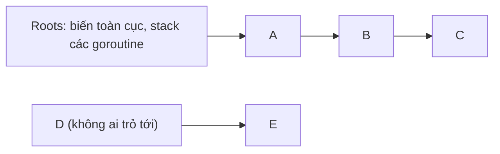
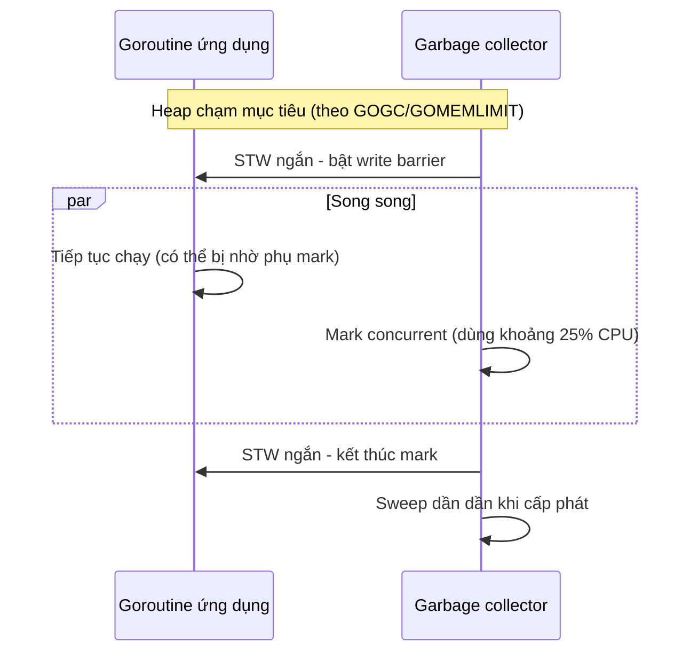

# Quản lý bộ nhớ và Garbage Collection

Go tự quản lý bộ nhớ: bạn không gọi `malloc`/`free`, trình biên dịch quyết định biến nằm trên **stack** hay **heap**, và **garbage collector** (GC — bộ thu gom rác) dọn những vùng heap không còn được dùng. Tự động không có nghĩa là không cần quan tâm: service Go chịu tải cao thường gặp vấn đề CPU tốn cho GC, bộ nhớ phình to hoặc bị OOM kill trong container. Bài này giải thích stack và heap, escape analysis, cách GC của Go hoạt động, hai núm vặn `GOGC`/`GOMEMLIMIT`, kỹ thuật giảm áp lực GC và các kiểu memory leak hay gặp.

---

:::note[Ghi nhớ nhanh]

- ⭐ **Stack rẻ, heap tốn** — biến trên stack tự biến mất khi hàm return; biến trên heap cần GC dọn. Escape analysis quyết định chỗ đặt, xem bằng `go build -gcflags=-m`.
- ⭐ **GC của Go là concurrent tri-color mark-and-sweep** — chạy song song với chương trình, chỉ dừng (stop-the-world) rất ngắn, ưu tiên độ trễ thấp.
- **`GOGC` (mặc định 100)** — heap được phép tăng bao nhiêu phần trăm so với lượng dữ liệu còn sống trước khi chạy GC tiếp.
- ⭐ **`GOMEMLIMIT` (Go 1.19)** — giới hạn mềm tổng bộ nhớ; đặt khoảng 80–90% memory limit của container để tránh OOM kill.
- **Go vẫn có memory leak** — goroutine bị kẹt mãi, sub-slice giữ mảng lớn, map/cache tăng không giới hạn, `time.Ticker` không `Stop`.

:::

---

## Mục lục

- [Vì sao cần hiểu bộ nhớ trong Go?](#vì-sao-cần-hiểu-bộ-nhớ-trong-go)
- [Stack và heap](#stack-và-heap)
- [Escape analysis](#escape-analysis)
- [Garbage collector hoạt động thế nào](#garbage-collector-hoạt-động-thế-nào)
- [GOGC và GOMEMLIMIT](#gogc-và-gomemlimit)
- [Giảm áp lực GC](#giảm-áp-lực-gc)
- [Memory leak thường gặp trong Go](#memory-leak-thường-gặp-trong-go)

---

## Vì sao cần hiểu bộ nhớ trong Go?

**Vấn đề:** Service chạy tốt khi test, lên production với vài nghìn request mỗi giây thì độ trễ p99 tăng vọt, CPU tốn 20–30% cho GC, hoặc pod Kubernetes bị `OOMKilled` liên tục dù "code không có gì sai":

```go
// Mỗi request cấp phát một buffer 64KB mới rồi bỏ đi → hàng trăm MB rác mỗi giây
func handler(w http.ResponseWriter, r *http.Request) {
	buf := make([]byte, 64*1024)
	n, _ := r.Body.Read(buf)
	process(buf[:n])
}

// Goroutine chờ channel không bao giờ có dữ liệu → không bao giờ kết thúc
func fetchAll(urls []string) {
	results := make(chan string) // unbuffered
	for _, u := range urls {
		go func() { results <- fetch(u) }()
	}
	fmt.Println(<-results) // chỉ đọc 1 kết quả, các goroutine còn lại kẹt mãi
}
```

**Giải pháp:** Hiểu đối tượng nào lên heap và vì sao, dùng lại bộ nhớ ở đường nóng, cấu hình GC phù hợp với môi trường, và đo bằng công cụ thay vì đoán:

```go
var bufPool = sync.Pool{
	New: func() any {
		b := make([]byte, 64*1024)
		return &b // lưu con trỏ để Put/Get không cấp phát thêm
	},
}

func handler(w http.ResponseWriter, r *http.Request) {
	bp := bufPool.Get().(*[]byte) // dùng lại buffer cũ nếu có
	defer bufPool.Put(bp)
	buf := *bp
	n, _ := r.Body.Read(buf)
	process(buf[:n])
}

func fetchAll(urls []string) {
	results := make(chan string, len(urls)) // đủ chỗ: goroutine gửi xong là thoát
	for _, u := range urls {
		go func() { results <- fetch(u) }()
	}
	fmt.Println(<-results)
}
```

:::tip[Dùng thực tế]

- **Service trong container** — đặt `GOMEMLIMIT` theo memory limit của pod để GC chạy tích cực hơn khi gần chạm trần thay vì bị OOM kill.
- **API throughput cao** — giảm cấp phát ở hot path (tái dùng buffer, cấp sẵn `cap`) để giảm CPU cho GC và độ trễ đuôi.
- **Điều tra bộ nhớ tăng dần** — dùng `pprof` heap profile và đếm goroutine để tìm leak.
- **Batch job xử lý file lớn** — tránh giữ sub-slice của dữ liệu lớn, stream thay vì đọc hết vào RAM.

:::

:::tip[Ví dụ đời thường]

Stack giống **bàn làm việc cá nhân**: lấy giấy nháp ra dùng, xong việc gạt hết vào thùng — nhanh, không cần ai dọn. Heap giống **kho chung của công ty**: đồ để lâu, nhiều người dùng chung, nên phải có **đội dọn kho (GC)** đi kiểm tra định kỳ món nào không còn ai cần thì bỏ. Đội dọn làm việc trong giờ hành chính song song với nhân viên (concurrent), chỉ thỉnh thoảng xin mọi người dừng tay vài giây để kiểm kê (stop-the-world).

:::

---

## Stack và heap

| | Stack | Heap |
|---|---|---|
| Thuộc về | Từng goroutine (bắt đầu nhỏ, tự giãn khi cần) | Dùng chung toàn chương trình |
| Cấp phát | Gần như miễn phí — dịch con trỏ stack | Tốn hơn — qua bộ cấp phát của runtime |
| Giải phóng | Tự động khi hàm return | GC thu hồi khi không còn tham chiếu |
| Ảnh hưởng GC | Không | Càng nhiều cấp phát, GC càng phải chạy nhiều |
| Tồn tại | Trong thời gian hàm chạy | Đến khi không còn ai tham chiếu |

Điểm khác với C/C++: trong Go bạn **không chọn** stack hay heap. `new`, `&T{}`, `make` không có nghĩa là "cấp phát trên heap" — trình biên dịch quyết định dựa trên việc giá trị có "thoát" ra khỏi hàm hay không.

```go
func a() int {
	p := new(int) // dù dùng new, p không thoát khỏi hàm → có thể nằm trên stack
	*p = 42
	return *p
}

func b() *int {
	x := 42 // biến thường, nhưng địa chỉ trả ra ngoài → phải lên heap
	return &x
}
```

:::note[Stack của goroutine]

Mỗi goroutine bắt đầu với stack nhỏ (vài KB) và runtime tự **nhân đôi kích thước** (copy sang vùng mới) khi cần. Nhờ vậy chạy được hàng trăm nghìn goroutine, và đệ quy sâu cũng không tràn stack sớm như thread của hệ điều hành (giới hạn mặc định tối đa 1GB trên máy 64-bit).

:::

---

## Escape analysis

**Escape analysis** (phân tích thoát) là bước trình biên dịch xác định một giá trị có thể sống lâu hơn hàm tạo ra nó hay không. Nếu có — hoặc không chứng minh được là không — giá trị "escape" lên heap.

Xem quyết định của trình biên dịch:

```bash
go build -gcflags='-m' ./...      # mức cơ bản
go build -gcflags='-m -l' ./...   # -l tắt inline để kết quả dễ đọc hơn
go build -gcflags='-m=2' ./...    # giải thích chi tiết lý do escape
```

Ví dụ:

```go
package main

import "fmt"

type User struct {
	Name string
	Age  int
}

func sumLocal() int {
	nums := []int{1, 2, 3, 4} // không thoát ra ngoài
	total := 0
	for _, n := range nums {
		total += n
	}
	return total
}

func newUser(name string) *User {
	u := User{Name: name}
	return &u // địa chỉ thoát ra ngoài hàm
}

func makeBuf(n int) []byte {
	return make([]byte, n) // slice được trả ra ngoài hàm
}

func printAge(age int) {
	fmt.Println(age) // truyền qua interface any
}

func main() {
	_ = sumLocal()
	_ = newUser("An")
	_ = makeBuf(10)
	printAge(30)
}
```

```text
$ go build -gcflags='-m -l' .
./main.go:11:15: []int{...} does not escape
./main.go:19:14: leaking param: name
./main.go:20:2: moved to heap: u
./main.go:25:13: make([]byte, n) escapes to heap
./main.go:29:13: ... argument does not escape
./main.go:29:14: age escapes to heap
```

Các nguyên nhân escape phổ biến:

| Tình huống | Vì sao escape |
|---|---|
| Trả về con trỏ tới biến cục bộ | Biến phải sống sau khi hàm return |
| Gán vào biến toàn cục, trường của object trên heap | Có tham chiếu sống lâu |
| Closure bắt biến và closure sống lâu hơn hàm | Biến phải đi theo closure |
| Truyền vào tham số kiểu interface (`any`, `fmt.Println`) | Trình biên dịch thường không biết callee giữ lại hay không |
| Gửi con trỏ qua channel | Goroutine khác có thể dùng |
| Slice/map quá lớn hoặc kích thước chỉ biết lúc chạy | Không đặt vừa stack frame cố định |

:::warning[Đừng tối ưu escape một cách mù quáng]

Escape analysis là chi tiết hiện thực và thay đổi theo phiên bản (ví dụ Go 1.25 đặt được nhiều backing array của slice trên stack hơn trước). Chỉ tối ưu khi **profile** (`pprof` với `-alloc_space`, benchmark với `-benchmem`) chỉ ra một hàm cấp phát nhiều. Code rõ ràng quan trọng hơn tiết kiệm vài lần cấp phát ở đường không nóng.

:::

---

## Garbage collector hoạt động thế nào

GC của Go là **concurrent, non-generational, non-moving, tri-color mark-and-sweep**:

- **Concurrent** — phần lớn công việc chạy song song với code của bạn (goroutine của chương trình gọi là *mutator*).
- **Non-generational** — không chia heap thành thế hệ trẻ/già như JVM.
- **Non-moving** — không dời object, nên địa chỉ con trỏ ổn định (không cần compaction).
- **Mark-and-sweep** — pha **mark** đánh dấu mọi object còn được tham chiếu, pha **sweep** thu hồi phần còn lại.

### Thuật toán ba màu (tri-color)

Mỗi object thuộc một trong ba tập:

- **Trắng** — chưa được thăm; cuối pha mark, object còn trắng là rác.
- **Xám** — đã biết là còn sống, nhưng chưa quét các con trỏ bên trong.
- **Đen** — còn sống và đã quét xong mọi con trỏ của nó.



Quy trình:

1. Bắt đầu: mọi object trắng; các **root** (biến toàn cục, biến trên stack của mọi goroutine) được tô xám.
2. Lấy một object xám, tô các object nó trỏ tới thành xám, rồi tô chính nó thành đen.
3. Lặp tới khi không còn object xám.
4. Object còn trắng (D, E trong sơ đồ) không thể truy cập được → bị thu hồi ở pha sweep.

Vì chương trình vẫn chạy trong lúc mark, nó có thể tạo tham chiếu mới từ object đen tới object trắng — nếu không xử lý, object trắng đó bị xoá nhầm. Go dùng **write barrier** (rào chắn ghi): trong pha mark, mỗi lần ghi con trỏ, runtime tô xám object liên quan để không bỏ sót.

### Một chu kỳ GC



- Hai lần **stop-the-world** (STW) thường chỉ vài chục micro giây tới dưới 1 ms.
- GC đặt mục tiêu dùng khoảng **25% CPU** trong pha mark. Nếu một goroutine cấp phát quá nhanh, nó bị bắt **phụ mark** (mark assist) — đây là lý do cấp phát nhiều làm tăng độ trễ chính request đó.

:::note[Green Tea GC]

Go 1.25 giới thiệu GC mới tên **Green Tea** dưới dạng thử nghiệm (`GOEXPERIMENT=greenteagc`), và từ **Go 1.26** nó được bật mặc định. Green Tea quét bộ nhớ theo từng trang (span) thay vì nhảy qua từng object, cải thiện cache locality và giảm chi phí GC với chương trình có nhiều object nhỏ. Mô hình tri-color, `GOGC`, `GOMEMLIMIT` vẫn giữ nguyên ý nghĩa.

:::

---

## GOGC và GOMEMLIMIT

### GOGC — khi nào chạy GC tiếp theo

`GOGC` (mặc định `100`) quy định heap được phép tăng bao nhiêu phần trăm so với **lượng heap còn sống** sau lần GC trước:

```text
Mục tiêu heap ≈ heap còn sống + (heap còn sống + GC roots) × GOGC / 100
```

Với live heap 100MB và `GOGC=100`, GC tiếp theo chạy khi heap chạm khoảng 200MB.

| Giá trị | Hiệu ứng |
|---|---|
| `GOGC=50` | GC chạy dày hơn → tốn CPU hơn, tốn ít RAM hơn |
| `GOGC=100` | Mặc định |
| `GOGC=200` | GC chạy thưa hơn → tốn ít CPU, dùng nhiều RAM hơn |
| `GOGC=off` | Tắt GC theo tỉ lệ (chỉ còn `GOMEMLIMIT` kích hoạt) |

```bash
GOGC=200 ./server
```

```go
import "runtime/debug"

old := debug.SetGCPercent(200) // đổi lúc chạy, trả về giá trị cũ
_ = old
```

### GOMEMLIMIT — giới hạn mềm (Go 1.19)

Vấn đề của chỉ dùng `GOGC`: nó chỉ biết **tỉ lệ**, không biết container của bạn có bao nhiêu RAM. Live heap 600MB với `GOGC=100` cho phép heap lên ~1.2GB — trong pod giới hạn 1GB là bị OOM kill.

`GOMEMLIMIT` đặt **giới hạn mềm** cho tổng bộ nhớ runtime quản lý. Khi gần chạm giới hạn, GC chạy thường xuyên hơn bất kể `GOGC`:

```bash
GOMEMLIMIT=900MiB ./server  # hậu tố hợp lệ: B, KiB, MiB, GiB, TiB
```

```yaml
# Kubernetes: pod giới hạn 1Gi, để GOMEMLIMIT khoảng 90%
resources:
  limits:
    memory: "1Gi"
env:
  - name: GOMEMLIMIT
    value: "900MiB"
```

```go
debug.SetMemoryLimit(900 << 20) // tương đương, đặt trong code
```

Hai cấu hình hay dùng:

- **`GOMEMLIMIT` + `GOGC` mặc định** — an toàn, hành vi như cũ khi còn nhiều RAM, chỉ siết lại khi gần trần.
- **`GOMEMLIMIT` + `GOGC=off`** — tận dụng tối đa RAM được cấp, GC chỉ chạy khi gần giới hạn → ít CPU cho GC nhất. Phù hợp khi service là thứ duy nhất trong container.

:::warning[Giới hạn mềm không phải tường cứng]

Nếu live heap thật sự vượt `GOMEMLIMIT`, runtime không thể làm gì ngoài chạy GC liên tục — CPU tăng vọt (gần như "death spiral"). Runtime có cơ chế giới hạn GC ở khoảng 50% CPU để chương trình vẫn tiến triển, nhưng khi đó vẫn sẽ OOM. `GOMEMLIMIT` giúp dùng RAM hiệu quả, không chữa được việc chương trình thật sự cần nhiều bộ nhớ hơn mức cấp. Ngoài ra, nó chỉ tính bộ nhớ Go runtime quản lý, không tính bộ nhớ cấp qua cgo.

:::

### Quan sát GC

```bash
GODEBUG=gctrace=1 ./server
# gc 12 @3.201s 2%: 0.031+1.2+0.015 ms clock, ... 48->49->25 MB, 50 MB goal, ...
#   2%          : tỉ lệ CPU dành cho GC từ khi chạy
#   48->49->25  : heap lúc bắt đầu -> lúc kết thúc mark -> heap còn sống
#   50 MB goal  : mục tiêu heap cho chu kỳ này
```

Trong code, đọc số liệu qua `runtime.ReadMemStats` (tốn kém, gây STW ngắn) hoặc package `runtime/metrics` (nhẹ hơn, khuyến nghị cho exporter Prometheus).

---

## Giảm áp lực GC

Chi phí GC tỉ lệ với **tốc độ cấp phát** và **lượng heap còn sống chứa con trỏ**. Giảm hai thứ này là giảm GC.

### 1. Cấp sẵn capacity

```go
// Tệ: append tăng trưởng nhiều lần, mỗi lần cấp mảng mới, mảng cũ thành rác
var ids []int64
for _, o := range orders {
	ids = append(ids, o.ID)
}

// Tốt: một lần cấp phát
ids := make([]int64, 0, len(orders))
for _, o := range orders {
	ids = append(ids, o.ID)
}
```

Tương tự: `make(map[K]V, n)`, `strings.Builder.Grow(n)`, `bytes.Buffer.Grow(n)`.

### 2. Tái dùng buffer

```go
// Dùng lại một buffer qua nhiều vòng lặp thay vì tạo mới mỗi lần
buf := make([]byte, 0, 4096)
for _, rec := range records {
	buf = buf[:0]                        // reset len, giữ nguyên mảng nền
	buf = append(buf, rec.Key...)
	buf = append(buf, '=')
	buf = append(buf, rec.Value...)
	w.Write(buf)
}
```

### 3. `sync.Pool` cho object tạm dùng chung giữa goroutine

```go
var bufPool = sync.Pool{
	New: func() any { return new(bytes.Buffer) }, // tạo mới khi pool rỗng
}

func render(name string) string {
	buf := bufPool.Get().(*bytes.Buffer)
	defer func() {
		buf.Reset()     // QUAN TRỌNG: xoá dữ liệu cũ trước khi trả lại
		bufPool.Put(buf)
	}()
	buf.WriteString("Xin chào, ")
	buf.WriteString(name)
	return buf.String()
}
```

:::warning[Lưu ý khi dùng sync.Pool]

- Object trong pool có thể **bị GC xoá bất cứ lúc nào** — pool là cache, không phải nơi lưu trữ.
- Luôn **reset** trạng thái trước khi `Put`, nếu không request sau đọc được dữ liệu của request trước.
- Không `Put` object quá lớn bất thường (ví dụ buffer đã phình lên 10MB vì một request lạ) — nó sẽ bị giữ lại phí bộ nhớ. Kiểm tra `buf.Cap()` và bỏ đi nếu vượt ngưỡng.
- Lưu con trỏ (`*bytes.Buffer`) chứ không lưu giá trị — `Put` một `[]byte` trực tiếp sẽ cấp phát thêm khi chuyển sang `any` (`staticcheck` cảnh báo SA6002).
- Chỉ dùng khi profile cho thấy cấp phát là vấn đề; `sync.Pool` làm code phức tạp hơn.

:::

### 4. Giảm con trỏ trong dữ liệu lớn

GC phải duyệt mọi con trỏ trong heap còn sống. Một `map[string]*Item` với 10 triệu phần tử buộc GC duyệt 20 triệu con trỏ (key string cũng chứa con trỏ) ở mỗi chu kỳ. Với cache khổng lồ, cân nhắc lưu giá trị không chứa con trỏ (`map[int64]ItemValue` với struct chỉ gồm số) hoặc dùng thư viện cache chuyên dụng.

---

## Memory leak thường gặp trong Go

GC chỉ thu hồi thứ **không còn được tham chiếu**. Leak trong Go là khi bạn vô tình **giữ tham chiếu** tới thứ không cần nữa.

### 1. Goroutine leak

Goroutine bị chặn mãi (chờ channel không ai gửi/nhận, chờ lock, chờ I/O không timeout) sẽ không bao giờ kết thúc — stack và mọi thứ nó tham chiếu không bao giờ được thu hồi:

```go
// LEAK: nếu ctx bị huỷ trước, không ai đọc ch → goroutine kẹt ở câu lệnh gửi
func search(ctx context.Context, q string) (string, error) {
	ch := make(chan string)
	go func() {
		ch <- slowQuery(q)
	}()
	select {
	case r := <-ch:
		return r, nil
	case <-ctx.Done():
		return "", ctx.Err()
	}
}

// SỬA: buffer 1 để goroutine gửi xong là thoát dù không ai đọc
func searchFixed(ctx context.Context, q string) (string, error) {
	ch := make(chan string, 1)
	go func() {
		ch <- slowQuery(q)
	}()
	select {
	case r := <-ch:
		return r, nil
	case <-ctx.Done():
		return "", ctx.Err()
	}
}
```

Phát hiện: theo dõi `runtime.NumGoroutine()` theo thời gian, xem `/debug/pprof/goroutine?debug=1` để biết goroutine kẹt ở dòng nào. Trong test, thư viện `go.uber.org/goleak` báo lỗi khi test kết thúc mà còn goroutine thừa.

### 2. Sub-slice giữ mảng lớn

```go
// LEAK: chỉ cần 10 byte đầu nhưng giữ cả file 100MB sống
func readHeader(path string) ([]byte, error) {
	data, err := os.ReadFile(path)
	if err != nil {
		return nil, err
	}
	return data[:10], nil // header của slice vẫn trỏ vào mảng nền 100MB
}

// SỬA: copy phần cần giữ sang mảng mới
func readHeaderFixed(path string) ([]byte, error) {
	data, err := os.ReadFile(path)
	if err != nil {
		return nil, err
	}
	return bytes.Clone(data[:10]), nil // mảng 100MB được GC thu hồi
}
```

Tương tự với string: substring `s[:10]` của chuỗi lớn giữ cả chuỗi gốc — dùng `strings.Clone` (Go 1.20) khi cần giữ lâu.

### 3. Các nguồn leak khác

| Nguồn | Ví dụ | Cách xử lý |
|---|---|---|
| Map/cache tăng mãi | `map[string]*Session` không bao giờ xoá | Giới hạn kích thước, TTL, LRU |
| `time.Ticker` không dừng | `t := time.NewTicker(d)` trong hàm gọi nhiều lần | `defer t.Stop()` |
| Không đóng response body | `resp, _ := http.Get(url)` quên `resp.Body.Close()` | `defer resp.Body.Close()` ngay sau kiểm tra lỗi |
| Slice con trỏ sau khi "xoá" | `s = s[:len(s)-1]` vẫn giữ con trỏ ở phần tử cuối trong mảng nền | Gán `s[len(s)-1] = nil` trước, hoặc dùng `slices.Delete` (Go 1.22 tự gán zero) |
| Biến toàn cục giữ tham chiếu | Logger/registry toàn cục giữ request cũ | Xem lại vòng đời dữ liệu |

:::note[time.After trong vòng lặp]

Trước Go 1.23, `time.After` trong vòng lặp `select` tạo timer không được thu hồi cho tới khi hết hạn — có thể tích tụ lớn. Từ Go 1.23 (với `go.mod` khai báo `go 1.23` trở lên), timer không còn được tham chiếu sẽ được GC thu hồi ngay cả khi chưa hết hạn hay chưa `Stop`.

:::

### Công cụ điều tra

```bash
# Thêm vào service: import _ "net/http/pprof" và chạy http.ListenAndServe(":6060", nil)
go tool pprof http://localhost:6060/debug/pprof/heap        # bộ nhớ đang dùng (inuse_space)
go tool pprof -sample_index=alloc_space http://localhost:6060/debug/pprof/heap  # tổng đã cấp phát
curl 'http://localhost:6060/debug/pprof/goroutine?debug=1'  # goroutine đang kẹt ở đâu

go test -bench=. -benchmem   # số lần cấp phát (allocs/op) mỗi thao tác
```

So sánh hai heap profile chụp cách nhau vài phút (`go tool pprof -base old.pb.gz new.pb.gz`) là cách nhanh nhất để tìm thứ đang tăng dần.
