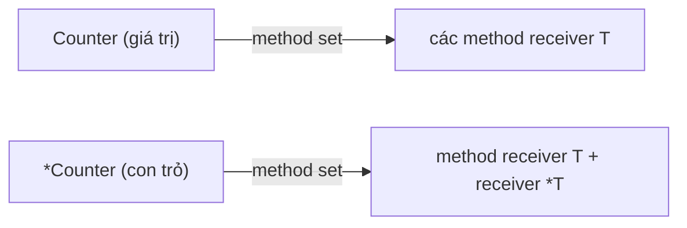

# Method

Method (phương thức) trong Go là một hàm được gắn với một kiểu thông qua **receiver** (tham số nhận). Go không có class, nhưng nhờ method mà struct (và cả kiểu không phải struct) có "hành vi" giống object trong Java hay C#. Bài này đi qua sự khác nhau giữa method và function, value receiver với pointer receiver, method set (tập method) — nền tảng để hiểu vì sao một kiểu có hoặc không thoả mãn một interface — và hai cú pháp ít người biết là method value, method expression.

---

:::note[Ghi nhớ nhanh]

- ⭐ **Cần sửa receiver hoặc struct lớn → pointer receiver `(p *T)`**; chỉ đọc và kiểu nhỏ → value receiver `(v T)` cũng được.
- ⭐ **Nhất quán**: nếu một method của kiểu dùng pointer receiver thì nên cho **tất cả** method của kiểu đó dùng pointer receiver.
- **Method set của `T` chỉ gồm method value receiver; của `*T` gồm cả hai** — quyết định `T` hay `*T` thoả mãn interface.
- **Method khai báo được trên mọi kiểu định nghĩa trong cùng package** (kể cả `type Celsius float64`), không được trên kiểu của package khác hay kiểu built-in.
- **Method value `obj.Method`** gói sẵn receiver thành một hàm; **method expression `T.Method`** biến receiver thành tham số đầu tiên.

:::

---

## Mục lục

- [Vì sao cần method?](#vì-sao-cần-method)
- [Khai báo method](#khai-báo-method)
- [Value receiver và pointer receiver](#value-receiver-và-pointer-receiver)
- [Khi nào dùng loại receiver nào](#khi-nào-dùng-loại-receiver-nào)
- [Method set](#method-set)
- [Method trên kiểu không phải struct](#method-trên-kiểu-không-phải-struct)
- [Method value và method expression](#method-value-và-method-expression)
- [Câu hỏi phỏng vấn](#câu-hỏi-phỏng-vấn)

---

## Vì sao cần method?

**Vấn đề:** Chỉ dùng function thuần, mọi thao tác trên dữ liệu đều là hàm rời, tên phải kèm tiền tố để tránh trùng, và người đọc khó biết hàm nào thuộc về kiểu nào:

```go
type Account struct {
	Owner   string
	Balance int64
}

// Hàm rời: tên dài, dễ trùng, IDE không gợi ý theo kiểu
func AccountDeposit(a *Account, amount int64) { a.Balance += amount }
func AccountWithdraw(a *Account, amount int64) error { /* ... */ return nil }
func InvoiceTotal(inv *Invoice) int64 { /* ... */ return 0 }
```

Quan trọng hơn: **function rời không giúp kiểu thoả mãn interface**. Muốn `Account` dùng được ở chỗ cần `fmt.Stringer`, nó phải có method `String()`.

**Giải pháp:** Gắn hàm vào kiểu bằng receiver:

```go
type Account struct {
	Owner   string
	Balance int64
}

// Deposit là method của *Account
func (a *Account) Deposit(amount int64) {
	a.Balance += amount
}

// String giúp Account thoả mãn fmt.Stringer
func (a Account) String() string {
	return fmt.Sprintf("%s: %d đ", a.Owner, a.Balance)
}

func main() {
	acc := &Account{Owner: "Lan", Balance: 100_000}
	acc.Deposit(50_000)
	fmt.Println(acc) // Lan: 150000 đ
}
```

:::tip[Dùng thực tế]

- **Đóng gói nghiệp vụ** — `order.Total()`, `user.IsAdmin()`, `cart.AddItem(p)` đọc tự nhiên hơn hàm rời.
- **Thoả mãn interface** — `String()` cho `fmt.Stringer`, `Error()` cho `error`, `ServeHTTP` cho `http.Handler`.
- **Kiểu domain có hành vi** — `type Money int64` với `m.Format()`, `type Status int` với `s.String()`.
- **Service có phụ thuộc** — `type UserService struct{ repo UserRepo }` rồi `func (s *UserService) Register(...)`.

:::

:::tip[Ví dụ đời thường]

Function rời giống **dịch vụ ngoài phố**: muốn sửa xe phải mang xe ra tiệm, đưa xe làm "tham số". Method giống **nút bấm trên chính chiếc xe máy**: `xe.BatDen()`, `xe.Khoa()` — hành vi đi kèm đồ vật, ai cầm xe cũng thấy ngay nó làm được gì.

:::

---

## Khai báo method

Cú pháp: thêm receiver trong ngoặc giữa `func` và tên method.

```go
func (receiver KieuNhan) TenMethod(thamSo) KieuTraVe {
	// thân method
}
```

```go
type Rect struct {
	W, H float64
}

// Method: receiver r kiểu Rect
func (r Rect) Area() float64 {
	return r.W * r.H
}

// Function tương đương: Rect chỉ là tham số thường
func Area(r Rect) float64 {
	return r.W * r.H
}

func main() {
	r := Rect{W: 3, H: 4}
	fmt.Println(r.Area()) // 12 — gọi method
	fmt.Println(Area(r))  // 12 — gọi function
}
```

Về bản chất, method **chỉ là function có receiver là tham số đầu tiên**. Sự khác biệt nằm ở chỗ:

| Tiêu chí | Function | Method |
| --- | --- | --- |
| Cách gọi | `Area(r)` | `r.Area()` |
| Namespace | Cấp package, tên phải duy nhất | Theo kiểu — `Rect.Area` và `Circle.Area` không trùng |
| Thoả mãn interface | Không | Có |
| Overload | Không (Go không có overload) | Không |

Quy ước đặt tên receiver:

- Ngắn, 1–2 chữ cái, lấy từ tên kiểu: `(r Rect)`, `(s *UserService)`, `(c *Client)`.
- **Không dùng `this` hay `self`** — `go vet`/linter phổ biến sẽ nhắc.
- Dùng cùng một tên receiver cho mọi method của một kiểu.

:::warning[Chỉ khai báo method trong cùng package với kiểu]

Kiểu nhận phải được định nghĩa trong **cùng package**. Không thể thêm method vào `time.Time`, `string` hay `int`:

```go
func (s string) Upper() string { ... } // lỗi: cannot define new methods on non-local type string
```

Muốn "mở rộng" kiểu bên ngoài, hãy định nghĩa kiểu mới (`type MyTime time.Time`) hoặc nhúng (embed) vào struct của mình.

:::

---

## Value receiver và pointer receiver

Go luôn **truyền theo giá trị** (pass by value). Receiver cũng không ngoại lệ:

- **Value receiver `(c Counter)`** — method nhận **bản sao**; sửa bản sao không ảnh hưởng biến gốc.
- **Pointer receiver `(c *Counter)`** — method nhận **địa chỉ**; sửa qua con trỏ là sửa biến gốc.

```go
type Counter struct {
	n int
}

// Value receiver: c là bản sao
func (c Counter) IncValue() {
	c.n++ // chỉ tăng bản sao
}

// Pointer receiver: c trỏ tới biến gốc
func (c *Counter) IncPointer() {
	c.n++ // tăng biến gốc
}

func main() {
	var c Counter
	c.IncValue()
	fmt.Println(c.n) // 0 — không đổi
	c.IncPointer()
	fmt.Println(c.n) // 1
}
```

### Go tự lấy địa chỉ và tự giải tham chiếu

Ở ví dụ trên, `c` là giá trị (không phải con trỏ) nhưng vẫn gọi được `c.IncPointer()`. Compiler tự viết lại thành `(&c).IncPointer()`. Chiều ngược lại cũng vậy: có con trỏ `p` thì `p.IncValue()` được viết lại thành `(*p).IncValue()`.

```go
p := &Counter{}
p.IncPointer() // bình thường
p.IncValue()   // tự động thành (*p).IncValue()

c := Counter{}
c.IncPointer() // tự động thành (&c).IncPointer() — vì c "addressable"
```

:::warning[Giá trị không lấy được địa chỉ thì không gọi được pointer method]

Tự lấy địa chỉ chỉ áp dụng khi biến **addressable** (có địa chỉ: biến, phần tử slice, field của struct addressable…). Giá trị trả về từ hàm, phần tử map, hằng số thì không:

```go
func newCounter() Counter { return Counter{} }

newCounter().IncPointer() // lỗi: cannot call pointer method IncPointer on Counter

m := map[string]Counter{"a": {}}
m["a"].IncPointer() // lỗi: phần tử map không addressable
```

Với map, hãy lưu con trỏ `map[string]*Counter` hoặc lấy ra – sửa – gán lại.

:::

### Bẫy: sửa bản sao trong vòng lặp

```go
type Item struct{ Price int }

func (it *Item) Discount(pct int) { it.Price = it.Price * (100 - pct) / 100 }

items := []Item{{100}, {200}}

for _, it := range items {
	it.Discount(10) // it là bản sao → slice gốc không đổi
}

for i := range items {
	items[i].Discount(10) // đúng: items[i] addressable, sửa phần tử gốc
}
```

---

## Khi nào dùng loại receiver nào

| Tình huống | Nên dùng |
| --- | --- |
| Method cần **sửa** receiver | `*T` |
| Struct **lớn** (nhiều field, mảng lớn) — tránh copy | `*T` |
| Struct chứa `sync.Mutex`, `sync.WaitGroup`… (không được copy) | `*T` (bắt buộc) |
| Kiểu đã có method nào dùng `*T` | `*T` cho tất cả (nhất quán) |
| Kiểu nhỏ, bất biến: `time.Time`, `Point{X, Y}`, kiểu số | `T` |
| Map, func, chan (bản thân đã là "tham chiếu") | `T` |
| Slice mà method không `append`/đổi độ dài | `T` |

:::warning[Struct có Mutex mà dùng value receiver]

```go
type SafeCounter struct {
	mu sync.Mutex
	n  int
}

// SAI: mỗi lần gọi copy cả mutex → khoá trên bản sao, không bảo vệ gì cả
func (s SafeCounter) Inc() {
	s.mu.Lock()
	defer s.mu.Unlock()
	s.n++
}
```

`go vet` sẽ báo `passes lock by value`. Luôn dùng `func (s *SafeCounter) Inc()`.

:::

### Quy tắc nhất quán

Go Code Review Comments khuyên: **đừng trộn** value và pointer receiver trên cùng một kiểu. Lý do:

1. **Method set** — trộn hai loại khiến `T` thoả mãn một số interface còn `*T` thoả mãn số khác, rất dễ nhầm (xem phần [Method set](#method-set)).
2. **Ngữ nghĩa rõ ràng** — người đọc biết kiểu này "được dùng qua con trỏ" hay "được copy như giá trị".
3. **Data race** — value receiver đọc toàn bộ struct khi copy; nếu goroutine khác đang sửa qua pointer method thì sinh race.

Ngoại lệ được chấp nhận: kiểu cần thoả mãn interface bằng giá trị (ví dụ `String()` để `fmt.Println(v)` in đẹp cả khi truyền giá trị) — nhưng hãy cân nhắc kỹ.

:::tip[Khi phân vân]

Nếu không chắc, **chọn pointer receiver**. Đây cũng là lựa chọn mặc định của phần lớn codebase Go: service, repository, handler, client đều là `*T`.

:::

---

## Method set

**Method set** (tập method) của một kiểu là danh sách method mà kiểu đó "có" theo quy tắc của ngôn ngữ. Nó quyết định kiểu nào **thoả mãn interface** nào.

| Kiểu | Method set gồm |
| --- | --- |
| `T` | Chỉ các method có receiver `T` |
| `*T` | Method có receiver `T` **và** `*T` |

Gọi trực tiếp `c.IncPointer()` thì được vì compiler tự lấy địa chỉ. Nhưng khi **gán vào interface**, không có bước tự lấy địa chỉ nào cả — chỉ xét method set:

```go
type Incrementer interface {
	Inc()
}

type Counter struct{ n int }

func (c *Counter) Inc() { c.n++ }

func main() {
	var i Incrementer

	i = &Counter{} // OK: *Counter có Inc
	i = Counter{}  // lỗi: Counter does not implement Incrementer (method Inc has pointer receiver)
	_ = i
}
```

Vì sao Go cấm? Interface giữ một **bản sao** của giá trị. Nếu cho phép gọi pointer method trên bản sao đó thì việc `Inc()` sẽ sửa bản sao ẩn bên trong interface — người dùng tưởng đã tăng `Counter` gốc nhưng thực tế không. Go chặn ngay từ lúc biên dịch để tránh bug khó thấy này.



### Method set khi embed struct

Khi nhúng (embed) một kiểu vào struct, method của kiểu được nhúng được "thăng cấp" (promoted) lên struct ngoài:

```go
type Logger struct{ prefix string }

func (l *Logger) Log(msg string) { fmt.Println(l.prefix + msg) }

type Service struct {
	*Logger // nhúng con trỏ: cả Service và *Service đều có Log
	name    string
}

type Service2 struct {
	Logger // nhúng giá trị: chỉ *Service2 có Log (vì Log có receiver *Logger)
}

func main() {
	s := Service{Logger: &Logger{prefix: "[svc] "}}
	s.Log("khởi động") // [svc] khởi động
}
```

Tóm tắt quy tắc với `struct S { E }` hoặc `struct S { *E }`:

- Nhúng `E`: method set của `S` có method receiver `E`; method set của `*S` có cả method receiver `E` và `*E`.
- Nhúng `*E`: cả `S` và `*S` đều có method receiver `E` và `*E`.

---

## Method trên kiểu không phải struct

Bất kỳ **kiểu định nghĩa** (defined type) nào trong package đều có thể có method — không chỉ struct.

```go
// Kiểu số
type Celsius float64

func (c Celsius) ToFahrenheit() float64 {
	return float64(c)*9/5 + 32
}

// Enum dựa trên int
type Status int

const (
	Pending Status = iota
	Paid
	Shipped
)

func (s Status) String() string {
	switch s {
	case Pending:
		return "Chờ thanh toán"
	case Paid:
		return "Đã thanh toán"
	case Shipped:
		return "Đang giao"
	default:
		return fmt.Sprintf("Status(%d)", int(s))
	}
}

// Slice
type IntList []int

func (l IntList) Sum() int {
	total := 0
	for _, v := range l {
		total += v
	}
	return total
}

// Hàm — chính là cách net/http làm với http.HandlerFunc
type HandlerFunc func(string) string

func (f HandlerFunc) Handle(s string) string {
	return f(s) // method gọi lại chính hàm
}

func main() {
	fmt.Println(Celsius(100).ToFahrenheit()) // 212
	fmt.Println(Paid)                        // Đã thanh toán (nhờ Stringer)
	fmt.Println(IntList{1, 2, 3}.Sum())      // 6
}
```

Mẫu `type HandlerFunc func(...)` + method là kỹ thuật kinh điển: thư viện chuẩn có `http.HandlerFunc` để một **hàm thường** thoả mãn interface `http.Handler`.

:::note[Type definition khác alias]

- `type Celsius float64` — **kiểu mới**, được khai báo method, không tự động gán lẫn với `float64`.
- `type Celsius = float64` — **alias** (bí danh), chính là `float64`, **không** khai báo method được.

Kiểu mới **không thừa hưởng** method của kiểu gốc: `type MyTime time.Time` không có `Format()`. Muốn giữ method thì embed: `type MyTime struct{ time.Time }`.

:::

---

## Method value và method expression

### Method value: `obj.Method`

Viết `obj.Method` (không có ngoặc gọi) tạo ra một **hàm đã gắn sẵn receiver**. Receiver được **đánh giá và lưu lại ngay lúc tạo**.

```go
type Greeter struct{ name string }

func (g Greeter) Hello() string { return "Xin chào " + g.name }

func main() {
	g := Greeter{name: "An"}
	f := g.Hello // method value: kiểu func() string

	g.name = "Bình"
	fmt.Println(f())       // Xin chào An — receiver giá trị đã được copy lúc tạo f
	fmt.Println(g.Hello()) // Xin chào Bình
}
```

Nếu receiver là con trỏ, method value giữ **con trỏ**, nên thay đổi sau đó vẫn thấy được.

Ứng dụng thường gặp — truyền method làm callback:

```go
type Server struct{ count int }

func (s *Server) handleHealth(w http.ResponseWriter, r *http.Request) {
	s.count++
	fmt.Fprintln(w, "ok")
}

func main() {
	s := &Server{}
	mux := http.NewServeMux()
	mux.HandleFunc("GET /health", s.handleHealth) // method value, mang theo s
	// http.ListenAndServe(":8080", mux)
}
```

Hoặc dùng với goroutine, `slices`, `strings`:

```go
var sb strings.Builder
write := sb.WriteString // method value: func(string) (int, error), giữ &sb bên trong
for _, w := range []string{"go", "java", "rust"} {
	write(w)
}
fmt.Println(sb.String()) // gojavarust
```

### Method expression: `T.Method`

Viết `Kieu.Method` tạo ra một **function thường** mà **receiver trở thành tham số đầu tiên**:

```go
type Point struct{ X, Y float64 }

func (p Point) Dist(q Point) float64 {
	return math.Hypot(q.X-p.X, q.Y-p.Y)
}

func (p *Point) Scale(k float64) {
	p.X *= k
	p.Y *= k
}

func main() {
	dist := Point.Dist        // kiểu func(Point, Point) float64
	scale := (*Point).Scale   // kiểu func(*Point, float64)

	a, b := Point{0, 0}, Point{3, 4}
	fmt.Println(dist(a, b)) // 5

	scale(&b, 2)
	fmt.Println(b) // {6 8}
}
```

Method expression hữu ích khi muốn **chọn method lúc runtime** mà receiver chưa có:

```go
type Op func(Point, Point) float64

ops := map[string]Op{
	"dist": Point.Dist,
}
fmt.Println(ops["dist"](Point{0, 0}, Point{6, 8})) // 10
```

| | Method value | Method expression |
| --- | --- | --- |
| Cú pháp | `g.Hello` | `Greeter.Hello` / `(*T).M` |
| Receiver | Gắn sẵn (đã đánh giá) | Truyền làm tham số đầu |
| Kiểu kết quả | `func() string` | `func(Greeter) string` |
| Dùng khi | Callback, handler, goroutine | Bảng tra hàm, chọn method động |

---

## Câu hỏi phỏng vấn

**1. Method khác function như thế nào trong Go?**

<details className="qa">
<summary>Xem đáp án</summary>

Method là function có thêm **receiver** — gắn với một kiểu được định nghĩa trong cùng package. Về mặt thực thi, receiver chỉ là tham số đầu tiên (method expression `T.M` cho thấy rõ điều này). Khác biệt thực tế: method nằm trong namespace của kiểu (hai kiểu có thể cùng tên method), gọi bằng cú pháp `v.M()`, và quan trọng nhất là **method giúp kiểu thoả mãn interface** — function rời thì không.

</details>

**2. Khi nào dùng pointer receiver, khi nào dùng value receiver?**

<details className="qa">
<summary>Xem đáp án</summary>

Dùng pointer receiver khi: method cần sửa receiver; struct lớn (tránh copy); struct chứa thứ không được copy như `sync.Mutex`; hoặc kiểu đã có method pointer receiver khác (nhất quán). Dùng value receiver khi kiểu nhỏ, bất biến, hoặc là map/func/chan — ví dụ `time.Time`, `Point`, kiểu enum số. Phân vân thì chọn pointer. Không nên trộn hai loại trên một kiểu.

</details>

**3. Vì sao `var i Incrementer = Counter{}` báo lỗi trong khi `c.Inc()` vẫn gọi được?**

<details className="qa">
<summary>Xem đáp án</summary>

Vì `Inc` có pointer receiver nên chỉ thuộc **method set của `*Counter`**, không thuộc method set của `Counter`. Gọi trực tiếp `c.Inc()` được là do compiler tự viết lại thành `(&c).Inc()` khi `c` addressable. Còn khi gán vào interface, Go chỉ xét method set — và giá trị nằm trong interface không addressable (nếu cho phép thì method sẽ sửa bản sao ẩn bên trong interface). Sửa: gán `&Counter{}`.

</details>

**4. Có thể khai báo method cho `int` hay `time.Time` không?**

<details className="qa">
<summary>Xem đáp án</summary>

Không. Kiểu receiver phải được định nghĩa trong cùng package. Cách làm: định nghĩa kiểu mới `type Age int` rồi gắn method; hoặc embed `type MyTime struct{ time.Time }` để vừa giữ method của `time.Time` vừa thêm method mới. Lưu ý `type MyTime time.Time` (type definition) **không** thừa hưởng method của `time.Time`, còn alias `type X = time.Time` thì không khai báo thêm method được.

</details>

**5. Method value và method expression khác nhau thế nào?**

<details className="qa">
<summary>Xem đáp án</summary>

Method value `v.M` gắn sẵn receiver `v` (được đánh giá và copy ngay lúc tạo nếu là value receiver), cho ra hàm không cần receiver — hay dùng làm callback (`mux.HandleFunc("/x", s.handleX)`). Method expression `T.M` hoặc `(*T).M` cho ra function mà receiver là tham số đầu tiên — dùng khi muốn chọn method động mà chưa có receiver.

</details>

**6. Đoạn code này in ra gì và vì sao?**

```go
for _, it := range items {
	it.Discount(10) // Discount có pointer receiver
}
```

<details className="qa">
<summary>Xem đáp án</summary>

Slice `items` không thay đổi. Biến `it` trong `for range` là **bản sao** của từng phần tử; `it.Discount(10)` thành `(&it).Discount(10)` — sửa bản sao. Từ Go 1.22, `it` còn là biến mới mỗi vòng lặp, nhưng vẫn là bản sao. Sửa: `for i := range items { items[i].Discount(10) }` hoặc dùng slice con trỏ `[]*Item`.

</details>
