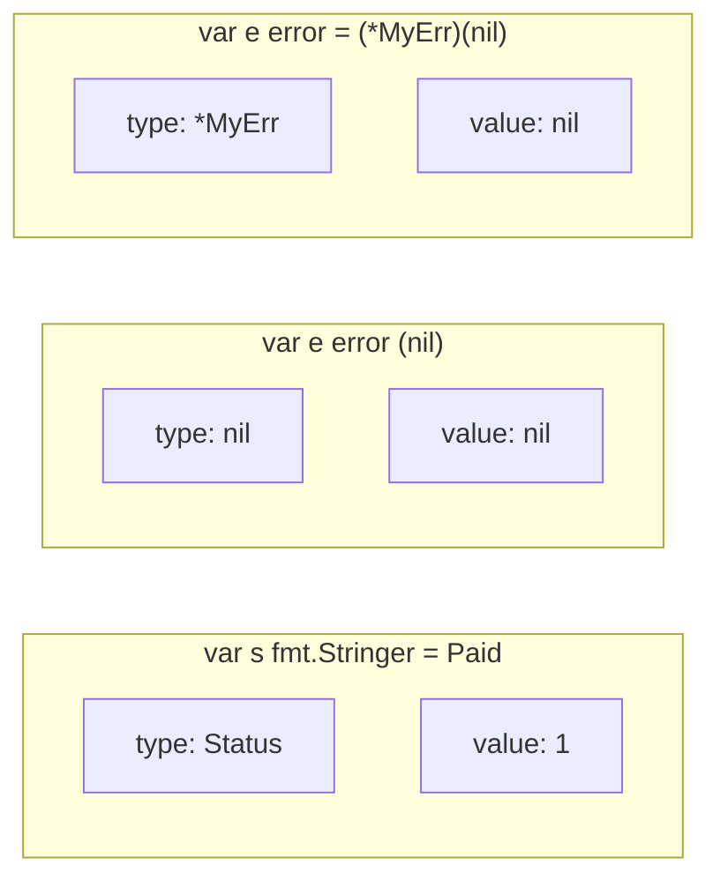

# Interface

Interface (giao diện) là tập hợp các chữ ký method; một kiểu nào có đủ các method đó thì **tự động** thoả mãn interface, không cần khai báo `implements`. Đây là cơ chế trừu tượng hoá duy nhất của Go — thay cho kế thừa class — và là thứ giúp code Go dễ test, dễ thay thế thành phần. Bài này đi qua interface ngầm định, triết lý interface nhỏ, nguyên tắc "accept interfaces, return structs", `any`, embedding interface, cấu trúc bên trong của interface value và cái bẫy nil nổi tiếng nhất của Go.

---

:::note[Ghi nhớ nhanh]

- ⭐ **Interface được thoả mãn ngầm định** — có đủ method là đủ, không có từ khoá `implements`; nhờ vậy có thể định nghĩa interface **ở phía dùng** (consumer).
- ⭐ **Bẫy nil**: interface chứa con trỏ `nil` **khác** interface `nil` — `var p *MyErr = nil; var err error = p; err != nil` là `true`.
- **Interface càng nhỏ càng tốt** — `io.Reader`, `io.Writer`, `fmt.Stringer` chỉ có 1 method nhưng được dùng khắp nơi.
- **"Accept interfaces, return structs"** — tham số nhận interface để linh hoạt, giá trị trả về là kiểu cụ thể để không giấu thông tin.
- **`any` = `interface{}`** (từ Go 1.18) — nhận mọi kiểu, nhưng mất kiểm tra kiểu lúc biên dịch; hạn chế dùng.
- **Kiểm tra lúc biên dịch**: `var _ io.Writer = (*MyWriter)(nil)`.

:::

---

## Mục lục

- [Vì sao cần interface?](#vì-sao-cần-interface)
- [Interface ngầm định](#interface-ngầm-định)
- [Interface nhỏ](#interface-nhỏ)
- [Accept interfaces, return structs](#accept-interfaces-return-structs)
- [Empty interface và any](#empty-interface-và-any)
- [Embedding interface](#embedding-interface)
- [Interface value và bẫy nil](#interface-value-và-bẫy-nil)
- [Kiểm tra thoả mãn interface lúc biên dịch](#kiểm-tra-thoả-mãn-interface-lúc-biên-dịch)
- [Câu hỏi phỏng vấn](#câu-hỏi-phỏng-vấn)

---

## Vì sao cần interface?

**Vấn đề:** Hàm phụ thuộc trực tiếp vào kiểu cụ thể thì bị "khoá cứng":

```go
type MySQLUserRepo struct{ db *sql.DB }

func (r *MySQLUserRepo) FindByEmail(email string) (*User, error) { /* query MySQL */ return nil, nil }

type AuthService struct {
	repo *MySQLUserRepo // dính chặt vào MySQL
}

func (s *AuthService) Login(email, password string) error {
	u, err := s.repo.FindByEmail(email)
	// ...
	_ = u
	return err
}
```

Muốn unit test `Login` thì phải dựng MySQL thật; muốn đổi sang PostgreSQL thì phải sửa `AuthService`.

**Giải pháp:** Khai báo interface mô tả **hành vi cần dùng**, nhận interface thay vì kiểu cụ thể:

```go
// Interface khai báo ngay tại package dùng nó
type UserFinder interface {
	FindByEmail(email string) (*User, error)
}

type AuthService struct {
	users UserFinder
}

func NewAuthService(users UserFinder) *AuthService {
	return &AuthService{users: users}
}

// Trong test: struct giả, không cần database
type fakeUsers struct{ u *User }

func (f fakeUsers) FindByEmail(string) (*User, error) { return f.u, nil }

// svc := NewAuthService(fakeUsers{u: &User{Email: "a@b.com"}})
```

`*MySQLUserRepo` vẫn dùng được với `AuthService` mà **không cần sửa một dòng nào** — nó đã có method `FindByEmail` nên tự động thoả mãn `UserFinder`.

:::tip[Dùng thực tế]

- **Mock trong unit test** — repository, HTTP client, clock (`Now() time.Time`) đều được thay bằng bản giả.
- **Đổi hiện thực** — lưu file lên local disk, S3 hay GCS sau cùng một interface `Storage`.
- **Thư viện chuẩn** — `io.Reader` cho phép cùng một hàm `json.NewDecoder(r)` đọc từ file, socket, HTTP body, chuỗi trong bộ nhớ.
- **Middleware/plugin** — `http.Handler` là interface 1 method, nhờ đó mọi router và middleware ghép được với nhau.

:::

:::tip[Ví dụ đời thường]

Interface giống **ổ cắm điện**: ổ cắm chỉ quy định "hai chân tròn, 220V". Nồi cơm, quạt, sạc điện thoại của bất kỳ hãng nào có phích hợp là cắm được — nhà sản xuất quạt không cần "đăng ký" với hãng ổ cắm. Đó chính là thoả mãn ngầm định.

:::

---

## Interface ngầm định

Interface khai báo bằng `type Ten interface { ... }`. Một kiểu thoả mãn interface khi **method set** của nó chứa đủ mọi method của interface — không có từ khoá `implements`.

```go
type Shape interface {
	Area() float64
	Perimeter() float64
}

type Rect struct{ W, H float64 }

func (r Rect) Area() float64      { return r.W * r.H }
func (r Rect) Perimeter() float64 { return 2 * (r.W + r.H) }

type Circle struct{ R float64 }

func (c Circle) Area() float64      { return math.Pi * c.R * c.R }
func (c Circle) Perimeter() float64 { return 2 * math.Pi * c.R }

func TotalArea(shapes []Shape) float64 {
	total := 0.0
	for _, s := range shapes {
		total += s.Area() // gọi động (dynamic dispatch)
	}
	return total
}

func main() {
	shapes := []Shape{Rect{3, 4}, Circle{1}}
	fmt.Printf("%.2f\n", TotalArea(shapes)) // 15.14
}
```

Người ta hay gọi đây là **duck typing tĩnh** (structural typing): "nếu nó kêu như vịt và đi như vịt thì nó là vịt" — nhưng khác Python, việc kiểm tra diễn ra **lúc biên dịch**.

### Hệ quả quan trọng: interface thuộc về phía dùng

Trong Java, interface thường đặt cạnh class hiện thực (`UserRepository` + `UserRepositoryImpl`). Trong Go thì ngược lại: **package nào cần trừu tượng thì package đó khai báo interface**, chỉ gồm các method nó thực sự gọi.

```go
// package notify — chỉ cần gửi, nên chỉ khai báo đúng 1 method
type Sender interface {
	Send(to, body string) error
}

// package sms — không biết gì về package notify, không import notify
type Client struct{ apiKey string }

func (c *Client) Send(to, body string) error { /* gọi API */ return nil }
func (c *Client) Balance() (int, error)      { return 0, nil }
```

`*sms.Client` dùng được làm `notify.Sender` mà hai package không phụ thuộc nhau. Đây là lý do Go có ít "interface khổng lồ" hơn Java.

| Tiêu chí | Java | Go |
| --- | --- | --- |
| Khai báo thoả mãn | `class A implements I` | Ngầm định |
| Interface đặt ở đâu | Cạnh hiện thực (producer) | Cạnh nơi dùng (consumer) |
| Thêm interface cho kiểu bên thứ ba | Phải viết adapter | Chỉ cần khai báo interface khớp method |
| Kiểm tra | Lúc biên dịch | Lúc biên dịch |

---

## Interface nhỏ

> "The bigger the interface, the weaker the abstraction." — Rob Pike

Thư viện chuẩn đầy những interface 1 method:

```go
// package io
type Reader interface {
	Read(p []byte) (n int, err error)
}

type Writer interface {
	Write(p []byte) (n int, err error)
}

// package fmt
type Stringer interface {
	String() string
}

// built-in
type error interface {
	Error() string
}
```

Vì nhỏ nên **rất nhiều kiểu thoả mãn**: `*os.File`, `*bytes.Buffer`, `*strings.Reader`, `net.Conn`, `http.Request.Body`, `gzip.Reader`… Một hàm nhận `io.Reader` dùng được với tất cả:

```go
// Đếm số dòng từ bất kỳ nguồn nào
func CountLines(r io.Reader) (int, error) {
	sc := bufio.NewScanner(r)
	n := 0
	for sc.Scan() {
		n++
	}
	return n, sc.Err()
}

func main() {
	n, _ := CountLines(strings.NewReader("a\nb\nc"))
	fmt.Println(n) // 3

	f, err := os.Open("data.txt")
	if err == nil {
		defer f.Close()
		n, _ = CountLines(f) // cùng hàm, nguồn là file
	}
}
```

Quy ước đặt tên: interface 1 method thường lấy tên method + hậu tố `-er`: `Reader`, `Writer`, `Closer`, `Stringer`, `Formatter`, `Handler`.

:::tip[Thiết kế interface]

- Bắt đầu bằng **kiểu cụ thể**; chỉ trích interface khi thực sự có từ 2 hiện thực trở lên hoặc cần mock khi test.
- Interface chỉ chứa method **người dùng gọi tới**, không phải mọi method của hiện thực.
- Interface lớn thì ghép từ interface nhỏ (xem [Embedding interface](#embedding-interface)).

:::

---

## Accept interfaces, return structs

Câu châm ngôn phổ biến trong cộng đồng Go:

- **Nhận interface** — hàm linh hoạt, người gọi truyền gì cũng được miễn có đủ hành vi.
- **Trả struct cụ thể** — người gọi có toàn bộ method, field của kiểu; họ tự quyết định có cần thu hẹp về interface hay không.

```go
// Tốt: nhận io.Writer, trả *Report cụ thể
func NewReport(w io.Writer) *Report {
	return &Report{out: w}
}

// Không nên: trả interface, giấu mất kiểu thật
type Repository interface {
	Find(id int) (*User, error)
}

func NewRepo(db *sql.DB) Repository { // người gọi không truy cập được method khác của hiện thực
	return &pgRepo{db: db}
}
```

Trả interface còn khiến bạn phải sửa interface (breaking change cho mọi hiện thực) mỗi khi thêm method mới.

:::note[Ngoại lệ hợp lý]

Trả interface là đúng khi **hiện thực thật sự cần được che giấu hoặc có nhiều biến thể**: `error` (luôn trả interface `error`), `errors.New`, `hash.Hash` từ `sha256.New()`, `context.Context` từ `context.WithTimeout`, `io.Reader` từ `gzip.NewReader`… Quy tắc trên là hướng dẫn, không phải luật.

:::

---

## Empty interface và any

Interface rỗng `interface{}` không đòi hỏi method nào nên **mọi kiểu đều thoả mãn**. Từ Go 1.18 có alias `any` ngắn gọn hơn:

```go
type any = interface{} // khai báo sẵn trong ngôn ngữ

func PrintAll(values ...any) {
	for _, v := range values {
		fmt.Printf("%v (%T)\n", v, v)
	}
}

func main() {
	PrintAll(42, "go", 3.14, []int{1, 2}, nil)
	// 42 (int)
	// go (string)
	// 3.14 (float64)
	// [1 2] ([]int)
	// <nil> (<nil>)
}
```

Nơi `any` xuất hiện hợp lý:

- `fmt.Println(a ...any)`, `log/slog` (`slog.Info("msg", "key", value)`).
- `json.Unmarshal` vào `map[string]any` khi cấu trúc JSON không biết trước.
- Container trước thời generics, `context.WithValue(ctx, key, val any)`.

:::warning[Đừng lạm dụng any]

`any` tắt kiểm tra kiểu lúc biên dịch — lỗi chuyển sang runtime (panic khi type assertion sai). Trước khi dùng `any`, hãy hỏi:

- Có thể dùng **generics** không? (`func Max[T cmp.Ordered](a, b T) T` thay vì `func Max(a, b any) any`)
- Có thể khai báo **interface có method** không?

`map[string]any` cho dữ liệu nghiệp vụ là dấu hiệu nên định nghĩa struct.

:::

---

## Embedding interface

Interface có thể nhúng interface khác để ghép thành interface lớn hơn — đây là cách thư viện chuẩn xây dựng `io.ReadWriter`, `io.ReadCloser`…:

```go
// package io
type ReadWriter interface {
	Reader
	Writer
}

type ReadCloser interface {
	Reader
	Closer
}

type ReadWriteCloser interface {
	Reader
	Writer
	Closer
}
```

Áp dụng cho code của mình:

```go
type UserReader interface {
	GetUser(id int) (*User, error)
}

type UserWriter interface {
	SaveUser(u *User) error
}

type UserStore interface {
	UserReader
	UserWriter
}

// Hàm chỉ đọc thì chỉ đòi UserReader — dễ mock hơn
func ShowProfile(r UserReader, id int) error {
	u, err := r.GetUser(id)
	if err != nil {
		return err
	}
	fmt.Println(u.Name)
	return nil
}
```

Từ Go 1.14, các interface được nhúng **được phép trùng method** (cùng chữ ký) — trước đó là lỗi biên dịch.

### Nhúng interface vào struct

Nhúng interface vào struct là kỹ thuật "ghi đè một phần" — rất hay dùng để viết mock hoặc decorator:

```go
// Bọc http.ResponseWriter để ghi lại status code
type statusRecorder struct {
	http.ResponseWriter // nhúng interface: mọi method được chuyển tiếp
	status              int
}

func (r *statusRecorder) WriteHeader(code int) {
	r.status = code
	r.ResponseWriter.WriteHeader(code) // gọi hiện thực gốc
}
```

:::warning[Nhúng interface nil]

Nếu field interface được nhúng là `nil` mà gọi tới một method không được ghi đè → **panic nil pointer dereference**. Khi dùng kỹ thuật này cho mock, chỉ gọi những method đã viết.

:::

---

## Interface value và bẫy nil

### Interface value gồm hai phần

Bên trong, một biến interface là một cặp **(type, value)** — kiểu động (dynamic type) và giá trị động (dynamic value):



Một interface chỉ bằng `nil` khi **cả hai phần đều nil**.

```go
var r io.Reader
fmt.Println(r == nil) // true — (nil, nil)

var buf *bytes.Buffer // con trỏ nil
r = buf
fmt.Println(r == nil)    // false — (*bytes.Buffer, nil)
fmt.Printf("%T\n", r)    // *bytes.Buffer
```

### Bẫy kinh điển: trả con trỏ lỗi nil qua interface error

```go
type ValidationError struct{ Field string }

func (e *ValidationError) Error() string { return "trường không hợp lệ: " + e.Field }

// SAI: kiểu trả về khai báo là *ValidationError rồi gán vào error
func validate(name string) error {
	var verr *ValidationError // nil
	if name == "" {
		verr = &ValidationError{Field: "name"}
	}
	return verr // luôn trả error KHÁC nil, kể cả khi verr == nil!
}

func main() {
	if err := validate("An"); err != nil {
		fmt.Println("có lỗi:", err) // vẫn chạy vào đây! In ra "có lỗi: <nil>"
		// fmt tự bắt panic do receiver nil nên in "<nil>";
		// còn gọi trực tiếp err.Error() thì panic nil pointer dereference (Error() đọc e.Field)
	}
}
```

Sửa: **trả `nil` tường minh** khi không có lỗi, và khai báo kiểu trả về là `error`:

```go
func validate(name string) error {
	if name == "" {
		return &ValidationError{Field: "name"}
	}
	return nil // interface nil thật sự
}
```

:::warning[Quy tắc phòng tránh]

- Hàm trả lỗi luôn khai báo kiểu trả về là `error`, không phải `*MyError`.
- Không bao giờ `return someTypedPointer` khi nó có thể nil — hãy `return nil`.
- Khi debug, in `fmt.Printf("%T %v", err, err)` để xem kiểu động bên trong.

:::

### Gọi method trên receiver nil

Ngược với bẫy trên, Go cho phép gọi method trên con trỏ nil — nếu method tự xử lý được:

```go
type Node struct {
	Val  int
	Next *Node
}

// Sum hoạt động cả khi n == nil
func (n *Node) Sum() int {
	if n == nil {
		return 0
	}
	return n.Val + n.Next.Sum()
}

var list *Node
fmt.Println(list.Sum()) // 0, không panic
```

### So sánh interface

Hai interface bằng nhau khi cùng kiểu động và giá trị động bằng nhau. Nếu kiểu động **không so sánh được** (slice, map, func) thì `==` sẽ **panic lúc runtime**:

```go
var a, b any = []int{1}, []int{1}
fmt.Println(a == b) // panic: runtime error: comparing uncomparable type []int
```

---

## Kiểm tra thoả mãn interface lúc biên dịch

Vì thoả mãn ngầm định, nếu bạn lỡ đổi chữ ký method (ví dụ `Write(p []byte) error` thay vì `(int, error)`), kiểu sẽ âm thầm không còn thoả mãn interface — lỗi chỉ lộ ra ở nơi gán, có thể ở package khác. Thêm một dòng "khẳng định" ngay cạnh kiểu:

```go
type JSONLogger struct{ w io.Writer }

func (l *JSONLogger) Write(p []byte) (int, error) { return l.w.Write(p) }

// Khẳng định lúc biên dịch: *JSONLogger phải thoả mãn io.Writer
var _ io.Writer = (*JSONLogger)(nil)

// Với value receiver thì có thể dùng giá trị rỗng
var _ fmt.Stringer = Status(0)
```

Giải thích:

- `var _` — biến "blank", không cấp tên, không tốn bộ nhớ đáng kể, không bị báo "unused".
- `(*JSONLogger)(nil)` — chuyển `nil` sang kiểu `*JSONLogger`, không cần tạo object thật.
- Nếu `*JSONLogger` thiếu method, compiler báo lỗi **ngay tại dòng này**, kèm tên method thiếu.

Mẫu này rất phổ biến trong thư viện và code production — nên dùng cho mọi kiểu được thiết kế để thoả mãn interface của package khác.

---

## Câu hỏi phỏng vấn

**1. Go không có từ khoá `implements`, vậy làm sao biết một kiểu thoả mãn interface? Lợi ích là gì?**

<details className="qa">
<summary>Xem đáp án</summary>

Kiểu thoả mãn interface khi method set của nó chứa đủ method của interface — compiler kiểm tra tại chỗ gán/truyền. Lợi ích: interface có thể khai báo ở phía dùng, chỉ gồm method cần thiết; kiểu của thư viện bên thứ ba cũng thoả mãn interface của mình mà không cần adapter; package hiện thực không cần import package khai báo interface, giảm phụ thuộc. Muốn đảm bảo lúc biên dịch, dùng `var _ I = (*T)(nil)`.

</details>

**2. Đoạn code sau in gì? Vì sao?**

```go
func find() error {
	var e *MyErr
	return e
}
fmt.Println(find() == nil)
```

<details className="qa">
<summary>Xem đáp án</summary>

In `false`. Interface value là cặp (type, value). Khi trả `e` qua kiểu `error`, interface mang `type = *MyErr`, `value = nil` — vì phần type khác nil nên interface khác nil. Interface chỉ nil khi cả type và value đều nil. Cách sửa: khi không có lỗi thì `return nil` tường minh, và luôn khai báo kiểu trả về là `error`.

</details>

**3. "Accept interfaces, return structs" nghĩa là gì?**

<details className="qa">
<summary>Xem đáp án</summary>

Tham số nên là interface (nhỏ, chỉ gồm hành vi cần dùng) để hàm linh hoạt và dễ test; giá trị trả về nên là kiểu cụ thể để người gọi có đủ thông tin, tự thu hẹp về interface nếu muốn, và thêm method vào kiểu không gây breaking change. Ngoại lệ: `error`, các constructor cố ý che hiện thực như `sha256.New() hash.Hash`, `context.WithCancel`.

</details>

**4. Vì sao interface trong Go nên nhỏ?**

<details className="qa">
<summary>Xem đáp án</summary>

Interface càng ít method thì càng nhiều kiểu thoả mãn, càng dễ mock và tái sử dụng — `io.Reader` 1 method mà được hiện thực bởi file, socket, buffer, gzip, HTTP body… Interface lớn ràng buộc người hiện thực, khó thay thế và thường là dấu hiệu trừu tượng sai. Cần interface lớn thì ghép từ interface nhỏ bằng embedding (`io.ReadWriteCloser`).

</details>

**5. `interface{}`/`any` dùng khi nào? Nhược điểm?**

<details className="qa">
<summary>Xem đáp án</summary>

Dùng khi thực sự phải nhận giá trị bất kỳ: hàm format/log (`fmt`, `slog`), JSON chưa biết cấu trúc, `context.WithValue`. Nhược điểm: mất kiểm tra kiểu lúc biên dịch, phải type assertion/type switch (có thể panic), giá trị thường bị cấp phát trên heap. Từ Go 1.18 nên ưu tiên generics cho container và hàm thuật toán.

</details>

**6. So sánh hai interface bằng `==` có thể panic không?**

<details className="qa">
<summary>Xem đáp án</summary>

Có. `==` trên interface so sánh kiểu động rồi giá trị động. Nếu cùng kiểu động mà kiểu đó không so sánh được (slice, map, func), runtime panic `comparing uncomparable type`. Tương tự khi dùng interface chứa slice làm key của `map[any]T`.

</details>
