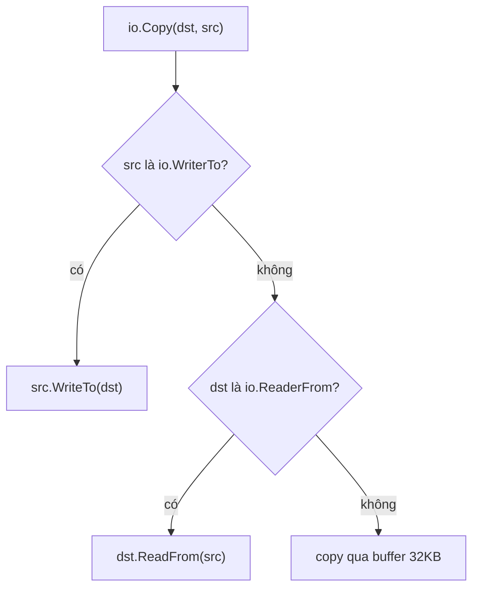

# Type assertion và Type switch

Một biến interface chỉ cho phép gọi các method mà interface khai báo — kiểu thật bên trong bị "che". Type assertion (khẳng định kiểu) và type switch (rẽ nhánh theo kiểu) là hai công cụ để **lấy lại kiểu cụ thể** hoặc **kiểm tra giá trị có thêm khả năng nào khác** lúc runtime. Bài này đi qua cú pháp `v.(T)`, dạng comma-ok an toàn, type switch, assertion sang interface khác để dò khả năng (pattern thư viện chuẩn dùng rất nhiều) và các ứng dụng thực tế.

---

:::note[Ghi nhớ nhanh]

- ⭐ **Luôn dùng dạng comma-ok `t, ok := v.(T)`** khi không chắc chắn — dạng một giá trị `v.(T)` sẽ **panic** nếu sai kiểu.
- ⭐ **Type switch `switch x := v.(type)`** để xử lý nhiều kiểu; trong mỗi `case` một kiểu, `x` có đúng kiểu đó.
- **Assertion sang interface** (`v.(io.Closer)`) để kiểm tra "giá trị này có làm được việc X không" — cách `io.Copy`, `fmt`, `http` nâng cấp hành vi.
- **Assertion chỉ áp dụng cho biến kiểu interface**, không dùng trên kiểu cụ thể.
- **Với lỗi, dùng `errors.As`** thay cho type assertion trực tiếp — vì lỗi có thể đã bị wrap.

:::

---

## Mục lục

- [Vì sao cần type assertion?](#vì-sao-cần-type-assertion)
- [Cú pháp type assertion](#cú-pháp-type-assertion)
- [Type switch](#type-switch)
- [Assertion sang interface khác](#assertion-sang-interface-khác)
- [Ứng dụng thực tế](#ứng-dụng-thực-tế)
- [Những lưu ý và bẫy](#những-lưu-ý-và-bẫy)

---

## Vì sao cần type assertion?

**Vấn đề:** Dữ liệu đến dưới dạng interface — `any` từ JSON, `error` từ hàm, `io.Writer` từ tham số — mà ta cần thông tin chỉ kiểu cụ thể mới có:

```go
var data map[string]any
_ = json.Unmarshal([]byte(`{"age": 30, "name": "An"}`), &data)

age := data["age"]
fmt.Println(age + 1) // lỗi biên dịch: mismatched types any and int
```

Biến `age` có kiểu tĩnh `any`; compiler không biết bên trong là số.

**Giải pháp:** Khẳng định kiểu để lấy giá trị cụ thể ra:

```go
if age, ok := data["age"].(float64); ok { // JSON number → float64
	fmt.Println(age + 1) // 31
}
```

:::tip[Dùng thực tế]

- **Xử lý JSON động** — `map[string]any` chứa `float64`, `string`, `bool`, `[]any`, `map[string]any`.
- **Kiểm tra khả năng tuỳ chọn** — `if f, ok := w.(http.Flusher); ok { f.Flush() }` khi stream dữ liệu.
- **Phân loại lỗi** — lỗi có method `Timeout() bool` thì retry.
- **Viết hàm format/serialize** — xử lý riêng từng kiểu cơ bản qua type switch.

:::

:::tip[Ví dụ đời thường]

Interface giống **thùng hàng dán nhãn "đồ điện tử"** ở bưu cục. Type assertion là lúc nhân viên mở thùng và nói "tôi chắc đây là điện thoại" — nếu đúng thì lấy ra dùng như điện thoại; dạng comma-ok là **mở ra xem trước** rồi mới quyết định, còn dạng không có `ok` là **cam đoan trước khi mở** — sai thì "sập" (panic).

:::

---

## Cú pháp type assertion

```go
t := v.(T)      // dạng 1 giá trị: sai kiểu → panic
t, ok := v.(T)  // dạng comma-ok: sai kiểu → ok = false, t = zero value của T
```

Trong đó `v` **bắt buộc** là biểu thức có kiểu interface; `T` có thể là kiểu cụ thể hoặc một interface khác.

```go
func main() {
	var v any = "xin chào"

	s := v.(string)
	fmt.Println(s) // xin chào

	n, ok := v.(int)
	fmt.Println(n, ok) // 0 false — không panic

	_ = v.(int) // panic: interface conversion: interface {} is string, not int
}
```

### Ý nghĩa khi `T` là kiểu cụ thể

`v.(T)` kiểm tra **kiểu động** của `v` có **đúng bằng** `T` không. Không có chuyển đổi ngầm:

```go
type MyInt int

var v any = MyInt(5)

_, ok1 := v.(int)   // false — MyInt khác int dù cùng kiểu nền
_, ok2 := v.(MyInt) // true

var p any = &User{}
_, ok3 := p.(User)  // false — kiểu động là *User, không phải User
_, ok4 := p.(*User) // true
```

### Assertion trên interface nil

Nếu `v` là interface nil thì assertion luôn thất bại (dạng 1 giá trị thì panic):

```go
var v any
_, ok := v.(string) // ok = false
s := v.(string)     // panic: interface conversion: interface {} is nil, not string
_ = s
```

:::warning[Không dùng được trên kiểu không phải interface]

```go
s := "abc"
_ = s.(string) // lỗi biên dịch: invalid operation: s (variable of type string) is not an interface
```

Muốn đổi kiểu cụ thể sang kiểu khác, dùng **type conversion** `T(x)`, không phải assertion.

:::

| | Type conversion `T(x)` | Type assertion `x.(T)` |
| --- | --- | --- |
| Áp dụng cho | Mọi kiểu tương thích | Chỉ biến interface |
| Kiểm tra | Lúc biên dịch | Lúc runtime |
| Làm gì | Biến đổi giá trị sang kiểu khác | Lấy giá trị bên trong ra, không biến đổi |
| Ví dụ | `float64(n)`, `[]byte(s)` | `v.(string)`, `err.(*MyErr)` |

---

## Type switch

Khi cần xử lý **nhiều kiểu**, viết chuỗi comma-ok rất dài. Type switch gọn hơn:

```go
func describe(v any) string {
	switch x := v.(type) {
	case nil:
		return "nil"
	case int:
		return fmt.Sprintf("int, gấp đôi = %d", x*2) // x có kiểu int
	case string:
		return fmt.Sprintf("string dài %d", len(x)) // x có kiểu string
	case bool:
		if x {
			return "đúng"
		}
		return "sai"
	case []int:
		return fmt.Sprintf("slice %d phần tử", len(x))
	case error:
		return "lỗi: " + x.Error() // case là interface cũng được
	case fmt.Stringer:
		return "stringer: " + x.String()
	default:
		return fmt.Sprintf("không hỗ trợ kiểu %T", x) // x giữ kiểu any
	}
}

func main() {
	fmt.Println(describe(21))                   // int, gấp đôi = 42
	fmt.Println(describe("Hà Nội"))             // string dài 9 (đếm byte, chữ có dấu chiếm nhiều byte)
	fmt.Println(describe(errors.New("hết hạn"))) // lỗi: hết hạn
	fmt.Println(describe(3.5))                  // không hỗ trợ kiểu float64
}
```

Quy tắc về biến `x` trong type switch:

- `case` có **một kiểu** → `x` mang đúng kiểu đó.
- `case` có **nhiều kiểu** (`case int, int64:`) → `x` giữ **kiểu interface gốc** (vì compiler không biết là kiểu nào).
- `default` và `case nil` → `x` giữ kiểu interface gốc.

```go
switch x := v.(type) {
case int, int64:
	// x có kiểu any ở đây, không thể x + 1
	fmt.Printf("số nguyên: %v\n", x)
}
```

:::note[Thứ tự case quan trọng]

Các `case` được xét **từ trên xuống**, gặp case khớp đầu tiên thì dừng. Nếu đặt `case fmt.Stringer:` trước `case error:` thì một kiểu có cả `String()` và `Error()` sẽ rơi vào nhánh `Stringer`. Đặt case cụ thể trước, case tổng quát sau. Type switch **không có `fallthrough`**.

:::

Không cần biến thì viết `switch v.(type)`:

```go
switch v.(type) {
case int, float64:
	fmt.Println("là số")
}
```

---

## Assertion sang interface khác

Đây là cách dùng mạnh nhất: kiểm tra một giá trị có **thêm khả năng** nào ngoài interface đang biết hay không — còn gọi là **interface upgrade** (nâng cấp interface) hay capability check.

```go
type Closer interface {
	Close() error
}

// Nhận io.Writer, nhưng nếu writer có Close thì đóng luôn
func writeAndMaybeClose(w io.Writer, data []byte) error {
	if _, err := w.Write(data); err != nil {
		return err
	}
	if c, ok := w.(io.Closer); ok { // w có method Close không?
		return c.Close()
	}
	return nil
}
```

Thư viện chuẩn dùng pattern này ở khắp nơi:

```go
// io.Copy (rút gọn): nếu src biết tự ghi ra writer thì để nó làm — nhanh hơn
if wt, ok := src.(io.WriterTo); ok {
	return wt.WriteTo(dst)
}
if rf, ok := dst.(io.ReaderFrom); ok {
	return rf.ReadFrom(src)
}
// ... nếu không thì copy qua buffer thông thường

// fmt: nếu giá trị có String() thì in bằng String()
if s, ok := arg.(fmt.Stringer); ok {
	// dùng s.String()
}
```

Nhờ đó `io.Copy(file, conn)` có thể dùng syscall `sendfile`/`splice` tối ưu trên Linux mà chữ ký hàm vẫn chỉ là `io.Writer`, `io.Reader`.



### Ví dụ: streaming với http.Flusher

```go
func streamHandler(w http.ResponseWriter, r *http.Request) {
	flusher, ok := w.(http.Flusher)
	if !ok {
		http.Error(w, "server không hỗ trợ streaming", http.StatusInternalServerError)
		return
	}
	w.Header().Set("Content-Type", "text/event-stream")
	for i := range 5 {
		fmt.Fprintf(w, "data: tin nhắn %d\n\n", i)
		flusher.Flush() // đẩy dữ liệu xuống client ngay
		time.Sleep(time.Second)
	}
}
```

:::note[http.ResponseController (Go 1.20)]

Khi `ResponseWriter` bị bọc bởi middleware (như `statusRecorder` ở bài Interface), assertion `w.(http.Flusher)` có thể thất bại vì kiểu bọc ngoài không có `Flush`. Từ Go 1.20, `http.NewResponseController(w).Flush()` tự dò qua method `Unwrap() http.ResponseWriter` của wrapper — middleware nên hiện thực `Unwrap`.

:::

---

## Ứng dụng thực tế

### 1. Duyệt JSON không biết trước cấu trúc

```go
func walk(prefix string, v any) {
	switch x := v.(type) {
	case map[string]any:
		for k, child := range x {
			walk(prefix+"."+k, child)
		}
	case []any:
		for i, child := range x {
			walk(fmt.Sprintf("%s[%d]", prefix, i), child)
		}
	case string:
		fmt.Printf("%s = %q\n", prefix, x)
	case float64:
		fmt.Printf("%s = %g\n", prefix, x)
	case bool:
		fmt.Printf("%s = %t\n", prefix, x)
	case nil:
		fmt.Printf("%s = null\n", prefix)
	}
}

func main() {
	raw := `{"user": {"name": "An", "tags": ["go", "k8s"], "active": true}}`
	var data any
	if err := json.Unmarshal([]byte(raw), &data); err != nil {
		log.Fatal(err)
	}
	walk("$", data)
}
```

`encoding/json` giải mã vào `any` theo bảng: object → `map[string]any`, array → `[]any`, number → `float64`, string → `string`, boolean → `bool`, null → `nil`.

### 2. Phân loại lỗi theo hành vi

```go
// Interface khai báo cục bộ: lỗi nào "tạm thời" thì retry
type temporary interface {
	Temporary() bool
}

func shouldRetry(err error) bool {
	var t temporary
	if errors.As(err, &t) { // dò cả chuỗi lỗi bị wrap
		return t.Temporary()
	}
	var ne net.Error
	if errors.As(err, &ne) {
		return ne.Timeout()
	}
	return false
}
```

Ở đây dùng `errors.As` thay cho `err.(temporary)`: lỗi thường bị bọc nhiều lớp bằng `fmt.Errorf("...: %w", err)`, type assertion trực tiếp chỉ nhìn lớp ngoài cùng nên sẽ trượt. Chi tiết trong bài Wrap và Unwrap lỗi.

### 3. Bộ chuyển đổi giá trị cấu hình

```go
func toInt(v any) (int, error) {
	switch x := v.(type) {
	case int:
		return x, nil
	case int64:
		return int(x), nil
	case float64:
		return int(x), nil
	case string:
		return strconv.Atoi(x)
	default:
		return 0, fmt.Errorf("không chuyển được %T sang int", v)
	}
}
```

### 4. Type switch với generics

Trong hàm generic, không thể switch trực tiếp trên tham số kiểu `T`, nhưng có thể chuyển sang `any` trước:

```go
func Format[T any](v T) string {
	switch x := any(v).(type) {
	case string:
		return x
	case int:
		return strconv.Itoa(x)
	default:
		return fmt.Sprint(x)
	}
}
```

Dùng hạn chế — nếu hàm generic phải switch theo kiểu, có thể generics không phải lựa chọn đúng.

---

## Những lưu ý và bẫy

:::warning[Dạng một giá trị trong code production]

`v.(T)` không có `ok` chỉ nên dùng khi **chắc chắn 100%** về kiểu (ví dụ chính bạn vừa đặt vào `sync.Pool` hay `context.WithValue` với key riêng). Mọi dữ liệu từ bên ngoài (JSON, input, plugin) đều phải dùng comma-ok hoặc type switch.

:::

- **Lạm dụng type switch là mùi code (code smell)** — nếu thêm kiểu mới mà phải sửa nhiều switch rải rác, hãy chuyển logic vào **method của interface** để dùng đa hình.
- **Đừng assertion trên `error` trực tiếp** — dùng `errors.As`/`errors.Is`.
- **Assertion sang kiểu con trỏ hay giá trị phải khớp đúng** — `*User` khác `User`.
- **Trong comma-ok, khi `ok == false` thì `t` là zero value** — đừng dùng `t` nếu chưa kiểm tra `ok`.

```go
// Code smell: mỗi lần thêm hình mới phải sửa hàm này
func area(s any) float64 {
	switch x := s.(type) {
	case Rect:
		return x.W * x.H
	case Circle:
		return math.Pi * x.R * x.R
	}
	return 0
}

// Tốt hơn: đa hình qua interface
type Shape interface{ Area() float64 }
```
