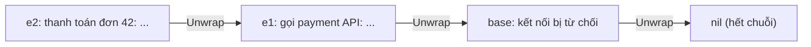
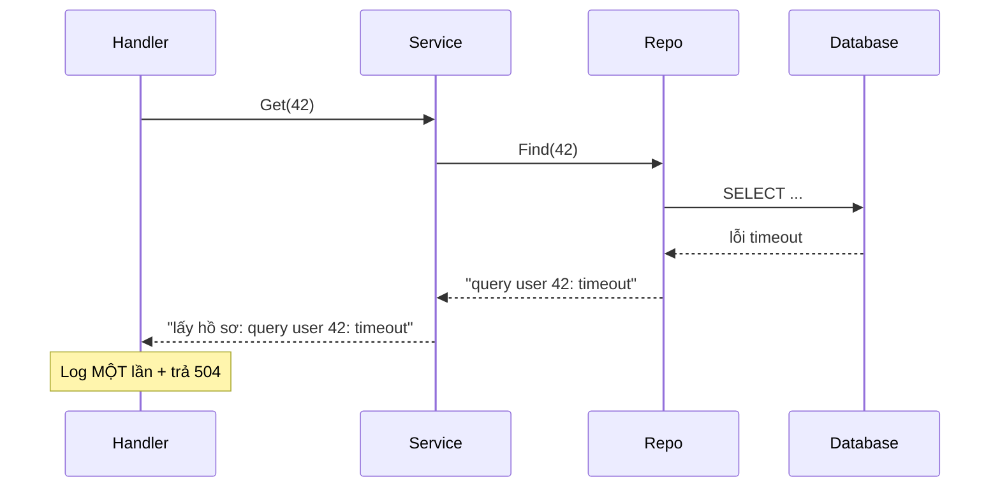

# Wrap và Unwrap lỗi

Khi lỗi đi từ tầng database lên tầng service rồi tới HTTP handler, mỗi tầng nên **thêm ngữ cảnh** để người đọc log biết chuyện gì đã xảy ra — nhưng vẫn phải giữ được lỗi gốc để code phía trên kiểm tra (đây có phải `sql.ErrNoRows` không? có phải timeout không?). Go 1.13 giải quyết bằng **wrap** (bọc) lỗi với `%w` và bộ ba `errors.Unwrap`, `errors.Is`, `errors.As`; Go 1.20 bổ sung `errors.Join` và nhiều `%w`. Bài này đi qua các công cụ đó và — quan trọng hơn — khi nào nên wrap, khi nào không.

---

:::note[Ghi nhớ nhanh]

- ⭐ **`fmt.Errorf("ngữ cảnh: %w", err)`** — thêm ngữ cảnh mà vẫn giữ lỗi gốc trong chuỗi; `%v` thì chỉ giữ chữ, cắt đứt chuỗi.
- ⭐ **Kiểm tra lỗi bằng `errors.Is` (so sánh giá trị) và `errors.As` (lấy ra theo kiểu)** — không dùng `==` hay type assertion trực tiếp vì chúng chỉ nhìn lớp ngoài cùng.
- **`errors.Join(e1, e2)`** và **`fmt.Errorf("%w; %w", e1, e2)`** (Go 1.20) gộp nhiều lỗi; `Is`/`As` duyệt cả cây.
- **Wrap = cam kết API** — lỗi gốc được wrap trở thành thứ người gọi có thể phụ thuộc; không muốn lộ chi tiết nội bộ thì dùng `%v` hoặc dịch sang lỗi domain.
- **Xử lý lỗi một lần**: hoặc log, hoặc trả lên — không làm cả hai.

:::

---

## Mục lục

- [Vì sao cần wrap lỗi?](#vì-sao-cần-wrap-lỗi)
- [Wrap bằng %w](#wrap-bằng-w)
- [errors.Unwrap](#errorsunwrap)
- [errors.Is](#errorsis)
- [errors.As](#errorsas)
- [Gộp nhiều lỗi với errors.Join](#gộp-nhiều-lỗi-với-errorsjoin)
- [Thêm ngữ cảnh đúng cách](#thêm-ngữ-cảnh-đúng-cách)
- [Khi nào wrap, khi nào không](#khi-nào-wrap-khi-nào-không)
- [Xử lý lỗi một lần](#xử-lý-lỗi-một-lần)

---

## Vì sao cần wrap lỗi?

**Vấn đề:** Trả lỗi nguyên bản lên thì mất ngữ cảnh; nối chuỗi bằng `%v` thì mất lỗi gốc:

```go
// Cách 1: trả nguyên — log chỉ thấy "sql: no rows in result set", không biết từ đâu
func (s *Service) GetOrder(id int) (*Order, error) {
	o, err := s.repo.Find(id)
	if err != nil {
		return nil, err
	}
	return o, nil
}

// Cách 2: thêm ngữ cảnh bằng %v — có chữ nhưng mất lỗi gốc
return nil, fmt.Errorf("lấy đơn %d: %v", id, err)

// Ở handler:
if err == sql.ErrNoRows { // false! lỗi giờ là một chuỗi mới
	// không bao giờ chạy vào đây → trả 500 thay vì 404
}
```

**Giải pháp:** Dùng `%w` để **bọc** — vừa có ngữ cảnh, vừa giữ được lỗi gốc:

```go
func (s *Service) GetOrder(id int) (*Order, error) {
	o, err := s.repo.Find(id)
	if err != nil {
		return nil, fmt.Errorf("lấy đơn %d: %w", id, err)
	}
	return o, nil
}

// Ở handler:
_, err := svc.GetOrder(42)
fmt.Println(err)                           // lấy đơn 42: sql: no rows in result set
fmt.Println(errors.Is(err, sql.ErrNoRows)) // true — tìm thấy trong chuỗi
```

:::tip[Dùng thực tế]

- **Log dễ truy vết** — `xử lý webhook: cập nhật đơn 42: lưu db: context deadline exceeded`.
- **Ánh xạ HTTP status** — `errors.Is(err, ErrNotFound)` → 404 dù lỗi đã đi qua 3 tầng.
- **Retry có điều kiện** — `errors.Is(err, context.DeadlineExceeded)` hay `errors.As(err, &netErr)` để quyết định thử lại.
- **Validate nhiều trường** — gom mọi lỗi bằng `errors.Join` rồi trả một lần.

:::

:::tip[Ví dụ đời thường]

Wrap lỗi giống **gói hàng chuyển phát qua nhiều bưu cục**: mỗi bưu cục dán thêm một nhãn "đã qua kho Đà Nẵng 9h", "đã qua kho Nha Trang 14h" — nhưng **không xé gói** bên trong. Người nhận đọc nhãn biết hành trình (ngữ cảnh), mở từng lớp ra vẫn thấy món hàng gốc (`errors.Is`/`errors.As`). Dùng `%v` giống chụp ảnh món hàng rồi gửi tấm ảnh — nhìn thì biết, nhưng không cầm lên kiểm tra được.

:::

---

## Wrap bằng %w

`fmt.Errorf` với động từ `%w` tạo ra lỗi mới có method `Unwrap() error` trả về lỗi được bọc:

```go
base := errors.New("kết nối bị từ chối")
e1 := fmt.Errorf("gọi payment API: %w", base)
e2 := fmt.Errorf("thanh toán đơn 42: %w", e1)

fmt.Println(e2) // thanh toán đơn 42: gọi payment API: kết nối bị từ chối
```

Chuỗi lỗi (error chain) tạo thành:



| Động từ | Thông điệp | Giữ lỗi gốc cho `Is`/`As` |
| --- | --- | --- |
| `%w` | Giống `%v` | **Có** |
| `%v` | Chuỗi của lỗi | Không |
| `%s` | Chuỗi của lỗi | Không |

### Tự viết kiểu lỗi có Unwrap

Custom error type muốn tham gia chuỗi thì hiện thực `Unwrap() error`:

```go
type QueryError struct {
	Query string
	Err   error
}

func (e *QueryError) Error() string { return "query " + e.Query + ": " + e.Err.Error() }
func (e *QueryError) Unwrap() error { return e.Err }

err := &QueryError{Query: "SELECT ...", Err: sql.ErrNoRows}
fmt.Println(errors.Is(err, sql.ErrNoRows)) // true — nhờ Unwrap
```

`*os.PathError`, `*net.OpError`, `*url.Error` trong thư viện chuẩn đều làm như vậy.

---

## errors.Unwrap

`errors.Unwrap(err)` gỡ **đúng một lớp**: gọi method `Unwrap() error` nếu có, không có thì trả `nil`.

```go
base := errors.New("gốc")
wrapped := fmt.Errorf("lớp 1: %w", base)

fmt.Println(errors.Unwrap(wrapped) == base) // true
fmt.Println(errors.Unwrap(base))            // <nil>
```

Trong thực tế **hiếm khi gọi trực tiếp** `errors.Unwrap` — vì không biết lỗi cần tìm nằm ở lớp thứ mấy. Dùng `errors.Is`/`errors.As`, chúng tự duyệt toàn bộ chuỗi.

:::note[errors.Unwrap không gỡ được lỗi Join]

Lỗi tạo bởi `errors.Join` hoặc `fmt.Errorf` có nhiều `%w` hiện thực `Unwrap() []error` (trả slice), **không phải** `Unwrap() error`. Với chúng, `errors.Unwrap` trả `nil`. `errors.Is`/`errors.As` thì xử lý được cả hai dạng.

:::

---

## errors.Is

`errors.Is(err, target)` duyệt chuỗi lỗi, trả `true` nếu có lỗi nào **bằng** `target` (so sánh `==`, hoặc lỗi đó có method `Is(error) bool` trả `true`).

```go
func readConfig(path string) ([]byte, error) {
	data, err := os.ReadFile(path)
	if err != nil {
		return nil, fmt.Errorf("đọc config: %w", err)
	}
	return data, nil
}

func main() {
	_, err := readConfig("/khong/co.yaml")
	if errors.Is(err, fs.ErrNotExist) { // *PathError → Unwrap → syscall.ENOENT → Is(fs.ErrNotExist)
		fmt.Println("không có file config, dùng mặc định")
	}
}
```

Dùng cho **sentinel error** và các lỗi so sánh được:

```go
switch {
case errors.Is(err, context.Canceled):
	// client huỷ request — không cần log lỗi
case errors.Is(err, context.DeadlineExceeded):
	// timeout → trả 504
case errors.Is(err, ErrNotFound):
	// → 404
}
```

### Tuỳ biến so sánh bằng method Is

```go
type StatusError struct{ Code int }

func (e *StatusError) Error() string { return fmt.Sprintf("status %d", e.Code) }

// Coi mọi StatusError cùng Code là bằng nhau
func (e *StatusError) Is(target error) bool {
	t, ok := target.(*StatusError)
	return ok && t.Code == e.Code
}

var ErrTooManyRequests = &StatusError{Code: 429}

err := fmt.Errorf("gọi API: %w", &StatusError{Code: 429})
fmt.Println(errors.Is(err, ErrTooManyRequests)) // true — khác con trỏ nhưng Is() so theo Code
```

---

## errors.As

`errors.As(err, &target)` duyệt chuỗi, tìm lỗi đầu tiên **gán được vào kiểu của `target`**; nếu thấy thì gán vào `target` và trả `true`.

```go
_, err := os.Open("/root/secret.txt")
err = fmt.Errorf("tải file: %w", err)

var pathErr *fs.PathError
if errors.As(err, &pathErr) {
	fmt.Println("thao tác:", pathErr.Op)   // open
	fmt.Println("đường dẫn:", pathErr.Path) // /root/secret.txt
}
```

`target` phải là **con trỏ tới** một kiểu hiện thực `error` hoặc một kiểu interface bất kỳ:

```go
// Kiểu cụ thể: target là **ValidationError
var ve *ValidationError
errors.As(err, &ve)

// Interface: tìm lỗi nào có method Timeout() bool
var te interface{ Timeout() bool }
if errors.As(err, &te) && te.Timeout() {
	// retry
}
```

:::warning[Lỗi hay gặp với errors.As]

```go
var ve *ValidationError
errors.As(err, ve)  // SAI: phải truyền &ve — go vet báo "second argument to errors.As must be a non-nil pointer..."

var ve2 ValidationError
errors.As(err, &ve2) // SAI: Error() có pointer receiver nên ValidationError không phải error → go vet báo, chạy thì panic
```

Quy tắc: kiểu của biến `target` phải **đúng y** kiểu được trả ra (`*ValidationError` nếu bạn `return &ValidationError{}`), rồi truyền **địa chỉ** của biến đó.

:::

:::note[errors.AsType (Go 1.26)]

Go 1.26 bổ sung hàm generic `errors.AsType[E error](err error) (E, bool)` — gọn hơn và an toàn kiểu hơn `errors.As`: `if ve, ok := errors.AsType[*ValidationError](err); ok { ... }`. Với dự án còn hỗ trợ phiên bản cũ, tiếp tục dùng `errors.As`.

:::

| | `errors.Is` | `errors.As` |
| --- | --- | --- |
| Hỏi | "Trong chuỗi có lỗi **này** không?" | "Trong chuỗi có lỗi **kiểu này** không? Đưa nó cho tôi" |
| Dùng với | Sentinel (`io.EOF`, `ErrNotFound`) | Custom type (`*PathError`, `*ValidationError`) |
| Kết quả | `bool` | `bool` + gán vào `target` |
| Thay thế cho | `err == X` | `err.(*T)` |

---

## Gộp nhiều lỗi với errors.Join

Go 1.20 cho phép một lỗi bọc **nhiều** lỗi. Hai cách:

```go
// 1. errors.Join — nối thông điệp bằng xuống dòng, bỏ qua các lỗi nil
err := errors.Join(
	errors.New("email trống"),
	nil,
	errors.New("tuổi âm"),
)
fmt.Println(err)
// email trống
// tuổi âm

// 2. Nhiều %w trong fmt.Errorf
var ErrA = errors.New("A")
var ErrB = errors.New("B")
e := fmt.Errorf("lỗi kép: %w, %w", ErrA, ErrB)
fmt.Println(errors.Is(e, ErrA), errors.Is(e, ErrB)) // true true
```

`errors.Join` trả `nil` nếu mọi lỗi đều `nil` — rất tiện cho validate:

```go
type SignupForm struct {
	Email    string
	Password string
	Age      int
}

var (
	ErrEmailRequired = errors.New("email bắt buộc")
	ErrPasswordShort = errors.New("mật khẩu tối thiểu 8 ký tự")
	ErrAgeInvalid    = errors.New("tuổi không hợp lệ")
)

func (f SignupForm) Validate() error {
	var errs []error
	if f.Email == "" {
		errs = append(errs, ErrEmailRequired)
	}
	if len(f.Password) < 8 {
		errs = append(errs, ErrPasswordShort)
	}
	if f.Age < 13 || f.Age > 120 {
		errs = append(errs, ErrAgeInvalid)
	}
	return errors.Join(errs...) // nil nếu errs rỗng
}

func main() {
	err := SignupForm{Password: "123", Age: 20}.Validate()
	fmt.Println(err)
	// email bắt buộc
	// mật khẩu tối thiểu 8 ký tự
	fmt.Println(errors.Is(err, ErrPasswordShort)) // true
}
```

Ứng dụng khác: đóng nhiều tài nguyên và gom lỗi.

```go
func (a *App) Close() error {
	return errors.Join(
		a.db.Close(),
		a.cache.Close(),
		a.queue.Close(),
	)
}
```

---

## Thêm ngữ cảnh đúng cách

Ngữ cảnh tốt trả lời câu hỏi **"đang làm gì thì lỗi"**, kèm định danh quan trọng:

```go
// Kém: lặp lại "failed", "error", không có định danh
return fmt.Errorf("error: failed to get user: %w", err)

// Tốt: động từ + đối tượng + id
return fmt.Errorf("lấy user %d: %w", id, err)
```

Kết quả khi đi qua nhiều tầng:

```text
xử lý thanh toán đơn 1024: trừ tiền ví user 77: cập nhật số dư: pq: could not serialize access due to concurrent update
```

Nguyên tắc:

- **Không lặp thông tin** lỗi gốc đã có — `os.Open` đã ghi đường dẫn trong `*PathError`, không cần `"mở %s: %w"` với cùng path.
- **Không viết "failed to", "lỗi khi"** ở mọi tầng — chuỗi sẽ thành "lỗi khi lỗi khi lỗi khi…".
- **Mỗi tầng thêm đúng một mẩu** thông tin của tầng đó.
- **Không đưa dữ liệu nhạy cảm** (mật khẩu, token, số thẻ) vào thông điệp lỗi — chúng sẽ vào log.

---

## Khi nào wrap, khi nào không

Wrap bằng `%w` khiến lỗi gốc trở thành **một phần API** của hàm: người gọi có thể viết `errors.Is(err, sql.ErrNoRows)` và phụ thuộc vào việc bạn dùng `database/sql`. Mai kia đổi sang MongoDB, code của họ âm thầm hỏng.

| Tình huống | Nên |
| --- | --- |
| Lỗi nội bộ trong cùng package/module, người gọi cần kiểm tra | Wrap `%w` |
| Lỗi chi tiết hiện thực (driver DB, thư viện HTTP) đi ra khỏi ranh giới package public | **Dịch** sang lỗi domain, hoặc dùng `%v` |
| Chỉ cần thông điệp cho log | `%v` là đủ |
| Lỗi có thể cần cho retry/timeout (`context.DeadlineExceeded`) | Wrap `%w` |

```go
// Tầng repository: dịch lỗi hạ tầng sang lỗi domain
func (r *UserRepo) Find(ctx context.Context, id int64) (*User, error) {
	u, err := r.query(ctx, id)
	if errors.Is(err, sql.ErrNoRows) {
		return nil, ErrUserNotFound // người gọi không cần biết có SQL
	}
	if err != nil {
		return nil, fmt.Errorf("tìm user %d: %w", id, err) // lỗi khác: wrap để còn kiểm tra timeout
	}
	return u, nil
}

// Thư viện public không muốn cam kết lỗi bên dưới
func (c *Client) Fetch(url string) error {
	if err := c.do(url); err != nil {
		return fmt.Errorf("fetch %s: %v", url, err) // %v: cắt chuỗi có chủ đích
	}
	return nil
}
```

:::warning[Không trả lỗi nội bộ cho client]

Ở tầng HTTP, **không** gửi `err.Error()` nguyên văn về client — có thể lộ tên bảng, câu SQL, đường dẫn file, IP nội bộ. Log đầy đủ ở server, trả client thông điệp chung kèm request ID:

```go
slog.Error("tạo đơn", "request_id", reqID, "err", err)
http.Error(w, "lỗi hệ thống, mã: "+reqID, http.StatusInternalServerError)
```

:::

---

## Xử lý lỗi một lần

Mỗi lỗi chỉ nên được **xử lý một lần**. "Xử lý" gồm: log, trả về, retry, hoặc chuyển thành giá trị mặc định. Lỗi phổ biến là vừa log vừa trả về:

```go
// SAI: log ở mọi tầng → một lỗi in ra 3 lần, log rối, khó đếm số lỗi thật
func (r *Repo) Find(id int) (*User, error) {
	u, err := r.query(id)
	if err != nil {
		log.Printf("query lỗi: %v", err) // log lần 1
		return nil, err
	}
	return u, nil
}

func (s *Service) Get(id int) (*User, error) {
	u, err := s.repo.Find(id)
	if err != nil {
		log.Printf("service lỗi: %v", err) // log lần 2
		return nil, err
	}
	return u, nil
}
// handler lại log lần 3...
```

```go
// ĐÚNG: tầng dưới chỉ thêm ngữ cảnh và trả lên; tầng trên cùng (handler, main, worker) log một lần
func (r *Repo) Find(id int) (*User, error) {
	u, err := r.query(id)
	if err != nil {
		return nil, fmt.Errorf("query user %d: %w", id, err)
	}
	return u, nil
}

func (h *Handler) getUser(w http.ResponseWriter, r *http.Request) {
	u, err := h.svc.Get(r.Context(), id)
	if err != nil {
		slog.Error("lấy user", "err", err) // log đúng một lần, đủ ngữ cảnh nhờ wrap
		writeError(w, err)
		return
	}
	// ...
}
```


