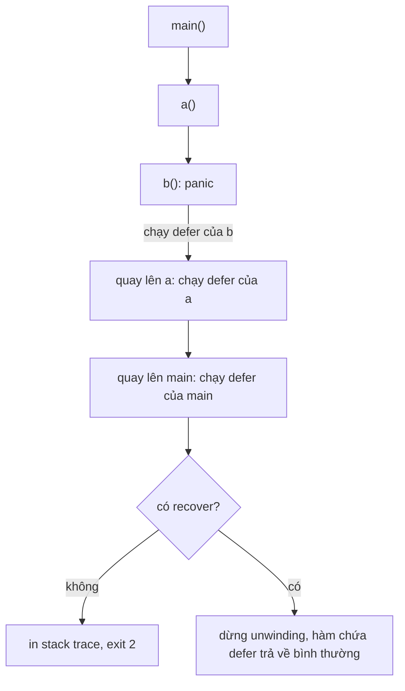

# Panic và Recover

`panic` là cơ chế dừng khẩn cấp của Go: hàm đang chạy dừng lại, các `defer` được thực thi, rồi nếu không ai `recover` thì **cả chương trình sập** kèm stack trace. Khác với exception ở ngôn ngữ khác, panic **không phải** cách xử lý lỗi thông thường — nó dành cho lỗi lập trình và tình huống không thể phục hồi. Bài này đi qua khi nào nên panic, cách `recover` hoạt động (và vì sao chỉ có tác dụng trong `defer`), middleware recover cho HTTP server, bẫy panic trong goroutine, cách đọc stack trace, `runtime/debug.Stack`, biến môi trường `GOTRACEBACK` và debug cơ bản với Delve.

---

:::note[Ghi nhớ nhanh]

- ⭐ **Lỗi dự đoán được → trả `error`; panic chỉ cho lỗi lập trình** (bug, bất biến bị vi phạm) hoặc lỗi khởi động không thể tiếp tục.
- ⭐ **Panic trong goroutine mà không recover trong chính goroutine đó → cả process sập** — recover ở `main` hay ở goroutine cha không cứu được.
- **`recover()` chỉ có tác dụng khi được gọi trực tiếp trong hàm `defer`** — gọi ở chỗ khác luôn trả `nil`.
- **HTTP server cần middleware recover** — `net/http` tự recover panic của handler nhưng chỉ in log và đóng kết nối; middleware cho phép trả 500 và log có cấu trúc.
- **`debug.Stack()` lấy stack trace dạng `[]byte`**; `GOTRACEBACK=all` in stack của mọi goroutine khi sập.

:::

---

## Mục lục

- [Vì sao cần panic?](#vì-sao-cần-panic)
- [Panic hoạt động thế nào](#panic-hoạt-động-thế-nào)
- [Khi nào nên panic](#khi-nào-nên-panic)
- [Recover](#recover)
- [Recover middleware cho HTTP server](#recover-middleware-cho-http-server)
- [Panic trong goroutine](#panic-trong-goroutine)
- [Đọc stack trace](#đọc-stack-trace)
- [Debug cơ bản với Delve](#debug-cơ-bản-với-delve)
- [Câu hỏi phỏng vấn](#câu-hỏi-phỏng-vấn)

---

## Vì sao cần panic?

**Vấn đề:** Có những tình huống mà trả `error` là vô nghĩa vì **không ai xử lý được** — chương trình đã ở trạng thái sai:

```go
// Truy cập ngoài mảng: đây là bug, không phải lỗi nghiệp vụ
nums := []int{1, 2, 3}
fmt.Println(nums[5])

// Nếu index trả về error, mọi phép truy cập slice đều phải viết:
// v, err := nums.At(5); if err != nil { ... } — không ai chịu nổi
```

Hoặc cấu hình bắt buộc thiếu lúc khởi động — tiếp tục chạy chỉ gây lỗi khó hiểu ở chỗ khác.

**Giải pháp:** Runtime và lập trình viên dùng `panic` để **dừng ngay**, in rõ vị trí:

```text
panic: runtime error: index out of range [5] with length 3

goroutine 1 [running]:
main.main()
	/app/main.go:9 +0x1d
exit status 2
```

Và với các tình huống hiếm hoi cần "chặn" panic (server không được chết vì một request lỗi), Go cung cấp `recover`.

:::tip[Dùng thực tế]

- **Runtime tự panic** — nil pointer dereference, index out of range, ghi vào map nil, chia số nguyên cho 0, type assertion sai.
- **Hàm `Must...`** — `regexp.MustCompile`, `template.Must`: panic nếu đầu vào sai, dùng cho giá trị cố định lúc khởi tạo.
- **Bất biến bị vi phạm** — nhánh `default` của switch "không bao giờ xảy ra".
- **Recover ở biên** — middleware HTTP, vòng lặp worker, để một request/job lỗi không kéo sập cả service.

:::

:::tip[Ví dụ đời thường]

`error` giống **khách gọi món hết hàng**: nhân viên báo lại, khách chọn món khác, quán vẫn chạy. `panic` giống **bếp bốc cháy**: dừng mọi thứ ngay. `recover` là **bình chữa cháy ở từng bếp**: cháy một chảo thì dập tại chỗ, báo khách bàn đó "món của anh bị hỏng", các bàn khác vẫn được phục vụ.

:::

---

## Panic hoạt động thế nào

Khi `panic(v)` được gọi (hoặc runtime tự panic):

1. Hàm hiện tại **dừng ngay** tại dòng đó.
2. Các hàm `defer` của nó chạy theo thứ tự **LIFO** (vào sau ra trước).
3. Quá trình lặp lại ở hàm gọi nó, rồi hàm gọi hàm đó… (gọi là **unwinding** — tháo ngăn xếp).
4. Nếu lên tới đỉnh goroutine mà không có `recover` → in giá trị panic + stack trace, **thoát process với mã 2**.

```go
func main() {
	defer fmt.Println("defer trong main")
	a()
	fmt.Println("không bao giờ in")
}

func a() {
	defer fmt.Println("defer trong a")
	b()
}

func b() {
	defer fmt.Println("defer trong b")
	panic("có sự cố")
}
```

```text
defer trong b
defer trong a
defer trong main
panic: có sự cố

goroutine 1 [running]:
main.b()
	/app/main.go:18 +0x...
main.a()
	/app/main.go:13 +0x...
main.main()
	/app/main.go:8 +0x...
exit status 2
```



`panic` nhận giá trị kiểu `any`, nhưng nên truyền `error` hoặc `string` để thông điệp rõ ràng.

:::note[os.Exit bỏ qua defer]

`os.Exit(1)` và `log.Fatal(...)` (gọi `os.Exit` bên trong) thoát **ngay**, **không chạy defer**. Đừng dùng chúng bên trong hàm có defer quan trọng (đóng file, flush log) — chỉ dùng ở `main`.

:::

---

## Khi nào nên panic

| Nên panic | Không nên panic (trả error) |
| --- | --- |
| Lỗi lập trình: gọi hàm sai cách, bất biến bị vi phạm | Input người dùng sai |
| Khởi tạo giá trị cố định: `regexp.MustCompile("^[a-z]+$")` | File không tồn tại, mạng lỗi, DB timeout |
| Thiếu cấu hình bắt buộc lúc khởi động (trong `main`/`init`) | Không tìm thấy bản ghi |
| Trạng thái "không thể xảy ra" | Bất kỳ lỗi nào người gọi có thể xử lý |

```go
// Mẫu Must: chỉ dùng với đầu vào cố định do lập trình viên viết
var emailRe = regexp.MustCompile(`^[^@\s]+@[^@\s]+\.[^@\s]+$`)

// Tự viết Must cho hàm của mình
func Must[T any](v T, err error) T {
	if err != nil {
		panic(err)
	}
	return v
}

var tmpl = Must(template.New("mail").Parse("Xin chào {{.Name}}"))

// Bất biến bị vi phạm
func (s Status) Label() string {
	switch s {
	case Pending:
		return "chờ"
	case Done:
		return "xong"
	}
	panic(fmt.Sprintf("Status không hợp lệ: %d", s)) // bug: ai đó tạo Status ngoài danh sách
}
```

:::warning[Thư viện không được panic ra ngoài]

Package dùng chung **không nên để panic thoát ra API public** cho lỗi bình thường. Người dùng thư viện không mong một hàm `Parse` làm sập service của họ. Nếu nội bộ dùng panic để thoát nhanh khỏi đệ quy sâu (như `encoding/json` từng làm), hãy recover ở hàm public và chuyển thành `error`.

:::

---

## Recover

`recover()` dừng quá trình unwinding và trả về giá trị đã truyền cho `panic`. Nó **chỉ có tác dụng khi được gọi trực tiếp bên trong một hàm defer**; ở mọi chỗ khác nó trả `nil` và không làm gì.

```go
func safeDivide(a, b int) (result int, err error) {
	defer func() {
		if r := recover(); r != nil {
			err = fmt.Errorf("safeDivide: %v", r) // gán vào named return
		}
	}()
	return a / b, nil // b = 0 → runtime panic: integer divide by zero
}

func main() {
	_, err := safeDivide(10, 0)
	fmt.Println(err) // safeDivide: runtime error: integer divide by zero
}
```

Điểm mấu chốt:

- Dùng **named return** (`err error`) để hàm defer có thể sửa giá trị trả về sau khi recover.
- Sau khi recover, hàm chứa defer **trả về bình thường** cho hàm gọi nó; code sau dòng panic **không chạy tiếp**.

### Những cách recover không hoạt động

```go
// 1. Không gọi trong defer
func f1() {
	recover() // trả nil — chưa có panic nào lúc này
	panic("x") // vẫn sập
}

// 2. Gọi lồng thêm một tầng hàm bên trong defer
func helper() { recover() }

func f2() {
	defer func() {
		helper() // recover trong helper KHÔNG bắt được — phải gọi trực tiếp trong hàm defer
	}()
	panic("x")
}

// 3. defer recover() trực tiếp
func f3() {
	defer recover() // không có tác dụng: recover được gọi bởi runtime, không phải bởi một hàm defer
	panic("x")
}
```

Cách đúng là hoặc dùng closure `defer func() { recover() }()`, hoặc **defer chính hàm helper**:

```go
func recoverAndLog() {
	if r := recover(); r != nil { // helper được defer trực tiếp → recover hoạt động
		slog.Error("đã recover", "panic", r)
	}
}

func f4() {
	defer recoverAndLog() // OK
	panic("x")
}
```

:::note[panic(nil) từ Go 1.21]

Trước Go 1.21, `panic(nil)` khiến `recover()` trả `nil` — không phân biệt được với "không có panic". Từ Go 1.21, `panic(nil)` được chuyển thành `*runtime.PanicNilError`, nên `recover()` luôn trả giá trị khác nil khi có panic.

:::

:::warning[Không dùng panic/recover như try/catch]

Đừng dùng panic để báo lỗi nghiệp vụ rồi recover ở tầng trên — đó là exception đội lốt, đi ngược triết lý Go và chậm hơn nhiều so với trả `error`. Recover chỉ nên đặt ở **biên**: middleware HTTP, vòng lặp worker, hàm public của thư viện.

:::

---

## Recover middleware cho HTTP server

`net/http` tự recover panic của từng handler để server không chết: nó in stack trace ra log của server và **đóng kết nối** — client nhận lỗi mạng (connection reset/EOF) thay vì một response 500 tử tế. Middleware recover cho phép kiểm soát việc này:

```go
func Recoverer(next http.Handler) http.Handler {
	return http.HandlerFunc(func(w http.ResponseWriter, r *http.Request) {
		defer func() {
			rec := recover()
			if rec == nil {
				return
			}
			// http.ErrAbortHandler là panic có chủ đích để huỷ response — để net/http xử lý
			if rec == http.ErrAbortHandler {
				panic(rec)
			}
			slog.Error("panic trong handler",
				"method", r.Method,
				"path", r.URL.Path,
				"panic", rec,
				"stack", string(debug.Stack()),
			)
			http.Error(w, http.StatusText(http.StatusInternalServerError), http.StatusInternalServerError)
		}()
		next.ServeHTTP(w, r)
	})
}

func main() {
	mux := http.NewServeMux()
	mux.HandleFunc("GET /users/{id}", func(w http.ResponseWriter, r *http.Request) {
		var m map[string]int
		m["x"] = 1 // panic: assignment to entry in nil map
	})
	mux.HandleFunc("GET /health", func(w http.ResponseWriter, r *http.Request) {
		fmt.Fprintln(w, "ok")
	})

	log.Fatal(http.ListenAndServe(":8080", Recoverer(mux)))
}
```

```bash
curl -i localhost:8080/users/1
# HTTP/1.1 500 Internal Server Error
# Internal Server Error

curl localhost:8080/health
# ok — server vẫn sống
```

:::tip[Lưu ý khi viết middleware recover]

- Đặt Recoverer ở **ngoài cùng** chuỗi middleware để bắt cả panic của middleware khác.
- Nếu handler **đã ghi header** trước khi panic, `http.Error` không đổi được status — chỉ log được.
- Gắn request ID vào log để truy vết; gửi tới hệ thống báo lỗi (Sentry…) nếu có.
- Framework như chi (`middleware.Recoverer`), gin (`gin.Recovery()`), echo (`middleware.Recover()`) có sẵn middleware tương đương.
- Recover chỉ bắt panic **trong cùng goroutine** với handler — goroutine handler tự sinh ra phải tự recover.

:::

---

## Panic trong goroutine

Đây là bẫy nghiêm trọng nhất: **panic không recover trong một goroutine bất kỳ làm sập toàn bộ process**, và `recover` ở goroutine khác (kể cả `main`, kể cả middleware) **không bắt được**.

```go
func main() {
	defer func() {
		if r := recover(); r != nil {
			fmt.Println("main recover:", r) // KHÔNG BAO GIỜ CHẠY
		}
	}()

	go func() {
		panic("lỗi trong goroutine") // làm sập cả chương trình
	}()

	time.Sleep(time.Second)
	fmt.Println("không in được")
}
```

```text
panic: lỗi trong goroutine

goroutine 18 [running]:
main.main.func2()
	/app/main.go:14 +0x...
created by main.main in goroutine 1
	/app/main.go:13 +0x...
exit status 2
```

Ở HTTP server, một handler `go sendEmail(...)` panic sẽ kéo sập **mọi request khác** đang xử lý — middleware recover không cứu được.

**Giải pháp:** mọi goroutine chạy lâu hoặc chạy code không tin cậy phải tự recover. Viết một hàm tiện ích:

```go
// SafeGo chạy fn trong goroutine mới, recover và log nếu panic
func SafeGo(fn func()) {
	go func() {
		defer func() {
			if r := recover(); r != nil {
				slog.Error("panic trong goroutine",
					"panic", r,
					"stack", string(debug.Stack()),
				)
			}
		}()
		fn()
	}()
}

// Dùng
SafeGo(func() {
	sendWelcomeEmail(user)
})
```

Với nhóm goroutine cần trả lỗi về, chuyển panic thành error:

```go
func runTasks(tasks []func() error) error {
	var wg sync.WaitGroup
	errs := make([]error, len(tasks))

	for i, task := range tasks {
		wg.Add(1)
		go func() { // Go 1.22: i, task là biến riêng mỗi vòng lặp
			defer wg.Done()
			defer func() {
				if r := recover(); r != nil {
					errs[i] = fmt.Errorf("task %d panic: %v", i, r)
				}
			}()
			errs[i] = task()
		}()
	}
	wg.Wait()
	return errors.Join(errs...)
}
```

:::warning[errgroup không recover panic]

`golang.org/x/sync/errgroup` chuyển `error` của các goroutine về `Wait()`, nhưng **không** bắt panic — panic trong `g.Go(...)` vẫn làm sập process. Cần tự bọc recover bên trong hàm truyền vào.

:::

:::note[Có những lỗi không recover được]

Một số lỗi runtime là **fatal error**, không phải panic, nên `recover` vô dụng: `fatal error: concurrent map writes` (ghi map đồng thời), `fatal error: all goroutines are asleep - deadlock!`, hết bộ nhớ, stack overflow (`goroutine stack exceeds 1000000000-byte limit`). Phải sửa bug, không thể chặn.

:::

---

## Đọc stack trace

```text
panic: runtime error: invalid memory address or nil pointer dereference
[signal SIGSEGV: segmentation violation code=0x2 addr=0x0 pc=0x100c4f2a4]

goroutine 7 [running]:
main.(*OrderService).Total(0x0)
	/app/order.go:42 +0x24
main.handleCheckout({0x101234560, 0x14000126000}, 0x14000132000)
	/app/handler.go:18 +0x3c
net/http.HandlerFunc.ServeHTTP(...)
	/usr/local/go/src/net/http/server.go:2294 +0x38
...
```

Cách đọc:

1. **Dòng đầu** — loại panic: `nil pointer dereference`.
2. **`goroutine 7 [running]`** — goroutine nào panic và trạng thái.
3. **Khung trên cùng là nơi panic xảy ra**: `(*OrderService).Total` ở `order.go:42`. Tham số `(0x0)` cho thấy **receiver là nil** — gợi ý nguyên nhân: gọi method trên `*OrderService` chưa khởi tạo.
4. Đọc **xuống dưới** để thấy ai gọi: `handleCheckout` ở `handler.go:18`.
5. `+0x24` là offset trong mã máy — thường bỏ qua.

### runtime/debug.Stack và PrintStack

```go
import "runtime/debug"

debug.PrintStack()        // in stack của goroutine hiện tại ra stderr
stack := debug.Stack()    // trả []byte để đưa vào log có cấu trúc
slog.Error("bất thường", "stack", string(stack))
```

Muốn lấy stack của **mọi** goroutine (ví dụ khi debug treo/deadlock):

```go
buf := make([]byte, 1<<20)
n := runtime.Stack(buf, true) // true = tất cả goroutine
os.Stderr.Write(buf[:n])
```

Hoặc gửi tín hiệu `SIGQUIT` (`kill -QUIT <pid>` hay Ctrl+\ trong terminal) — runtime Go in stack mọi goroutine rồi thoát.

### GOTRACEBACK

Biến môi trường `GOTRACEBACK` điều khiển lượng thông tin in ra khi chương trình sập:

| Giá trị | In gì |
| --- | --- |
| `none` (hoặc `0`) | Không in stack goroutine nào |
| `single` (mặc định) | Chỉ goroutine gây panic |
| `all` (hoặc `1`) | Mọi goroutine của người dùng |
| `system` (hoặc `2`) | Mọi goroutine kể cả của runtime, kèm frame nội bộ |
| `crash` | Như `system`, rồi gây crash theo cách của hệ điều hành (tạo core dump trên Linux nếu được bật) |

```bash
GOTRACEBACK=all ./server
GOTRACEBACK=crash ./server   # kết hợp ulimit -c unlimited để có core dump, phân tích bằng dlv core
```

Có thể đặt trong code bằng `debug.SetTraceback("all")`.

---

## Debug cơ bản với Delve

**Delve** (`dlv`) là debugger chuẩn cho Go — hiểu goroutine, interface, slice tốt hơn gdb. Các IDE (GoLand, VS Code Go extension) đều dùng Delve bên dưới.

```bash
# Cài đặt
go install github.com/go-delve/delve/cmd/dlv@latest

# Chạy chương trình dưới debugger (biên dịch không tối ưu để debug chính xác)
dlv debug ./cmd/server -- --port=8080

# Debug test
dlv test ./internal/order -- -test.run TestTotal

# Gắn vào process đang chạy
dlv attach <pid>
```

Lệnh hay dùng trong phiên `dlv`:

| Lệnh | Tác dụng |
| --- | --- |
| `break order.go:42` / `b main.main` | Đặt breakpoint theo dòng hoặc tên hàm |
| `continue` / `c` | Chạy tới breakpoint tiếp theo |
| `next` / `n` | Chạy dòng tiếp theo (không đi vào hàm) |
| `step` / `s` | Đi vào hàm |
| `stepout` | Chạy hết hàm hiện tại rồi dừng |
| `print expr` / `p o.Items` | In giá trị biểu thức |
| `locals`, `args` | In biến cục bộ, tham số |
| `stack` / `bt` | In call stack |
| `goroutines` | Liệt kê goroutine |
| `goroutine 7` | Chuyển sang goroutine số 7 |
| `restart`, `exit` | Chạy lại, thoát |

Ví dụ phiên debug một panic nil pointer:

```text
$ dlv debug .
(dlv) continue
> [unrecovered-panic] runtime.fatalpanic() ...
     panic: runtime error: invalid memory address or nil pointer dereference
(dlv) stack
0  runtime.fatalpanic
...
4  main.(*OrderService).Total
   ./order.go:42
5  main.handleCheckout
   ./handler.go:18
(dlv) frame 5 locals
svc = (*main.OrderService)(nil)
(dlv) exit
```

Delve **tự dừng khi có panic chưa được recover**, nên chỉ cần `continue` rồi `stack` là thấy ngay ngữ cảnh — thường nhanh hơn rải `fmt.Println`.

:::tip[Build để debug]

`dlv debug` tự build với `-gcflags="all=-N -l"` (tắt tối ưu và inline). Nếu tự build binary để debug sau, dùng cùng cờ đó; binary build bình thường vẫn debug được nhưng một số biến có thể hiện `optimized away`.

:::

---

## Câu hỏi phỏng vấn

**1. Khi nào nên dùng panic thay vì trả error?**

<details className="qa">
<summary>Xem đáp án</summary>

Chỉ khi gặp lỗi lập trình hoặc tình huống không thể phục hồi: bất biến bị vi phạm, trạng thái "không thể xảy ra", khởi tạo giá trị cố định sai (`regexp.MustCompile`), thiếu cấu hình bắt buộc lúc khởi động. Mọi lỗi có thể dự đoán (input sai, I/O, mạng, không tìm thấy bản ghi) phải trả `error`. Thư viện không nên để panic thoát ra API public.

</details>

**2. Vì sao `recover()` chỉ hoạt động trong defer? Đoạn `defer recover()` có tác dụng không?**

<details className="qa">
<summary>Xem đáp án</summary>

Khi panic, hàm bình thường không còn chạy tiếp — chỉ các hàm defer được thực thi trong lúc unwinding, nên đó là nơi duy nhất có thể chặn panic. Quy tắc cụ thể: `recover` phải được gọi **trực tiếp bởi hàm được defer**. `defer recover()` không hoạt động vì `recover` khi đó chính là hàm được defer (được runtime gọi), không phải được gọi bởi một hàm defer. Gọi `recover` trong hàm helper mà helper lại được gọi từ closure defer cũng không hoạt động; phải `defer helper()` trực tiếp.

</details>

**3. Một goroutine con panic, `main` có `defer recover()` đúng cách. Chương trình có sập không?**

<details className="qa">
<summary>Xem đáp án</summary>

Có. Panic chỉ unwind stack của **goroutine đang panic**; nếu goroutine đó không tự recover thì runtime kết thúc toàn bộ process — recover ở goroutine khác không có tác dụng. Vì thế mọi goroutine (đặc biệt goroutine sinh ra từ HTTP handler, worker) phải tự có `defer func() { if r := recover(); r != nil { ... } }()`, thường gói vào helper như `SafeGo`.

</details>

**4. `net/http` có tự recover panic trong handler không? Vậy sao vẫn cần middleware recover?**

<details className="qa">
<summary>Xem đáp án</summary>

Có, server recover panic của từng handler, in stack trace bằng logger của server và đóng kết nối — client nhận lỗi kết nối chứ không phải response 500. Middleware recover cho phép trả 500 đúng chuẩn, log có cấu trúc (slog, request ID, stack), gửi cảnh báo. Middleware cũng không cứu được panic ở goroutine do handler tự tạo. Lưu ý chừa `http.ErrAbortHandler` cho `net/http` xử lý.

</details>

**5. Làm sao lấy stack trace khi recover? `GOTRACEBACK` dùng để làm gì?**

<details className="qa">
<summary>Xem đáp án</summary>

Trong hàm defer sau khi recover, gọi `debug.Stack()` (trả `[]byte`) hoặc `debug.PrintStack()` — stack lúc này vẫn còn khung của nơi panic. `runtime.Stack(buf, true)` lấy stack mọi goroutine. `GOTRACEBACK` điều khiển lượng stack in ra khi chương trình sập: `none`, `single` (mặc định), `all`, `system`, `crash` (tạo core dump để phân tích bằng `dlv core`).

</details>

**6. Những lỗi nào không thể recover?**

<details className="qa">
<summary>Xem đáp án</summary>

Các **fatal error** của runtime không đi qua cơ chế panic nên `recover` không bắt được: ghi/đọc map đồng thời (`concurrent map writes`), deadlock toàn bộ (`all goroutines are asleep`), stack overflow, hết bộ nhớ. Ngoài ra `os.Exit` và `log.Fatal` thoát ngay, không chạy defer. Cách duy nhất là sửa bug — dùng `go test -race` để phát hiện truy cập map đồng thời sớm.

</details>
