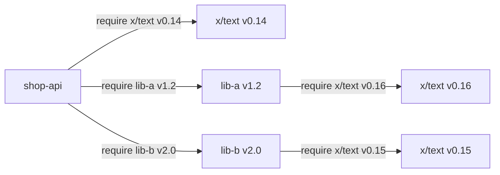

# Module và dependency

Module là đơn vị phát hành và quản lý phụ thuộc của Go: một thư mục có file `go.mod`, khai báo tên module, phiên bản Go và danh sách thư viện mà code cần. Từ Go 1.16, module là chế độ mặc định và GOPATH kiểu cũ gần như chỉ còn là chỗ chứa cache. Bài này đi qua cách tạo module, đọc hiểu `go.mod`/`go.sum`, thêm — nâng — hạ phiên bản thư viện, quy tắc `/v2`, `replace`, workspace `go.work`, proxy cho repo private và directive `toolchain`. Đây là thứ bạn đụng tới ngay từ dòng lệnh đầu tiên của mọi dự án Go.

---

:::note[Ghi nhớ nhanh]

- ⭐ **`go mod init <module-path>` + `go mod tidy`** — hai lệnh dùng nhiều nhất: tạo module và đồng bộ `go.mod`/`go.sum` với code đang import.
- ⭐ **Semantic import versioning** — từ v2 trở lên, đường dẫn module phải có hậu tố `/v2`, `/v3`...; v0/v1 thì không.
- **`go.sum` phải commit** — chứa hash để kiểm tra thư viện tải về không bị sửa; không phải lock file theo nghĩa npm.
- **Go chọn phiên bản bằng MVS** (Minimal Version Selection — chọn phiên bản tối thiểu thoả mãn mọi yêu cầu), không tự nhảy lên bản mới nhất.
- **`replace` chỉ có tác dụng ở module chính**; phát triển nhiều module cùng lúc thì dùng `go.work` thay vì commit `replace`.
- **Repo private** → đặt `GOPRIVATE=github.com/cong-ty/*` để bỏ qua proxy và checksum database công khai.

:::

---

## Mục lục

- [Vì sao Go cần module?](#vì-sao-go-cần-module)
- [Tạo module với go mod init](#tạo-module-với-go-mod-init)
- [Đọc hiểu go.mod](#đọc-hiểu-gomod)
- [go.sum để làm gì](#gosum-để-làm-gì)
- [Thêm, nâng, hạ phiên bản với go get](#thêm-nâng-hạ-phiên-bản-với-go-get)
- [go mod tidy và các lệnh go mod khác](#go-mod-tidy-và-các-lệnh-go-mod-khác)
- [Semantic import versioning](#semantic-import-versioning)
- [Directive replace](#directive-replace)
- [Workspace với go.work](#workspace-với-gowork)
- [GOPROXY, GOPRIVATE và repo private](#goproxy-goprivate-và-repo-private)
- [Directive go và toolchain](#directive-go-và-toolchain)

---

## Vì sao Go cần module?

**Vấn đề:** Trước Go 1.11, mọi code phải nằm trong **GOPATH** (một thư mục workspace duy nhất, mặc định `~/go`):

```text
~/go/
├── bin/
├── pkg/
└── src/
    ├── github.com/gin-gonic/gin/     ← chỉ có MỘT bản gin cho mọi dự án
    ├── github.com/sirupsen/logrus/
    └── github.com/toi/du-an-a/        ← code của bạn cũng bắt buộc nằm ở đây
```

Hậu quả:

- **Không có phiên bản** — `go get` luôn kéo nhánh mới nhất. Dự án A cần gin v1.6, dự án B cần v1.9 → không thể cùng tồn tại.
- **Build không lặp lại được** — hôm nay build OK, tuần sau thư viện đổi API là vỡ, dù code của bạn không đổi.
- **Bắt buộc vị trí thư mục** — clone dự án ra `~/Desktop` là không build được.

Cộng đồng phải dùng công cụ bên ngoài như `godep`, `glide`, `dep` cùng thư mục `vendor/`, mỗi dự án một kiểu.

**Giải pháp:** Go 1.11 giới thiệu **module**, Go 1.16 bật mặc định. Mỗi dự án tự mô tả phụ thuộc trong `go.mod`, đặt ở đâu trên ổ đĩa cũng được:

```bash
mkdir ~/code/shop-api && cd ~/code/shop-api
go mod init github.com/toi/shop-api
go get github.com/google/uuid@v1.6.0
```

```text
module github.com/toi/shop-api

go 1.24

require github.com/google/uuid v1.6.0
```

Thư viện tải về được lưu theo **từng phiên bản** trong module cache (`$GOPATH/pkg/mod`), nhiều dự án dùng nhiều phiên bản khác nhau mà không đụng nhau.

:::tip[Dùng thực tế]

- **Build CI lặp lại được** — cùng `go.mod` + `go.sum` thì máy nào build ra cũng cùng tập phiên bản.
- **Monorepo nhiều service** — mỗi service một module riêng, phát triển chung bằng `go.work`.
- **Thư viện nội bộ công ty** — tag `v1.2.0` trên GitLab nội bộ, các team `go get` như thư viện công khai, cấu hình `GOPRIVATE`.
- **Nâng cấp bảo mật** — `go get -u=patch ./...` lấy bản vá mà không nhảy minor version.

:::

:::tip[Ví dụ đời thường]

GOPATH giống **một tủ thuốc chung cho cả khu trọ**: ai cũng lấy từ một lọ, có người thay lọ mới là cả khu dùng thuốc mới dù không muốn. Module giống **mỗi phòng có đơn thuốc riêng** (`go.mod`) ghi rõ tên thuốc và hàm lượng, kèm **tem chống hàng giả** (`go.sum`) để chắc thuốc mua về đúng là thuốc đó.

:::

---

## Tạo module với go mod init

```bash
go mod init github.com/toi/shop-api
```

Tham số là **module path** — tiền tố cho mọi import path của package bên trong module. Quy ước:

| Trường hợp | Module path nên đặt |
|---|---|
| Sẽ publish lên GitHub/GitLab | Đúng URL repo: `github.com/toi/shop-api` |
| Repo nội bộ công ty | `gitlab.cong-ty.vn/team/billing` |
| Chỉ chạy local, học tập | Tên ngắn tuỳ ý: `shop-api`, `example.com/hello` |

Sau khi init, package con được import bằng `module-path/đường-dẫn-thư-mục`:

```text
shop-api/
├── go.mod                 ← module github.com/toi/shop-api
├── main.go                ← package main
└── order/
    └── order.go           ← import "github.com/toi/shop-api/order"
```

:::warning

Module path không nhất thiết trỏ tới repo có thật, nhưng nếu sau này muốn người khác `go get` được thì path **phải** khớp với vị trí repo. Đổi module path về sau đồng nghĩa phải sửa mọi câu import — nên đặt đúng từ đầu.

:::

---

## Đọc hiểu go.mod

```text
module github.com/toi/shop-api

go 1.24.0

toolchain go1.25.3

require (
	github.com/go-chi/chi/v5 v5.2.1
	github.com/google/uuid v1.6.0
	golang.org/x/sync v0.12.0
)

require (
	github.com/stretchr/testify v1.10.0 // indirect
)

replace github.com/toi/thu-vien-chung => ../thu-vien-chung

exclude github.com/xyz/broken v1.3.0

retract v1.0.5 // phát hành nhầm, có bug nghiêm trọng

tool golang.org/x/tools/cmd/stringer
```

| Directive | Ý nghĩa |
|---|---|
| `module` | Tên (path) của module này |
| `go` | Phiên bản ngôn ngữ tối thiểu; quyết định ngữ nghĩa (vd biến vòng lặp per-iteration từ 1.22) |
| `toolchain` | Toolchain gợi ý khi build module này (Go 1.21+) |
| `require` | Phụ thuộc và **phiên bản tối thiểu** cần dùng |
| `// indirect` | Phụ thuộc gián tiếp (thư viện của thư viện) hoặc không được import trực tiếp |
| `replace` | Thay một module bằng phiên bản/thư mục khác — chỉ có hiệu lực ở module chính |
| `exclude` | Cấm dùng một phiên bản cụ thể |
| `retract` | Tác giả thư viện đánh dấu phiên bản của chính mình là không nên dùng |
| `tool` | Khai báo công cụ chạy bằng `go tool <tên>` (Go 1.24+) |

Từ Go 1.17, `go.mod` liệt kê **đầy đủ** cả phụ thuộc gián tiếp (module graph pruning), nên thường có hai khối `require`: khối trực tiếp và khối `// indirect`.

---

## go.sum để làm gì

`go.sum` chứa hash mật mã của từng phiên bản module (cả nội dung lẫn file `go.mod` của nó):

```text
github.com/google/uuid v1.6.0 h1:NIvaJDMOsjHA8n1jAhLSgzrAzy1Hgr+hNrb57e+94F0=
github.com/google/uuid v1.6.0/go.mod h1:TIyPZe4MgqvfeYDBFedMoGGpEw/LqOeaOT+nhxU+yHo=
```

- Khi tải module, Go so hash với `go.sum`; lệch là **báo lỗi bảo mật** ngay.
- Lần đầu thấy một phiên bản, Go đối chiếu với **checksum database** công khai `sum.golang.org` để chắc mọi người trên thế giới thấy cùng một nội dung.
- `go.sum` **không phải lock file**: phiên bản được dùng do `go.mod` + MVS quyết định; `go.sum` chỉ xác minh. Nó có thể chứa dòng của những phiên bản không còn dùng — `go mod tidy` sẽ dọn.

:::warning

Luôn **commit `go.sum`**. Không commit thì CI phải tự tải và tin bất cứ thứ gì nhận được, mất lớp bảo vệ chống tấn công chuỗi cung ứng.

:::

---

## Thêm, nâng, hạ phiên bản với go get

Từ Go 1.17, `go get` **chỉ dùng để quản lý phụ thuộc** trong `go.mod`; cài công cụ dòng lệnh thì dùng `go install pkg@version`.

```bash
# Thêm phụ thuộc — bản mới nhất (theo tag semver)
go get github.com/google/uuid

# Chỉ định phiên bản cụ thể
go get github.com/google/uuid@v1.5.0

# Nâng lên bản mới nhất
go get github.com/google/uuid@latest

# Hạ phiên bản: chỉ cần chỉ định bản thấp hơn
go get github.com/go-chi/chi/v5@v5.0.12

# Lấy theo commit hoặc nhánh → Go sinh pseudo-version
go get github.com/toi/thu-vien@a1b2c3d
go get github.com/toi/thu-vien@main

# Gỡ phụ thuộc
go get github.com/google/uuid@none

# Nâng mọi phụ thuộc của module (cẩn thận!)
go get -u ./...

# Chỉ nâng bản vá (patch): v1.4.1 → v1.4.3, không lên v1.5
go get -u=patch ./...

# Nâng phiên bản Go tối thiểu trong go.mod
go get go@1.25
```

**Pseudo-version** có dạng `v0.0.0-20250301123456-a1b2c3d4e5f6` — dùng khi trỏ vào commit chưa được tag.

### Minimal Version Selection

Giả sử module của bạn và hai thư viện cùng cần `x/text`:



Go chọn **bản cao nhất trong các yêu cầu tối thiểu** — `v0.16` — chứ **không** phải bản mới nhất đang có trên mạng (có thể là v0.22). Nhờ vậy build ổn định: không ai phát hành bản mới mà làm thay đổi build của bạn, trừ khi bạn chủ động `go get`.

Muốn hỏi vì sao một module có mặt:

```bash
go mod why -m golang.org/x/text
go mod graph | grep x/text
```

---

## go mod tidy và các lệnh go mod khác

```bash
go mod tidy
```

`tidy` quét toàn bộ code (kể cả test), rồi:

- **thêm** các module đang import mà `go.mod` chưa có;
- **xoá** các module không còn ai import;
- cập nhật đánh dấu `// indirect` và dọn `go.sum`.

Nên chạy trước mỗi commit; nhiều đội thêm bước CI kiểm tra `go mod tidy` không làm thay đổi file (`go mod tidy -diff`, Go 1.23+).

| Lệnh | Công dụng |
|---|---|
| `go mod download` | Tải trước mọi module vào cache (hay dùng trong Dockerfile để tận dụng layer cache) |
| `go mod verify` | Kiểm tra module trong cache chưa bị sửa |
| `go mod why -m <mod>` | Giải thích vì sao cần module đó |
| `go mod graph` | In đồ thị phụ thuộc |
| `go mod edit -replace=...` | Sửa `go.mod` bằng lệnh (cho script) |
| `go mod vendor` | Chép toàn bộ phụ thuộc vào thư mục `vendor/` |

### go mod vendor

```bash
go mod vendor
```

Tạo thư mục `vendor/` chứa mã nguồn mọi phụ thuộc cùng `vendor/modules.txt`. Khi có `vendor/` và `go` trong `go.mod` từ 1.14 trở lên, lệnh `go build` **tự dùng vendor** (tương đương `-mod=vendor`).

Dùng khi: build trong môi trường **không có Internet**, công ty yêu cầu review mã nguồn bên thứ ba trong repo, hoặc muốn repo tự đủ. Nhược điểm: repo phình to, diff khó đọc. Phần lớn dự án hiện nay không vendor mà dựa vào proxy + `go.sum`.

:::warning

Đã vendor thì sau mỗi lần `go get`/`go mod tidy` phải chạy lại `go mod vendor`, nếu không build sẽ báo `inconsistent vendoring`.

:::

---

## Semantic import versioning

Go tuân theo **semver** (`vMAJOR.MINOR.PATCH`) và thêm một luật riêng — **import compatibility rule**: *nếu package mới và cũ có cùng import path, package mới phải tương thích ngược với package cũ.*

Hệ quả: khi phá vỡ tương thích (lên major v2+), **import path phải đổi**:

```go
import (
	"github.com/go-chi/chi"        // v1 (hoặc v0)
	chiv5 "github.com/go-chi/chi/v5" // v5 — module path khác hẳn
)
```

Một chương trình có thể dùng **cùng lúc** v1 và v5 vì Go coi chúng là hai module khác nhau — hữu ích khi di chuyển dần.

### Phát hành v2 cho thư viện của bạn

Cách phổ biến nhất (major branch):

```text
// go.mod trên nhánh chính sau khi lên v2
module github.com/toi/money/v2

go 1.24
```

```bash
# Sửa mọi import nội bộ từ github.com/toi/money/... sang github.com/toi/money/v2/...
git tag v2.0.0
git push origin v2.0.0
```

| Phiên bản | Module path | Ghi chú |
|---|---|---|
| v0.x.y | `github.com/toi/money` | Chưa ổn định, được phép phá API |
| v1.x.y | `github.com/toi/money` | Cam kết tương thích ngược |
| v2.x.y | `github.com/toi/money/v2` | Bắt buộc có `/v2` |
| v2 nhưng quên `/v2` | — | Go gắn `+incompatible`, nên tránh |

:::tip[Ví dụ đời thường]

Giống **đổi số nhà sau khi xây lại**: cải tạo nhẹ (minor/patch) thì giữ địa chỉ cũ, khách cũ vẫn tìm được. Đập đi xây lại kiểu khác hoàn toàn (major) thì phải lấy **địa chỉ mới** (`/v2`), để khách cũ vẫn tới được căn cũ, khách mới tới căn mới.

:::

---

## Directive replace

`replace` thay một module bằng một bản khác — thư mục local hoặc fork:

```text
// Sửa bug trong thư viện, test local trước khi gửi PR
replace github.com/xyz/payment => ../payment

// Dùng fork tạm thời đã vá lỗi
replace github.com/xyz/payment => github.com/toi/payment v1.4.1-fix
```

Lưu ý quan trọng:

- `replace` **chỉ có hiệu lực ở module chính** (module đang build). Thư viện của bạn khai báo `replace` thì người dùng thư viện **không** nhận được.
- `replace` trỏ tới đường dẫn local mà commit lên thì CI và đồng nghiệp sẽ build lỗi vì không có thư mục đó.

Với nhu cầu "đang sửa song song nhiều module trên máy mình", dùng workspace ở phần sau thay vì `replace`.

---

## Workspace với go.work

Go 1.18 giới thiệu **workspace** — gom nhiều module local để build cùng nhau mà không phải sửa từng `go.mod`:

```text
~/code/
├── go.work
├── shop-api/          ← module github.com/toi/shop-api (import thu-vien-chung)
│   └── go.mod
└── thu-vien-chung/    ← module github.com/toi/thu-vien-chung
    └── go.mod
```

```bash
cd ~/code
go work init ./shop-api ./thu-vien-chung
# hoặc thêm dần
go work use ./thu-vien-chung
```

```text
// go.work
go 1.24

use (
	./shop-api
	./thu-vien-chung
)
```

Giờ trong `shop-api`, import `github.com/toi/thu-vien-chung` sẽ dùng **thư mục local** thay vì bản tải về. Sửa thư viện, chạy lại service là thấy ngay.

| | `replace` trong `go.mod` | `go.work` |
|---|---|---|
| Phạm vi | Ghi vào module, dễ lỡ commit | File riêng, thường **không** commit |
| Nhiều module | Phải thêm `replace` ở từng module | Một file cho cả nhóm |
| Phù hợp | Fork lâu dài, vá tạm có chủ đích | Phát triển local song song |

:::warning

Đa số dự án thêm `go.work` và `go.work.sum` vào `.gitignore`. Muốn tạm tắt workspace khi build: `GOWORK=off go build ./...`.

:::

---

## GOPROXY, GOPRIVATE và repo private

Mặc định `go` không clone thẳng từ GitHub mà tải qua **module proxy**:

```bash
go env GOPROXY
# https://proxy.golang.org,direct
```

- `proxy.golang.org` cache module công khai — nhanh, và vẫn tải được kể cả khi tác giả xoá repo.
- `direct` — nếu proxy không có, tải thẳng từ VCS (git).
- `GOSUMDB=sum.golang.org` — checksum database dùng để đối chiếu hash.

Với **repo private**, proxy công khai không truy cập được và bạn cũng không muốn lộ tên module ra checksum database. Đặt `GOPRIVATE`:

```bash
go env -w GOPRIVATE='gitlab.cong-ty.vn/*,github.com/cong-ty/*'
```

`GOPRIVATE` là cách viết gọn đặt đồng thời `GONOPROXY` và `GONOSUMDB` cho các pattern đó: module khớp sẽ được tải trực tiếp qua git (dùng SSH key/token của máy) và không kiểm tra với `sum.golang.org`.

Cấu hình git để dùng SSH thay HTTPS cho repo private:

```bash
git config --global url."git@gitlab.cong-ty.vn:".insteadOf "https://gitlab.cong-ty.vn/"
```

Công ty lớn thường dựng **proxy nội bộ** (Athens, Artifactory, JFrog...) và đặt `GOPROXY=https://goproxy.cong-ty.vn,https://proxy.golang.org,direct`.

---

## Directive go và toolchain

Dòng `go` trong `go.mod`:

- Trước Go 1.21: chỉ là gợi ý, toolchain cũ vẫn cố build.
- **Từ Go 1.21**: là **yêu cầu tối thiểu bắt buộc**. Module ghi `go 1.24.0` thì Go 1.23 từ chối build — hoặc tự tải toolchain mới nếu `GOTOOLCHAIN` cho phép.

Dòng `go` còn quyết định **ngữ nghĩa ngôn ngữ** cho module: ví dụ biến vòng lặp `for` riêng cho từng vòng lặp chỉ áp dụng khi `go` từ 1.22 trở lên.

Directive `toolchain` gợi ý toolchain cụ thể:

```text
go 1.24.0
toolchain go1.25.3
```

Biến môi trường `GOTOOLCHAIN` điều khiển hành vi tự chuyển toolchain:

| Giá trị | Hành vi |
|---|---|
| `auto` (mặc định, tương đương `local+auto`) | Dùng toolchain cài sẵn; nếu `go.mod` đòi bản mới hơn thì tự tải về và chạy |
| `local` | Luôn dùng bản cài sẵn, không tự tải |
| `go1.25.3` | Ép dùng đúng phiên bản này |

```bash
go get go@1.25          # nâng dòng go
go get toolchain@go1.25.3  # đặt dòng toolchain
```

:::warning

Đừng nâng dòng `go` của **thư viện** lên quá cao khi không cần — mọi người dùng thư viện sẽ bị buộc nâng theo. Ứng dụng (service, CLI) thì nâng thoải mái hơn.

:::
