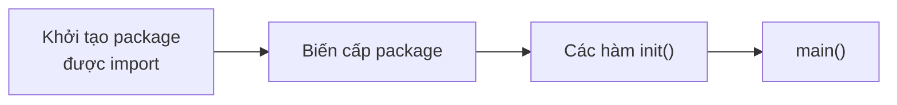

# Package

Nếu module là đơn vị **phát hành**, thì package là đơn vị **tổ chức code và đóng gói**: mỗi thư mục là một package, mọi file trong đó chia sẻ chung một không gian tên. Go không có `public`/`private` — thay vào đó, chữ cái đầu của tên quyết định thứ gì được nhìn thấy từ bên ngoài. Bài này đi qua quy tắc package, export, import (alias, blank, dot), thư mục `internal/`, hàm `init()`, cách bố trí một dự án thường gặp và cách publish module của bạn cho người khác dùng.

---

:::note[Ghi nhớ nhanh]

- ⭐ **Một thư mục = một package** — mọi file `.go` trong thư mục (trừ `_test`) phải cùng tên package; tên package nên trùng tên thư mục cuối.
- ⭐ **Chữ hoa = exported, chữ thường = unexported** — áp dụng cho hàm, kiểu, biến, hằng, field struct, method.
- **Không được import vòng** — A import B thì B không được import A (kể cả gián tiếp); compiler báo lỗi `import cycle not allowed`.
- **`internal/`** — package nằm dưới `internal` chỉ được import bởi code trong cây thư mục cha của `internal`; được compiler bắt buộc.
- **Hạn chế `init()`** — chạy ngầm, khó test; ưu tiên khởi tạo tường minh trong `main`.
- **`cmd/`, `internal/`, `pkg/` chỉ là quy ước cộng đồng**, không phải chuẩn chính thức của Go team.

:::

---

## Mục lục

- [Vì sao cần package?](#vì-sao-cần-package)
- [Package là thư mục](#package-là-thư-mục)
- [Exported và unexported](#exported-và-unexported)
- [Quy tắc import](#quy-tắc-import)
- [Thư mục internal](#thư-mục-internal)
- [Hàm init và thứ tự khởi tạo](#hàm-init-và-thứ-tự-khởi-tạo)
- [Bố cục dự án thường gặp](#bố-cục-dự-án-thường-gặp)
- [Dùng thư viện bên thứ ba](#dùng-thư-viện-bên-thứ-ba)
- [Publish module](#publish-module)

---

## Vì sao cần package?

**Vấn đề:** Dồn mọi thứ vào `package main` thì code nhanh chóng thành một mớ hỗn độn:

```go
// main.go — 3.000 dòng
package main

var db *sql.DB              // ai cũng sửa được
var orderCache = map[int]Order{} // ai cũng đọc/ghi trực tiếp

func validateEmail(s string) bool { /* ... */ }
func calcShippingFee(o Order) int { /* ... */ }
func handleCreateOrder(w http.ResponseWriter, r *http.Request) { /* ... */ }
// ... hàng trăm hàm khác, không rõ ranh giới, không tái sử dụng được ở service khác
```

Không có ranh giới: handler HTTP gọi thẳng vào map cache, logic tính phí lẫn với code SQL, đổi một chỗ phải đọc cả file.

**Giải pháp:** Chia theo package, mỗi package một trách nhiệm, chỉ lộ ra thứ cần lộ:

```go
// order/order.go
package order

type Order struct {
	ID    int
	Total int
}

// Exported — package khác gọi được
func ShippingFee(o Order) int {
	if o.Total >= freeShipThreshold {
		return 0
	}
	return baseFee
}

// unexported — chi tiết nội bộ, có thể đổi thoải mái
const (
	freeShipThreshold = 500_000
	baseFee           = 30_000
)
```

```go
// main.go
package main

import (
	"fmt"

	"github.com/toi/shop-api/order"
)

func main() {
	o := order.Order{ID: 1, Total: 200_000}
	fmt.Println(order.ShippingFee(o)) // 30000
	// order.baseFee → lỗi biên dịch: không truy cập được
}
```

:::tip[Dùng thực tế]

- **Tách domain** — `order`, `payment`, `user` mỗi thứ một package, team khác nhau làm song song.
- **Che giấu chi tiết** — package `storage` chỉ lộ interface `Store`, bên trong dùng Postgres hay Redis là chuyện nội bộ.
- **Tái sử dụng** — package `money` dùng chung cho nhiều service trong công ty.
- **Kiểm soát API** — dùng `internal/` để chắc chắn không ai ngoài dự án phụ thuộc vào code chưa ổn định.

:::

:::tip[Ví dụ đời thường]

Package giống **các phòng ban trong công ty**: phòng kế toán (package `payment`) có quầy giao dịch mở cho các phòng khác (exported), còn sổ sách nội bộ (unexported) thì đóng cửa. Thư mục `internal/` giống **khu vực chỉ dành cho nhân viên công ty** — khách ngoài không được vào dù biết đường.

:::

---

## Package là thư mục

Quy tắc cốt lõi:

- Mọi file `.go` trong **cùng thư mục** phải khai báo **cùng tên package** (ngoại lệ: file `_test.go` có thể dùng `<tên>_test` cho black-box test).
- Các file trong cùng package **thấy hết nhau**, kể cả thứ unexported — không cần import.
- **Import path** = module path + đường dẫn thư mục; **tên package** là thứ viết sau từ khoá `package`. Hai thứ này nên trùng phần cuối.

```text
github.com/toi/shop-api/
├── go.mod
├── main.go                  package main
└── order/
    ├── order.go             package order
    ├── fee.go               package order   ← cùng package, dùng chung unexported
    └── order_test.go        package order (white-box) hoặc order_test (black-box)
```

### Đặt tên package

| Nên | Không nên | Lý do |
|---|---|---|
| `order`, `http`, `strconv` | `orders`, `orderPkg`, `order_service` | Ngắn, chữ thường, số ít, không gạch dưới |
| `user.New()` | `user.NewUser()` | Tên package đã là ngữ cảnh, tránh lặp |
| `slug`, `money` | `util`, `common`, `helpers` | Tên chung chung thành bãi rác, không mô tả gì |

Người gọi luôn viết `tênpackage.Tên`, nên hãy đặt tên để cụm đó đọc tự nhiên: `bytes.Buffer`, `http.Client`, `order.ShippingFee`.

### Package main

`package main` kèm hàm `func main()` là điểm vào của chương trình chạy được. Mỗi binary có đúng một `package main`. Một module có thể có nhiều `package main` ở các thư mục khác nhau (mỗi cái build ra một binary) — đó là lý do có quy ước thư mục `cmd/`.

---

## Exported và unexported

Go chỉ có **hai mức** truy cập, quyết định bởi **chữ cái đầu**:

```go
package account

type Account struct {
	ID      int    // exported field
	Owner   string // exported
	balance int    // unexported — package khác không đọc/ghi trực tiếp được
}

// Exported constructor
func New(id int, owner string) *Account {
	return &Account{ID: id, Owner: owner}
}

// Exported method
func (a *Account) Balance() int { return a.balance }

func (a *Account) Deposit(amount int) error {
	if err := validate(amount); err != nil {
		return err
	}
	a.balance += amount
	return nil
}

// unexported helper
func validate(amount int) error {
	if amount <= 0 {
		return errInvalidAmount
	}
	return nil
}

var errInvalidAmount = errors.New("số tiền phải dương")
```

| | Phạm vi nhìn thấy |
|---|---|
| `Account`, `New`, `Deposit`, `ID` | Mọi package import `account` |
| `balance`, `validate`, `errInvalidAmount` | Chỉ trong package `account` |

:::warning

- Field unexported **không** được `encoding/json` encode/decode — lỗi hay gặp: struct có field chữ thường, JSON trả về `{}`.
- Trả về một kiểu unexported từ hàm exported là hợp lệ nhưng gây khó chịu cho người dùng (không khai báo biến kiểu đó được) — `golint`/`revive` sẽ cảnh báo.
- Unexported là ranh giới **package**, không phải ranh giới **type**: hai struct trong cùng package đọc được field chữ thường của nhau.

:::

---

## Quy tắc import

```go
import (
	// 1. Thư viện chuẩn
	"context"
	"fmt"
	"net/http"

	// 2. Thư viện bên thứ ba
	"github.com/go-chi/chi/v5"

	// 3. Package trong cùng module
	"github.com/toi/shop-api/internal/order"
)
```

`goimports` (hoặc `gopls` trong editor) tự sắp xếp và nhóm như trên. Import mà không dùng là **lỗi biên dịch**, không phải cảnh báo.

### Không được import vòng

```text
order  ──import──▶  payment
  ▲                    │
  └──────import────────┘     ✗ import cycle not allowed
```

Cách gỡ vòng:

1. **Tách phần dùng chung** ra package thứ ba (vd `domain` chứa kiểu `Order`, `Payment`) mà cả hai cùng import.
2. **Đảo phụ thuộc bằng interface** — `payment` khai báo interface nhỏ nó cần, `order` hiện thực; `main` nối hai bên.
3. **Gộp package** — nếu hai package dính nhau chặt đến vậy, có thể chúng vốn là một.

```go
// payment/payment.go — không import order, chỉ định nghĩa thứ nó cần
package payment

type Payable interface {
	AmountDue() int
}

func Charge(p Payable) error {
	// ...
	return nil
}
```

### Import alias

```go
import (
	"crypto/rand"
	mrand "math/rand/v2"       // trùng tên rand → đặt alias

	chi "github.com/go-chi/chi/v5" // tên package không suy ra rõ từ path
	orderv1 "github.com/toi/api/gen/order/v1"
)
```

Chỉ dùng alias khi **trùng tên** hoặc tên package khác hẳn phần cuối path. Đặt alias tuỳ hứng làm code khó tìm kiếm.

### Blank import `_`

Import chỉ để chạy `init()` của package đó (đăng ký driver, codec...), không dùng tên nào:

```go
import (
	"database/sql"

	_ "github.com/jackc/pgx/v5/stdlib" // đăng ký driver "pgx" vào database/sql
	_ "image/png"                       // đăng ký decoder PNG cho image.Decode
	_ "net/http/pprof"                  // gắn handler /debug/pprof vào DefaultServeMux
)

func main() {
	db, err := sql.Open("pgx", "postgres://...")
	// ...
}
```

### Dot import

```go
import . "math"

func main() {
	fmt.Println(Sqrt(2)) // không cần "math."
}
```

Đưa mọi tên exported vào phạm vi hiện tại — làm mất dấu nguồn gốc của tên, dễ đụng tên. **Tránh dùng**, trừ vài trường hợp trong test DSL (vd Ginkgo/Gomega).

---

## Thư mục internal

Go compiler **bắt buộc** quy tắc: package có đường dẫn chứa phần tử `internal` chỉ được import bởi code nằm trong cây có gốc là **thư mục cha của `internal`**.

```text
github.com/toi/shop-api/
├── cmd/api/main.go              ✓ import ".../shop-api/internal/order"
├── internal/
│   ├── order/                   ← chỉ code dưới shop-api/ import được
│   └── platform/db/
└── pkg/client/client.go         ✓ cũng import được internal/order

github.com/nguoi-khac/app/main.go ✗ use of internal package not allowed
```

`internal` có thể nằm ở mọi cấp: `a/b/internal/c` chỉ dành cho code dưới `a/b/`.

Lợi ích: bạn tự do đổi tên, đổi chữ ký các package trong `internal/` mà **không sợ phá ai**, vì không có ai bên ngoài phụ thuộc được. Với ứng dụng (không phải thư viện), đặt gần như toàn bộ code vào `internal/` là lựa chọn an toàn.

---

## Hàm init và thứ tự khởi tạo

```go
package config

import "os"

var Env = os.Getenv("APP_ENV") // biến package khởi tạo trước

func init() {
	if Env == "" {
		Env = "development"
	}
}
```

Thứ tự khi chương trình khởi động:

1. Package được import được khởi tạo **trước** package import nó (đệ quy, mỗi package chỉ một lần).
2. Trong một package: **biến cấp package** khởi tạo trước (theo thứ tự phụ thuộc), rồi tới các hàm `init()`.
3. Một package (thậm chí một file) có thể có **nhiều** `init()`; chúng chạy theo thứ tự file được đưa cho compiler (thường theo tên file) và thứ tự xuất hiện trong file.
4. Cuối cùng mới tới `main()`.



:::warning

Hạn chế `init()`:

- Không nhận tham số, không trả lỗi → lỗi chỉ có thể `panic` hoặc bị nuốt.
- Chạy ngầm ngay cả khi chỉ chạy test → test chậm, khó giả lập.
- Thứ tự giữa các file phụ thuộc tên file — dễ vỡ khi đổi tên.

Dùng `init()` cho việc **đăng ký** đơn giản (driver, plugin). Kết nối DB, đọc config, khởi động goroutine → làm tường minh trong `main()` hoặc hàm `New...`.

:::

---

## Bố cục dự án thường gặp

:::warning

Go team **không** định nghĩa bố cục thư mục chuẩn. Repo `golang-standards/project-layout` trên GitHub **không phải** của Go team — chính Russ Cox từng lên tiếng rằng nó không phải chuẩn chính thức. Hướng dẫn chính thức ở [go.dev/doc/modules/layout](https://go.dev/doc/modules/layout) đơn giản hơn nhiều. Dự án nhỏ cứ để phẳng; chỉ thêm thư mục khi thực sự cần.

:::

Bố cục phổ biến cho một service vừa và lớn:

```text
shop-api/
├── go.mod
├── go.sum
├── cmd/
│   ├── api/
│   │   └── main.go          ← binary HTTP server
│   └── worker/
│       └── main.go          ← binary xử lý queue
├── internal/
│   ├── order/               ← domain + logic
│   │   ├── order.go
│   │   ├── service.go
│   │   └── repository.go
│   ├── payment/
│   ├── httpapi/             ← handler, router, middleware
│   └── platform/
│       ├── postgres/
│       └── config/
├── pkg/                     ← (tuỳ chọn) code cố ý cho dự án khác import
│   └── client/
├── migrations/
└── Makefile
```

| Thư mục | Mục đích | Ghi chú |
|---|---|---|
| `cmd/<tên>/` | Mỗi thư mục con là một `package main` → một binary | `main.go` nên mỏng: đọc config, nối dependency, chạy |
| `internal/` | Code riêng của dự án | Được compiler bảo vệ |
| `pkg/` | Code public cho dự án khác dùng | Gây tranh cãi; nhiều người bỏ qua, đặt package public ở gốc module |
| Gốc module | Thư viện nhỏ thường để code ngay ở đây | `github.com/google/uuid` chỉ có các file ở gốc |

Với thư viện nhỏ hoặc CLI đơn giản, bố cục tối thiểu là đủ:

```text
slugify/
├── go.mod
├── slugify.go
└── slugify_test.go
```

:::tip[Dùng thực tế]

Một nguyên tắc tốt hơn mọi template: **tổ chức theo domain** (`order`, `payment`) thay vì theo loại kỹ thuật (`controllers`, `models`, `services`). Tổ chức theo loại dễ dẫn tới import vòng (models ↔ services) và package khổng lồ.

:::

---

## Dùng thư viện bên thứ ba

```bash
# 1. Tìm trên pkg.go.dev: xem số người import, license, ngày cập nhật, phiên bản ổn định (v1+)
# 2. Thêm vào module
go get github.com/google/uuid@latest
```

```go
package main

import (
	"fmt"

	"github.com/google/uuid"
)

func main() {
	id := uuid.New()
	fmt.Println(id.String())
}
```

```bash
# 3. Dọn go.mod / go.sum
go mod tidy
```

Thực tế, bạn có thể viết `import` trước rồi chạy `go mod tidy` — Go tự tìm và thêm phiên bản mới nhất.

Tiêu chí chọn thư viện:

- **Thư viện chuẩn đã đủ chưa?** Go stdlib rất mạnh: `net/http` (có router với method + wildcard từ 1.22), `log/slog`, `encoding/json`, `slices`, `maps`... Mỗi phụ thuộc thêm vào là một rủi ro bảo mật và bảo trì.
- **Còn được bảo trì** — commit gần đây, issue được phản hồi.
- **License** phù hợp (MIT, BSD, Apache-2.0).
- **Ít phụ thuộc bắc cầu** — xem bằng `go mod graph`.
- **Kiểm tra lỗ hổng** bằng `govulncheck ./...`.

---

## Publish module

Go **không có registry trung tâm** kiểu npm hay Maven Central. "Publish" chỉ là: đẩy code lên một repo công khai và **gắn tag semver**.

```bash
# 1. Module path khớp URL repo
go mod init github.com/toi/slugify

# 2. Viết code, test, dọn dẹp
go test ./...
go mod tidy

# 3. Commit và push
git add . && git commit -m "feat: slugify tiếng Việt"
git push origin main

# 4. Gắn tag phiên bản (bắt buộc có tiền tố v)
git tag v0.1.0
git push origin v0.1.0
```

Người dùng giờ có thể `go get github.com/toi/slugify@v0.1.0`.

### Xuất hiện trên pkg.go.dev

[pkg.go.dev](https://pkg.go.dev) tự lập chỉ mục khi có người tải module qua `proxy.golang.org`. Muốn có ngay, yêu cầu proxy lấy phiên bản đó:

```bash
GOPROXY=proxy.golang.org go list -m github.com/toi/slugify@v0.1.0
```

Tài liệu trên pkg.go.dev sinh từ **doc comment**:

```go
// Package slugify chuyển chuỗi tiếng Việt thành slug dùng cho URL.
package slugify

// Make chuyển s thành slug: bỏ dấu, chữ thường, khoảng trắng thành "-".
//
//	slugify.Make("Xin chào Việt Nam") // "xin-chao-viet-nam"
func Make(s string) string {
	// ...
	return s
}
```

### Lộ trình phiên bản

| Giai đoạn | Tag | Cam kết |
|---|---|---|
| Thử nghiệm | `v0.x.y` | Có thể phá API bất cứ lúc nào |
| Ổn định | `v1.0.0` | Tương thích ngược trong mọi v1.x.y |
| Phá API | `v2.0.0` + module path `/v2` | Xem bài Module và dependency |
| Phát hành nhầm | Thêm `retract` vào `go.mod`, tag bản mới | Không xoá tag cũ — proxy đã cache |

:::warning

Tag một khi đã được proxy cache thì **không thể sửa nội dung** — xoá rồi tag lại cùng tên, người dùng sẽ gặp lỗi checksum mismatch. Sai thì phát hành bản mới và `retract` bản lỗi.

:::
