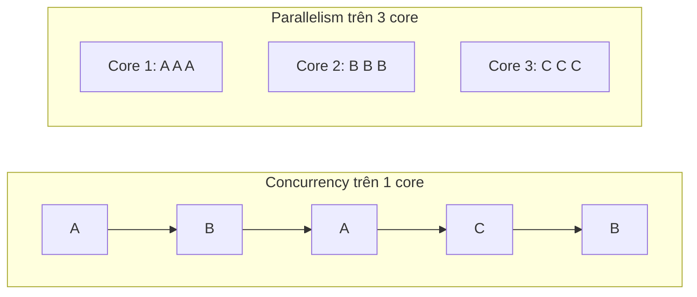
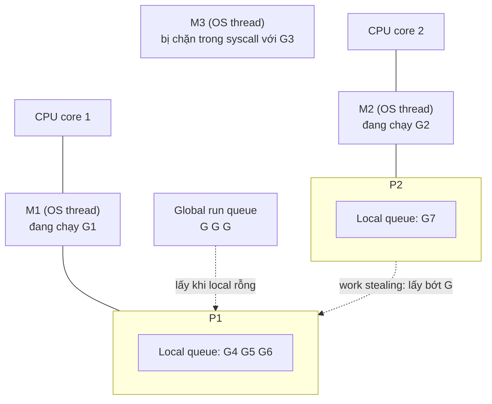

# Goroutine

Goroutine là "luồng nhẹ" do Go runtime quản lý — chỉ cần thêm từ khoá `go` trước lời gọi hàm là hàm đó chạy đồng thời với phần còn lại của chương trình. Một server Go có thể chạy hàng trăm nghìn goroutine trên vài luồng hệ điều hành, đây chính là lý do Go được chọn cho backend, proxy, crawler. Bài này phân biệt concurrency với parallelism, giải thích vì sao goroutine rẻ, cách scheduler G-M-P hoạt động, `GOMAXPROCS`, cách chờ goroutine kết thúc và cái bẫy kinh điển: goroutine leak.

---

:::note[Ghi nhớ nhanh]

- ⭐ **`go f()` chạy `f` đồng thời và trả về ngay** — `main` kết thúc thì mọi goroutine bị giết, không chờ.
- ⭐ **Goroutine leak** — goroutine bị kẹt mãi (chờ channel không ai gửi/nhận) sẽ giữ bộ nhớ đến khi process chết; luôn biết goroutine của bạn **kết thúc khi nào**.
- **Concurrency ≠ parallelism** — concurrency là cấu trúc (nhiều việc đan xen), parallelism là thực thi (nhiều việc cùng lúc trên nhiều core).
- **Goroutine rẻ**: stack khởi đầu ~2KB, tự tăng/giảm; tạo và chuyển đổi do runtime làm, không cần system call.
- **Scheduler G-M-P** — G (goroutine) chạy trên M (OS thread) qua P (processor logic); số P = `GOMAXPROCS`, mặc định bằng số CPU.
- **Chờ goroutine bằng `sync.WaitGroup`, channel hoặc `errgroup`** — không bao giờ dùng `time.Sleep`.

:::

---

## Mục lục

- [Vì sao cần goroutine?](#vì-sao-cần-goroutine)
- [Concurrency và parallelism](#concurrency-và-parallelism)
- [Từ khoá go](#từ-khoá-go)
- [Goroutine rẻ đến mức nào](#goroutine-rẻ-đến-mức-nào)
- [Scheduler G-M-P](#scheduler-g-m-p)
- [GOMAXPROCS](#gomaxprocs)
- [Chờ goroutine kết thúc](#chờ-goroutine-kết-thúc)
- [Goroutine leak](#goroutine-leak)

---

## Vì sao cần goroutine?

**Vấn đề:** Gọi 3 API tuần tự, mỗi cái 1 giây → tổng 3 giây, dù CPU gần như ngồi chơi (chỉ chờ mạng):

```go
func fetchAll() {
	start := time.Now()
	for _, url := range []string{"/users", "/orders", "/products"} {
		fetch(url) // mỗi lần ~1s, chủ yếu là chờ I/O
	}
	fmt.Println("xong sau", time.Since(start)) // ~3s
}
```

Trong Java/C++ truyền thống, muốn làm song song phải tạo **OS thread** — mỗi thread tốn ~1MB stack, tạo và chuyển ngữ cảnh đắt, nên phải dùng thread pool, callback hoặc async/await phức tạp.

**Giải pháp:** Mỗi việc một goroutine, code vẫn viết kiểu tuần tự dễ đọc:

```go
func fetchAll() {
	start := time.Now()
	var wg sync.WaitGroup
	for _, url := range []string{"/users", "/orders", "/products"} {
		wg.Add(1)
		go func() {
			defer wg.Done()
			fetch(url) // Go 1.22+: mỗi vòng lặp có biến url riêng
		}()
	}
	wg.Wait()
	fmt.Println("xong sau", time.Since(start)) // ~1s
}
```

:::tip[Dùng thực tế]

- **HTTP server** — `net/http` tạo một goroutine cho **mỗi request**; bạn viết handler như code tuần tự.
- **Gọi nhiều service song song** — lấy profile, đơn hàng, điểm thưởng cùng lúc để ghép response.
- **Xử lý nền** — gửi email, ghi audit log mà không bắt người dùng chờ.
- **Crawler, consumer queue** — hàng nghìn kết nối đồng thời trên vài core.

:::

:::tip[Ví dụ đời thường]

Một quán phở chỉ có **một đầu bếp** vẫn phục vụ được 20 bàn: trong lúc chờ nước dùng sôi cho bàn 1, anh trụng bánh cho bàn 2, thái thịt cho bàn 3. Đó là **concurrency**. Thuê thêm 3 đầu bếp đứng 3 bếp cùng nấu là **parallelism**. Goroutine là **từng tô phở đang làm dở**; scheduler là quản lý bếp phân tô nào cho đầu bếp nào.

:::

---

## Concurrency và parallelism

> "Concurrency is about **dealing with** lots of things at once. Parallelism is about **doing** lots of things at once." — Rob Pike

| | Concurrency (đồng thời) | Parallelism (song song) |
|---|---|---|
| Bản chất | Cách **cấu trúc** chương trình thành nhiều việc độc lập | Cách **thực thi** nhiều việc cùng một thời điểm |
| Cần nhiều core? | Không — 1 core vẫn đan xen được | Có |
| Lợi ích chính | Không phí thời gian chờ I/O, code rõ ràng | Tăng tốc tác vụ nặng CPU |
| Ví dụ | Server xử lý 10.000 kết nối chờ mạng | Nén 100 file ảnh trên 8 core |

Go cho bạn viết **concurrent**; runtime tự quyết định chạy **parallel** khi có nhiều core.



---

## Từ khoá go

```go
package main

import (
	"fmt"
	"time"
)

func say(msg string) {
	for i := range 3 {
		fmt.Println(msg, i)
		time.Sleep(10 * time.Millisecond)
	}
}

func main() {
	go say("goroutine") // chạy đồng thời, main không chờ
	say("main")         // chạy trên goroutine main
}
```

Đầu ra đan xen, thứ tự **không xác định**:

```text
main 0
goroutine 0
goroutine 1
main 1
main 2
goroutine 2
```

Quy tắc cần nhớ:

- `go` đi với **lời gọi hàm** (hàm thường, method, hàm ẩn danh): `go f(x)`, `go obj.Run()`, `go func() { ... }()`.
- **Tham số được tính ngay** tại thời điểm `go`, phần thân chạy sau.
- **Giá trị trả về bị bỏ** — muốn lấy kết quả phải dùng channel hoặc biến chia sẻ có đồng bộ.
- Khi hàm `main` return, **chương trình thoát ngay**, các goroutine khác bị dừng giữa chừng.

```go
func main() {
	go fmt.Println("có thể không bao giờ in ra")
} // main kết thúc trước khi goroutine kịp chạy
```

### Biến vòng lặp từ Go 1.22

```go
for i := range 3 {
	go func() {
		fmt.Println(i) // Go 1.22+: in 0, 1, 2 (thứ tự bất kỳ)
	}()
}
```

Trước Go 1.22, `i` là **một biến dùng chung** cho mọi vòng lặp → các goroutine thường in `3 3 3`. Cách sửa cũ là `i := i` hoặc truyền tham số `go func(i int) { ... }(i)`. Từ Go 1.22 (khi `go.mod` khai báo `go 1.22` trở lên) mỗi vòng lặp có biến riêng, không cần nữa.

:::warning

Goroutine **không có ID công khai**, không có cách "kill" từ bên ngoài, không có giá trị trả về. Muốn dừng goroutine phải **báo cho nó tự dừng** — qua channel `done` hoặc `context.Context` (xem bài Context).

:::

---

## Goroutine rẻ đến mức nào

| | OS thread | Goroutine |
|---|---|---|
| Stack ban đầu | ~1–8 MB, cố định | ~2 KB, **tự tăng/giảm** (tối đa mặc định 1 GB trên 64-bit) |
| Tạo/huỷ | System call, chậm | Cấp phát trong runtime, nhanh |
| Chuyển ngữ cảnh | Kernel làm, lưu nhiều thanh ghi | Runtime làm trong user space, rẻ hơn nhiều |
| Số lượng thực tế | Vài nghìn | Hàng trăm nghìn đến hàng triệu |

Stack goroutine dùng cơ chế **contiguous stack** (stack liền mạch): khi đầy, runtime cấp vùng mới gấp đôi và chép sang; khi GC thấy dùng ít, stack có thể bị thu nhỏ.

```go
package main

import (
	"fmt"
	"runtime"
	"sync"
)

func main() {
	var wg sync.WaitGroup
	block := make(chan struct{})

	for range 100_000 {
		wg.Add(1)
		go func() {
			defer wg.Done()
			<-block // giữ goroutine sống để đếm
		}()
	}

	fmt.Println("số goroutine:", runtime.NumGoroutine()) // ~100001
	close(block)
	wg.Wait()
}
```

100.000 goroutine chỉ tốn vài trăm MB bộ nhớ — làm điều tương tự với OS thread thì hầu hết hệ thống sẽ từ chối.

:::warning

"Rẻ" không có nghĩa "miễn phí". Mở một goroutine cho **mỗi phần tử** của danh sách 10 triệu dòng, mỗi goroutine gọi DB, sẽ làm sập DB chứ không phải Go. Giới hạn số goroutine đồng thời bằng worker pool hoặc semaphore (xem bài Các pattern concurrency).

:::

---

## Scheduler G-M-P

Go runtime dùng mô hình **M:N** — ánh xạ M goroutine lên N OS thread — với ba thực thể:

| Ký hiệu | Tên | Vai trò |
|---|---|---|
| **G** | Goroutine | Đơn vị công việc: stack, con trỏ lệnh, trạng thái |
| **M** | Machine | Một OS thread thật, thứ thực sự chạy lệnh |
| **P** | Processor | "Giấy phép" chạy code Go; giữ **hàng đợi cục bộ** (local run queue) các G sẵn sàng. Số P = `GOMAXPROCS` |

Một M phải **cầm một P** mới chạy được code Go.



Các cơ chế chính:

- **Local run queue** — mỗi P có hàng đợi riêng, giảm tranh chấp khoá. `go f()` đặt G mới vào hàng đợi của P hiện tại.
- **Work stealing** — P hết việc sẽ lấy từ global queue, rồi **lấy trộm một nửa** hàng đợi của P khác.
- **Syscall chặn** — khi G gọi system call chặn (đọc file...), M bị kẹt cùng nó; P được **tách ra** và giao cho M khác để các G còn lại vẫn chạy.
- **Network poller** — I/O mạng không chặn M: G chuyển sang trạng thái chờ, M chạy G khác; khi socket sẵn sàng, G được đưa lại vào hàng đợi. Nhờ vậy 10.000 kết nối mạng chỉ cần vài OS thread.
- **Preemption** — từ Go 1.14, scheduler có thể **chen ngang bất đồng bộ** (asynchronous preemption, qua tín hiệu) một G chạy quá lâu (~10ms), kể cả vòng lặp không gọi hàm. Trước 1.14, vòng lặp chặt như `for {}` có thể chiếm P mãi.

:::tip[Ví dụ đời thường]

**M** là **đầu bếp**, **P** là **bếp nấu** (quán chỉ có `GOMAXPROCS` bếp), **G** là **phiếu order**. Mỗi bếp có xấp phiếu riêng (local queue); bếp nào hết phiếu sang xin bớt phiếu của bếp bên cạnh (work stealing). Đầu bếp phải chạy ra chợ mua thêm hành (syscall) thì bếp được giao cho đầu bếp khác, không để bếp nguội.

:::

---

## GOMAXPROCS

`GOMAXPROCS` = số P = số goroutine **tối đa chạy code Go cùng lúc**.

```go
fmt.Println(runtime.NumCPU())       // số CPU logic của máy
fmt.Println(runtime.GOMAXPROCS(0))  // đọc giá trị hiện tại (tham số 0 = không đổi)
```

```bash
GOMAXPROCS=2 go run main.go  # đặt qua biến môi trường
```

- Mặc định (từ Go 1.5) bằng **số CPU logic**.
- **Trong container**: trước Go 1.25, Go **không** đọc giới hạn CPU của cgroup — container giới hạn 2 CPU chạy trên node 64 core sẽ có `GOMAXPROCS=64`, gây throttling và tăng latency. Giải pháp phổ biến là import `go.uber.org/automaxprocs`. **Từ Go 1.25**, runtime tự tính `GOMAXPROCS` theo CPU limit của cgroup trên Linux và cập nhật định kỳ nếu limit thay đổi.
- Hiếm khi cần chỉnh tay. Tăng `GOMAXPROCS` vượt số core không làm chương trình nhanh hơn.

---

## Chờ goroutine kết thúc

### Sai: dùng time.Sleep

```go
go doWork()
time.Sleep(time.Second) // đoán mò: máy chậm thì chưa xong, máy nhanh thì phí thời gian
```

### sync.WaitGroup — chờ nhiều goroutine

```go
var wg sync.WaitGroup
for _, id := range orderIDs {
	wg.Add(1) // Add TRƯỚC khi go, không phải bên trong goroutine
	go func() {
		defer wg.Done()
		process(id)
	}()
}
wg.Wait() // chặn đến khi bộ đếm về 0
```

Từ **Go 1.25** có `wg.Go` gộp `Add` + `go` + `Done`:

```go
var wg sync.WaitGroup
for _, id := range orderIDs {
	wg.Go(func() {
		process(id)
	})
}
wg.Wait()
```

### Channel — chờ và nhận kết quả

```go
results := make(chan int, len(urls))
for _, u := range urls {
	go func() {
		results <- fetchSize(u)
	}()
}
total := 0
for range urls {
	total += <-results // nhận đủ len(urls) lần = mọi goroutine đã xong
}
```

### errgroup — chờ và gom lỗi

```go
import "golang.org/x/sync/errgroup"

g, ctx := errgroup.WithContext(ctx)
for _, u := range urls {
	g.Go(func() error {
		return fetch(ctx, u) // lỗi đầu tiên sẽ huỷ ctx cho các goroutine còn lại
	})
}
if err := g.Wait(); err != nil {
	return err
}
```

Chi tiết `WaitGroup`, `errgroup` ở bài Package sync.

### Panic trong goroutine

Panic không được `recover` trong một goroutine sẽ **làm sập cả chương trình** — `recover` ở `main` không bắt được panic của goroutine khác. Goroutine chạy việc không tin cậy nên tự `defer recover()`:

```go
func safeGo(f func()) {
	go func() {
		defer func() {
			if r := recover(); r != nil {
				slog.Error("goroutine panic", "err", r)
			}
		}()
		f()
	}()
}
```

---

## Goroutine leak

**Goroutine leak** (rò rỉ goroutine) xảy ra khi goroutine bị chặn mãi mãi và không bao giờ kết thúc. GC **không** thu hồi goroutine đang chặn, nên stack và mọi thứ nó tham chiếu sống mãi.

### Ví dụ kinh điển: không ai nhận kết quả

```go
func search(query string) string {
	ch := make(chan string) // unbuffered
	go func() {
		ch <- slowSearch(query) // chặn mãi nếu không ai nhận
	}()

	select {
	case r := <-ch:
		return r
	case <-time.After(100 * time.Millisecond):
		return "timeout" // return → không ai nhận ch → goroutine kẹt vĩnh viễn
	}
}
```

Mỗi request timeout rò một goroutine; sau vài ngày, service hết RAM.

**Sửa:** dùng channel có buffer 1 để gửi không bị chặn, và truyền `context` để goroutine dừng sớm:

```go
func search(ctx context.Context, query string) (string, error) {
	ctx, cancel := context.WithTimeout(ctx, 100*time.Millisecond)
	defer cancel()

	ch := make(chan string, 1) // buffer 1: goroutine luôn gửi được rồi thoát
	go func() {
		ch <- slowSearch(ctx, query)
	}()

	select {
	case r := <-ch:
		return r, nil
	case <-ctx.Done():
		return "", ctx.Err()
	}
}
```

### Các nguồn leak hay gặp

| Nguyên nhân | Cách phòng |
|---|---|
| Gửi vào channel không còn ai nhận | Buffer đủ, hoặc `select` với `ctx.Done()` khi gửi |
| Nhận từ channel không bao giờ được đóng | Bên gửi `close(ch)` khi xong |
| Vòng lặp `for` không có điều kiện dừng | Kiểm tra `ctx.Done()` trong vòng lặp |
| Quên `cancel()` của context | Luôn `defer cancel()` |
| `time.Ticker` không `Stop()` (trước Go 1.23) | `defer ticker.Stop()` |

### Phát hiện leak

- Theo dõi `runtime.NumGoroutine()` trên dashboard metrics — tăng mãi không giảm là dấu hiệu.
- `net/http/pprof`: mở `/debug/pprof/goroutine?debug=1` để xem stack của mọi goroutine, nhóm theo chỗ đang chặn.
- Trong test: thư viện `go.uber.org/goleak` kiểm tra không còn goroutine thừa sau mỗi test.

:::tip[Dùng thực tế]

Quy tắc vàng: **trước khi viết `go`, trả lời được câu hỏi "goroutine này dừng khi nào và ai làm nó dừng?"**. Không trả lời được thì gần như chắc chắn có leak.

:::
