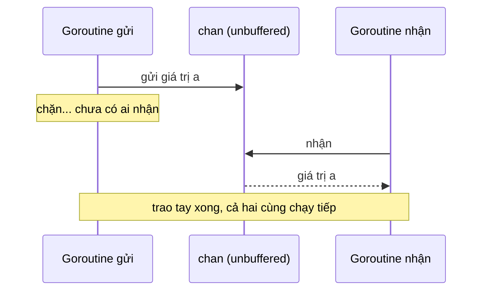

# Channel

Goroutine giúp chạy nhiều việc đồng thời, nhưng các việc đó cần **trao đổi dữ liệu và phối hợp** với nhau. Channel là "đường ống" có kiểu để một goroutine gửi giá trị và goroutine khác nhận, đồng thời đóng vai trò **điểm đồng bộ**: gửi và nhận có thể chặn cho tới khi bên kia sẵn sàng. Bài này đi qua channel unbuffered và buffered, quy tắc chặn, đóng channel, `for range`, comma-ok, channel có hướng, nil channel và bảng hành vi cần thuộc lòng để không bị deadlock hay panic.

---

:::note[Ghi nhớ nhanh]

- ⭐ **Unbuffered = gặp mặt trực tiếp** — gửi chặn tới khi có người nhận và ngược lại; buffered chỉ chặn khi buffer đầy (gửi) hoặc rỗng (nhận).
- ⭐ **Chỉ bên gửi mới `close`** — gửi vào channel đã đóng hoặc đóng hai lần đều **panic**; nhận từ channel đã đóng trả zero value ngay.
- **`v, ok := <-ch`** — `ok == false` nghĩa là channel đã đóng **và** đã rút hết dữ liệu.
- **`for v := range ch`** lặp tới khi channel bị đóng — quên `close` là goroutine nhận kẹt mãi.
- **Nil channel chặn vĩnh viễn** cả gửi lẫn nhận — vô dụng một mình nhưng rất hữu ích để tắt một case trong `select`.
- **"Don't communicate by sharing memory; share memory by communicating."**

:::

---

## Mục lục

- [Vì sao cần channel?](#vì-sao-cần-channel)
- [Tạo channel, gửi và nhận](#tạo-channel-gửi-và-nhận)
- [Unbuffered và buffered](#unbuffered-và-buffered)
- [Đóng channel](#đóng-channel)
- [Duyệt channel với for range](#duyệt-channel-với-for-range)
- [Channel có hướng](#channel-có-hướng)
- [Nil channel](#nil-channel)
- [Bảng hành vi channel](#bảng-hành-vi-channel)
- [Share memory by communicating](#share-memory-by-communicating)
- [Câu hỏi phỏng vấn](#câu-hỏi-phỏng-vấn)

---

## Vì sao cần channel?

**Vấn đề:** Goroutine không có giá trị trả về. Dùng biến chung để lấy kết quả thì phải tự lo khoá và tự biết khi nào xong:

```go
var result int // biến chung
go func() {
	result = heavyCompute() // ghi
}()
fmt.Println(result) // đọc — data race! Có thể in 0 vì goroutine chưa chạy xong
```

Thêm `sync.Mutex` thì tránh được race, nhưng vẫn chưa giải quyết được câu hỏi "**khi nào** kết quả sẵn sàng?".

**Giải pháp:** Channel vừa **truyền dữ liệu** vừa **đồng bộ**:

```go
ch := make(chan int)
go func() {
	ch <- heavyCompute() // gửi: chặn tới khi main nhận
}()
result := <-ch // nhận: chặn tới khi goroutine gửi
fmt.Println(result) // chắc chắn có giá trị, không race
```

:::tip[Dùng thực tế]

- **Trả kết quả từ goroutine** — mỗi worker gửi kết quả vào một channel chung.
- **Hàng đợi công việc** — channel buffered làm job queue cho worker pool.
- **Tín hiệu dừng** — `close(done)` báo cho mọi goroutine đang lắng nghe cùng lúc.
- **Pipeline** — dữ liệu chảy qua các stage nối với nhau bằng channel.

:::

:::tip[Ví dụ đời thường]

Channel **unbuffered** giống **trao tay trực tiếp**: shipper phải đứng chờ tới khi bạn ra nhận hàng. Channel **buffered** giống **tủ locker giao hàng** có N ngăn: shipper bỏ hàng vào ngăn trống rồi đi luôn, chỉ phải chờ khi tủ đầy; bạn ra lấy bất cứ lúc nào, chỉ phải chờ khi tủ trống. `close` là tấm biển **"Hôm nay hết giao hàng"**.

:::

---

## Tạo channel, gửi và nhận

```go
ch := make(chan int)        // unbuffered
jobs := make(chan Job, 100) // buffered, sức chứa 100
var nilCh chan int          // zero value của channel là nil

ch <- 42      // gửi
v := <-ch     // nhận và gán
<-ch          // nhận và bỏ giá trị (dùng làm tín hiệu)

fmt.Println(len(jobs), cap(jobs)) // số phần tử đang chờ, sức chứa
```

Channel là **kiểu tham chiếu** giống map, slice: truyền vào hàm là truyền "tay cầm" tới cùng một channel, không sao chép dữ liệu bên trong.

Channel có thể chứa bất kỳ kiểu nào, kể cả channel khác. Khi chỉ cần tín hiệu, dùng `chan struct{}` — `struct{}` chiếm 0 byte:

```go
done := make(chan struct{})
go func() {
	defer close(done)
	cleanup()
}()
<-done // chờ cleanup xong
```

---

## Unbuffered và buffered

### Unbuffered

```go
ch := make(chan string)
```

Gửi và nhận phải **gặp nhau**: bên nào tới trước sẽ chặn chờ bên kia. Khi việc trao đổi hoàn tất, cả hai cùng biết bên kia đã tới điểm đó — đây là **đồng bộ mạnh**.



```go
func main() {
	ch := make(chan int)
	ch <- 1          // chặn mãi: không có goroutine nào nhận
	fmt.Println(<-ch)
}
// fatal error: all goroutines are asleep - deadlock!
```

Runtime phát hiện **mọi** goroutine đều đang chặn và dừng chương trình với lỗi deadlock. Lưu ý: nếu còn goroutine khác đang chạy (ví dụ HTTP server), runtime **không** phát hiện được — chương trình chỉ đơn giản treo một phần.

### Buffered

```go
ch := make(chan int, 3)
ch <- 1
ch <- 2
ch <- 3      // vẫn không chặn: buffer có 3 chỗ
// ch <- 4   // sẽ chặn: buffer đầy
fmt.Println(<-ch, <-ch, <-ch) // 1 2 3 — FIFO
```

| | Unbuffered `make(chan T)` | Buffered `make(chan T, n)` |
|---|---|---|
| Gửi chặn khi | Chưa có người nhận | Buffer **đầy** |
| Nhận chặn khi | Chưa có người gửi | Buffer **rỗng** |
| Đảm bảo | Bên gửi biết bên nhận **đã nhận** | Bên gửi chỉ biết giá trị **đã vào buffer** |
| Dùng khi | Cần đồng bộ chặt, tín hiệu, handoff | Hấp thụ dao động tốc độ, job queue, semaphore, tránh leak |

:::warning

Buffer **không** phải cách sửa deadlock hay làm chương trình nhanh hơn. Nếu bên nhận chậm hơn bên gửi một cách liên tục, buffer chỉ trì hoãn lúc bị chặn. Chọn kích thước buffer có lý do: số worker, số kết quả biết trước (`len(tasks)`), hoặc 1 để goroutine gửi xong thoát được.

:::

---

## Đóng channel

```go
close(ch)
```

`close` báo "**sẽ không còn giá trị nào được gửi nữa**". Sau khi đóng:

- **Nhận** vẫn lấy được các giá trị còn trong buffer; hết rồi thì nhận **ngay lập tức** zero value.
- **Gửi** → panic: `send on closed channel`.
- **Đóng lần nữa** → panic: `close of closed channel`.

### Comma-ok khi nhận

```go
ch := make(chan int, 2)
ch <- 10
close(ch)

v, ok := <-ch
fmt.Println(v, ok) // 10 true  — còn dữ liệu trong buffer
v, ok = <-ch
fmt.Println(v, ok) // 0 false  — đã đóng và rút hết
```

`ok` giúp phân biệt "nhận được số 0 thật" với "channel đã đóng".

### Ai đóng channel?

Quy tắc: **bên gửi đóng, bên nhận không bao giờ đóng**. Bên nhận không biết còn ai sắp gửi hay không, đóng là có nguy cơ làm bên gửi panic.

Nhiều goroutine cùng gửi vào một channel → dùng `WaitGroup` và một goroutine riêng đóng sau khi tất cả gửi xong:

```go
func produceAll(sources []Source) <-chan Item {
	out := make(chan Item)
	var wg sync.WaitGroup
	for _, s := range sources {
		wg.Add(1)
		go func() {
			defer wg.Done()
			for _, it := range s.Items() {
				out <- it
			}
		}()
	}
	go func() {
		wg.Wait()
		close(out) // chỉ đóng khi MỌI bên gửi đã xong
	}()
	return out
}
```

:::tip

Không bắt buộc phải đóng mọi channel. Channel không còn ai tham chiếu sẽ được GC thu hồi dù chưa đóng. Chỉ cần `close` khi **bên nhận cần biết** đã hết dữ liệu (dùng `for range`, comma-ok, hoặc broadcast tín hiệu).

:::

### Close làm tín hiệu broadcast

Một lần `close` đánh thức **mọi** goroutine đang nhận — điều mà một lần gửi không làm được (gửi chỉ tới một người nhận):

```go
stop := make(chan struct{})
for i := range 5 {
	go func() {
		for {
			select {
			case <-stop:
				fmt.Println("worker", i, "dừng")
				return
			default:
				doWork()
			}
		}
	}()
}
time.Sleep(time.Second)
close(stop) // cả 5 worker cùng nhận được tín hiệu
```

Trong code thật, vai trò này thường do `context.Context` đảm nhiệm (bên trong `ctx.Done()` chính là một channel bị đóng khi huỷ).

---

## Duyệt channel với for range

```go
func generate(n int) <-chan int {
	ch := make(chan int)
	go func() {
		defer close(ch) // QUAN TRỌNG: thiếu dòng này, vòng range bên dưới treo mãi
		for i := range n {
			ch <- i * i
		}
	}()
	return ch
}

func main() {
	for v := range generate(5) {
		fmt.Println(v) // 0 1 4 9 16
	}
	fmt.Println("xong")
}
```

`for v := range ch` tương đương:

```go
for {
	v, ok := <-ch
	if !ok {
		break
	}
	// dùng v
}
```

:::warning

Quên `close` ở bên gửi là lỗi kinh điển: bên nhận `range` mãi không thoát. Nếu đó là goroutine `main` và không còn ai khác → `deadlock!`; nếu là goroutine phụ → **goroutine leak** im lặng.

:::

---

## Channel có hướng

Kiểu channel có thể giới hạn **chỉ gửi** hoặc **chỉ nhận**:

| Kiểu | Ý nghĩa | Được làm |
|---|---|---|
| `chan T` | Hai chiều | Gửi, nhận, đóng |
| `chan<- T` | Send-only (chỉ gửi) | Gửi, đóng |
| `<-chan T` | Receive-only (chỉ nhận) | Nhận |

Mẹo nhớ: mũi tên `<-` chỉ hướng dữ liệu chảy so với từ khoá `chan`.

```go
// producer chỉ được gửi
func producer(out chan<- int) {
	defer close(out)
	for i := range 3 {
		out <- i
	}
	// v := <-out // lỗi biên dịch: receive from send-only channel
}

// consumer chỉ được nhận
func consumer(in <-chan int) {
	for v := range in {
		fmt.Println(v)
	}
	// close(in) // lỗi biên dịch: không đóng được receive-only channel
}

func main() {
	ch := make(chan int) // hai chiều
	go producer(ch)      // tự chuyển thành chan<- int
	consumer(ch)         // tự chuyển thành <-chan int
}
```

Channel hai chiều **tự chuyển** sang một chiều khi truyền vào hàm; chiều ngược lại thì không. Lợi ích: compiler bảo đảm đúng vai trò, và chữ ký hàm tự mô tả — nhìn `func Watch() <-chan Event` là biết "tôi chỉ đọc sự kiện, hàm này sở hữu và đóng channel".

---

## Nil channel

```go
var ch chan int // nil
ch <- 1         // chặn vĩnh viễn
<-ch            // chặn vĩnh viễn
close(ch)       // panic: close of nil channel
```

Một mình thì vô dụng, nhưng trong `select`, **case với nil channel không bao giờ được chọn** — dùng để "tắt" một nhánh khi nguồn đó đã hết. Ví dụ gộp hai channel, mỗi cái đóng ở thời điểm khác nhau:

```go
func merge(a, b <-chan int) <-chan int {
	out := make(chan int)
	go func() {
		defer close(out)
		for a != nil || b != nil {
			select {
			case v, ok := <-a:
				if !ok {
					a = nil // a đã đóng → tắt case này
					continue
				}
				out <- v
			case v, ok := <-b:
				if !ok {
					b = nil
					continue
				}
				out <- v
			}
		}
	}()
	return out
}
```

Nếu không gán `nil`, case của channel đã đóng sẽ được chọn liên tục (vì nhận từ channel đóng trả về ngay) → vòng lặp quay vô ích tốn CPU. Chi tiết hơn ở bài Select.

---

## Bảng hành vi channel

Bảng này rất hay bị hỏi phỏng vấn:

| Thao tác | Nil channel | Đã đóng | Mở (bình thường) |
|---|---|---|---|
| **Gửi** `ch <- v` | Chặn vĩnh viễn | **Panic** | Chặn tới khi có chỗ/người nhận |
| **Nhận** `<-ch` | Chặn vĩnh viễn | Trả giá trị còn trong buffer; hết thì zero value ngay, `ok = false` | Chặn tới khi có giá trị |
| **Đóng** `close(ch)` | **Panic** | **Panic** | Thành công; đánh thức mọi người nhận đang chờ |
| `len(ch)` | 0 | Số phần tử còn trong buffer | Số phần tử trong buffer |
| `cap(ch)` | 0 | Sức chứa | Sức chứa |

Các lỗi cần tránh:

1. Gửi vào channel đã đóng → panic.
2. Đóng channel hai lần → panic. Nếu nhiều nơi có thể đóng, bọc bằng `sync.Once`.
3. Đóng nil channel → panic.
4. Gửi/nhận trên nil channel ngoài `select` → treo mãi (thường do quên `make`).

---

## Share memory by communicating

Châm ngôn nổi tiếng trong [Effective Go](https://go.dev/doc/effective_go#sharing):

> **Don't communicate by sharing memory; share memory by communicating.**
> (Đừng giao tiếp bằng cách chia sẻ bộ nhớ; hãy chia sẻ bộ nhớ bằng cách giao tiếp.)

Ý nghĩa: thay vì nhiều goroutine cùng sửa một biến và bảo vệ bằng khoá, hãy để **một goroutine sở hữu** dữ liệu và các goroutine khác gửi yêu cầu cho nó qua channel. Tại mỗi thời điểm chỉ một goroutine chạm vào dữ liệu → không cần khoá.

```go
type deposit struct {
	amount int
}

type balanceQuery struct {
	reply chan int
}

// Goroutine duy nhất sở hữu biến balance
func bankTeller(deposits <-chan deposit, queries <-chan balanceQuery) {
	balance := 0
	for {
		select {
		case d := <-deposits:
			balance += d.amount
		case q := <-queries:
			q.reply <- balance
		}
	}
}

func main() {
	deposits := make(chan deposit)
	queries := make(chan balanceQuery)
	go bankTeller(deposits, queries)

	var wg sync.WaitGroup
	for range 100 {
		wg.Go(func() { deposits <- deposit{amount: 10} }) // Go 1.25+
	}
	wg.Wait()

	reply := make(chan int)
	queries <- balanceQuery{reply: reply}
	fmt.Println(<-reply) // 1000
}
```

:::warning

Đây là **định hướng**, không phải luật tuyệt đối. Bảo vệ một bộ đếm hay một map cache bằng `sync.Mutex` thường **đơn giản và nhanh hơn** channel. Go wiki gợi ý: dùng channel khi **chuyển quyền sở hữu dữ liệu**, phân phối công việc, truyền kết quả bất đồng bộ; dùng mutex cho **cache, trạng thái dùng chung** đơn giản. Xem thêm bài Package sync.

:::

---

## Câu hỏi phỏng vấn

**1. Channel unbuffered và buffered khác nhau thế nào? Khi nào dùng loại nào?**

<details className="qa">
<summary>Xem đáp án</summary>

Unbuffered: gửi chặn tới khi có người nhận và ngược lại — đồng bộ hoá hai goroutine tại điểm trao đổi; bên gửi biết chắc bên nhận đã nhận. Buffered với sức chứa n: gửi chỉ chặn khi đầy, nhận chỉ chặn khi rỗng — tách rời tốc độ hai bên. Unbuffered cho tín hiệu và handoff cần đảm bảo; buffered cho job queue, semaphore, hoặc buffer 1 để goroutine gửi kết quả không bị kẹt khi bên nhận đã bỏ đi.

</details>

**2. Điều gì xảy ra khi gửi, nhận, đóng trên nil channel và channel đã đóng?**

<details className="qa">
<summary>Xem đáp án</summary>

Nil channel: gửi và nhận chặn vĩnh viễn, đóng thì panic. Channel đã đóng: gửi panic, đóng lại panic, nhận trả hết dữ liệu còn trong buffer rồi trả zero value ngay lập tức với `ok == false`. Channel mở: gửi/nhận chặn theo buffer, đóng thành công và đánh thức mọi goroutine đang nhận.

</details>

**3. Ai nên đóng channel? Làm sao đóng an toàn khi có nhiều goroutine gửi?**

<details className="qa">
<summary>Xem đáp án</summary>

Bên gửi (người sở hữu channel) đóng, bên nhận không đóng. Với nhiều bên gửi: dùng `sync.WaitGroup` đếm các bên gửi và một goroutine riêng `wg.Wait()` rồi `close(ch)`. Hoặc không đóng channel dữ liệu mà dùng một channel/context riêng để báo dừng. Không bắt buộc đóng mọi channel — chỉ đóng khi bên nhận cần biết đã hết dữ liệu.

</details>

**4. Lỗi "all goroutines are asleep - deadlock!" xuất hiện khi nào?**

<details className="qa">
<summary>Xem đáp án</summary>

Khi runtime thấy **mọi** goroutine đều đang chặn (chờ channel, lock...) và không goroutine nào có thể đánh thức chúng — ví dụ gửi vào channel unbuffered trong `main` mà không có goroutine nhận, hoặc `range` một channel không bao giờ đóng. Nếu vẫn còn goroutine khác chạy hoặc đang chờ I/O mạng/timer (như HTTP server), runtime không báo lỗi mà chương trình chỉ treo một phần — vì vậy deadlock trong service thật thường khó phát hiện hơn.

</details>

**5. Channel có hướng (`chan<- T`, `<-chan T`) dùng để làm gì?**

<details className="qa">
<summary>Xem đáp án</summary>

Giới hạn thao tác tại compile time: `chan<- T` chỉ gửi (và đóng), `<-chan T` chỉ nhận. Channel hai chiều tự chuyển thành một chiều khi truyền vào tham số. Giúp chữ ký hàm thể hiện rõ vai trò producer/consumer, ngăn bên nhận lỡ đóng hoặc gửi ngược, và làm rõ ai sở hữu channel.

</details>

**6. Nil channel có ích gì?**

<details className="qa">
<summary>Xem đáp án</summary>

Trong `select`, case với nil channel không bao giờ được chọn. Gán một channel thành nil sau khi nó đóng (hoặc khi tạm thời không muốn gửi/nhận) giúp tắt động nhánh đó — ví dụ gộp nhiều channel đóng vào các thời điểm khác nhau, hoặc chỉ bật case gửi khi có dữ liệu chờ gửi. Nếu không, case của channel đã đóng được chọn liên tục làm vòng lặp quay vô ích.

</details>
