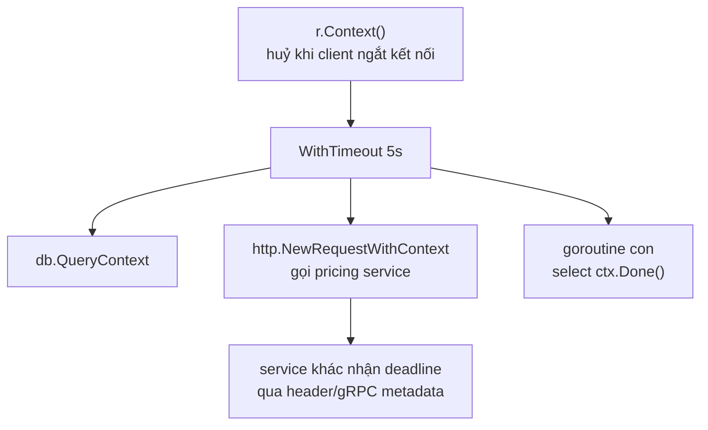

# Context

Một request HTTP đi vào server có thể kéo theo hàng chục goroutine: gọi DB, gọi service khác, đọc cache. Khi người dùng đóng trình duyệt hoặc request quá hạn, **tất cả** chỗ việc đó nên dừng lại thay vì chạy tiếp cho một người không còn chờ. Package `context` giải quyết đúng việc này: truyền **tín hiệu huỷ, deadline và vài giá trị phạm vi request** xuyên qua các tầng hàm và goroutine. Bài này đi qua mọi hàm tạo context, cách dùng trong HTTP server/client và DB, cùng các quy ước bắt buộc phải theo.

---

:::note[Ghi nhớ nhanh]

- ⭐ **`ctx context.Context` là tham số đầu tiên** của mọi hàm làm I/O hoặc có thể chạy lâu; không lưu ctx trong struct.
- ⭐ **Luôn `defer cancel()`** ngay sau `WithCancel`/`WithTimeout`/`WithDeadline` — quên là rò tài nguyên (`go vet` cảnh báo).
- **Huỷ lan từ cha xuống con, không lan ngược** — huỷ ctx con không ảnh hưởng ctx cha.
- **`WithValue` chỉ cho dữ liệu phạm vi request** (request ID, user đã xác thực, trace) với key kiểu riêng chưa export; **không** dùng để truyền tham số tuỳ chọn.
- **`ctx.Err()`** trả `context.Canceled` hoặc `context.DeadlineExceeded`; `context.Cause(ctx)` (Go 1.20) cho biết lý do chi tiết.
- **`WithoutCancel`** (Go 1.21) — tách việc chạy nền ra khỏi vòng đời request nhưng vẫn giữ giá trị.

:::

---

## Mục lục

- [Vì sao cần context?](#vì-sao-cần-context)
- [Interface Context](#interface-context)
- [Background và TODO](#background-và-todo)
- [WithCancel](#withcancel)
- [WithTimeout và WithDeadline](#withtimeout-và-withdeadline)
- [WithCancelCause và Cause](#withcancelcause-và-cause)
- [WithValue](#withvalue)
- [AfterFunc và WithoutCancel](#afterfunc-và-withoutcancel)
- [Quy ước sử dụng](#quy-ước-sử-dụng)
- [Context trong HTTP và database](#context-trong-http-và-database)

---

## Vì sao cần context?

**Vấn đề:** Handler gọi một truy vấn DB nặng 30 giây. Người dùng sốt ruột đóng tab sau 2 giây — nhưng server **vẫn chạy tiếp** 28 giây còn lại, giữ kết nối DB, tốn CPU, cho một kết quả không ai nhận:

```go
func reportHandler(w http.ResponseWriter, r *http.Request) {
	rows, err := db.Query("SELECT ... báo cáo rất nặng ...") // không biết client đã bỏ đi
	// ...
	go sendAnalytics()  // goroutine con cũng không biết khi nào nên dừng
	callPricingService() // gọi HTTP sang service khác, không có timeout
}
```

Tự làm cơ chế huỷ bằng channel `done` thì mỗi hàm phải nhận thêm channel, timeout phải tự cài, mỗi thư viện một kiểu.

**Giải pháp:** Một kiểu chuẩn `context.Context` được cả thư viện chuẩn (`net/http`, `database/sql`, `os/exec`...) lẫn bên thứ ba hiểu:

```go
func reportHandler(w http.ResponseWriter, r *http.Request) {
	ctx, cancel := context.WithTimeout(r.Context(), 5*time.Second) // tối đa 5s
	defer cancel()

	rows, err := db.QueryContext(ctx, "SELECT ...") // client bỏ đi hoặc quá 5s → DB huỷ truy vấn
	if err != nil {
		http.Error(w, err.Error(), http.StatusGatewayTimeout)
		return
	}
	defer rows.Close()

	price, err := fetchPrice(ctx) // cùng ctx → cùng bị huỷ
	// ...
	_ = price
}
```



Huỷ ở gốc → mọi nhánh bên dưới cùng nhận tín hiệu — **huỷ dây chuyền** (cancellation propagation).

:::tip[Dùng thực tế]

- **Timeout cho mọi lời gọi ra ngoài** — DB, HTTP, gRPC, Redis.
- **Dừng xử lý khi client ngắt kết nối** — tiết kiệm tài nguyên server.
- **Graceful shutdown** — `signal.NotifyContext` huỷ context gốc khi nhận SIGTERM.
- **Mang request ID / trace ID** qua các tầng để log và tracing.

:::

:::tip[Ví dụ đời thường]

Context giống **lệnh từ tổng đài taxi**: tổng đài (handler) điều một tài xế (goroutine), tài xế gọi thêm xe hỗ trợ (goroutine con). Khi khách **huỷ cuốc**, tổng đài phát một lệnh huỷ — mọi xe liên quan đều nhận và quay về, không ai chạy tiếp đến điểm đón. Deadline là "**khách chỉ chờ tới 8h**" — quá giờ tự huỷ.

:::

---

## Interface Context

```go
type Context interface {
	Deadline() (deadline time.Time, ok bool) // thời điểm hết hạn (nếu có)
	Done() <-chan struct{}                   // channel bị ĐÓNG khi ctx bị huỷ/hết hạn
	Err() error                              // nil nếu chưa huỷ; Canceled hoặc DeadlineExceeded
	Value(key any) any                       // lấy giá trị gắn theo key
}
```

Cách một hàm "tôn trọng" context:

```go
func process(ctx context.Context, items []Item) error {
	for _, it := range items {
		select {
		case <-ctx.Done():
			return ctx.Err() // dừng sớm, trả lý do
		default:
		}
		if err := handle(ctx, it); err != nil {
			return err
		}
	}
	return nil
}
```

Context là **bất biến** và an toàn khi dùng từ nhiều goroutine. Các hàm `With...` không sửa context cũ mà tạo **context con** bọc context cha → thành một cây.

---

## Background và TODO

```go
ctx := context.Background() // gốc rỗng: không huỷ, không deadline, không giá trị
ctx := context.TODO()       // y hệt về hành vi, nhưng mang nghĩa "chưa biết dùng ctx nào"
```

| | Dùng ở đâu |
|---|---|
| `Background()` | Gốc của cây: `main`, khởi tạo, test, goroutine nền sống suốt chương trình |
| `TODO()` | Chỗ tạm khi đang refactor, hàm gọi chưa truyền ctx xuống — công cụ phân tích có thể tìm để nhắc bạn sửa |

Trong HTTP handler **không** dùng `Background()` — dùng `r.Context()`. Trong test (Go 1.24+) dùng `t.Context()`, tự huỷ khi test kết thúc.

---

## WithCancel

```go
ctx, cancel := context.WithCancel(parent)
defer cancel()
```

`cancel()` đóng `ctx.Done()`, huỷ mọi context con, và giải phóng liên kết với cha. Gọi nhiều lần không sao.

```go
func firstResult(ctx context.Context, mirrors []string) (string, error) {
	ctx, cancel := context.WithCancel(ctx)
	defer cancel() // có kết quả đầu tiên → huỷ mọi request còn lại

	results := make(chan string, len(mirrors)) // buffer đủ → không goroutine nào kẹt
	for _, m := range mirrors {
		go func() {
			if r, err := download(ctx, m); err == nil {
				results <- r
			}
		}()
	}

	select {
	case r := <-results:
		return r, nil
	case <-ctx.Done():
		return "", ctx.Err()
	}
}
```

:::warning

Quên gọi `cancel` thì context con và goroutine/timer nội bộ chỉ được giải phóng khi **context cha** bị huỷ — nếu cha là `Background()` thì là **không bao giờ**. `go vet` (analyzer lostcancel) báo: `the cancel function is not used on all paths`.

:::

---

## WithTimeout và WithDeadline

```go
// Hết hạn sau một khoảng thời gian
ctx, cancel := context.WithTimeout(parent, 3*time.Second)
defer cancel()

// Hết hạn tại một thời điểm cụ thể
ctx, cancel := context.WithDeadline(parent, time.Now().Add(3*time.Second))
defer cancel()
```

`WithTimeout(p, d)` chính là `WithDeadline(p, time.Now().Add(d))`.

Context con **không thể kéo dài** deadline của cha: cha còn 1 giây mà con xin 5 giây thì con vẫn hết hạn sau 1 giây.

```go
func callPayment(ctx context.Context, req PaymentReq) (*PaymentResp, error) {
	ctx, cancel := context.WithTimeout(ctx, 2*time.Second)
	defer cancel()

	resp, err := paymentClient.Charge(ctx, req)
	if errors.Is(err, context.DeadlineExceeded) {
		return nil, fmt.Errorf("cổng thanh toán quá 2s: %w", err)
	}
	return resp, err
}
```

Đọc deadline còn lại để quyết định có nên bắt đầu việc dài hay không:

```go
if dl, ok := ctx.Deadline(); ok && time.Until(dl) < 500*time.Millisecond {
	return errors.New("không đủ thời gian để thử lại")
}
```

---

## WithCancelCause và Cause

`ctx.Err()` chỉ nói "bị huỷ" hoặc "hết hạn", không nói **vì sao**. Go 1.20 thêm `WithCancelCause`:

```go
var ErrUserAborted = errors.New("người dùng huỷ upload")

ctx, cancel := context.WithCancelCause(parent)
defer cancel(nil) // nil → cause mặc định là context.Canceled

go func() {
	if userClickedCancel() {
		cancel(ErrUserAborted)
	}
}()

<-ctx.Done()
fmt.Println(ctx.Err())             // context canceled
fmt.Println(context.Cause(ctx))    // người dùng huỷ upload
```

Go 1.21 thêm `WithTimeoutCause` và `WithDeadlineCause` để gắn lý do khi hết hạn:

```go
ctx, cancel := context.WithTimeoutCause(parent, time.Second,
	errors.New("quá 1s khi gọi inventory"))
defer cancel()
```

`context.Cause(ctx)` trả về cause của context **hoặc cha của nó** đã gây ra việc huỷ; nếu chưa huỷ thì `nil`.

---

## WithValue

```go
ctx = context.WithValue(parent, key, value)
v := ctx.Value(key) // tìm từ con lên cha, trả any
```

### Key phải là kiểu riêng

```go
// SAI: key kiểu string có thể đụng với package khác cũng dùng "userID"
ctx = context.WithValue(ctx, "userID", 42) // staticcheck SA1029 cảnh báo

// ĐÚNG: kiểu chưa export → không package nào khác tạo được key trùng
type ctxKey int

const (
	requestIDKey ctxKey = iota
	userKey
)

func WithRequestID(ctx context.Context, id string) context.Context {
	return context.WithValue(ctx, requestIDKey, id)
}

func RequestID(ctx context.Context) (string, bool) {
	id, ok := ctx.Value(requestIDKey).(string)
	return id, ok
}
```

Đóng gói bằng cặp hàm `WithX`/`X` như trên để bên ngoài không phải biết key và không phải type assertion.

### Dùng hạn chế

| Nên đặt vào ctx | Không nên |
|---|---|
| Request ID, trace/span | Kết nối DB, logger cấu hình, service client |
| Thông tin user đã xác thực | Tham số nghiệp vụ (`orderID`, `pageSize`) |
| Locale/tenant của request | Cấu hình, feature flag toàn cục |

Lý do: `Value` là **phụ thuộc ẩn** — chữ ký hàm không cho biết hàm cần gì, thiếu thì chỉ phát hiện lúc runtime, không có kiểm tra kiểu. Tra cứu cũng chậm (duyệt danh sách liên kết từ con lên cha). Thứ hàm **cần** để chạy → truyền tham số tường minh.

---

## AfterFunc và WithoutCancel

### context.AfterFunc (Go 1.21)

Đăng ký một hàm chạy (trong goroutine riêng) **khi ctx bị huỷ**:

```go
conn := openConn()
stop := context.AfterFunc(ctx, func() {
	conn.Close() // ctx huỷ → đóng kết nối để mọi thao tác đang chặn trên conn trả lỗi
})
defer stop() // xong việc trước khi huỷ → gỡ đăng ký, không đóng conn

readAll(conn)
```

Hữu ích để nối context với API **không hiểu context** (ví dụ đánh thức một `sync.Cond`, đóng `net.Conn` đang chặn đọc). `stop()` trả `true` nếu đã gỡ được trước khi hàm chạy.

### context.WithoutCancel (Go 1.21)

Tạo context **giữ nguyên giá trị** của cha nhưng **không bị huỷ** khi cha huỷ, không có deadline:

```go
func orderHandler(w http.ResponseWriter, r *http.Request) {
	order := createOrder(r.Context())
	w.WriteHeader(http.StatusCreated)

	// Gửi email xác nhận chạy nền — không được dừng khi request kết thúc,
	// nhưng vẫn muốn mang theo request ID, trace để log.
	bg := context.WithoutCancel(r.Context())
	go func() {
		ctx, cancel := context.WithTimeout(bg, 30*time.Second) // tự đặt giới hạn mới
		defer cancel()
		sendConfirmEmail(ctx, order)
	}()
}
```

Không có `WithoutCancel`, nếu truyền thẳng `r.Context()`, việc gửi email bị huỷ ngay khi handler trả response.

---

## Quy ước sử dụng

Theo tài liệu package `context`:

1. **Không lưu Context trong struct**; truyền tường minh cho từng hàm cần nó.
2. **`ctx` là tham số đầu tiên**, đặt tên `ctx`: `func (s *Service) Get(ctx context.Context, id int) (*User, error)`.
3. **Không truyền `nil`** làm Context — không chắc thì dùng `context.TODO()`.
4. **`WithValue` chỉ cho dữ liệu phạm vi request** đi qua ranh giới process/API, không cho tham số tuỳ chọn.
5. Cùng một Context có thể truyền cho nhiều goroutine — nó an toàn đồng thời.

```go
// SAI
type Service struct {
	ctx context.Context // ctx của request nào? Sống bao lâu?
	db  *sql.DB
}

// ĐÚNG
type Service struct {
	db *sql.DB
}

func (s *Service) FindUser(ctx context.Context, id int) (*User, error) {
	row := s.db.QueryRowContext(ctx, "SELECT id, name FROM users WHERE id = $1", id)
	var u User
	if err := row.Scan(&u.ID, &u.Name); err != nil {
		return nil, fmt.Errorf("tìm user %d: %w", id, err)
	}
	return &u, nil
}
```

:::warning

Context chỉ là **lời đề nghị** dừng — không có cơ chế cưỡng chế. Hàm không kiểm tra `ctx.Done()` hoặc không truyền `ctx` xuống thư viện bên dưới thì vẫn chạy tới cùng. Vòng lặp CPU nặng phải tự kiểm tra `ctx.Err()` định kỳ.

:::

---

## Context trong HTTP và database

### HTTP server

`r.Context()` bị huỷ khi: client đóng kết nối, request HTTP/2 bị huỷ, hoặc `ServeHTTP` trả về.

```go
mux := http.NewServeMux()
mux.HandleFunc("GET /reports/{id}", func(w http.ResponseWriter, r *http.Request) {
	ctx := r.Context()
	report, err := buildReport(ctx, r.PathValue("id"))
	if err != nil {
		if errors.Is(err, context.Canceled) {
			return // client đã bỏ đi, không cần trả gì
		}
		http.Error(w, "lỗi tạo báo cáo", http.StatusInternalServerError)
		return
	}
	json.NewEncoder(w).Encode(report)
})
```

Middleware gắn request ID:

```go
func requestIDMiddleware(next http.Handler) http.Handler {
	return http.HandlerFunc(func(w http.ResponseWriter, r *http.Request) {
		id := r.Header.Get("X-Request-ID")
		if id == "" {
			id = newID()
		}
		ctx := WithRequestID(r.Context(), id)
		next.ServeHTTP(w, r.WithContext(ctx)) // r.WithContext trả request mới, không sửa r cũ
	})
}
```

### HTTP client

```go
func fetchPrice(ctx context.Context, sku string) (int, error) {
	req, err := http.NewRequestWithContext(ctx, http.MethodGet,
		"https://pricing.internal/prices/"+sku, nil)
	if err != nil {
		return 0, err
	}
	resp, err := http.DefaultClient.Do(req) // ctx huỷ → kết nối bị đóng, Do trả lỗi
	if err != nil {
		return 0, fmt.Errorf("gọi pricing: %w", err)
	}
	defer resp.Body.Close()
	var out struct{ Price int }
	if err := json.NewDecoder(resp.Body).Decode(&out); err != nil {
		return 0, err
	}
	return out.Price, nil
}
```

### Database

`database/sql` có phiên bản `...Context` cho mọi thao tác: `QueryContext`, `QueryRowContext`, `ExecContext`, `BeginTx`, `PingContext`. Khi ctx huỷ, driver gửi lệnh huỷ truy vấn tới DB (với driver hỗ trợ như pgx) và trả kết nối về pool.

```go
func (r *OrderRepo) Transfer(ctx context.Context, from, to int, amount int64) error {
	tx, err := r.db.BeginTx(ctx, nil) // ctx huỷ trước Commit → tx tự rollback
	if err != nil {
		return err
	}
	defer tx.Rollback() // no-op nếu đã Commit

	if _, err := tx.ExecContext(ctx,
		"UPDATE accounts SET balance = balance - $1 WHERE id = $2", amount, from); err != nil {
		return err
	}
	if _, err := tx.ExecContext(ctx,
		"UPDATE accounts SET balance = balance + $1 WHERE id = $2", amount, to); err != nil {
		return err
	}
	return tx.Commit()
}
```

### Huỷ theo tín hiệu hệ điều hành

```go
func main() {
	ctx, stop := signal.NotifyContext(context.Background(), os.Interrupt, syscall.SIGTERM)
	defer stop()

	go runWorker(ctx) // Ctrl+C hoặc SIGTERM → ctx huỷ → worker dừng
	<-ctx.Done()
	fmt.Println("đang tắt...")
}
```

Chi tiết tắt server êm ở bài Các pattern concurrency.
