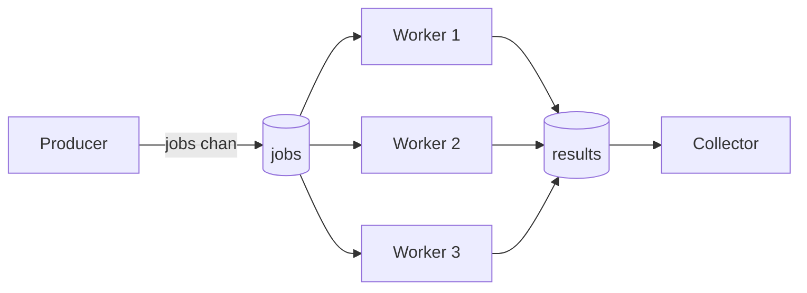
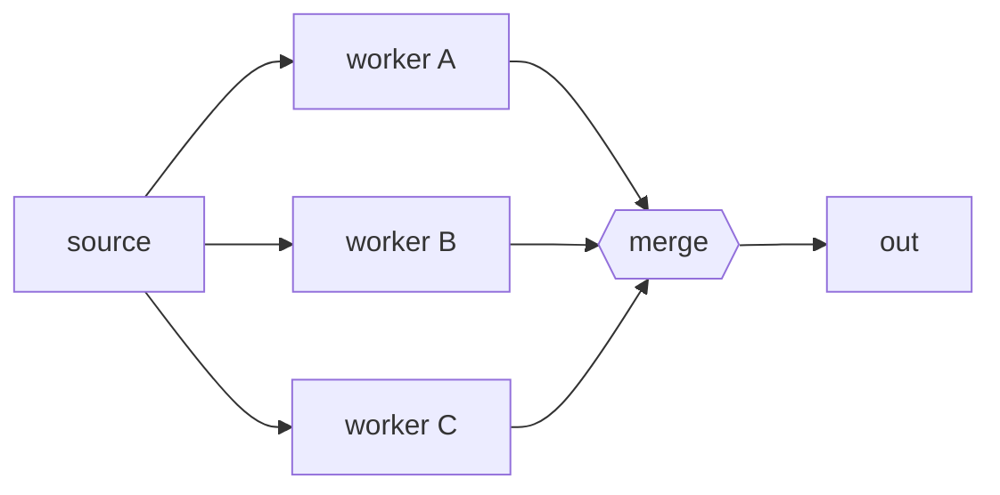
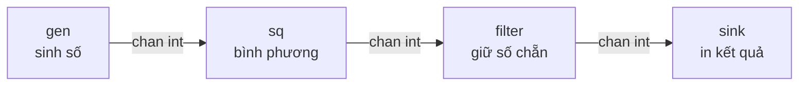
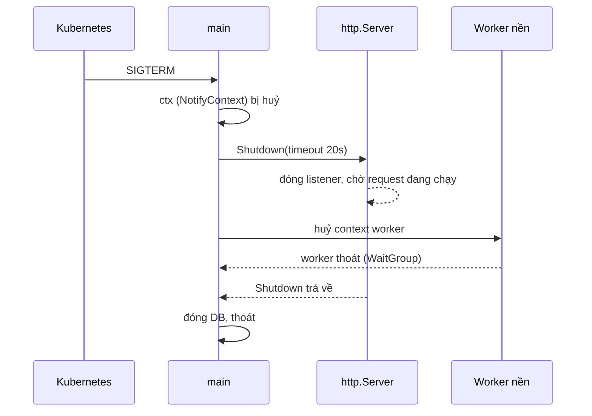

# Các pattern concurrency

Goroutine, channel, `select`, `sync` và `context` là các viên gạch; bài này là các **bản thiết kế** ghép chúng lại để giải quyết bài toán thật: xử lý hàng nghìn job với số worker cố định, chia việc rồi gom kết quả, xây pipeline nhiều bước, giới hạn số lời gọi đồng thời hoặc số request mỗi giây, và tắt server mà không làm rơi request đang xử lý. Mỗi pattern đi kèm sơ đồ, code chạy được và các bẫy cần tránh.

---

:::note[Ghi nhớ nhanh]

- ⭐ **Worker pool** — N goroutine cố định đọc từ một channel job; giới hạn tài nguyên (DB connection, CPU) thay vì mở một goroutine cho mỗi việc.
- ⭐ **Graceful shutdown** — `signal.NotifyContext` + `server.Shutdown(ctx)`: ngừng nhận request mới, chờ request đang chạy xong trong giới hạn thời gian.
- **Fan-out / fan-in** — chia một nguồn cho nhiều worker, rồi gộp nhiều channel kết quả thành một (dùng `WaitGroup` để đóng channel gộp).
- **Pipeline** — chuỗi stage nối bằng channel; mỗi stage **đóng channel output** khi xong và **lắng nghe `ctx.Done()`** để không leak.
- **Semaphore = buffered channel** `make(chan struct{}, n)`; hoặc `errgroup.SetLimit(n)`.
- **Rate limiting** — `time.Ticker` cho trường hợp đơn giản; `golang.org/x/time/rate` (token bucket) cho thực tế.

:::

---

## Mục lục

- [Vì sao cần pattern concurrency?](#vì-sao-cần-pattern-concurrency)
- [Generator](#generator)
- [Worker pool](#worker-pool)
- [Fan-out và fan-in](#fan-out-và-fan-in)
- [Pipeline](#pipeline)
- [Semaphore bằng buffered channel](#semaphore-bằng-buffered-channel)
- [Rate limiting](#rate-limiting)
- [Graceful shutdown](#graceful-shutdown)
- [Câu hỏi phỏng vấn](#câu-hỏi-phỏng-vấn)

---

## Vì sao cần pattern concurrency?

**Vấn đề:** Cần resize 50.000 ảnh. Cách "Go thuần" đầu tiên ai cũng nghĩ tới:

```go
for _, img := range images { // 50.000 phần tử
	go resize(img) // 50.000 goroutine cùng lúc đọc file, chiếm RAM, giành CPU
}
// và... chờ bằng gì? lỗi trả về đâu? Ctrl+C thì dừng thế nào?
```

Hậu quả: hết file descriptor (`too many open files`), RAM tăng vọt, DB/API phía sau bị dội request, không có cách gom lỗi hay dừng giữa chừng.

**Giải pháp:** Dùng pattern đã được kiểm chứng — ở đây là **worker pool**: số goroutine cố định, job đi qua channel, kết quả gom về một chỗ, `context` để huỷ:

```go
jobs := make(chan Image)
var wg sync.WaitGroup
for range runtime.NumCPU() { // chỉ N worker
	wg.Go(func() {
		for img := range jobs {
			resize(img)
		}
	})
}
for _, img := range images {
	jobs <- img
}
close(jobs)
wg.Wait()
```

:::tip[Dùng thực tế]

- **Worker pool** — consumer Kafka/RabbitMQ, xử lý ảnh, gửi email hàng loạt.
- **Fan-out/fan-in** — gọi song song nhiều nhà cung cấp vận chuyển rồi gộp báo giá.
- **Pipeline** — ETL: đọc CSV → parse → validate → ghi DB theo batch.
- **Rate limit** — gọi API bên thứ ba bị giới hạn 100 request/giây.
- **Graceful shutdown** — deploy Kubernetes không làm rơi request.

:::

:::tip[Ví dụ đời thường]

Một **bếp nhà hàng tiệc cưới**: không thuê 500 đầu bếp cho 500 mâm (một goroutine mỗi việc), mà có 10 đầu bếp nhận phiếu từ một chồng phiếu chung (**worker pool**). Món đi qua dây chuyền sơ chế → nấu → bày đĩa (**pipeline**). Bếp trưởng chia việc cho nhiều người rồi gom món ra cửa chuyển (**fan-out/fan-in**). Hết giờ, quản lý **ngừng nhận order mới nhưng chờ các món đang nấu xong** mới tắt bếp (**graceful shutdown**).

:::

---

## Generator

Hàm trả về `<-chan T` và tự sinh giá trị trong goroutine riêng:

```go
func countdown(ctx context.Context, from int) <-chan int {
	out := make(chan int)
	go func() {
		defer close(out)
		for i := from; i > 0; i-- {
			select {
			case out <- i:
			case <-ctx.Done(): // người dùng ngừng đọc → goroutine thoát, không leak
				return
			}
		}
	}()
	return out
}

func main() {
	ctx, cancel := context.WithCancel(context.Background())
	defer cancel()
	for n := range countdown(ctx, 5) {
		fmt.Println(n) // 5 4 3 2 1
	}
}
```

:::tip

Nếu chỉ cần **duyệt tuần tự** (không cần goroutine riêng), từ Go 1.23 hãy dùng **iterator** `iter.Seq[T]` — nhanh hơn nhiều (không có chi phí channel và chuyển goroutine), và dừng sớm bằng `break` tự nhiên, không lo leak:

```go
func Countdown(from int) iter.Seq[int] {
	return func(yield func(int) bool) {
		for i := from; i > 0; i-- {
			if !yield(i) {
				return
			}
		}
	}
}

for n := range Countdown(5) {
	fmt.Println(n)
}
```

Generator dựa trên channel chỉ đáng dùng khi việc sinh giá trị **thật sự cần chạy đồng thời** với việc tiêu thụ (ví dụ đọc từ mạng).

:::

---

## Worker pool



```go
type Job struct {
	ID  int
	URL string
}

type Result struct {
	JobID int
	Size  int
	Err   error
}

func worker(ctx context.Context, jobs <-chan Job, results chan<- Result) {
	for job := range jobs { // dừng khi jobs bị đóng
		size, err := download(ctx, job.URL)
		select {
		case results <- Result{JobID: job.ID, Size: size, Err: err}:
		case <-ctx.Done():
			return
		}
	}
}

func runPool(ctx context.Context, urls []string, numWorkers int) []Result {
	jobs := make(chan Job)
	results := make(chan Result)

	// 1. Khởi động N worker
	var wg sync.WaitGroup
	for range numWorkers {
		wg.Go(func() { worker(ctx, jobs, results) })
	}

	// 2. Đẩy job (goroutine riêng để không chặn việc nhận kết quả)
	go func() {
		defer close(jobs)
		for i, u := range urls {
			select {
			case jobs <- Job{ID: i, URL: u}:
			case <-ctx.Done():
				return
			}
		}
	}()

	// 3. Đóng results khi mọi worker xong
	go func() {
		wg.Wait()
		close(results)
	}()

	// 4. Gom kết quả
	var out []Result
	for r := range results {
		out = append(out, r)
	}
	return out
}
```

Ba điểm hay sai:

1. **Ai đóng `jobs`?** Producer, sau khi gửi hết.
2. **Ai đóng `results`?** Một goroutine riêng chờ `wg.Wait()` — không worker nào được tự đóng vì các worker khác có thể còn gửi.
3. **Producer và collector phải chạy song song** — nếu gửi hết job rồi mới đọc kết quả với channel unbuffered, worker sẽ kẹt khi gửi kết quả → deadlock.

Chọn số worker: việc nặng CPU → khoảng `runtime.NumCPU()`; việc chờ I/O → nhiều hơn, theo giới hạn của tài nguyên phía sau (số connection DB, rate limit API).

:::tip

Khi chỉ cần "chạy N việc song song, dừng khi có lỗi", `errgroup` với `SetLimit` gọn hơn nhiều so với tự dựng pool:

```go
g, ctx := errgroup.WithContext(ctx)
g.SetLimit(8)
for _, u := range urls {
	g.Go(func() error { return process(ctx, u) })
}
err := g.Wait()
```

:::

---

## Fan-out và fan-in

- **Fan-out**: nhiều goroutine cùng đọc từ **một** channel để chia tải.
- **Fan-in**: gộp **nhiều** channel thành một.



```go
// Fan-in: gộp nhiều channel thành một
func merge[T any](ctx context.Context, inputs ...<-chan T) <-chan T {
	out := make(chan T)
	var wg sync.WaitGroup

	for _, in := range inputs {
		wg.Go(func() {
			for v := range in {
				select {
				case out <- v:
				case <-ctx.Done():
					return
				}
			}
		})
	}

	go func() {
		wg.Wait()
		close(out) // đóng khi mọi input đã cạn
	}()
	return out
}

// Fan-out: N goroutine cùng xử lý một nguồn, mỗi cái có output riêng
func square(ctx context.Context, in <-chan int) <-chan int {
	out := make(chan int)
	go func() {
		defer close(out)
		for n := range in {
			select {
			case out <- n * n:
			case <-ctx.Done():
				return
			}
		}
	}()
	return out
}

func main() {
	ctx, cancel := context.WithCancel(context.Background())
	defer cancel()

	src := gen(ctx, 1, 2, 3, 4, 5, 6)
	// fan-out: 3 worker cùng đọc src
	w1, w2, w3 := square(ctx, src), square(ctx, src), square(ctx, src)
	// fan-in
	sum := 0
	for v := range merge(ctx, w1, w2, w3) {
		sum += v
	}
	fmt.Println(sum) // 91 — thứ tự xử lý không xác định, tổng thì luôn đúng
}
```

:::warning

Fan-out/fan-in **làm mất thứ tự**. Cần giữ thứ tự thì gắn chỉ số vào mỗi phần tử rồi sắp xếp lại, hoặc ghi kết quả vào slice theo chỉ số (`results[i] = ...`) như ví dụ `WaitGroup` ở bài Package sync.

:::

---

## Pipeline

Pipeline là chuỗi **stage**, mỗi stage là một goroutine (hoặc nhóm goroutine) nhận từ channel vào, xử lý, gửi ra channel ra:



```go
func gen(ctx context.Context, nums ...int) <-chan int {
	out := make(chan int)
	go func() {
		defer close(out)
		for _, n := range nums {
			select {
			case out <- n:
			case <-ctx.Done():
				return
			}
		}
	}()
	return out
}

func filterEven(ctx context.Context, in <-chan int) <-chan int {
	out := make(chan int)
	go func() {
		defer close(out)
		for n := range in {
			if n%2 != 0 {
				continue
			}
			select {
			case out <- n:
			case <-ctx.Done():
				return
			}
		}
	}()
	return out
}

func main() {
	ctx, cancel := context.WithCancel(context.Background())
	defer cancel() // dù sink dừng sớm, mọi stage đều thoát

	for v := range filterEven(ctx, square(ctx, gen(ctx, 1, 2, 3, 4, 5, 6))) {
		fmt.Println(v) // 4 16 36
	}
}
```

Quy tắc cho mỗi stage (theo bài [Go Concurrency Patterns: Pipelines](https://go.dev/blog/pipelines)):

1. Stage **đóng channel output** khi mọi lần gửi đã xong (`defer close(out)`).
2. Stage **tiếp tục nhận** từ input cho tới khi input đóng — **hoặc** dừng khi nhận tín hiệu huỷ.
3. Mọi lần **gửi** đều nằm trong `select` với `ctx.Done()` — nếu stage sau dừng đọc, stage trước không bị kẹt.

Mở rộng: một stage chậm có thể fan-out thành nhiều goroutine rồi fan-in lại; thêm buffer giữa các stage để hấp thụ dao động tốc độ.

---

## Semaphore bằng buffered channel

Giới hạn **số việc chạy đồng thời** mà không cần pool cố định — mỗi việc vẫn một goroutine nhưng phải "lấy vé" trước:

```go
func fetchAll(ctx context.Context, urls []string) {
	sem := make(chan struct{}, 5) // tối đa 5 request cùng lúc
	var wg sync.WaitGroup

	for _, u := range urls {
		select {
		case sem <- struct{}{}: // lấy vé; đủ 5 thì chặn ở đây
		case <-ctx.Done():
			wg.Wait()
			return
		}
		wg.Go(func() {
			defer func() { <-sem }() // trả vé
			fetch(ctx, u)
		})
	}
	wg.Wait()
}
```

Lấy vé **trước** khi `go` (ở goroutine cha) để số goroutine tồn tại cũng bị giới hạn, không chỉ số đang chạy.

| Cách giới hạn | Khi nào dùng |
|---|---|
| Buffered channel | Đơn giản, không cần thư viện, mỗi việc trọng số 1 |
| `errgroup.SetLimit(n)` | Kèm gom lỗi và huỷ — lựa chọn mặc định |
| `golang.org/x/sync/semaphore` | Trọng số khác nhau (`Acquire(ctx, n)`), hỗ trợ context |
| Worker pool | Worker có trạng thái riêng (kết nối, buffer) cần tái sử dụng |

---

## Rate limiting

Semaphore giới hạn **số việc cùng lúc**; rate limit giới hạn **số việc mỗi đơn vị thời gian**.

### Đơn giản với Ticker

```go
func callAPIs(ctx context.Context, reqs []Request) {
	limiter := time.NewTicker(100 * time.Millisecond) // 10 request/giây
	defer limiter.Stop()

	for _, r := range reqs {
		select {
		case <-limiter.C: // chờ tới lượt
			go send(ctx, r)
		case <-ctx.Done():
			return
		}
	}
}
```

Nhược điểm: không cho phép **burst** (dồn) — yêu cầu luôn cách đều nhau.

### Token bucket với x/time/rate

`golang.org/x/time/rate` hiện thực **token bucket**: thùng chứa tối đa `b` token, nạp `r` token mỗi giây; mỗi request tiêu 1 token.

```go
import "golang.org/x/time/rate"

limiter := rate.NewLimiter(rate.Limit(100), 20) // 100 req/s, cho phép burst 20

for _, r := range reqs {
	if err := limiter.Wait(ctx); err != nil { // chặn tới khi có token hoặc ctx huỷ
		return err
	}
	go send(ctx, r)
}
```

```go
// Middleware HTTP: vượt giới hạn thì trả 429 ngay, không chờ
func rateLimit(next http.Handler, l *rate.Limiter) http.Handler {
	return http.HandlerFunc(func(w http.ResponseWriter, r *http.Request) {
		if !l.Allow() {
			http.Error(w, "quá nhiều request", http.StatusTooManyRequests)
			return
		}
		next.ServeHTTP(w, r)
	})
}
```

:::warning

Limiter trong bộ nhớ chỉ đúng cho **một instance**. Chạy 5 pod thì giới hạn thực tế gấp 5. Giới hạn toàn hệ thống cần lưu trạng thái chung (Redis) hoặc làm ở API gateway. Limiter **theo từng client** (theo IP, API key) cần một map limiter có dọn dẹp định kỳ.

:::

---

## Graceful shutdown

Khi Kubernetes deploy bản mới, pod cũ nhận **SIGTERM** rồi có một khoảng thời gian (mặc định 30 giây) trước khi bị **SIGKILL**. Tắt "êm" nghĩa là: ngừng nhận request mới, chờ request đang xử lý xong, dừng worker nền, đóng DB — rồi mới thoát.



```go
package main

import (
	"context"
	"errors"
	"log/slog"
	"net"
	"net/http"
	"os"
	"os/signal"
	"sync"
	"syscall"
	"time"
)

func main() {
	// ctx bị huỷ khi nhận Ctrl+C hoặc SIGTERM
	ctx, stop := signal.NotifyContext(context.Background(), os.Interrupt, syscall.SIGTERM)
	defer stop()

	mux := http.NewServeMux()
	mux.HandleFunc("GET /slow", func(w http.ResponseWriter, r *http.Request) {
		time.Sleep(3 * time.Second) // giả lập request lâu
		w.Write([]byte("xong\n"))
	})

	srv := &http.Server{
		Addr:    ":8080",
		Handler: mux,
		// Context gốc của mọi request — có thể dùng để huỷ request khi tắt
		BaseContext: func(net.Listener) context.Context { return ctx },
	}

	// Worker nền dùng chung ctx
	var wg sync.WaitGroup
	wg.Go(func() { backgroundJob(ctx) })

	// Chạy server trong goroutine riêng
	go func() {
		slog.Info("server đang chạy", "addr", srv.Addr)
		if err := srv.ListenAndServe(); err != nil && !errors.Is(err, http.ErrServerClosed) {
			slog.Error("server lỗi", "err", err)
			stop() // lỗi khởi động → kích hoạt tắt
		}
	}()

	<-ctx.Done() // chờ tín hiệu
	slog.Info("nhận tín hiệu tắt, đang dọn dẹp...")

	// Cho tối đa 20s để xử lý nốt — phải nhỏ hơn terminationGracePeriodSeconds
	shutdownCtx, cancel := context.WithTimeout(context.Background(), 20*time.Second)
	defer cancel()

	if err := srv.Shutdown(shutdownCtx); err != nil {
		slog.Error("shutdown quá hạn, buộc đóng", "err", err)
		srv.Close()
	}
	wg.Wait() // chờ worker nền thoát
	// db.Close(), flush log/metrics...
	slog.Info("đã tắt")
}

func backgroundJob(ctx context.Context) {
	t := time.NewTicker(5 * time.Second)
	defer t.Stop()
	for {
		select {
		case <-ctx.Done():
			return
		case <-t.C:
			slog.Info("job định kỳ")
		}
	}
}
```

Điểm quan trọng:

- **`srv.Shutdown(ctx)`** đóng listener (không nhận kết nối mới), đóng các kết nối rảnh, rồi **chờ** các request đang chạy hoàn tất — hoặc tới khi `ctx` hết hạn.
- `ListenAndServe` trả `http.ErrServerClosed` **ngay** khi `Shutdown` được gọi — không phải lỗi; và `main` phải chờ `Shutdown` trả về chứ không thoát ngay sau `ListenAndServe`.
- **`shutdownCtx` dùng `Background()`**, không dùng `ctx` đã bị huỷ — nếu không `Shutdown` sẽ hết hạn tức thì.
- `Shutdown` **không** chờ các kết nối bị hijack (WebSocket) — phải tự đóng, có thể đăng ký bằng `srv.RegisterOnShutdown`.
- Trên Kubernetes thường thêm một khoảng chờ ngắn (hoặc `preStop` hook) trước khi `Shutdown` để load balancer kịp gỡ pod khỏi danh sách.

---

## Câu hỏi phỏng vấn

**1. Vì sao cần worker pool khi goroutine đã rất rẻ?**

<details className="qa">
<summary>Xem đáp án</summary>

Goroutine rẻ nhưng tài nguyên mà chúng dùng thì không: kết nối DB, file descriptor, băng thông, quota API, CPU. Một goroutine mỗi việc với hàng trăm nghìn việc có thể làm sập hệ thống phía sau hoặc hết bộ nhớ. Worker pool (hoặc semaphore, `errgroup.SetLimit`) giới hạn mức đồng thời, tạo backpressure tự nhiên (producer chặn khi worker bận) và cho phép tái sử dụng tài nguyên theo worker.

</details>

**2. Trong worker pool, ai đóng channel jobs và results? Vì sao?**

<details className="qa">
<summary>Xem đáp án</summary>

Producer đóng `jobs` sau khi gửi hết — để worker thoát vòng `range`. `results` có nhiều bên gửi (các worker) nên không worker nào được tự đóng; dùng một goroutine riêng `wg.Wait()` rồi `close(results)`, để collector `range results` biết khi nào hết. Đóng sai bên dẫn tới panic "send on closed channel" hoặc collector chờ mãi.

</details>

**3. Pipeline cần làm gì để không leak goroutine khi bên tiêu thụ dừng sớm?**

<details className="qa">
<summary>Xem đáp án</summary>

Mỗi stage gửi bằng `select` có thêm case `<-ctx.Done()` (hoặc channel `done`) để thoát khi bị huỷ; mỗi stage `defer close(out)`. Bên tiêu thụ dừng sớm thì gọi `cancel()` — mọi stage đang chặn ở bước gửi sẽ chọn nhánh huỷ và return, đóng output, kéo theo stage sau thoát vòng range.

</details>

**4. Semaphore và rate limiter khác nhau thế nào?**

<details className="qa">
<summary>Xem đáp án</summary>

Semaphore giới hạn **số việc đang chạy đồng thời** (concurrency) — ví dụ tối đa 10 kết nối cùng lúc, việc nhanh thì throughput cao. Rate limiter giới hạn **tốc độ** — số việc mỗi đơn vị thời gian (ví dụ 100 req/s), bất kể mỗi việc mất bao lâu. Semaphore dùng buffered channel hoặc `x/sync/semaphore`; rate limiter dùng ticker hoặc token bucket `x/time/rate` (cho phép burst).

</details>

**5. Mô tả graceful shutdown một HTTP server Go.**

<details className="qa">
<summary>Xem đáp án</summary>

Dùng `signal.NotifyContext` bắt SIGINT/SIGTERM; chạy `ListenAndServe` trong goroutine; khi ctx huỷ, tạo context mới có timeout (nhỏ hơn grace period của orchestrator) và gọi `srv.Shutdown(ctx)` — nó đóng listener, đóng kết nối rảnh và chờ request đang xử lý xong. Bỏ qua `http.ErrServerClosed`. Đồng thời huỷ context của worker nền và chờ bằng `WaitGroup`, sau đó đóng DB và flush log. Nếu `Shutdown` quá hạn thì `srv.Close()` để buộc đóng.

</details>

**6. Fan-out/fan-in có giữ thứ tự kết quả không? Làm sao giữ?**

<details className="qa">
<summary>Xem đáp án</summary>

Không — các worker hoàn thành theo thứ tự bất kỳ và channel gộp nhận theo thứ tự hoàn thành. Để giữ thứ tự: gắn chỉ số vào mỗi job và ghi kết quả vào `results[i]` (mỗi goroutine ghi ô riêng, không race), hoặc gom rồi sắp xếp theo chỉ số, hoặc dùng cấu trúc reorder buffer phát ra theo thứ tự khi phần tử kế tiếp đã sẵn sàng.

</details>
