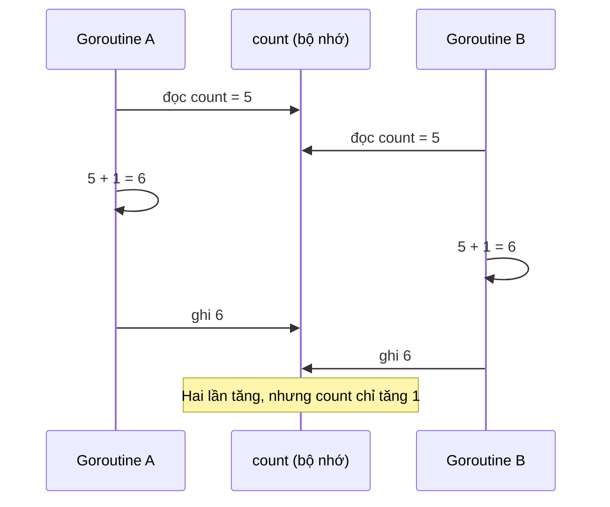

# Race condition và Race detector

Bug concurrency đáng sợ nhất là bug **không lặp lại được**: chạy 100 lần đúng 99, lần thứ 100 ra số sai, chỉ xảy ra trên production lúc cao điểm. Phần lớn chúng bắt nguồn từ **data race** — hai goroutine truy cập cùng một biến mà không đồng bộ. Go có sẵn một công cụ cực mạnh để bắt lỗi này: **race detector**, bật chỉ bằng cờ `-race`. Bài này giải thích data race là gì, cách chạy và đọc báo cáo race, các cách sửa, mô hình bộ nhớ "happens-before" ở mức đủ dùng, và cách đưa race detector vào CI.

---

:::note[Ghi nhớ nhanh]

- ⭐ **Data race** = hai goroutine truy cập cùng vùng nhớ, **ít nhất một là ghi**, và không có đồng bộ nào xếp thứ tự giữa chúng. Kết quả là hành vi không xác định.
- ⭐ **`go test -race ./...` trong CI** — race detector chỉ thấy race trên **đường code thực sự chạy**, nên cần test có tính đồng thời.
- **Sửa bằng mutex, atomic hoặc channel** — hoặc tránh chia sẻ ngay từ đầu (mỗi goroutine ghi vùng riêng).
- **Race detector không có false positive** — báo là có race thật; nhưng không báo không có nghĩa là không có race.
- **Chi phí**: chậm 2–20 lần, tốn bộ nhớ 5–10 lần → dùng khi test/staging, thường không bật trên production.
- **Map dùng đồng thời không khoá** — runtime có thể dừng chương trình với `fatal error: concurrent map writes` (không recover được).

:::

---

## Mục lục

- [Vì sao cần race detector?](#vì-sao-cần-race-detector)
- [Data race và race condition](#data-race-và-race-condition)
- [Ví dụ bộ đếm](#ví-dụ-bộ-đếm)
- [Chạy race detector](#chạy-race-detector)
- [Đọc báo cáo race](#đọc-báo-cáo-race)
- [Các cách sửa data race](#các-cách-sửa-data-race)
- [Những race khó thấy](#những-race-khó-thấy)
- [Memory model và happens-before](#memory-model-và-happens-before)
- [Race detector trong CI](#race-detector-trong-ci)
- [Câu hỏi phỏng vấn](#câu-hỏi-phỏng-vấn)

---

## Vì sao cần race detector?

**Vấn đề:** Code có race **trông hoàn toàn bình thường** và thường chạy đúng khi test thủ công:

```go
type Server struct {
	requestCount int
}

func (s *Server) handle(w http.ResponseWriter, r *http.Request) {
	s.requestCount++ // mỗi request một goroutine → nhiều goroutine cùng ghi
	fmt.Fprintln(w, "ok")
}
```

Test bằng tay gửi từng request một → đúng. Lên production với 1000 request/giây → số đếm sai, và có thể tệ hơn: race trên `map`, `slice` hay `interface` có thể làm **hỏng bộ nhớ** và crash ở chỗ chẳng liên quan. Đọc code để tìm race trong hệ thống lớn gần như bất khả thi.

**Giải pháp:** Chạy test với `-race`. Race detector **theo dõi mọi truy cập bộ nhớ** lúc chạy và báo ngay khi thấy hai truy cập xung đột không có đồng bộ:

```bash
go test -race ./...
```

```text
WARNING: DATA RACE
Write at 0x00c0000a4010 by goroutine 9:
  example.com/shop/server.(*Server).handle()
      /home/toi/shop/server/server.go:12 +0x44
...
```

Kèm chính xác dòng code của **cả hai** truy cập và nơi tạo goroutine.

:::tip[Dùng thực tế]

- **CI bắt buộc `go test -race`** cho mọi pull request.
- **Chạy integration test/load test với binary build `-race`** trên môi trường staging để bắt race ở đường code mà unit test không phủ.
- **Điều tra bug "thỉnh thoảng sai"** — build `-race`, tái hiện tải, đọc báo cáo.
- **Review code concurrency** — viết test chạy song song (`t.Parallel()`, nhiều goroutine) rồi chạy `-race -count=100`.

:::

:::tip[Ví dụ đời thường]

Data race giống **hai thu ngân cùng sửa một cuốn sổ quỹ**: chị A đọc "còn 5 triệu", anh B cũng đọc "còn 5 triệu"; A ghi "thu thêm 1 triệu → 6 triệu", B ghi "chi 2 triệu → 3 triệu". Cuối ngày sổ ghi 3 triệu, mất 1 triệu không ai hay. Race detector là **camera giám sát** quay lại mọi lần mở sổ và báo ngay: "lúc 10:15:03, hai người cùng ghi sổ mà không ai giữ chìa khoá".

:::

---

## Data race và race condition

Hai khái niệm hay bị dùng lẫn:

| | Data race | Race condition |
|---|---|---|
| Định nghĩa | Truy cập đồng thời cùng vùng nhớ, ít nhất một ghi, **không đồng bộ** | Kết quả **phụ thuộc thứ tự/thời điểm** thực thi theo cách không mong muốn |
| Phạm vi | Lỗi ở mức bộ nhớ | Lỗi ở mức logic |
| Race detector bắt được? | **Có** | Không (nếu mọi truy cập đều có khoá) |

Có race condition mà **không** có data race:

```go
// Mỗi thao tác đều an toàn (có khoá bên trong), nhưng "kiểm tra rồi hành động" thì không
if inventory.Get("iphone") > 0 { // goroutine A và B cùng thấy còn 1
	inventory.Decrease("iphone")  // cả hai cùng trừ → tồn kho -1
}
```

Sửa: gộp kiểm tra và hành động trong **cùng một vùng khoá** (`TryDecrease` trả `bool`), hoặc dùng ràng buộc ở DB (`UPDATE ... WHERE stock > 0`).

---

## Ví dụ bộ đếm

```go
package main

import (
	"fmt"
	"sync"
)

func main() {
	count := 0
	var wg sync.WaitGroup
	for range 1000 {
		wg.Add(1)
		go func() {
			defer wg.Done()
			count++ // DATA RACE
		}()
	}
	wg.Wait()
	fmt.Println(count)
}
```

```bash
$ go run main.go
978
$ go run main.go
1000
$ go run main.go
991
```

`count++` biên dịch thành ba bước: **đọc** `count` vào thanh ghi, **cộng** 1, **ghi** lại. Hai goroutine xen kẽ giữa các bước sẽ làm mất lần cập nhật:



:::warning

Đừng nghĩ "chỉ sai số đếm thì chấp nhận được". Theo memory model của Go, chương trình có data race có thể quan sát những giá trị **không bao giờ được ghi**; race trên biến nhiều word (string, slice, interface) có thể đọc được nửa cũ nửa mới → con trỏ hỏng → crash hoặc lỗ hổng bảo mật.

:::

---

## Chạy race detector

```bash
go run -race main.go
go test -race ./...
go build -race -o app-race ./cmd/api   # binary có race detector để chạy staging/load test
go install -race ./cmd/...
```

Với ví dụ bộ đếm:

```bash
$ go run -race main.go
==================
WARNING: DATA RACE
...
==================
1000
Found 1 data race(s)
exit status 66
```

Đặc điểm:

- Race detector dựa trên **ThreadSanitizer** (TSan) của LLVM, chèn mã theo dõi vào mọi lần đọc/ghi bộ nhớ.
- Chỉ phát hiện race **thực sự xảy ra** trong lần chạy đó — đường code không chạy thì không kiểm tra được. Chạy nhiều lần (`-count=N`) tăng xác suất bắt được.
- **Không có false positive**: đã báo là race thật.
- Mặc định chương trình **chạy tiếp** sau khi báo, kết thúc với exit code 66. Trong `go test`, test có race bị đánh **FAIL**.
- Hỗ trợ các nền tảng 64-bit phổ biến (linux, darwin, windows, freebsd trên amd64/arm64...). Xem danh sách đầy đủ ở [go.dev/doc/articles/race_detector](https://go.dev/doc/articles/race_detector).

Tuỳ chọn qua biến môi trường `GORACE`:

```bash
GORACE="halt_on_error=1" go test -race ./...     # dừng ngay ở race đầu tiên
GORACE="log_path=/tmp/race" ./app-race           # ghi báo cáo ra file /tmp/race.<pid>
GORACE="history_size=5" go test -race ./...      # nhớ lịch sử dài hơn (stack đầy đủ hơn), tốn RAM hơn
```

| | Chi phí điển hình khi bật `-race` |
|---|---|
| Tốc độ | Chậm hơn **2–20 lần** |
| Bộ nhớ | Tốn hơn **5–10 lần** |

Vì vậy thường **không** bật trên production đầy đủ tải; có đội chạy một phần nhỏ instance canary với binary `-race`.

---

## Đọc báo cáo race

Báo cáo đầy đủ của ví dụ bộ đếm (đã rút gọn đường dẫn):

```text
==================
WARNING: DATA RACE
Read at 0x00c000012138 by goroutine 7:
  main.main.func1()
      /home/toi/counter/main.go:15 +0x68

Previous write at 0x00c000012138 by goroutine 8:
  main.main.func1()
      /home/toi/counter/main.go:15 +0x78

Goroutine 7 (running) created at:
  main.main()
      /home/toi/counter/main.go:13 +0x6c

Goroutine 8 (finished) created at:
  main.main()
      /home/toi/counter/main.go:13 +0x6c
==================
```

Đọc theo bốn khối:

| Khối | Ý nghĩa |
|---|---|
| `Read at 0x... by goroutine 7` | Truy cập **hiện tại** (đọc hay ghi), địa chỉ bộ nhớ, goroutine nào, kèm stack trace tới dòng code |
| `Previous write at 0x... by goroutine 8` | Truy cập **trước đó** xung đột với nó — cùng địa chỉ |
| `Goroutine 7 (running) created at` | Goroutine thứ nhất được **tạo ở đâu** (dòng có lệnh `go`) |
| `Goroutine 8 (finished) created at` | Goroutine thứ hai được tạo ở đâu; `finished` = đã kết thúc |

Cách xử lý: nhìn **hai dòng code xung đột** (ở đây cùng là dòng 15, `count++`), xác định **biến** bị chia sẻ, rồi tìm xem vì sao hai goroutine cùng chạm vào nó mà không có khoá. Nếu stack trace dừng ở hàm thư viện, kéo xuống các frame bên dưới để thấy code của bạn gọi vào đâu.

---

## Các cách sửa data race

### 1. Mutex

```go
var (
	mu    sync.Mutex
	count int
)
for range 1000 {
	wg.Go(func() {
		mu.Lock()
		count++
		mu.Unlock()
	})
}
```

Dùng khi bảo vệ **cấu trúc phức tạp** hoặc nhiều biến cần cập nhật cùng nhau.

### 2. Atomic

```go
var count atomic.Int64
for range 1000 {
	wg.Go(func() {
		count.Add(1)
	})
}
fmt.Println(count.Load()) // 1000
```

Dùng cho **một biến đơn** (bộ đếm, cờ). Nhanh nhất.

### 3. Channel — một chủ sở hữu duy nhất

```go
increments := make(chan int)
done := make(chan int)

go func() { // goroutine duy nhất chạm vào count
	count := 0
	for n := range increments {
		count += n
	}
	done <- count
}()

for range 1000 {
	wg.Go(func() { increments <- 1 })
}
wg.Wait()
close(increments)
fmt.Println(<-done) // 1000
```

Dùng khi trạng thái gắn với **luồng xử lý** (event loop, actor).

### 4. Không chia sẻ — mỗi goroutine một vùng riêng

```go
results := make([]int, len(inputs))
for i, in := range inputs {
	wg.Go(func() {
		results[i] = compute(in) // mỗi goroutine ghi phần tử riêng → không race
	})
}
wg.Wait()
total := 0
for _, r := range results { // đọc sau Wait → an toàn
	total += r
}
```

Thường là cách **tốt nhất**: không khoá, không tranh chấp. Lưu ý: các phần tử **khác nhau** của slice/array là các vùng nhớ khác nhau — an toàn; nhưng `append` vào **cùng một slice** từ nhiều goroutine thì **không** an toàn.

| Cách | Hợp với | Chi phí |
|---|---|---|
| Không chia sẻ | Chia việc độc lập, gộp sau | Thấp nhất |
| Atomic | Một biến số/cờ/con trỏ | Rất thấp |
| Mutex | Struct, map, nhiều biến liên quan | Thấp, tăng khi tranh chấp cao |
| Channel | Chuyển quyền sở hữu, event loop | Cao hơn mutex một chút |

---

## Những race khó thấy

### Map dùng đồng thời

```go
m := map[string]int{}
for i := range 100 {
	go func() {
		m[strconv.Itoa(i)] = i // nhiều goroutine ghi map
	}()
}
// fatal error: concurrent map writes
```

Runtime có cơ chế phát hiện **best-effort** và dừng hẳn chương trình — đây là `fatal error`, **không** `recover` được. Bảo vệ bằng `Mutex` hoặc dùng `sync.Map`.

### Biến được closure bắt

```go
var err error
for _, f := range files {
	wg.Go(func() {
		if e := process(f); e != nil {
			err = e // nhiều goroutine cùng ghi err → race
		}
	})
}
```

Sửa: dùng `errgroup`, hoặc mỗi goroutine ghi vào `errs[i]` rồi `errors.Join(errs...)` sau `Wait`.

### Đọc mà không khoá

```go
func (c *Cache) Set(k, v string) {
	c.mu.Lock()
	defer c.mu.Unlock()
	c.data[k] = v
}

func (c *Cache) Get(k string) string {
	return c.data[k] // QUÊN khoá khi đọc → vẫn là race với Set
}
```

### Struct được copy kèm field dùng chung

```go
type Config struct {
	Tags []string // slice header được copy, nhưng mảng bên dưới dùng chung
}
c2 := c1         // copy nông
go func() { c2.Tags[0] = "x" }()
fmt.Println(c1.Tags[0]) // race: cùng mảng nền
```

### Race trong test

Biến cấp package bị nhiều test `t.Parallel()` cùng sửa, hoặc `httptest` handler ghi vào biến của test mà test đọc trước khi request kết thúc. `go test -race` bắt được — thêm `-count=1` để tránh dùng kết quả cache.

---

## Memory model và happens-before

[Go Memory Model](https://go.dev/ref/mem) trả lời câu hỏi: *khi goroutine A ghi một biến, lúc nào goroutine B chắc chắn đọc được giá trị đó?*

Câu trả lời ngắn: chỉ khi có quan hệ **happens-before** (xảy ra trước) giữa lần ghi và lần đọc, được tạo bởi các thao tác đồng bộ. Không có đồng bộ thì **không có gì đảm bảo** — compiler và CPU được phép sắp xếp lại lệnh, cache CPU có thể chưa đẩy giá trị ra.

```go
var data string
var ready bool

go func() {
	data = "xin chào"
	ready = true // không đồng bộ
}()

for !ready { } // có thể lặp mãi (compiler đưa đọc ready ra ngoài vòng lặp)
fmt.Println(data) // có thể in "" dù ready == true (CPU/compiler đổi thứ tự ghi)
```

Các cạnh happens-before chính:

| Thao tác đồng bộ | Đảm bảo |
|---|---|
| Lệnh `go f()` | Mọi thứ **trước** `go` xảy ra trước khi `f` bắt đầu |
| Gửi vào channel | Xảy ra trước khi lần **nhận tương ứng** hoàn tất |
| `close(ch)` | Xảy ra trước lần nhận trả zero value do channel đóng |
| Nhận từ channel **unbuffered** | Xảy ra trước khi lần **gửi** tương ứng hoàn tất |
| `mu.Unlock()` lần thứ n | Xảy ra trước `mu.Lock()` lần thứ n+1 trả về |
| `once.Do(f)`: `f` trả về | Xảy ra trước mọi lời gọi `once.Do` trả về |
| `wg.Done()` | Xảy ra trước `wg.Wait()` mà nó giải phóng trả về |
| Thao tác `sync/atomic` | Nhất quán tuần tự (sequentially consistent) — từ Go 1.19 được ghi rõ trong memory model |

Sửa ví dụ trên bằng channel:

```go
var data string
done := make(chan struct{})

go func() {
	data = "xin chào"
	close(done) // ghi data xảy ra trước close
}()

<-done            // close xảy ra trước lần nhận này
fmt.Println(data) // chắc chắn in "xin chào"
```

Go cam kết **DRF-SC**: chương trình **không có data race** sẽ chạy như thể mọi goroutine được xen kẽ tuần tự trên một CPU. Nói cách khác: loại bỏ hết data race thì bạn có thể suy luận về code theo kiểu "từng bước một" quen thuộc.

:::tip

Lời khuyên từ chính tài liệu memory model: *"If you must read the rest of this document to understand the behavior of your program, you are being too clever. Don't be clever."* — Hãy dùng channel, mutex, atomic đúng cách thay vì dựa vào thứ tự thực thi tinh vi.

:::

---

## Race detector trong CI

### GitHub Actions

```yaml
name: test
on: [push, pull_request]

jobs:
  test:
    runs-on: ubuntu-latest
    steps:
      - uses: actions/checkout@v4
      - uses: actions/setup-go@v5
        with:
          go-version-file: go.mod
      - name: Vet
        run: go vet ./...
      - name: Test với race detector
        run: go test -race -count=1 -timeout 10m ./...
```

### GitLab CI

```yaml
test:
  image: golang:1.25
  script:
    - go vet ./...
    - go test -race -count=1 ./...
```

Lưu ý khi đưa vào CI:

- Trên Linux, `-race` cần **cgo** (`CGO_ENABLED=1`) và trình biên dịch C (`gcc`) — image `golang:<version>` (bản Debian) có sẵn; image `alpine` phải cài thêm `gcc musl-dev`.
- Test chậm hơn đáng kể → tăng `-timeout`, cân nhắc tách job race riêng chạy song song với job test thường.
- Race detector chỉ hiệu quả khi test **thực sự chạy đồng thời**: viết test bắn nhiều goroutine vào cùng API, dùng `t.Parallel()`, chạy với `-count` lớn ở job nightly.
- Kết hợp `go vet` (bắt copy mutex, quên `cancel`) và `goleak` (bắt goroutine leak) để phủ các lỗi concurrency mà race detector không thấy.

```go
// Test có chủ đích tạo tải đồng thời để race detector có cơ hội bắt lỗi
func TestCounterConcurrent(t *testing.T) {
	c := NewCounter()
	var wg sync.WaitGroup
	for range 100 {
		wg.Go(func() {
			c.Inc("k")
			_ = c.Get("k")
		})
	}
	wg.Wait()
	if got := c.Get("k"); got != 100 {
		t.Fatalf("got %d, want 100", got)
	}
}
```

---

## Câu hỏi phỏng vấn

**1. Data race là gì? Khác race condition thế nào?**

<details className="qa">
<summary>Xem đáp án</summary>

Data race: hai goroutine truy cập cùng vùng nhớ đồng thời, ít nhất một truy cập là ghi, và không có thao tác đồng bộ nào tạo quan hệ happens-before giữa chúng. Race condition: tính đúng đắn phụ thuộc vào thứ tự/thời điểm thực thi — có thể xảy ra ngay cả khi mọi truy cập đều có khoá (ví dụ check-then-act: kiểm tra tồn kho rồi trừ ở hai lần khoá riêng). Race detector chỉ bắt data race; race condition logic phải thiết kế đúng (gộp thao tác trong một vùng khoá, dùng transaction/ràng buộc DB).

</details>

**2. Race detector hoạt động thế nào? Có hạn chế gì?**

<details className="qa">
<summary>Xem đáp án</summary>

Dựa trên ThreadSanitizer: compiler chèn mã theo dõi vào mọi lần truy cập bộ nhớ và các thao tác đồng bộ, runtime dùng vector clock để phát hiện hai truy cập xung đột không có happens-before. Không có false positive. Hạn chế: chỉ bắt race trên đường code thực sự chạy trong lần đó (không chứng minh được "không có race"), chậm 2–20 lần, tốn 5–10 lần bộ nhớ, cần cgo trên Linux — nên thường dùng trong test/CI/staging.

</details>

**3. Vì sao `count++` từ nhiều goroutine cho kết quả sai? Có những cách sửa nào?**

<details className="qa">
<summary>Xem đáp án</summary>

`count++` gồm đọc - cộng - ghi, không nguyên tử; hai goroutine đọc cùng giá trị cũ rồi cùng ghi giá trị mới nên mất một lần tăng. Sửa bằng: `sync.Mutex` bao quanh; `atomic.Int64.Add(1)`; một goroutine sở hữu biến, các goroutine khác gửi yêu cầu qua channel; hoặc mỗi goroutine đếm cục bộ rồi cộng tổng sau `Wait`.

</details>

**4. Happens-before là gì? Kể vài thao tác tạo quan hệ này trong Go.**

<details className="qa">
<summary>Xem đáp án</summary>

Là quan hệ thứ tự đảm bảo hiệu ứng của thao tác A nhìn thấy được bởi thao tác B. Không có happens-before thì compiler/CPU có thể sắp xếp lại và goroutine khác có thể thấy giá trị cũ hoặc thứ tự khác. Các thao tác tạo quan hệ: lệnh `go` (trước khi goroutine bắt đầu), gửi channel trước khi nhận tương ứng hoàn tất, `close` trước lần nhận do đóng, `Unlock` trước `Lock` kế tiếp, `once.Do` hoàn tất trước các `Do` khác trả về, `wg.Done` trước `Wait` trả về, và các thao tác atomic (nhất quán tuần tự).

</details>

**5. Ghi vào các phần tử khác nhau của cùng một slice từ nhiều goroutine có race không?**

<details className="qa">
<summary>Xem đáp án</summary>

Không, nếu mỗi goroutine ghi vào chỉ số riêng và slice không bị `append`/gán lại trong lúc đó — mỗi phần tử là vùng nhớ riêng. Đọc kết quả sau `wg.Wait()` là an toàn nhờ happens-before của WaitGroup. Ngược lại, `append` vào cùng một slice từ nhiều goroutine là race (cùng đọc/ghi header slice và có thể cấp phát lại mảng). Ghi vào các field khác nhau của cùng struct cũng không race; nhưng ghi vào cùng một map (kể cả key khác nhau) là race.

</details>

**6. Đưa race detector vào CI thế nào cho hiệu quả?**

<details className="qa">
<summary>Xem đáp án</summary>

Chạy `go test -race -count=1 ./...` trên mọi PR (bật cgo, image có gcc), tăng timeout. Viết test có tính đồng thời thật (nhiều goroutine gọi cùng API, `t.Parallel()`), vì race detector chỉ thấy race trên đường code chạy. Thêm job nightly với `-count` lớn để bắt race hiếm. Bổ sung `go vet` (copylocks, lostcancel) và `goleak`. Với integration/load test, build binary `-race` chạy trên staging.

</details>
