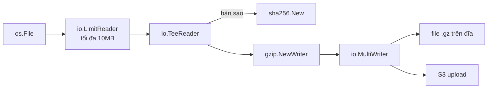

# I/O và xử lý file

Gần như mọi chương trình đều đọc và ghi dữ liệu: file cấu hình, log, body HTTP, kết quả nén, dữ liệu gửi qua socket. Go gom tất cả về hai interface cực nhỏ là `io.Reader` và `io.Writer`, nhờ đó các mảnh ghép (file, buffer, gzip, hash, network) lắp vào nhau như Lego. Bài này đi qua hai interface đó, các hàm kết hợp trong `io`, package `os` để thao tác file/thư mục/biến môi trường, `bufio` để đọc ghi có bộ đệm, `path/filepath` và `io/fs` để duyệt cây thư mục, cùng cách đóng file đúng (kể cả kiểm tra lỗi `Close` khi ghi).

---

:::note[Ghi nhớ nhanh]

- ⭐ **`io.Reader`/`io.Writer` là trung tâm** — viết hàm nhận `io.Reader` thay vì `*os.File` thì dùng được cho file, HTTP body, chuỗi, buffer, gzip... và dễ test.
- ⭐ **Ghi file thì phải kiểm tra lỗi của `Close` (và `Flush`)** — `defer f.Close()` trần sẽ nuốt lỗi ghi đĩa; dùng named return để gộp lỗi.
- **File nhỏ dùng `os.ReadFile`/`os.WriteFile`**, file lớn hoặc stream dùng `os.Open` + `bufio.Scanner`/`io.Copy` để không nạp hết vào RAM.
- **`bufio.Writer` phải `Flush()`** — quên là mất dữ liệu cuối file.
- **Dùng `filepath.Join`, không cộng chuỗi bằng `"/"`** — chạy đúng cả Windows lẫn Linux; duyệt cây thư mục bằng `filepath.WalkDir`/`fs.WalkDir`.

:::

---

## Mục lục

- [Vì sao cần io.Reader và io.Writer?](#vì-sao-cần-ioreader-và-iowriter)
- [Hai interface nền tảng](#hai-interface-nền-tảng)
- [Kết hợp Reader và Writer](#kết-hợp-reader-và-writer)
- [Package os: file, thư mục, môi trường](#package-os-file-thư-mục-môi-trường)
- [bufio: đọc ghi có bộ đệm](#bufio-đọc-ghi-có-bộ-đệm)
- [Đóng file đúng cách](#đóng-file-đúng-cách)
- [path/filepath và io/fs](#pathfilepath-và-iofs)
- [Câu hỏi phỏng vấn](#câu-hỏi-phỏng-vấn)

---

## Vì sao cần io.Reader và io.Writer?

**Vấn đề:** Nếu mỗi nguồn dữ liệu có một API riêng, ta phải viết lại cùng một logic cho từng nguồn:

```go
// Đếm dòng trong file
func countLinesInFile(f *os.File) int { /* ... */ }

// Lại viết lại để đếm dòng trong body HTTP
func countLinesInBody(resp *http.Response) int { /* ... */ }

// Lại viết lại để đếm dòng trong chuỗi (khi viết test)
func countLinesInString(s string) int { /* ... */ }
```

Ba hàm làm cùng một việc, test riêng ba lần, và muốn đọc từ file `.gz` lại phải thêm hàm thứ tư.

**Giải pháp:** Viết **một** hàm nhận `io.Reader` — bất kỳ thứ gì "đọc được byte":

```go
func countLines(r io.Reader) (int, error) {
	sc := bufio.NewScanner(r)
	n := 0
	for sc.Scan() {
		n++
	}
	return n, sc.Err()
}

// Dùng được cho mọi nguồn:
// countLines(file)                     // *os.File
// countLines(resp.Body)                // HTTP body
// countLines(strings.NewReader("a\nb")) // chuỗi — tiện cho unit test
// countLines(gzipReader)               // file nén
```

:::tip[Dùng thực tế]

- **Upload file**: stream thẳng từ `r.Body` sang S3/đĩa bằng `io.Copy`, không nạp cả file vào RAM.
- **Tính checksum khi tải**: `io.TeeReader` vừa ghi ra đĩa vừa đưa qua `sha256` trong một lượt đọc.
- **Ghi log ra nhiều nơi**: `io.MultiWriter(os.Stdout, logFile)`.
- **Chặn request quá lớn**: `io.LimitReader` (hoặc `http.MaxBytesReader`) để không bị tấn công bằng body vài GB.

:::

:::tip[Ví dụ đời thường]

`io.Reader` giống **ổ cắm điện chuẩn**: nồi cơm, quạt, sạc điện thoại đều cắm vào được vì cùng chuẩn chân cắm. Nhà cung cấp điện (file, mạng, chuỗi) và thiết bị dùng điện (hàm xử lý) không cần biết nhau — chỉ cần cùng chuẩn. Ổ chia nhiều lỗ chính là `io.MultiWriter`, còn công tơ điện đo lượng điện chạy qua là `io.TeeReader`.

:::

---

## Hai interface nền tảng

```go
type Reader interface {
	Read(p []byte) (n int, err error)
}

type Writer interface {
	Write(p []byte) (n int, err error)
}
```

**Hợp đồng của `Read`** (quan trọng, hay bị hiểu sai):

- `Read` đổ **tối đa** `len(p)` byte vào `p`, trả về số byte thật sự đọc được `n` — có thể nhỏ hơn `len(p)` dù chưa hết dữ liệu.
- Hết dữ liệu thì trả `io.EOF`. `io.EOF` **không phải lỗi thật**, chỉ là tín hiệu kết thúc.
- Có thể trả **cả `n > 0` lẫn `err != nil`** trong cùng một lần gọi → luôn xử lý `p[:n]` **trước** khi xét `err`.

```go
buf := make([]byte, 4096)
for {
	n, err := r.Read(buf)
	if n > 0 {
		process(buf[:n]) // xử lý dữ liệu trước
	}
	if err == io.EOF {
		break // đọc xong
	}
	if err != nil {
		return err // lỗi thật
	}
}
```

Thực tế hiếm khi phải tự viết vòng `Read` như trên — dùng `io.ReadAll`, `io.Copy`, `bufio.Scanner` sẽ an toàn hơn.

**Hợp đồng của `Write`:** nếu `n < len(p)` thì **bắt buộc** trả về `err != nil`. Vì vậy với `Writer` chỉ cần kiểm tra `err`.

### Tự viết một Writer

Vì interface chỉ có một method, tự viết rất dễ. Ví dụ writer chuyển mọi chữ thành chữ hoa rồi chuyển tiếp:

```go
type upperWriter struct{ w io.Writer }

func (u upperWriter) Write(p []byte) (int, error) {
	return u.w.Write(bytes.ToUpper(p))
}

func main() {
	var buf bytes.Buffer
	io.Copy(upperWriter{&buf}, strings.NewReader("xin chao"))
	fmt.Println(buf.String()) // XIN CHAO
}
```

### Các interface "họ hàng"

| Interface | Method | Ai hiện thực |
|-----------|--------|--------------|
| `io.Closer` | `Close() error` | file, connection, HTTP body |
| `io.ReadCloser` | `Read` + `Close` | `resp.Body`, `*os.File` |
| `io.ReadWriter` | `Read` + `Write` | `*bytes.Buffer`, `net.Conn` |
| `io.Seeker` | `Seek(offset, whence)` | `*os.File`, `*bytes.Reader` |
| `io.ReaderAt` | `ReadAt(p, off)` | `*os.File` (đọc song song ở nhiều vị trí) |
| `io.StringWriter` | `WriteString(s)` | `*bytes.Buffer`, `*bufio.Writer`, `*os.File` |

Các kiểu dựng sẵn hay dùng: `strings.NewReader(s)`, `bytes.NewReader(b)`, `bytes.Buffer` (vừa đọc vừa ghi), `io.Discard` (writer bỏ mọi thứ — giống `/dev/null`).

---

## Kết hợp Reader và Writer

Sức mạnh thật sự nằm ở chỗ ghép các mảnh nhỏ:



### io.Copy — chép từ Reader sang Writer

```go
// Tải file về đĩa mà không nạp hết vào RAM
resp, err := http.Get(url)
if err != nil {
	return err
}
defer resp.Body.Close()

out, err := os.Create("video.mp4")
if err != nil {
	return err
}
defer out.Close() // xem phần "Đóng file đúng cách" để xử lý lỗi Close

written, err := io.Copy(out, resp.Body) // chép theo từng khối 32KB
```

`io.Copy` dùng buffer nội bộ 32KB; nếu nguồn/đích hỗ trợ `WriterTo`/`ReaderFrom` (ví dụ file → socket trên Linux) nó còn dùng đường tắt của hệ điều hành như `sendfile`.

### io.MultiWriter — ghi một lần ra nhiều nơi

```go
logFile, _ := os.OpenFile("app.log", os.O_APPEND|os.O_CREATE|os.O_WRONLY, 0o644)
w := io.MultiWriter(os.Stdout, logFile)
fmt.Fprintln(w, "server started") // xuất hiện ở cả terminal và file
```

### io.TeeReader — đọc và "nghe lén" cùng lúc

```go
h := sha256.New()
tee := io.TeeReader(resp.Body, h) // mọi byte đọc qua tee đều được ghi vào h

if _, err := io.Copy(out, tee); err != nil {
	return err
}
fmt.Printf("sha256 = %x\n", h.Sum(nil)) // checksum có sẵn, không cần đọc file lần hai
```

### io.LimitReader — giới hạn số byte

```go
lr := io.LimitReader(strings.NewReader("0123456789"), 4)
data, _ := io.ReadAll(lr)
fmt.Println(string(data)) // 0123
```

Với HTTP server, nên dùng `http.MaxBytesReader(w, r.Body, n)` — nó trả **lỗi** khi vượt giới hạn, còn `LimitReader` chỉ âm thầm cắt bớt (dễ khiến JSON bị cụt mà không biết vì sao).

### Các hàm tiện ích khác

| Hàm | Công dụng |
|-----|-----------|
| `io.ReadAll(r)` | Đọc hết vào `[]byte` — chỉ dùng khi biết dữ liệu nhỏ |
| `io.ReadFull(r, buf)` | Đọc đủ `len(buf)` byte, thiếu thì `io.ErrUnexpectedEOF` (đọc header nhị phân) |
| `io.CopyN(w, r, n)` | Chép đúng `n` byte |
| `io.MultiReader(r1, r2)` | Nối nhiều reader thành một, đọc lần lượt |
| `io.Pipe()` | Nối một writer với một reader đồng bộ — producer ở goroutine này, consumer ở goroutine khác |
| `io.NopCloser(r)` | Bọc reader thành `ReadCloser` với `Close` không làm gì (hay dùng khi giả lập `resp.Body` trong test) |

---

## Package os: file, thư mục, môi trường

### Đọc và ghi nhanh cả file

```go
data, err := os.ReadFile("config.yaml") // đọc hết, tự đóng file
if err != nil {
	return fmt.Errorf("đọc config: %w", err)
}

err = os.WriteFile("out.txt", []byte("xin chào\n"), 0o644) // tạo mới hoặc ghi đè
```

### Mở file chi tiết

```go
in, err := os.Open("data.csv")   // chỉ đọc (O_RDONLY)
out, err := os.Create("out.csv") // tạo mới hoặc truncate về 0, quyền 0666 (trước umask)

// Tuỳ biến hoàn toàn: ghi nối đuôi, tạo nếu chưa có
logf, err := os.OpenFile("app.log", os.O_APPEND|os.O_CREATE|os.O_WRONLY, 0o644)
```

| Cờ | Ý nghĩa |
|----|---------|
| `os.O_RDONLY` / `O_WRONLY` / `O_RDWR` | Chỉ đọc / chỉ ghi / đọc-ghi (chọn một) |
| `os.O_CREATE` | Tạo nếu chưa có |
| `os.O_EXCL` | Đi cùng `O_CREATE`: lỗi nếu file đã tồn tại (tạo lock file) |
| `os.O_APPEND` | Ghi vào cuối file |
| `os.O_TRUNC` | Xoá nội dung cũ khi mở |

### Quyền file (permission)

Quyền viết theo hệ bát phân kiểu Unix, Go 1.13+ cho phép tiền tố `0o`:

| Giá trị | Ý nghĩa | Dùng cho |
|---------|---------|----------|
| `0o644` | chủ: đọc-ghi; nhóm và người khác: chỉ đọc | file thường |
| `0o600` | chỉ chủ đọc-ghi | file chứa secret, private key |
| `0o755` | chủ: đầy đủ; người khác: đọc + vào thư mục | thư mục, file thực thi |

Quyền thực tế còn bị `umask` của tiến trình trừ bớt. Trên Windows, phần lớn bit quyền bị bỏ qua.

### Kiểm tra lỗi file

```go
_, err := os.Open("khong-co.txt")
if errors.Is(err, fs.ErrNotExist) { // hoặc os.ErrNotExist (cùng giá trị)
	fmt.Println("file không tồn tại")
}

// Kiểm tra tồn tại
if _, err := os.Stat(path); errors.Is(err, fs.ErrNotExist) {
	// chưa có
}
```

:::warning[Lỗi hay gặp]

- **Kiểm tra tồn tại rồi mới mở** (`Stat` → `Open`) tạo ra race condition (TOCTOU): giữa hai lệnh file có thể bị xoá. Cứ mở thẳng và xử lý lỗi `fs.ErrNotExist`.
- **So sánh `err == os.ErrNotExist`** sẽ sai vì lỗi thật là `*fs.PathError` bọc bên trong — luôn dùng `errors.Is`.

:::

### Thư mục

```go
os.Mkdir("logs", 0o755)                      // tạo một cấp, lỗi nếu cha chưa có
os.MkdirAll("data/2026/10/15", 0o755)        // tạo cả cây, đã có thì không lỗi
os.Remove("tmp.txt")                         // xoá file hoặc thư mục rỗng
os.RemoveAll("build")                        // xoá đệ quy — cẩn thận!
os.Rename("old.txt", "new.txt")              // đổi tên/di chuyển (cùng ổ đĩa)
entries, err := os.ReadDir(".")              // liệt kê, đã sắp theo tên
dir, err := os.MkdirTemp("", "upload-*")     // thư mục tạm, nhớ RemoveAll
f, err := os.CreateTemp("", "report-*.csv")  // file tạm
```

Go 1.24 thêm `os.Root` (`os.OpenRoot(dir)`): mọi thao tác qua root bị giới hạn bên trong thư mục đó — chặn tấn công path traversal kiểu `../../etc/passwd` khi tên file đến từ người dùng.

### Biến môi trường và tham số dòng lệnh

```go
port := os.Getenv("PORT") // không có thì trả "" — không phân biệt "chưa đặt" với "đặt rỗng"

dsn, ok := os.LookupEnv("DATABASE_URL") // phân biệt được
if !ok {
	log.Fatal("thiếu DATABASE_URL")
}

os.Setenv("TZ", "Asia/Ho_Chi_Minh")
os.Environ() // []string dạng "KEY=value"

// os.Args[0] là tên chương trình, tham số bắt đầu từ os.Args[1]
// go run . upload a.txt → os.Args = [/tmp/.../exe/main upload a.txt]
if len(os.Args) < 2 {
	fmt.Fprintln(os.Stderr, "cách dùng: tool <lệnh>")
	os.Exit(2)
}
```

`os.Exit` thoát ngay, **không chạy `defer`** — chỉ gọi ở `main` sau khi đã dọn dẹp xong. Xử lý cờ dòng lệnh bài bản hơn có package `flag` (bài sau).

---

## bufio: đọc ghi có bộ đệm

Mỗi lần gọi `Read`/`Write` trên file là một system call — tốn kém nếu gọi hàng triệu lần với vài byte. `bufio` đặt một bộ đệm (mặc định 4KB) ở giữa để gom lại.

### Đọc từng dòng với bufio.Scanner

```go
f, err := os.Open("access.log")
if err != nil {
	return err
}
defer f.Close()

sc := bufio.NewScanner(f)
for sc.Scan() {
	line := sc.Text() // đã bỏ ký tự xuống dòng (\n và \r\n)
	if strings.Contains(line, " 500 ") {
		fmt.Println(line)
	}
}
if err := sc.Err(); err != nil { // vòng lặp dừng vì lỗi hay vì hết file?
	return err
}
```

Đổi cách tách bằng `sc.Split(bufio.ScanWords)` (từng từ), `bufio.ScanRunes` (từng ký tự Unicode).

:::warning[Dòng dài hơn 64KB]

`Scanner` mặc định giới hạn mỗi token 64KB. Gặp dòng dài hơn (JSON minified, log stack trace), `Scan()` trả `false` và `sc.Err()` là `bufio.ErrTooLong` — nếu quên kiểm tra `Err()` thì chương trình **âm thầm dừng giữa chừng**. Tăng giới hạn:

```go
sc.Buffer(make([]byte, 0, 64*1024), 10*1024*1024) // tối đa 10MB mỗi dòng
```

Hoặc dùng `bufio.Reader.ReadString('\n')` / `ReadLine` khi không biết trước độ dài.

:::

### Ghi với bufio.Writer

```go
w := bufio.NewWriter(f)
for _, row := range rows {
	fmt.Fprintf(w, "%s,%d\n", row.Name, row.Qty) // ghi vào bộ đệm, chưa xuống đĩa
}
if err := w.Flush(); err != nil { // đẩy phần còn lại xuống — BẮT BUỘC
	return err
}
```

Quên `Flush()` là mất tối đa 4KB dữ liệu cuối — lỗi rất khó phát hiện vì file "trông như" có dữ liệu.

`bufio.Reader` còn cho `Peek(n)` (xem trước không tiêu thụ), `ReadByte`, `ReadRune` — hữu ích khi viết parser.

---

## Đóng file đúng cách

Mọi file đã mở phải được đóng, nếu không sẽ rò rỉ file descriptor (hệ điều hành giới hạn số lượng, thường 1024 — hết thì `too many open files`). Cách chuẩn là `defer` **ngay sau khi kiểm tra lỗi mở**:

```go
f, err := os.Open(path)
if err != nil {
	return err
}
defer f.Close() // đọc: lỗi Close hầu như vô hại, bỏ qua được
```

### Khi ghi: lỗi của Close là lỗi thật

Hệ điều hành có thể giữ dữ liệu trong cache và chỉ báo lỗi (đĩa đầy, NFS mất kết nối) khi `Close`. `defer f.Close()` trần sẽ **nuốt** lỗi đó → hàm báo thành công trong khi file bị hỏng. Dùng named return để gộp lỗi:

```go
func writeReport(path string, lines []string) (err error) {
	f, err := os.Create(path)
	if err != nil {
		return err
	}
	defer func() {
		// Chỉ ghi đè err khi chưa có lỗi nào trước đó
		if cerr := f.Close(); cerr != nil && err == nil {
			err = cerr
		}
	}()

	w := bufio.NewWriter(f)
	for _, l := range lines {
		if _, err := fmt.Fprintln(w, l); err != nil {
			return err
		}
	}
	return w.Flush()
}
```

Với dữ liệu quan trọng (file cấu hình, checkpoint), gọi thêm `f.Sync()` trước `Close` để chắc dữ liệu đã xuống đĩa, và ghi vào file tạm rồi `os.Rename` sang tên thật — rename trên cùng filesystem là thao tác nguyên tử, người đọc không bao giờ thấy file ghi dở.

:::warning[defer trong vòng lặp]

```go
for _, p := range paths {
	f, _ := os.Open(p)
	defer f.Close() // SAI: chỉ đóng khi HÀM kết thúc → 10.000 file mở cùng lúc
}
```

Tách thân vòng lặp ra một hàm riêng để `defer` chạy sau mỗi lần lặp.

:::

---

## path/filepath và io/fs

### Ghép và tách đường dẫn

```go
p := filepath.Join("data", "2026", "report.csv") // data/2026/report.csv (Windows: data\2026\report.csv)
filepath.Base(p)   // report.csv
filepath.Dir(p)    // data/2026
filepath.Ext(p)    // .csv
filepath.Abs("x")  // đường dẫn tuyệt đối
filepath.Rel("/a", "/a/b/c") // b/c
filepath.Glob("logs/*.log")  // khớp mẫu
```

Package `path` (không có `file`) luôn dùng `/` — dành cho URL và đường dẫn trong `io/fs`/`embed`, **không** dùng cho file trên đĩa.

### Duyệt cây thư mục với WalkDir

```go
err := filepath.WalkDir("project", func(path string, d fs.DirEntry, err error) error {
	if err != nil {
		return err // không đọc được thư mục: dừng (hoặc return nil để bỏ qua)
	}
	if d.IsDir() && d.Name() == "node_modules" {
		return filepath.SkipDir // bỏ qua cả nhánh này
	}
	if !d.IsDir() && filepath.Ext(path) == ".go" {
		fmt.Println(path)
	}
	return nil
})
```

`WalkDir` (Go 1.16) nhanh hơn `filepath.Walk` cũ vì không gọi `Stat` cho mọi file — `fs.DirEntry` đã có tên và kiểu sẵn; cần kích thước thì gọi `d.Info()`.

### io/fs — filesystem trừu tượng

Go 1.16 thêm interface `fs.FS` đại diện cho "một cây file chỉ đọc" bất kỳ: thư mục thật (`os.DirFS`), file nhúng trong binary (`embed.FS`), file zip (`zip.Reader`), hay map trong bộ nhớ (`fstest.MapFS`). Viết hàm nhận `fs.FS` thì test cực dễ:

```go
func countGoFiles(fsys fs.FS) (int, error) {
	n := 0
	err := fs.WalkDir(fsys, ".", func(path string, d fs.DirEntry, err error) error {
		if err != nil {
			return err
		}
		if !d.IsDir() && filepath.Ext(path) == ".go" {
			n++
		}
		return nil
	})
	return n, err
}

// Production: đọc thư mục thật
countGoFiles(os.DirFS("/src/project"))

// Test: filesystem giả trong bộ nhớ, không chạm đĩa
countGoFiles(fstest.MapFS{
	"main.go":      {Data: []byte("package main")},
	"pkg/util.go":  {},
	"README.md":    {},
}) // 2, nil
```

Đường dẫn trong `fs.FS` luôn dùng `/`, không bắt đầu bằng `/`, không có `..` — giúp code không phụ thuộc hệ điều hành.

| Hàm | Công dụng |
|-----|-----------|
| `fs.ReadFile(fsys, name)` | Đọc cả file |
| `fs.ReadDir(fsys, dir)` | Liệt kê thư mục |
| `fs.Glob(fsys, pattern)` | Khớp mẫu |
| `fs.Sub(fsys, dir)` | Lấy cây con (hay dùng với `embed` để bỏ tiền tố thư mục) |
| `fs.Stat(fsys, name)` | Thông tin file |

---

## Câu hỏi phỏng vấn

**1. `io.Reader` và `io.Writer` là gì? Vì sao chúng quan trọng trong Go?**

<details className="qa">
<summary>Xem đáp án</summary>

Là hai interface một method: `Read(p []byte) (n int, err error)` và `Write(p []byte) (n int, err error)`. Vì interface trong Go là ngầm định và rất nhỏ, hàng trăm kiểu trong thư viện chuẩn hiện thực chúng (file, socket, HTTP body, buffer, gzip, hash, cipher...). Hàm viết theo `io.Reader`/`io.Writer` dùng lại được cho mọi nguồn/đích, ghép nối được (`io.Copy`, `TeeReader`, `MultiWriter`) và dễ test bằng `strings.NewReader`/`bytes.Buffer`. Đây là ví dụ kinh điển cho triết lý "interface nhỏ, kết hợp mạnh".

</details>

**2. Khi đọc bằng `Read`, xử lý `n` và `err` theo thứ tự nào? `io.EOF` có phải lỗi không?**

<details className="qa">
<summary>Xem đáp án</summary>

`Read` có thể trả về đồng thời `n > 0` và `err != nil` (kể cả `io.EOF`), nên phải xử lý `p[:n]` **trước**, rồi mới xét `err`. `io.EOF` là tín hiệu "hết dữ liệu", không phải lỗi thật — các hàm như `io.ReadAll`, `io.Copy` coi nó là kết thúc bình thường và trả `nil`. `Read` cũng có thể trả `n < len(p)` mà chưa hết dữ liệu, nên muốn đọc đủ số byte thì dùng `io.ReadFull`.

</details>

**3. Vì sao `defer f.Close()` có thể gây mất lỗi khi ghi file? Sửa thế nào?**

<details className="qa">
<summary>Xem đáp án</summary>

Dữ liệu ghi có thể còn trong buffer của hệ điều hành; lỗi như đĩa đầy hay mất kết nối ổ mạng chỉ lộ ra ở `Close`. `defer f.Close()` bỏ qua giá trị trả về nên hàm báo thành công dù file hỏng. Cách sửa: dùng named return `err` và trong `defer` gán `err = cerr` nếu `Close` lỗi và trước đó chưa có lỗi. Với `bufio.Writer` còn phải kiểm tra lỗi `Flush()`. Dữ liệu quan trọng thì `Sync()` rồi ghi file tạm + `os.Rename` để đảm bảo nguyên tử.

</details>

**4. Đọc một file log 20GB để lọc dòng lỗi, bạn làm thế nào?**

<details className="qa">
<summary>Xem đáp án</summary>

Không dùng `os.ReadFile` (nạp 20GB vào RAM). Mở bằng `os.Open`, dùng `bufio.Scanner` đọc từng dòng — bộ nhớ chỉ tốn vài KB. Lưu ý tăng giới hạn bằng `sc.Buffer(...)` nếu có dòng dài hơn 64KB và **luôn kiểm tra `sc.Err()`** sau vòng lặp. Nếu cần nhanh hơn có thể chia file theo offset và đọc song song bằng `ReadAt`/`io.NewSectionReader`, cẩn thận cắt đúng ranh giới dòng.

</details>

**5. `filepath` khác `path` thế nào? `io/fs` dùng để làm gì?**

<details className="qa">
<summary>Xem đáp án</summary>

`path/filepath` xử lý đường dẫn theo hệ điều hành (dấu `\` trên Windows) — dùng cho file trên đĩa. `path` luôn dùng `/` — dùng cho URL và đường dẫn bên trong `fs.FS`. `io/fs` định nghĩa interface `fs.FS` là filesystem chỉ đọc trừu tượng; nhờ đó cùng một code có thể đọc thư mục thật (`os.DirFS`), file nhúng (`embed.FS`), file zip, hoặc `fstest.MapFS` trong test.

</details>

**6. `bufio.Writer` có rủi ro gì?**

<details className="qa">
<summary>Xem đáp án</summary>

Dữ liệu nằm trong bộ đệm cho tới khi đầy hoặc gọi `Flush()`. Quên `Flush()` (hoặc `os.Exit` trước khi flush) sẽ mất phần dữ liệu cuối mà không có lỗi nào. Ngoài ra lỗi ghi có thể chỉ xuất hiện khi flush, nên phải kiểm tra lỗi trả về của `Flush()`. `bufio.Writer` cũng không an toàn khi dùng đồng thời từ nhiều goroutine nếu không có khoá.

</details>
