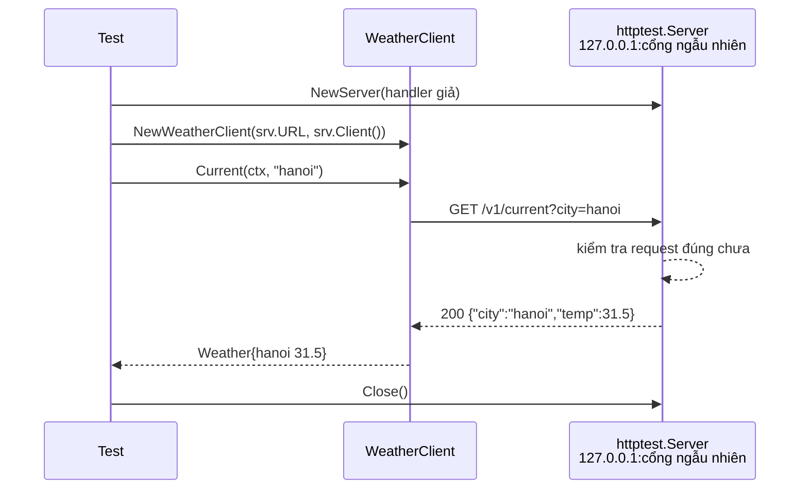

# Test HTTP với httptest

Phần lớn service Go là HTTP API, và phần lớn service cũng **gọi** HTTP API của bên khác. Package `net/http/httptest` trong thư viện chuẩn giải quyết cả hai chiều: `httptest.NewRecorder` cho phép gọi thẳng handler mà không cần mở cổng mạng, còn `httptest.NewServer` dựng một server thật trên `127.0.0.1` với cổng ngẫu nhiên để giả lập API bên ngoài. Bài này đi qua cách test handler, router, middleware, HTTP client và kiểm tra JSON response.

---

:::note[Ghi nhớ nhanh]

- ⭐ **Test handler: `httptest.NewRequest` + `httptest.NewRecorder` + `h.ServeHTTP(rec, req)`** — không mở cổng mạng, chạy trong micro giây.
- ⭐ **Test client gọi API ngoài: `httptest.NewServer(handler)`** rồi truyền `srv.URL` vào client — server giả trả dữ liệu bạn muốn, kể cả lỗi 503 hay timeout.
- **Test qua router thật** (`mux.ServeHTTP`) để kiểm tra cả route, method, path value; hoặc gọi handler trực tiếp kèm `req.SetPathValue` (Go 1.22).
- **Middleware test bằng một `next` handler giả** — kiểm tra status trả về và việc `next` có được gọi hay không.
- **So sánh JSON bằng cách decode vào struct/map**, không so chuỗi thô (thứ tự key, khoảng trắng, `\n` cuối của `Encoder` dễ làm test vỡ).

:::

---

## Mục lục

- [Vì sao cần httptest?](#vì-sao-cần-httptest)
- [Test handler với NewRecorder](#test-handler-với-newrecorder)
- [Test qua router và path value](#test-qua-router-và-path-value)
- [Kiểm tra JSON response](#kiểm-tra-json-response)
- [Test middleware](#test-middleware)
- [Giả lập API bên ngoài với NewServer](#giả-lập-api-bên-ngoài-với-newserver)
- [Câu hỏi phỏng vấn](#câu-hỏi-phỏng-vấn)

---

## Vì sao cần httptest?

**Vấn đề:** Không có công cụ hỗ trợ, test API thường là:

```go
func TestGetUser(t *testing.T) {
	go http.ListenAndServe(":8080", NewServer().Routes()) // cổng cố định → đụng nhau khi chạy song song
	time.Sleep(500 * time.Millisecond)                    // "chờ server lên" — chậm và vẫn có lúc fail

	resp, err := http.Get("http://localhost:8080/users/1")
	// ... server không bao giờ được tắt
}
```

Còn với code **gọi** API bên ngoài (thời tiết, thanh toán), test sẽ gọi API thật: phụ thuộc mạng, tốn quota, không tạo được tình huống API trả lỗi.

**Giải pháp:** `httptest` cung cấp:

```go
// 1. Gọi handler trực tiếp — không cần mạng
req := httptest.NewRequest(http.MethodGet, "/users/1", nil)
rec := httptest.NewRecorder()
handler.ServeHTTP(rec, req)
// rec.Code, rec.Body, rec.Header() để kiểm tra

// 2. Server thật trên cổng ngẫu nhiên — để test HTTP client
srv := httptest.NewServer(fakeAPIHandler)
defer srv.Close()
client := NewWeatherClient(srv.URL, srv.Client()) // srv.URL dạng http://127.0.0.1:51626
```

:::tip[Dùng thực tế]

- **Test REST endpoint**: status code, header `Content-Type`, body JSON cho từng trường hợp (thành công, 400, 404).
- **Test middleware xác thực**: thiếu token → 401, token sai → 403, đúng → handler được gọi.
- **Test SDK/client gọi bên thứ ba**: giả lập trả 200, 429 (rate limit), 503, timeout để kiểm tra logic retry.
- **Test webhook receiver**: gửi payload giả có chữ ký đúng/sai.

:::

:::tip[Ví dụ đời thường]

`NewRecorder` giống **diễn tập phòng cháy trong toà nhà**: bấm chuông báo động thật, kiểm tra mọi người phản ứng đúng — nhưng không cần gọi xe cứu hoả thật. `NewServer` giống **tổng đài giả lập khi đào tạo nhân viên chăm sóc khách hàng**: người hướng dẫn đóng vai khách gọi đến, có thể giả làm khách dễ tính (200 OK), khách khó chịu (500), hay khách im lặng không nói gì (timeout) — nhân viên được luyện mọi tình huống mà không làm phiền khách thật.

:::

---

## Test handler với NewRecorder

Giả sử có server đơn giản dùng router `net/http` của Go 1.22 (có method và wildcard):

```go
type User struct {
	ID   int64  `json:"id"`
	Name string `json:"name"`
}

type Server struct {
	users map[int64]User
}

func NewServer() *Server {
	return &Server{users: map[int64]User{1: {ID: 1, Name: "An"}}}
}

func (s *Server) Routes() http.Handler {
	mux := http.NewServeMux()
	mux.HandleFunc("GET /users/{id}", s.getUser)
	mux.HandleFunc("POST /users", s.createUser)
	return RequireAPIKey("secret", mux) // middleware bọc ngoài
}

func writeJSON(w http.ResponseWriter, status int, v any) {
	w.Header().Set("Content-Type", "application/json") // header phải đặt TRƯỚC WriteHeader
	w.WriteHeader(status)
	json.NewEncoder(w).Encode(v)
}

func (s *Server) getUser(w http.ResponseWriter, r *http.Request) {
	id, err := strconv.ParseInt(r.PathValue("id"), 10, 64)
	if err != nil {
		writeJSON(w, http.StatusBadRequest, map[string]string{"error": "id không hợp lệ"})
		return
	}
	u, ok := s.users[id]
	if !ok {
		writeJSON(w, http.StatusNotFound, map[string]string{"error": "không tìm thấy user"})
		return
	}
	writeJSON(w, http.StatusOK, u)
}
```

### Ba thành phần

| Thành phần | Vai trò |
|------------|---------|
| `httptest.NewRequest(method, target, body)` | Tạo `*http.Request` phía **server** (giống request server nhận được). Không trả `error` — sai tham số thì panic, tiện cho test |
| `httptest.NewRecorder()` | `*ResponseRecorder` hiện thực `http.ResponseWriter`, ghi lại status, header, body |
| `handler.ServeHTTP(rec, req)` | Gọi handler đồng bộ, không qua mạng |

`NewRequest` khác `http.NewRequest`: bản `httptest` tạo request "đã nhận" (có `RemoteAddr`, `RequestURI`, `Host` mặc định `example.com`) — chỉ dùng cho test handler, không dùng để gửi đi bằng client.

### Table-driven test cho handler

```go
func TestGetUser(t *testing.T) {
	h := NewServer().Routes()

	tests := []struct {
		name       string
		path       string
		wantStatus int
		wantBody   string
	}{
		{"tồn tại", "/users/1", http.StatusOK, `{"id":1,"name":"An"}`},
		{"không tồn tại", "/users/99", http.StatusNotFound, `{"error":"không tìm thấy user"}`},
		{"id sai", "/users/abc", http.StatusBadRequest, `{"error":"id không hợp lệ"}`},
	}

	for _, tt := range tests {
		t.Run(tt.name, func(t *testing.T) {
			req := httptest.NewRequest(http.MethodGet, tt.path, nil)
			req.Header.Set("X-API-Key", "secret")
			rec := httptest.NewRecorder()

			h.ServeHTTP(rec, req)

			if rec.Code != tt.wantStatus {
				t.Errorf("status = %d; muốn %d", rec.Code, tt.wantStatus)
			}
			if ct := rec.Header().Get("Content-Type"); ct != "application/json" {
				t.Errorf("Content-Type = %q; muốn application/json", ct)
			}
			// Encoder thêm "\n" ở cuối → TrimSpace trước khi so sánh
			if got := strings.TrimSpace(rec.Body.String()); got != tt.wantBody {
				t.Errorf("body = %s; muốn %s", got, tt.wantBody)
			}
		})
	}
}
```

### Gửi body (POST/PUT)

```go
func TestCreateUser(t *testing.T) {
	h := NewServer().Routes()

	req := httptest.NewRequest(http.MethodPost, "/users", strings.NewReader(`{"name":"Bình"}`))
	req.Header.Set("Content-Type", "application/json")
	req.Header.Set("X-API-Key", "secret")
	rec := httptest.NewRecorder()

	h.ServeHTTP(rec, req)

	res := rec.Result() // *http.Response — tiện khi muốn xử lý giống phía client
	defer res.Body.Close()
	if res.StatusCode != http.StatusCreated {
		t.Fatalf("status = %d; muốn 201", res.StatusCode)
	}
}
```

Form: `strings.NewReader(url.Values{"name": {"Bình"}}.Encode())` kèm header `Content-Type: application/x-www-form-urlencoded`.

:::warning[rec.Header() và rec.Result().Header]

`rec.Header()` là header handler **đang ghi**, kể cả những gì được đặt **sau** `WriteHeader` (vốn không được gửi đi trong thực tế). `rec.Result().Header` là snapshot tại thời điểm header được gửi — chính xác hơn khi muốn bắt lỗi "đặt header sau khi đã ghi body". Với kiểm tra thông thường, cả hai đều được.

:::

---

## Test qua router và path value

Có hai mức test:

**1. Qua router thật** (như ví dụ trên): kiểm tra luôn đăng ký route, method, wildcard. Router Go 1.22 tự trả **405 Method Not Allowed** kèm header `Allow` khi path đúng nhưng method sai:

```go
req := httptest.NewRequest(http.MethodDelete, "/users/1", nil)
req.Header.Set("X-API-Key", "secret")
rec := httptest.NewRecorder()
h.ServeHTTP(rec, req)
// rec.Code == 405, rec.Header().Get("Allow") == "GET, HEAD"
```

**2. Gọi thẳng hàm handler**: nhanh, tập trung vào logic, nhưng không có router để điền `{id}` — tự gán bằng `SetPathValue` (Go 1.22):

```go
func TestGetUserHandler(t *testing.T) {
	req := httptest.NewRequest(http.MethodGet, "/users/1", nil)
	req.SetPathValue("id", "1") // giả lập việc router đã parse wildcard
	rec := httptest.NewRecorder()

	NewServer().getUser(rec, req)

	if rec.Code != http.StatusOK {
		t.Errorf("status = %d; muốn 200", rec.Code)
	}
}
```

Thường nên ưu tiên test qua router (giống thực tế hơn), và chỉ gọi thẳng khi handler được tái sử dụng ở nhiều route.

### Kiểm tra handler có tôn trọng context

```go
ctx, cancel := context.WithCancel(context.Background())
cancel() // giả lập client đã ngắt kết nối
req := httptest.NewRequest(http.MethodGet, "/reports", nil).WithContext(ctx)
```

---

## Kiểm tra JSON response

So sánh chuỗi JSON thô rất mong manh: thứ tự key của struct có thể đổi, thêm một trường mới là vỡ hết test. Cách bền hơn là **decode rồi so sánh giá trị**:

```go
func TestGetUser_JSON(t *testing.T) {
	h := NewServer().Routes()
	req := httptest.NewRequest(http.MethodGet, "/users/1", nil)
	req.Header.Set("X-API-Key", "secret")
	rec := httptest.NewRecorder()
	h.ServeHTTP(rec, req)

	var got User
	if err := json.NewDecoder(rec.Body).Decode(&got); err != nil {
		t.Fatalf("response không phải JSON hợp lệ: %v", err)
	}
	want := User{ID: 1, Name: "An"}
	if got != want { // struct so sánh được bằng == khi mọi field comparable
		t.Errorf("user = %+v; muốn %+v", got, want)
	}
}
```

Với struct có slice/map, dùng `reflect.DeepEqual` hoặc tốt hơn là `cmp.Diff` từ `github.com/google/go-cmp/cmp` để có diff dễ đọc:

```go
if diff := cmp.Diff(want, got); diff != "" {
	t.Errorf("response khác mong đợi (-want +got):\n%s", diff)
}
```

Khi muốn khẳng định JSON có **đúng** những trường nào (ví dụ không lộ trường `password`), decode vào `map[string]any`:

```go
var m map[string]any
json.Unmarshal(rec.Body.Bytes(), &m)
if _, ok := m["password"]; ok {
	t.Error("response không được chứa password")
}
```

Nếu dùng testify, `assert.JSONEq(t, want, got)` so sánh hai chuỗi JSON theo ngữ nghĩa (bỏ qua thứ tự key và khoảng trắng).

---

## Test middleware

Middleware là hàm nhận `http.Handler` và trả về `http.Handler`:

```go
func RequireAPIKey(key string, next http.Handler) http.Handler {
	return http.HandlerFunc(func(w http.ResponseWriter, r *http.Request) {
		if r.Header.Get("X-API-Key") != key {
			http.Error(w, "unauthorized", http.StatusUnauthorized)
			return
		}
		next.ServeHTTP(w, r)
	})
}
```

Test bằng một `next` giả ghi lại việc có được gọi hay không:

```go
func TestRequireAPIKey(t *testing.T) {
	tests := []struct {
		name       string
		key        string
		wantStatus int
		wantCalled bool
	}{
		{"thiếu key", "", http.StatusUnauthorized, false},
		{"sai key", "wrong", http.StatusUnauthorized, false},
		{"đúng key", "secret", http.StatusNoContent, true},
	}

	for _, tt := range tests {
		t.Run(tt.name, func(t *testing.T) {
			called := false
			next := http.HandlerFunc(func(w http.ResponseWriter, r *http.Request) {
				called = true
				w.WriteHeader(http.StatusNoContent)
			})
			h := RequireAPIKey("secret", next)

			req := httptest.NewRequest(http.MethodGet, "/", nil)
			if tt.key != "" {
				req.Header.Set("X-API-Key", tt.key)
			}
			rec := httptest.NewRecorder()
			h.ServeHTTP(rec, req)

			if rec.Code != tt.wantStatus {
				t.Errorf("status = %d; muốn %d", rec.Code, tt.wantStatus)
			}
			if called != tt.wantCalled {
				t.Errorf("next được gọi = %v; muốn %v", called, tt.wantCalled)
			}
		})
	}
}
```

Với middleware **gắn dữ liệu vào context** (user đã xác thực, request ID), `next` giả đọc `r.Context()` và kiểm tra giá trị. Với middleware **ghi log/đo thời gian**, truyền logger ghi vào `bytes.Buffer` rồi kiểm tra nội dung buffer.

---

## Giả lập API bên ngoài với NewServer

Client gọi API thời tiết:

```go
type WeatherClient struct {
	baseURL string
	http    *http.Client
}

func NewWeatherClient(baseURL string, hc *http.Client) *WeatherClient {
	return &WeatherClient{baseURL: baseURL, http: hc}
}

type Weather struct {
	City string  `json:"city"`
	Temp float64 `json:"temp"`
}

func (c *WeatherClient) Current(ctx context.Context, city string) (Weather, error) {
	req, err := http.NewRequestWithContext(ctx, http.MethodGet,
		c.baseURL+"/v1/current?city="+url.QueryEscape(city), nil)
	if err != nil {
		return Weather{}, err
	}
	resp, err := c.http.Do(req)
	if err != nil {
		return Weather{}, fmt.Errorf("gọi weather API: %w", err)
	}
	defer resp.Body.Close()

	if resp.StatusCode != http.StatusOK {
		return Weather{}, fmt.Errorf("weather API trả về %d", resp.StatusCode)
	}
	var w Weather
	if err := json.NewDecoder(resp.Body).Decode(&w); err != nil {
		return Weather{}, fmt.Errorf("decode: %w", err)
	}
	return w, nil
}
```

Điểm thiết kế quan trọng: **base URL và `*http.Client` được truyền vào** — nhờ vậy test trỏ client tới server giả.



### Trường hợp thành công + kiểm tra request

```go
func TestWeatherClient_Current(t *testing.T) {
	srv := httptest.NewServer(http.HandlerFunc(func(w http.ResponseWriter, r *http.Request) {
		// Server giả kiểm tra client gửi đúng request
		if r.URL.Path != "/v1/current" || r.URL.Query().Get("city") != "hanoi" {
			t.Errorf("request sai: %s %s", r.Method, r.URL)
		}
		w.Header().Set("Content-Type", "application/json")
		io.WriteString(w, `{"city":"hanoi","temp":31.5}`)
	}))
	defer srv.Close()

	c := NewWeatherClient(srv.URL, srv.Client())
	got, err := c.Current(t.Context(), "hanoi")
	if err != nil {
		t.Fatalf("Current lỗi: %v", err)
	}
	if got.Temp != 31.5 {
		t.Errorf("Temp = %v; muốn 31.5", got.Temp)
	}
}
```

Handler của server giả chạy ở goroutine khác — dùng `t.Errorf` (không dùng `t.Fatalf`) bên trong nó.

### Trường hợp lỗi: 503 và timeout

```go
func TestWeatherClient_ServerError(t *testing.T) {
	srv := httptest.NewServer(http.HandlerFunc(func(w http.ResponseWriter, r *http.Request) {
		w.WriteHeader(http.StatusServiceUnavailable)
	}))
	defer srv.Close()

	c := NewWeatherClient(srv.URL, srv.Client())
	if _, err := c.Current(t.Context(), "hanoi"); err == nil {
		t.Fatal("muốn lỗi khi API trả 503")
	}
}

func TestWeatherClient_Timeout(t *testing.T) {
	srv := httptest.NewServer(http.HandlerFunc(func(w http.ResponseWriter, r *http.Request) {
		select {
		case <-time.After(2 * time.Second): // giả lập API chậm
		case <-r.Context().Done(): // client bỏ cuộc → thoát sớm để srv.Close() không phải chờ
		}
	}))
	defer srv.Close()

	hc := srv.Client()
	hc.Timeout = 50 * time.Millisecond
	c := NewWeatherClient(srv.URL, hc)

	_, err := c.Current(t.Context(), "hanoi")
	if err == nil {
		t.Fatal("muốn lỗi timeout")
	}
	// err: ... context deadline exceeded (Client.Timeout exceeded while awaiting headers)
}
```

Để test **retry**, cho handler đếm số lần được gọi (dùng `atomic.Int32`) và trả 503 hai lần đầu, 200 lần thứ ba.

### Các biến thể

| Hàm | Công dụng |
|-----|-----------|
| `httptest.NewServer(h)` | HTTP server, đã chạy sẵn |
| `httptest.NewTLSServer(h)` | HTTPS với chứng chỉ tự ký; `srv.Client()` đã tin chứng chỉ này |
| `httptest.NewUnstartedServer(h)` | Tạo nhưng chưa chạy — chỉnh cấu hình (bật HTTP/2, đổi `TLS`) rồi `Start()`/`StartTLS()` |
| `srv.URL` | `http://127.0.0.1:PORT` |
| `srv.Client()` | `*http.Client` cấu hình sẵn để gọi server này |
| `srv.Close()` | Tắt server, chờ các request đang xử lý xong |

`NewServer` cũng dùng được để test **toàn bộ** ứng dụng qua mạng thật (`httptest.NewServer(app.Routes())`) — gần với end-to-end hơn, kiểm tra được cả những thứ `NewRecorder` bỏ qua như hành vi của `http.Server` với header lớn, keep-alive, streaming.

---

## Câu hỏi phỏng vấn

**1. `httptest.NewRecorder` và `httptest.NewServer` khác nhau thế nào? Khi nào dùng cái nào?**

<details className="qa">
<summary>Xem đáp án</summary>

`NewRecorder` tạo một `ResponseWriter` ghi lại kết quả trong bộ nhớ; ta gọi `handler.ServeHTTP(rec, req)` trực tiếp — không có mạng, rất nhanh, dùng để unit test handler, router, middleware. `NewServer` khởi động một HTTP server thật trên loopback với cổng ngẫu nhiên; dùng khi cần một endpoint mạng thật — chủ yếu để test **HTTP client** (giả lập API bên ngoài), hoặc test tích hợp toàn bộ ứng dụng qua mạng.

</details>

**2. Làm sao test code gọi API bên thứ ba mà không gọi API thật?**

<details className="qa">
<summary>Xem đáp án</summary>

Thiết kế client nhận base URL và `*http.Client` qua constructor (không hard-code URL hay dùng `http.DefaultClient`). Trong test dựng `httptest.NewServer` với handler trả về dữ liệu giả cho từng kịch bản (200, 4xx, 5xx, JSON hỏng, chậm để test timeout), rồi truyền `srv.URL` và `srv.Client()` cho client. Handler giả cũng kiểm tra request client gửi (path, query, header, body). Cách khác là thay `http.Client.Transport` bằng một `RoundTripper` giả — không cần mở socket.

</details>

**3. Test một handler dùng `r.PathValue("id")` mà không qua router thế nào?**

<details className="qa">
<summary>Xem đáp án</summary>

Từ Go 1.22, `*http.Request` có `SetPathValue(name, value)`. Trong test tạo request bằng `httptest.NewRequest`, gọi `req.SetPathValue("id", "1")`, rồi gọi hàm handler trực tiếp. Nếu không gán, `PathValue` trả chuỗi rỗng. Tuy vậy, test qua `mux.ServeHTTP` với pattern thật thường tốt hơn vì kiểm tra luôn việc đăng ký route và method.

</details>

**4. Vì sao không nên so sánh JSON response bằng chuỗi?**

<details className="qa">
<summary>Xem đáp án</summary>

Chuỗi JSON phụ thuộc thứ tự key, khoảng trắng, ký tự `\n` cuối do `json.Encoder` thêm, cách escape — những thứ không ảnh hưởng ngữ nghĩa. Thêm một trường mới vào response cũng làm vỡ test so chuỗi. Nên decode response vào struct (hoặc `map[string]any`) và so sánh giá trị bằng `==`, `cmp.Diff`, hoặc dùng `assert.JSONEq` của testify. Decode cũng đồng thời kiểm tra response là JSON hợp lệ.

</details>

**5. Test một middleware xác thực thế nào?**

<details className="qa">
<summary>Xem đáp án</summary>

Tạo `next` là một `http.HandlerFunc` giả ghi lại việc được gọi (và có thể đọc context để kiểm tra dữ liệu middleware gắn vào). Bọc `next` bằng middleware, rồi chạy table-driven test qua các trường hợp: thiếu header, header sai, header đúng. Với mỗi case kiểm tra status code từ `NewRecorder` và việc `next` có được gọi hay không — middleware chặn đúng thì `next` không bao giờ được gọi.

</details>

**6. Trong handler của `httptest.NewServer`, gọi `t.Fatal` có được không?**

<details className="qa">
<summary>Xem đáp án</summary>

Không nên. Handler chạy trong goroutine do server tạo, không phải goroutine của test; `t.Fatal` gọi `runtime.Goexit` chỉ dừng goroutine đó (handler), test chính vẫn chạy và có thể treo chờ response. Dùng `t.Errorf` để ghi lỗi rồi trả response bình thường, hoặc gửi thông tin về goroutine test qua channel.

</details>
