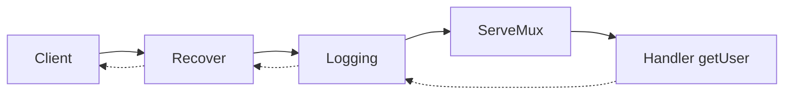
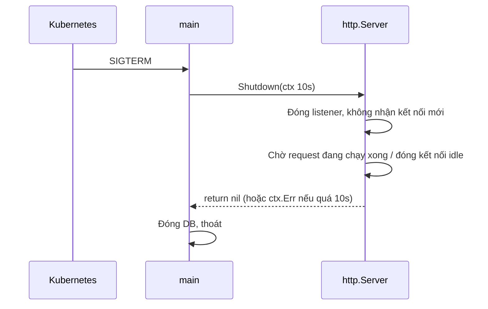

# net/http

`net/http` là package thư viện chuẩn để viết cả HTTP server lẫn HTTP client trong Go. Khác với nhiều ngôn ngữ phải cài framework mới làm được web, Go có sẵn một server đủ mạnh để chạy production — và từ Go 1.22, router chuẩn (`ServeMux`) còn hỗ trợ method và wildcard nên rất nhiều dự án không cần framework nữa. Bài này đi từ `Handler` cơ bản, router, middleware, JSON, cấu hình server an toàn, tắt server êm (graceful shutdown) đến HTTP client, và kết thúc bằng một CRUD API hoàn chỉnh.

---

:::note[Ghi nhớ nhanh]

- ⭐ **Mọi thứ xoay quanh interface `http.Handler`** — chỉ có một method `ServeHTTP(w, r)`; router, middleware, handler đều là `Handler`.
- ⭐ **Không dùng `http.ListenAndServe` / `http.DefaultClient` trần trong production** — chúng **không có timeout**; luôn tự tạo `http.Server` và `http.Client` với timeout.
- **ServeMux Go 1.22+** — pattern `"GET /users/{id}"`, đọc bằng `r.PathValue("id")`, `{path...}` bắt phần còn lại, `{$}` khớp đúng đường dẫn.
- **Middleware = hàm `func(http.Handler) http.Handler`** — bọc handler để thêm log, recover, auth.
- **Graceful shutdown** — `signal.NotifyContext` bắt SIGTERM, rồi `srv.Shutdown(ctx)` chờ request đang chạy xong.
- **Client: luôn `defer resp.Body.Close()`** — quên đóng sẽ rò kết nối, không tái sử dụng được connection.

:::

---

## Mục lục

- [Vì sao cần net/http?](#vì-sao-cần-nethttp)
- [Handler và HandlerFunc](#handler-và-handlerfunc)
- [ServeMux từ Go 1.22](#servemux-từ-go-122)
- [Middleware](#middleware)
- [Đọc và ghi JSON](#đọc-và-ghi-json)
- [http.Server với timeout](#httpserver-với-timeout)
- [Graceful shutdown](#graceful-shutdown)
- [HTTP client](#http-client)
- [CRUD API mẫu](#crud-api-mẫu)

---

## Vì sao cần net/http?

**Vấn đề:** Ở nhiều hệ sinh thái, muốn có một API đơn giản bạn phải chọn framework, cài web server riêng (Tomcat, Gunicorn, PM2...), rồi cấu hình reverse proxy. Còn nếu tự viết server trên socket thô thì phải tự parse HTTP — việc vừa khó vừa dễ lỗi bảo mật:

```go
// Tự parse HTTP trên TCP — ĐỪNG làm thế này
ln, _ := net.Listen("tcp", ":8080")
for {
	conn, _ := ln.Accept()
	go func() {
		buf := make([]byte, 1024)
		conn.Read(buf) // header dài hơn 1024 byte? keep-alive? chunked? HTTP/2?
		conn.Write([]byte("HTTP/1.1 200 OK\r\n\r\nhello"))
		conn.Close()
	}()
}
```

**Giải pháp:** `net/http` lo toàn bộ phần giao thức (HTTP/1.1, HTTP/2 qua TLS, keep-alive, chunked encoding), mỗi request chạy trong một goroutine riêng. Bạn chỉ viết logic:

```go
package main

import (
	"fmt"
	"net/http"
)

func main() {
	http.HandleFunc("GET /hello", func(w http.ResponseWriter, r *http.Request) {
		fmt.Fprintln(w, "Xin chào từ Go!")
	})
	http.ListenAndServe(":8080", nil) // chỉ dùng cho demo — xem phần timeout bên dưới
}
```

Biên dịch ra **một file binary duy nhất**, chạy thẳng mà không cần web server nào khác.

:::tip[Dùng thực tế]

- **REST/JSON API cho microservice** — rất nhiều service ở các công ty dùng Go chỉ cần `net/http` + vài helper.
- **Health check, metrics endpoint** (`/healthz`, `/metrics`) cho Kubernetes và Prometheus.
- **Gọi API bên thứ ba** (cổng thanh toán, OTP SMS) bằng `http.Client` có timeout và retry.
- **Nền tảng cho framework** — Gin, Echo, chi đều xây trên `net/http`, hiểu nó thì hiểu mọi framework.

:::

:::tip[Ví dụ đời thường]

`net/http` giống **một nhà hàng đã có sẵn bếp, quầy lễ tân và đội phục vụ**. Bạn chỉ việc viết thực đơn (handler). Lễ tân (`ServeMux`) nhìn order "GET /pho-bo" để chuyển đúng bếp; bảo vệ cửa (middleware) kiểm tra khách trước khi vào; đến giờ đóng cửa (graceful shutdown) thì không nhận khách mới nhưng vẫn phục vụ nốt khách đang ăn.

:::

---

## Handler và HandlerFunc

Toàn bộ package dựa trên một interface:

```go
type Handler interface {
	ServeHTTP(ResponseWriter, *Request)
}
```

- `http.ResponseWriter` — để ghi header, status code, body trả về.
- `*http.Request` — chứa method, URL, header, body, `Context()` của request.

Có thể implement bằng struct (tiện khi handler cần giữ phụ thuộc như DB, logger):

```go
type HelloHandler struct {
	greeting string
}

func (h HelloHandler) ServeHTTP(w http.ResponseWriter, r *http.Request) {
	name := r.URL.Query().Get("name") // ?name=An
	if name == "" {
		name = "bạn"
	}
	fmt.Fprintf(w, "%s, %s!\n", h.greeting, name)
}

// Đăng ký
mux.Handle("GET /hello", HelloHandler{greeting: "Xin chào"})
```

Viết struct cho mỗi handler thì dài dòng, nên Go có **adapter** `http.HandlerFunc` — một kiểu hàm có sẵn method `ServeHTTP`:

```go
// Trong thư viện chuẩn:
type HandlerFunc func(ResponseWriter, *Request)

func (f HandlerFunc) ServeHTTP(w ResponseWriter, r *Request) { f(w, r) }
```

Nhờ đó một hàm thường trở thành `Handler`:

```go
func ping(w http.ResponseWriter, r *http.Request) {
	w.Write([]byte("pong"))
}

mux.Handle("GET /ping", http.HandlerFunc(ping)) // ép kiểu hàm → Handler
mux.HandleFunc("GET /ping2", ping)              // HandleFunc làm việc ép kiểu giùm
```

:::warning[Lỗi hay gặp]

- **Gọi `w.WriteHeader` sau khi đã `w.Write`** — `Write` đầu tiên tự gửi status 200, lệnh `WriteHeader` sau đó bị bỏ qua (log "superfluous response.WriteHeader call").
- **Set header sau khi ghi body** — header đã gửi đi rồi, `w.Header().Set(...)` lúc đó không có tác dụng. Thứ tự đúng: `Header().Set` → `WriteHeader` → `Write`.
- **Quên `return` sau khi trả lỗi** — code tiếp tục chạy và ghi thêm body vào response.

:::

---

## ServeMux từ Go 1.22

Trước Go 1.22, `ServeMux` chỉ khớp theo tiền tố đường dẫn, không phân biệt method, không có tham số đường dẫn — đó là lý do mọi người dùng gorilla/mux hay chi. Từ **Go 1.22**, pattern có dạng `[METHOD ][HOST]/path`:

```go
mux := http.NewServeMux()

mux.HandleFunc("GET /users", listUsers)          // chỉ GET (và HEAD)
mux.HandleFunc("POST /users", createUser)        // chỉ POST
mux.HandleFunc("GET /users/{id}", getUser)       // wildcard một đoạn
mux.HandleFunc("DELETE /users/{id}", deleteUser)
mux.HandleFunc("GET /files/{path...}", serveFile) // bắt phần còn lại, kể cả dấu /
mux.HandleFunc("GET /{$}", home)                 // CHỈ khớp đúng "/", không khớp "/abc"

func getUser(w http.ResponseWriter, r *http.Request) {
	id := r.PathValue("id") // luôn là string, tự chuyển sang số
	fmt.Fprintf(w, "user %s\n", id)
}

func serveFile(w http.ResponseWriter, r *http.Request) {
	// GET /files/css/a/b.css → path = "css/a/b.css"
	fmt.Fprintf(w, "file: %s\n", r.PathValue("path"))
}
```

Các quy tắc cần nhớ:

| Quy tắc | Ví dụ |
|---------|-------|
| Pattern có method `GET` cũng khớp `HEAD` | `GET /users` nhận cả `HEAD /users` |
| Sai method → tự trả **405** kèm header `Allow` | `PATCH /users/1` → `405 Method Not Allowed` |
| Không khớp pattern nào → **404** | `GET /khongco` |
| Pattern kết thúc bằng `/` khớp mọi đường dẫn con | `/static/` khớp `/static/a/b` |
| Pattern **cụ thể hơn** thắng | `/users/me` thắng `/users/{id}` |
| Hai pattern xung đột, không cái nào cụ thể hơn → **panic lúc đăng ký** | `/users/{id}` và `/{resource}/1` |

:::warning[Lưu ý phiên bản]

- Cú pháp mới chỉ có hiệu lực khi `go.mod` khai báo `go 1.22` trở lên. Với module cũ hơn, `"GET /users"` bị hiểu là đường dẫn có dấu cách.
- Có thể tạm quay lại hành vi cũ bằng `GODEBUG=httpmuxgo121=1`.
- `r.PathValue` trả về chuỗi rỗng nếu tên wildcard không tồn tại trong pattern — gõ sai tên sẽ không báo lỗi biên dịch.

:::

---

## Middleware

Middleware là code chạy **trước/sau** handler chính (log, recover panic, xác thực, CORS...). Trong Go, middleware đơn giản là hàm nhận một `Handler` và trả về `Handler` mới bọc lấy nó:

```go
// Logging ghi lại method, path, status và thời gian xử lý
func Logging(next http.Handler) http.Handler {
	return http.HandlerFunc(func(w http.ResponseWriter, r *http.Request) {
		start := time.Now()
		rec := &statusRecorder{ResponseWriter: w, status: http.StatusOK}
		next.ServeHTTP(rec, r) // gọi handler bên trong
		slog.Info("request", "method", r.Method, "path", r.URL.Path,
			"status", rec.status, "duration", time.Since(start))
	})
}

// statusRecorder "nghe lén" status code mà handler ghi ra
type statusRecorder struct {
	http.ResponseWriter
	status int
}

func (r *statusRecorder) WriteHeader(code int) {
	r.status = code
	r.ResponseWriter.WriteHeader(code)
}

// Recover bắt panic để một request lỗi không làm sập cả goroutine xử lý
func Recover(next http.Handler) http.Handler {
	return http.HandlerFunc(func(w http.ResponseWriter, r *http.Request) {
		defer func() {
			if err := recover(); err != nil {
				slog.Error("panic", "err", err, "path", r.URL.Path)
				http.Error(w, "lỗi máy chủ", http.StatusInternalServerError)
			}
		}()
		next.ServeHTTP(w, r)
	})
}
```

Ghép nhiều middleware bằng một hàm `Chain` nhỏ — middleware đứng đầu danh sách là lớp **ngoài cùng**:

```go
func Chain(h http.Handler, mws ...func(http.Handler) http.Handler) http.Handler {
	for i := len(mws) - 1; i >= 0; i-- {
		h = mws[i](h)
	}
	return h
}

handler := Chain(mux, Recover, Logging) // tương đương Recover(Logging(mux))
```



Muốn truyền dữ liệu từ middleware xuống handler (user đã xác thực, request-id), dùng `context`:

```go
type ctxKey string

const userIDKey ctxKey = "userID"

func Auth(next http.Handler) http.Handler {
	return http.HandlerFunc(func(w http.ResponseWriter, r *http.Request) {
		token := r.Header.Get("Authorization")
		userID, ok := verifyToken(token) // hàm tự viết
		if !ok {
			http.Error(w, "unauthorized", http.StatusUnauthorized)
			return // không gọi next → chặn request
		}
		ctx := context.WithValue(r.Context(), userIDKey, userID)
		next.ServeHTTP(w, r.WithContext(ctx))
	})
}

// Trong handler
userID, _ := r.Context().Value(userIDKey).(string)
```

---

## Đọc và ghi JSON

Go không có helper JSON có sẵn trong `net/http`, nên dự án nào cũng tự viết hai hàm nhỏ:

```go
func writeJSON(w http.ResponseWriter, status int, v any) {
	w.Header().Set("Content-Type", "application/json") // set header TRƯỚC WriteHeader
	w.WriteHeader(status)
	if err := json.NewEncoder(w).Encode(v); err != nil {
		slog.Error("encode response", "err", err)
	}
}

func writeError(w http.ResponseWriter, status int, msg string) {
	writeJSON(w, status, map[string]string{"error": msg})
}

func readJSON(w http.ResponseWriter, r *http.Request, dst any) error {
	r.Body = http.MaxBytesReader(w, r.Body, 1<<20) // giới hạn body 1 MB, chống gửi body khổng lồ
	dec := json.NewDecoder(r.Body)
	dec.DisallowUnknownFields() // field lạ → lỗi, bắt client gửi sai tên field
	if err := dec.Decode(dst); err != nil {
		return fmt.Errorf("body không hợp lệ: %w", err)
	}
	if dec.More() {
		return errors.New("body chỉ được chứa một object JSON")
	}
	return nil
}
```

:::tip[Mẹo]

Không cần tự đóng `r.Body` ở server — server tự đóng khi handler trả về. Nhưng ở **client** thì bắt buộc phải đóng `resp.Body` (xem phần client).

:::

---

## http.Server với timeout

`http.ListenAndServe(addr, h)` tạo một `http.Server` **không có timeout nào**. Một client chậm (hoặc kẻ tấn công kiểu Slowloris gửi header từng byte một) có thể giữ kết nối mãi mãi đến khi server cạn file descriptor. Production luôn tự tạo server:

```go
srv := &http.Server{
	Addr:              ":8080",
	Handler:           Chain(mux, Recover, Logging),
	ReadHeaderTimeout: 5 * time.Second,  // thời gian tối đa đọc xong header
	ReadTimeout:       10 * time.Second, // đọc xong toàn bộ request (header + body)
	WriteTimeout:      15 * time.Second, // từ lúc đọc xong header đến lúc ghi xong response
	IdleTimeout:       60 * time.Second, // giữ kết nối keep-alive rảnh rỗi bao lâu
	MaxHeaderBytes:    1 << 20,          // giới hạn kích thước header (mặc định 1 MB)
}
```

| Trường | Bảo vệ khỏi | Ghi chú |
|--------|-------------|---------|
| `ReadHeaderTimeout` | Slowloris (gửi header chậm) | Quan trọng nhất; linter gosec (rule G112) cảnh báo nếu thiếu |
| `ReadTimeout` | Upload body cực chậm | Áp cho cả request; endpoint upload lớn cần cân nhắc |
| `WriteTimeout` | Handler hoặc client đọc chậm giữ kết nối | Phải **lớn hơn** thời gian xử lý lâu nhất; SSE/streaming nên tắt riêng |
| `IdleTimeout` | Kết nối keep-alive bỏ không | Nếu 0 thì dùng `ReadTimeout` |

:::warning[Timeout server không huỷ handler]

`WriteTimeout` hết hạn thì kết nối bị đóng, nhưng **goroutine handler vẫn chạy tiếp**. Muốn giới hạn thời gian xử lý thực sự, dùng `http.TimeoutHandler(h, 5*time.Second, "timeout")` hoặc truyền `r.Context()` xuống DB/HTTP call để chúng tự dừng khi context bị huỷ.

:::

Với timeout từng route, có thể tinh chỉnh bằng `http.ResponseController` (Go 1.20+):

```go
func export(w http.ResponseWriter, r *http.Request) {
	rc := http.NewResponseController(w)
	_ = rc.SetWriteDeadline(time.Now().Add(2 * time.Minute)) // route xuất file được phép lâu hơn
	// ...
}
```

---

## Graceful shutdown

Khi Kubernetes rolling update hay bạn bấm Ctrl+C, process nhận tín hiệu `SIGTERM`/`SIGINT`. Nếu thoát ngay, các request đang xử lý bị cắt ngang (đơn hàng ghi dở, client nhận lỗi). **Graceful shutdown**: ngừng nhận kết nối mới, chờ request đang chạy xong rồi mới thoát.

```go
func main() {
	srv := &http.Server{ /* ... như trên ... */ }

	// ctx bị huỷ khi nhận Ctrl+C (SIGINT) hoặc SIGTERM
	ctx, stop := signal.NotifyContext(context.Background(), os.Interrupt, syscall.SIGTERM)
	defer stop()

	go func() {
		// ListenAndServe luôn trả lỗi khác nil; ErrServerClosed là do ta gọi Shutdown
		if err := srv.ListenAndServe(); err != nil && !errors.Is(err, http.ErrServerClosed) {
			slog.Error("server lỗi", "err", err)
			os.Exit(1)
		}
	}()
	slog.Info("server chạy", "addr", srv.Addr)

	<-ctx.Done() // chặn đến khi có tín hiệu
	slog.Info("đang tắt server...")

	// Cho tối đa 10 giây để các request đang chạy hoàn tất
	shutdownCtx, cancel := context.WithTimeout(context.Background(), 10*time.Second)
	defer cancel()
	if err := srv.Shutdown(shutdownCtx); err != nil {
		slog.Error("shutdown quá hạn, buộc đóng", "err", err)
	}
	// Đóng DB, flush log... ở đây
	slog.Info("đã tắt")
}
```



:::warning[Lỗi hay gặp]

- **Dùng `<-ctx.Done()` nhưng quên gọi `Shutdown`** — process thoát ngay khi `main` kết thúc, request bị cắt.
- **Truyền `ctx` đã bị huỷ (ctx của signal) vào `Shutdown`** — `Shutdown` trả về ngay lập tức, không chờ gì cả. Phải tạo context **mới** có timeout.
- `Shutdown` **không** chờ kết nối bị hijack (WebSocket); cần tự đóng chúng, có thể đăng ký bằng `srv.RegisterOnShutdown`.

:::

---

## HTTP client

```go
// SAI trong production: http.Get dùng http.DefaultClient — KHÔNG có timeout.
// API bên kia treo → goroutine của bạn treo theo, mãi mãi.
resp, err := http.Get("https://api.example.com/rates")
```

Cách đúng: tạo **một** client dùng chung (client an toàn khi dùng đồng thời và tái sử dụng kết nối qua `Transport`):

```go
var apiClient = &http.Client{
	Timeout: 10 * time.Second, // tổng thời gian: kết nối + gửi + đọc xong body
}

type Rate struct {
	Currency string  `json:"currency"`
	Value    float64 `json:"value"`
}

func fetchRate(ctx context.Context, currency string) (Rate, error) {
	url := "https://api.example.com/rates/" + currency
	req, err := http.NewRequestWithContext(ctx, http.MethodGet, url, nil)
	if err != nil {
		return Rate{}, err
	}
	req.Header.Set("Accept", "application/json")

	resp, err := apiClient.Do(req)
	if err != nil {
		return Rate{}, fmt.Errorf("gọi API tỷ giá: %w", err)
	}
	defer resp.Body.Close() // BẮT BUỘC, kể cả khi status lỗi

	if resp.StatusCode != http.StatusOK {
		body, _ := io.ReadAll(io.LimitReader(resp.Body, 1024)) // đọc tối đa 1KB để log
		return Rate{}, fmt.Errorf("API trả %d: %s", resp.StatusCode, body)
	}

	var rate Rate
	if err := json.NewDecoder(resp.Body).Decode(&rate); err != nil {
		return Rate{}, fmt.Errorf("decode tỷ giá: %w", err)
	}
	return rate, nil
}
```

Những điểm cần nhớ:

- **`err != nil` không có nghĩa là HTTP status lỗi** — status 404, 500 vẫn trả `err == nil`; phải tự kiểm tra `resp.StatusCode`.
- **Đóng `resp.Body`** sau mỗi request thành công, nếu không kết nối không được trả về pool để tái sử dụng (rò rỉ kết nối và goroutine).
- **Dùng `NewRequestWithContext`** — huỷ request khi request gốc phía server bị huỷ (client của bạn đóng tab).
- Muốn chỉnh pool kết nối, tạo `Transport` riêng (thường clone từ mặc định):

```go
tr := http.DefaultTransport.(*http.Transport).Clone()
tr.MaxIdleConnsPerHost = 50 // mặc định chỉ 2 — quá thấp nếu gọi nhiều tới cùng một host
apiClient := &http.Client{Timeout: 10 * time.Second, Transport: tr}
```

:::warning[Không tạo client mới cho mỗi request]

`&http.Client{}` mới mỗi lần gọi (kèm `Transport` mới) sẽ không tái sử dụng được kết nối TCP/TLS — mỗi request phải bắt tay lại, chậm và tốn port. Tạo client một lần, dùng chung.

:::

---

## CRUD API mẫu

Ghép tất cả lại: API quản lý user lưu trong bộ nhớ. Bản đầy đủ (có cả PUT) đã chạy kiểm tra với Go 1.22+; dưới đây lược bớt phần trùng với các mục trước.

```go
package main

import (
	"fmt"
	"net/http"
	"strconv"
	"sync"
	"time"
	// + các import của helper/middleware/shutdown ở trên
)

type User struct {
	ID    int    `json:"id"`
	Name  string `json:"name"`
	Email string `json:"email"`
}

// Store lưu user trong bộ nhớ; handler chạy song song nên cần mutex
type Store struct {
	mu     sync.RWMutex
	nextID int
	users  map[int]User
}

func NewStore() *Store { return &Store{nextID: 1, users: make(map[int]User)} }

func (s *Store) Create(u User) User {
	s.mu.Lock()
	defer s.mu.Unlock()
	u.ID = s.nextID
	s.nextID++
	s.users[u.ID] = u
	return u
}

func (s *Store) Get(id int) (User, bool) {
	s.mu.RLock()
	defer s.mu.RUnlock()
	u, ok := s.users[id]
	return u, ok
}

func (s *Store) List() []User {
	s.mu.RLock()
	defer s.mu.RUnlock()
	out := make([]User, 0, len(s.users)) // trả [] thay vì null khi rỗng
	for _, u := range s.users {
		out = append(out, u)
	}
	return out
}

func (s *Store) Delete(id int) bool {
	s.mu.Lock()
	defer s.mu.Unlock()
	if _, ok := s.users[id]; !ok {
		return false
	}
	delete(s.users, id)
	return true
}

type UserHandler struct{ store *Store }

func (h *UserHandler) Register(mux *http.ServeMux) {
	mux.HandleFunc("GET /users", h.list)
	mux.HandleFunc("GET /users/{id}", h.get)
	mux.HandleFunc("POST /users", h.create)
	// PUT /users/{id}: tương tự create, thêm bước đọc id như get
	mux.HandleFunc("DELETE /users/{id}", h.remove)
}

func pathID(r *http.Request) (int, error) {
	return strconv.Atoi(r.PathValue("id"))
}

func (h *UserHandler) list(w http.ResponseWriter, r *http.Request) {
	writeJSON(w, http.StatusOK, h.store.List())
}

func (h *UserHandler) get(w http.ResponseWriter, r *http.Request) {
	id, err := pathID(r)
	if err != nil {
		writeError(w, http.StatusBadRequest, "id phải là số")
		return
	}
	u, ok := h.store.Get(id)
	if !ok {
		writeError(w, http.StatusNotFound, "không tìm thấy user")
		return
	}
	writeJSON(w, http.StatusOK, u)
}

func (h *UserHandler) create(w http.ResponseWriter, r *http.Request) {
	var in User
	if err := readJSON(w, r, &in); err != nil {
		writeError(w, http.StatusBadRequest, err.Error())
		return
	}
	if in.Name == "" || in.Email == "" {
		writeError(w, http.StatusUnprocessableEntity, "name và email là bắt buộc")
		return
	}
	u := h.store.Create(in)
	w.Header().Set("Location", fmt.Sprintf("/users/%d", u.ID))
	writeJSON(w, http.StatusCreated, u)
}

func (h *UserHandler) remove(w http.ResponseWriter, r *http.Request) {
	id, err := pathID(r)
	if err != nil {
		writeError(w, http.StatusBadRequest, "id phải là số")
		return
	}
	if !h.store.Delete(id) {
		writeError(w, http.StatusNotFound, "không tìm thấy user")
		return
	}
	w.WriteHeader(http.StatusNoContent)
}

// writeJSON, writeError, readJSON, Logging, Recover, Chain, statusRecorder:
// giống các phần phía trên

func main() {
	mux := http.NewServeMux()
	(&UserHandler{store: NewStore()}).Register(mux)

	srv := &http.Server{
		Addr:              ":8080",
		Handler:           Chain(mux, Recover, Logging),
		ReadHeaderTimeout: 5 * time.Second,
		ReadTimeout:       10 * time.Second,
		WriteTimeout:      15 * time.Second,
		IdleTimeout:       60 * time.Second,
	}
	// Chạy server + graceful shutdown: y hệt đoạn code ở mục "Graceful shutdown"
	runWithGracefulShutdown(srv)
}
```

Thử bằng `curl`:

```bash
curl -i -X POST localhost:8080/users -d '{"name":"An","email":"an@example.com"}'
# HTTP/1.1 201 Created
# Location: /users/1
# {"id":1,"name":"An","email":"an@example.com"}

curl -i localhost:8080/users/abc          # 400 {"error":"id phải là số"}
curl -i -X PATCH localhost:8080/users/1   # 405 Method Not Allowed (mux tự xử lý)
curl -i -X DELETE localhost:8080/users/1  # 204 No Content
curl -i localhost:8080/users/1            # 404 {"error":"không tìm thấy user"}
```
