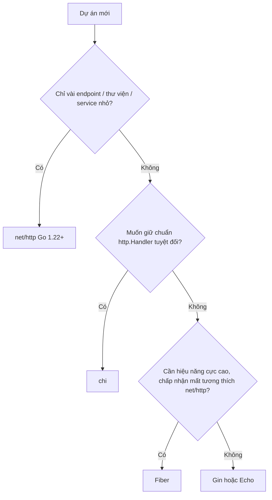

# Web framework: Gin, Echo, Fiber, Beego

Go có `net/http` đủ dùng cho production, nhưng phần lớn dự án thực tế vẫn chọn một framework hoặc router để bớt code lặp: bind và validate JSON, nhóm route, middleware dựng sẵn, xử lý lỗi tập trung. Bài này giải thích khi nào framework thực sự đáng dùng, viết **cùng một API** trên Gin, Echo, Fiber để thấy khác biệt, giới thiệu Beego (full-stack MVC) và các router nhẹ chi, gorilla/mux, rồi đưa ra bảng so sánh và khuyến nghị lựa chọn.

---

:::note[Ghi nhớ nhanh]

- ⭐ **Gin, Echo, chi xây trên `net/http`; Fiber xây trên fasthttp** — Fiber **không** tương thích `http.Handler`, không dùng lại được middleware và thư viện viết cho `net/http`.
- ⭐ **Từ Go 1.22, `net/http` thuần đã đủ cho nhiều API** — framework chủ yếu tiết kiệm phần bind/validate, nhóm route, middleware dựng sẵn.
- **Gin** — phổ biến nhất, nhiều tài liệu/ví dụ, validate qua struct tag `binding:"required"`.
- **Echo** — handler trả về `error`, xử lý lỗi tập trung gọn gàng.
- **Beego** — full-stack MVC kiểu Django/Rails (ORM, cache, admin, công cụ `bee`); ít được chọn cho dự án mới.
- **chi** — router nhẹ, 100% tương thích `net/http`, lựa chọn "an toàn" khi muốn gần thư viện chuẩn.

:::

---

## Mục lục

- [Vì sao cần web framework?](#vì-sao-cần-web-framework)
- [Gin](#gin)
- [Echo](#echo)
- [Fiber](#fiber)
- [Beego](#beego)
- [Router nhẹ: chi và gorilla/mux](#router-nhẹ-chi-và-gorillamux)
- [Bảng so sánh](#bảng-so-sánh)
- [Nên chọn gì?](#nên-chọn-gì)
- [Câu hỏi phỏng vấn](#câu-hỏi-phỏng-vấn)

---

## Vì sao cần web framework?

**Vấn đề:** Với `net/http` thuần, mỗi handler lặp đi lặp lại cùng một khuôn: đọc JSON, kiểm tra field, parse path param, trả lỗi đúng định dạng:

```go
func createUser(w http.ResponseWriter, r *http.Request) {
	var in CreateUserInput
	if err := json.NewDecoder(r.Body).Decode(&in); err != nil {
		writeError(w, http.StatusBadRequest, "body không hợp lệ")
		return
	}
	if in.Name == "" {
		writeError(w, http.StatusUnprocessableEntity, "name là bắt buộc")
		return
	}
	if !strings.Contains(in.Email, "@") {
		writeError(w, http.StatusUnprocessableEntity, "email không hợp lệ")
		return
	}
	// ... 20 handler nữa, mỗi cái lặp lại khuôn này
}
```

Thêm vào đó: nhóm route `/api/v1` dùng chung middleware auth, CORS, rate limit, gzip, request-id... đều phải tự viết hoặc tự tìm thư viện.

**Giải pháp:** Framework gói các việc lặp lại đó thành API ngắn gọn. Ví dụ với Gin:

```go
type CreateUserInput struct {
	Name  string `json:"name" binding:"required"`
	Email string `json:"email" binding:"required,email"`
}

func createUser(c *gin.Context) {
	var in CreateUserInput
	if err := c.ShouldBindJSON(&in); err != nil { // decode + validate trong một bước
		c.JSON(http.StatusBadRequest, gin.H{"error": err.Error()})
		return
	}
	c.JSON(http.StatusCreated, in)
}
```

:::tip[Dùng thực tế]

- **API CRUD nhiều endpoint** cho app mobile/web — Gin hoặc Echo giúp code handler ngắn và đồng đều.
- **Team chuyển từ Express/Spring sang** — framework có khái niệm quen thuộc (context, group, middleware), học nhanh hơn.
- **Service hiệu năng cực cao, ít phụ thuộc hệ sinh thái `net/http`** (proxy, gateway nội bộ) — cân nhắc Fiber.
- **Thư viện dùng chung, SDK, service nhỏ** — giữ `net/http` hoặc chi để không ép người dùng theo framework.

:::

:::tip[Ví dụ đời thường]

`net/http` giống **nấu ăn với bếp gas và dao thớt** — đủ để nấu mọi món, nhưng món nào cũng phải tự sơ chế. Framework giống **bếp có sẵn máy xay, nồi cơm điện, gia vị pha sẵn** — nhanh hơn nhiều cho món quen. Còn Fiber giống **bếp công nghiệp chạy điện ba pha**: rất mạnh, nhưng nồi niêu (thư viện) mua cho bếp gas thường không dùng được.

:::

---

## Gin

[Gin](https://github.com/gin-gonic/gin) là framework phổ biến nhất trong hệ sinh thái Go. Router dựa trên radix tree (httprouter), validate bằng [go-playground/validator](https://github.com/go-playground/validator) qua tag `binding`.

```bash
go get github.com/gin-gonic/gin
```

API mẫu: lấy và tạo user.

```go
package main

import (
	"net/http"
	"strconv"

	"github.com/gin-gonic/gin"
)

type User struct {
	ID    int    `json:"id"`
	Name  string `json:"name" binding:"required"`
	Email string `json:"email" binding:"required,email"`
}

func main() {
	r := gin.Default() // có sẵn middleware Logger và Recovery

	api := r.Group("/api/v1")
	api.Use(authRequired()) // middleware chỉ áp cho nhóm này
	{
		api.GET("/users/:id", getUser)
		api.POST("/users", createUser)
	}

	r.Run(":8080") // dùng cho demo; production nên bọc trong http.Server (xem dưới)
}

func getUser(c *gin.Context) {
	id, err := strconv.Atoi(c.Param("id")) // path param dạng :id
	if err != nil {
		c.JSON(http.StatusBadRequest, gin.H{"error": "id phải là số"})
		return
	}
	c.JSON(http.StatusOK, User{ID: id, Name: "An", Email: "an@example.com"})
}

func createUser(c *gin.Context) {
	var in User
	if err := c.ShouldBindJSON(&in); err != nil {
		c.JSON(http.StatusBadRequest, gin.H{"error": err.Error()})
		return
	}
	in.ID = 1
	c.JSON(http.StatusCreated, in)
}

func authRequired() gin.HandlerFunc {
	return func(c *gin.Context) {
		if c.GetHeader("Authorization") == "" {
			c.AbortWithStatusJSON(http.StatusUnauthorized, gin.H{"error": "unauthorized"})
			return // Abort để các handler phía sau không chạy
		}
		c.Set("userID", "u-123") // truyền dữ liệu xuống handler, đọc bằng c.GetString("userID")
		c.Next()
	}
}
```

Vì `*gin.Engine` implement `http.Handler`, có thể cấu hình timeout và graceful shutdown y như bài `net/http`:

```go
srv := &http.Server{
	Addr:              ":8080",
	Handler:           r, // gin.Engine là một http.Handler
	ReadHeaderTimeout: 5 * time.Second,
}
```

:::warning[Lỗi hay gặp với Gin]

- **`c.Bind` / `c.BindJSON` tự ghi status 400** khi lỗi; nếu sau đó bạn lại `c.JSON(...)` sẽ có cảnh báo ghi header hai lần. Thường dùng `ShouldBind*` để tự kiểm soát response.
- **Quên `return` sau `c.AbortWithStatusJSON`** — `Abort` chỉ ngăn handler *tiếp theo*, code còn lại trong hàm hiện tại vẫn chạy.
- **Dùng `*gin.Context` trong goroutine khác** sau khi handler trả về — context được tái sử dụng; phải dùng `c.Copy()`.
- **Chạy production với debug mode** — đặt `GIN_MODE=release` hoặc `gin.SetMode(gin.ReleaseMode)`.

:::

---

## Echo

[Echo](https://echo.labstack.com/) (bài này dùng `github.com/labstack/echo/v4`) có API gần giống Gin, điểm khác dễ thấy nhất: **handler trả về `error`**, và lỗi được gom về một `HTTPErrorHandler` chung.

```bash
go get github.com/labstack/echo/v4
```

```go
package main

import (
	"net/http"
	"strconv"

	"github.com/labstack/echo/v4"
	"github.com/labstack/echo/v4/middleware"
)

type User struct {
	ID    int    `json:"id"`
	Name  string `json:"name"`
	Email string `json:"email"`
}

func main() {
	e := echo.New()
	e.Use(middleware.Logger())
	e.Use(middleware.Recover())

	api := e.Group("/api/v1")
	api.GET("/users/:id", getUser)
	api.POST("/users", createUser)

	e.Logger.Fatal(e.Start(":8080"))
}

func getUser(c echo.Context) error {
	id, err := strconv.Atoi(c.Param("id"))
	if err != nil {
		// trả lỗi HTTP có status — Echo tự chuyển thành JSON {"message": "..."}
		return echo.NewHTTPError(http.StatusBadRequest, "id phải là số")
	}
	return c.JSON(http.StatusOK, User{ID: id, Name: "An", Email: "an@example.com"})
}

func createUser(c echo.Context) error {
	var in User
	if err := c.Bind(&in); err != nil { // bind JSON/form/query tuỳ Content-Type
		return echo.NewHTTPError(http.StatusBadRequest, "body không hợp lệ")
	}
	if in.Name == "" {
		return echo.NewHTTPError(http.StatusUnprocessableEntity, "name là bắt buộc")
	}
	in.ID = 1
	return c.JSON(http.StatusCreated, in)
}
```

Điểm cần biết:

- Echo **không có validator mặc định** — muốn validate bằng tag phải gán `e.Validator` (thường bọc go-playground/validator) rồi gọi `c.Validate(&in)`.
- Lỗi không phải `*echo.HTTPError` (vd lỗi DB) sẽ được trả **500**. Có thể ghi đè `e.HTTPErrorHandler` để map lỗi nghiệp vụ sang status code ở **một chỗ**.
- `*echo.Echo` cũng implement `http.Handler`, nên dùng được với `http.Server` và middleware chuẩn (qua `echo.WrapMiddleware`).

---

## Fiber

[Fiber](https://gofiber.io/) lấy cảm hứng từ Express.js, xây trên **fasthttp** — một hiện thực HTTP riêng, tối ưu cấp phát bộ nhớ bằng cách tái sử dụng object request/response. Ví dụ dưới dùng **Fiber v2** (`github.com/gofiber/fiber/v2`).

```bash
go get github.com/gofiber/fiber/v2
```

```go
package main

import (
	"log"

	"github.com/gofiber/fiber/v2"
	"github.com/gofiber/fiber/v2/middleware/logger"
	"github.com/gofiber/fiber/v2/middleware/recover"
)

type User struct {
	ID    int    `json:"id"`
	Name  string `json:"name"`
	Email string `json:"email"`
}

func main() {
	app := fiber.New()
	app.Use(logger.New(), recover.New())

	api := app.Group("/api/v1")
	api.Get("/users/:id", getUser)
	api.Post("/users", createUser)

	log.Fatal(app.Listen(":8080"))
}

func getUser(c *fiber.Ctx) error {
	id, err := c.ParamsInt("id")
	if err != nil {
		return fiber.NewError(fiber.StatusBadRequest, "id phải là số")
	}
	return c.JSON(User{ID: id, Name: "An", Email: "an@example.com"})
}

func createUser(c *fiber.Ctx) error {
	var in User
	if err := c.BodyParser(&in); err != nil {
		return fiber.NewError(fiber.StatusBadRequest, "body không hợp lệ")
	}
	in.ID = 1
	return c.Status(fiber.StatusCreated).JSON(in)
}
```

:::warning[Fiber không phải net/http]

- **Không tương thích `http.Handler`** — middleware như `otelhttp`, `promhttp`, thư viện auth viết cho `net/http` không gắn trực tiếp được (Fiber có adaptor nhưng mất bớt lợi thế hiệu năng). `httptest` của chuẩn cũng không dùng thẳng được; Fiber có `app.Test(req)` riêng.
- **Giá trị lấy từ `*fiber.Ctx` chỉ hợp lệ trong handler** — chuỗi từ `c.Params()`, `c.Query()`... trỏ vào buffer sẽ bị tái sử dụng. Lưu ra ngoài (cache, goroutine) mà không copy sẽ thấy dữ liệu "tự đổi". Copy bằng `utils.CopyString` hoặc bật `fiber.Config{Immutable: true}`.
- **fasthttp không hỗ trợ HTTP/2** — thường đặt sau reverse proxy (Nginx, load balancer) lo HTTP/2/TLS.
- **Fiber v3** đổi nhiều API so với v2 (ví dụ handler nhận `fiber.Ctx` dạng interface thay vì con trỏ `*fiber.Ctx`) — đọc hướng dẫn migrate trước khi nâng cấp.

:::

---

## Beego

[Beego](https://github.com/beego/beego) (v2: `github.com/beego/beego/v2`) là framework **full-stack theo mô hình MVC**, giống Django/Rails: có router, controller, ORM, cache, session, config, i18n, task, và công cụ dòng lệnh `bee` để sinh project, hot reload.

```go
package main

import (
	"github.com/beego/beego/v2/server/web"
)

type User struct {
	ID    int    `json:"id"`
	Name  string `json:"name"`
	Email string `json:"email"`
}

// Controller nhúng web.Controller — kiểu MVC truyền thống
type UserController struct {
	web.Controller
}

func (c *UserController) GetOne() {
	id, err := c.GetInt(":id") // đọc path param :id
	if err != nil {
		c.Ctx.Output.SetStatus(400)
		c.Data["json"] = map[string]string{"error": "id phải là số"}
		c.ServeJSON()
		return
	}
	c.Data["json"] = User{ID: id, Name: "An", Email: "an@example.com"}
	c.ServeJSON()
}

func main() {
	// "get:GetOne" — map method HTTP GET vào hàm GetOne của controller
	web.Router("/api/v1/users/:id", &UserController{}, "get:GetOne")
	web.Run(":8080")
}
```

Beego từng rất phổ biến (nhất là ở Trung Quốc) cho app web truyền thống render HTML. Với API/microservice hiện đại, cộng đồng nghiêng về framework gọn (Gin, Echo) + thư viện chuyên biệt (sqlc/GORM, slog...) hơn là một khối "tất cả trong một".

---

## Router nhẹ: chi và gorilla/mux

Nếu chỉ cần router tốt hơn và vẫn giữ **nguyên kiểu `http.Handler`** thì dùng router thay vì framework.

### chi

[chi](https://github.com/go-chi/chi) (`github.com/go-chi/chi/v5`) — handler vẫn là `func(w http.ResponseWriter, r *http.Request)`, mọi middleware chuẩn dùng được:

```go
package main

import (
	"net/http"

	"github.com/go-chi/chi/v5"
	"github.com/go-chi/chi/v5/middleware"
)

func main() {
	r := chi.NewRouter()
	r.Use(middleware.RequestID, middleware.Logger, middleware.Recoverer)

	r.Route("/api/v1", func(r chi.Router) {
		r.Get("/users/{id}", func(w http.ResponseWriter, r *http.Request) {
			id := chi.URLParam(r, "id")
			w.Write([]byte("user " + id))
		})
	})

	http.ListenAndServe(":8080", r) // chi.Mux là http.Handler
}
```

### gorilla/mux

[gorilla/mux](https://github.com/gorilla/mux) là router lâu đời nhất, từng bị lưu trữ (archived) cuối năm 2022 rồi được nhóm maintainer mới tiếp quản năm 2023. Vẫn gặp nhiều trong code cũ:

```go
r := mux.NewRouter()
r.HandleFunc("/users/{id:[0-9]+}", getUser).Methods(http.MethodGet) // hỗ trợ regex trong path

func getUser(w http.ResponseWriter, r *http.Request) {
	id := mux.Vars(r)["id"]
	w.Write([]byte("user " + id))
}
```

Với dự án mới, ServeMux Go 1.22 đã làm được phần lớn những gì gorilla/mux làm (trừ regex trong path và một số matcher nâng cao).

---

## Bảng so sánh

| Tiêu chí | `net/http` (1.22+) | chi | Gin | Echo | Fiber | Beego |
|----------|-------------------|-----|-----|------|-------|-------|
| Nền tảng | Chuẩn | `net/http` | `net/http` | `net/http` | **fasthttp** | `net/http` |
| Tương thích `http.Handler` | ✅ | ✅ hoàn toàn | ✅ (Engine) | ✅ (Echo) | ❌ | ✅ |
| Kiểu handler | `(w, r)` | `(w, r)` | `func(*gin.Context)` | `func(echo.Context) error` | `func(*fiber.Ctx) error` | method của Controller |
| Bind + validate | Tự viết | Tự viết | ✅ có sẵn | Bind có, validate tự gắn | Bind có, validate tự gắn | Có (form/valid) |
| Middleware dựng sẵn | Ít | Nhiều | Nhiều | Nhiều | Nhiều | Có (filter) |
| HTTP/2 | ✅ | ✅ | ✅ | ✅ | ❌ | ✅ |
| Phạm vi | Thư viện | Router | Framework API | Framework API | Framework API | Full-stack MVC |
| Cộng đồng/tài liệu | Rất lớn | Lớn | **Lớn nhất** | Lớn | Lớn | Giảm dần |

:::warning[Về benchmark]

Các bảng benchmark "Fiber nhanh gấp N lần" đo request rỗng kiểu hello-world. Trong API thật, thời gian chủ yếu nằm ở DB, gọi mạng, serialize JSON — chênh lệch router/framework thường không đáng kể. Đừng chọn framework chỉ vì benchmark.

:::

---

## Nên chọn gì?



- **Mặc định cho API team**: **Gin** (nhiều người biết, nhiều ví dụ) hoặc **Echo** (thích xử lý lỗi qua `return error`).
- **Muốn gần thư viện chuẩn, dễ thay thế về sau**: `net/http` hoặc **chi**.
- **Gateway/proxy cần tối ưu từng micro giây**: **Fiber**, sau khi đã đo thực tế.
- **Bảo trì hệ thống Beego sẵn có**: tiếp tục Beego; dự án mới ít khi chọn.

Dù chọn gì, hãy giữ **logic nghiệp vụ tách khỏi framework** (service nhận struct thường, không nhận `*gin.Context`) để đổi framework hay viết test đều dễ.

---

## Câu hỏi phỏng vấn

**1. Khi nào nên dùng `net/http` thuần thay vì framework?**

<details className="qa">
<summary>Xem đáp án</summary>

Khi service nhỏ, ít endpoint; khi viết thư viện/SDK không muốn ép người dùng theo framework; khi muốn ít phụ thuộc, dễ nâng cấp Go. Từ Go 1.22, ServeMux đã có method và path param nên lý do lớn nhất để dùng router ngoài không còn. Framework đáng dùng khi có nhiều endpoint cần bind/validate, nhóm route với middleware khác nhau, và team muốn quy ước chung sẵn có.

</details>

**2. Fiber khác Gin/Echo ở điểm cốt lõi nào? Hệ quả là gì?**

<details className="qa">
<summary>Xem đáp án</summary>

Fiber xây trên **fasthttp**, không phải `net/http`. Hệ quả: không tương thích `http.Handler` nên không dùng lại được middleware/thư viện của hệ sinh thái chuẩn (OpenTelemetry, Prometheus, auth...) nếu không qua adaptor; không hỗ trợ HTTP/2; `httptest` không dùng thẳng được; và do fasthttp tái sử dụng buffer, chuỗi lấy từ context chỉ hợp lệ trong handler — giữ lại sau đó phải copy hoặc bật `Immutable`. Đổi lại là ít cấp phát bộ nhớ, throughput cao trong benchmark.

</details>

**3. Trong Gin, `c.Abort()` có dừng hàm handler hiện tại không?**

<details className="qa">
<summary>Xem đáp án</summary>

Không. `Abort` chỉ đánh dấu để các handler **tiếp theo** trong chuỗi (middleware/handler sau) không được gọi. Code còn lại trong hàm hiện tại vẫn chạy bình thường, nên phải `return` ngay sau `Abort`/`AbortWithStatusJSON`. Ngược lại, `c.Next()` gọi các handler phía sau ngay tại chỗ, code sau `c.Next()` chạy khi chúng trả về (dùng để đo thời gian, log status).

</details>

**4. Echo xử lý lỗi theo cách nào và vì sao tiện?**

<details className="qa">
<summary>Xem đáp án</summary>

Handler Echo có kiểu `func(echo.Context) error`. Lỗi trả về được chuyển tới `e.HTTPErrorHandler` — một nơi duy nhất quyết định status code và format JSON. `*echo.HTTPError` (tạo bằng `echo.NewHTTPError`) mang sẵn status; lỗi khác mặc định thành 500. Nhờ vậy handler chỉ cần `return err`, có thể ghi đè error handler để map lỗi nghiệp vụ (vd `ErrNotFound` → 404) tập trung, thay vì mỗi handler tự ghi response.

</details>

**5. Làm sao để code không bị "khoá" vào một framework?**

<details className="qa">
<summary>Xem đáp án</summary>

Giữ lớp handler mỏng: chỉ đọc input từ context của framework, gọi service với struct/kiểu thường, rồi ghi output. Service, repository không import framework, không nhận `*gin.Context`/`echo.Context`; truyền `context.Context` chuẩn (`c.Request.Context()` với Gin, `c.Request().Context()` với Echo). Ưu tiên framework tương thích `net/http` để dùng chung middleware chuẩn. Khi đổi framework chỉ phải viết lại lớp handler và router.

</details>
