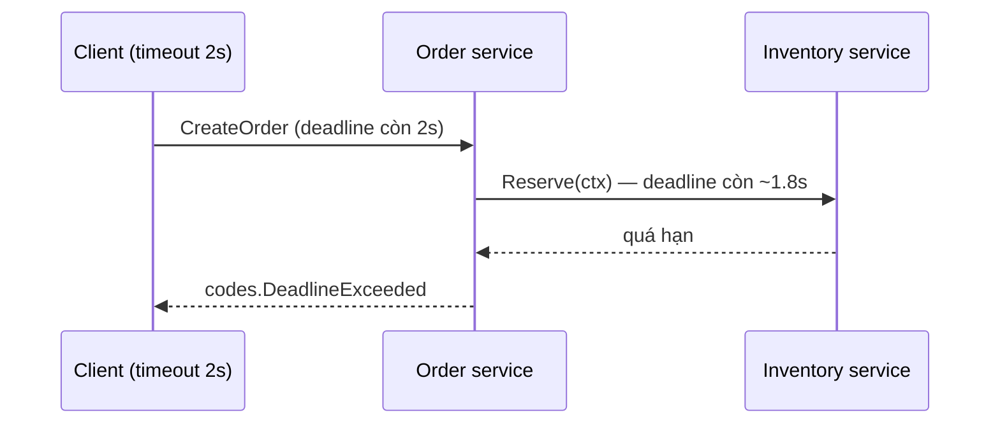

# gRPC và Protocol Buffers

gRPC là framework RPC (Remote Procedure Call — gọi hàm từ xa) do Google phát triển, dùng Protocol Buffers để mô tả API và mã hoá dữ liệu nhị phân, chạy trên HTTP/2. Go là một trong những ngôn ngữ được hỗ trợ tốt nhất, và gRPC gần như là lựa chọn mặc định cho giao tiếp giữa các microservice viết bằng Go. Bài này đi từ file `.proto`, sinh code, viết server/client unary, bốn kiểu streaming, interceptor, deadline, mã lỗi, rồi so sánh với REST.

---

:::note[Ghi nhớ nhanh]

- ⭐ **Contract-first** — viết file `.proto` trước, sinh code Go cho cả server và client; hai bên không bao giờ lệch kiểu dữ liệu.
- ⭐ **Luôn đặt deadline cho mọi lời gọi** — `context.WithTimeout`; không có deadline thì một service chậm kéo cả chuỗi treo theo.
- **4 kiểu RPC** — unary, server streaming, client streaming, bidirectional streaming.
- **Lỗi dùng `status.Error(codes.X, msg)`** — client đọc lại bằng `status.Code(err)`; đừng trả lỗi Go thường (sẽ thành `Unknown`).
- **Interceptor = middleware của gRPC** — log, auth, metrics, recover panic.
- **Không đổi số thứ tự field** trong `.proto` đã phát hành — số field mới là thứ được mã hoá, không phải tên.

:::

---

## Mục lục

- [Vì sao cần gRPC?](#vì-sao-cần-grpc)
- [Protocol Buffers](#protocol-buffers)
- [Sinh code Go](#sinh-code-go)
- [Server và client unary](#server-và-client-unary)
- [Streaming](#streaming)
- [Interceptor](#interceptor)
- [Deadline và status code](#deadline-và-status-code)
- [gRPC-Gateway và ConnectRPC](#grpc-gateway-và-connectrpc)
- [REST hay gRPC?](#rest-hay-grpc)
- [Câu hỏi phỏng vấn](#câu-hỏi-phỏng-vấn)

---

## Vì sao cần gRPC?

**Vấn đề:** Hệ thống có hàng chục service gọi nhau bằng REST/JSON. Mỗi team tự viết struct request/response, tự viết HTTP client, và hợp đồng giữa hai bên chỉ nằm trong tài liệu (hoặc trong đầu):

```go
// Service Order gọi service User — tự đoán format JSON
resp, err := client.Get("http://user-svc/users/" + id)
// ...
var u struct {
	ID       string `json:"id"`
	FullName string `json:"full_name"` // bên kia đã đổi thành "fullName" từ tuần trước?
}
json.NewDecoder(resp.Body).Decode(&u) // không lỗi, chỉ ra chuỗi rỗng — bug âm thầm
```

Thêm vào đó: JSON dạng text tốn băng thông và CPU để parse; HTTP/1.1 mỗi kết nối chỉ xử lý một request tại một thời điểm; muốn stream dữ liệu hai chiều phải chuyển sang WebSocket.

**Giải pháp:** Định nghĩa API **một lần** trong file `.proto`, sinh code cho mọi ngôn ngữ:

```protobuf
service UserService {
  rpc GetUser(GetUserRequest) returns (User);
}
```

```go
// Client Go: gọi như hàm bình thường, kiểu dữ liệu được kiểm tra lúc biên dịch
u, err := userClient.GetUser(ctx, &userpb.GetUserRequest{Id: "42"})
fmt.Println(u.GetFullName())
```

Dữ liệu được mã hoá nhị phân (nhỏ, parse nhanh), chạy trên HTTP/2 (nhiều request song song trên một kết nối, hỗ trợ streaming hai chiều).

:::tip[Dùng thực tế]

- **Giao tiếp nội bộ giữa microservice** — order gọi inventory, payment gọi fraud-check.
- **Streaming dữ liệu** — đẩy giá cổ phiếu, vị trí tài xế, log realtime từ server xuống client.
- **Hệ thống đa ngôn ngữ** — backend Go, service ML bằng Python, app mobile Kotlin/Swift dùng chung một file `.proto`.
- **Hạ tầng cloud-native** — Kubernetes, etcd, containerd đều dùng gRPC cho API nội bộ.

:::

:::tip[Ví dụ đời thường]

REST/JSON giống **gửi thư tay viết tự do** — mỗi người viết một kiểu, người nhận phải tự đọc hiểu, dễ hiểu nhầm. gRPC giống **tờ khai hải quan in sẵn mẫu**: ô nào ghi gì, kiểu gì đã quy định từ trước (file `.proto`), cả hai bên dùng cùng một mẫu, máy đọc tự động rất nhanh, và điền thiếu hay sai kiểu là bị phát hiện ngay.

:::

---

## Protocol Buffers

**Protocol Buffers** (protobuf) là ngôn ngữ mô tả dữ liệu + định dạng mã hoá nhị phân. Bạn viết schema trong file `.proto` (dùng cú pháp `proto3`):

```protobuf
// proto/user/v1/user.proto
syntax = "proto3";

package user.v1;

// Đường dẫn import của package Go được sinh ra
option go_package = "example.com/shop/gen/user/v1;userv1";

import "google/protobuf/timestamp.proto";

enum Role {
  ROLE_UNSPECIFIED = 0; // proto3: giá trị enum đầu tiên phải là 0
  ROLE_CUSTOMER = 1;
  ROLE_ADMIN = 2;
}

message User {
  string id = 1;          // số 1, 2, 3... là "field number" — thứ thật sự được mã hoá
  string full_name = 2;
  string email = 3;
  Role role = 4;
  repeated string tags = 5;                   // repeated = slice
  google.protobuf.Timestamp created_at = 6;   // kiểu dựng sẵn (well-known type)
  optional string phone = 7;                  // optional → phân biệt "không có" với ""
}

message GetUserRequest { string id = 1; }
message ListUsersRequest { int32 page_size = 1; }
message CreateUserRequest { string full_name = 1; string email = 2; }
message CreateUsersSummary { int32 created = 1; }
message ChatMessage { string from = 1; string text = 2; }

service UserService {
  rpc GetUser(GetUserRequest) returns (User);                          // unary
  rpc ListUsers(ListUsersRequest) returns (stream User);               // server streaming
  rpc CreateUsers(stream CreateUserRequest) returns (CreateUsersSummary); // client streaming
  rpc Chat(stream ChatMessage) returns (stream ChatMessage);           // bidirectional
}
```

Ánh xạ sang Go:

| Protobuf | Go |
|----------|-----|
| `string`, `bool`, `bytes` | `string`, `bool`, `[]byte` |
| `int32`, `int64`, `uint32` | `int32`, `int64`, `uint32` |
| `double`, `float` | `float64`, `float32` |
| `repeated T` | `[]T` |
| `map<string, int32>` | `map[string]int32` |
| `message User` | `*User` (luôn dùng con trỏ) |
| `optional string` | `*string` |
| `enum Role` | `type Role int32` + hằng `Role_ROLE_ADMIN` |
| `full_name` | field `FullName`, getter `GetFullName()` |

:::warning[Quy tắc tương thích ngược]

- **Không bao giờ đổi field number** hay đổi kiểu của field đã phát hành — client cũ sẽ đọc sai dữ liệu.
- Xoá field thì **đánh dấu `reserved`** để không ai vô tình dùng lại số đó: `reserved 3; reserved "email";`.
- Thêm field mới luôn an toàn — bên cũ không biết field đó sẽ bỏ qua.
- Đổi **tên** field không làm hỏng mã hoá nhị phân (vì mã hoá theo số), nhưng làm hỏng JSON mapping và code dùng nó.

:::

---

## Sinh code Go

### Cách 1: protoc + plugin

```bash
# Cài trình biên dịch protoc (macOS)
brew install protobuf

# Cài 2 plugin Go: một sinh message, một sinh service gRPC
go install google.golang.org/protobuf/cmd/protoc-gen-go@latest
go install google.golang.org/grpc/cmd/protoc-gen-go-grpc@latest

# Sinh code (plugin phải nằm trong PATH — thường là $(go env GOPATH)/bin)
protoc --go_out=gen --go_opt=paths=source_relative \
       --go-grpc_out=gen --go-grpc_opt=paths=source_relative \
       -I proto proto/user/v1/user.proto
```

Kết quả:

```text
gen/user/v1/user.pb.go        # struct message, enum, hàm mã hoá  (protoc-gen-go)
gen/user/v1/user_grpc.pb.go   # interface server, client stub      (protoc-gen-go-grpc)
```

### Cách 2: buf

[buf](https://buf.build/) thay thế `protoc` với cấu hình YAML, có thêm lint và kiểm tra **breaking change** (so file `.proto` mới với bản cũ để phát hiện thay đổi phá tương thích):

```yaml
# buf.yaml
version: v2
modules:
  - path: proto
```

```yaml
# buf.gen.yaml
version: v2
plugins:
  - remote: buf.build/protocolbuffers/go
    out: gen
    opt: paths=source_relative
  - remote: buf.build/grpc/go
    out: gen
    opt: paths=source_relative
```

```bash
buf lint                                   # kiểm tra quy ước đặt tên, cấu trúc
buf breaking --against '.git#branch=main'  # so với nhánh main, báo thay đổi phá vỡ
buf generate                               # sinh code
```

Thêm thư viện runtime vào module:

```bash
go get google.golang.org/grpc google.golang.org/protobuf
```

---

## Server và client unary

**Unary** = một request, một response — giống gọi hàm thường.

### Server

```go
package main

import (
	"context"
	"log"
	"net"

	"google.golang.org/grpc"
	"google.golang.org/grpc/codes"
	"google.golang.org/grpc/reflection"
	"google.golang.org/grpc/status"

	userv1 "example.com/shop/gen/user/v1"
)

type userServer struct {
	// Nhúng (theo giá trị, không phải con trỏ) để server vẫn biên dịch được
	// khi .proto thêm RPC mới — RPC chưa viết sẽ trả codes.Unimplemented
	userv1.UnimplementedUserServiceServer
	users map[string]*userv1.User
}

func (s *userServer) GetUser(ctx context.Context, req *userv1.GetUserRequest) (*userv1.User, error) {
	if req.GetId() == "" {
		return nil, status.Error(codes.InvalidArgument, "id là bắt buộc")
	}
	u, ok := s.users[req.GetId()]
	if !ok {
		return nil, status.Errorf(codes.NotFound, "không tìm thấy user %s", req.GetId())
	}
	return u, nil
}

func main() {
	lis, err := net.Listen("tcp", ":50051")
	if err != nil {
		log.Fatalf("listen: %v", err)
	}

	srv := grpc.NewServer()
	userv1.RegisterUserServiceServer(srv, &userServer{
		users: map[string]*userv1.User{
			"42": {Id: "42", FullName: "Nguyễn Văn An", Email: "an@example.com"},
		},
	})
	reflection.Register(srv) // cho phép grpcurl/Postman khám phá API (thường chỉ bật ở dev)

	log.Println("gRPC server chạy ở :50051")
	if err := srv.Serve(lis); err != nil {
		log.Fatalf("serve: %v", err)
	}
}
```

Graceful shutdown tương tự HTTP: nhận tín hiệu rồi gọi `srv.GracefulStop()` (chờ RPC đang chạy xong) — có thể kèm hẹn giờ, quá hạn thì `srv.Stop()`.

### Client

```go
package main

import (
	"context"
	"log"
	"time"

	"google.golang.org/grpc"
	"google.golang.org/grpc/credentials/insecure"

	userv1 "example.com/shop/gen/user/v1"
)

func main() {
	// grpc.NewClient (từ grpc-go 1.63) thay cho grpc.Dial đã deprecated.
	// NewClient không kết nối ngay — kết nối được tạo lười ở lần gọi đầu tiên.
	conn, err := grpc.NewClient("localhost:50051",
		grpc.WithTransportCredentials(insecure.NewCredentials()), // không TLS — chỉ cho dev/nội bộ
	)
	if err != nil {
		log.Fatalf("tạo client: %v", err)
	}
	defer conn.Close()

	client := userv1.NewUserServiceClient(conn) // tạo một lần, dùng chung, an toàn đồng thời

	ctx, cancel := context.WithTimeout(context.Background(), 2*time.Second)
	defer cancel()

	u, err := client.GetUser(ctx, &userv1.GetUserRequest{Id: "42"})
	if err != nil {
		log.Fatalf("GetUser: %v", err)
	}
	log.Printf("user: %s <%s>", u.GetFullName(), u.GetEmail())
}
```

Thử nhanh bằng [grpcurl](https://github.com/fullstorydev/grpcurl) khi server bật reflection:

```bash
grpcurl -plaintext localhost:50051 list
grpcurl -plaintext -d '{"id":"42"}' localhost:50051 user.v1.UserService/GetUser
```

:::tip[Dùng getter]

Luôn đọc field qua getter (`u.GetEmail()`) thay vì truy cập trực tiếp (`u.Email`). Getter an toàn với con trỏ `nil` — trả giá trị zero thay vì panic, rất hữu ích với message lồng nhau (`req.GetUser().GetAddress().GetCity()`).

:::

---

## Streaming

| Kiểu | Khai báo | Ví dụ dùng |
|------|----------|-----------|
| Unary | `rpc A(Req) returns (Resp)` | CRUD thông thường |
| Server streaming | `rpc A(Req) returns (stream Resp)` | Xuất danh sách lớn, đẩy thông báo, giá realtime |
| Client streaming | `rpc A(stream Req) returns (Resp)` | Upload file theo chunk, gửi lô dữ liệu cảm biến |
| Bidirectional | `rpc A(stream Req) returns (stream Resp)` | Chat, game, đồng bộ hai chiều |

Code sinh ra (protoc-gen-go-grpc bản mới) dùng kiểu generic như `grpc.ServerStreamingServer[User]`, kèm alias tên cũ như `UserService_ListUsersServer` — dùng tên nào cũng được.

### Server streaming

```go
// Server: gửi lần lượt từng user, return nil để kết thúc stream
func (s *userServer) ListUsers(req *userv1.ListUsersRequest, stream userv1.UserService_ListUsersServer) error {
	for _, u := range s.users {
		if err := stream.Context().Err(); err != nil {
			return status.FromContextError(err).Err() // client đã huỷ/hết hạn → dừng sớm
		}
		if err := stream.Send(u); err != nil {
			return err
		}
	}
	return nil
}

// Client: đọc đến khi gặp io.EOF
stream, err := client.ListUsers(ctx, &userv1.ListUsersRequest{PageSize: 100})
if err != nil {
	log.Fatal(err)
}
for {
	u, err := stream.Recv()
	if errors.Is(err, io.EOF) {
		break // server đã gửi hết
	}
	if err != nil {
		log.Fatal(err)
	}
	log.Println(u.GetFullName())
}
```

### Client streaming

```go
// Server: nhận liên tục, khi client đóng gửi (io.EOF) thì trả kết quả tổng
func (s *userServer) CreateUsers(stream userv1.UserService_CreateUsersServer) error {
	var count int32
	for {
		req, err := stream.Recv()
		if errors.Is(err, io.EOF) {
			return stream.SendAndClose(&userv1.CreateUsersSummary{Created: count})
		}
		if err != nil {
			return err
		}
		_ = req // lưu req.GetFullName(), req.GetEmail() vào DB...
		count++
	}
}

// Client
stream, err := client.CreateUsers(ctx)
if err != nil {
	log.Fatal(err)
}
for _, name := range []string{"An", "Bình", "Chi"} {
	if err := stream.Send(&userv1.CreateUserRequest{FullName: name}); err != nil {
		log.Fatal(err)
	}
}
summary, err := stream.CloseAndRecv() // báo "gửi xong" và chờ response
if err != nil {
	log.Fatal(err)
}
log.Println("đã tạo:", summary.GetCreated())
```

### Bidirectional streaming

Hai chiều độc lập: thường một goroutine gửi, một goroutine nhận.

```go
// Server: echo lại mọi tin nhắn
func (s *userServer) Chat(stream userv1.UserService_ChatServer) error {
	for {
		msg, err := stream.Recv()
		if errors.Is(err, io.EOF) {
			return nil
		}
		if err != nil {
			return err
		}
		reply := &userv1.ChatMessage{From: "server", Text: "đã nhận: " + msg.GetText()}
		if err := stream.Send(reply); err != nil {
			return err
		}
	}
}

// Client
stream, err := client.Chat(ctx)
if err != nil {
	log.Fatal(err)
}
done := make(chan struct{})
go func() { // goroutine nhận
	defer close(done)
	for {
		msg, err := stream.Recv()
		if err != nil { // io.EOF khi server kết thúc
			return
		}
		log.Printf("%s: %s", msg.GetFrom(), msg.GetText())
	}
}()
for _, t := range []string{"xin chào", "tạm biệt"} {
	if err := stream.Send(&userv1.ChatMessage{From: "client", Text: t}); err != nil {
		log.Fatal(err)
	}
}
stream.CloseSend() // báo server: client không gửi nữa
<-done
```

---

## Interceptor

**Interceptor** là middleware của gRPC, có 4 loại: unary/stream × server/client.

```go
// Unary server interceptor: log thời gian xử lý và mã lỗi của mọi RPC
func loggingInterceptor(
	ctx context.Context,
	req any,
	info *grpc.UnaryServerInfo,
	handler grpc.UnaryHandler,
) (any, error) {
	start := time.Now()
	resp, err := handler(ctx, req) // gọi handler thật
	slog.Info("grpc", "method", info.FullMethod,
		"code", status.Code(err).String(), "duration", time.Since(start))
	return resp, err
}

// Interceptor xác thực: đọc token từ metadata (tương đương HTTP header)
func authInterceptor(
	ctx context.Context,
	req any,
	info *grpc.UnaryServerInfo,
	handler grpc.UnaryHandler,
) (any, error) {
	md, _ := metadata.FromIncomingContext(ctx)
	tokens := md.Get("authorization") // key metadata luôn viết thường
	if len(tokens) == 0 || !validToken(tokens[0]) {
		return nil, status.Error(codes.Unauthenticated, "thiếu hoặc sai token")
	}
	return handler(ctx, req)
}

srv := grpc.NewServer(
	grpc.ChainUnaryInterceptor(loggingInterceptor, authInterceptor), // chạy theo thứ tự
	// grpc.ChainStreamInterceptor(...) cho RPC streaming
)
```

Phía client gửi metadata và gắn interceptor:

```go
ctx = metadata.AppendToOutgoingContext(ctx, "authorization", "Bearer "+token)

conn, err := grpc.NewClient(addr,
	grpc.WithTransportCredentials(insecure.NewCredentials()),
	grpc.WithChainUnaryInterceptor(clientLogging), // func(ctx, method, req, reply, cc, invoker, opts...) error
)
```

Không cần tự viết hết: [go-grpc-middleware](https://github.com/grpc-ecosystem/go-grpc-middleware) có sẵn interceptor logging, recovery, retry, rate limit, validator; OpenTelemetry có instrumentation cho gRPC.

---

## Deadline và status code

### Deadline lan truyền qua context

Deadline của client được gửi kèm trong request; server nhận được `ctx` có cùng deadline. Nếu server tiếp tục gọi service khác bằng **chính `ctx` đó**, deadline lan truyền xuyên suốt chuỗi gọi.



```go
func (s *orderServer) CreateOrder(ctx context.Context, req *orderv1.CreateOrderRequest) (*orderv1.Order, error) {
	// Truyền ctx xuống — KHÔNG dùng context.Background() ở đây
	_, err := s.inventory.Reserve(ctx, &inventoryv1.ReserveRequest{Sku: req.GetSku()})
	if err != nil {
		return nil, err
	}
	// ...
}
```

### Status code

| Code | Khi nào dùng | Tương đương HTTP |
|------|--------------|------------------|
| `OK` | Thành công | 200 |
| `InvalidArgument` | Input sai định dạng | 400 |
| `Unauthenticated` | Chưa đăng nhập / token sai | 401 |
| `PermissionDenied` | Đã đăng nhập nhưng không có quyền | 403 |
| `NotFound` | Không tìm thấy tài nguyên | 404 |
| `AlreadyExists` | Tạo trùng | 409 |
| `FailedPrecondition` | Trạng thái hệ thống không cho phép (vd huỷ đơn đã giao) | 400 |
| `ResourceExhausted` | Hết quota, rate limit | 429 |
| `Unavailable` | Service tạm thời không truy cập được — **có thể retry** | 503 |
| `DeadlineExceeded` | Hết thời hạn | 504 |
| `Internal` | Lỗi nội bộ | 500 |
| `Unknown` | Lỗi không rõ — trả `error` Go thường sẽ thành code này | 500 |

Client xử lý lỗi theo code:

```go
u, err := client.GetUser(ctx, req)
if err != nil {
	switch status.Code(err) {
	case codes.NotFound:
		return nil, ErrUserNotFound
	case codes.DeadlineExceeded, codes.Unavailable:
		return nil, fmt.Errorf("user service tạm thời lỗi: %w", err) // có thể retry
	default:
		st, _ := status.FromError(err)
		return nil, fmt.Errorf("GetUser: %s", st.Message())
	}
}
```

:::warning[Lỗi hay gặp]

- **Trả `errors.New(...)` hoặc `fmt.Errorf` từ handler** → client nhận `codes.Unknown`, không phân biệt được lỗi nào. Hãy dùng `status.Error` với code phù hợp.
- **Client không đặt deadline** → mặc định không có deadline, RPC có thể treo vô hạn.
- **Tạo `grpc.ClientConn` mới cho mỗi request** — conn là đối tượng nặng (giữ kết nối HTTP/2, resolver, load balancer); tạo một lần và dùng chung.
- **Lộ chi tiết nội bộ trong message lỗi** (câu SQL, stack trace) — log ở server, trả message chung cho client.

:::

---

## gRPC-Gateway và ConnectRPC

Trình duyệt không gọi gRPC "thuần" được (cần kiểm soát HTTP/2 trailer). Hai giải pháp phổ biến:

- **[gRPC-Gateway](https://github.com/grpc-ecosystem/grpc-gateway)** — plugin `protoc` sinh **reverse proxy REST/JSON** từ annotation `google.api.http` trong `.proto`. Một định nghĩa, phục vụ cả gRPC (nội bộ) lẫn REST (frontend, đối tác), kèm sinh OpenAPI.

```protobuf
import "google/api/annotations.proto";

service UserService {
  rpc GetUser(GetUserRequest) returns (User) {
    option (google.api.http) = { get: "/v1/users/{id}" };
  }
}
```

- **[ConnectRPC](https://connectrpc.com/)** (`connectrpc.com/connect`) — thư viện của nhóm buf, sinh handler **dựa trên `net/http`** hỗ trợ cùng lúc ba giao thức: gRPC, gRPC-Web và Connect (POST JSON đơn giản, gọi được bằng `curl` hay `fetch` từ trình duyệt). Dùng chung router, middleware chuẩn của `net/http`.

---

## REST hay gRPC?

| Tiêu chí | REST + JSON | gRPC + Protobuf |
|----------|-------------|-----------------|
| Hợp đồng API | OpenAPI (tuỳ chọn, hay lệch với code) | `.proto` bắt buộc, sinh code |
| Định dạng | Text JSON, dễ đọc | Nhị phân, nhỏ và nhanh hơn |
| Giao thức | HTTP/1.1 hoặc HTTP/2 | HTTP/2 |
| Streaming | Hạn chế (SSE, WebSocket riêng) | Có sẵn 4 kiểu |
| Gọi từ trình duyệt | ✅ trực tiếp | ⚠️ cần gRPC-Web / Gateway / Connect |
| Debug | `curl`, DevTools | Cần `grpcurl`, Postman |
| Cache HTTP (CDN) | ✅ GET cache được | ❌ |
| Deadline, metadata, mã lỗi chuẩn | Tự quy ước | Có sẵn |
| Phù hợp | API công khai, web/mobile | Giao tiếp nội bộ giữa service |

Thực tế thường kết hợp: **gRPC giữa các service nội bộ**, **REST/JSON (hoặc Gateway/Connect) cho bên ngoài**.

---

## Câu hỏi phỏng vấn

**1. Protocol Buffers mã hoá theo tên hay số field? Hệ quả với việc thay đổi schema?**

<details className="qa">
<summary>Xem đáp án</summary>

Theo **field number** (kèm wire type), tên field không xuất hiện trong dữ liệu nhị phân. Vì vậy: được thêm field mới (bên cũ bỏ qua field lạ); được đổi tên field (nhị phân không đổi, nhưng ảnh hưởng JSON và code); **không được** đổi số hoặc đổi kiểu không tương thích của field đã dùng; khi xoá field phải `reserved` số và tên để tránh bị tái sử dụng, nếu không client cũ sẽ hiểu sai dữ liệu mới.

</details>

**2. Kể tên 4 kiểu RPC trong gRPC và ví dụ dùng.**

<details className="qa">
<summary>Xem đáp án</summary>

- **Unary**: 1 request – 1 response (lấy thông tin user).
- **Server streaming**: 1 request – nhiều response (đẩy giá cổ phiếu, xuất danh sách lớn).
- **Client streaming**: nhiều request – 1 response (upload file theo chunk, gửi lô số liệu cảm biến rồi nhận tổng kết).
- **Bidirectional streaming**: hai chiều độc lập trên cùng một stream (chat, game, đồng bộ realtime).

Tất cả chạy trên một kết nối HTTP/2 nhờ multiplexing.

</details>

**3. Deadline trong gRPC hoạt động thế nào? Vì sao quan trọng?**

<details className="qa">
<summary>Xem đáp án</summary>

Client đặt deadline qua `context.WithTimeout`/`WithDeadline`; grpc-go gửi nó trong header `grpc-timeout`. Server nhận `ctx` có cùng deadline, khi hết hạn `ctx.Done()` đóng và client nhận `codes.DeadlineExceeded`. Nếu server truyền tiếp `ctx` khi gọi service khác, deadline lan truyền qua cả chuỗi, tránh việc service phía sau vẫn làm việc vô ích cho một request đã bị bỏ. Không đặt deadline thì một service chậm có thể làm cạn goroutine/kết nối của mọi service gọi nó (lỗi dây chuyền).

</details>

**4. Vì sao server phải nhúng `UnimplementedXxxServer`?**

<details className="qa">
<summary>Xem đáp án</summary>

Để **tương thích tiến**: khi file `.proto` thêm RPC mới và sinh lại code, interface server có thêm method. Nhờ nhúng struct `Unimplemented...`, kiểu của bạn vẫn thoả interface (method mới được kế thừa, trả `codes.Unimplemented`) nên code vẫn biên dịch được. protoc-gen-go-grpc mặc định bắt buộc nhúng (method `mustEmbedUnimplemented...`). Nên nhúng **theo giá trị** — nhúng con trỏ nil sẽ panic khi RPC chưa hiện thực được gọi.

</details>

**5. Interceptor là gì? Cho ví dụ.**

<details className="qa">
<summary>Xem đáp án</summary>

Là hàm bọc quanh lời gọi RPC, tương tự middleware HTTP, có cho unary/stream ở cả server và client. Server unary có chữ ký `func(ctx, req any, info *grpc.UnaryServerInfo, handler grpc.UnaryHandler) (any, error)`. Dùng cho logging, metrics, tracing, xác thực (đọc token từ `metadata`), recover panic, validate request, retry phía client. Gắn bằng `grpc.ChainUnaryInterceptor(...)` ở server, `grpc.WithChainUnaryInterceptor(...)` ở client.

</details>

**6. Khi nào chọn REST thay vì gRPC?**

<details className="qa">
<summary>Xem đáp án</summary>

Khi API công khai cho bên thứ ba hoặc trình duyệt gọi trực tiếp, cần dễ debug bằng `curl`, cần tận dụng cache HTTP/CDN, hoặc team/đối tác chưa sẵn sàng với toolchain protobuf. gRPC phù hợp cho giao tiếp nội bộ giữa service: hiệu năng cao, hợp đồng chặt, streaming, đa ngôn ngữ. Có thể dùng gRPC-Gateway hoặc ConnectRPC để phục vụ cả hai từ một định nghĩa `.proto`.

</details>
