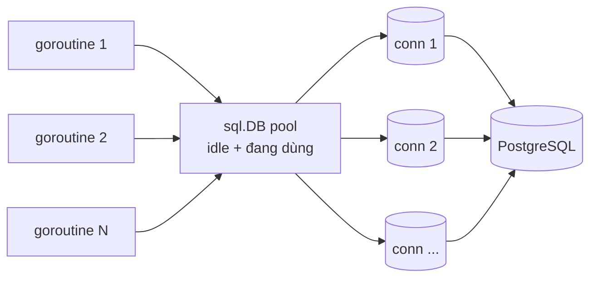

# Làm việc với database

Go không có một ORM "chính thức" như Hibernate hay Entity Framework. Thay vào đó, thư viện chuẩn cung cấp `database/sql` — một lớp trừu tượng mỏng có sẵn connection pool — và cộng đồng xây nhiều lớp phía trên: driver (pgx, MySQL), sqlx giảm code lặp, sqlc sinh code từ SQL, GORM là ORM đầy đủ, cùng các công cụ migration. Bài này đi qua từng lớp, chỉ ra khi nào nên dùng cái nào và những lỗi kinh điển (quên `rows.Close`, nối chuỗi SQL, pool cấu hình sai).

---

:::note[Ghi nhớ nhanh]

- ⭐ **`*sql.DB` là một connection pool, không phải một kết nối** — tạo một lần lúc khởi động, dùng chung cho cả ứng dụng, an toàn khi dùng đồng thời.
- ⭐ **Luôn dùng tham số `$1` / `?`, không bao giờ nối chuỗi SQL** — chống SQL injection.
- **`QueryRowContext(...).Scan` không thấy dòng → `sql.ErrNoRows`** — kiểm tra bằng `errors.Is`.
- **Với `QueryContext`: luôn `defer rows.Close()` và kiểm tra `rows.Err()`** — quên đóng sẽ giữ kết nối, pool cạn dần.
- **Transaction: `BeginTx` → `defer tx.Rollback()` → `tx.Commit()`** — Rollback sau Commit là vô hại.
- **Chọn công cụ**: thích viết SQL → sqlc hoặc sqlx; muốn ORM, CRUD nhanh → GORM; Postgres hiệu năng cao → pgx trực tiếp.

:::

---

## Mục lục

- [Vì sao cần database/sql?](#vì-sao-cần-databasesql)
- [database/sql cơ bản](#databasesql-cơ-bản)
- [Connection pool](#connection-pool)
- [Truy vấn và Scan](#truy-vấn-và-scan)
- [Chống SQL injection và prepared statement](#chống-sql-injection-và-prepared-statement)
- [Transaction](#transaction)
- [Driver: pgx và MySQL](#driver-pgx-và-mysql)
- [sqlx](#sqlx)
- [sqlc](#sqlc)
- [GORM](#gorm)
- [Migration](#migration)
- [Bảng so sánh](#bảng-so-sánh)

---

## Vì sao cần database/sql?

**Vấn đề:** Nếu mỗi database có một API riêng, đổi từ MySQL sang PostgreSQL phải viết lại toàn bộ tầng truy cập dữ liệu. Ngoài ra, việc mở/đóng kết nối cho mỗi request là rất đắt (bắt tay TCP, TLS, xác thực):

```go
// Mỗi request mở kết nối mới — chậm, và khi tải cao sẽ vượt max_connections của DB
func getUser(id int64) (User, error) {
	conn := mysqlLib.Connect("user:pass@tcp(db:3306)/shop") // API riêng của từng DB
	defer conn.Close()
	return conn.QueryUser(id)
}
```

**Giải pháp:** `database/sql` định nghĩa **một API chung**; mỗi database có một **driver** tự đăng ký vào. Kèm theo là connection pool tự quản lý:

```go
import (
	"database/sql"

	_ "github.com/jackc/pgx/v5/stdlib" // import để driver tự đăng ký tên "pgx"
)

db, err := sql.Open("pgx", os.Getenv("DATABASE_URL")) // pool, tạo một lần
// ... dùng db ở mọi nơi; đổi sang MySQL chủ yếu chỉ đổi driver và placeholder
```

:::tip[Dùng thực tế]

- **Service CRUD** với PostgreSQL/MySQL — tầng repository dùng `database/sql` + sqlc hoặc sqlx.
- **Báo cáo, truy vấn phức tạp** (JOIN, CTE, window function) — viết SQL thuần, Scan vào struct.
- **Admin nội bộ, prototype nhanh** — GORM với `AutoMigrate` và CRUD sẵn có.
- **Hệ thống nhiều ghi đồng thời** (ví điện tử, kho hàng) — transaction và isolation level phải đúng.

:::

:::tip[Ví dụ đời thường]

Connection pool giống **bãi xe taxi của một khách sạn**: thay vì mỗi khách tự gọi taxi từ xa (mở kết nối mới, chờ lâu), khách sạn giữ sẵn một số xe đỗ trước cửa. Khách cần đi thì lấy xe có sẵn, đi xong xe quay về bãi cho khách sau. Bãi quá nhỏ thì khách phải xếp hàng; quá lớn thì tốn chỗ và có thể vượt giới hạn xe mà thành phố (database) cho phép.

:::

---

## database/sql cơ bản

```go
func OpenDB(ctx context.Context, dsn string) (*sql.DB, error) {
	db, err := sql.Open("pgx", dsn) // CHƯA kết nối — chỉ kiểm tra tham số và tạo pool
	if err != nil {
		return nil, err
	}

	// Cấu hình pool (giải thích ở phần sau)
	db.SetMaxOpenConns(25)
	db.SetMaxIdleConns(25)
	db.SetConnMaxLifetime(30 * time.Minute)
	db.SetConnMaxIdleTime(5 * time.Minute)

	// Ping để chắc chắn kết nối được ngay lúc khởi động (fail fast)
	pingCtx, cancel := context.WithTimeout(ctx, 5*time.Second)
	defer cancel()
	if err := db.PingContext(pingCtx); err != nil {
		db.Close()
		return nil, fmt.Errorf("ping db: %w", err)
	}
	return db, nil
}
```

Các method chính:

| Method | Dùng cho | Trả về |
|--------|----------|--------|
| `QueryRowContext` | SELECT đúng một dòng (hoặc `INSERT ... RETURNING`) | `*sql.Row` → `.Scan(...)` |
| `QueryContext` | SELECT nhiều dòng | `*sql.Rows` → lặp `Next()` |
| `ExecContext` | INSERT/UPDATE/DELETE không cần dữ liệu trả về | `sql.Result` (`RowsAffected`, `LastInsertId`) |
| `PrepareContext` | Câu lệnh chạy lặp lại nhiều lần | `*sql.Stmt` |
| `BeginTx` | Mở transaction | `*sql.Tx` |

Luôn dùng bản có hậu tố `Context` để truy vấn bị huỷ theo request (client ngắt kết nối, hết timeout).

---

## Connection pool



| Thiết lập | Ý nghĩa | Mặc định |
|-----------|---------|----------|
| `SetMaxOpenConns(n)` | Tổng số kết nối tối đa (đang dùng + idle). Hết thì goroutine **chờ** | 0 = không giới hạn |
| `SetMaxIdleConns(n)` | Số kết nối rảnh được giữ lại để tái sử dụng | 2 |
| `SetConnMaxLifetime(d)` | Tuổi thọ tối đa của một kết nối, hết thì đóng và mở mới | 0 = vĩnh viễn |
| `SetConnMaxIdleTime(d)` | Kết nối rảnh quá lâu thì đóng | 0 = vĩnh viễn |

Nguyên tắc chọn số:

- `MaxOpenConns` × **số instance** của service phải **nhỏ hơn** `max_connections` của DB (Postgres mặc định 100). 10 pod × 25 = 250 kết nối là vượt.
- `MaxIdleConns` mặc định chỉ 2 — tải cao sẽ liên tục đóng/mở kết nối; thường đặt bằng `MaxOpenConns`.
- `ConnMaxLifetime` vài chục phút giúp cân bằng lại khi DB failover hoặc đi qua load balancer/PgBouncer.
- Theo dõi bằng `db.Stats()` (`WaitCount`, `WaitDuration` tăng nhanh nghĩa là pool đang thiếu).

---

## Truy vấn và Scan

### Một dòng

```go
type User struct {
	ID        int64
	Name      string
	Email     string
	Phone     sql.NullString // cột có thể NULL
	CreatedAt time.Time
}

var ErrNotFound = errors.New("không tìm thấy")

func (r *UserRepo) GetByID(ctx context.Context, id int64) (User, error) {
	var u User
	err := r.db.QueryRowContext(ctx,
		`SELECT id, name, email, phone, created_at FROM users WHERE id = $1`, id,
	).Scan(&u.ID, &u.Name, &u.Email, &u.Phone, &u.CreatedAt) // thứ tự khớp thứ tự cột
	if errors.Is(err, sql.ErrNoRows) {
		return User{}, ErrNotFound // chuyển thành lỗi nghiệp vụ của mình
	}
	if err != nil {
		return User{}, fmt.Errorf("get user %d: %w", id, err)
	}
	return u, nil
}
```

Cột có thể `NULL` phải Scan vào `sql.NullString`, `sql.NullInt64`, `sql.Null[T]` (generic, Go 1.22+) hoặc con trỏ (`*string`) — Scan `NULL` vào `string` thường sẽ báo lỗi.

### Nhiều dòng

```go
func (r *UserRepo) List(ctx context.Context, limit int) ([]User, error) {
	rows, err := r.db.QueryContext(ctx,
		`SELECT id, name, email, phone, created_at FROM users ORDER BY id LIMIT $1`, limit)
	if err != nil {
		return nil, fmt.Errorf("list users: %w", err)
	}
	defer rows.Close() // BẮT BUỘC — trả kết nối về pool

	var users []User
	for rows.Next() {
		var u User
		if err := rows.Scan(&u.ID, &u.Name, &u.Email, &u.Phone, &u.CreatedAt); err != nil {
			return nil, err
		}
		users = append(users, u)
	}
	return users, rows.Err() // lỗi xảy ra giữa chừng khi lặp (mất kết nối...) nằm ở đây
}
```

:::warning[Lỗi hay gặp]

- **Quên `rows.Close()`** — kết nối bị giữ, sau vài trăm request pool cạn và mọi truy vấn treo chờ.
- **Quên kiểm tra `rows.Err()`** — vòng lặp dừng sớm vì lỗi mạng nhưng hàm vẫn trả "thành công" với danh sách thiếu.
- **`QueryContext` cho câu INSERT/UPDATE** mà không đọc/đóng rows — dùng `ExecContext`.
- **`SELECT *`** rồi Scan theo thứ tự — thêm cột vào bảng là Scan sai/lỗi. Luôn liệt kê cột.

:::

---

## Chống SQL injection và prepared statement

```go
// SAI — nối chuỗi: email = "' OR '1'='1" sẽ trả về toàn bộ bảng
q := "SELECT id FROM users WHERE email = '" + email + "'"
db.QueryContext(ctx, q)

// ĐÚNG — tham số hoá: driver gửi giá trị tách khỏi câu SQL, DB không bao giờ hiểu nó là code
db.QueryContext(ctx, "SELECT id FROM users WHERE email = $1", email)
```

Placeholder khác nhau theo driver: PostgreSQL dùng `$1, $2`, MySQL và SQLite dùng `?`.

Tham số chỉ thay được **giá trị**, không thay được tên bảng/cột hay `ASC/DESC`. Với phần động đó, dùng **whitelist**:

```go
var sortColumns = map[string]string{"name": "name", "created": "created_at"}

col, ok := sortColumns[r.URL.Query().Get("sort")]
if !ok {
	col = "id"
}
q := "SELECT id, name FROM users ORDER BY " + col // an toàn vì col chỉ đến từ map cố định
```

**Prepared statement** — câu lệnh được DB phân tích một lần, chạy nhiều lần:

```go
stmt, err := db.PrepareContext(ctx, `INSERT INTO subscribers (email) VALUES ($1)`)
if err != nil {
	return err
}
defer stmt.Close()

for _, e := range emails {
	if _, err := stmt.ExecContext(ctx, e); err != nil {
		return fmt.Errorf("insert %s: %w", e, err)
	}
}
```

Thực tế, truy vấn có tham số thường đã được driver chuẩn bị ngầm (pgx còn tự cache statement), nên chỉ cần `Prepare` thủ công khi chạy cùng một câu rất nhiều lần trong vòng lặp nóng.

---

## Transaction

Chuyển tiền: trừ tài khoản A và cộng tài khoản B phải cùng thành công hoặc cùng thất bại.

```go
func Transfer(ctx context.Context, db *sql.DB, from, to, amount int64) error {
	tx, err := db.BeginTx(ctx, &sql.TxOptions{Isolation: sql.LevelSerializable})
	if err != nil {
		return err
	}
	// Rollback sau khi đã Commit chỉ trả về sql.ErrTxDone, vô hại.
	// Nhờ dòng này, mọi nhánh return lỗi đều tự rollback.
	defer tx.Rollback()

	res, err := tx.ExecContext(ctx,
		`UPDATE accounts SET balance = balance - $1 WHERE id = $2 AND balance >= $1`, amount, from)
	if err != nil {
		return fmt.Errorf("trừ tiền: %w", err)
	}
	n, err := res.RowsAffected()
	if err != nil {
		return err
	}
	if n == 0 {
		return errors.New("số dư không đủ")
	}

	if _, err := tx.ExecContext(ctx,
		`UPDATE accounts SET balance = balance + $1 WHERE id = $2`, amount, to); err != nil {
		return fmt.Errorf("cộng tiền: %w", err)
	}
	return tx.Commit()
}
```

:::warning[Bẫy với transaction]

- **Dùng `db.ExecContext` thay vì `tx.ExecContext`** bên trong transaction — câu lệnh chạy trên kết nối khác, **nằm ngoài** transaction.
- **Gọi ra ngoài (HTTP, gửi email) khi đang giữ transaction** — kết nối và khoá bị giữ lâu; làm việc chậm trước hoặc sau transaction.
- `*sql.Tx` gắn với **một** kết nối và **không** an toàn khi dùng từ nhiều goroutine cùng lúc.

:::

---

## Driver: pgx và MySQL

| Database | Driver | Tên driver cho `sql.Open` |
|----------|--------|---------------------------|
| PostgreSQL | `github.com/jackc/pgx/v5/stdlib` | `"pgx"` |
| MySQL/MariaDB | `github.com/go-sql-driver/mysql` | `"mysql"` |
| SQLite (không cần cgo) | `modernc.org/sqlite` | `"sqlite"` |
| SQLite (cgo) | `github.com/mattn/go-sqlite3` | `"sqlite3"` |

```go
// MySQL: parseTime=true để Scan DATETIME vào time.Time
import _ "github.com/go-sql-driver/mysql"

db, err := sql.Open("mysql", "app:secret@tcp(localhost:3306)/shop?parseTime=true&loc=UTC")
```

### pgx dùng trực tiếp (không qua database/sql)

[pgx](https://github.com/jackc/pgx) có API riêng mạnh hơn `database/sql` cho PostgreSQL: hỗ trợ đầy đủ kiểu Postgres (array, jsonb, uuid...), `COPY`, batch, LISTEN/NOTIFY, và pool riêng `pgxpool`:

```go
import (
	"github.com/jackc/pgx/v5"
	"github.com/jackc/pgx/v5/pgxpool"
)

pool, err := pgxpool.New(ctx, os.Getenv("DATABASE_URL")) // pool_max_conns=20 cấu hình qua DSN
if err != nil {
	return err
}
defer pool.Close()

// Một dòng
var name string
err = pool.QueryRow(ctx, `SELECT name FROM users WHERE id = $1`, 42).Scan(&name)
if errors.Is(err, pgx.ErrNoRows) { // pgx có lỗi ErrNoRows riêng
	// ...
}

// Nhiều dòng → slice struct, tự map cột theo tên field (hoặc tag `db`)
type User struct {
	ID    int64  `db:"id"`
	Name  string `db:"name"`
	Email string `db:"email"`
}
rows, _ := pool.Query(ctx, `SELECT id, name, email FROM users LIMIT $1`, 50)
users, err := pgx.CollectRows(rows, pgx.RowToStructByName[User]) // tự đóng rows
```

Nếu chắc chắn chỉ dùng PostgreSQL, pgx trực tiếp (hoặc sqlc sinh code cho pgx) là lựa chọn tốt nhất về hiệu năng và tính năng.

---

## sqlx

[sqlx](https://github.com/jmoiron/sqlx) mở rộng `database/sql` (vẫn dùng chung driver), bỏ bớt việc `Scan` từng cột bằng tay:

```go
import "github.com/jmoiron/sqlx"

type User struct {
	ID    int64  `db:"id"`
	Name  string `db:"name"`
	Email string `db:"email"`
}

db, err := sqlx.Connect("pgx", dsn) // Open + Ping

var u User
err = db.GetContext(ctx, &u, `SELECT id, name, email FROM users WHERE id = $1`, 42) // 1 dòng

var users []User
err = db.SelectContext(ctx, &users, `SELECT id, name, email FROM users LIMIT $1`, 50) // nhiều dòng

// Named parameter: lấy giá trị từ field của struct theo tag db
_, err = db.NamedExecContext(ctx,
	`INSERT INTO users (name, email) VALUES (:name, :email)`, u)
```

`sqlx.In` hỗ trợ mở rộng `IN (?)` với slice. sqlx gọn, ít "phép thuật", nhưng câu SQL vẫn là chuỗi — sai tên cột chỉ phát hiện lúc chạy.

---

## sqlc

[sqlc](https://sqlc.dev/) đi theo hướng ngược lại ORM: **bạn viết SQL, sqlc sinh code Go type-safe**. Nó phân tích schema và câu truy vấn lúc sinh code, nên sai tên cột/kiểu bị báo **trước khi chạy**.

```yaml
# sqlc.yaml
version: "2"
sql:
  - engine: "postgresql"
    schema: "db/schema.sql"     # hoặc thư mục migrations
    queries: "db/query.sql"
    gen:
      go:
        package: "store"
        out: "internal/store"
        sql_package: "pgx/v5"   # sinh code dùng pgx; bỏ đi để dùng database/sql
```

```sql
-- db/query.sql
-- name: GetUser :one
SELECT id, name, email FROM users WHERE id = $1;

-- name: ListUsers :many
SELECT id, name, email FROM users ORDER BY id LIMIT $1;

-- name: CreateUser :one
INSERT INTO users (name, email) VALUES ($1, $2) RETURNING id, name, email;
```

```bash
sqlc generate
```

Code sinh ra (rút gọn) và cách dùng:

```go
// internal/store/query.sql.go — KHÔNG sửa tay
func (q *Queries) GetUser(ctx context.Context, id int64) (User, error)
func (q *Queries) ListUsers(ctx context.Context, limit int32) ([]User, error)
func (q *Queries) CreateUser(ctx context.Context, arg CreateUserParams) (User, error)

// Sử dụng
q := store.New(pool)
u, err := q.CreateUser(ctx, store.CreateUserParams{Name: "An", Email: "an@example.com"})
users, err := q.ListUsers(ctx, 50)

// Transaction: tạo Queries gắn với tx
tx, err := pool.Begin(ctx)
defer tx.Rollback(ctx)
qtx := q.WithTx(tx)
```

sqlc hợp với team thích kiểm soát SQL, cần truy vấn phức tạp mà vẫn type-safe. Hạn chế: truy vấn động (bộ lọc tuỳ chọn, sort động) phải dùng mẹo SQL (`sqlc.narg`, `CASE`) hoặc viết tay.

---

## GORM

[GORM](https://gorm.io/) là ORM phổ biến nhất của Go: model là struct, CRUD không cần viết SQL, có association, hook, soft delete, `AutoMigrate`.

```go
import (
	"gorm.io/driver/postgres"
	"gorm.io/gorm"
)

type User struct {
	gorm.Model         // nhúng: ID, CreatedAt, UpdatedAt, DeletedAt (soft delete)
	Name   string      `gorm:"size:100;not null"`
	Email  string      `gorm:"uniqueIndex;not null"`
	Orders []Order     // has many
}

type Order struct {
	gorm.Model
	UserID uint        // khoá ngoại theo quy ước <Tên>ID
	Total  int64
}

db, err := gorm.Open(postgres.Open(dsn), &gorm.Config{})
if err != nil {
	return err
}

// Tạo/sửa bảng theo struct — tiện cho dev, KHÔNG nên dùng thay migration ở production
db.AutoMigrate(&User{}, &Order{})

// Create
u := User{Name: "An", Email: "an@example.com"}
db.WithContext(ctx).Create(&u) // u.ID được điền sau khi insert

// Read
var found User
err = db.WithContext(ctx).First(&found, u.ID).Error
if errors.Is(err, gorm.ErrRecordNotFound) {
	// ...
}
var list []User
db.WithContext(ctx).Where("email LIKE ?", "%@example.com").Order("id").Limit(20).Find(&list)

// Update
db.WithContext(ctx).Model(&found).Update("name", "An Nguyễn")
db.WithContext(ctx).Model(&found).Updates(map[string]any{"name": "An", "email": "a@x.vn"})

// Delete — vì có DeletedAt nên chỉ đánh dấu (soft delete); Unscoped().Delete để xoá thật
db.WithContext(ctx).Delete(&User{}, found.ID)

// Association: nạp kèm Orders (2 câu SELECT), tránh N+1
var withOrders []User
db.WithContext(ctx).Preload("Orders").Find(&withOrders)

// Transaction: trả lỗi → rollback, trả nil → commit
err = db.WithContext(ctx).Transaction(func(tx *gorm.DB) error {
	if err := tx.Create(&Order{UserID: u.ID, Total: 100_000}).Error; err != nil {
		return err
	}
	return tx.Model(&u).Update("name", "Khách VIP").Error
})
```

:::warning[Nhược điểm và bẫy của GORM]

- **`Updates(struct)` bỏ qua giá trị zero** — `Updates(User{Name: ""})` không cập nhật gì; muốn ghi `""`, `0`, `false` phải dùng `map[string]any` hoặc `Select(...)`.
- **Lỗi nằm trong `.Error`, rất dễ quên kiểm tra** — `db.Create(&u)` không trả error trực tiếp.
- **Update/Delete không có điều kiện bị chặn** (`ErrMissingWhereCondition`) — tốt, nhưng cho thấy GORM rất "phép thuật".
- **N+1 query** nếu duyệt user rồi truy vấn order từng người — dùng `Preload`/`Joins`.
- **Khó dự đoán SQL sinh ra, khó tối ưu truy vấn phức tạp**; bật `db.Debug()` hoặc logger để xem câu SQL thật.
- **Dùng reflection** nên chậm hơn và tốn bộ nhớ hơn sqlc/pgx.

Phiên bản gần đây (v1.30+) có thêm API dùng generics (`gorm.G[User](db)`) cho kiểu an toàn hơn; xem tài liệu chính thức nếu dùng.

:::

---

## Migration

Schema database cần được quản lý phiên bản như code: mỗi thay đổi là một file migration có **up** (áp dụng) và **down** (hoàn tác), chạy theo thứ tự, được ghi lại trong bảng hệ thống.

### golang-migrate

[golang-migrate](https://github.com/golang-migrate/migrate) — mỗi migration là cặp file `.up.sql` / `.down.sql`:

```bash
migrate create -ext sql -dir migrations -seq create_users
# migrations/000001_create_users.up.sql
# migrations/000001_create_users.down.sql

migrate -path migrations -database "$DATABASE_URL" up      # áp dụng tất cả
migrate -path migrations -database "$DATABASE_URL" down 1  # hoàn tác 1 bước
```

```sql
-- 000001_create_users.up.sql
CREATE TABLE users (
    id         BIGSERIAL PRIMARY KEY,
    name       TEXT NOT NULL,
    email      TEXT NOT NULL UNIQUE,
    created_at TIMESTAMPTZ NOT NULL DEFAULT now()
);

-- 000001_create_users.down.sql
DROP TABLE users;
```

### goose

[goose](https://github.com/pressly/goose) — up và down nằm chung một file, hỗ trợ cả migration viết bằng Go và nhúng file migration vào binary qua `embed`:

```sql
-- migrations/20260101120000_create_users.sql
-- +goose Up
CREATE TABLE users (id BIGSERIAL PRIMARY KEY, name TEXT NOT NULL);

-- +goose Down
DROP TABLE users;
```

```bash
goose -dir migrations create create_users sql
goose -dir migrations postgres "$DATABASE_URL" up
goose -dir migrations postgres "$DATABASE_URL" status
```

:::tip[Thực hành tốt]

- Chạy migration như một **bước riêng** trong CI/CD (job hoặc init container), không để mỗi instance tự chạy lúc khởi động gây tranh chấp.
- Migration đã chạy ở production thì **không sửa**; muốn đổi thì viết migration mới.
- Thay đổi lớn (đổi tên cột, thêm cột NOT NULL vào bảng lớn) làm theo nhiều bước để không khoá bảng và không phá code đang chạy.

:::

---

## Bảng so sánh

| Tiêu chí | `database/sql` | pgx trực tiếp | sqlx | sqlc | GORM |
|----------|---------------|---------------|------|------|------|
| Viết SQL | Tay | Tay | Tay | Tay (sinh code Go) | Không cần (có thể Raw) |
| Map kết quả vào struct | `Scan` thủ công | `CollectRows` | Tự động theo tag | Sinh sẵn | Tự động |
| Kiểm tra lỗi SQL | Lúc chạy | Lúc chạy | Lúc chạy | **Lúc sinh code** | Lúc chạy |
| Truy vấn động | Tự ghép | Tự ghép | Tự ghép | Hạn chế | ✅ dễ |
| Hiệu năng | Tốt | **Tốt nhất** (Postgres) | Tốt | Tốt nhất (tuỳ backend) | Chậm hơn (reflection) |
| Đa database | ✅ | ❌ chỉ Postgres | ✅ | Postgres, MySQL, SQLite | ✅ |
| Đường cong học | Thấp | Trung bình | Thấp | Thấp (biết SQL) | Trung bình, nhiều quy ước ngầm |

Gợi ý: **sqlc + pgx** cho service PostgreSQL mới; **sqlx** khi muốn nhẹ và linh hoạt; **GORM** khi ưu tiên tốc độ phát triển CRUD và team quen ORM; kết hợp với **golang-migrate** hoặc **goose** cho schema.
