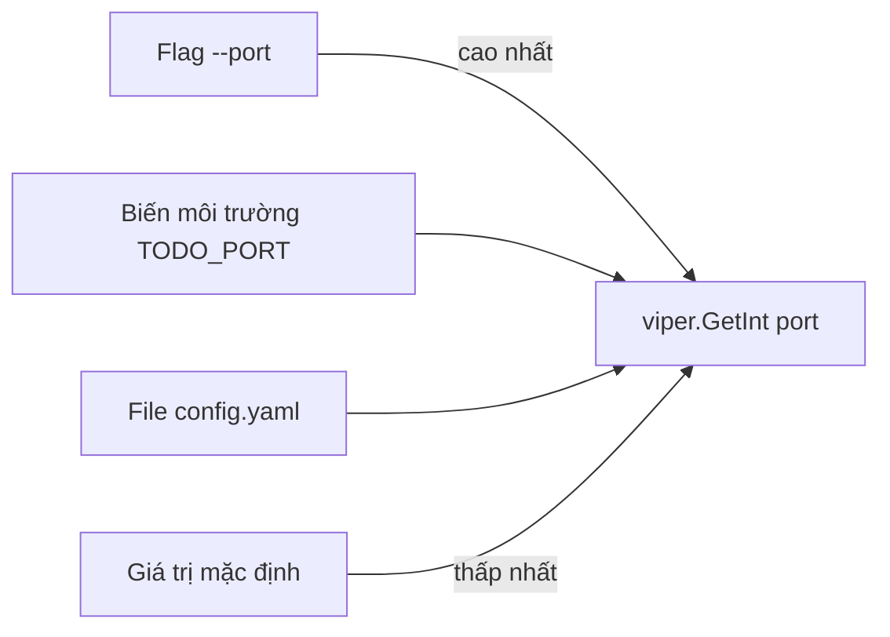
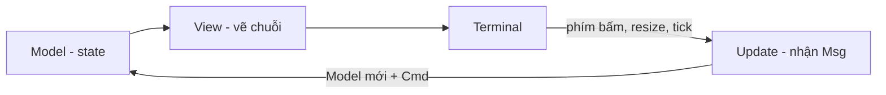

# Xây dựng CLI

Go là một trong những ngôn ngữ được ưa chuộng nhất để viết công cụ dòng lệnh (CLI — Command Line Interface): biên dịch ra một file binary duy nhất, không cần cài runtime, khởi động tức thì, cross-compile cho mọi hệ điều hành chỉ bằng một biến môi trường. `docker`, `kubectl`, `gh`, `terraform`, `hugo` đều viết bằng Go. Bài này đi từ package `flag` chuẩn, lên Cobra (kèm Viper) và urfave/cli cho CLI nhiều lệnh, Bubble Tea + Lip Gloss cho giao diện terminal tương tác (TUI), và cuối cùng là cách phân phối binary.

---

:::note[Ghi nhớ nhanh]

- ⭐ **Cobra là chuẩn de facto cho CLI nhiều lệnh** — `kubectl`, `gh`, `hugo` dùng Cobra; cấu trúc `app <lệnh> <lệnh con> --flag`.
- ⭐ **Persistent flag áp cho lệnh hiện tại và mọi lệnh con; local flag chỉ cho lệnh đó** — `--config`, `--verbose` thường là persistent.
- **`flag` chuẩn đủ cho tool nhỏ** — nhưng dừng parse ở đối số không phải flag đầu tiên và không hỗ trợ cú pháp `-abc` kiểu GNU.
- **Viper đọc cấu hình theo thứ tự ưu tiên** — flag > biến môi trường > file config > giá trị mặc định.
- **Bubble Tea theo kiến trúc Elm** — `Model` giữ state, `Update` nhận message trả state mới, `View` vẽ state thành chuỗi.
- **Phân phối**: `go install`, cross-compile với `GOOS`/`GOARCH`, tự động hoá với GoReleaser.

:::

---

## Mục lục

- [Vì sao viết CLI bằng Go?](#vì-sao-viết-cli-bằng-go)
- [Package flag chuẩn](#package-flag-chuẩn)
- [Cobra](#cobra)
- [Viper đi kèm Cobra](#viper-đi-kèm-cobra)
- [urfave/cli](#urfavecli)
- [TUI với Bubble Tea và Lip Gloss](#tui-với-bubble-tea-và-lip-gloss)
- [Phân phối binary](#phân-phối-binary)
- [Câu hỏi phỏng vấn](#câu-hỏi-phỏng-vấn)

---

## Vì sao viết CLI bằng Go?

**Vấn đề:** Viết tool nội bộ bằng script (Python, Node.js) thì người dùng phải cài đúng phiên bản runtime và thư viện. Gửi tool cho đồng nghiệp là bắt đầu chuỗi "máy em chạy được mà":

```bash
$ python deploy.py --env prod
ModuleNotFoundError: No module named 'requests'
$ pip install requests
$ python deploy.py --env prod
SyntaxError: ... # máy này đang dùng Python 2.7
```

**Giải pháp:** Go biên dịch ra một binary tĩnh, chép sang máy khác là chạy:

```bash
# Build cho Windows, macOS chip M, Linux từ cùng một máy
GOOS=windows GOARCH=amd64 go build -o dist/deploy.exe ./cmd/deploy
GOOS=darwin  GOARCH=arm64 go build -o dist/deploy-mac ./cmd/deploy
GOOS=linux   GOARCH=amd64 go build -o dist/deploy-linux ./cmd/deploy

./dist/deploy-mac --env prod   # không cần cài gì thêm
```

:::tip[Dùng thực tế]

- **Tool DevOps nội bộ** — deploy, rotate secret, seed dữ liệu, dọn dẹp tài nguyên cloud.
- **CLI cho sản phẩm** — như `gh` cho GitHub, `stripe` cho Stripe: người dùng thao tác API từ terminal.
- **Công cụ sinh code / scaffold** dự án theo chuẩn của team.
- **Dashboard trong terminal** — xem log, trạng thái job, chọn môi trường bằng phím mũi tên (TUI).

:::

:::tip[Ví dụ đời thường]

CLI nhiều lệnh giống **tổng đài chăm sóc khách hàng**: "bấm 1 để tra cước, bấm 2 để nạp tiền; trong mục nạp tiền, bấm 1 cho thẻ cào, bấm 2 cho chuyển khoản". `app topup card --serial 123` chính là đi qua từng tầng menu. Cobra là phần mềm tổng đài lo sẵn việc chuyển tầng, đọc phím và phát lời hướng dẫn (`--help`).

:::

---

## Package flag chuẩn

Với tool một lệnh hoặc vài lệnh con, `flag` của thư viện chuẩn là đủ. Ví dụ CLI quản lý việc cần làm với lệnh con `add`, `list`, `version`:

```go
package main

import (
	"flag"
	"fmt"
	"os"
	"strings"
)

// Ghi đè lúc build: go build -ldflags "-X main.version=1.2.0"
var version = "dev"

func main() {
	if len(os.Args) < 2 {
		usage()
		os.Exit(2)
	}
	switch os.Args[1] {
	case "add":
		runAdd(os.Args[2:])
	case "list":
		runList(os.Args[2:])
	case "version":
		fmt.Println("todo", version)
	default:
		fmt.Fprintf(os.Stderr, "lệnh không hợp lệ: %q\n", os.Args[1])
		usage()
		os.Exit(2)
	}
}

func usage() {
	fmt.Fprintln(os.Stderr, "Cách dùng: todo <add|list|version> [flags]")
}

func runAdd(args []string) {
	// Mỗi lệnh con có FlagSet riêng
	fs := flag.NewFlagSet("add", flag.ExitOnError)
	priority := fs.Int("priority", 3, "độ ưu tiên 1-5")
	tags := fs.String("tags", "", "nhãn, cách nhau bởi dấu phẩy")
	fs.Parse(args)

	if fs.NArg() == 0 { // đối số còn lại sau khi parse flag
		fmt.Fprintln(os.Stderr, "thiếu nội dung công việc")
		os.Exit(2)
	}
	title := strings.Join(fs.Args(), " ")
	fmt.Printf("Đã thêm: %q (ưu tiên %d, nhãn [%s])\n", title, *priority, *tags)
}

func runList(args []string) {
	fs := flag.NewFlagSet("list", flag.ExitOnError)
	all := fs.Bool("all", false, "hiện cả việc đã xong")
	fs.Parse(args)
	fmt.Println("Liệt kê, all =", *all)
}
```

```bash
$ go build -ldflags "-X main.version=1.2.0" -o todo .
$ ./todo add -priority 1 -tags=work,urgent Viết báo cáo tuần
Đã thêm: "Viết báo cáo tuần" (ưu tiên 1, nhãn [work,urgent])
$ ./todo list --all          # -all và --all đều được chấp nhận
Liệt kê, all = true
$ ./todo add -h              # help sinh tự động
Usage of add:
  -priority int
    	độ ưu tiên 1-5 (default 3)
  -tags string
    	nhãn, cách nhau bởi dấu phẩy
```

:::warning[Giới hạn của flag]

- **Dừng parse ở đối số không phải flag đầu tiên** — `todo add Viết báo cáo -priority 1` thì `-priority 1` bị coi là nội dung, không phải flag.
- **Không có flag ngắn/dài kiểu GNU** — không có `-p` làm alias cho `--priority` (phải tự khai báo hai flag), không gộp `-abc`.
- **Lệnh con, help nhiều tầng, gợi ý "did you mean", shell completion** — đều phải tự viết. Khi CLI lớn dần, chuyển sang Cobra.

:::

---

## Cobra

[Cobra](https://github.com/spf13/cobra) cung cấp: lệnh lồng nhau, flag kiểu POSIX (dùng [pflag](https://github.com/spf13/pflag): `-p`, `--priority`, `-abc`), help và usage tự sinh, gợi ý khi gõ sai lệnh, sinh shell completion (bash/zsh/fish/PowerShell).

```bash
go get github.com/spf13/cobra@latest
# Tuỳ chọn: công cụ sinh khung project
go install github.com/spf13/cobra-cli@latest
cobra-cli init && cobra-cli add serve
```

Cấu trúc thường gặp:

```text
todo/
├── main.go          # chỉ gọi cmd.Execute()
└── cmd/
    ├── root.go      # lệnh gốc + persistent flag
    ├── add.go       # todo add
    └── list.go      # todo list
```

### Lệnh gốc và persistent flag

```go
// cmd/root.go
package cmd

import (
	"context"
	"os"

	"github.com/spf13/cobra"
)

var verbose bool

var rootCmd = &cobra.Command{
	Use:   "todo",
	Short: "Quản lý danh sách việc cần làm",
	Long:  "todo là CLI ví dụ minh hoạ Cobra: thêm, liệt kê, đánh dấu hoàn thành công việc.",
	// Không có Run → gõ "todo" sẽ in help
	SilenceUsage: true, // lỗi khi chạy (không phải lỗi cú pháp) thì không in lại usage dài dòng
}

func init() {
	// Persistent: dùng được ở "todo", "todo add", "todo list"...
	rootCmd.PersistentFlags().BoolVarP(&verbose, "verbose", "v", false, "in chi tiết")
}

func Execute(ctx context.Context) {
	if err := rootCmd.ExecuteContext(ctx); err != nil {
		os.Exit(1) // Cobra đã tự in "Error: ..." ra stderr (trừ khi bật SilenceErrors)
	}
}
```

### Lệnh con và local flag

```go
// cmd/add.go
package cmd

import (
	"fmt"
	"strings"

	"github.com/spf13/cobra"
)

var (
	priority int
	tags     []string
)

var addCmd = &cobra.Command{
	Use:     "add [nội dung]",
	Short:   "Thêm một công việc",
	Example: `  todo add "Viết báo cáo" -p 1 --tag work --tag urgent`,
	Args:    cobra.MinimumNArgs(1), // kiểm tra số đối số; sai → báo lỗi + usage
	RunE: func(cmd *cobra.Command, args []string) error { // RunE trả error thay vì tự os.Exit
		if priority < 1 || priority > 5 {
			return fmt.Errorf("priority phải từ 1 đến 5, nhận %d", priority)
		}
		title := strings.Join(args, " ")
		if verbose {
			fmt.Println("[debug] tags =", tags)
		}
		fmt.Printf("Đã thêm: %q (ưu tiên %d)\n", title, priority)
		_ = cmd.Context() // context từ ExecuteContext — truyền xuống HTTP/DB
		return nil
	},
}

func init() {
	// Local flag: chỉ có ở "todo add"
	addCmd.Flags().IntVarP(&priority, "priority", "p", 3, "độ ưu tiên 1-5")
	addCmd.Flags().StringSliceVar(&tags, "tag", nil, "nhãn (lặp lại hoặc phân tách bằng dấu phẩy)")
	rootCmd.AddCommand(addCmd)
}
```

```go
// main.go
package main

import (
	"context"
	"os"
	"os/signal"

	"example.com/todo/cmd"
)

func main() {
	ctx, stop := signal.NotifyContext(context.Background(), os.Interrupt) // Ctrl+C huỷ context
	defer stop()
	cmd.Execute(ctx)
}
```

```bash
$ todo add Viết báo cáo -p 1 --tag work,urgent -v   # flag đặt sau đối số vẫn được hiểu
[debug] tags = [work urgent]
Đã thêm: "Viết báo cáo" (ưu tiên 1)
$ todo ad
Error: unknown command "ad" for "todo"

Did you mean this?
	add

Run 'todo --help' for usage.
$ todo completion zsh > "${fpath[1]}/_todo"         # shell completion có sẵn
```

Một số tính năng hay dùng:

| Tính năng | Cách dùng |
|-----------|-----------|
| Flag bắt buộc | `addCmd.MarkFlagRequired("priority")` |
| Kiểm tra đối số | `cobra.NoArgs`, `cobra.ExactArgs(n)`, `cobra.RangeArgs(a, b)` |
| Hook trước/sau | `PersistentPreRunE` (vd đọc config, khởi tạo logger cho mọi lệnh), `PostRunE` |
| Bí danh lệnh | `Aliases: []string{"a"}` |
| Ẩn / deprecate | `Hidden: true`, `Deprecated: "dùng 'todo create'"` |

:::warning[Lỗi hay gặp với Cobra]

- **Dùng biến toàn cục cho flag rồi viết test** — giá trị của lần chạy trước còn lưu lại. Với CLI lớn, nên tạo command bằng hàm `newAddCmd()` trả `*cobra.Command` mới mỗi lần.
- **Dùng `Run` rồi `os.Exit` bên trong** — khó test và bỏ qua `defer`; ưu tiên `RunE` trả error.
- **Đọc config trong `init()`** — lúc đó flag chưa được parse; đọc trong `PersistentPreRunE` hoặc `cobra.OnInitialize`.

:::

---

## Viper đi kèm Cobra

[Viper](https://github.com/spf13/viper) (cùng tác giả với Cobra) gom cấu hình từ nhiều nguồn với thứ tự ưu tiên rõ ràng:



```go
// cmd/root.go (bổ sung)
import "github.com/spf13/viper"

var cfgFile string

func init() {
	cobra.OnInitialize(initConfig) // chạy sau khi parse flag, trước Run của lệnh
	rootCmd.PersistentFlags().StringVar(&cfgFile, "config", "", "file cấu hình (mặc định $HOME/.todo.yaml)")
	rootCmd.PersistentFlags().String("api-url", "https://api.example.com", "địa chỉ API")

	// Gắn flag vào khoá viper: flag được truyền thì thắng mọi nguồn khác
	viper.BindPFlag("api_url", rootCmd.PersistentFlags().Lookup("api-url"))
	viper.SetDefault("timeout", "10s")
}

func initConfig() {
	if cfgFile != "" {
		viper.SetConfigFile(cfgFile)
	} else {
		home, _ := os.UserHomeDir()
		viper.AddConfigPath(home)
		viper.SetConfigName(".todo") // tìm .todo.yaml, .todo.json, .todo.toml...
	}
	viper.SetEnvPrefix("TODO")                         // TODO_API_URL, TODO_TIMEOUT
	viper.SetEnvKeyReplacer(strings.NewReplacer("-", "_"))
	viper.AutomaticEnv()

	if err := viper.ReadInConfig(); err == nil && verbose {
		fmt.Println("dùng config:", viper.ConfigFileUsed())
	}
}

// Trong lệnh bất kỳ
apiURL := viper.GetString("api_url")
timeout := viper.GetDuration("timeout")
```

```yaml
# ~/.todo.yaml
api_url: https://api.staging.example.com
timeout: 30s
```

Với ứng dụng lớn, nên `viper.Unmarshal(&cfg)` vào một struct cấu hình rồi truyền struct đó đi, thay vì gọi `viper.GetString` rải rác khắp code. Viper khá nặng (nhiều dependency); nếu chỉ cần flag + env, có thể dùng thư viện nhẹ hơn hoặc tự đọc `os.Getenv`.

---

## urfave/cli

[urfave/cli](https://github.com/urfave/cli) là lựa chọn thay thế Cobra, khai báo CLI bằng **một cấu trúc dữ liệu** thay vì nhiều biến command. Có hai dòng phiên bản đang gặp:

- **v2** (`github.com/urfave/cli/v2`) — rất nhiều dự án hiện có đang dùng; gốc là `*cli.App`, action nhận `*cli.Context`.
- **v3** (`github.com/urfave/cli/v3`) — bản mới: gốc là `*cli.Command`, action nhận `context.Context` chuẩn và `*cli.Command`.

Ví dụ với **v3**:

```go
package main

import (
	"context"
	"fmt"
	"log"
	"os"
	"strings"

	"github.com/urfave/cli/v3"
)

func main() {
	cmd := &cli.Command{
		Name:  "todo",
		Usage: "quản lý việc cần làm",
		Flags: []cli.Flag{
			&cli.BoolFlag{Name: "verbose", Aliases: []string{"v"}, Usage: "in chi tiết"},
		},
		Commands: []*cli.Command{
			{
				Name:      "add",
				Usage:     "thêm công việc",
				ArgsUsage: "[nội dung]",
				Flags: []cli.Flag{
					&cli.IntFlag{Name: "priority", Aliases: []string{"p"}, Value: 3},
				},
				Action: func(ctx context.Context, cmd *cli.Command) error {
					title := strings.Join(cmd.Args().Slice(), " ")
					fmt.Printf("Đã thêm: %q (ưu tiên %d)\n", title, cmd.Int("priority"))
					return nil
				},
			},
		},
	}

	if err := cmd.Run(context.Background(), os.Args); err != nil {
		log.Fatal(err)
	}
}
```

Cùng lệnh đó với **v2** chỉ khác phần khung:

```go
app := &cli.App{ // v2: *cli.App thay vì *cli.Command
	Name: "todo",
	Commands: []*cli.Command{{
		Name: "add",
		Action: func(c *cli.Context) error { // v2: nhận *cli.Context
			fmt.Println(c.Args().Slice(), c.Int("priority"))
			return nil
		},
	}},
}
app.Run(os.Args)
```

| Tiêu chí | Cobra | urfave/cli |
|----------|-------|------------|
| Khai báo | Mỗi lệnh một biến/hàm, `AddCommand` | Một cây struct lồng nhau |
| Flag | pflag (POSIX) | Riêng, có alias, đọc biến môi trường qua `Sources`/`EnvVars` |
| Hệ sinh thái | Viper, cobra-cli, rất nhiều dự án lớn | Gọn, ít phụ thuộc |
| Phù hợp | CLI lớn, nhiều tầng lệnh | CLI nhỏ đến vừa |

---

## TUI với Bubble Tea và Lip Gloss

Khi cần giao diện tương tác trong terminal (chọn bằng phím mũi tên, bảng, thanh tiến độ), dùng [Bubble Tea](https://github.com/charmbracelet/bubbletea) của Charm. Bubble Tea theo **kiến trúc Elm**:



- **Model** — struct chứa toàn bộ trạng thái.
- **Update(msg)** — nhận sự kiện (phím bấm, kết quả HTTP, timer), trả về model mới và một `Cmd` (việc bất đồng bộ cần chạy tiếp, có thể nil).
- **View()** — biến model thành chuỗi để in ra màn hình. Không có side effect.

Ví dụ: chọn môi trường deploy bằng phím mũi tên (Bubble Tea v1, `github.com/charmbracelet/bubbletea`):

```go
package main

import (
	"fmt"
	"os"
	"strings"

	tea "github.com/charmbracelet/bubbletea"
	"github.com/charmbracelet/lipgloss"
)

var (
	titleStyle    = lipgloss.NewStyle().Bold(true).Foreground(lipgloss.Color("205")).MarginBottom(1)
	selectedStyle = lipgloss.NewStyle().Foreground(lipgloss.Color("42")).Bold(true)
	boxStyle      = lipgloss.NewStyle().Border(lipgloss.RoundedBorder()).Padding(0, 2)
)

type model struct {
	choices  []string
	cursor   int
	selected string
}

func (m model) Init() tea.Cmd { return nil } // không cần việc gì lúc khởi động

func (m model) Update(msg tea.Msg) (tea.Model, tea.Cmd) {
	switch msg := msg.(type) {
	case tea.KeyMsg:
		switch msg.String() {
		case "ctrl+c", "q":
			return m, tea.Quit
		case "up", "k":
			if m.cursor > 0 {
				m.cursor-- // m là bản sao (value receiver) — trả về bản mới
			}
		case "down", "j":
			if m.cursor < len(m.choices)-1 {
				m.cursor++
			}
		case "enter":
			m.selected = m.choices[m.cursor]
			return m, tea.Quit
		}
	}
	return m, nil
}

func (m model) View() string {
	var b strings.Builder
	b.WriteString(titleStyle.Render("Chọn môi trường deploy"))
	b.WriteString("\n")
	for i, c := range m.choices {
		if i == m.cursor {
			b.WriteString(selectedStyle.Render("> " + c))
		} else {
			b.WriteString("  " + c)
		}
		b.WriteString("\n")
	}
	b.WriteString("\n↑/↓ di chuyển • enter chọn • q thoát")
	return boxStyle.Render(b.String())
}

func main() {
	final, err := tea.NewProgram(model{choices: []string{"dev", "staging", "production"}}).Run()
	if err != nil {
		fmt.Fprintln(os.Stderr, "lỗi:", err)
		os.Exit(1)
	}
	if m := final.(model); m.selected != "" {
		fmt.Println("Deploy lên:", m.selected)
	}
}
```

- **[Lip Gloss](https://github.com/charmbracelet/lipgloss)** — định dạng chuỗi kiểu CSS: màu, viền, padding, căn lề, ghép khối (`lipgloss.JoinHorizontal`).
- **[Bubbles](https://github.com/charmbracelet/bubbles)** — component dựng sẵn: text input, list có lọc, table, spinner, progress bar, viewport cuộn.
- **[Huh](https://github.com/charmbracelet/huh)** — form/hỏi đáp nhanh khi không cần tự viết Model.

:::warning[Lưu ý]

- Việc chậm (gọi HTTP, đọc file lớn) **không làm trong `Update`** — trả về một `tea.Cmd` (hàm chạy nền trả `tea.Msg`), kết quả sẽ quay lại `Update` dưới dạng message.
- Bubble Tea chiếm terminal, nên **không dùng `fmt.Println` để debug** — ghi log ra file bằng `tea.LogToFile`.
- Bubble Tea **v2** thay đổi một số API so với v1 (đường dẫn import, kiểu message phím bấm...); ví dụ trên dùng v1 — kiểm tra phiên bản trong `go.mod` trước khi chép code từ tài liệu.

:::

---

## Phân phối binary

| Cách | Lệnh | Phù hợp |
|------|------|---------|
| `go install` | `go install github.com/acme/todo@latest` | Người dùng là dev Go |
| Build tay | `GOOS=linux GOARCH=arm64 go build -trimpath -ldflags "-s -w" ./cmd/todo` | Tool nội bộ đơn giản |
| GoReleaser | `goreleaser release --clean` | Phát hành công khai, nhiều nền tảng |

- `-trimpath` bỏ đường dẫn máy build khỏi binary; `-ldflags "-s -w"` bỏ bảng symbol/debug để binary nhỏ hơn; `-X main.version=...` nhúng phiên bản.
- `CGO_ENABLED=0` để có binary tĩnh hoàn toàn, chạy được cả trên image `scratch`/`distroless`.

[GoReleaser](https://goreleaser.com/) đọc file `.goreleaser.yaml`, khi bạn push tag `v1.2.0` (thường qua GitHub Actions) nó build cho mọi `GOOS/GOARCH`, nén file, tạo checksum, đăng GitHub Release, và có thể đẩy lên Homebrew tap, Scoop, Docker registry, gói `.deb`/`.rpm`.

```bash
goreleaser init                        # tạo .goreleaser.yaml mẫu
goreleaser release --snapshot --clean  # chạy thử local, không phát hành
```

---

## Câu hỏi phỏng vấn

**1. Vì sao Go phù hợp để viết CLI?**

<details className="qa">
<summary>Xem đáp án</summary>

Biên dịch ra một binary tĩnh duy nhất, không cần runtime hay thư viện đi kèm; khởi động gần như tức thì (khác JVM/Node); cross-compile chỉ bằng `GOOS`/`GOARCH`; thư viện chuẩn mạnh (HTTP, JSON, file, crypto); concurrency dễ dùng cho tác vụ song song. Hệ sinh thái có Cobra, Viper, Bubble Tea, GoReleaser. Các tool lớn như Docker, kubectl, Terraform, gh đều viết bằng Go.

</details>

**2. Persistent flag và local flag trong Cobra khác nhau thế nào?**

<details className="qa">
<summary>Xem đáp án</summary>

Persistent flag (khai báo bằng `cmd.PersistentFlags()`) có hiệu lực ở lệnh khai báo và **mọi lệnh con** — dùng cho tuỳ chọn toàn cục như `--config`, `--verbose`, `--output`. Local flag (`cmd.Flags()`) chỉ có ở đúng lệnh đó, ví dụ `--priority` của `todo add`. Khai báo persistent flag ở root là cách phổ biến để mọi lệnh đều đọc được cấu hình chung.

</details>

**3. `Run` và `RunE` trong Cobra khác gì? Nên dùng cái nào?**

<details className="qa">
<summary>Xem đáp án</summary>

`Run` không trả giá trị, nên lỗi phải tự in và gọi `os.Exit` bên trong — khó test, bỏ qua `defer`. `RunE` trả `error`, Cobra đưa lỗi về `Execute()`, nơi bạn xử lý tập trung (in ra stderr, chọn exit code). Nên dùng `RunE` (và `PersistentPreRunE`...). Kết hợp `SilenceUsage: true` để lỗi khi chạy không in kèm usage dài, và `SilenceErrors` nếu muốn tự định dạng thông báo lỗi.

</details>

**4. Viper lấy giá trị cấu hình theo thứ tự ưu tiên nào?**

<details className="qa">
<summary>Xem đáp án</summary>

Từ cao xuống thấp: giá trị đặt bằng `viper.Set` → flag (đã `BindPFlag`, và flag được người dùng truyền) → biến môi trường (`AutomaticEnv`/`BindEnv`) → file config → key/value store từ xa → giá trị mặc định (`SetDefault`). Nhờ đó một CLI có thể có default hợp lý, cho phép ghi đè bằng file, bằng env trong CI, và bằng flag khi chạy tay.

</details>

**5. Kiến trúc Elm trong Bubble Tea gồm những gì?**

<details className="qa">
<summary>Xem đáp án</summary>

Ba phần: **Model** (struct trạng thái), **Update** (nhận `tea.Msg` như phím bấm, kết quả việc nền; trả model mới và `tea.Cmd` tiếp theo), **View** (hàm thuần biến model thành chuỗi). Luồng dữ liệu một chiều: sự kiện → Update → Model mới → View. Việc bất đồng bộ được mô tả bằng `Cmd` (hàm trả về `Msg`), runtime chạy nó trong goroutine và gửi kết quả về Update, nên state chỉ thay đổi ở một chỗ, dễ suy luận và dễ test.

</details>

**6. Làm sao nhúng phiên bản vào binary lúc build?**

<details className="qa">
<summary>Xem đáp án</summary>

Khai báo biến package-level kiểu string (vd `var version = "dev"` trong `main`) rồi build với `go build -ldflags "-X main.version=1.2.0"` (đường dẫn đầy đủ của package nếu biến không ở `main`, vd `-X example.com/todo/internal/build.Version=1.2.0`). GoReleaser tự truyền `-X` với tag git. Ngoài ra từ Go 1.18, `runtime/debug.ReadBuildInfo()` cho biết module version (khi cài bằng `go install ...@v1.2.0`) và thông tin VCS (commit, thời gian) được nhúng tự động.

</details>
