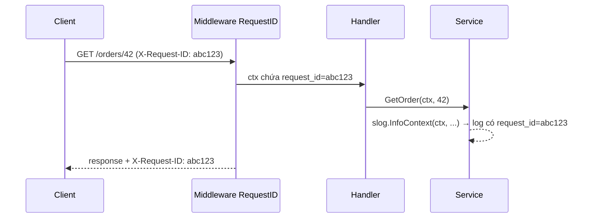

# Logging: slog, zap, zerolog

Log là "hộp đen" của ứng dụng: khi production có sự cố lúc 2 giờ sáng, log là thứ đầu tiên bạn mở ra. Trong Go, `log` chuẩn chỉ in chuỗi văn bản — không đủ cho hệ thống cần tìm kiếm, lọc, thống kê log. Bài này giải thích structured logging (log có cấu trúc), nhắc lại `log/slog` của thư viện chuẩn, đi sâu hai thư viện hiệu năng cao phổ biến nhất là **zap** và **zerolog**, rồi đến các thực hành bắt buộc: gắn request-id qua context, chỉnh log level theo môi trường, và không để lộ dữ liệu nhạy cảm.

---

:::note[Ghi nhớ nhanh]

- ⭐ **Structured logging = log dạng key-value (thường là JSON)** — máy đọc được, lọc được theo `user_id=42` thay vì grep chuỗi.
- ⭐ **Dự án mới: bắt đầu với `log/slog`** (Go 1.21+) — chuẩn, không phụ thuộc ngoài; chỉ chọn zap/zerolog khi đo thấy log là điểm nghẽn hoặc dự án đã dùng sẵn.
- **zap**: `Logger` (nhanh, field có kiểu `zap.String`) và `SugaredLogger` (tiện, key-value lỏng); nhớ `defer logger.Sync()`.
- **zerolog**: API chuỗi `log.Info().Str("k", v).Msg("...")`, gần như không cấp phát bộ nhớ; **quên `.Msg()`/`.Send()` thì log không được ghi**.
- **Gắn request-id vào mọi dòng log** của một request qua `context` — để lần theo toàn bộ hành trình của request.
- **Không bao giờ log password, token, số thẻ, OTP** — che bằng `LogValuer` / `ReplaceAttr` hoặc hook.

:::

---

## Mục lục

- [Vì sao cần structured logging?](#vì-sao-cần-structured-logging)
- [slog - thư viện chuẩn](#slog---thư-viện-chuẩn)
- [Zap](#zap)
- [Zerolog](#zerolog)
- [So sánh slog, zap, zerolog](#so-sánh-slog-zap-zerolog)
- [Request-id qua context](#request-id-qua-context)
- [Log level theo môi trường](#log-level-theo-môi-trường)
- [Không log dữ liệu nhạy cảm](#không-log-dữ-liệu-nhạy-cảm)
- [Câu hỏi phỏng vấn](#câu-hỏi-phỏng-vấn)

---

## Vì sao cần structured logging?

**Vấn đề:** Log kiểu chuỗi tự do dễ viết nhưng rất khó dùng khi hệ thống lớn:

```go
log.Printf("user %d placed order %s total %d", userID, orderID, total)
log.Printf("Payment failed for order=%s: %v", orderID, err)
log.Println("order", orderID, "shipped by", carrier)
```

```text
2026/10/15 10:00:01 user 42 placed order A-981 total 350000
2026/10/15 10:00:02 Payment failed for order=A-981: timeout
2026/10/15 10:00:03 order A-982 shipped by GHN
```

Mỗi dòng một định dạng. Muốn tìm "mọi lỗi thanh toán của user 42 trong 1 giờ qua" hay "tổng số đơn theo nhà vận chuyển", bạn phải viết regex cho từng kiểu câu — và chúng vỡ ngay khi ai đó sửa câu log.

**Giải pháp:** Log có cấu trúc — thông điệp cố định + các cặp key-value:

```go
slog.Info("đặt hàng thành công", "user_id", userID, "order_id", orderID, "total", total)
slog.Error("thanh toán thất bại", "order_id", orderID, "err", err)
```

```json
{"time":"2026-10-15T10:00:01Z","level":"INFO","msg":"đặt hàng thành công","user_id":42,"order_id":"A-981","total":350000}
{"time":"2026-10-15T10:00:02Z","level":"ERROR","msg":"thanh toán thất bại","order_id":"A-981","err":"timeout"}
```

Hệ thống thu thập log (Loki, Elasticsearch, Datadog, CloudWatch) hiểu ngay từng field: lọc `level=ERROR AND user_id=42`, vẽ biểu đồ theo `carrier`, đặt cảnh báo khi số lỗi tăng.

:::tip[Dùng thực tế]

- **Điều tra sự cố** — lọc toàn bộ log của một `request_id` xuyên qua nhiều service.
- **Cảnh báo** — số dòng `level=ERROR` của service thanh toán vượt ngưỡng thì báo Slack/PagerDuty.
- **Audit** — ai đổi quyền của ai, lúc nào, từ IP nào.
- **Phân tích nghiệp vụ nhanh** — đếm đơn thất bại theo `reason` trước khi có dashboard chính thức.

:::

:::tip[Ví dụ đời thường]

Log chuỗi tự do giống **sổ ghi chép viết tay của bảo vệ toà nhà**: mỗi ca một kiểu chữ, một cách ghi, muốn tìm "khách nào lên tầng 5 tuần trước" phải lật từng trang. Structured log giống **phần mềm quản lý ra vào quét CCCD**: mỗi lượt là một bản ghi có cột tên, số CCCD, tầng, giờ vào, giờ ra — tìm kiếm, lọc, thống kê trong vài giây.

:::

---

## slog - thư viện chuẩn

Từ **Go 1.21**, package `log/slog` là structured logger chính thức (đã có bài riêng trong phần thư viện chuẩn). Tóm tắt nhanh:

```go
// JSON cho production, Text cho lúc dev
logger := slog.New(slog.NewJSONHandler(os.Stdout, &slog.HandlerOptions{Level: slog.LevelInfo}))
slog.SetDefault(logger) // các hàm slog.Info, slog.Error... dùng logger này

slog.Info("server khởi động", "port", 8080)
slog.Error("kết nối DB thất bại", "err", err, "retry_in", 5*time.Second)

// Field cố định cho một nhóm log
orderLog := logger.With("component", "order")
orderLog.Info("tạo đơn", slog.String("order_id", "A-981"), slog.Int64("total", 350000)) // Attr có kiểu: nhanh hơn
```

Điểm mạnh của slog là **tách frontend (API `Logger`) khỏi backend (`Handler`)**: code ứng dụng và thư viện chỉ cần phụ thuộc vào `*slog.Logger`, còn đầu ra có thể là handler JSON chuẩn, hoặc handler bọc zap/zerolog nếu cần hiệu năng của chúng.

---

## Zap

[zap](https://github.com/uber-go/zap) (`go.uber.org/zap`) do Uber phát triển, ra đời từ trước slog với mục tiêu: log có cấu trúc **nhanh nhất có thể**, ít cấp phát bộ nhớ. Zap có hai API:

### Logger — nhanh, có kiểu

```go
package main

import (
	"errors"
	"time"

	"go.uber.org/zap"
)

func main() {
	logger, err := zap.NewProduction() // JSON, level Info, có sampling, ghi stack trace cho Error
	if err != nil {
		panic(err)
	}
	defer logger.Sync() // xả buffer trước khi thoát — quên là có thể mất những dòng log cuối

	logger.Info("đặt hàng thành công",
		zap.Int("user_id", 42),
		zap.String("order_id", "A-981"),
		zap.Int64("total", 350000),
		zap.Duration("latency", 120*time.Millisecond),
	)
	logger.Error("thanh toán thất bại", zap.Error(errors.New("timeout")))

	// Logger con mang sẵn field
	orderLog := logger.With(zap.String("component", "order"))
	orderLog.Warn("tồn kho thấp", zap.String("sku", "AO-THUN-M"), zap.Int("left", 3))
}
```

```json
{"level":"info","ts":1760500000.123,"caller":"app/main.go:17","msg":"đặt hàng thành công","user_id":42,"order_id":"A-981","total":350000,"latency":0.12}
```

### SugaredLogger — tiện, chậm hơn một chút

```go
sugar := logger.Sugar()

sugar.Infow("đặt hàng thành công", "user_id", 42, "order_id", "A-981") // key-value lỏng như slog
sugar.Infof("đã xử lý %d đơn trong %s", 120, time.Second)              // kiểu printf
sugar.Desugar() // quay về *zap.Logger khi cần hiệu năng
```

| | `*zap.Logger` | `*zap.SugaredLogger` |
|---|---|---|
| Cú pháp | `zap.String("k", v)` | `"k", v` hoặc `Infof(...)` |
| Kiểm tra kiểu | Lúc biên dịch | Lúc chạy (sai cặp key-value → log lỗi) |
| Cấp phát bộ nhớ | Gần như 0 | Có (do `interface{}`/`any`) |
| Dùng ở | Đường xử lý nóng, thư viện | Code ứng dụng thường, script |

### Cấu hình production

```go
func newZapLogger(env string) (*zap.Logger, error) {
	var cfg zap.Config
	if env == "production" {
		cfg = zap.NewProductionConfig() // JSON, Info, sampling
	} else {
		cfg = zap.NewDevelopmentConfig() // console có màu, Debug, stack trace từ Warn
	}
	cfg.EncoderConfig.TimeKey = "time"
	cfg.EncoderConfig.EncodeTime = zapcore.ISO8601TimeEncoder // thời gian dễ đọc thay vì epoch
	cfg.InitialFields = map[string]any{"service": "order-api"}

	logger, err := cfg.Build()
	if err != nil {
		return nil, err
	}
	return logger, nil
}
```

`cfg.Level` là một `zap.AtomicLevel` — có thể đổi level lúc đang chạy (`cfg.Level.SetLevel(zap.DebugLevel)`), thậm chí mở endpoint HTTP vì `AtomicLevel` implement `http.Handler`.

:::warning[Lỗi hay gặp với zap]

- **Quên `defer logger.Sync()`** — log cuối cùng trước khi crash có thể không được ghi. (`Sync` trên stdout/stderr đôi khi trả lỗi vô hại như `invalid argument` — nhiều dự án bỏ qua lỗi này.)
- **Sampling ở `NewProduction`** — log trùng lặp với tần suất cao (cùng message trong một giây) sẽ bị lấy mẫu, không phải dòng nào cũng được ghi. Cần ghi đủ thì đặt `cfg.Sampling = nil`.
- **Dùng `zap.Any` khắp nơi** — mất lợi thế hiệu năng do phải dùng reflection; ưu tiên field có kiểu cụ thể.

:::

---

## Zerolog

[zerolog](https://github.com/rs/zerolog) (`github.com/rs/zerolog`) đi xa hơn về hiệu năng: ghi JSON trực tiếp vào buffer, **zero-allocation** (không cấp phát heap) trong đa số trường hợp, với API **chuỗi phương thức** (method chaining):

```go
package main

import (
	"errors"
	"os"
	"time"

	"github.com/rs/zerolog"
	"github.com/rs/zerolog/log"
)

func main() {
	zerolog.TimeFieldFormat = time.RFC3339 // mặc định là RFC3339; có thể đổi sang zerolog.TimeFormatUnix

	logger := zerolog.New(os.Stdout).With().
		Timestamp().                 // thêm field time
		Str("service", "order-api"). // field cố định
		Logger()

	logger.Info().
		Int("user_id", 42).
		Str("order_id", "A-981").
		Int64("total", 350000).
		Dur("latency", 120*time.Millisecond).
		Msg("đặt hàng thành công") // Msg/Send là bước GHI — thiếu thì không có gì xảy ra

	logger.Error().Err(errors.New("timeout")).Str("order_id", "A-981").Msg("thanh toán thất bại")

	// Logger toàn cục của package log (ghi ra stderr)
	log.Warn().Str("sku", "AO-THUN-M").Int("left", 3).Send() // Send = Msg("")
}
```

```json
{"level":"info","time":"2026-10-15T10:00:01+07:00","service":"order-api","user_id":42,"order_id":"A-981","total":350000,"latency":120,"message":"đặt hàng thành công"}
```

Một số tính năng đáng biết:

```go
// Đặt level toàn cục (dưới level này bị bỏ qua, gần như không tốn chi phí)
zerolog.SetGlobalLevel(zerolog.InfoLevel)

// Log đẹp, có màu khi chạy local (chậm hơn JSON, KHÔNG dùng cho production)
logger = zerolog.New(zerolog.ConsoleWriter{Out: os.Stderr}).With().Timestamp().Logger()

// Logger con và gắn vào context
reqLogger := logger.With().Str("request_id", "abc123").Logger()
ctx = reqLogger.WithContext(ctx)
zerolog.Ctx(ctx).Info().Msg("lấy từ context") // trả về logger đã gắn, hoặc logger mặc định/disabled

// Kiểm tra trước khi tính toán tốn kém
if e := logger.Debug(); e.Enabled() {
	e.Str("dump", expensiveDump()).Msg("trạng thái chi tiết")
}
```

Package con `github.com/rs/zerolog/hlog` cung cấp middleware `net/http` sẵn có: gắn logger vào request, sinh request-id, log access.

:::warning[Lỗi hay gặp với zerolog]

- **Quên `.Msg()` / `.Send()` / `.Msgf()`** — event được tạo nhưng không bao giờ ghi ra; log "biến mất" mà không báo lỗi.
- **Giữ lại `*zerolog.Event` để dùng sau hoặc dùng lại hai lần** — event được trả về pool sau khi `Msg`, dùng lại gây dữ liệu hỏng.
- **Field trùng tên** — zerolog không khử trùng lặp, `Str("id", ...)` hai lần sinh JSON có hai key `id`.

:::

---

## So sánh slog, zap, zerolog

| Tiêu chí | `log/slog` | zap | zerolog |
|----------|-----------|-----|---------|
| Nguồn | Thư viện chuẩn (Go 1.21+) | Uber | Cộng đồng (rs) |
| Phụ thuộc ngoài | Không | Có | Có |
| API | `Info(msg, k, v...)` hoặc `slog.Attr` | `zap.String(...)` / Sugared | Chuỗi `.Str().Int().Msg()` |
| Hiệu năng | Tốt, có cấp phát nhỏ | Rất nhanh (Logger) | Rất nhanh, gần zero-alloc |
| Kiểu an toàn | Một phần (Attr có kiểu) | Logger: có; Sugared: không | Có |
| Thay backend | ✅ interface `Handler` | Qua `zapcore.Core` | Qua `io.Writer`, hook |
| Đổi level lúc chạy | `slog.LevelVar` | `zap.AtomicLevel` | `SetGlobalLevel` / logger.Level |
| Bẫy riêng | Cặp key-value lẻ → key `!BADKEY` (`go vet` phát hiện được) | Quên `Sync`, sampling | Quên `Msg()` |

Theo benchmark công bố của chính các dự án, zerolog và zap (Logger) nhanh nhất và gần như không cấp phát, slog chậm hơn một chút nhưng vẫn rất nhanh; `SugaredLogger` và các logger cũ như logrus chậm hơn rõ rệt. Với đa số API, khác biệt này nhỏ so với thời gian DB và mạng.

**Khuyến nghị:**

- Dự án mới → **slog**. Thư viện bạn viết cho người khác dùng → nhận `*slog.Logger` thay vì ép dùng zap/zerolog.
- Dự án đã dùng zap/zerolog → giữ nguyên; có thể cho slog ghi qua backend của chúng (vd zap có `zapslog` handler trong `go.uber.org/zap/exp`).
- Service log cực nhiều (gateway, xử lý stream) và profile cho thấy log tốn CPU → zap hoặc zerolog.

---

## Request-id qua context

Một request đi qua middleware → handler → service → repository, mỗi tầng ghi log. Nếu không có ID chung, log của hàng nghìn request song song trộn vào nhau, không thể biết dòng nào thuộc request nào. Giải pháp: middleware sinh (hoặc nhận từ header) **request-id**, đặt vào `context`, và logger tự đọc ra.



Với slog, viết một handler bọc lấy handler gốc, tự thêm `request_id` từ context vào mọi bản ghi:

```go
type ctxKey struct{}

func WithRequestID(ctx context.Context, id string) context.Context {
	return context.WithValue(ctx, ctxKey{}, id)
}

// ContextHandler bọc một slog.Handler, thêm request_id nếu context có
type ContextHandler struct{ slog.Handler }

func (h ContextHandler) Handle(ctx context.Context, r slog.Record) error {
	if id, ok := ctx.Value(ctxKey{}).(string); ok {
		r.AddAttrs(slog.String("request_id", id))
	}
	return h.Handler.Handle(ctx, r)
}

// Bắt buộc bọc lại ở WithAttrs/WithGroup, nếu không logger.With(...) sẽ "rơi" mất ContextHandler
func (h ContextHandler) WithAttrs(attrs []slog.Attr) slog.Handler {
	return ContextHandler{h.Handler.WithAttrs(attrs)}
}

func (h ContextHandler) WithGroup(name string) slog.Handler {
	return ContextHandler{h.Handler.WithGroup(name)}
}

// Middleware: nhận X-Request-ID từ gateway hoặc tự sinh
func RequestID(next http.Handler) http.Handler {
	return http.HandlerFunc(func(w http.ResponseWriter, r *http.Request) {
		id := r.Header.Get("X-Request-ID")
		if id == "" {
			b := make([]byte, 8)
			_, _ = rand.Read(b) // crypto/rand
			id = hex.EncodeToString(b)
		}
		w.Header().Set("X-Request-ID", id) // trả lại cho client để báo lỗi kèm mã
		next.ServeHTTP(w, r.WithContext(WithRequestID(r.Context(), id)))
	})
}

// Khởi tạo
slog.SetDefault(slog.New(ContextHandler{slog.NewJSONHandler(os.Stdout, nil)}))

// Ở bất kỳ tầng nào — chỉ cần truyền ctx và dùng hàm *Context
func (s *OrderService) Get(ctx context.Context, id int64) (Order, error) {
	slog.InfoContext(ctx, "lấy đơn hàng", "order_id", id)
	// ...
}
```

```json
{"time":"...","level":"INFO","msg":"lấy đơn hàng","order_id":42,"request_id":"abc123"}
```

Với zap/zerolog, cách thường dùng là tạo **logger con** có sẵn field `request_id` trong middleware rồi đặt logger đó vào context (zerolog có sẵn `logger.WithContext(ctx)` / `zerolog.Ctx(ctx)`; zap thì tự viết hàm lưu/lấy `*zap.Logger` từ context). Trong hệ thống có tracing, nên log thêm `trace_id` của OpenTelemetry để nhảy từ log sang trace.

:::warning[Lưu ý]

Phải dùng `slog.InfoContext(ctx, ...)` (hoặc `logger.InfoContext`) — `slog.Info(...)` không nhận context nên handler không có gì để đọc request-id.

:::

---

## Log level theo môi trường

| Level | Dùng khi | Dev | Production |
|-------|----------|-----|-----------|
| `DEBUG` | Chi tiết để gỡ lỗi (giá trị biến, payload) | ✅ | Tắt (bật tạm khi điều tra) |
| `INFO` | Sự kiện nghiệp vụ bình thường (khởi động, đơn tạo thành công) | ✅ | ✅ |
| `WARN` | Bất thường nhưng tự xử lý được (retry, dùng giá trị mặc định) | ✅ | ✅ |
| `ERROR` | Thao tác thất bại cần chú ý | ✅ | ✅ (thường gắn cảnh báo) |

Đọc level và định dạng từ biến môi trường, kèm khả năng đổi level lúc đang chạy:

```go
func newLogger(env string) (*slog.Logger, *slog.LevelVar) {
	level := new(slog.LevelVar) // mặc định Info, đổi được lúc chạy bằng level.Set(...)
	if err := level.UnmarshalText([]byte(os.Getenv("LOG_LEVEL"))); err != nil {
		level.Set(slog.LevelInfo) // LOG_LEVEL rỗng hoặc sai → Info
	}

	opts := &slog.HandlerOptions{Level: level, AddSource: env != "production"}
	var h slog.Handler
	if env == "production" {
		h = slog.NewJSONHandler(os.Stdout, opts) // JSON cho hệ thống thu thập log
	} else {
		h = slog.NewTextHandler(os.Stdout, opts) // text dễ đọc khi dev
	}
	return slog.New(ContextHandler{h}).With("service", "order-api", "env", env), level
}
```

```bash
APP_ENV=production LOG_LEVEL=warn ./order-api   # chỉ WARN và ERROR
APP_ENV=dev LOG_LEVEL=debug go run .            # mọi thứ, dạng text
```

Nguyên tắc: ghi log ra **stdout** và để hạ tầng (Docker, Kubernetes, agent thu thập) lo việc chuyển đi, lưu trữ, xoay vòng file — không tự ghi file log trong container.

---

## Không log dữ liệu nhạy cảm

Log thường được nhiều người truy cập hơn database (dev, vận hành, bên thứ ba lưu trữ log) và giữ lâu. Lộ password, token, số thẻ, OTP, CCCD qua log là sự cố bảo mật và vi phạm quy định bảo vệ dữ liệu cá nhân.

```go
// SAI — log cả request body đăng nhập (có password) và header (có token)
slog.Info("login request", "body", string(body), "headers", r.Header)

// SAI — log nguyên struct user, kể cả field PasswordHash
slog.Info("user created", "user", user)
```

**Cách 1: `slog.LogValuer`** — kiểu dữ liệu tự quyết định nó được log thế nào:

```go
type Password string

// Mọi nơi log một Password đều chỉ ra "***"
func (Password) LogValue() slog.Value { return slog.StringValue("***") }

type User struct {
	ID       int
	Email    string
	Password Password
}

// Chỉ log những field an toàn, email được che bớt
func (u User) LogValue() slog.Value {
	return slog.GroupValue(
		slog.Int("id", u.ID),
		slog.String("email", maskEmail(u.Email)), // an@example.com → a***@example.com
	)
}
```

**Cách 2: `ReplaceAttr`** — chốt chặn cuối cùng theo tên key:

```go
var sensitiveKeys = map[string]bool{"password": true, "token": true, "authorization": true, "otp": true}

opts := &slog.HandlerOptions{
	ReplaceAttr: func(groups []string, a slog.Attr) slog.Attr {
		if sensitiveKeys[strings.ToLower(a.Key)] {
			return slog.String(a.Key, "***")
		}
		return a
	},
}
```

```json
{"level":"INFO","msg":"login","user":{"id":1,"email":"a***@example.com"},"token":"***"}
```

zap có cơ chế tương tự qua interface `zapcore.ObjectMarshaler` (tự định nghĩa cách mã hoá object); zerolog qua `zerolog.LogObjectMarshaler` hoặc hook.

:::warning[Checklist dữ liệu không được log]

- Password (kể cả dạng hash), OTP, mã PIN, câu trả lời bảo mật.
- Access token, refresh token, API key, cookie phiên, header `Authorization`.
- Số thẻ, CVV, số tài khoản ngân hàng đầy đủ.
- Thông tin định danh cá nhân khi không cần thiết (CCCD, số điện thoại, địa chỉ) — che bớt hoặc chỉ log ID nội bộ.
- Toàn bộ request/response body — chỉ log field đã chọn lọc.

:::

---

## Câu hỏi phỏng vấn

**1. Structured logging là gì và lợi ích so với log chuỗi?**

<details className="qa">
<summary>Xem đáp án</summary>

Là ghi log dưới dạng thông điệp cố định + các cặp key-value có kiểu (thường xuất JSON), thay vì chuỗi ghép tự do. Lợi ích: hệ thống thu thập log hiểu từng field nên lọc/tìm kiếm/thống kê chính xác (`level=ERROR AND user_id=42`), không phụ thuộc vào câu chữ; dễ gắn cảnh báo và dashboard; thêm field mới không phá các truy vấn cũ; kết hợp được với request-id, trace-id để lần theo request xuyên service.

</details>

**2. Zap `Logger` và `SugaredLogger` khác nhau thế nào?**

<details className="qa">
<summary>Xem đáp án</summary>

`*zap.Logger` dùng field có kiểu (`zap.String`, `zap.Int`...), kiểm tra lúc biên dịch và gần như không cấp phát bộ nhớ — dùng cho đường xử lý nóng hoặc thư viện. `*zap.SugaredLogger` (lấy bằng `logger.Sugar()`) nhận key-value lỏng (`Infow`) hoặc định dạng printf (`Infof`), tiện hơn nhưng chậm hơn và chỉ phát hiện sai cặp key-value lúc chạy. Chuyển qua lại bằng `Sugar()` và `Desugar()`.

</details>

**3. Vì sao zerolog nhanh? Bẫy lớn nhất khi dùng là gì?**

<details className="qa">
<summary>Xem đáp án</summary>

Zerolog ghi JSON trực tiếp vào byte buffer lấy từ `sync.Pool`, không qua `map` hay `interface{}`, không reflection với field có kiểu; event dưới level bị tắt trả về nil nên các lời gọi `.Str()...` gần như không tốn gì. Kết quả là gần như zero-allocation. Bẫy lớn nhất: phải kết thúc bằng `.Msg()`, `.Msgf()` hoặc `.Send()` — quên thì event không bao giờ được ghi và không có lỗi nào báo. Ngoài ra không được giữ lại hay dùng lại `*zerolog.Event` sau khi đã gửi.

</details>

**4. Làm sao để mọi dòng log của một request có cùng request-id?**

<details className="qa">
<summary>Xem đáp án</summary>

Middleware đầu chuỗi lấy `X-Request-ID` từ header (do gateway/load balancer gắn) hoặc tự sinh, đưa vào `context` của request và trả lại trong response header. Sau đó: với slog, viết `Handler` bọc đọc ID từ context và thêm vào record, mọi nơi log bằng `InfoContext(ctx, ...)`; với zap/zerolog, tạo logger con có field `request_id` rồi đặt logger đó vào context, các tầng dưới lấy logger từ ctx. Điều kiện tiên quyết là truyền `ctx` xuyên suốt từ handler xuống service, repository. Khi có tracing, log thêm `trace_id`.

</details>

**5. Chọn log level cho production thế nào và làm sao bật debug khi cần?**

<details className="qa">
<summary>Xem đáp án</summary>

Production thường ở `INFO` (hoặc `WARN` cho service rất nhiều traffic) để giảm chi phí lưu trữ và nhiễu; `DEBUG` chỉ bật ở dev. Level nên đọc từ biến môi trường (`LOG_LEVEL`) chứ không hardcode. Để bật debug khi điều tra mà không deploy lại, dùng level động: `slog.LevelVar`, `zap.AtomicLevel` (có sẵn `http.Handler` để đổi qua endpoint nội bộ), hoặc `zerolog.SetGlobalLevel`, rồi trả về level cũ sau khi điều tra xong.

</details>

**6. Làm sao ngăn dữ liệu nhạy cảm lọt vào log?**

<details className="qa">
<summary>Xem đáp án</summary>

Kết hợp nhiều lớp: (1) quy ước không log request body, header `Authorization`, struct chứa secret; (2) cho kiểu dữ liệu nhạy cảm tự che khi log — `slog.LogValuer`, `zapcore.ObjectMarshaler`, `zerolog.LogObjectMarshaler`, hoặc implement `String()` trả `***`; (3) chốt chặn ở handler như `ReplaceAttr` của slog che theo tên key (`password`, `token`...); (4) review code và quét log định kỳ; (5) giới hạn quyền truy cập và thời gian lưu log.

</details>
