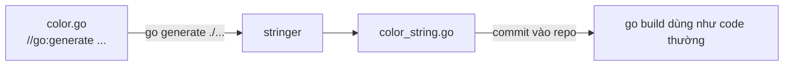

# Các lệnh go cốt lõi

Go không cần Maven, Gradle, npm hay Makefile phức tạp để chạy dự án: một lệnh `go` duy nhất lo từ biên dịch, chạy thử, quản lý dependency, chạy test, định dạng code, đến xem tài liệu. Bài này đi qua các lệnh dùng hằng ngày (`run`, `build`, `install`, `fmt`, `mod`, `test`, `clean`, `doc`, `version`, `env`, `list`), cách sinh code bằng `go generate`, cách biên dịch có điều kiện bằng build tag `//go:build` và quy ước tên file, cuối cùng là `go tool` cùng directive `tool` trong `go.mod` (Go 1.24). Nắm vững bộ lệnh này là nền tảng cho mọi bài còn lại trong nhóm Toolchain.

---

:::note[Ghi nhớ nhanh]

- ⭐ **`go build` tạo binary, `go run` biên dịch rồi chạy ngay, `go install` biên dịch rồi đặt binary vào `$GOBIN`** (mặc định `$GOPATH/bin`).
- ⭐ **Build tag viết bằng `//go:build linux && !arm64`** ở đầu file, trước `package`, theo sau là một dòng trống; dạng cũ `// +build` đã lỗi thời.
- **Tên file `xxx_linux.go`, `xxx_amd64.go`, `xxx_windows_amd64.go`** tự động mang build constraint theo GOOS/GOARCH — không cần viết tag.
- **`go generate` không tự chạy khi build** — phải gọi tay (hoặc trong CI), nó chỉ thực thi các dòng `//go:generate`.
- **Go 1.24: `go get -tool <pkg>`** ghi directive `tool` vào `go.mod`, rồi chạy bằng `go tool <tên>` — thay thế mẹo `tools.go` với blank import.
- **`go env -w KEY=value`** ghi cấu hình bền vững (ví dụ `GOPRIVATE`); `go env` không tham số in toàn bộ biến môi trường của toolchain.

:::

---

## Mục lục

- [Vì sao cần hiểu bộ lệnh go?](#vì-sao-cần-hiểu-bộ-lệnh-go)
- [Chạy và biên dịch: run, build, install](#chạy-và-biên-dịch-run-build-install)
- [Định dạng, module và test](#định-dạng-module-và-test)
- [Tra cứu: doc, version, env, list](#tra-cứu-doc-version-env-list)
- [Dọn dẹp cache: go clean](#dọn-dẹp-cache-go-clean)
- [Sinh code với go generate](#sinh-code-với-go-generate)
- [Build tag và quy ước tên file](#build-tag-và-quy-ước-tên-file)
- [go tool và directive tool trong go.mod](#go-tool-và-directive-tool-trong-gomod)
- [Câu hỏi phỏng vấn](#câu-hỏi-phỏng-vấn)

---

## Vì sao cần hiểu bộ lệnh go?

**Vấn đề:** Ở nhiều hệ sinh thái, "chạy được dự án" đòi hỏi cả một chuỗi công cụ rời rạc, mỗi team cấu hình một kiểu:

```bash
# Ví dụ một dự án Java/Node điển hình
mvn clean install -DskipTests      # build tool riêng, file pom.xml dài
npm install && npx prettier --write . && npx eslint . && npm test
# Muốn sinh code (mock, enum string) → thêm plugin, thêm cấu hình...
```

Người mới vào team phải học công cụ build trước khi học code; mỗi máy cài phiên bản plugin khác nhau, kết quả khác nhau.

**Giải pháp:** Go đóng gói gần như mọi thứ vào **một** lệnh `go`, với quy ước thay cho cấu hình:

```bash
go mod tidy        # đồng bộ dependency theo import thực tế
gofmt -l .         # kiểm tra định dạng (một style duy nhất cho cả cộng đồng)
go vet ./...       # phân tích tĩnh lỗi hay gặp
go test ./...      # chạy toàn bộ test
go build -o bin/app ./cmd/app   # ra binary tĩnh, copy là chạy
```

Không có file cấu hình build; cấu trúc thư mục + `go.mod` là đủ.

:::tip[Dùng thực tế]

- **Onboarding nhanh** — clone repo, `go run ./cmd/api` là chạy, không cần cài build tool.
- **CI gọn** — pipeline chỉ cần vài lệnh `go vet`, `go test -race`, `go build`.
- **Sinh code lặp lại được** — `go generate ./...` sinh mock, enum `String()`, code từ protobuf, mọi người ra cùng kết quả.
- **Một codebase nhiều nền tảng** — build tag tách phần code riêng cho Linux/Windows/macOS.

:::

:::tip[Ví dụ đời thường]

Lệnh `go` giống **con dao đa năng** của thợ sửa xe máy đầu ngõ: một món trong túi mà có tua vít, kìm, cờ lê. Không cần mang cả thùng đồ nghề (Maven + plugin + linter + formatter riêng lẻ) — đến đâu rút đúng lưỡi dao cần dùng ở đó.

:::

---

## Chạy và biên dịch: run, build, install

### go run

Biên dịch vào thư mục tạm rồi chạy ngay, **không** để lại binary. Dùng khi phát triển:

```bash
go run .                          # chạy package main trong thư mục hiện tại
go run ./cmd/api                  # chạy package main ở thư mục khác
go run ./cmd/api -port=8080       # tham số sau package được truyền cho chương trình
go run golang.org/x/tools/cmd/stringer@v0.30.0 -h   # chạy thẳng một tool theo phiên bản
```

### go build

Biên dịch và ghi binary ra đĩa. Với package không phải `main`, `go build` chỉ kiểm tra biên dịch được và bỏ kết quả.

```bash
go build                          # binary tên theo thư mục, đặt tại chỗ
go build -o bin/api ./cmd/api     # chỉ định tên/đường dẫn output
go build ./...                    # kiểm tra mọi package đều biên dịch được
go build -v -x ./cmd/api          # -v: in tên package, -x: in từng lệnh con được gọi
go build -race ./cmd/api          # bật race detector (xem bài Race detection)
```

Các cờ build quan trọng (dùng chung cho `run`, `build`, `install`, `test`):

| Cờ | Ý nghĩa |
|----|---------|
| `-o file` | Tên/đường dẫn binary output |
| `-tags a,b` | Bật thêm build tag tuỳ biến |
| `-race` | Bật race detector |
| `-trimpath` | Xoá đường dẫn tuyệt đối trên máy build khỏi binary |
| `-ldflags '...'` | Cờ cho linker, ví dụ `-s -w`, `-X main.version=...` |
| `-gcflags '...'` | Cờ cho compiler, ví dụ `-m` xem escape analysis |
| `-pgo file` | Profile cho PGO, mặc định `auto` (dùng `default.pgo` nếu có) |
| `-C dir` | Đổi thư mục làm việc trước khi chạy lệnh |

Cache build nằm ở `go env GOCACHE`. Build lần hai nhanh vì chỉ biên dịch lại package thay đổi.

### go install

Biên dịch rồi đặt binary vào `$GOBIN` (nếu đặt) hoặc `$GOPATH/bin`. Có hai cách dùng:

```bash
# 1. Cài chính dự án đang đứng (theo go.mod hiện tại)
go install ./cmd/api

# 2. Cài một công cụ bất kỳ theo phiên bản — KHÔNG đụng tới go.mod hiện tại
go install golang.org/x/vuln/cmd/govulncheck@latest
go install github.com/go-delve/delve/cmd/dlv@v1.25.0
```

:::warning[Lỗi hay gặp]

- **Cài tool xong gõ tên không thấy** — `$GOPATH/bin` (thường là `~/go/bin`) chưa có trong `PATH`.
- **Dùng `go get` để cài tool** — từ Go 1.17 `go get` chỉ dùng để sửa dependency trong `go.mod`; cài binary dùng `go install pkg@version`.
- **`go run main.go` trong package có nhiều file** — chỉ biên dịch đúng file được liệt kê, báo `undefined` cho hàm ở file khác. Dùng `go run .`.

:::

---

## Định dạng, module và test

### go fmt và gofmt

`go fmt ./...` thực chất gọi `gofmt -l -w` trên các file của package. Muốn kiểm tra mà không sửa (dùng trong CI):

```bash
gofmt -l .          # liệt kê file chưa đúng format, không in gì nghĩa là ổn
gofmt -d main.go    # xem diff
gofmt -s -w .       # -s: đơn giản hoá thêm (vd []T{T{...}} → []T{{...}})
```

### go mod

Nhóm lệnh quản lý module (chi tiết ở bài Modules):

```bash
go mod init example.com/shop   # tạo go.mod
go mod tidy                    # thêm dependency thiếu, xoá dependency thừa
go mod download                # tải dependency về module cache (hay dùng trong Docker layer)
go mod vendor                  # copy dependency vào thư mục vendor/
go mod why -m golang.org/x/text  # vì sao module này có trong build
go mod graph                   # in đồ thị dependency
go mod verify                  # kiểm tra module cache chưa bị sửa
go mod edit -go=1.26           # sửa go.mod bằng lệnh (hữu ích trong script)
```

### go test

```bash
go test ./...                          # test toàn bộ module
go test -run 'TestOrder/huy_don' ./order   # lọc theo tên test/subtest (regex)
go test -v -count=1 ./...              # -count=1: bỏ qua cache kết quả test
go test -race -cover ./...             # race detector + độ phủ
go test -bench=. -benchmem ./...       # chạy benchmark, in allocation
go test -fuzz=FuzzParse -fuzztime=30s ./parser
```

`go test` cache kết quả test thành công khi file nguồn và tham số không đổi — dòng output có chữ `(cached)`.

---

## Tra cứu: doc, version, env, list

### go doc

Xem tài liệu ngay trong terminal, không cần mở trình duyệt:

```bash
go doc strings.Cut              # chữ ký + mô tả một hàm
go doc -all net/http.Client     # toàn bộ method của một type
go doc -src slices.Sort         # xem mã nguồn
go doc ./internal/order         # tài liệu package nội bộ của dự án
```

### go version

```bash
go version                  # phiên bản toolchain: go version go1.26.5 darwin/arm64
go version -m ./bin/api     # đọc thông tin build nhúng trong binary: module, dependency, cờ build
```

`go version -m` rất hữu ích khi cần biết binary đang chạy trên server được build từ commit nào, với dependency phiên bản nào.

### go env

```bash
go env                      # toàn bộ biến môi trường của toolchain
go env GOPATH GOMODCACHE GOCACHE GOOS GOARCH
go env -w GOPRIVATE=gitlab.company.vn/*   # ghi bền vào file cấu hình (go env GOENV)
go env -u GOPRIVATE                       # xoá giá trị đã ghi
go env -json                              # output JSON cho script
```

Các biến hay dùng: `GOOS`/`GOARCH` (nền tảng đích), `CGO_ENABLED`, `GOPROXY`, `GOPRIVATE`, `GOFLAGS` (cờ mặc định cho mọi lệnh, vd `GOFLAGS=-mod=vendor`), `GOTOOLCHAIN` (chọn phiên bản toolchain).

### go list

Truy vấn thông tin package/module — nền tảng để viết script:

```bash
go list ./...                               # liệt kê mọi package
go list -m all                              # mọi module trong build
go list -m -u all                           # module nào có bản mới hơn
go list -f '{{.ImportPath}} {{.Name}}' ./...   # định dạng bằng text/template
go list -f '{{join .Deps "\n"}}' ./cmd/api  # mọi dependency (bắc cầu) của một package
go list -json ./internal/order              # JSON đầy đủ
```

Ví dụ: chỉ test các package có file test:

```bash
go test $(go list -f '{{if .TestGoFiles}}{{.ImportPath}}{{end}}' ./...)
```

---

## Dọn dẹp cache: go clean

```bash
go clean                 # xoá binary sinh ra trong thư mục hiện tại
go clean -cache          # xoá toàn bộ build cache (GOCACHE)
go clean -testcache      # chỉ vô hiệu hoá kết quả test đã cache
go clean -modcache       # xoá module cache (GOMODCACHE) — lần build sau phải tải lại
go clean -fuzzcache      # xoá dữ liệu fuzzing đã sinh
```

:::warning[Lỗi hay gặp]

- **Gặp lỗi lạ sau khi đổi phiên bản Go là `go clean -cache`** — thực tế cache đã gắn khoá theo phiên bản compiler nên hiếm khi cần; xoá cache chỉ làm build chậm lần sau.
- **`go clean -modcache` trên máy CI dùng chung** — mọi job khác phải tải lại toàn bộ dependency.

:::

---

## Sinh code với go generate

`go generate` quét các file `.go` tìm dòng comment dạng `//go:generate lệnh tham số` (không có dấu cách sau `//`) và chạy lệnh đó **trong thư mục chứa file**. Nó **không** chạy tự động khi `go build` — người phát triển chạy rồi commit code sinh ra.



Ví dụ kinh điển: sinh method `String()` cho enum bằng `stringer`:

```go
package main

import "fmt"

//go:generate go tool stringer -type=Color -trimprefix=Color

type Color int

const (
	ColorRed Color = iota
	ColorGreen
	ColorBlue
)

func main() {
	fmt.Println(ColorGreen, Color(9)) // Green Color(9)
}
```

```bash
go get -tool golang.org/x/tools/cmd/stringer   # khai báo tool trong go.mod (Go 1.24+)
go generate ./...                              # sinh ra color_string.go
go run .
```

Trong lệnh `//go:generate`, có sẵn các biến `$GOFILE`, `$GOPACKAGE`, `$GOLINE`, `$GOARCH`, `$GOOS`, `$DOLLAR`. Vài cờ của `go generate`:

```bash
go generate -run stringer ./...   # chỉ chạy directive có chuỗi khớp regex
go generate -n ./...              # in lệnh sẽ chạy, không thực thi
go generate -x ./...              # in lệnh khi chạy
```

Các tool thường gặp: `stringer`, `mockgen` (go.uber.org/mock), `sqlc`, `protoc`/`buf`, `oapi-codegen`, `ent`.

:::tip[Quy ước file sinh tự động]

Code do tool sinh ra nên có dòng `// Code generated ... DO NOT EDIT.` ở đầu (theo regex `^// Code generated .* DO NOT EDIT\.$`). Linter, `gofmt` và code review tool dựa vào dòng này để bỏ qua file. `stringer` tự thêm dòng này.

:::

---

## Build tag và quy ước tên file

Build constraint (ràng buộc build, hay build tag) quyết định file nào được đưa vào lần biên dịch.

### Cú pháp `//go:build`

Phải nằm **trước** `package`, chỉ có comment hoặc dòng trống phía trên, và **theo sau bởi một dòng trống**:

```go
//go:build linux && !arm64

package sysinfo

func Name() string { return "linux (không phải arm64)" }
```

Biểu thức dùng `&&`, `||`, `!` và ngoặc như Go. Các tag tự động đúng trong một lần build:

| Tag | Khi nào đúng |
|-----|-------------|
| `linux`, `windows`, `darwin`... | Trùng `GOOS` |
| `amd64`, `arm64`... | Trùng `GOARCH` |
| `unix` | GOOS thuộc họ Unix |
| `cgo` | cgo được bật (`CGO_ENABLED=1`) |
| `gc` / `gccgo` | Compiler đang dùng |
| `go1.22`, `go1.23`... | Phiên bản Go đủ mới |
| `amd64.v3` | Mức tính năng kiến trúc (`GOAMD64=v3`) |
| tag tuỳ biến | Truyền bằng `-tags` |

Ví dụ một file chỉ dành cho Windows và một file cho phần còn lại:

```go
// file: path_windows.go — tên file đã ngầm ràng buộc windows
package config

const defaultDir = `C:\ProgramData\shop`
```

```go
//go:build !windows

// file: path_other.go
package config

const defaultDir = "/etc/shop"
```

### Tag tuỳ biến với `-tags`

```go
//go:build integration

package order_test

// Test tích hợp cần database thật — chỉ chạy khi bật tag
func TestCreateOrderWithDB(t *testing.T) { /* ... */ }
```

```bash
go test ./...                       # bỏ qua file integration
go test -tags=integration ./...     # chạy cả test tích hợp
go build -tags=prod,nomsgpack ./cmd/api   # nhiều tag, phân tách bằng dấu phẩy
```

Ứng dụng khác: bật/tắt tính năng (`-tags=debug` để có endpoint debug), chọn implement (`-tags=jsoniter`), tách code phụ thuộc cgo.

### Quy ước tên file

Nếu tên file (bỏ đuôi `.go` và hậu tố `_test`) kết thúc bằng một trong các mẫu sau, file mang **ngầm** ràng buộc tương ứng:

```text
*_GOOS.go            vd: signal_windows.go, notify_darwin.go
*_GOARCH.go          vd: asm_amd64.go
*_GOOS_GOARCH.go     vd: syscall_linux_arm64.go
*_GOOS_test.go       vd: path_windows_test.go
```

Ngoài ra, file bắt đầu bằng `_` hoặc `.` bị bỏ qua, file `_test.go` chỉ biên dịch khi `go test`.

:::warning[Lỗi hay gặp]

- **Quên dòng trống sau `//go:build`** — dòng đó bị coi là doc comment của package, không còn là build constraint.
- **Đặt tên file vô tình trùng mẫu**, ví dụ `handler_js.go` hay `config_test_linux.go` — `js` là một GOOS hợp lệ nên `handler_js.go` chỉ build khi `GOOS=js`.
- **Viết `// +build` kiểu cũ** — từ Go 1.17 dùng `//go:build`; `gofmt` tự đồng bộ và `go vet` (analyzer `buildtag`) cảnh báo khi sai cú pháp.
- **Mỗi nền tảng thiếu một hiện thực** — `go build` trên máy dev qua, nhưng `GOOS=windows go build` báo `undefined`. Kiểm tra cross-compile trong CI.

:::

---

## go tool và directive tool trong go.mod

### Tool có sẵn trong toolchain

`go tool` không tham số liệt kê các tool đi kèm: `compile`, `link`, `asm`, `cgo`, `cover`, `pprof`, `trace`, `vet`, `fix`, `nm`, `objdump`, `addr2line`, `buildid`, `covdata`...

```bash
go tool pprof cpu.pprof              # phân tích profile
go tool trace trace.out              # xem execution trace
go tool cover -html=cover.out        # xem độ phủ test dạng HTML
go tool nm ./bin/api | grep main.    # liệt kê symbol trong binary
go tool objdump -s 'main.main' ./bin/api   # disassemble một hàm
go tool -n pprof                     # in đường dẫn binary của tool, không chạy
```

### Directive `tool` (Go 1.24)

**Trước Go 1.24**, để khoá phiên bản các tool phát triển (stringer, mockgen...) trong `go.mod`, cộng đồng dùng mẹo file `tools.go`:

```go
//go:build tools

package tools

import (
	_ "go.uber.org/mock/mockgen"
	_ "golang.org/x/tools/cmd/stringer"
)
```

Cách này rối và trộn dependency của tool vào dependency của ứng dụng một cách mập mờ.

**Từ Go 1.24**, `go.mod` có directive `tool` chính thức:

```bash
go get -tool golang.org/x/tools/cmd/stringer     # thêm tool, ghi phiên bản vào go.mod
go get -tool go.uber.org/mock/mockgen@v0.5.0
go tool                                          # danh sách: tool built-in + tool của module
go tool stringer -type=Color                     # chạy tool (tên = phần cuối import path)
go tool golang.org/x/tools/cmd/stringer -h       # hoặc gọi đủ import path
go get tool                                      # nâng cấp mọi tool lên bản mới nhất
go install tool                                  # cài mọi tool vào GOBIN
go get -tool golang.org/x/tools/cmd/stringer@none   # gỡ tool
```

`go.mod` sau khi thêm:

```text
module example.com/shop

go 1.26

tool golang.org/x/tools/cmd/stringer

require (
	golang.org/x/mod v0.42.0 // indirect
	golang.org/x/sync v0.24.0 // indirect
	golang.org/x/tools v0.52.0 // indirect
)
```

Lợi ích: mọi thành viên và CI dùng **đúng một phiên bản tool**, không cần cài trước; `go tool` cache binary nên lần chạy sau nhanh. Lưu ý dependency của tool vẫn nằm chung module graph với ứng dụng — tool có nhiều dependency nặng (như `golangci-lint`) thì nhiều team vẫn chọn cài riêng bằng `go install` hoặc dùng file go.mod riêng qua cờ `-modfile`.

:::warning[Lỗi hay gặp]

- **Gọi `stringer` trực tiếp trong `//go:generate`** — máy ai chưa cài là lỗi; viết `go tool stringer` để dùng phiên bản khoá trong `go.mod`.
- **Hai tool trùng tên cuối** (vd hai package cùng tên `gen`) — `go tool gen` không biết chọn cái nào; gọi bằng import path đầy đủ.

:::

---

## Câu hỏi phỏng vấn

**1. Khác nhau giữa `go run`, `go build` và `go install`?**

<details className="qa">
<summary>Xem đáp án</summary>

- `go run`: biên dịch vào thư mục tạm và chạy ngay, không để lại binary — dùng khi phát triển.
- `go build`: biên dịch và ghi binary ở thư mục hiện tại (hoặc theo `-o`); với package không phải `main` chỉ kiểm tra biên dịch.
- `go install`: biên dịch và đặt binary vào `$GOBIN`/`$GOPATH/bin`. Dạng `go install pkg@version` cài tool theo phiên bản mà không đụng tới `go.mod` của dự án hiện tại.

Cả ba đều dùng chung build cache nên lần sau nhanh hơn.

</details>

**2. Làm sao để một file chỉ được biên dịch trên Linux? Có mấy cách?**

<details className="qa">
<summary>Xem đáp án</summary>

Hai cách:
1. Đặt tên file theo mẫu `*_linux.go` — ràng buộc ngầm theo GOOS.
2. Thêm dòng `//go:build linux` ở đầu file, trước `package`, kèm dòng trống phía sau.

Cách 2 linh hoạt hơn vì kết hợp được biểu thức (`linux && amd64`, `!windows`, `unix`) và tag tuỳ biến. Hai cách có thể dùng cùng nhau — khi đó cả hai điều kiện phải đúng.

</details>

**3. `go generate` có chạy khi `go build` không? Nên dùng thế nào?**

<details className="qa">
<summary>Xem đáp án</summary>

Không. `go generate` là bước riêng, chỉ chạy khi gọi tường minh. Quy trình thông thường: thêm `//go:generate ...` cạnh code nguồn, chạy `go generate ./...`, **commit** file sinh ra (có dòng `// Code generated ... DO NOT EDIT.`). Nhờ vậy người dùng package chỉ cần `go build`, không cần cài tool sinh code. Trong CI có thể chạy lại `go generate` rồi `git diff --exit-code` để phát hiện ai quên sinh lại code.

</details>

**4. Directive `tool` trong `go.mod` (Go 1.24) giải quyết vấn đề gì?**

<details className="qa">
<summary>Xem đáp án</summary>

Nó khoá phiên bản các công cụ phát triển (stringer, mockgen, sqlc...) ngay trong `go.mod`, thay cho mẹo file `tools.go` với blank import và tag `tools`. Thêm bằng `go get -tool pkg`, chạy bằng `go tool <tên>`, nâng cấp bằng `go get tool`. Mọi người và CI dùng cùng phiên bản tool, không cần cài trước, kết quả sinh code nhất quán.

</details>

**5. Muốn chạy test tích hợp tách khỏi unit test, bạn làm thế nào?**

<details className="qa">
<summary>Xem đáp án</summary>

Đặt `//go:build integration` ở đầu file test tích hợp. `go test ./...` mặc định bỏ qua các file đó; chạy chúng bằng `go test -tags=integration ./...`. Cách khác là dùng `testing.Short()` với `go test -short` để bỏ qua test chậm, hoặc kiểm tra biến môi trường rồi gọi `t.Skip`. Build tag có ưu điểm là code test tích hợp (và dependency của nó) hoàn toàn không được biên dịch khi không cần.

</details>

**6. Làm sao biết binary đang chạy trên server được build bằng Go phiên bản nào, từ commit nào?**

<details className="qa">
<summary>Xem đáp án</summary>

Chạy `go version -m ./binary`: in phiên bản Go, module chính, toàn bộ dependency kèm phiên bản và các build setting như `vcs.revision`, `vcs.time`, `vcs.modified`, `GOOS`, `GOARCH`, `CGO_ENABLED`. Bên trong chương trình có thể đọc cùng thông tin bằng `runtime/debug.ReadBuildInfo()` để in ra ở endpoint `/version`.

</details>
