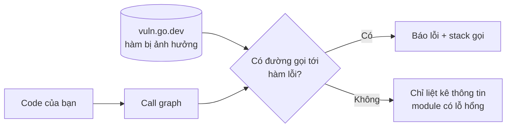

# Chất lượng code và bảo mật

Compiler Go đã khắt khe (import thừa, biến không dùng đều là lỗi), nhưng vẫn còn rất nhiều bug "hợp lệ về cú pháp": sai format string trong `Printf`, copy `sync.Mutex` theo giá trị, quên gọi `cancel()` của context, bỏ qua `error`, dùng thư viện có lỗ hổng bảo mật đã công bố. Bài này giới thiệu bộ công cụ giữ chất lượng code trong hệ sinh thái Go: `gofmt`/`goimports` (định dạng), `go vet` (phân tích tĩnh chính chủ), `staticcheck` và `revive` (linter mở rộng), `golangci-lint` (chạy gộp nhiều linter), `govulncheck` (quét lỗ hổng theo call graph), rồi ghép tất cả vào CI và pre-commit hook.

---

:::note[Ghi nhớ nhanh]

- ⭐ **Bộ tối thiểu cho mọi dự án: `gofmt` + `go vet` + `staticcheck` (hoặc `golangci-lint`) + `govulncheck`**, chạy trong CI và chặn merge khi lỗi.
- ⭐ **`govulncheck` chỉ báo lỗ hổng mà code của bạn thực sự gọi tới** (phân tích call graph) — ít báo động giả hơn hẳn công cụ chỉ đọc danh sách dependency.
- **`goimports` = `gofmt` + tự thêm/xoá/nhóm import** — cấu hình editor chạy khi lưu file.
- **`go vet` chạy sẵn một phần khi `go test`** (các analyzer chắc chắn như `printf`, `atomic`, `bools`...) — nhưng vẫn nên chạy `go vet ./...` đầy đủ.
- **`golangci-lint` v2** dùng file `.golangci.yml` có `version: "2"`, tách riêng `linters` và `formatters`.
- **Linter là công cụ, không phải luật** — bật dần, tắt rule gây nhiễu, dùng `//nolint:tên // lý do` có giải thích.

:::

---

## Mục lục

- [Vì sao cần công cụ kiểm tra chất lượng?](#vì-sao-cần-công-cụ-kiểm-tra-chất-lượng)
- [gofmt và goimports](#gofmt-và-goimports)
- [go vet](#go-vet)
- [staticcheck](#staticcheck)
- [revive](#revive)
- [golangci-lint](#golangci-lint)
- [govulncheck](#govulncheck)
- [Tích hợp CI với GitHub Actions](#tích-hợp-ci-với-github-actions)
- [Pre-commit hook](#pre-commit-hook)

---

## Vì sao cần công cụ kiểm tra chất lượng?

**Vấn đề:** Đoạn code dưới biên dịch thành công nhưng chứa ba bug:

```go
package main

import (
	"context"
	"fmt"
	"sync"
	"time"
)

type Counter struct {
	mu sync.Mutex
	n  int
}

// Bug 1: receiver giá trị → copy cả Mutex, khoá không có tác dụng
func (c Counter) Inc() {
	c.mu.Lock()
	defer c.mu.Unlock()
	c.n++
}

func main() {
	// Bug 2: cancel bị bỏ đi → rò rỉ timer/goroutine của context
	ctx, _ := context.WithTimeout(context.Background(), time.Second)
	_ = ctx

	// Bug 3: %d cho chuỗi
	fmt.Printf("user: %d\n", "an")
}
```

Code review bằng mắt rất dễ bỏ sót những lỗi kiểu này, nhất là trong PR dài.

**Giải pháp:** Để máy làm phần việc máy giỏi:

```bash
$ go vet ./...
./main.go:16:9: Inc passes lock by value: main.Counter contains sync.Mutex
./main.go:24:7: the cancel function returned by context.WithTimeout should be called, not discarded, to avoid a context leak
./main.go:28:20: fmt.Printf format %d has arg "an" of wrong type string
```

Reviewer chỉ cần tập trung vào thiết kế và nghiệp vụ.

:::tip[Dùng thực tế]

- **Chặn PR trong CI** — lint đỏ thì không merge, không ai phải nhắc "chạy gofmt đi".
- **Quét lỗ hổng định kỳ** — job hằng đêm chạy `govulncheck` để biết khi nào thư viện đang dùng có CVE mới.
- **Thống nhất style trong team lớn** — không tranh luận tab hay space, đặt tên ra sao.
- **Phát hiện code chết, API lỗi thời** — `staticcheck` báo hàm không dùng, hàm deprecated.

:::

:::tip[Ví dụ đời thường]

Linter giống **bộ phận kiểm tra chất lượng (QC) ở xưởng may**: trước khi áo xuất xưởng, QC soát đường chỉ lệch, nút thiếu, nhãn sai size theo checklist. Thợ may (lập trình viên) vẫn chịu trách nhiệm chính, nhưng những lỗi lặp đi lặp lại được bắt tự động. `govulncheck` thì như **kiểm định an toàn vải**: không chỉ hỏi "lô vải này có từng bị thu hồi không", mà hỏi "áo này có thực sự dùng đúng phần vải lỗi không".

:::

---

## gofmt và goimports

`gofmt` là formatter chính thức, **không có tuỳ chọn style** — cả cộng đồng Go dùng chung một định dạng.

```bash
gofmt -l .              # liệt kê file cần format (dùng trong CI)
gofmt -w .              # ghi đè file
gofmt -s -w .           # thêm bước đơn giản hoá code
gofmt -r 'a[b:len(a)] -> a[b:]' -w .   # rewrite rule đơn giản
```

`goimports` (thuộc `golang.org/x/tools`) làm mọi việc của `gofmt` và thêm: tự import package còn thiếu, xoá import thừa, nhóm import chuẩn thư viện tách khỏi import bên thứ ba.

```bash
go install golang.org/x/tools/cmd/goimports@latest
goimports -w -local example.com/shop .   # nhóm import nội bộ module thành khối riêng
```

Kết quả nhóm import:

```go
import (
	"context"
	"fmt"

	"github.com/jackc/pgx/v5"

	"example.com/shop/internal/order"
)
```

Ngoài ra có `gofumpt` (mvdan.cc/gofumpt) — format khắt khe hơn `gofmt` (luôn tương thích ngược với gofmt), được nhiều team dùng.

:::tip[Editor]

VS Code với extension Go (gopls) và GoLand đều format + sắp xếp import khi lưu file. Đây là cách hiệu quả nhất — CI chỉ là lưới an toàn.

:::

---

## go vet

`go vet` là công cụ phân tích tĩnh đi kèm toolchain, gồm nhiều **analyzer** (bộ phân tích) độc lập. Xem danh sách bằng `go tool vet help`.

```bash
go vet ./...                       # chạy mọi analyzer
go vet -printf=false ./...         # tắt một analyzer
go vet -copylocks -lostcancel ./...   # chỉ chạy các analyzer được liệt kê
go tool vet help printf            # tài liệu chi tiết một analyzer
```

Các analyzer đáng nhớ:

| Analyzer | Bắt lỗi gì |
|----------|-----------|
| `printf` | Format string không khớp tham số (`%d` với string, thiếu tham số) |
| `copylocks` | Copy giá trị chứa `sync.Mutex`, `sync.WaitGroup`... |
| `lostcancel` | Bỏ qua hàm `cancel` của `context.WithCancel`/`WithTimeout` |
| `loopclosure` | Closure trong vòng lặp tham chiếu biến lặp (chủ yếu với code trước Go 1.22) |
| `structtag` | Struct tag sai cú pháp (`json:name` thiếu dấu ngoặc kép) |
| `unmarshal` | Truyền non-pointer vào `json.Unmarshal` |
| `errorsas` | Đối số thứ hai của `errors.As` không phải con trỏ |
| `httpresponse` | Dùng `resp` trước khi kiểm tra `err` của HTTP call |
| `unsafeptr` | Chuyển `uintptr` sang `unsafe.Pointer` sai quy tắc |
| `nilfunc`, `bools`, `assign` | So sánh hàm với nil, biểu thức bool thừa, gán `x = x` |
| `tests` | Chữ ký hàm `Test`/`Example`/`Benchmark` sai |
| `stdversion` | Dùng API thư viện chuẩn mới hơn phiên bản `go` trong `go.mod` |
| `slog` | Cặp key-value của `log/slog` lệch |
| `waitgroup` | Gọi `wg.Add(1)` bên trong goroutine thay vì trước khi `go` (Go 1.25) |
| `hostport` | Ghép địa chỉ bằng `fmt.Sprintf("%s:%d")` thay vì `net.JoinHostPort` (Go 1.25) |

Khi chạy `go test`, một tập con analyzer có độ chính xác cao (`atomic`, `bool`, `buildtags`, `directive`, `errorsas`, `ifaceassert`, `nilfunc`, `printf`, `stringintconv`, `tests`) được chạy tự động; lỗi sẽ làm test fail.

:::warning[Lỗi hay gặp]

- **Nghĩ `go test` đã đủ thay `go vet`** — `go test` chỉ chạy tập con; `copylocks`, `lostcancel`, `httpresponse` không nằm trong đó.
- **Tắt hẳn `go vet` vì một cảnh báo** — `go vet` gần như không báo sai; nếu bị báo, thường là code thật sự có vấn đề.

:::

---

## staticcheck

`staticcheck` (honnef.co/go/tools) là linter bên thứ ba được tin dùng nhất, với hàng trăm check chia thành nhóm:

| Nhóm | Ý nghĩa | Ví dụ |
|------|---------|-------|
| `SA` | Bug thật (static analysis) | `SA4006` gán giá trị rồi không dùng, `SA1012` truyền `nil` context |
| `S` | Đơn giản hoá code | `S1002` bỏ `== true` |
| `ST` | Style | `ST1003` tên biến sai quy ước (`userId` → `userID`) |
| `QF` | Quick fix gợi ý cho editor | `QF1003` đổi chuỗi if-else thành switch |
| `U1000` | Code không dùng (unused) | Hàm, field, type không ai gọi |

```bash
go install honnef.co/go/tools/cmd/staticcheck@latest
staticcheck ./...
staticcheck -checks 'all,-ST1000' ./...   # bật tất cả trừ ST1000
staticcheck -explain SA1012               # giải thích một check
```

Cấu hình bằng file `staticcheck.conf` ở gốc module:

```text
checks = ["all", "-ST1000", "-ST1003"]
```

Tắt cảnh báo tại một dòng cụ thể (bắt buộc có lý do):

```go
//lint:ignore SA1019 vẫn phải hỗ trợ client cũ đến hết quý 4
legacy.OldAPI()
```

---

## revive

`revive` (github.com/mgechev/revive) là hậu duệ nhanh và cấu hình được của `golint` (đã bị khai tử). Mạnh về **quy ước đặt tên và style**: comment cho identifier exported, tên receiver nhất quán, `error` phải là giá trị trả về cuối, không dùng dot import...

```bash
go install github.com/mgechev/revive@latest
revive -config revive.toml ./...
```

```text
# revive.toml
severity = "warning"
confidence = 0.8

[rule.exported]
[rule.error-return]
[rule.error-naming]
[rule.receiver-naming]
[rule.var-naming]
[rule.cognitive-complexity]
  arguments = [15]
```

Trong thực tế, hầu hết team không chạy `revive` riêng lẻ mà bật nó qua `golangci-lint`.

---

## golangci-lint

`golangci-lint` là **bộ chạy gộp** hàng chục linter (staticcheck, revive, errcheck, gosec, gocritic...) trong một lần: dùng chung bước parse/type-check nên nhanh, có cache, một file cấu hình duy nhất, output thống nhất.

```bash
# Cài theo khuyến nghị của dự án: binary release, không nên go install
curl -sSfL https://golangci-lint.run/install.sh | sh -s -- -b $(go env GOPATH)/bin
golangci-lint run ./...
golangci-lint run --fix ./...        # tự sửa những gì sửa được
golangci-lint fmt ./...              # chỉ chạy formatter (v2)
golangci-lint linters                # xem linter nào đang bật
golangci-lint config verify          # kiểm tra file cấu hình hợp lệ
```

### Cấu hình `.golangci.yml` (v2)

Từ v2 (2025), cấu hình có `version: "2"`, formatter tách thành khối `formatters`, và `linters.default` chọn bộ mặc định (`standard`, `all`, `none`, `fast`):

```yaml
version: "2"

run:
  timeout: 5m

linters:
  default: standard      # errcheck, govet, ineffassign, staticcheck, unused
  enable:
    - bodyclose          # quên đóng resp.Body
    - errorlint          # so sánh error bằng == thay vì errors.Is
    - gocritic
    - gosec              # vấn đề bảo mật: SQL ghép chuỗi, quyền file, TLS lỏng
    - misspell
    - noctx              # gọi HTTP/SQL không truyền context
    - revive
    - unconvert          # ép kiểu thừa
  settings:
    errcheck:
      check-type-assertions: true
    revive:
      rules:
        - name: exported
          disabled: true
  exclusions:
    generated: lax       # bỏ qua file "Code generated ... DO NOT EDIT."
    rules:
      - path: _test\.go
        linters:
          - gosec

formatters:
  enable:
    - gofmt
    - goimports
  settings:
    goimports:
      local-prefixes:
        - example.com/shop

issues:
  max-issues-per-linter: 0   # 0 = không giới hạn số lỗi hiển thị
  max-same-issues: 0
```

Với dự án cũ có sẵn rất nhiều lỗi, dùng chế độ chỉ báo lỗi mới:

```bash
golangci-lint run --new-from-rev=origin/main ./...
```

Tắt cảnh báo tại chỗ, luôn ghi lý do:

```go
resp, err := http.Get(url) //nolint:noctx // script CLI chạy một lần, không cần huỷ
```

:::warning[Lỗi hay gặp]

- **Dùng file cấu hình v1 với golangci-lint v2** — các khoá như `linters-settings`, `enable-all`, `issues.exclude-rules` đã đổi chỗ; chạy `golangci-lint migrate` để chuyển đổi tự động.
- **Bật `default: all` ngay ngày đầu** — hàng nghìn cảnh báo, team chán và tắt luôn CI. Bắt đầu từ `standard`, bật thêm từng linter có giá trị.
- **`//nolint` không ghi tên linter** — tắt mọi linter cho dòng đó, che luôn lỗi thật.

:::

---

## govulncheck

`govulncheck` (golang.org/x/vuln) đối chiếu code với **Go vulnerability database** (vuln.go.dev). Khác biệt lớn: nó phân tích **call graph** (đồ thị lời gọi hàm) — chỉ báo lỗ hổng khi code của bạn **thực sự gọi tới** hàm có lỗi, không phải chỉ vì module có mặt trong `go.mod`.



```bash
go install golang.org/x/vuln/cmd/govulncheck@latest
govulncheck ./...                        # quét source
govulncheck -show verbose ./...          # thêm chi tiết module/package bị ảnh hưởng
govulncheck -mode=binary ./bin/api       # quét binary đã build (dùng thông tin build nhúng)
govulncheck -format json ./... > vuln.json   # cho công cụ khác xử lý
```

Output mẫu khi có lỗ hổng thực sự bị gọi:

```text
Vulnerability #1: GO-2024-XXXX
    Improper handling of ... in net/http
  More info: https://pkg.go.dev/vuln/GO-2024-XXXX
  Standard library
    Found in: net/http@go1.22.1
    Fixed in: net/http@go1.22.2
    Example traces found:
      #1: internal/api/server.go:42:21: api.Start calls http.Server.ListenAndServe
```

Cách xử lý: nâng phiên bản Go (lỗ hổng thư viện chuẩn) hoặc `go get module@phiên-bản-đã-sửa` rồi `go mod tidy`.

:::tip[govulncheck và Dependabot]

Dependabot/Renovate báo theo **phiên bản module**, nên báo cả những lỗ hổng ở hàm bạn không dùng. `govulncheck` báo theo **đường gọi thực tế**, chính xác hơn — hai công cụ bổ sung nhau: Dependabot giữ dependency mới, govulncheck cho biết lỗ hổng nào cần xử lý **ngay**.

:::

---

## Tích hợp CI với GitHub Actions

Pipeline mẫu: format → vet → lint → test có race → quét lỗ hổng.

```yaml
# .github/workflows/ci.yml
name: ci

on:
  push:
    branches: [main]
  pull_request:

permissions:
  contents: read

jobs:
  quality:
    runs-on: ubuntu-latest
    steps:
      - uses: actions/checkout@v4

      - uses: actions/setup-go@v5
        with:
          go-version-file: go.mod   # đọc phiên bản từ go.mod
          cache: true

      - name: gofmt
        run: |
          out=$(gofmt -l .)
          if [ -n "$out" ]; then
            echo "File chưa format:"; echo "$out"; exit 1
          fi

      - name: go vet
        run: go vet ./...

      - name: golangci-lint
        uses: golangci/golangci-lint-action@v8
        with:
          version: v2.14   # ghim phiên bản để kết quả ổn định giữa các lần chạy

      - name: test
        run: go test -race -coverprofile=cover.out ./...

      - name: govulncheck
        uses: golang/govulncheck-action@v1
        with:
          go-version-file: go.mod
          go-package: ./...
```

Thêm bước kiểm tra code sinh tự động và `go.mod` gọn gàng:

```yaml
      - name: kiểm tra go.mod và code sinh
        run: |
          go mod tidy
          go generate ./...
          git diff --exit-code
```

---

## Pre-commit hook

Bắt lỗi ngay trên máy trước khi push, tiết kiệm vòng CI. Cách đơn giản nhất là git hook thuần:

```bash
#!/bin/sh
# .git/hooks/pre-commit  (nhớ chmod +x)
set -e

files=$(git diff --cached --name-only --diff-filter=ACM -- '*.go')
[ -z "$files" ] && exit 0

unformatted=$(gofmt -l $files)
if [ -n "$unformatted" ]; then
  echo "Chạy gofmt -w cho các file:"
  echo "$unformatted"
  exit 1
fi

go vet ./...
golangci-lint run --new-from-rev=HEAD ./...
```

Hoặc dùng framework `pre-commit` (pre-commit.com) để chia sẻ cấu hình qua repo:

```yaml
# .pre-commit-config.yaml
repos:
  - repo: local
    hooks:
      - id: gofmt
        name: gofmt
        entry: gofmt -l -w
        language: system
        types: [go]
      - id: go-vet
        name: go vet
        entry: go vet ./...
        language: system
        pass_filenames: false
        types: [go]
      - id: golangci-lint
        name: golangci-lint
        entry: golangci-lint run --new-from-rev=HEAD
        language: system
        pass_filenames: false
        types: [go]
```

```bash
pre-commit install     # cài hook vào .git/hooks
pre-commit run --all-files
```

:::warning[Lỗi hay gặp]

- **Pre-commit chạy toàn bộ test chậm** — dev sẽ dùng `--no-verify` để né. Giữ hook nhanh (format, vet, lint thay đổi), để test đầy đủ cho CI.
- **Chỉ dựa vào hook** — hook nằm trên máy cá nhân, có thể bị bỏ qua; CI mới là chốt chặn bắt buộc.

:::
