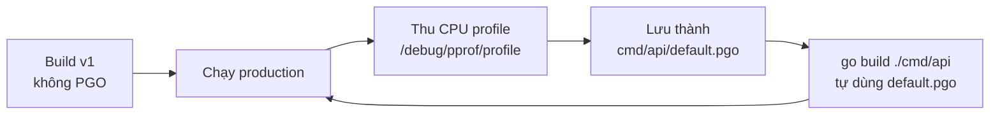

# Hiệu năng và debug

"Đoán" chỗ chậm là thói quen tốn kém nhất của lập trình viên: thường thì chỗ ta nghi ngờ không phải nút thắt thật. Go đi kèm bộ công cụ đo đạc rất mạnh ngay trong toolchain: **pprof** (lấy mẫu CPU, bộ nhớ, goroutine, block, mutex), **execution tracer** (`runtime/trace` + `go tool trace`) để nhìn từng goroutine theo thời gian, **PGO** (profile-guided optimization) để compiler tối ưu theo profile production, và **Delve** — debugger chuẩn của Go. Bài này hướng dẫn dùng từng công cụ, đọc kết quả và khi nào chọn công cụ nào.

---

:::note[Ghi nhớ nhanh]

- ⭐ **Đo trước, tối ưu sau** — `go test -bench -cpuprofile` hoặc `net/http/pprof` trên service thật, rồi `go tool pprof -http=:8081 file` để xem flame graph.
- ⭐ **`import _ "net/http/pprof"`** đăng ký các endpoint `/debug/pprof/*` vào `http.DefaultServeMux` — **không bao giờ** mở endpoint này ra Internet.
- **Heap profile có 4 góc nhìn**: `inuse_space`/`inuse_objects` (đang giữ — tìm rò rỉ) và `alloc_space`/`alloc_objects` (tổng đã cấp phát — tìm áp lực GC).
- **Block và mutex profile mặc định tắt** — bật bằng `runtime.SetBlockProfileRate` và `runtime.SetMutexProfileFraction`.
- **pprof trả lời "tốn ở đâu", trace trả lời "chuyện gì xảy ra khi nào"** — độ trễ do chờ, scheduler, GC thì xem trace.
- **PGO (GA từ Go 1.21)**: đặt CPU profile production tên `default.pgo` cạnh package `main`, `go build` tự dùng — thường nhanh hơn 2–14%.

:::

---

## Mục lục

- [Vì sao cần profiling?](#vì-sao-cần-profiling)
- [Các loại profile](#các-loại-profile)
- [Thu profile từ benchmark và code](#thu-profile-từ-benchmark-và-code)
- [net/http/pprof cho service đang chạy](#nethttppprof-cho-service-đang-chạy)
- [Phân tích với go tool pprof](#phân-tích-với-go-tool-pprof)
- [Execution trace](#execution-trace)
- [Profile-guided optimization](#profile-guided-optimization)
- [Debug với Delve](#debug-với-delve)
- [Race detector](#race-detector)
- [Câu hỏi phỏng vấn](#câu-hỏi-phỏng-vấn)

---

## Vì sao cần profiling?

**Vấn đề:** API báo cáo chậm, lập trình viên "cảm thấy" lỗi nằm ở câu SQL nên dành hai ngày viết lại truy vấn:

```go
func ReportHandler(w http.ResponseWriter, r *http.Request) {
	rows := loadOrders(r.Context())      // nghi ngờ chỗ này chậm...
	var out string
	for _, o := range rows {
		out += fmt.Sprintf("%d,%s\n", o.ID, o.Name) // ...nhưng thật ra chỗ này
	}
	w.Write([]byte(out))
}
```

Kết quả: không nhanh hơn chút nào, vì 80% thời gian nằm ở việc nối chuỗi `+=` tạo ra hàng chục nghìn chuỗi tạm và GC phải dọn liên tục.

**Giải pháp:** Đo bằng profile, nhìn flame graph thấy ngay `runtime.concatstrings` và `runtime.mallocgc` chiếm phần lớn, rồi sửa đúng chỗ:

```go
func ReportHandler(w http.ResponseWriter, r *http.Request) {
	rows := loadOrders(r.Context())
	bw := bufio.NewWriter(w)
	defer bw.Flush()
	for _, o := range rows {
		fmt.Fprintf(bw, "%d,%s\n", o.ID, o.Name) // ghi thẳng, không tạo chuỗi trung gian
	}
}
```

:::tip[Dùng thực tế]

- **CPU tăng vọt sau một lần deploy** — lấy CPU profile production, so sánh với profile bản trước bằng `-diff_base`.
- **Bộ nhớ tăng dần đến OOM** — so sánh hai heap profile `inuse_space` cách nhau vài giờ để tìm chỗ giữ bộ nhớ.
- **Số goroutine tăng mãi** — goroutine profile cho thấy hàng nghìn goroutine kẹt cùng một dòng `chan send`.
- **p99 latency cao dù CPU thấp** — execution trace cho thấy request chờ lock hoặc bị GC stop-the-world.

:::

:::tip[Ví dụ đời thường]

Tối ưu không đo giống **sửa xe máy theo cảm giác**: xe yếu thì thay bugi, thay nhớt, xe vẫn yếu vì thực ra lọc gió bị tắc. Thợ giỏi cắm máy đo trước rồi mới tháo. pprof là máy đo tổng quát "bộ phận nào tốn nhiên liệu nhất"; trace là **camera hành trình** ghi lại từng giây xe đứng ở đèn đỏ nào.

:::

---

## Các loại profile

| Profile | Đo gì | Mặc định | Dùng khi |
|---------|-------|----------|----------|
| `cpu` | Hàm nào chiếm CPU (lấy mẫu 100 lần/giây) | Bật khi yêu cầu | Chương trình tốn CPU, chậm |
| `heap` | Bộ nhớ đang giữ và đã cấp phát (lấy mẫu) | Luôn có | Rò rỉ bộ nhớ, GC nhiều |
| `allocs` | Giống `heap` nhưng mặc định xem tổng cấp phát | Luôn có | Giảm allocation |
| `goroutine` | Stack của mọi goroutine hiện tại | Luôn có | Goroutine leak, deadlock |
| `block` | Thời gian goroutine bị chặn (chan, select, `sync.Cond`...) | **Tắt** | Chờ đợi nhiều nhưng CPU thấp |
| `mutex` | Thời gian tranh chấp mutex (contention) | **Tắt** | Lock bị tranh giành |
| `threadcreate` | Stack tạo OS thread | Luôn có | Ít dùng |

```go
// Bật block và mutex profile — đặt ở đầu main, chỉ khi cần điều tra
runtime.SetBlockProfileRate(1)        // ghi mọi sự kiện block (tốn chi phí, có thể tăng giá trị)
runtime.SetMutexProfileFraction(5)    // lấy mẫu trung bình 1/5 sự kiện tranh chấp
```

---

## Thu profile từ benchmark và code

### Từ go test

Cách nhanh nhất để profile một hàm cụ thể:

```bash
go test -bench=BenchmarkReport -benchmem \
  -cpuprofile=cpu.pprof -memprofile=mem.pprof \
  -blockprofile=block.pprof -mutexprofile=mutex.pprof \
  ./internal/report
```

### Từ code với `runtime/pprof`

Dùng cho CLI, batch job — chương trình chạy xong rồi thoát:

```go
package main

import (
	"log/slog"
	"os"
	"runtime"
	"runtime/pprof"
)

func cpuProfile(path string, work func()) error {
	f, err := os.Create(path)
	if err != nil {
		return err
	}
	defer f.Close()
	if err := pprof.StartCPUProfile(f); err != nil {
		return err
	}
	defer pprof.StopCPUProfile()
	work()
	return nil
}

func heapProfile(path string) error {
	f, err := os.Create(path)
	if err != nil {
		return err
	}
	defer f.Close()
	runtime.GC() // cập nhật số liệu heap mới nhất trước khi ghi
	return pprof.WriteHeapProfile(f)
}

func fib(n int) int {
	if n < 2 {
		return n
	}
	return fib(n-1) + fib(n-2)
}

func main() {
	if err := cpuProfile("cpu.pprof", func() { _ = fib(38) }); err != nil {
		slog.Error("cpu profile", "err", err)
		os.Exit(1)
	}
	if err := heapProfile("heap.pprof"); err != nil {
		slog.Error("heap profile", "err", err)
		os.Exit(1)
	}
}
```

Các profile khác lấy qua `pprof.Lookup("goroutine").WriteTo(w, 0)`, tương tự với `"block"`, `"mutex"`, `"allocs"`.

---

## net/http/pprof cho service đang chạy

Với service dài hạn, chỉ cần một dòng import:

```go
package main

import (
	"log/slog"
	"net/http"
	_ "net/http/pprof" // đăng ký /debug/pprof/* vào http.DefaultServeMux
	"os"
)

func main() {
	// Server pprof riêng, chỉ nghe localhost — tách khỏi server phục vụ người dùng
	go func() {
		if err := http.ListenAndServe("localhost:6060", nil); err != nil {
			slog.Error("pprof server", "err", err)
		}
	}()

	api := http.NewServeMux() // mux riêng cho API, không lộ pprof
	api.HandleFunc("GET /health", func(w http.ResponseWriter, r *http.Request) {
		w.Write([]byte("ok"))
	})
	if err := http.ListenAndServe(":8080", api); err != nil {
		slog.Error("api server", "err", err)
		os.Exit(1)
	}
}
```

Các endpoint chính:

```bash
# CPU 30 giây, mở thẳng giao diện web
go tool pprof -http=:8081 'http://localhost:6060/debug/pprof/profile?seconds=30'

# Heap hiện tại
go tool pprof http://localhost:6060/debug/pprof/heap

# Goroutine: debug=2 in stack đầy đủ dạng text, rất hữu ích khi nghi deadlock
curl 'http://localhost:6060/debug/pprof/goroutine?debug=2' > goroutines.txt

# Trace 5 giây
curl -o trace.out 'http://localhost:6060/debug/pprof/trace?seconds=5'
```

Nếu dùng mux riêng (không dùng `DefaultServeMux`), đăng ký thủ công các handler `pprof.Index`, `pprof.Profile`, `pprof.Symbol`, `pprof.Trace` từ package `net/http/pprof`.

:::warning[Lỗi hay gặp]

- **Mở `/debug/pprof` ra Internet** — lộ stack, tên hàm, cho phép kẻ xấu kích hoạt CPU profile liên tục làm chậm server. Chỉ nghe `localhost` hoặc mạng nội bộ, đặt sau xác thực.
- **Dùng `http.ListenAndServe(":8080", nil)` cho API kèm import pprof** — pprof tự lộ trên cổng API vì cả hai dùng `DefaultServeMux`.
- **Profile trên máy dev với dữ liệu nhỏ** — kết quả khác production. Ưu tiên profile môi trường thật hoặc dữ liệu gần thật.

:::

---

## Phân tích với go tool pprof

### Giao diện web và flame graph

```bash
go tool pprof -http=:8081 cpu.pprof
```

Mở trình duyệt với các view: **Top**, **Graph** (đồ thị gọi hàm, ô càng to càng tốn), **Flame Graph**, **Peek**, **Source** (từng dòng code tốn bao nhiêu), **Disassemble**.

Đọc flame graph: trục ngang là **tỷ lệ thời gian** (không phải thời gian trôi), trục dọc là **stack** (hàm gọi ở dưới, hàm bị gọi ở trên). Khối **rộng** ở trên cùng là nơi CPU thực sự tiêu tốn.

### Chế độ dòng lệnh

```bash
go tool pprof cpu.pprof
(pprof) top10                 # 10 hàm tốn nhất
(pprof) top10 -cum            # sắp theo thời gian tích luỹ (gồm hàm con)
(pprof) list ReportHandler    # source có số liệu từng dòng
(pprof) web                   # đồ thị SVG (cần graphviz)
(pprof) peek mallocgc         # ai gọi tới / gọi đi từ hàm này
```

`flat` là thời gian **trong chính hàm**; `cum` (cumulative) là thời gian **của hàm và mọi hàm nó gọi**. Hàm có `flat` lớn là chỗ cần tối ưu trực tiếp; hàm có `cum` lớn nhưng `flat` nhỏ là "cửa ngõ" dẫn tới chỗ tốn.

### Heap: chọn sample type

```bash
go tool pprof -sample_index=inuse_space heap.pprof    # đang giữ bao nhiêu byte
go tool pprof -sample_index=alloc_objects heap.pprof  # đã cấp phát bao nhiêu object
```

### So sánh hai profile

```bash
# Profile trước và sau khi deploy — chỉ hiển thị phần chênh lệch
go tool pprof -http=:8081 -diff_base=before.pprof after.pprof
```

---

## Execution trace

pprof là thống kê lấy mẫu; **trace** ghi lại **từng sự kiện** theo thời gian: goroutine được tạo/chạy/block, syscall, GC, chuyển P (processor). Phù hợp để hiểu latency, độ song song thực tế, tác động của GC.

```go
package main

import (
	"context"
	"log/slog"
	"os"
	"runtime/trace"
	"sync"
)

func main() {
	f, err := os.Create("trace.out")
	if err != nil {
		slog.Error("tạo file trace", "err", err)
		os.Exit(1)
	}
	defer f.Close()

	if err := trace.Start(f); err != nil {
		slog.Error("bắt đầu trace", "err", err)
		os.Exit(1)
	}
	defer trace.Stop()

	var wg sync.WaitGroup
	for i := range 4 {
		wg.Go(func() { // Go 1.25: WaitGroup.Go
			// Region đánh dấu một đoạn logic, hiển thị riêng trong UI
			trace.WithRegion(context.Background(), "xu-ly-batch", func() {
				_ = i * i
			})
		})
	}
	wg.Wait()
}
```

```bash
go tool trace trace.out      # mở UI web: timeline goroutine, GC, network/syscall blocking...
```

Trong UI, các mục hay dùng: **Goroutine analysis** (goroutine nào chờ gì, bao lâu), **Scheduler latency profile**, **Network/Synchronization/Syscall blocking profile**, và timeline từng P.

:::tip[Flight recorder (Go 1.25)]

Trace liên tục tốn nhiều dữ liệu. Go 1.25 thêm `trace.FlightRecorder`: giữ trace của **vài giây gần nhất** trong bộ nhớ; khi phát hiện sự cố (request quá chậm) mới gọi `WriteTo` để ghi ra file — giống hộp đen máy bay.

```go
fr := trace.NewFlightRecorder(trace.FlightRecorderConfig{
	MinAge:   5 * time.Second, // giữ ít nhất 5 giây gần nhất
	MaxBytes: 4 << 20,         // tối đa khoảng 4 MiB
})
if err := fr.Start(); err != nil { /* xử lý lỗi */ }
// ... khi có request chậm bất thường:
// fr.WriteTo(file)
```

:::

---

## Profile-guided optimization

**PGO** (tối ưu theo profile) cho compiler biết **hàm nào nóng nhất trên production**, để nó inline mạnh tay hơn và devirtualize (biến lời gọi qua interface thành gọi trực tiếp) ở đúng chỗ. Preview ở Go 1.20, chính thức từ **Go 1.21**; cờ `-pgo=auto` là mặc định.



```bash
# 1. Thu CPU profile đại diện từ production (30–60 giây lúc tải bình thường)
curl -o cpu.pprof 'http://prod-host:6060/debug/pprof/profile?seconds=60'

# 2. (tuỳ chọn) gộp nhiều profile từ nhiều instance
go tool pprof -proto a.pprof b.pprof c.pprof > merged.pprof

# 3. Đặt vào thư mục package main và commit
mv merged.pprof cmd/api/default.pgo

# 4. Build như bình thường — -pgo=auto tự tìm default.pgo
go build ./cmd/api
go build -pgo=off ./cmd/api              # tắt PGO để so sánh
go build -pgo=profiles/cpu.pprof ./cmd/api   # chỉ định file khác
```

Lưu ý: PGO chịu được code thay đổi nhẹ sau khi thu profile (profile cũ vẫn có ích); build lâu hơn một chút; binary có thể lớn hơn do inline nhiều. Thường cải thiện **2–14%** CPU tuỳ chương trình.

---

## Debug với Delve

**Delve** (`dlv`) là debugger chuyên cho Go, hiểu goroutine, interface, slice, map — tốt hơn hẳn gdb với code Go. VS Code và GoLand dùng Delve phía sau.

```bash
go install github.com/go-delve/delve/cmd/dlv@latest

dlv debug ./cmd/api -- -port=8080   # biên dịch (tắt tối ưu) và debug; tham số sau -- cho chương trình
dlv test ./internal/order -- -test.run TestCancel   # debug test
dlv attach 12345                    # gắn vào process đang chạy (PID)
dlv exec ./bin/api                  # debug binary có sẵn
dlv core ./bin/api core.12345       # phân tích core dump sau crash
```

Các lệnh trong phiên debug:

```text
(dlv) break main.go:42              # đặt breakpoint theo dòng (viết tắt: b)
(dlv) break order.(*Service).Cancel # breakpoint theo hàm/method
(dlv) condition 1 id == 100         # breakpoint có điều kiện
(dlv) continue                      # chạy tới breakpoint tiếp (c)
(dlv) next                          # qua dòng tiếp, không vào hàm (n)
(dlv) step                          # bước vào hàm (s)
(dlv) stepout                       # ra khỏi hàm hiện tại
(dlv) print order                   # in biến (p), hỗ trợ biểu thức: p len(items)
(dlv) locals                        # mọi biến cục bộ
(dlv) args                          # tham số hàm
(dlv) stack                         # stack trace (bt)
(dlv) goroutines                    # liệt kê goroutine
(dlv) goroutine 18                  # chuyển sang goroutine 18
(dlv) goroutines -t                 # kèm stack của từng goroutine
(dlv) restart                       # chạy lại từ đầu
(dlv) exit
```

Debug binary build bình thường sẽ khó vì compiler đã inline và tối ưu biến. `dlv debug` tự build với `-gcflags=all="-N -l"` (tắt tối ưu và inline); nếu tự build để debug, dùng cùng cờ này.

:::warning[Lỗi hay gặp]

- **Debug binary build bằng `-ldflags "-s -w"`** — đã xoá bảng symbol và DWARF, Delve không đọc được biến/dòng.
- **Biến hiện `optimized away`** — binary build có tối ưu; build lại với `-gcflags=all="-N -l"`.
- **Đặt breakpoint trong code chạy song song cao** — dừng một goroutine làm thay đổi timing, bug concurrency có thể "biến mất". Kết hợp log, trace và race detector.

:::

---

## Race detector

Race detector đã được trình bày chi tiết trong bài Race detection ở nhóm Concurrency. Nhắc lại ngắn:

```bash
go test -race ./...           # bắt buộc trong CI
go run -race ./cmd/api        # chạy thử cục bộ / staging
```

Chỉ phát hiện race trên đường code **thực sự chạy**, làm chậm 2–20 lần và tốn bộ nhớ 5–10 lần nên thường không bật trên production.

---

## Câu hỏi phỏng vấn

**1. Service Go của bạn bị tăng bộ nhớ liên tục rồi OOM. Bạn điều tra thế nào?**

<details className="qa">
<summary>Xem đáp án</summary>

1. Xem số goroutine (`/debug/pprof/goroutine`) — goroutine leak là nguyên nhân rất phổ biến (mỗi goroutine giữ stack và mọi thứ nó tham chiếu).
2. Lấy hai heap profile cách nhau một khoảng thời gian, so sánh `inuse_space` bằng `-diff_base` để thấy chỗ cấp phát mà không giải phóng.
3. Nghi phạm thường gặp: cache/map không giới hạn, slice con giữ mảng gốc lớn, timer/ticker không `Stop`, goroutine chờ channel không bao giờ đóng, `resp.Body` không đóng.
4. Kiểm tra cấu hình `GOMEMLIMIT` để runtime GC kịp thời trong container.

</details>

**2. `flat` và `cum` trong pprof khác nhau thế nào?**

<details className="qa">
<summary>Xem đáp án</summary>

`flat` là thời gian (hoặc bộ nhớ) tiêu tốn **trong thân chính hàm đó**. `cum` là tổng của hàm **cộng mọi hàm nó gọi**. `main.main` luôn có `cum` gần 100% nhưng `flat` gần 0. Tối ưu nên nhắm hàm có `flat` lớn, và dùng `cum` để lần theo đường gọi dẫn tới đó.

</details>

**3. Khi nào dùng pprof, khi nào dùng execution trace?**

<details className="qa">
<summary>Xem đáp án</summary>

pprof là **thống kê lấy mẫu** — trả lời "CPU/bộ nhớ tốn ở hàm nào", chi phí thấp, chạy được trên production. Trace ghi **mọi sự kiện theo thời gian** — trả lời "goroutine này đã chờ gì, khi nào, bao lâu", hữu ích cho latency, độ song song kém, tác động của GC và scheduler; dữ liệu lớn nên chỉ thu trong vài giây (hoặc dùng flight recorder).

</details>

**4. PGO hoạt động thế nào và triển khai ra sao?**

<details className="qa">
<summary>Xem đáp án</summary>

Compiler đọc CPU profile để biết hàm và lời gọi nào nóng, từ đó inline mạnh hơn ở các call site nóng và devirtualize lời gọi interface sang kiểu cụ thể hay gặp nhất. Quy trình: thu CPU profile đại diện từ production, gộp nếu nhiều instance, lưu thành `default.pgo` trong thư mục package `main`, commit; `go build` (mặc định `-pgo=auto`) tự áp dụng. Cập nhật profile định kỳ. Cải thiện thường 2–14%.

</details>

**5. Vì sao không nên mở `net/http/pprof` trên cổng public?**

<details className="qa">
<summary>Xem đáp án</summary>

Endpoint lộ thông tin nội bộ (stack, tên hàm, đường dẫn mã nguồn, dữ liệu trong cmdline) và cho phép bất kỳ ai kích hoạt CPU profile/trace dài, gây tốn tài nguyên — một dạng DoS. Ngoài ra import `net/http/pprof` tự đăng ký vào `http.DefaultServeMux`, nên nếu server API dùng `nil` handler thì pprof lộ ra ngay. Cách đúng: server pprof riêng nghe `localhost`/mạng nội bộ, API dùng mux riêng, có xác thực nếu cần truy cập từ xa.

</details>

**6. Debug một bug concurrency bằng breakpoint có vấn đề gì?**

<details className="qa">
<summary>Xem đáp án</summary>

Breakpoint dừng goroutine, làm thay đổi thứ tự xen kẽ giữa các goroutine — bug phụ thuộc timing có thể không tái hiện (heisenbug). Nên dùng race detector (`-race`), goroutine dump (`debug=2`), execution trace và log có cấu trúc; Delve vẫn hữu ích để xem trạng thái goroutine khi chương trình đã treo (`dlv attach` rồi `goroutines -t`).

</details>
