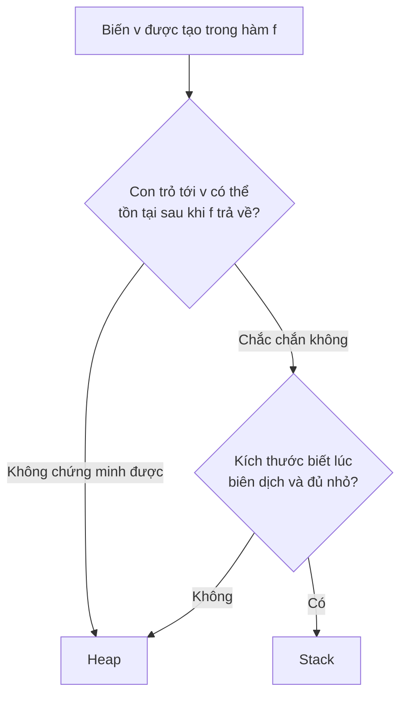

# Escape analysis và bộ nhớ chuyên sâu

Trong Go, bạn không tự quyết định một biến nằm trên **stack** hay **heap** — compiler quyết định thông qua **escape analysis** (phân tích thoát). Quyết định này ảnh hưởng trực tiếp tới hiệu năng: cấp phát trên stack gần như miễn phí và tự giải phóng khi hàm kết thúc, còn cấp phát trên heap tốn thời gian và tạo việc cho garbage collector. Bài này giải thích compiler quyết định thế nào, các tình huống làm biến "thoát" lên heap, cách đọc output của `-gcflags=-m`, inlining, sắp xếp field struct để tránh padding, và cách đo, giảm allocation bằng benchmark `-benchmem`.

---

:::note[Ghi nhớ nhanh]

- ⭐ **Biến thoát lên heap khi compiler không chứng minh được nó không còn được dùng sau khi hàm trả về** — trả con trỏ ra ngoài, gán vào interface, bị closure giữ, kích thước không biết lúc biên dịch hoặc quá lớn.
- ⭐ **`go build -gcflags=-m`** in quyết định escape và inlining; `-m -m` in thêm lý do chi tiết.
- **Trả con trỏ (`&T{}`) không phải lúc nào cũng lên heap** — nếu hàm được inline, compiler có thể giữ trên stack của hàm gọi.
- **Inlining** (chép thân hàm vào chỗ gọi) bỏ chi phí gọi hàm và mở thêm cơ hội tối ưu escape; hàm nhỏ, đơn giản mới được inline.
- **Sắp field struct từ lớn đến nhỏ** để giảm padding; analyzer `fieldalignment` gợi ý thứ tự tối ưu.
- **Đo trước khi tối ưu**: `go test -bench . -benchmem` cho `B/op` và `allocs/op` — chỉ tối ưu allocation trên đường nóng (hot path).

:::

---

## Mục lục

- [Vì sao cần hiểu escape analysis?](#vì-sao-cần-hiểu-escape-analysis)
- [Stack và heap trong Go](#stack-và-heap-trong-go)
- [Xem quyết định của compiler](#xem-quyết-định-của-compiler)
- [Các trường hợp biến thoát lên heap](#các-trường-hợp-biến-thoát-lên-heap)
- [Inlining](#inlining)
- [Struct alignment và padding](#struct-alignment-và-padding)
- [Kỹ thuật giảm allocation](#kỹ-thuật-giảm-allocation)
- [Đo bằng benchmark](#đo-bằng-benchmark)
- [Câu hỏi phỏng vấn](#câu-hỏi-phỏng-vấn)

---

## Vì sao cần hiểu escape analysis?

**Vấn đề:** Người từ C/C++ quen nghĩ "trả con trỏ tới biến cục bộ là lỗi nghiêm trọng" (dangling pointer). Người từ Java nghĩ "mọi object đều nằm trên heap". Go khác cả hai — đoạn sau **hợp lệ và an toàn**:

```go
func NewUser(name string) *User {
	u := User{Name: name} // biến cục bộ...
	return &u             // ...nhưng trả con trỏ ra ngoài vẫn an toàn
}
```

Compiler thấy `u` được dùng sau khi hàm kết thúc nên tự đặt nó lên heap. An toàn, nhưng nếu đây là đường nóng chạy triệu lần/giây, mỗi lần là một lần cấp phát heap và GC phải dọn — dịch vụ có thể tốn CPU cho GC nhiều hơn cho nghiệp vụ.

**Giải pháp:** Hiểu quy tắc để viết code mà compiler giữ được trên stack khi cần, và **kiểm chứng** bằng công cụ thay vì đoán:

```go
// Trả giá trị: thường không cấp phát heap
func NewUserVal(name string) User {
	return User{Name: name}
}
```

```text
$ go test -bench . -benchmem
BenchmarkPtr-10    141088780     8.578 ns/op    16 B/op    1 allocs/op
BenchmarkVal-10    670846100     1.796 ns/op     0 B/op    0 allocs/op
```

:::tip[Dùng thực tế]

- **Tối ưu hot path** của parser, encoder, router HTTP — các thư viện như `fasthttp`, `zap`, `zerolog` được thiết kế "zero allocation".
- **Giảm áp lực GC** cho service latency thấp (game server, trading) — ít allocation thì ít chu kỳ GC, p99 ổn định hơn.
- **Đọc hiểu profile** — thấy `runtime.mallocgc` chiếm nhiều trong pprof thì biết tìm allocation ở đâu.
- **Tiết kiệm RAM** khi giữ hàng triệu struct trong bộ nhớ — sắp lại field giảm 20–30% kích thước.

:::

:::tip[Ví dụ đời thường]

Stack giống **bàn làm việc cá nhân**: giấy nháp dùng xong trong buổi thì vứt ngay khi đứng dậy, không tốn công ai. Heap giống **kho lưu trữ chung của công ty**: tài liệu cần dùng lâu dài hoặc chia cho phòng khác phải gửi vào kho, và cần nhân viên kho (GC) định kỳ đi dọn những gì không ai cần nữa. Escape analysis là trưởng phòng xem tờ giấy nào "sẽ bị mang ra khỏi phòng" thì mới gửi vào kho.

:::

---

## Stack và heap trong Go

| | Stack | Heap |
|--|-------|------|
| Thuộc về | Từng goroutine (bắt đầu ~2–8 KB, tự giãn) | Toàn chương trình |
| Cấp phát | Dịch con trỏ stack, gần như miễn phí | Qua allocator (`runtime.mallocgc`), tốn hơn |
| Giải phóng | Tự động khi hàm trả về | Garbage collector |
| Ảnh hưởng GC | Không (chỉ là root khi quét) | Có — càng nhiều càng tốn GC |
| Cache CPU | Rất tốt (liền mạch, nóng) | Phân tán hơn |

Stack của goroutine trong Go **có thể giãn ra** (copy sang vùng lớn hơn khi cần), nên đệ quy sâu không dễ tràn như C — nhưng giới hạn kích thước một biến đặt trên stack vẫn có (xem phần dưới).

Quy tắc của compiler là **bảo thủ**: chỉ đặt trên stack khi **chứng minh được** biến không được tham chiếu sau khi hàm kết thúc. Không chứng minh được → heap.



---

## Xem quyết định của compiler

```bash
go build -gcflags=-m ./...              # quyết định escape + inline cho package của bạn
go build -gcflags='-m -m' ./internal/x  # chi tiết lý do (rất dài)
go build -gcflags='all=-m' ./...        # cả dependency và thư viện chuẩn
go test -gcflags=-m -run=^$ ./pkg       # với code trong test
```

Chương trình ví dụ:

```go
package main

import "fmt"

type User struct{ Name string }

func newUserPtr(name string) *User { return &User{Name: name} }
func newUserVal(name string) User  { return User{Name: name} }

func sum(n int) int {
	buf := make([]int, 8) // kích thước hằng, không thoát
	for i := range buf {
		buf[i] = i * n
	}
	t := 0
	for _, v := range buf {
		t += v
	}
	return t
}

func dyn(n int) []int { return make([]int, n) } // trả slice ra ngoài

func counter() func() int {
	c := 0
	return func() int { c++; return c } // closure giữ c
}

func big() int {
	arr := make([]byte, 128<<10) // 128 KB
	return len(arr)
}

func main() {
	u := newUserPtr("An")
	v := newUserVal("Bình")
	x := 42
	fmt.Println(u.Name, v.Name, x, sum(2), len(dyn(3)), counter()(), big())
}
```

Output thực tế (Go 1.26, đã lược bớt):

```text
./main.go:7:6: can inline newUserPtr
./main.go:10:6: can inline sum
./main.go:7:45: &User{...} escapes to heap
./main.go:11:13: make([]int, 8) does not escape
./main.go:22:36: make([]int, n) escapes to heap
./main.go:25:2: moved to heap: c
./main.go:26:9: func literal escapes to heap
./main.go:30:13: make([]byte, 131072) escapes to heap
./main.go:35:17: &User{...} does not escape
./main.go:38:15: u.Name escapes to heap
./main.go:38:30: 42 escapes to heap
```

Cách đọc:

- **`escapes to heap`** — giá trị này được cấp phát trên heap.
- **`moved to heap: c`** — biến `c` (vốn là biến cục bộ) bị chuyển lên heap.
- **`does not escape`** — ở lại stack.
- **`leaking param: name`** — tham số `name` có thể "rò" ra ngoài qua giá trị trả về; người gọi phải lưu ý.
- **Dòng 7 và dòng 35** — trong thân `newUserPtr`, `&User{}` thoát; nhưng vì `newUserPtr` được **inline** vào `main` và `u` không rời `main`, tại dòng 35 nó **không thoát**.
- **`42 escapes to heap`, `u.Name escapes to heap`** — do truyền vào `fmt.Println(...any)`: giá trị được đóng hộp vào interface (xem phần dưới).

---

## Các trường hợp biến thoát lên heap

### 1. Trả con trỏ ra ngoài hàm (không được inline)

```go
//go:noinline
func NewPoint(x, y int) *Point {
	return &Point{x, y} // escapes to heap
}
```

Cách tránh khi hợp lý: trả giá trị (struct nhỏ), hoặc để người gọi truyền vùng nhớ vào:

```go
func (p *Point) Reset(x, y int) { p.X, p.Y = x, y } // người gọi quyết định p nằm đâu
```

### 2. Gán vào interface

Khi một giá trị không phải con trỏ được gán vào interface (`any`, `error`, `fmt.Stringer`...), Go thường phải cấp phát để giữ bản sao của nó, vì compiler không biết method/hàm nhận interface sẽ giữ nó bao lâu:

```go
func logValue(v any) { fmt.Println(v) }

func main() {
	n := 1000
	logValue(n) // n được đóng hộp (boxing) → thường cấp phát heap
}
```

Runtime có tối ưu cho vài trường hợp (số nguyên nhỏ 0–255, giá trị hằng, giá trị zero) nên không phải lần nào cũng cấp phát. Đây là lý do logger hiệu năng cao (`slog`, `zap`) dùng API có kiểu cụ thể như `slog.Int("n", n)` thay vì `...any`.

### 3. Closure giữ biến

```go
func counter() func() int {
	c := 0                              // moved to heap: c
	return func() int { c++; return c } // closure sống lâu hơn counter()
}
```

Closure **không thoát** (gọi ngay trong hàm) thì biến vẫn có thể ở stack.

### 4. Kích thước không biết lúc biên dịch hoặc quá lớn

```go
func process(n int) {
	buf := make([]byte, n)      // n động → trước Go 1.25 luôn lên heap
	small := make([]byte, 64)   // hằng, nhỏ → stack (nếu không thoát)
	huge := make([]byte, 1<<20) // 1 MB: vượt ngưỡng → heap
	_, _, _ = buf, small, huge
}
```

Ngưỡng cho cấp phát ngầm (`make`, `new`, `&T{}`) có kích thước hằng là 64 KB; biến khai báo tường minh (`var a [N]byte`) có ngưỡng 128 KB (hằng số nội bộ của compiler, có thể đổi giữa các phiên bản). Từ Go 1.25, nếu slice không thoát, compiler đặt được backing array của `make([]T, n)` với `n` động lên stack khi đủ nhỏ (dùng một buffer nhỏ cố định trên stack, quá cỡ mới cấp phát heap) — `go build -gcflags=-m` khi đó in `make([]byte, n) does not escape`.

### 5. Lưu con trỏ vào nơi sống lâu hơn

```go
var cache []*User

func remember(u User) {
	cache = append(cache, &u) // &u lưu vào biến global → moved to heap: u
}
```

Tương tự: gửi con trỏ qua channel, lưu vào map/slice được trả về, lưu vào field của struct đã ở heap.

### 6. Gọi method qua interface với tham số con trỏ

```go
func write(w io.Writer) {
	buf := make([]byte, 128) // escapes: compiler không biết w.Write sẽ giữ buf hay không
	w.Write(buf)
}
```

Khi gọi qua interface, compiler không biết hiện thực cụ thể nên giả định xấu nhất. PGO có thể devirtualize lời gọi nóng để cải thiện.

:::warning[Lỗi hay gặp]

- **"Dùng con trỏ cho nhanh, tránh copy"** — với struct nhỏ (vài field), truyền giá trị thường **nhanh hơn** vì tránh heap allocation và tốt cho cache. Đo rồi mới quyết.
- **Tối ưu escape ở code không nóng** — làm code khó đọc mà không cải thiện gì đo được.
- **Dựa vào output `-m` của một phiên bản Go cho mãi mãi** — heuristic thay đổi qua mỗi bản (vd Go 1.25 cải thiện cấp phát slice trên stack); kiểm chứng lại bằng benchmark khi nâng cấp.

:::

---

## Inlining

**Inlining** là compiler chép thân hàm được gọi vào chỗ gọi, bỏ chi phí gọi hàm (đẩy tham số, nhảy, trả về) và mở cơ hội tối ưu khác — trong đó có escape analysis tốt hơn như ví dụ `newUserPtr` ở trên.

Compiler tính "chi phí" (cost) của hàm theo số nút trong cây cú pháp, budget mặc định là 80; hàm vượt budget không được inline. Vòng lặp `for`, `select`, closure đã inline được (từ Go 1.16 trở đi), nhưng hàm chứa `defer`, `go` hoặc `recover` vẫn **không** được inline (Go 1.26 báo `unhandled op DEFER`).

```bash
go build -gcflags=-m ./... 2>&1 | grep -E 'can inline|inlining call'
go build -gcflags='-m -m' ./... 2>&1 | grep 'cannot inline'   # xem lý do không inline
```

```text
./order.go:12:6: cannot inline (*Service).Process: function too complex: cost 312 exceeds budget 80
./lock.go:10:6: cannot inline withDefer: unhandled op DEFER
```

Điều khiển thủ công (chủ yếu để benchmark/debug, không nên dùng trong code thường):

```go
//go:noinline
func add(a, b int) int { return a + b }
```

```bash
go build -gcflags=-l ./...          # tắt inline toàn bộ (dùng khi debug)
```

PGO cho phép compiler vượt budget ở các call site nóng trên production.

---

## Struct alignment và padding

CPU đọc bộ nhớ hiệu quả nhất khi dữ liệu được **căn lề** (alignment) theo kích thước của nó: `int64` phải nằm ở địa chỉ chia hết cho 8 (trên 64-bit). Compiler chèn **padding** (byte đệm) giữa các field để đảm bảo điều đó.

```go
package main

import (
	"fmt"
	"unsafe"
)

type Bad struct {
	A bool  // 1 byte + 7 byte padding
	B int64 // 8 byte
	C bool  // 1 byte + 7 byte padding (để cả struct căn lề 8)
}

type Good struct {
	B int64 // 8 byte
	A bool  // 1 byte
	C bool  // 1 byte + 6 byte padding
}

func main() {
	fmt.Println(unsafe.Sizeof(Bad{}), unsafe.Sizeof(Good{})) // 24 16
	fmt.Println(unsafe.Alignof(Bad{}.B), unsafe.Offsetof(Bad{}.C)) // 8 16
}
```

```text
Bad:  | A |  padding 7  |        B (8)        | C |  padding 7  |   = 24 byte
Good: |        B (8)        | A | C | padding 6 |                   = 16 byte
```

Với một triệu phần tử `[]Bad` là 24 MB, `[]Good` chỉ 16 MB — tiết kiệm 33% và nhiều phần tử nằm trong cùng cache line hơn.

Quy tắc: **xếp field từ kiểu có alignment lớn đến nhỏ** (`int64`, `float64`, con trỏ, `string`, slice → `int32` → `int16` → `bool`/`byte`).

Công cụ `fieldalignment` tự tìm struct có thể sắp lại:

```bash
go install golang.org/x/tools/go/analysis/passes/fieldalignment/cmd/fieldalignment@latest
fieldalignment ./...
fieldalignment -fix ./...   # tự sắp lại (cẩn thận: mất thứ tự logic, comment có thể lệch)
```

```text
./model.go:8:10: struct of size 24 could be 16
```

:::warning[Lỗi hay gặp]

- **Sắp lại mọi struct theo `fieldalignment`** — struct chỉ có vài instance thì tiết kiệm vài byte không đáng đánh đổi thứ tự field dễ đọc. Chỉ áp dụng cho struct có số lượng lớn hoặc nằm trên đường nóng.
- **Đổi thứ tự field của struct dùng với `unsafe`, cgo hoặc binary encoding theo layout** — làm hỏng tương thích.
- **Thao tác atomic 64-bit trên field `int64` trong struct ở nền tảng 32-bit** — cần căn lề 8; dùng kiểu `atomic.Int64` (tự căn lề đúng) thay vì `int64` thô.

:::

---

## Kỹ thuật giảm allocation

### Cấp sẵn dung lượng

```go
// Tệ: append nhiều lần → cấp phát lại và copy nhiều lần
var ids []int
for _, o := range orders {
	ids = append(ids, o.ID)
}

// Tốt: biết trước số phần tử
ids := make([]int, 0, len(orders))
for _, o := range orders {
	ids = append(ids, o.ID)
}
```

Tương tự cho map: `make(map[string]int, n)`; với chuỗi: `strings.Builder` + `Grow`.

### Tái sử dụng bằng `sync.Pool`

```go
var bufPool = sync.Pool{
	New: func() any { return new(bytes.Buffer) },
}

func render(w io.Writer, data Page) error {
	buf := bufPool.Get().(*bytes.Buffer)
	buf.Reset()
	defer bufPool.Put(buf)

	if err := tmpl.Execute(buf, data); err != nil {
		return err
	}
	_, err := w.Write(buf.Bytes())
	return err
}
```

### Tránh chuyển đổi `[]byte`/`string` thừa

```go
// Tệ: chuyển sang string chỉ để xử lý rồi bỏ → mỗi lần một bản copy
if strings.HasPrefix(string(b), "GET ") { /* ... */ }
parts := strings.Split(string(b), ",")

// Tốt: package bytes có hàm tương ứng làm việc trực tiếp trên []byte
if bytes.HasPrefix(b, []byte("GET ")) { /* ... */ }
fields := bytes.Split(b, []byte(","))
```

Compiler đã tối ưu sẵn vài trường hợp không copy: `m[string(b)]` khi tra map, `string(b) == "..."` khi so sánh, `for range []byte(s)`.

### Truyền buffer từ ngoài vào

Mẫu API `Append...` của thư viện chuẩn cho người gọi tái sử dụng buffer:

```go
buf := make([]byte, 0, 64)
buf = strconv.AppendInt(buf, 42, 10)
buf = append(buf, ' ')
buf = time.Now().AppendFormat(buf, time.RFC3339)
```

---

## Đo bằng benchmark

```go
package bench

import (
	"strings"
	"testing"
)

type Point struct{ X, Y int }

//go:noinline
func NewPointPtr(x, y int) *Point { return &Point{x, y} }

//go:noinline
func NewPointVal(x, y int) Point { return Point{x, y} }

var (
	sinkP *Point // gán vào biến package-level để compiler không loại bỏ lời gọi
	sinkV Point
)

func BenchmarkPtr(b *testing.B) {
	for b.Loop() { // Go 1.24: b.Loop thay cho vòng for i := 0; i < b.N; i++
		sinkP = NewPointPtr(1, 2)
	}
}

func BenchmarkVal(b *testing.B) {
	for b.Loop() {
		sinkV = NewPointVal(1, 2)
	}
}

var parts = strings.Fields("a b c d e f g h i j")

func BenchmarkJoinNaive(b *testing.B) {
	for b.Loop() {
		s := ""
		for _, p := range parts {
			s += p // mỗi lần tạo chuỗi mới
		}
		_ = s
	}
}

func BenchmarkJoinBuilder(b *testing.B) {
	for b.Loop() {
		var sb strings.Builder
		sb.Grow(16)
		for _, p := range parts {
			sb.WriteString(p)
		}
		_ = sb.String()
	}
}
```

```text
$ go test -bench=. -benchmem
BenchmarkPtr-10            141088780     8.578 ns/op    16 B/op    1 allocs/op
BenchmarkVal-10            670846100     1.796 ns/op     0 B/op    0 allocs/op
BenchmarkJoinNaive-10        8698603   146.4 ns/op      64 B/op    9 allocs/op
BenchmarkJoinBuilder-10     30756447    38.47 ns/op     16 B/op    1 allocs/op
```

- `B/op` — số byte cấp phát heap mỗi lần lặp.
- `allocs/op` — số lần cấp phát heap mỗi lần lặp.
- So sánh trước/sau một thay đổi một cách có thống kê bằng `benchstat` (golang.org/x/perf/cmd/benchstat): chạy mỗi bản `-count=10`, rồi `benchstat old.txt new.txt`.

Có thể kiểm tra allocation ngay trong unit test để chống "lùi" hiệu năng:

```go
func TestRenderNoAlloc(t *testing.T) {
	allocs := testing.AllocsPerRun(100, func() {
		_ = NewPointVal(1, 2)
	})
	if allocs > 0 {
		t.Fatalf("mong đợi 0 allocation, nhận %v", allocs)
	}
}
```

---

## Câu hỏi phỏng vấn

**1. Escape analysis là gì? Tại sao Go cho phép trả con trỏ tới biến cục bộ?**

<details className="qa">
<summary>Xem đáp án</summary>

Là bước compiler phân tích xem một giá trị có thể được tham chiếu sau khi hàm tạo ra nó kết thúc hay không. Nếu có (hoặc không chứng minh được là không), giá trị được cấp phát trên heap và GC quản lý; nếu không, đặt trên stack. Vì vậy trả `&u` là an toàn: compiler tự chuyển `u` lên heap, không có dangling pointer như C. Lập trình viên không chọn stack/heap trực tiếp, chỉ ảnh hưởng gián tiếp qua cách viết code.

</details>

**2. Kể các trường hợp khiến biến thoát lên heap.**

<details className="qa">
<summary>Xem đáp án</summary>

Trả con trỏ ra khỏi hàm (không được inline); gán giá trị vào interface (boxing — vd truyền vào `fmt.Println`); biến bị closure tồn tại lâu hơn hàm giữ; slice/map có kích thước động hoặc quá lớn; lưu con trỏ vào biến global, channel, map, hoặc struct đã nằm trên heap; truyền con trỏ/slice cho method gọi qua interface (compiler không biết hiện thực có giữ lại không).

</details>

**3. Truyền struct theo con trỏ có luôn nhanh hơn theo giá trị không?**

<details className="qa">
<summary>Xem đáp án</summary>

Không. Con trỏ tránh copy nhưng dễ khiến struct thoát lên heap (tốn allocation, tạo việc cho GC) và truy cập gián tiếp kém thân thiện cache. Struct nhỏ (vài word) truyền giá trị thường nhanh hơn. Struct rất lớn, hoặc cần sửa nội dung, hoặc chứa `sync.Mutex` thì dùng con trỏ. Quyết định bằng benchmark `-benchmem`, không bằng cảm giác.

</details>

**4. Padding trong struct là gì? Làm sao giảm?**

<details className="qa">
<summary>Xem đáp án</summary>

Compiler chèn byte đệm giữa các field để mỗi field nằm ở địa chỉ căn lề theo kích thước của nó (vd `int64` ở bội số của 8), và thêm đệm cuối để kích thước struct là bội số alignment lớn nhất. Ví dụ `{bool; int64; bool}` chiếm 24 byte nhưng `{int64; bool; bool}` chỉ 16 byte. Giảm bằng cách xếp field từ alignment lớn đến nhỏ; dùng `unsafe.Sizeof` để kiểm tra và analyzer `fieldalignment` để phát hiện. Chỉ đáng làm với struct có số lượng lớn.

</details>

**5. Inlining ảnh hưởng thế nào tới escape analysis?**

<details className="qa">
<summary>Xem đáp án</summary>

Escape analysis phân tích theo từng hàm. Khi hàm `NewX()` trả `&X{}` không được inline, kết quả bắt buộc lên heap. Nếu được inline, thân hàm nằm trong hàm gọi, compiler thấy con trỏ không rời hàm gọi nên có thể giữ trên stack. Vì vậy constructor nhỏ, đơn giản (dưới inline budget) thường không gây allocation; thêm logic phức tạp vào constructor có thể đột ngột làm tăng allocation.

</details>

**6. Bạn tìm và giảm allocation trong một service như thế nào?**

<details className="qa">
<summary>Xem đáp án</summary>

Bắt đầu từ dữ liệu: heap profile `alloc_space`/`alloc_objects` (pprof) để tìm hàm cấp phát nhiều nhất trên production; viết benchmark `-benchmem` cho hàm đó; dùng `-gcflags=-m` để biết vì sao biến thoát. Kỹ thuật: cấp sẵn capacity cho slice/map, `strings.Builder`/`bytes.Buffer` thay `+=`, `sync.Pool` cho buffer tạm, API kiểu `Append` nhận buffer từ ngoài, tránh boxing vào interface trên đường nóng, tránh chuyển `[]byte`↔`string` thừa. Kiểm chứng bằng `benchstat` và chốt bằng `testing.AllocsPerRun` trong test.

</details>
