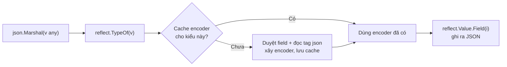

# Reflection

**Reflection** (phản chiếu) là khả năng chương trình tự xem xét và thao tác kiểu dữ liệu, giá trị của chính nó **lúc chạy** — đọc tên field, đọc struct tag, gán giá trị, gọi method theo tên. Đây là phép màu phía sau `encoding/json`, `fmt.Println`, ORM, thư viện validate. Bài này giải thích ba khái niệm trung tâm `reflect.Type`, `reflect.Value`, `reflect.Kind`, cách đọc struct tag, điều kiện để sửa giá trị (`CanSet`, `Elem`), gọi hàm/method động, các ứng dụng thực tế, chi phí hiệu năng và khi nào nên dùng generics thay thế — theo đúng câu châm ngôn của Go: *"Clear is better than clever. Reflection is never clear."*

---

:::note[Ghi nhớ nhanh]

- ⭐ **`reflect.TypeOf(x)` cho kiểu, `reflect.ValueOf(x)` cho giá trị; `Kind()` cho biết loại nền** (`struct`, `ptr`, `slice`, `int`...) — kiểu `type MyInt int` có Type là `MyInt` nhưng Kind là `int`.
- ⭐ **Muốn sửa giá trị phải đi qua con trỏ**: `reflect.ValueOf(&x).Elem()` — `ValueOf(x)` chỉ là bản copy nên `CanSet()` trả `false`; field unexported cũng không set được.
- **Struct tag đọc bằng `field.Tag.Get("json")`** hoặc `Tag.Lookup` (phân biệt "không có" với "rỗng").
- **Gọi động**: `v.MethodByName("Greet").Call(args)` — sai số lượng/kiểu tham số sẽ **panic**, không phải lỗi biên dịch.
- **Chậm hơn truy cập trực tiếp nhiều lần** và mất kiểm tra kiểu lúc biên dịch → chỉ dùng khi xử lý kiểu **không biết trước** (serializer, ORM, DI); nếu chỉ cần "cùng code cho nhiều kiểu" thì dùng generics.

:::

---

## Mục lục

- [Vì sao cần reflection?](#vì-sao-cần-reflection)
- [Type, Value và Kind](#type-value-và-kind)
- [Duyệt struct và đọc struct tag](#duyệt-struct-và-đọc-struct-tag)
- [Sửa giá trị: CanSet và Elem](#sửa-giá-trị-canset-và-elem)
- [Tạo giá trị và gọi hàm động](#tạo-giá-trị-và-gọi-hàm-động)
- [Ví dụ: tự viết validator](#ví-dụ-tự-viết-validator)
- [Reflection trong thư viện thực tế](#reflection-trong-thư-viện-thực-tế)
- [Chi phí và rủi ro](#chi-phí-và-rủi-ro)
- [Reflection hay generics?](#reflection-hay-generics)
- [Câu hỏi phỏng vấn](#câu-hỏi-phỏng-vấn)

---

## Vì sao cần reflection?

**Vấn đề:** Bạn muốn viết một hàm chuyển **bất kỳ struct nào** thành `map[string]any` để ghi log. Không có reflection, phải viết tay cho từng kiểu:

```go
func UserToMap(u User) map[string]any {
	return map[string]any{"name": u.Name, "age": u.Age}
}

func OrderToMap(o Order) map[string]any {
	return map[string]any{"id": o.ID, "total": o.Total, "status": o.Status}
}
// ...thêm struct mới là thêm hàm mới, thêm field là phải nhớ sửa hàm
```

Generics cũng không giúp được: generics cho phép **cùng một thuật toán** chạy trên nhiều kiểu, nhưng không cho bạn **liệt kê field** của một kiểu tuỳ ý.

**Giải pháp:** Reflection cho phép nhìn vào cấu trúc của giá trị lúc chạy:

```go
func ToMap(s any) map[string]any {
	v := reflect.ValueOf(s)
	if v.Kind() == reflect.Pointer {
		v = v.Elem()
	}
	if v.Kind() != reflect.Struct {
		return nil
	}
	t := v.Type()
	out := make(map[string]any, t.NumField())
	for i := range t.NumField() {
		f := t.Field(i)
		if !f.IsExported() {
			continue // bỏ qua field unexported
		}
		key := f.Name
		if tag := f.Tag.Get("json"); tag != "" && tag != "-" {
			key, _, _ = strings.Cut(tag, ",") // bỏ phần ",omitempty"
		}
		out[key] = v.Field(i).Interface()
	}
	return out
}
```

Một hàm dùng cho mọi struct, tự cập nhật khi thêm field.

:::tip[Dùng thực tế]

- **Serialization**: `encoding/json`, `encoding/xml`, YAML, protobuf runtime đọc field và tag để mã hoá/giải mã.
- **ORM/query builder**: GORM, sqlx ánh xạ cột database vào field struct theo tag `db:"..."`.
- **Validation**: `go-playground/validator` đọc tag `validate:"required,email"`.
- **In và so sánh tổng quát**: `fmt.Printf("%+v")`, `reflect.DeepEqual`, thư viện test `testify`, `go-cmp`.

:::

:::tip[Ví dụ đời thường]

Code bình thường giống **nhân viên giao hàng biết trước địa chỉ** từng nhà. Reflection giống **nhân viên hải quan** nhận một kiện hàng không rõ nội dung: phải mở ra, đọc nhãn (struct tag), đếm từng món (field), kiểm tra từng món là gì (Kind) — linh hoạt với mọi kiện hàng, nhưng chậm hơn nhiều và dễ "toang" nếu nhãn ghi sai.

:::

---

## Type, Value và Kind

```go
package main

import (
	"fmt"
	"reflect"
)

type MyInt int

type User struct {
	Name string
	Age  int
}

func main() {
	var x MyInt = 7
	t := reflect.TypeOf(x)
	v := reflect.ValueOf(x)
	fmt.Println(t, t.Name(), t.Kind(), v.Int()) // main.MyInt MyInt int 7

	var p *User
	pt := reflect.TypeOf(p)
	fmt.Println(pt, pt.Kind(), pt.Elem(), pt.Elem().Kind()) // *main.User ptr main.User struct

	// Go 1.22: lấy Type từ tham số kiểu, không cần tạo giá trị
	fmt.Println(reflect.TypeFor[error]()) // error

	var e error
	fmt.Println(reflect.TypeOf(e)) // <nil> — interface nil không mang kiểu động nào
}
```

| Khái niệm | Là gì | Ví dụ |
|-----------|-------|-------|
| `reflect.Type` | Mô tả kiểu: tên, package, field, method | `main.User`, `*main.User`, `[]string` |
| `reflect.Value` | Một giá trị cụ thể kèm kiểu của nó | Giá trị `User{Name: "An"}` |
| `reflect.Kind` | Loại nền tảng, tập hữu hạn | `Struct`, `Pointer`, `Slice`, `Map`, `Int`, `String`, `Func`, `Interface`... |

Vì sao cần cả Type lẫn Kind? Vô số kiểu (`MyInt`, `Celsius`, `UserID`) có chung Kind `int`. Code reflection thường **switch theo Kind** để xử lý tổng quát:

```go
func describe(v reflect.Value) string {
	switch v.Kind() {
	case reflect.Int, reflect.Int8, reflect.Int16, reflect.Int32, reflect.Int64:
		return fmt.Sprintf("số nguyên %d", v.Int())
	case reflect.String:
		return fmt.Sprintf("chuỗi %q", v.String())
	case reflect.Slice:
		return fmt.Sprintf("slice %d phần tử", v.Len())
	case reflect.Pointer:
		if v.IsNil() {
			return "con trỏ nil"
		}
		return "con trỏ tới " + describe(v.Elem())
	default:
		return v.Type().String()
	}
}
```

Quay lại giá trị thường bằng `v.Interface()` rồi type assertion: `u := v.Interface().(User)`.

:::warning[Lỗi hay gặp]

- **Gọi method không hợp với Kind** — `v.Int()` trên Value Kind `String`, `v.Elem()` trên Value không phải con trỏ/interface, `v.Field(0)` trên non-struct đều **panic**. Luôn kiểm tra `Kind()` trước.
- **`reflect.ValueOf(nil)`** trả Value không hợp lệ — kiểm tra `v.IsValid()` trước khi dùng.
- **Nhầm `reflect.Ptr` và `reflect.Pointer`** — cùng một hằng; `Pointer` là tên mới (Go 1.18), `Ptr` giữ để tương thích.

:::

---

## Duyệt struct và đọc struct tag

```go
type User struct {
	Name  string `json:"name" validate:"required"`
	Age   int    `json:"age" validate:"min=18"`
	Email string `json:"email,omitempty"`
	note  string // unexported
}

func listFields() {
	t := reflect.TypeFor[User]()
	for i := range t.NumField() {
		f := t.Field(i) // reflect.StructField
		fmt.Printf("%s %s json=%q exported=%v\n",
			f.Name, f.Type, f.Tag.Get("json"), f.IsExported())
	}
}
```

```text
Name string json="name" exported=true
Age int json="age" exported=true
Email string json="email,omitempty" exported=true
note string json="" exported=false
```

Go 1.26 thêm iterator cho reflection, viết gọn hơn với `range`:

```go
for f := range reflect.TypeFor[User]().Fields() { // iter.Seq[StructField]
	fmt.Println(f.Name, f.Tag.Get("json"))
}

v := reflect.ValueOf(User{Name: "An", Age: 30})
for f, fv := range v.Fields() { // iter.Seq2[StructField, Value]
	fmt.Println(f.Name, "=", fv.Interface())
}
```

Tương tự có `Type.Methods()`, `Type.Ins()`, `Type.Outs()`, `Value.Methods()`; từ Go 1.23 có `Value.Seq()`/`Seq2()` để range trên slice, map, channel, hàm iterator.

### Cú pháp struct tag

Tag là chuỗi dạng `key:"value" key2:"value2"`, các cặp cách nhau **một dấu cách**, value trong **nháy kép**:

```go
Tag.Get("json")              // "name" — trả "" nếu không có
val, ok := f.Tag.Lookup("db") // phân biệt "không có tag" (ok=false) với tag rỗng `db:""`
```

Field nhúng (embedded) có `f.Anonymous == true`; truy cập field lồng bằng `t.FieldByIndex([]int{1, 0})` hoặc `FieldByName` (tìm cả trong struct nhúng).

:::warning[Lỗi hay gặp]

- **Tag sai cú pháp im lặng bị bỏ qua**: `json:name` (thiếu nháy), `json: "name"` (thừa dấu cách), dùng dấu phẩy ngăn cách các key. `go vet` (analyzer `structtag`) bắt được — hãy chạy nó.
- **Đọc `v.Field(i).Interface()` trên field unexported** → panic. Kiểm tra `f.IsExported()` hoặc `fv.CanInterface()`.

:::

---

## Sửa giá trị: CanSet và Elem

`reflect.ValueOf(x)` nhận **bản copy** của `x` (Go truyền theo giá trị), nên sửa nó vô nghĩa — reflect cấm luôn:

```go
x := 10
v := reflect.ValueOf(x)
fmt.Println(v.CanSet()) // false
// v.SetInt(99)          // panic: reflect.Value.SetInt using unaddressable value

p := reflect.ValueOf(&x).Elem() // Value của con trỏ → Elem() lấy biến mà nó trỏ tới
fmt.Println(p.CanSet())         // true
p.SetInt(99)
fmt.Println(x) // 99
```

Một Value **settable** khi: (1) addressable — lấy được qua con trỏ, phần tử slice, field của struct addressable; và (2) không đi qua field unexported.

```go
u := User{}
uv := reflect.ValueOf(&u).Elem()
uv.FieldByName("Name").SetString("Bình")      // OK
fmt.Println(uv.FieldByName("note").CanSet())  // false — field unexported
fmt.Println(u.Name)                           // Bình
```

Các setter khác: `Set(Value)`, `SetBool`, `SetFloat`, `SetUint`, `SetLen`, `SetMapIndex` (map không cần addressable vì map đã là tham chiếu), `SetZero` (Go 1.20), `Clear` (Go 1.21).

```go
m := map[string]int{"a": 1}
reflect.ValueOf(m).SetMapIndex(reflect.ValueOf("b"), reflect.ValueOf(2))
fmt.Println(m) // map[a:1 b:2]
```

:::warning[Lỗi hay gặp]

- **Gán sai kiểu**: `v.Set(reflect.ValueOf("30"))` vào field `int` → panic. Kiểm tra `val.Type().AssignableTo(field.Type())` hoặc `ConvertibleTo` + `Convert`.
- **Truyền struct (không phải con trỏ) vào hàm decode tự viết** — lý do `json.Unmarshal(data, v)` bắt buộc `v` là con trỏ và trả lỗi `InvalidUnmarshalError` nếu không.

:::

---

## Tạo giá trị và gọi hàm động

### Tạo giá trị mới

```go
t := reflect.TypeFor[User]()
nv := reflect.New(t).Elem()       // reflect.New trả *User; Elem() → User settable
nv.Field(0).SetString("Bình")
u := nv.Interface().(User)
fmt.Println(u) // {Bình 0}

s := reflect.MakeSlice(reflect.TypeFor[[]int](), 0, 10)
s = reflect.Append(s, reflect.ValueOf(42))
mm := reflect.MakeMap(reflect.TypeFor[map[string]int]())
_ = mm
```

### Gọi method theo tên

```go
type User struct{ Name string }

func (u User) Greet(prefix string) string { return prefix + ", " + u.Name }

func callGreet() {
	u := User{Name: "Chi"}
	m := reflect.ValueOf(u).MethodByName("Greet")
	if !m.IsValid() {
		fmt.Println("không có method Greet")
		return
	}
	out := m.Call([]reflect.Value{reflect.ValueOf("Xin chào")})
	fmt.Println(out[0].String()) // Xin chào, Chi
}
```

Chỉ method **exported** mới thấy qua reflection. Method có receiver con trỏ chỉ có trong method set của `*User`, nên phải gọi `reflect.ValueOf(&u).MethodByName(...)`.

### Gọi hàm bất kỳ

```go
fn := reflect.ValueOf(fmt.Sprintf)
out := fn.Call([]reflect.Value{
	reflect.ValueOf("%d-%s"), reflect.ValueOf(1), reflect.ValueOf("x"),
})
fmt.Println(out[0]) // 1-x
```

Hàm variadic có thể gọi bằng `Call` (tự gom tham số thừa) hoặc `CallSlice` (truyền slice sẵn). Kiểm tra trước bằng `fn.Type().NumIn()`, `In(i)`, `IsVariadic()` để tránh panic.

:::tip[Ứng dụng: router, RPC, DI]

`net/rpc` dùng reflection để tìm method có chữ ký `func (t *T) Method(args *A, reply *R) error` và gọi theo tên nhận qua mạng. Các framework DI như `uber-go/dig`/`fx` đọc tham số của constructor bằng `Type.In(i)` để biết cần tiêm phụ thuộc nào.

:::

---

## Ví dụ: tự viết validator

Ghép mọi thứ lại: đọc tag `validate`, kiểm tra field, gom lỗi bằng `errors.Join`.

```go
package main

import (
	"errors"
	"fmt"
	"reflect"
	"strconv"
	"strings"
)

type User struct {
	Name  string `validate:"required"`
	Age   int    `validate:"min=18"`
	Email string
}

func Validate(s any) error {
	v := reflect.ValueOf(s)
	if v.Kind() == reflect.Pointer {
		v = v.Elem()
	}
	if v.Kind() != reflect.Struct {
		return fmt.Errorf("validate: cần struct, nhận %s", v.Kind())
	}
	t := v.Type()
	var errs []error
	for i := range t.NumField() {
		f := t.Field(i)
		rule, ok := f.Tag.Lookup("validate")
		if !ok || !f.IsExported() {
			continue
		}
		fv := v.Field(i)
		switch {
		case rule == "required":
			if fv.IsZero() {
				errs = append(errs, fmt.Errorf("%s: bắt buộc", f.Name))
			}
		case strings.HasPrefix(rule, "min="):
			n, err := strconv.Atoi(strings.TrimPrefix(rule, "min="))
			if err != nil {
				return fmt.Errorf("%s: rule không hợp lệ %q", f.Name, rule)
			}
			if fv.CanInt() && fv.Int() < int64(n) {
				errs = append(errs, fmt.Errorf("%s: phải >= %d", f.Name, n))
			}
		}
	}
	return errors.Join(errs...) // nil nếu không có lỗi
}

func main() {
	fmt.Println(Validate(User{Age: 15}))
	// Name: bắt buộc
	// Age: phải >= 18
	fmt.Println(Validate(&User{Name: "Dũng", Age: 30})) // <nil>
	fmt.Println(Validate(42))                           // validate: cần struct, nhận int
}
```

Thư viện thật (`go-playground/validator`) làm giống hệt về nguyên lý, nhưng **cache** thông tin đã phân tích của từng kiểu để không phải parse tag mỗi lần gọi.

---

## Reflection trong thư viện thực tế



- **`encoding/json`**: lần đầu gặp một kiểu, xây "encoder" dựa trên field và tag rồi cache trong `sync.Map`. Các lần sau chỉ còn chi phí đọc giá trị qua `reflect.Value`.
- **`fmt`**: `%v` duyệt đệ quy giá trị theo Kind.
- **`database/sql` + sqlx/GORM**: ánh xạ tên cột sang field theo tag `db`/`gorm`.
- **`reflect.DeepEqual`**: so sánh đệ quy mọi kiểu — tiện cho test nhưng chậm, và coi slice `nil` khác slice rỗng.

Vì chi phí reflection, nhiều thư viện hiệu năng cao chọn **sinh code** thay thế: `easyjson`, `ffjson`, `sqlc`, `ent`, protobuf — code sinh ra truy cập field trực tiếp, nhanh và được kiểm tra kiểu lúc biên dịch.

---

## Chi phí và rủi ro

Benchmark gán một field `int` (Go 1.26, Apple M4):

```go
func BenchmarkDirect(b *testing.B) {
	u := &User{}
	for b.Loop() {
		u.Age = 30
	}
}

func BenchmarkReflectByName(b *testing.B) {
	u := &User{}
	for b.Loop() {
		reflect.ValueOf(u).Elem().FieldByName("Age").SetInt(30)
	}
}

func BenchmarkReflectByIndex(b *testing.B) {
	u := &User{}
	f, _ := reflect.TypeFor[User]().FieldByName("Age") // tra tên MỘT lần
	idx := f.Index
	for b.Loop() {
		reflect.ValueOf(u).Elem().FieldByIndex(idx).SetInt(30)
	}
}
```

```text
BenchmarkDirect-10            622614122     2.043 ns/op
BenchmarkReflectByName-10      34837936    33.41 ns/op
BenchmarkReflectByIndex-10    199173361     5.273 ns/op
```

Rút ra: **tra theo tên rất đắt** — cache chỉ số field (như thư viện thật làm) giảm chi phí đáng kể.

| Rủi ro | Chi tiết |
|--------|---------|
| Chậm | Gọi qua nhiều tầng kiểm tra, khó inline, `Interface()`/`ValueOf` có thể gây allocation |
| Mất an toàn kiểu | Lỗi kiểu thành **panic lúc chạy** thay vì lỗi biên dịch |
| Khó đọc, khó refactor | Đổi tên field/method không làm code reflection báo lỗi biên dịch |
| Binary lớn hơn | Dùng `MethodByName` với tên động khiến linker phải giữ mọi method exported |

> *"Clear is better than clever. Reflection is never clear."* — Rob Pike, Go Proverbs

---

## Reflection hay generics?

Từ Go 1.18, nhiều chỗ trước đây phải dùng `interface{}` + reflection nay dùng generics an toàn và nhanh hơn:

```go
// Trước generics: reflection, panic nếu truyền sai kiểu
func ContainsReflect(slice any, target any) bool {
	s := reflect.ValueOf(slice)
	for i := range s.Len() {
		if reflect.DeepEqual(s.Index(i).Interface(), target) {
			return true
		}
	}
	return false
}

// Generics: kiểm tra kiểu lúc biên dịch, nhanh như code viết tay
func Contains[T comparable](s []T, target T) bool {
	for _, v := range s {
		if v == target {
			return true
		}
	}
	return false
}
// Thực tế: dùng luôn slices.Contains của thư viện chuẩn
```

| Nhu cầu | Dùng |
|---------|------|
| Cùng thuật toán cho nhiều kiểu (`Map`, `Filter`, `Max`, container) | **Generics** |
| Biết trước tập hành vi cần có | **Interface** |
| Liệt kê field/method, đọc tag của kiểu tuỳ ý | **Reflection** |
| Hiệu năng cao trên kiểu cố định | **Sinh code** (`go generate`) |
| Phân nhánh theo vài kiểu cụ thể | **Type switch** |

---

## Câu hỏi phỏng vấn

**1. `reflect.Type` và `reflect.Kind` khác nhau thế nào?**

<details className="qa">
<summary>Xem đáp án</summary>

`Type` mô tả kiểu đầy đủ, có tên và package (vd `main.UserID`, `*main.User`, `map[string]int`). `Kind` là loại nền tảng trong một tập hữu hạn (`Int`, `String`, `Struct`, `Pointer`, `Slice`, `Map`...). Với `type UserID int`, Type là `main.UserID` còn Kind là `Int`. Code reflection tổng quát thường switch theo Kind để biết cần gọi `Int()`, `Field()`, `Elem()` hay `Len()`.

</details>

**2. Vì sao `reflect.ValueOf(x).SetInt(5)` panic? Sửa thế nào?**

<details className="qa">
<summary>Xem đáp án</summary>

`ValueOf(x)` nhận bản copy của `x`, Value đó không addressable nên không settable (sửa nó cũng không ảnh hưởng `x`). Phải truyền con trỏ rồi lấy phần tử: `reflect.ValueOf(&x).Elem().SetInt(5)`. Ngoài ra field unexported của struct cũng không set được dù struct addressable. Kiểm tra bằng `CanSet()` trước khi gán.

</details>

**3. `encoding/json` dùng reflection thế nào, và làm sao nó không quá chậm?**

<details className="qa">
<summary>Xem đáp án</summary>

`Marshal` lấy `reflect.TypeOf` của giá trị, duyệt field exported, đọc tag `json` (tên, `omitempty`, `-`, `string`), rồi đọc từng field qua `reflect.Value`. `Unmarshal` cần con trỏ để set giá trị. Để giảm chi phí, nó cache encoder/decoder đã phân tích cho từng kiểu (phân tích tag chỉ một lần), và gọi thẳng `MarshalJSON`/`UnmarshalJSON` nếu kiểu implement các interface đó. Khi cần nhanh hơn nữa thì dùng thư viện sinh code.

</details>

**4. Khi nào nên dùng reflection, khi nào dùng generics?**

<details className="qa">
<summary>Xem đáp án</summary>

Generics khi cần **cùng một thuật toán** trên nhiều kiểu mà thao tác được mô tả bằng constraint (so sánh, cộng, method) — an toàn kiểu, nhanh. Reflection khi cần **khám phá cấu trúc** của kiểu không biết trước: liệt kê field, đọc struct tag, gọi method theo tên nhận lúc chạy — như serializer, ORM, validator, DI. Nếu chỉ vài kiểu cụ thể thì type switch đơn giản hơn cả hai.

</details>

**5. Rủi ro lớn nhất của reflection là gì?**

<details className="qa">
<summary>Xem đáp án</summary>

Mất kiểm tra kiểu lúc biên dịch: sai Kind, sai số tham số `Call`, gán sai kiểu, field unexported đều thành **panic lúc chạy**. Code khó đọc, đổi tên field không gây lỗi biên dịch. Hiệu năng thấp hơn truy cập trực tiếp nhiều lần (tra theo tên còn chậm hơn nữa). Vì vậy giới hạn reflection trong một lớp nhỏ, được test kỹ, cache metadata, và kiểm tra `Kind`/`IsValid`/`CanSet` trước mọi thao tác.

</details>

**6. Có lấy được tên tham số của một hàm qua reflection không?**

<details className="qa">
<summary>Xem đáp án</summary>

Không. `reflect.Type` của hàm chỉ có số lượng và **kiểu** tham số/kết quả (`NumIn`, `In(i)`, `NumOut`, `Out(i)`, `IsVariadic`), không lưu tên tham số. Đó là lý do các framework DI của Go tiêm theo **kiểu** chứ không theo tên, và router HTTP không thể tự ánh xạ query param vào tham số hàm theo tên như một số framework ngôn ngữ khác.

</details>
