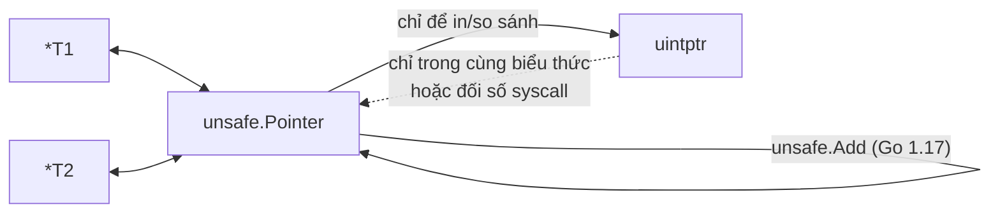
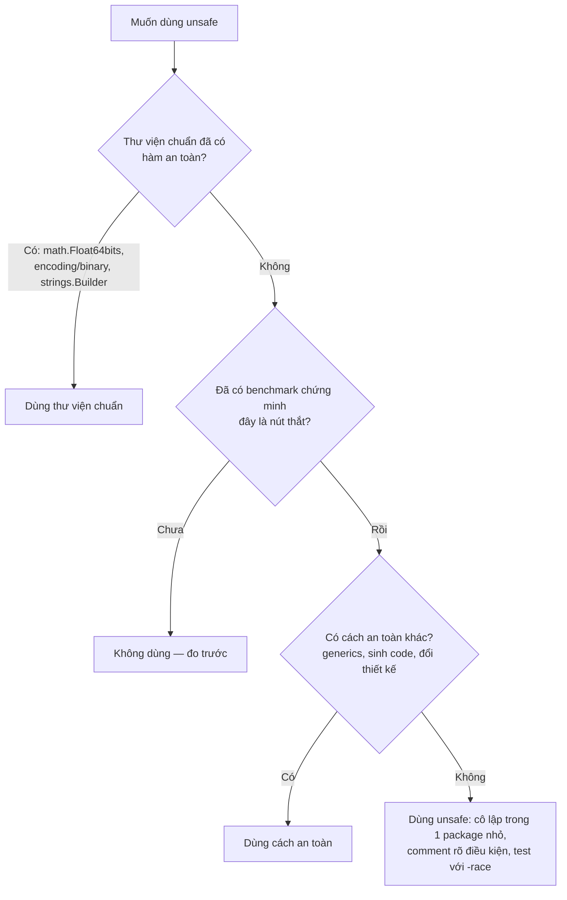

# Package unsafe

Go là ngôn ngữ **an toàn bộ nhớ**: không có phép toán con trỏ, không ép kiểu tuỳ tiện giữa các con trỏ, mọi truy cập slice đều được kiểm tra biên. Package `unsafe` là "cửa sau" có chủ đích để vượt qua các bảo vệ đó — cần thiết cho runtime, thư viện chuẩn, cgo và một số tối ưu cực đoan. Bài này giải thích `unsafe.Pointer`, các hàm `Sizeof`/`Alignof`/`Offsetof`, sáu quy tắc chuyển đổi hợp lệ, bộ hàm `unsafe.String`/`StringData`/`Slice`/`SliceData` (Go 1.20), ví dụ chuyển `[]byte`↔`string` không copy cùng rủi ro, cách `go vet` kiểm tra, và quan trọng nhất: khi nào **không** nên dùng.

---

:::note[Ghi nhớ nhanh]

- ⭐ **`unsafe.Pointer` là con trỏ "không kiểu"**: chuyển được qua lại giữa mọi `*T` và với `uintptr` — nhưng chỉ đúng khi tuân theo các quy tắc trong tài liệu package `unsafe`.
- ⭐ **Không bao giờ lưu địa chỉ dạng `uintptr` vào biến rồi chuyển lại thành con trỏ** — GC không coi `uintptr` là tham chiếu, đối tượng có thể bị thu hồi hoặc di chuyển (stack giãn ra). Dùng `unsafe.Add` (Go 1.17).
- **`Sizeof`/`Alignof`/`Offsetof` được tính lúc biên dịch**, trả `uintptr`, không có rủi ro — là phần "an toàn" nhất của package.
- **Go 1.20: `unsafe.String`, `StringData`, `Slice`, `SliceData`** thay thế cách cũ dùng `reflect.SliceHeader`/`StringHeader` (đã deprecated).
- **Chuyển `[]byte`→`string` không copy chỉ an toàn nếu không bao giờ sửa `[]byte` đó nữa** — vi phạm làm "chuỗi bất biến" bị thay đổi, gây bug cực khó tìm.
- **Code dùng `unsafe` không được đảm bảo tương thích** theo Go 1 compatibility promise và có thể khác nhau giữa các kiến trúc.

:::

---

## Mục lục

- [Vì sao có package unsafe?](#vì-sao-có-package-unsafe)
- [Sizeof, Alignof, Offsetof](#sizeof-alignof-offsetof)
- [unsafe.Pointer và uintptr](#unsafepointer-và-uintptr)
- [Các quy tắc chuyển đổi hợp lệ](#các-quy-tắc-chuyển-đổi-hợp-lệ)
- [String, StringData, Slice, SliceData](#string-stringdata-slice-slicedata)
- [Chuyển byte slice và string không copy](#chuyển-byte-slice-và-string-không-copy)
- [go vet và công cụ kiểm tra](#go-vet-và-công-cụ-kiểm-tra)
- [Khi nào không nên dùng unsafe](#khi-nào-không-nên-dùng-unsafe)

---

## Vì sao có package unsafe?

**Vấn đề:** Hệ thống kiểu của Go chặn mọi thao tác "nhìn bộ nhớ dưới dạng kiểu khác":

```go
f := 1.0
// Muốn xem 8 byte của float64 dưới dạng uint64 (vd để băm, mã hoá nhị phân)
// u := *(*uint64)(&f)   // lỗi biên dịch: cannot convert &f (type *float64) to type *uint64
```

Nhưng ở tầng thấp — runtime, thư viện chuẩn, giao tiếp C, system call, các cấu trúc dữ liệu hiệu năng cao — đôi khi **bắt buộc** phải làm vậy.

**Giải pháp:** `unsafe.Pointer` là cầu nối giữa các kiểu con trỏ:

```go
func Float64bits(f float64) uint64 {
	return *(*uint64)(unsafe.Pointer(&f)) // *float64 → unsafe.Pointer → *uint64
}

fmt.Printf("%#x\n", Float64bits(1.0)) // 0x3ff0000000000000
```

Đây chính là cách `math.Float64bits` của thư viện chuẩn được viết. Lưu ý: với nhu cầu này, bạn chỉ cần gọi `math.Float64bits` — thư viện chuẩn đã bọc `unsafe` lại một cách an toàn.

:::tip[Dùng thực tế]

- **Thư viện chuẩn và runtime**: `math.Float64bits`, `strings.Builder.String()` (chuyển buffer thành string không copy), `sync/atomic`, `reflect`.
- **cgo và system call**: truyền con trỏ vùng nhớ cho C, cho `syscall.Syscall`, `golang.org/x/sys/unix`.
- **Thư viện hiệu năng cao**: JSON/serializer nhanh, `fasthttp`, ánh xạ cấu trúc dữ liệu lên vùng nhớ `mmap`.
- **Đo kích thước, layout struct**: `unsafe.Sizeof` để tối ưu bộ nhớ (xem bài Escape analysis).

:::

:::tip[Ví dụ đời thường]

`unsafe` giống **chìa khoá vạn năng của ban quản lý chung cư**: mở được mọi cửa, cần thiết khi có sự cố (cháy, rò nước), nhưng ai dùng bừa thì phá vỡ mọi quy tắc an ninh của toà nhà. Vì vậy nó được cất trong tủ có ghi tên rõ ràng — `import "unsafe"` là dòng chữ báo cho người review: "đoạn này cần soi kỹ".

:::

---

## Sizeof, Alignof, Offsetof

Ba hàm này được **tính lúc biên dịch**, kết quả là hằng `uintptr`, hoàn toàn an toàn:

| Hàm | Trả về |
|-----|--------|
| `unsafe.Sizeof(x)` | Số byte của **giá trị** `x` (không tính dữ liệu mà nó trỏ tới) |
| `unsafe.Alignof(x)` | Yêu cầu căn lề (alignment) của kiểu của `x` |
| `unsafe.Offsetof(s.f)` | Vị trí (byte) của field `f` tính từ đầu struct |

```go
package main

import (
	"fmt"
	"unsafe"
)

type Header struct {
	Flag  bool  // offset 0, 1 byte + 7 padding
	ID    int64 // offset 8
	Count int32 // offset 16, + 4 padding cuối
}

func main() {
	var h Header
	fmt.Println(unsafe.Sizeof(h))         // 24
	fmt.Println(unsafe.Alignof(h.ID))     // 8
	fmt.Println(unsafe.Offsetof(h.ID))    // 8
	fmt.Println(unsafe.Offsetof(h.Count)) // 16

	// Sizeof chỉ đo "phần đầu" của kiểu tham chiếu
	fmt.Println(unsafe.Sizeof("một chuỗi rất dài")) // 16: con trỏ + độ dài
	fmt.Println(unsafe.Sizeof([]int{1, 2, 3}))      // 24: con trỏ + len + cap
	fmt.Println(unsafe.Sizeof(map[string]int{}))    // 8: một con trỏ
}
```

(Số liệu trên nền tảng 64-bit.)

---

## unsafe.Pointer và uintptr

| | `*T` | `unsafe.Pointer` | `uintptr` |
|--|------|------------------|-----------|
| Có kiểu | Có | Không | Là số nguyên |
| GC coi là tham chiếu (giữ đối tượng sống) | Có | **Có** | **Không** |
| Phép toán số học | Không | Không (dùng `unsafe.Add`) | Có |
| Được runtime cập nhật khi stack di chuyển | Có | Có | **Không** |

Điểm mấu chốt: `uintptr` chỉ là **một con số**. Khi bạn giữ địa chỉ dưới dạng `uintptr`, GC không biết đó là địa chỉ, nên:

- đối tượng có thể bị thu hồi nếu không còn tham chiếu nào khác;
- nếu đối tượng nằm trên stack của goroutine và stack được giãn (copy sang vùng mới), con số đó trỏ vào vùng nhớ cũ.

```go
// SAI: lưu uintptr qua biến rồi mới chuyển lại
x := [2]int{1, 2}
u := uintptr(unsafe.Pointer(&x[0]))
u += unsafe.Sizeof(x[0])
p := (*int)(unsafe.Pointer(u)) // go vet: possible misuse of unsafe.Pointer

// ĐÚNG: Go 1.17+, unsafe.Add làm phép cộng mà vẫn giữ kiểu unsafe.Pointer
p2 := (*int)(unsafe.Add(unsafe.Pointer(&x[0]), unsafe.Sizeof(x[0])))
fmt.Println(*p2) // 2
```

---

## Các quy tắc chuyển đổi hợp lệ

Tài liệu package `unsafe` liệt kê **sáu mẫu** chuyển đổi hợp lệ; code nằm ngoài các mẫu này là không hợp lệ (dù có thể "chạy được" hôm nay).

### (1) `*T1` → `unsafe.Pointer` → `*T2`

Hợp lệ khi `T2` không lớn hơn `T1` và hai kiểu có layout bộ nhớ tương thích:

```go
func Float64bits(f float64) uint64 { return *(*uint64)(unsafe.Pointer(&f)) }
```

### (2) `unsafe.Pointer` → `uintptr` (không chuyển ngược lại)

Chỉ để **in, so sánh, băm** địa chỉ. Kết quả là con số, không phải tham chiếu.

```go
addr := uintptr(unsafe.Pointer(&x))
fmt.Printf("%#x\n", addr)
```

### (3) Phép toán con trỏ: `unsafe.Pointer` → `uintptr` → cộng/trừ → `unsafe.Pointer`, **trong cùng một biểu thức**

```go
// Hợp lệ — toàn bộ nằm trong một biểu thức, không lưu uintptr ra biến
f := unsafe.Pointer(uintptr(unsafe.Pointer(&s)) + unsafe.Offsetof(s.f))

// Cách hiện đại tương đương, dễ đọc hơn:
f2 := unsafe.Add(unsafe.Pointer(&s), unsafe.Offsetof(s.f))
```

Không được trỏ ra ngoài vùng nhớ của đối tượng gốc (kể cả trỏ tới đúng byte ngay sau cuối đối tượng).

### (4) Chuyển `unsafe.Pointer` thành `uintptr` khi gọi `syscall.Syscall`

```go
syscall.Syscall(SYS_READ, uintptr(fd), uintptr(unsafe.Pointer(p)), uintptr(n))
```

Compiler xử lý đặc biệt: đối tượng được giữ sống cho đến khi lời gọi kết thúc — **chỉ khi** chuyển đổi nằm ngay trong danh sách đối số.

### (5) Kết quả `reflect.Value.Pointer()` hoặc `UnsafeAddr()` → `unsafe.Pointer` ngay lập tức

```go
p := (*int)(unsafe.Pointer(reflect.ValueOf(new(int)).Pointer()))
```

### (6) Chuyển `reflect.SliceHeader`/`StringHeader` ... (lỗi thời)

Cách cũ để thao tác header của slice/string. Hai kiểu này **đã deprecated** (Go 1.21); thay bằng các hàm ở phần tiếp theo.



### Ví dụ: truy cập field qua offset

```go
hp := &Header{ID: 7, Count: 3}
cnt := (*int32)(unsafe.Add(unsafe.Pointer(hp), unsafe.Offsetof(hp.Count)))
*cnt = 99
fmt.Println(hp.Count) // 99
```

Với mảng, `unsafe.Add` thay cho phép toán con trỏ kiểu C:

```go
arr := [4]int32{10, 20, 30, 40}
p := unsafe.Pointer(&arr[0])
third := (*int32)(unsafe.Add(p, 2*unsafe.Sizeof(arr[0])))
fmt.Println(*third) // 30
```

:::warning[Lỗi hay gặp]

- **Ép giữa hai struct "trông giống nhau" ở hai package** — layout có thể khác (thứ tự field, padding, kiến trúc 32/64-bit). Nếu hai kiểu có cùng underlying type, dùng chuyển đổi thường `B(a)` — không cần `unsafe`.
- **Ép `*T` nhỏ sang `*T` lớn hơn** (vd `*int32` → `*int64`) — đọc/ghi lấn sang vùng nhớ không thuộc đối tượng.
- **Nghĩ rằng "chạy thử không lỗi" là đúng** — vi phạm quy tắc có thể chỉ lộ ra khi GC chạy đúng lúc, stack giãn, hoặc ở phiên bản Go mới.

:::

---

## String, StringData, Slice, SliceData

Go 1.17 thêm `unsafe.Slice`, Go 1.20 bổ sung bộ đầy đủ:

| Hàm | Chữ ký | Ý nghĩa |
|-----|--------|---------|
| `unsafe.Slice` | `Slice(ptr *T, len) []T` | Tạo slice từ con trỏ tới phần tử đầu và độ dài |
| `unsafe.SliceData` | `SliceData(s []T) *T` | Con trỏ tới mảng nền của slice |
| `unsafe.String` | `String(ptr *byte, len) string` | Tạo string từ con trỏ byte và độ dài |
| `unsafe.StringData` | `StringData(s string) *byte` | Con trỏ tới byte đầu tiên của string |

Các hàm này thay thế hoàn toàn mẹo cũ:

```go
// Cũ — dễ sai, reflect.StringHeader đã deprecated
// hdr := (*reflect.StringHeader)(unsafe.Pointer(&s))

// Mới
p := unsafe.StringData(s)
```

Ứng dụng điển hình: nhận con trỏ C và độ dài từ cgo rồi bọc thành slice Go mà không copy:

```go
// cBuf là *C.char, n là C.int — nhận từ một hàm C
// b := unsafe.Slice((*byte)(unsafe.Pointer(cBuf)), int(n))
```

Tài liệu ghi rõ: string trả về từ `unsafe.String` yêu cầu **vùng byte bên dưới không được sửa** khi string còn tồn tại; byte trả về từ `StringData` **không được ghi**.

---

## Chuyển byte slice và string không copy

Chuyển đổi thông thường `string(b)` và `[]byte(s)` luôn **copy** dữ liệu (để giữ string bất biến). Với dữ liệu lớn trên đường nóng, có thể tránh copy:

```go
package main

import (
	"fmt"
	"unsafe"
)

// BytesToString không copy. Điều kiện: b KHÔNG được sửa sau lời gọi này.
func BytesToString(b []byte) string {
	if len(b) == 0 {
		return ""
	}
	return unsafe.String(unsafe.SliceData(b), len(b))
}

// StringToBytes không copy. Điều kiện: KHÔNG được ghi vào slice trả về.
func StringToBytes(s string) []byte {
	if s == "" {
		return nil
	}
	return unsafe.Slice(unsafe.StringData(s), len(s))
}

func main() {
	b := []byte("xin chào")
	s := BytesToString(b)
	fmt.Println(s) // xin chào

	b[0] = 'X'     // vi phạm điều kiện!
	fmt.Println(s) // Xin chào — "string bất biến" vừa bị thay đổi

	bs := StringToBytes("hello")
	fmt.Println(len(bs), string(bs)) // 5 hello
	// bs[0] = 'H' // có thể crash: string literal nằm ở vùng nhớ chỉ đọc
}
```

Rủi ro cụ thể:

- **String bị đổi nội dung** sau khi đã làm key của map → map hỏng (key ở sai bucket), tra không ra.
- **Ghi vào byte của string literal** → `SIGSEGV`/`fatal error: fault` vì dữ liệu nằm ở segment chỉ đọc của binary.
- **Buffer được tái sử dụng** (`sync.Pool`, `bufio`) → string trỏ vào dữ liệu đã bị request khác ghi đè.

:::tip[Thường không cần làm vậy]

Compiler đã tự tránh copy trong nhiều tình huống: `m[string(b)]` khi tra map, `string(b) == "x"` khi so sánh, `for i, c := range []byte(s)`, nối chuỗi tạm. `strings.Builder.String()` cũng trả string không copy một cách an toàn. Hãy benchmark chứng minh `string(b)` là nút thắt trước khi dùng `unsafe`.

:::

---

## go vet và công cụ kiểm tra

**`go vet`** (analyzer `unsafeptr`) bắt mẫu chuyển `uintptr` → `unsafe.Pointer` không hợp lệ:

```text
$ go vet ./...
./main.go:12:14: possible misuse of unsafe.Pointer
```

**`-gcflags=all=-d=checkptr`** bật kiểm tra con trỏ lúc chạy: phát hiện chuyển đổi `unsafe.Pointer` sai căn lề, trỏ ra ngoài đối tượng. Được bật **tự động** khi build với `-race` hoặc `-msan`:

```bash
go test -race ./...                       # checkptr bật kèm
go test -gcflags=all=-d=checkptr ./...    # bật riêng
```

```text
fatal error: checkptr: pointer arithmetic result points to invalid allocation
```

Linter `gosec` (qua golangci-lint) có rule **G103** cảnh báo mọi chỗ dùng `unsafe` để buộc review.

---

## Khi nào không nên dùng unsafe



Không nên dùng `unsafe` khi:

- **Chỉ để "nhanh hơn một chút"** mà chưa có số liệu đo.
- **Code nghiệp vụ** (handler, service, repository) — ở đó, sự rõ ràng quan trọng hơn vài nano giây.
- **Truy cập field unexported của package khác** (dùng `unsafe` + offset) — phá vỡ đóng gói, gãy ngay khi thư viện đổi struct.
- **Cần chạy trên nhiều kiến trúc** mà chưa kiểm tra layout trên từng nền tảng (32-bit, big-endian).
- **Thay `encoding/binary`** để đọc struct từ byte — vấn đề endianness và padding; `binary.Read`/`binary.LittleEndian.Uint32` an toàn và đủ nhanh.

Nếu buộc phải dùng: cô lập trong một package nhỏ với API an toàn, ghi rõ điều kiện bất biến trong comment, test với `-race` (kèm checkptr) và trên các nền tảng mục tiêu.
