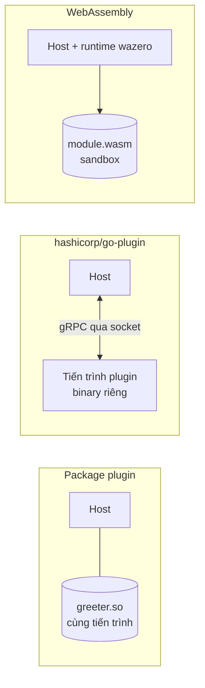

# cgo, compiler flags và plugin

Đôi khi chương trình Go cần vượt ra khỏi "thế giới Go thuần": gọi một thư viện C có sẵn (SQLite, OpenSSL, driver phần cứng), tinh chỉnh compiler và linker, hoặc nạp thêm chức năng lúc chạy dưới dạng plugin. Bài này giới thiệu **cgo** (cơ chế gọi C từ Go): cú pháp `import "C"` với phần preamble, gọi hàm C, chuyển chuỗi bằng `C.CString` và giải phóng bộ nhớ, chi phí của mỗi lời gọi và vì sao cộng đồng nói *"cgo is not Go"*; tổng quan các cờ `-gcflags`, `-ldflags`, `-asmflags`; và package `plugin` (`-buildmode=plugin`) cùng các hạn chế khiến người ta thường chọn **hashicorp/go-plugin** (RPC) hoặc **WebAssembly** thay thế.

---

:::note[Ghi nhớ nhanh]

- ⭐ **cgo: comment ngay trên `import "C"` là code C (preamble)**; gọi hàm bằng `C.ten_ham`, kiểu C qua `C.int`, `C.char`... Không được có dòng trống giữa comment và `import "C"`.
- ⭐ **`C.CString` cấp phát bằng `malloc` của C → luôn `defer C.free(unsafe.Pointer(cs))`**; GC của Go không quản lý vùng nhớ đó.
- **Mỗi lời gọi cgo tốn hàng chục nano giây** (so với vài ns cho lời gọi Go) — gom việc thành ít lời gọi lớn, đừng gọi C trong vòng lặp chặt.
- **Bật cgo là mất "build một lệnh ra mọi nền tảng"**: cần C toolchain cho nền tảng đích, binary phụ thuộc libc, không chạy trên `scratch` dễ dàng.
- **Package `plugin` chỉ hỗ trợ Linux, FreeBSD, macOS** và đòi hỏi app + plugin build bằng **cùng toolchain, cùng phiên bản dependency, cùng build tag** — rất mong manh.
- **Plugin trong thực tế**: tiến trình con giao tiếp qua RPC (`hashicorp/go-plugin` — Terraform, Vault dùng) hoặc module WebAssembly (`wazero`).

:::

---

## Mục lục

- [Vì sao cần cgo và plugin?](#vì-sao-cần-cgo-và-plugin)
- [cgo cơ bản](#cgo-cơ-bản)
- [Chuỗi, bộ nhớ và con trỏ](#chuỗi-bộ-nhớ-và-con-trỏ)
- [Liên kết thư viện C](#liên-kết-thư-viện-c)
- [Chi phí và đánh đổi của cgo](#chi-phí-và-đánh-đổi-của-cgo)
- [Compiler và linker flags](#compiler-và-linker-flags)
- [Package plugin](#package-plugin)
- [Thay thế plugin: go-plugin và WebAssembly](#thay-thế-plugin-go-plugin-và-webassembly)

---

## Vì sao cần cgo và plugin?

**Vấn đề:** Công ty đã có một thư viện C xử lý ảnh y tế được kiểm định qua nhiều năm, hoặc cần dùng SQLite, `libvips`, driver máy in hoá đơn chỉ phát hành dạng `.so`. Viết lại bằng Go tốn hàng tháng và có thể sai khác kết quả. Một yêu cầu khác: cho khách hàng tự viết "tiện ích mở rộng" cho phần mềm mà không cần build lại cả ứng dụng.

```go
// Không có cgo: không có cách nào gọi trực tiếp
// int compute_checksum(const unsigned char* data, size_t len);
// từ code Go thuần
```

**Giải pháp:** cgo cho phép nhúng và gọi code C trực tiếp:

```go
package main

/*
static int add(int a, int b) { return a + b; }
*/
import "C"

import "fmt"

func main() {
	fmt.Println(int(C.add(2, 3))) // 5
}
```

Còn với nhu cầu mở rộng lúc chạy: package `plugin` hoặc — phổ biến hơn — kiến trúc plugin qua RPC/WebAssembly.

:::tip[Dùng thực tế]

- **Database nhúng**: `mattn/go-sqlite3` bọc SQLite bằng cgo.
- **Xử lý ảnh/video/ML**: `h2non/bimg` (libvips), GoCV (OpenCV), binding TensorFlow/ONNX Runtime.
- **Giao tiếp hệ thống**: một số API macOS/Windows, driver phần cứng, thư viện mã hoá phần cứng (HSM).
- **Hệ thống plugin**: Terraform provider, Vault secret engine, Packer builder đều là tiến trình riêng nói chuyện qua `hashicorp/go-plugin`.

:::

:::tip[Ví dụ đời thường]

cgo giống **thuê phiên dịch** khi làm ăn với đối tác nước ngoài: làm được việc mà một mình không làm được, nhưng mỗi câu nói phải qua phiên dịch (chậm hơn), phải trả thêm chi phí (toolchain C), và đi công tác tỉnh khác (cross-compile) thì phải mang phiên dịch theo. Vì vậy người ta gom nội dung để nói **ít lần mà mỗi lần nhiều**, thay vì nói từng chữ.

:::

---

## cgo cơ bản

Quy tắc cú pháp:

1. `import "C"` là một "package giả" — không có trong thư viện chuẩn, do công cụ `cgo` xử lý.
2. Comment **ngay sát phía trên** `import "C"` (không dòng trống) là **preamble** (phần mở đầu): code C được biên dịch cùng — `#include`, khai báo, hàm `static`, chỉ thị `#cgo`.
3. Truy cập mọi thứ trong preamble và header qua `C.`: hàm `C.add`, kiểu `C.int`, hằng `C.EOF`, struct `C.struct_point`.
4. `import "C"` nên đứng riêng, tách khỏi các import khác.

```go
package main

/*
#cgo CFLAGS: -O2
#include <stdio.h>
#include <stdlib.h>
#include <string.h>

static int add(int a, int b) { return a + b; }

static void greet(const char* name) {
    printf("Xin chào, %s (từ C)\n", name);
    fflush(stdout);
}

// Trả về chuỗi mới cấp phát bằng malloc — người gọi phải free
static char* upper_copy(const char* s) {
    size_t n = strlen(s);
    char* out = malloc(n + 1);
    for (size_t i = 0; i < n; i++) {
        char c = s[i];
        out[i] = (c >= 'a' && c <= 'z') ? c - 32 : c;
    }
    out[n] = 0;
    return out;
}
*/
import "C"

import (
	"fmt"
	"unsafe"
)

func Upper(s string) string {
	cs := C.CString(s)               // copy chuỗi Go sang vùng nhớ C (malloc)
	defer C.free(unsafe.Pointer(cs)) // bắt buộc giải phóng
	res := C.upper_copy(cs)
	defer C.free(unsafe.Pointer(res)) // vùng nhớ do C malloc → C free
	return C.GoString(res)            // copy ngược về string Go
}

func main() {
	fmt.Println(int(C.add(2, 3))) // 5

	name := C.CString("Gopher")
	defer C.free(unsafe.Pointer(name))
	C.greet(name) // Xin chào, Gopher (từ C)

	fmt.Println(Upper("hello cgo")) // HELLO CGO
}
```

```bash
go run .              # cần C compiler (gcc/clang) trong PATH, CGO_ENABLED=1
go build -x . 2>&1 | grep cgo   # xem các bước cgo sinh code trung gian
```

### Ánh xạ kiểu

| C | Go (qua cgo) | Ghi chú |
|---|-------------|---------|
| `int`, `long`, `char` | `C.int`, `C.long`, `C.char` | Phải ép tường minh: `C.int(x)`, `int(r)` |
| `unsigned int` | `C.uint` | `unsigned char` → `C.uchar` |
| `size_t` | `C.size_t` | |
| `struct point` | `C.struct_point` | Truy cập field như struct Go |
| `void*` | `unsafe.Pointer` | |
| `char*` | `*C.char` | Chuyển chuỗi bằng các hàm bên dưới |
| Kiểu có kích thước cố định | `C.int32_t`... hoặc dùng thẳng `int32` | |

Hàm C trả về `errno` có thể lấy theo dạng hai giá trị: `n, err := C.some_call()` — `err` là `syscall.Errno`.

### Gọi Go từ C

Đánh dấu hàm Go bằng `//export`, C có thể gọi lại (callback):

```go
//export goOnProgress
func goOnProgress(percent C.int) {
	fmt.Printf("tiến độ %d%%\n", int(percent))
}
```

Khi một file có `//export`, preamble của file đó chỉ được chứa **khai báo**, không chứa định nghĩa hàm C (tránh trùng symbol khi link) — đặt định nghĩa C trong file `.c` riêng cùng package.

---

## Chuỗi, bộ nhớ và con trỏ

| Hàm | Chiều | Bộ nhớ |
|-----|-------|--------|
| `C.CString(s string) *C.char` | Go → C | `malloc` mới, **phải `C.free`** |
| `C.CBytes(b []byte) unsafe.Pointer` | Go → C | `malloc` mới, **phải `C.free`** |
| `C.GoString(p *C.char) string` | C → Go | Copy sang heap Go (đến byte `\0`) |
| `C.GoStringN(p *C.char, n C.int) string` | C → Go | Copy `n` byte |
| `C.GoBytes(p unsafe.Pointer, n C.int) []byte` | C → Go | Copy `n` byte |

Hai thế giới bộ nhớ tách biệt: **GC của Go không biết vùng nhớ `malloc`** (phải tự `free`), và **C không được giữ con trỏ tới bộ nhớ Go** lâu dài vì GC quản lý vùng đó.

**Quy tắc truyền con trỏ (cgo pointer passing rules)**, tóm tắt:

- Go được truyền con trỏ tới bộ nhớ Go cho C, **miễn là vùng nhớ đó không chứa con trỏ Go khác** (vd truyền `&buf[0]` của `[]byte` là được, truyền struct chứa slice/string là không).
- C **không được giữ** con trỏ Go sau khi lời gọi trả về.
- Runtime kiểm tra một phần lúc chạy (biến `GODEBUG=cgocheck=1` mặc định) và panic khi vi phạm; `go vet` (analyzer `cgocall`) bắt một số trường hợp lúc biên dịch.
- Khi C cần giữ "tham chiếu" tới đối tượng Go lâu dài (vd callback), dùng `runtime/cgo.Handle` (Go 1.17): đưa cho C một số nguyên handle thay vì con trỏ.

```go
buf := make([]byte, 1024)
// Truyền con trỏ phần tử đầu — hợp lệ vì []byte không chứa con trỏ Go
n := C.read_into((*C.char)(unsafe.Pointer(&buf[0])), C.size_t(len(buf)))
_ = n
```

:::warning[Lỗi hay gặp]

- **Quên `C.free`** sau `C.CString`/`C.CBytes` → rò rỉ bộ nhớ mà pprof heap **không thấy** (vì không phải heap Go). Theo dõi RSS của tiến trình mới phát hiện.
- **Có dòng trống giữa preamble và `import "C"`** → preamble bị bỏ qua, báo `could not determine kind of name for C.add`.
- **Trả con trỏ tới biến cục bộ C** hoặc dùng con trỏ sau khi đã `free` — lỗi C kinh điển, giờ làm crash cả chương trình Go với `SIGSEGV` không có stack trace Go rõ ràng.

:::

---

## Liên kết thư viện C

Chỉ thị `#cgo` trong preamble khai báo cờ cho compiler/linker C:

```go
/*
#cgo CFLAGS: -I${SRCDIR}/include -O2
#cgo LDFLAGS: -L${SRCDIR}/lib -lmylib
#cgo linux LDFLAGS: -lm -ldl
#cgo darwin LDFLAGS: -framework CoreFoundation
#cgo pkg-config: libpng
#include "mylib.h"
#include <png.h>
*/
import "C"
```

- `${SRCDIR}` được thay bằng thư mục chứa file nguồn.
- Có thể kèm build constraint ngay trong chỉ thị (`#cgo linux LDFLAGS: ...`).
- `pkg-config` tự lấy cờ của thư viện cài trên hệ thống.
- File `.c`, `.h`, `.s` nằm cùng thư mục package được `go build` tự biên dịch.

Go 1.24 thêm hai chỉ thị tối ưu: `#cgo noescape tên_hàm` (khẳng định hàm C không giữ con trỏ Go, giúp tránh đẩy dữ liệu lên heap) và `#cgo nocallback tên_hàm` (hàm C không gọi ngược lại Go). Khai báo sai sẽ gây bug khó tìm — chỉ dùng khi chắc chắn.

---

## Chi phí và đánh đổi của cgo

### Chi phí mỗi lời gọi

Một lời gọi cgo phải chuyển từ stack nhỏ của goroutine sang stack hệ thống, báo cho scheduler biết goroutine đang ở "vùng C" (không bị preempt được), rồi quay lại:

```go
package cgb

/*
static int addc(int a, int b) { return a + b; }
*/
import "C"

func AddC(a, b int) int { return int(C.addc(C.int(a), C.int(b))) }

//go:noinline
func AddGo(a, b int) int { return a + b }
```

```text
BenchmarkAddGo-10    618998349     2.090 ns/op
BenchmarkAddC-10      61775001    17.20 ns/op
```

Gấp khoảng 8 lần (Go 1.26, Apple M4; Go 1.26 đã giảm chi phí cơ bản của lời gọi cgo khoảng 30% so với trước). Với hàm C làm việc nặng (nén ảnh 50 ms) thì không đáng kể; với hàm nhỏ gọi hàng triệu lần thì rất đáng kể. Ngoài ra lời gọi C bị **block** lâu sẽ chiếm một OS thread — nhiều lời gọi block đồng thời làm runtime phải tạo thêm thread.

### "cgo is not Go"

Câu nói của Dave Cheney tóm tắt những gì mất đi khi bật cgo:

| Mất gì | Chi tiết |
|--------|---------|
| Build nhanh | Phải gọi C compiler; cache kém hiệu quả hơn |
| Cross-compile dễ | Cần C cross-compiler cho mỗi GOOS/GOARCH đích |
| Binary tĩnh | Thường link động với libc; khó chạy trên `scratch`/alpine |
| An toàn bộ nhớ | Một lỗi trong C làm crash cả tiến trình, không `recover` được |
| Công cụ Go | pprof không thấy bộ nhớ C; race detector không thấy race trong C; stack trace dừng ở ranh giới |
| Đơn giản khi triển khai | Phải cài thư viện `.so` đúng phiên bản trên máy đích |

Nguyên tắc: **tìm thư viện Go thuần trước** (vd `modernc.org/sqlite` thay `mattn/go-sqlite3`). Nếu bắt buộc dùng cgo, cô lập trong một package nhỏ, có build tag `cgo` và một hiện thực dự phòng khi `CGO_ENABLED=0` nếu có thể.

---

## Compiler và linker flags

`go build` gọi các tool con `compile`, `asm`, `link`; mỗi tool nhận cờ riêng qua:

| Cờ của `go build` | Truyền cho | Ví dụ |
|-------------------|-----------|-------|
| `-gcflags` | `go tool compile` | `-gcflags=-m` (escape analysis), `-gcflags='all=-N -l'` (tắt tối ưu + inline để debug) |
| `-ldflags` | `go tool link` | `-ldflags "-s -w"` (bỏ symbol/DWARF), `-X main.version=v1` (gán biến), `-extldflags '-static'` (cờ cho linker C khi dùng cgo) |
| `-asmflags` | `go tool asm` | `-asmflags=-S` (in mã lệnh); hiếm khi dùng |

Cú pháp pattern: mặc định cờ chỉ áp dụng cho **package được chỉ định trên dòng lệnh**; thêm tiền tố để áp dụng rộng hơn:

```bash
go build -gcflags=-m ./cmd/api                     # chỉ package cmd/api
go build -gcflags='all=-m' ./cmd/api               # mọi package kể cả dependency, stdlib
go build -gcflags='example.com/shop/...=-m' ./...  # theo pattern import path
```

Một số cờ compiler hữu ích:

```bash
go build -gcflags='-m -m' .          # lý do escape/inline chi tiết
go build -gcflags='-l' .             # tắt inline
go build -gcflags='-N' .             # tắt tối ưu
go build -gcflags='-S' . 2>asm.txt   # in assembly do compiler sinh ra
go build -gcflags='-d=ssa/check_bce/debug=1' .   # chỉ ra chỗ còn kiểm tra biên (bounds check)
go tool compile -help                # mọi cờ của compiler
go tool link -help                   # mọi cờ của linker
```

Một số `-buildmode` của `go build`:

| `-buildmode` | Kết quả |
|-------------|---------|
| `exe` (mặc định) | Binary thực thi |
| `pie` | Binary position-independent (mặc định trên một số nền tảng như Windows, Android, macOS ARM64) |
| `c-archive` | Thư viện tĩnh `.a` + header để code C/C++ gọi Go |
| `c-shared` | Thư viện động `.so`/`.dylib`/`.dll` để ngôn ngữ khác gọi Go |
| `plugin` | Go plugin `.so` (xem phần sau) |

---

## Package plugin

Package chuẩn `plugin` cho phép nạp một **package main** đã build thành `.so` lúc chạy và tra cứu symbol exported.

```go
// plugins/greeter/main.go — build thành plugin
package main

import "fmt"

var Version = "1.0.0"

func Greet(name string) string { return fmt.Sprintf("Xin chào %s từ plugin", name) }
```

```go
// cmd/host/main.go — ứng dụng nạp plugin
package main

import (
	"fmt"
	"log"
	"plugin"
)

func main() {
	p, err := plugin.Open("greeter.so")
	if err != nil {
		log.Fatalf("mở plugin: %v", err)
	}

	sym, err := p.Lookup("Greet") // trả plugin.Symbol (any)
	if err != nil {
		log.Fatalf("tìm Greet: %v", err)
	}
	greet, ok := sym.(func(string) string) // hàm: assert về đúng kiểu hàm
	if !ok {
		log.Fatalf("Greet sai kiểu: %T", sym)
	}
	fmt.Println(greet("An"))

	v, err := p.Lookup("Version")
	if err != nil {
		log.Fatalf("tìm Version: %v", err)
	}
	fmt.Println("version:", *v.(*string)) // biến: Lookup trả CON TRỎ tới biến
}
```

```bash
go build -buildmode=plugin -o greeter.so ./plugins/greeter
go run ./cmd/host
# Xin chào An từ plugin
# version: 1.0.0
```

Khi `Open`, hàm `init` của các package chưa có trong chương trình được chạy; `main` của plugin không chạy. Plugin **không thể gỡ** (unload) sau khi nạp.

### Hạn chế (theo chính tài liệu package)

- **Chỉ Linux, FreeBSD, macOS** — không có Windows.
- **Ứng dụng và plugin phải build bằng đúng cùng phiên bản toolchain**, cùng build tag, cùng một số cờ và biến môi trường — lệch là crash lúc chạy hoặc `Open` báo lỗi "plugin was built with a different version of package".
- **Dependency chung phải build từ đúng cùng mã nguồn** — nâng phiên bản một thư viện ở app mà không build lại plugin là hỏng.
- Race detector hỗ trợ kém; khởi tạo chương trình khó suy luận; triển khai phức tạp hơn một binary tĩnh; cần cgo (`CGO_ENABLED=1`).
- Plugin không unload được, chạy trong cùng tiến trình — plugin lỗi làm sập cả ứng dụng.

Tài liệu Go cũng nhận xét: vì app và plugin gần như phải được build cùng nhau, nhiều khi đơn giản hơn là sinh code import các "plugin" rồi build thành một binary tĩnh duy nhất (cách Caddy dùng với `xcaddy`).

---

## Thay thế plugin: go-plugin và WebAssembly



### hashicorp/go-plugin

Mỗi plugin là **một binary riêng**; host khởi chạy nó như tiến trình con và giao tiếp qua **gRPC** (hoặc net/rpc) trên socket cục bộ. Đây là kiến trúc của Terraform, Vault, Packer, Nomad.

Ưu điểm:

- Plugin crash **không** làm sập host; có thể khởi động lại.
- Plugin build bằng phiên bản Go khác, dependency khác — thậm chí ngôn ngữ khác (nhờ gRPC).
- Chạy trên mọi hệ điều hành, kể cả Windows.
- Có handshake kiểm tra phiên bản giao thức, tự quản lý vòng đời tiến trình.

Đánh đổi: mỗi lời gọi là một round-trip IPC (micro-giây thay vì nano-giây) — phù hợp với lời gọi "thô" (mỗi lần làm nhiều việc), không phù hợp lời gọi siêu nhỏ, dày đặc.

Phác thảo phía host (tham khảo, lược bỏ phần định nghĩa interface/gRPC):

```go
client := plugin.NewClient(&plugin.ClientConfig{
	HandshakeConfig:  handshake,                       // magic cookie + phiên bản giao thức
	Plugins:          map[string]plugin.Plugin{"greeter": &GreeterPlugin{}},
	Cmd:              exec.Command("./plugins/greeter"),
	AllowedProtocols: []plugin.Protocol{plugin.ProtocolGRPC},
})
defer client.Kill()

rpcClient, err := client.Client()
if err != nil {
	return err
}
raw, err := rpcClient.Dispense("greeter")
if err != nil {
	return err
}
greeter := raw.(Greeter) // interface do bạn định nghĩa
fmt.Println(greeter.Greet("An"))
```

### WebAssembly

Plugin biên dịch thành module `.wasm` (từ Go, Rust, C, AssemblyScript...), host chạy trong **sandbox** bằng runtime Wasm viết bằng Go thuần như **wazero** (không cần cgo).

- An toàn: module không truy cập file, mạng, bộ nhớ host trừ khi host cấp quyền.
- Đa ngôn ngữ, chạy mọi nền tảng, nạp/gỡ module lúc chạy được.
- Go hỗ trợ build `GOOS=wasip1 GOARCH=wasm` (Go 1.21) và chỉ thị `//go:wasmexport` (Go 1.24) để export hàm cho host gọi.
- Đánh đổi: chậm hơn code native, truyền dữ liệu phức tạp qua ranh giới cần tự serialize (hoặc dùng framework như Extism).

| Tiêu chí | `plugin` chuẩn | `hashicorp/go-plugin` | WebAssembly |
|----------|---------------|----------------------|-------------|
| Hệ điều hành | Linux, FreeBSD, macOS | Mọi nền tảng | Mọi nền tảng |
| Cách ly lỗi | Không (cùng tiến trình) | Có (tiến trình riêng) | Có (sandbox) |
| Ràng buộc phiên bản | Rất chặt | Chỉ giao thức | Chỉ ABI của module |
| Hiệu năng lời gọi | Như gọi hàm | IPC — chậm nhất | Trung bình |
| Ngôn ngữ plugin | Chỉ Go | Bất kỳ (qua gRPC) | Bất kỳ biên dịch ra Wasm |
| Unload | Không | Có (kill tiến trình) | Có |
