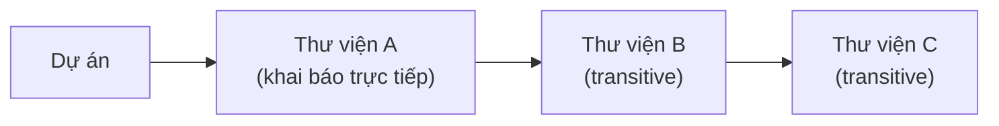
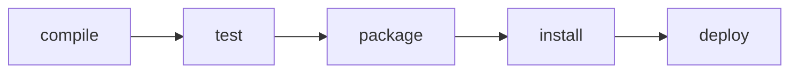

# 9. Công cụ Build

## 1. Tổng quan công cụ Build

Bài học: [1. Tổng quan công cụ Build](../../java/09-build-tools/1_tong-quan-build-tools.md)

Những câu thường gặp về chủ đề này. Tự trả lời trước, rồi bấm **Xem đáp án** để đối chiếu.

**1. Công cụ build tự động hóa những công việc gì? Nếu không có nó, những vấn đề gì sẽ xảy ra với dự án nhiều file?**

<details className="qa">
<summary>Xem đáp án</summary>

Công cụ build tự động hóa toàn bộ quy trình biến mã nguồn thành sản phẩm chạy được: **biên dịch** (compile) mã nguồn, **tải thư viện** cần thiết, **chạy test**, **đóng gói** (package) thành `.jar`/`.war`, và **triển khai** (deploy).

Không có nó, dự án nhiều file sẽ gặp:
- Phải gõ tay lệnh `javac` cho hàng trăm file, dễ sót hoặc sai thứ tự biên dịch.
- Phải tự tải và quản lý hàng chục thư viện `.jar` cùng các phụ thuộc lồng nhau của chúng.
- Mỗi thành viên trong nhóm có thể build ra kết quả khác nhau (không tái lập được), gây lỗi "chạy máy tôi được mà máy bạn không được".

</details>

**2. Một dependency được xác định duy nhất bằng những thông tin nào? Cho ví dụ.**

<details className="qa">
<summary>Xem đáp án</summary>

Bằng ba thành phần gọi là **GAV**: **`groupId`** (tổ chức/công ty tạo ra thư viện), **`artifactId`** (tên thư viện), **`version`** (phiên bản cụ thể).

```text
com.google.code.gson : gson : 2.10.1
   groupId           : artifactId : version
```

Ba giá trị này kết hợp lại xác định **chính xác một phiên bản** của một thư viện trên toàn thế giới, tránh nhầm lẫn giữa các thư viện trùng tên hoặc các phiên bản khác nhau của cùng một thư viện.

</details>

**3. Transitive dependency (phụ thuộc chuyền tiếp/bắc cầu) là gì? Vì sao nắm được khái niệm này giúp tránh bất ngờ khi làm việc thực tế?**

<details className="qa">
<summary>Xem đáp án</summary>

**Transitive dependency** là các thư viện mà **chính thư viện bạn khai báo lại cần dùng tới**, dù bạn không khai báo trực tiếp. Ví dụ: dự án khai báo thư viện A, A lại cần thư viện B, B lại cần thư viện C — bạn chỉ khai báo A, nhưng công cụ build sẽ tự tải cả A, B, C.



Hiểu khái niệm này giúp không bất ngờ khi thấy thư mục thư viện (`~/.m2` hay cache Gradle) chứa nhiều thư viện hơn hẳn số dòng bạn khai báo, và giúp debug đúng nguyên nhân khi gặp lỗi xung đột phiên bản giữa các thư viện chuyền tiếp.

</details>

**4. Xung đột phiên bản (version conflict) xảy ra khi nào? Công cụ build xử lý tình huống này ra sao?**

<details className="qa">
<summary>Xem đáp án</summary>

Xảy ra khi **hai thư viện khác nhau trong cùng dự án đòi hỏi hai phiên bản khác nhau** của cùng một thư viện thứ ba. Ví dụ: thư viện X cần `gson 2.8`, còn thư viện Y cần `gson 2.10` — nhưng dự án chỉ có thể có **một** phiên bản `gson` duy nhất trên classpath.

Thay vì để chương trình lỗi ngay lập tức, công cụ build áp dụng một **quy tắc chọn phiên bản (dependency resolution/mediation)** để tự động chọn ra một phiên bản duy nhất dùng chung cho toàn dự án (mỗi công cụ có chiến lược chọn riêng — ví dụ Maven ưu tiên phiên bản "gần" khai báo trực tiếp hơn). Nếu phiên bản được chọn không tương thích với một trong hai thư viện, lỗi runtime khó hiểu như `NoSuchMethodError` có thể xảy ra dù build vẫn thành công.

</details>

**5. Vòng đời build (build lifecycle) gồm những bước nào và theo thứ tự ra sao? Điều gì xảy ra khi bạn chỉ gọi bước `package`?**

<details className="qa">
<summary>Xem đáp án</summary>

Các bước phổ biến theo thứ tự: **compile → test → package → install → deploy**.



Đặc điểm quan trọng: các bước **chạy tuần tự và phụ thuộc lẫn nhau** — khi bạn gọi một bước, công cụ build sẽ **tự động chạy tất cả các bước đứng trước nó**. Vì vậy chỉ cần gọi `package`, công cụ build sẽ tự chạy `compile` rồi `test` trước, bạn không cần (và không nên) gọi từng bước riêng lẻ.

</details>

**6. Tình huống: bạn dẫn dắt một dự án Java doanh nghiệp truyền thống, không cần đa ngôn ngữ, đội ngũ đa số mới vào nghề. Nên chọn Maven, Gradle hay Bazel? Còn nếu đó là dự án Android?**

<details className="qa">
<summary>Xem đáp án</summary>

- **Dự án Java doanh nghiệp truyền thống, đội mới**: nên chọn **Maven** — cấu hình XML tường minh theo quy ước cố định, dễ học, tài liệu phong phú, phù hợp khi không cần logic build tùy biến phức tạp.
- **Dự án Android**: bắt buộc thực tế phải dùng **Gradle** — đây là công cụ build chính thức của Android, tích hợp sẵn trong Android Studio và hệ sinh thái plugin Android.
- **Bazel** chỉ nên cân nhắc khi dự án đạt quy mô **cực lớn, đa ngôn ngữ** (monorepo hàng nghìn module) và có đội ngũ đủ mạnh để vận hành — không phù hợp với tình huống được mô tả ở trên.

</details>

**7. Vì sao cài thư viện thủ công (tải `.jar` rồi tự thêm vào classpath) dễ dẫn tới lỗi `ClassNotFoundException` hoặc `NoClassDefFoundError` khi chạy chương trình, dù code biên dịch bình thường?**

<details className="qa">
<summary>Xem đáp án</summary>

Vì khi cài thủ công, người lập trình thường chỉ tải **đúng thư viện mình biết tới** mà quên mất (hoặc không biết) rằng thư viện đó còn có các **transitive dependency** riêng cần thiết để nó hoạt động đầy đủ lúc chạy (runtime), dù không phải lúc nào cũng cần lúc biên dịch (compile-time).

- Nếu thiếu một class chỉ được dùng ở **runtime** (ví dụ tải động qua reflection, hay chỉ chạy tới một nhánh code cụ thể mới gọi tới), chương trình vẫn **biên dịch thành công** vì compiler không kiểm tra tới đó — nhưng khi chạy tới đoạn code cần class thiếu đó, JVM sẽ ném `ClassNotFoundException` hoặc `NoClassDefFoundError`.
- Công cụ build tự động kéo **toàn bộ cây transitive dependency** khi bạn khai báo một thư viện, nên loại lỗi thiếu sót do quên tải tay gần như không xảy ra.

</details>

**8. Build "tái lập" (reproducible build) nghĩa là gì? Vì sao đặc tính này quan trọng với CI/CD?**

<details className="qa">
<summary>Xem đáp án</summary>

**Reproducible build** nghĩa là: cùng một mã nguồn và cùng một cấu hình build, chạy ở **bất kỳ máy nào, vào bất kỳ thời điểm nào**, đều cho ra **kết quả giống hệt nhau** — không phụ thuộc vào việc máy đó đã cài sẵn thư viện gì, phiên bản công cụ gì đang có sẵn trên máy.

Quan trọng với CI/CD (Continuous Integration/Continuous Deployment — tích hợp và triển khai liên tục) vì:
- Đảm bảo bản build chạy trên máy chủ CI **giống hệt** bản mà lập trình viên build và test trên máy cá nhân — tránh tình huống "qua được trên máy tôi nhưng CI báo lỗi".
- Cho phép **tái tạo lại chính xác** một bản build cũ (ví dụ để điều tra lỗi sản phẩm ở phiên bản đã phát hành trước đó) mà không lo kết quả bị lệch do môi trường thay đổi theo thời gian.

</details>

---

## 2. Maven

Bài học: [2. Maven](../../java/09-build-tools/2_maven.md)

Những câu thường gặp về chủ đề này. Tự trả lời trước, rồi bấm **Xem đáp án** để đối chiếu.

**1. `pom.xml` là gì? Nguyên tắc "convention over configuration" thể hiện ở đâu trong Maven?**

<details className="qa">
<summary>Xem đáp án</summary>

`pom.xml` (**Project Object Model**) là file cấu hình trung tâm của một dự án Maven — khai báo định danh dự án (GAV), dependencies, plugin và các thiết lập build khác.

**"Convention over configuration"** (quy ước hơn cấu hình) thể hiện ở cấu trúc thư mục **cố định** mà Maven mặc định hiểu, không cần khai báo lại trong `pom.xml`:

```text
src/main/java/        # mã nguồn chính
src/main/resources/   # tài nguyên đi kèm
src/test/java/        # mã nguồn test
```

Nếu bạn đặt file đúng các vị trí quy ước này, Maven tự biết cách biên dịch/đóng gói mà không cần chỉ định đường dẫn thủ công — khác với việc phải khai báo tường minh từng đường dẫn như một số công cụ khác.

</details>

**2. Liệt kê các `<scope>` phổ biến của dependency trong Maven và cho ví dụ tình huống dùng mỗi loại.**

<details className="qa">
<summary>Xem đáp án</summary>

| Scope | Ý nghĩa | Ví dụ |
|---|---|---|
| `compile` (mặc định) | Dùng ở mọi giai đoạn: biên dịch, test, chạy; được đóng gói vào sản phẩm cuối | Thư viện nghiệp vụ chính như Gson, Jackson |
| `test` | Chỉ dùng khi biên dịch/chạy test, không đóng gói vào sản phẩm cuối | JUnit, Mockito |
| `provided` | Cần lúc biên dịch, nhưng **môi trường chạy đã có sẵn** nên không đóng gói kèm | `servlet-api` khi deploy lên Tomcat (Tomcat đã có sẵn) |
| `runtime` | Không cần lúc biên dịch, chỉ cần khi **chạy chương trình** | JDBC driver cụ thể (code chỉ gọi qua interface JDBC chuẩn lúc compile) |

Chọn sai `scope` — ví dụ quên đặt `provided` cho `servlet-api` — có thể khiến file `.war` bị đóng gói dư thừa thư viện đã có sẵn ở server, hoặc gây xung đột phiên bản với server đích.

</details>

**3. Khi bạn chạy `mvn package`, Maven thực hiện đúng các bước nào? Liệt kê theo đúng thứ tự.**

<details className="qa">
<summary>Xem đáp án</summary>

Maven sẽ tự động chạy **tất cả các phase đứng trước** `package` trong vòng đời, theo thứ tự:

```text
validate → compile → test → package
```

Cụ thể: `validate` (kiểm tra cấu trúc dự án hợp lệ) → `compile` (biên dịch mã nguồn chính) → `test` (chạy unit test) → `package` (đóng gói thành `.jar`/`.war`). Nếu bất kỳ phase nào trước đó thất bại (ví dụ một test fail), Maven sẽ **dừng lại ngay**, không tiếp tục sang `package`.

</details>

**4. Maven Central và local repository (`~/.m2`) khác nhau thế nào? Điều gì xảy ra ở lần build đầu tiên so với các lần build sau?**

<details className="qa">
<summary>Xem đáp án</summary>

- **Maven Central**: kho công khai trên Internet, chứa gần như mọi thư viện Java mã nguồn mở — nơi Maven tải thư viện về lần đầu.
- **Local repository** (`~/.m2/repository`): thư mục cục bộ trên máy bạn, nơi Maven **lưu cache** lại mọi thư viện đã tải.

Lần build **đầu tiên**: Maven phải tải thư viện từ Maven Central về (tốn thời gian, cần mạng). Các lần build **sau**: nếu thư viện với đúng GAV đã có sẵn trong `~/.m2`, Maven **dùng lại luôn** từ cache cục bộ, không tải lại — giúp các lần build sau nhanh hơn nhiều và có thể build offline nếu mọi dependency đã có sẵn trong cache.

</details>

**5. Hậu tố `-SNAPSHOT` trong version (ví dụ `1.0.0-SNAPSHOT`) có ý nghĩa gì? Khác gì so với version release bình thường (`1.0.0`)?**

<details className="qa">
<summary>Xem đáp án</summary>

`-SNAPSHOT` đánh dấu đây là một **bản đang phát triển (development version)**, chưa ổn định và có thể thay đổi liên tục — trái với version release (`1.0.0` không có hậu tố) được coi là **bất biến (immutable)**, một khi đã publish thì nội dung không đổi nữa.

Khác biệt quan trọng về hành vi:
- Với dependency có `-SNAPSHOT`, Maven sẽ **định kỳ kiểm tra và tải lại bản mới nhất** từ repository (vì nội dung có thể đã thay đổi), thay vì chỉ dùng mãi bản đã cache trong `~/.m2`.
- Với version release, một khi đã tải về, Maven **tin tưởng tuyệt đối** cache cục bộ, không bao giờ tải lại — vì theo quy ước, nội dung của một version release đã publish sẽ không bao giờ thay đổi.

Trong thực tế, các bản release **không nên** phụ thuộc vào bất kỳ `-SNAPSHOT` nào của thư viện khác, vì bản SNAPSHOT có thể thay đổi bất cứ lúc nào, làm build không còn tái lập được.

</details>

**6. Plugin trong Maven là gì? Vì sao nói "bản thân Maven không tự làm gì cả"?**

<details className="qa">
<summary>Xem đáp án</summary>

**Plugin** (phần mở rộng) là thành phần thực sự **thực thi công việc** trong mỗi phase của vòng đời build — Maven chỉ đóng vai trò điều phối, gọi đúng plugin tương ứng ở đúng thời điểm.

Ví dụ: phase `compile` được thực thi bởi `maven-compiler-plugin`; phase `test` được thực thi bởi `maven-surefire-plugin`; đóng gói thành `.jar` chạy được (kèm `Main-Class` trong manifest) cần `maven-jar-plugin`.

```xml
<plugin>
    <groupId>org.apache.maven.plugins</groupId>
    <artifactId>maven-jar-plugin</artifactId>
    <configuration>
        <archive>
            <manifest>
                <mainClass>com.example.Main</mainClass>
            </manifest>
        </archive>
    </configuration>
</plugin>
```

Vì mọi hành động cụ thể đều do plugin đảm nhiệm, Maven tự nó chỉ là một "khung điều phối" (framework) — muốn thay đổi hành vi của một phase, bạn cấu hình hoặc thay plugin tương ứng, không sửa "lõi" của Maven.

</details>

**7. Tình huống: dự án của bạn có thư viện X yêu cầu `commons-lang3:3.9`, còn thư viện Y yêu cầu `commons-lang3:3.12`. Maven chọn phiên bản nào? Làm sao ép Maven dùng một version cụ thể nếu cần?**

<details className="qa">
<summary>Xem đáp án</summary>

Mặc định, Maven áp dụng quy tắc **"nearest wins"** (phiên bản khai báo **gần nhất** với dự án gốc trong cây phụ thuộc sẽ được chọn) khi có xung đột phiên bản của cùng một artifact.

Muốn **ép** Maven dùng đúng một version cụ thể bất kể quy tắc mặc định, khai báo **tường minh** dependency đó ngay trong `pom.xml` của dự án — vì dependency khai báo trực tiếp luôn có độ ưu tiên cao nhất (khoảng cách gần nhất = 0):

```xml
<dependency>
    <groupId>org.apache.commons</groupId>
    <artifactId>commons-lang3</artifactId>
    <version>3.12.0</version> <!-- ép dùng đúng version này, ghi đè quy tắc mặc định -->
</dependency>
```

Ngoài ra có thể dùng `<dependencyManagement>` ở mức cha (parent POM) để quản lý version tập trung cho toàn bộ dự án đa module.

</details>

**8. `mvn clean install` khác `mvn clean package` ở điểm nào? Khi nào cần dùng `install`?**

<details className="qa">
<summary>Xem đáp án</summary>

`install` là một phase đứng **sau** `package` trong vòng đời build, nên `mvn clean install` sẽ tự động chạy hết `package` trước, rồi thêm một bước: **sao chép file đã đóng gói vào local repository** (`~/.m2`).

Cần dùng `install` khi bạn có một dự án **khác trên cùng máy** (ví dụ một module khác trong dự án đa module, hay một thư viện nội bộ dùng chung) cần **tham chiếu tới artifact này như một dependency** — chúng chỉ tìm thấy được nó nếu nó đã được `install` vào `~/.m2`. Nếu chỉ cần file `.jar` để chạy độc lập, không có dự án nào khác phụ thuộc vào nó, `mvn clean package` là đủ.

</details>

**9. Dự án Maven đa module (multi-module project) là gì? `<parent>` và thẻ `<modules>` đóng vai trò gì?**

<details className="qa">
<summary>Xem đáp án</summary>

**Dự án đa module** là một dự án lớn được chia thành nhiều dự án con (module) độc lập, mỗi module có `pom.xml` riêng, nhưng dùng chung một **parent POM** ở thư mục gốc để quản lý tập trung.

```xml
<!-- pom.xml gốc (parent) -->
<packaging>pom</packaging>
<modules>
    <module>api</module>
    <module>service</module>
    <module>web</module>
</modules>
```

```xml
<!-- pom.xml của module con, ví dụ api/pom.xml -->
<parent>
    <groupId>com.example</groupId>
    <artifactId>my-app-parent</artifactId>
    <version>1.0.0</version>
</parent>
```

- **`<parent>`**: giúp module con **kế thừa** cấu hình chung (version Java, danh sách plugin, quản lý version dependency qua `<dependencyManagement>`) từ POM cha, tránh lặp lại cấu hình ở từng module.
- **`<modules>`**: khai báo ở POM cha, liệt kê các module con để khi build ở thư mục gốc, Maven biết build **tất cả** các module theo đúng thứ tự phụ thuộc giữa chúng.

</details>

**10. Gặp lỗi `Could not find artifact ... in central` khi chạy `mvn compile`. Liệt kê các nguyên nhân phổ biến và cách kiểm tra.**

<details className="qa">
<summary>Xem đáp án</summary>

Nguyên nhân phổ biến:
- **Sai `groupId`/`artifactId`/`version`**: gõ nhầm hoặc copy sai từ tài liệu — kiểm tra lại chính xác trên [search.maven.org](https://search.maven.org).
- **Thư viện nội bộ chưa được `install`**: nếu dependency là một module nội bộ của công ty/nhóm, cần chạy `mvn install` cho module đó trước để nó có mặt trong `~/.m2`.
- **Thiếu cấu hình repository riêng**: một số thư viện không nằm trên Maven Central mà ở kho riêng (ví dụ Nexus/Artifactory nội bộ công ty) — cần khai báo thêm thẻ `<repositories>` trỏ tới kho đó trong `pom.xml`.
- **Sự cố mạng/proxy**: máy không truy cập được Internet hoặc cần cấu hình proxy trong `settings.xml`.

Cách kiểm tra nhanh: chạy `mvn compile -X` (chế độ debug chi tiết) để xem chính xác Maven đang cố tải từ repository nào và thông điệp lỗi cụ thể.

</details>

---

## 3. Gradle

Bài học: [3. Gradle](../../java/09-build-tools/3_gradle.md)

Những câu thường gặp về chủ đề này. Tự trả lời trước, rồi bấm **Xem đáp án** để đối chiếu.

**1. Gradle hỗ trợ hai loại DSL nào để viết file cấu hình? Khác biệt chính giữa chúng là gì?**

<details className="qa">
<summary>Xem đáp án</summary>

- **Groovy DSL** — file `build.gradle`: cú pháp truyền thống, ngắn gọn, linh hoạt nhưng ít được IDE hỗ trợ gợi ý/kiểm tra kiểu chặt chẽ.
- **Kotlin DSL** — file `build.gradle.kts`: an toàn kiểu (type-safe) hơn, IDE gợi ý và tự động hoàn thành (autocomplete) tốt hơn nhờ Kotlin có kiểm tra kiểu tĩnh.

```groovy
// Groovy: gán trực tiếp bằng dấu =, hoặc gọi hàm không cần ngoặc
mainClass = 'com.example.Main'
```

```kotlin
// Kotlin: gọi phương thức .set(...) một cách tường minh
mainClass.set("com.example.Main")
```

Cả hai đều biên dịch xuống cùng một mô hình Gradle bên dưới, khác biệt chủ yếu ở cú pháp và trải nghiệm IDE, không phải ở khả năng của Gradle.

</details>

**2. `implementation` và `api` khác nhau thế nào khi khai báo dependency? Vì sao Gradle khuyến nghị ưu tiên `implementation`?**

<details className="qa">
<summary>Xem đáp án</summary>

- **`api`**: dependency được khai báo bằng `api` sẽ **lộ ra (expose)** cho bất kỳ dự án nào phụ thuộc vào module hiện tại — họ có thể truy cập trực tiếp các class của dependency đó thông qua module của bạn.
- **`implementation`**: dependency chỉ dùng **nội bộ** trong module hiện tại, **không lộ ra** classpath biên dịch của module phụ thuộc vào nó.

```groovy
dependencies {
    api 'com.example:public-api:1.0'          // lộ ra cho module khác
    implementation 'com.example:internal:1.0'  // chỉ dùng nội bộ
}
```

Gradle khuyến nghị ưu tiên `implementation` vì nó giúp **giảm phạm vi rò rỉ chi tiết cài đặt nội bộ** ra bên ngoài, và quan trọng hơn về hiệu năng build: khi một dependency khai báo bằng `implementation` thay đổi, Gradle chỉ cần **build lại module hiện tại**; nếu khai báo bằng `api`, mọi module phụ thuộc "xuôi dòng" (downstream) cũng phải **build lại theo**, vì chúng có thể đang dùng trực tiếp dependency đó.

</details>

**3. Task trong Gradle là gì? Viết một task tùy chỉnh in ra một dòng chữ khi chạy.**

<details className="qa">
<summary>Xem đáp án</summary>

**Task (tác vụ)** là đơn vị công việc cơ bản mà Gradle thực thi — mọi hành động Gradle làm (biên dịch, test, đóng gói) đều được mô hình hóa thành một task, và bạn có thể định nghĩa thêm task riêng.

```groovy
tasks.register('hello') {
    doLast {
        println 'Xin chào từ Gradle!' // chạy khi task được thực thi
    }
}
```

```bash
gradle hello
# In ra: Xin chào từ Gradle!
```

`doLast` chỉ định hành động chạy **sau cùng** khi task được thực thi (còn có `doFirst` để chạy hành động ngay khi task bắt đầu, trước các hành động khác).

</details>

**4. Gradle Wrapper (`./gradlew`) giải quyết vấn đề gì? Vì sao nên luôn dùng nó thay vì lệnh `gradle` cài trực tiếp trên máy?**

<details className="qa">
<summary>Xem đáp án</summary>

Vấn đề: nếu mỗi thành viên trong nhóm tự cài Gradle trên máy riêng, họ có thể đang dùng **các phiên bản Gradle khác nhau** — dẫn tới build không nhất quán, có thể chạy được ở máy này nhưng lỗi ở máy khác do khác biệt hành vi giữa các phiên bản Gradle.

**Gradle Wrapper** là một bộ script (`gradlew`, `gradlew.bat`) đi kèm ngay trong mã nguồn dự án, tự động **tải đúng phiên bản Gradle** mà dự án yêu cầu (ghi trong `gradle/wrapper/gradle-wrapper.properties`) nếu máy chưa có sẵn — đảm bảo **mọi người, mọi máy CI** đều build bằng chính xác cùng một phiên bản Gradle, loại bỏ hoàn toàn rủi ro lệch phiên bản.

</details>

**5. Vì sao Gradle thường nhanh hơn Maven ở các lần build sau (không phải lần đầu tiên)? Nêu ba cơ chế chính.**

<details className="qa">
<summary>Xem đáp án</summary>

1. **Incremental build (build tăng tiến)**: Gradle theo dõi input/output của từng task; nếu input không đổi so với lần build trước, task đó được **bỏ qua** (đánh dấu "UP-TO-DATE"), không chạy lại.
2. **Build cache**: lưu lại **kết quả** của các task đã chạy (kể cả từ máy khác/CI nếu dùng cache chia sẻ); nếu một task có cùng input y hệt đã từng chạy ở đâu đó, Gradle **lấy lại kết quả cũ** thay vì thực thi lại từ đầu.
3. **Gradle Daemon**: một tiến trình JVM chạy **ngầm, sẵn sàng** giữa các lần build, giữ lại các thông tin đã "làm nóng" (như class đã load, cache trong bộ nhớ) — tránh việc phải khởi động lại toàn bộ JVM và nạp lại mọi thứ từ đầu ở mỗi lần gọi `gradle`/`./gradlew`.

Maven theo mặc định không có ba cơ chế này ở mức tương đương, nên với dự án lớn, các lần build lặp lại của Gradle thường nhanh hơn đáng kể.

</details>

**6. `testImplementation` và `runtimeOnly` khác nhau thế nào? Cho ví dụ tình huống dùng `runtimeOnly`.**

<details className="qa">
<summary>Xem đáp án</summary>

- **`testImplementation`**: dependency chỉ cần khi biên dịch và chạy **mã test** (thư mục `src/test`), không có mặt trong classpath biên dịch/chạy của mã chính (`src/main`).
- **`runtimeOnly`**: dependency **không cần thiết lúc biên dịch** (code chính không gọi trực tiếp tới class của nó), nhưng **bắt buộc phải có mặt lúc chạy chương trình**.

```groovy
dependencies {
    testImplementation 'org.junit.jupiter:junit-jupiter:5.10.0' // chỉ cho test

    // Code chỉ gọi qua interface JDBC chuẩn (java.sql.*) lúc biên dịch,
    // nhưng cần driver cụ thể của MySQL có mặt lúc CHẠY để kết nối thật
    runtimeOnly 'com.mysql:mysql-connector-j:8.3.0'
}
```

</details>

**7. Tình huống: nhóm bạn đang dùng Maven cho một dự án Java thuần, không có nhu cầu tùy biến logic build phức tạp và không quan tâm tốc độ build (dự án nhỏ). Có nên chuyển sang Gradle không? Vì sao?**

<details className="qa">
<summary>Xem đáp án</summary>

**Không nhất thiết cần chuyển.** Lợi ích chính của Gradle (tốc độ nhờ incremental build/cache, khả năng lập trình linh hoạt trong build script) phát huy rõ rệt nhất ở **dự án lớn** hoặc khi cần **logic build tùy biến** phức tạp — cả hai điều kiện này đều **không xuất hiện** trong tình huống được mô tả.

Với dự án nhỏ, ổn định, không cần tùy biến: chi phí chuyển đổi (học DSL mới, viết lại cấu hình, đào tạo lại nhóm) thường **không tương xứng** với lợi ích thu được. Nguyên tắc chung: chỉ đổi công cụ build khi có **nhu cầu cụ thể** mà công cụ hiện tại không đáp ứng được, không đổi chỉ vì công cụ mới "nghe có vẻ hiện đại hơn".

</details>

**8. `compile` (đã bị loại bỏ) từng dùng để làm gì trong Gradle cũ? Vì sao nó bị thay thế bằng `implementation`?**

<details className="qa">
<summary>Xem đáp án</summary>

Trong các phiên bản Gradle cũ, `compile` từng là cấu hình dependency mặc định phổ biến nhất, có hành vi **tương tự `api` hiện nay** — mọi dependency khai báo bằng `compile` đều tự động **lộ ra** cho các module phụ thuộc.

Vấn đề: hầu hết dependency thực ra chỉ cần dùng **nội bộ**, không cần lộ ra ngoài — nhưng vì `compile` là lựa chọn mặc định "dễ dùng nhất", lập trình viên thường dùng nó cho mọi trường hợp, dẫn tới **rò rỉ dependency nội bộ** ra module khác một cách không cần thiết, và làm chậm build (mọi thay đổi dependency đều kéo theo build lại các module downstream). Gradle giới thiệu `implementation` làm lựa chọn **mặc định nên dùng**, buộc lập trình viên phải cân nhắc rõ ràng khi thực sự cần dùng `api`.

</details>

**9. Gradle biết một task đã "up-to-date" (không cần chạy lại) dựa vào đâu?**

<details className="qa">
<summary>Xem đáp án</summary>

Gradle theo dõi **input** (file mã nguồn, tham số cấu hình, dependency...) và **output** (file/thư mục được task tạo ra) đã khai báo của mỗi task, rồi lưu lại một "dấu vân tay" (checksum/hash) của chúng sau mỗi lần chạy.

Ở lần chạy tiếp theo, trước khi thực thi một task, Gradle **so sánh** dấu vân tay input/output hiện tại với dấu vân tay đã lưu lần trước:
- Nếu **giống hệt** (không file nào trong input thay đổi) → task được đánh dấu **UP-TO-DATE**, bỏ qua không chạy lại, giữ nguyên output cũ.
- Nếu **khác** → task được chạy lại bình thường.

Đây chính là cơ chế nền tảng của **incremental build** — nó chỉ hoạt động chính xác nếu task được khai báo **đầy đủ và đúng** input/output của mình (một task tự viết mà khai báo thiếu input có thể bị Gradle nhầm là "up-to-date" dù thực ra cần chạy lại).

</details>

**10. Viết một task Gradle tùy chỉnh phụ thuộc vào task khác, sao cho task `hello` luôn chạy sau khi `compileJava` hoàn tất.**

<details className="qa">
<summary>Xem đáp án</summary>

```groovy
tasks.register('hello') {
    dependsOn 'compileJava' // khai báo phụ thuộc: compileJava phải chạy XONG trước hello
    doLast {
        println 'Đã biên dịch xong, chào từ task hello!'
    }
}
```

`dependsOn` khai báo **quan hệ phụ thuộc** giữa các task — khi bạn chạy `gradle hello`, Gradle sẽ tự động chạy `compileJava` trước (nếu nó chưa "up-to-date"), tương tự cách một phase trong vòng đời Maven tự chạy các phase đứng trước nó, nhưng ở Gradle quan hệ này có thể được khai báo tường minh, linh hoạt giữa bất kỳ hai task nào, không giới hạn theo một vòng đời cố định.

</details>

---

## 4. Bazel

Bài học: [4. Bazel](../../java/09-build-tools/4_bazel.md)

Những câu thường gặp về chủ đề này. Tự trả lời trước, rồi bấm **Xem đáp án** để đối chiếu.

**1. File `WORKSPACE` (hoặc `MODULE.bazel`) và file `BUILD` khác nhau thế nào về vai trò?**

<details className="qa">
<summary>Xem đáp án</summary>

- **`WORKSPACE`** (hoặc `MODULE.bazel` ở phiên bản mới hơn): chỉ có **một file duy nhất** ở gốc dự án, đánh dấu "đây là gốc của một workspace Bazel" và khai báo các phụ thuộc bên ngoài ở mức toàn dự án (ví dụ tải quy tắc build cho một ngôn ngữ).
- **`BUILD`** (hoặc `BUILD.bazel`): có **nhiều file**, mỗi thư mục con chứa mã nguồn thường có một file `BUILD` riêng, khai báo các **target** cụ thể (thư viện, chương trình chạy được) trong thư mục đó cùng `deps` (phụ thuộc) của chúng.

Nói cách khác: `WORKSPACE` trả lời câu hỏi "dự án bắt đầu từ đâu", còn `BUILD` trả lời câu hỏi "trong thư mục này có những gì cần build và chúng phụ thuộc vào đâu".

</details>

**2. Vì sao Bazel đạt được build tái lập (reproducible) tốt hơn hẳn Maven/Gradle theo mặc định?**

<details className="qa">
<summary>Xem đáp án</summary>

Bazel build trong môi trường **hermetic** (đóng kín, cô lập) — mọi đầu vào ảnh hưởng tới kết quả build (phiên bản thư viện, phiên bản công cụ biên dịch, biến môi trường...) đều phải được **khai báo tường minh** trong cấu hình Bazel, thay vì "ngầm định phụ thuộc" vào những gì tình cờ có sẵn trên máy đang chạy build.

Maven/Gradle mặc định có thể vô tình bị ảnh hưởng bởi những thứ có sẵn trên máy (phiên bản JDK hệ thống, biến môi trường, thư viện cached khác nhau) mà không phải lúc nào cũng được kiểm soát chặt như cách Bazel yêu cầu — nên khả năng "máy này build ra khác máy kia" cao hơn.

</details>

**3. Vì sao Bazel yêu cầu khai báo `deps` rất tường minh và chi tiết trong mỗi file `BUILD`? Lợi ích của việc này là gì?**

<details className="qa">
<summary>Xem đáp án</summary>

Vì Bazel dùng chính thông tin `deps` này để dựng một **"bản đồ quan hệ phụ thuộc"** chính xác giữa toàn bộ các target trong dự án — nhờ vậy khi một file thay đổi, Bazel biết **chính xác** những target nào bị ảnh hưởng và cần build lại, mà không cần đoán hay build lại "cho chắc" toàn bộ dự án.

```python
java_binary(
    name = "app",
    srcs = ["Main.java"],
    deps = [":greeter"], # phải khai báo rõ, không được ngầm định
)
```

Lợi ích: **incremental build cực kỳ chính xác** — chỉ build lại đúng phần bị ảnh hưởng thực sự, cực kỳ hiệu quả ở quy mô hàng nghìn module, thứ mà Maven/Gradle khó đạt được ở cùng mức độ chính xác vì chúng không bắt buộc khai báo tường minh tới từng target nhỏ như vậy.

</details>

**4. Cú pháp `//src/main/java/com/example:app` trong lệnh `bazel build` nghĩa là gì?**

<details className="qa">
<summary>Xem đáp án</summary>

Đây là **nhãn (label)** — cách Bazel định danh chính xác một target:

- **`//`**: ký hiệu gốc của workspace (tương đương thư mục chứa file `WORKSPACE`).
- **`src/main/java/com/example`**: đường dẫn thư mục chứa file `BUILD` khai báo target đó.
- **`:app`**: tên target cụ thể, đã được khai báo trong file `BUILD` ở thư mục đó (ví dụ `java_binary(name = "app", ...)`).

Thiếu `//` hoặc thiếu phần `:tên_target` đều khiến Bazel không xác định được target cần build.

</details>

**5. Tình huống: một dự án Java nhỏ, một nhóm 3 người, không có nhu cầu đa ngôn ngữ. Có nên đề xuất chuyển sang Bazel để "tối ưu tốc độ build cho tương lai" không?**

<details className="qa">
<summary>Xem đáp án</summary>

**Không nên.** Bazel được thiết kế cho quy mô **rất lớn** (monorepo hàng nghìn module, nhiều ngôn ngữ) — với dự án nhỏ, chi phí học và vận hành Bazel (viết `BUILD` cho từng thư mục, khai báo `deps` tường minh, hiểu Starlark) **vượt xa lợi ích** mà nó mang lại, vì Maven/Gradle vốn đã đủ nhanh và đơn giản hơn nhiều ở quy mô này.

Nguyên tắc chọn công cụ: chọn dựa trên **nhu cầu thực tế hiện tại**, không phải "phòng xa cho tương lai xa vời" — nếu dự án phát triển tới quy mô thực sự cần Bazel, việc di chuyển (migrate) vẫn khả thi khi đó, và lúc đó quyết định sẽ có cơ sở rõ ràng hơn nhiều.

</details>

**6. Lập bảng so sánh nhanh Maven, Gradle, Bazel theo quy mô phù hợp và độ khó học.**

<details className="qa">
<summary>Xem đáp án</summary>

| Tiêu chí | Maven | Gradle | Bazel |
|---|---|---|---|
| Quy mô phù hợp | Nhỏ → vừa | Nhỏ → lớn | Rất lớn |
| Độ dễ học | Dễ | Trung bình | Khó |
| File cấu hình | `pom.xml` (XML) | `build.gradle`(`.kts`) (DSL) | `BUILD` + `WORKSPACE` (Starlark) |
| Đa ngôn ngữ | Hạn chế | Hạn chế | Mạnh |

Ghi nhớ nhanh: Maven/Gradle phù hợp phần lớn dự án Java/Android thông thường; Bazel chỉ nên cân nhắc khi dự án đạt quy mô monorepo cực lớn và đội ngũ đủ mạnh để duy trì nó.

</details>

**7. Starlark là gì? Nó khác gì so với XML của Maven hay Groovy/Kotlin DSL của Gradle?**

<details className="qa">
<summary>Xem đáp án</summary>

**Starlark** là ngôn ngữ cấu hình của Bazel, được thiết kế như một **biến thể đơn giản hóa của Python** — có cú pháp gần giống Python (thụt lề, hàm, danh sách) nhưng **hạn chế** nhiều tính năng động của Python thật (ví dụ không có vòng lặp `while` không giới hạn, không I/O tùy tiện) nhằm đảm bảo file cấu hình luôn **phân tích được nhanh và dự đoán được** (quan trọng cho việc build hermetic, tái lập).

Khác biệt với hai công cụ kia:
- **XML (Maven)**: hoàn toàn khai báo (declarative), không thể viết logic lập trình (điều kiện, vòng lặp) trực tiếp trong `pom.xml`.
- **Groovy/Kotlin DSL (Gradle)**: là ngôn ngữ lập trình **đầy đủ tính năng**, cho phép viết logic tùy ý, kể cả các đoạn code phức tạp không liên quan trực tiếp tới build.
- **Starlark (Bazel)**: nằm ở giữa — có cấu trúc lập trình cơ bản (biến, hàm, điều kiện) nhưng **cố tình giới hạn** để tránh việc build script trở nên khó dự đoán hoặc phụ thuộc vào trạng thái bên ngoài.

</details>

**8. Vì sao quên khai báo `deps` cho một target trong file `BUILD` sẽ khiến build thất bại NGAY LẬP TỨC ở Bazel, trong khi Maven/Gradle có thể "may mắn" build được nhờ dependency bắc cầu?**

<details className="qa">
<summary>Xem đáp án</summary>

Bazel áp dụng nguyên tắc **"strict dependencies"** (phụ thuộc nghiêm ngặt): mỗi target **chỉ được phép sử dụng** đúng những gì nó khai báo trong `deps`, không được "mượn tạm" một class chỉ vì class đó tình cờ có mặt trên classpath nhờ một dependency khác kéo vào gián tiếp (transitive). Nếu code trong target dùng tới một class mà `deps` không khai báo, Bazel báo lỗi build thất bại ngay, không cho qua.

Ngược lại, ở Maven/Gradle, nếu class đó tình cờ có mặt trên classpath (nhờ một thư viện khác đã kéo nó vào như transitive dependency), code vẫn **biên dịch và chạy được** dù bạn chưa bao giờ khai báo trực tiếp thư viện chứa class đó — đây là hiện tượng gọi là "phụ thuộc ẩn" (implicit/undeclared dependency), tiềm ẩn rủi ro: nếu sau này thư viện trung gian kia đổi version và không còn kéo theo class đó nữa, build sẽ đột ngột lỗi mà không rõ nguyên nhân. Cách tiếp cận nghiêm ngặt của Bazel buộc mọi phụ thuộc phải tường minh ngay từ đầu, tránh được rủi ro "bom hẹn giờ" này.

</details>
