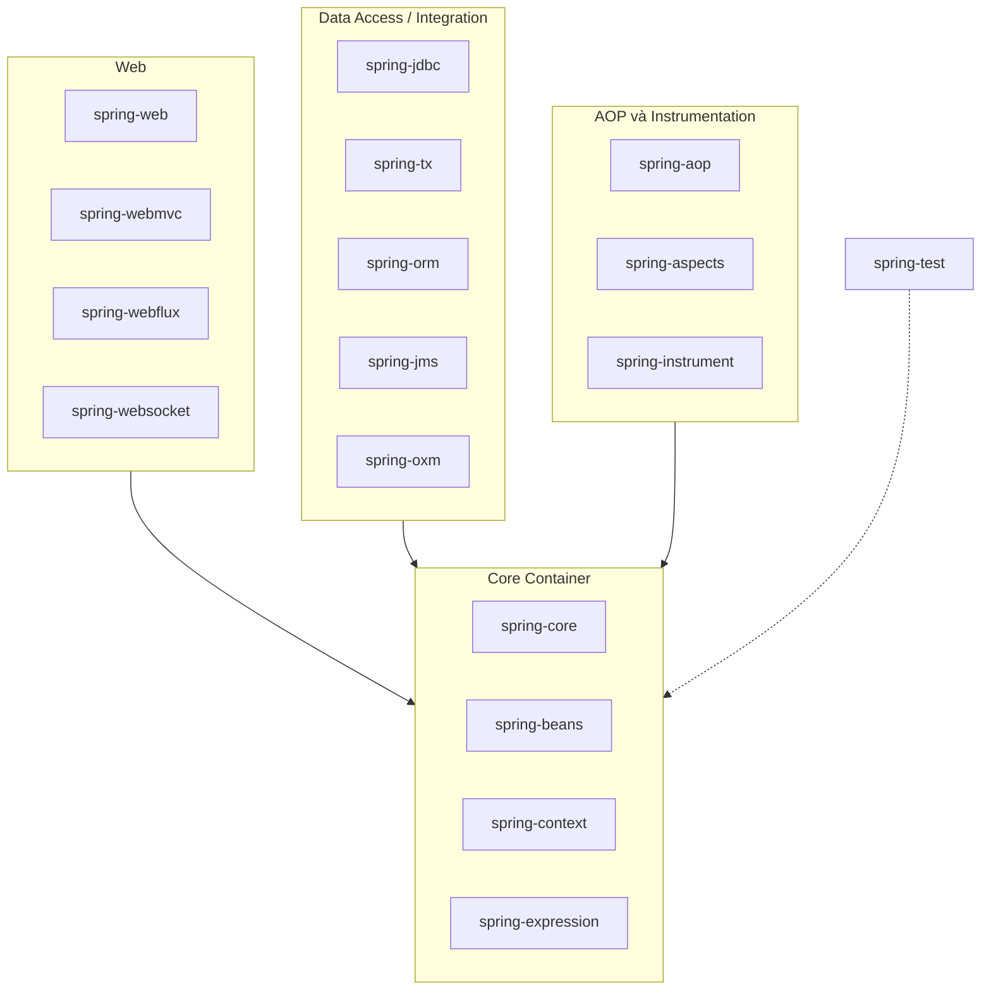
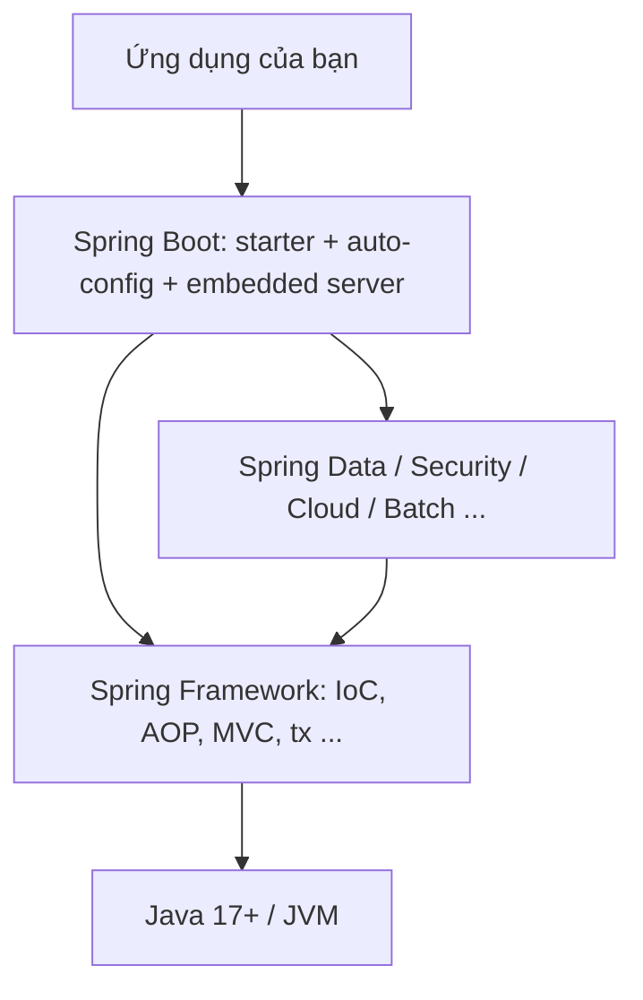
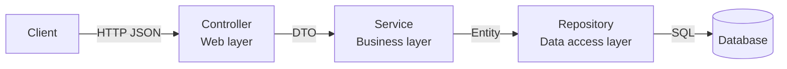
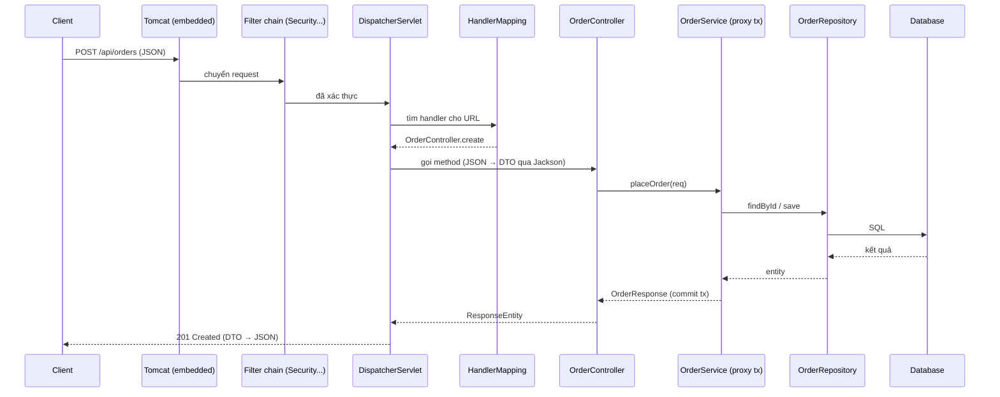

# Kiến trúc Spring

Spring không phải một thư viện đơn lẻ mà là một **tập hợp module** xếp tầng, cộng với cả một **hệ sinh thái** dự án anh em (Boot, Data, Security, Cloud...). Bài này vẽ bức tranh tổng: Spring Framework gồm những module nào, các dự án trong hệ sinh thái liên quan ra sao, một ứng dụng Spring Boot thường chia tầng thế nào, và một HTTP request đi qua những đâu. Nắm được bản đồ này thì khi học từng phần sẽ biết nó nằm ở vị trí nào.

---

:::note[Ghi nhớ nhanh]

- ⭐ **Core Container là nền móng** — `spring-core`, `spring-beans`, `spring-context`, `spring-expression`; mọi module khác đều dựa trên IoC container.
- ⭐ **Ứng dụng Spring Boot chia 3 tầng chính** — Controller (nhận request) → Service (nghiệp vụ, transaction) → Repository (truy cập dữ liệu).
- **Spring Framework là lõi, Spring Boot là lớp tiện ích bên trên** — Boot không thay thế Framework mà cấu hình sẵn cho nó.
- **Hệ sinh thái**: Spring Data (dữ liệu), Spring Security (bảo mật), Spring Cloud (microservices), Spring Batch, Spring Integration...
- **Request web đi qua** Filter → `DispatcherServlet` → HandlerMapping → Controller → Service → Repository → trả JSON qua `HttpMessageConverter`.

:::

---

## Mục lục

- [Vì sao Spring được thiết kế theo module?](#vì-sao-spring-được-thiết-kế-theo-module)
- [Các module của Spring Framework](#các-module-của-spring-framework)
- [Hệ sinh thái Spring](#hệ-sinh-thái-spring)
- [Kiến trúc phân tầng ứng dụng Spring Boot](#kiến-trúc-phân-tầng-ứng-dụng-spring-boot)
- [Luồng đi của một request](#luồng-đi-của-một-request)
- [Cấu trúc thư mục dự án](#cấu-trúc-thư-mục-dự-án)

---

## Vì sao Spring được thiết kế theo module?

**Vấn đề:** Thời J2EE (đầu những năm 2000), muốn dùng transaction hay bảo mật bạn phải dùng EJB — một khối nặng, bắt class kế thừa interface đặc thù, phải chạy trong application server to (WebLogic, WebSphere). Muốn một phần cũng phải ôm cả khối.

```java
// EJB 2.x: business logic bị "trói" vào API của container
public class OrderBean implements javax.ejb.SessionBean {
    public void setSessionContext(SessionContext ctx) { }
    public void ejbCreate() { }
    public void ejbRemove() { }
    public void ejbActivate() { }
    public void ejbPassivate() { }

    public void placeOrder(Order order) {
        // logic thật chỉ có vài dòng ở đây
    }
}
```

**Giải pháp:** Spring tách thành nhiều module độc lập, class nghiệp vụ là POJO thuần, cần gì thêm module đó.

```java
// Spring: POJO thuần, transaction được "gắn" từ ngoài qua AOP
@Service
public class OrderService {
    @Transactional
    public void placeOrder(Order order) {
        // chỉ có logic nghiệp vụ
    }
}
```

:::tip[Dùng thực tế]

- **Ứng dụng console/batch** chỉ cần `spring-context` (IoC) + `spring-jdbc`, không cần web.
- **REST API** thêm `spring-webmvc` (hoặc `spring-webflux` nếu reactive).
- **Thư viện nội bộ** chỉ phụ thuộc `spring-context` để dễ nhúng vào nhiều dự án.
- **Nâng cấp từng phần** — thay tầng dữ liệu JDBC sang JPA mà không đụng tầng web.

:::

---

## Các module của Spring Framework



### Core Container

| Module | Vai trò |
|--------|---------|
| `spring-core` | Tiện ích nền: đọc resource, chuyển đổi kiểu, xử lý annotation, nền tảng cho mọi module |
| `spring-beans` | `BeanFactory`, bean definition, cơ chế DI |
| `spring-context` | `ApplicationContext`, event, i18n, component scan, `@Configuration`, scheduling, cache abstraction |
| `spring-expression` | SpEL — ngôn ngữ biểu thức `#{...}` |

### AOP và Instrumentation

- `spring-aop` — AOP dựa trên proxy, nền tảng cho `@Transactional`, `@Cacheable`, `@Async`.
- `spring-aspects` — tích hợp AspectJ.
- `spring-instrument` — hỗ trợ load-time weaving (hiếm dùng).

### Data Access / Integration

- `spring-jdbc` — `JdbcTemplate`, `JdbcClient`: bớt code JDBC lặp lại.
- `spring-tx` — quản lý transaction thống nhất (`PlatformTransactionManager`, `@Transactional`).
- `spring-orm` — tích hợp JPA/Hibernate.
- `spring-jms`, `spring-messaging` — gửi/nhận message.
- `spring-oxm` — map object và XML.

### Web

- `spring-web` — nền HTTP chung: `RestClient`, `WebClient` (trong webflux), multipart, CORS.
- `spring-webmvc` — Spring MVC, mô hình Servlet, blocking (một thread mỗi request).
- `spring-webflux` — web reactive, non-blocking (Netty hoặc Servlet container hỗ trợ async).
- `spring-websocket` — WebSocket, STOMP.

### Test

- `spring-test` — `TestContext` framework, MockMvc, hỗ trợ JUnit 5; là nền cho `@SpringBootTest`.

:::warning[Lỗi hay gặp]

Trộn cả `spring-boot-starter-web` (MVC) và `spring-boot-starter-webflux` rồi thắc mắc vì sao vẫn chạy Tomcat/MVC. Khi có cả hai, Spring Boot **ưu tiên Spring MVC**; WebFlux chỉ được dùng khi không có MVC (hoặc bạn đặt `spring.main.web-application-type=reactive`).

:::

---

## Hệ sinh thái Spring

Ngoài Spring Framework, Spring có hàng chục dự án con xây bên trên:

| Dự án | Làm gì | Học ở nhóm |
|-------|--------|------------|
| **Spring Boot** | Cấu hình sẵn, starter, server nhúng, Actuator | 3 |
| **Spring Data** | Repository tự sinh cho JPA, JDBC, MongoDB, Redis, Elasticsearch... | 7 |
| **Spring Security** | Xác thực, phân quyền, OAuth2, JWT, chống CSRF | 5 |
| **Spring Cloud** | Microservices: Gateway, Config Server, service discovery, OpenFeign, Circuit Breaker | 8 |
| **Spring Batch** | Xử lý lô dữ liệu lớn: đọc - xử lý - ghi theo chunk, restart khi lỗi | — |
| **Spring Integration** | Enterprise Integration Patterns: kênh, router, adapter | — |
| **Spring AMQP / Kafka** | Làm việc với RabbitMQ, Kafka | — |
| **Spring Session** | Lưu HTTP session vào Redis/JDBC để scale nhiều instance | — |
| **Spring Authorization Server** | Tự dựng OAuth2 Authorization Server | — |
| **Spring AI** | Tích hợp mô hình AI (LLM, embedding, vector store) | — |



:::tip[Ví dụ đời thường]

Spring Framework như **móng và khung bê tông** của một toà chung cư. Các dự án Spring Data, Security, Cloud là **hệ thống điện, nước, thang máy, camera** — đều gắn vào khung đó. Spring Boot là **nhà thầu hoàn thiện**: lắp sẵn điện nước theo bản chuẩn, bạn dọn vào ở ngay, muốn đổi ổ cắm thì vẫn đổi được.

:::

---

## Kiến trúc phân tầng ứng dụng Spring Boot

Hầu hết ứng dụng Spring Boot (REST API) dùng kiến trúc 3 tầng (layered architecture):



| Tầng | Annotation | Trách nhiệm | Không nên làm |
|------|------------|-------------|---------------|
| **Controller** | `@RestController` | Nhận request, validate input, gọi service, map sang DTO trả về | Chứa logic nghiệp vụ, gọi thẳng repository |
| **Service** | `@Service` | Nghiệp vụ, quy tắc, ranh giới transaction, điều phối nhiều repository | Biết đến `HttpServletRequest`, trả `ResponseEntity` |
| **Repository** | `@Repository` / interface `JpaRepository` | Đọc/ghi dữ liệu | Chứa logic nghiệp vụ |

Ví dụ đầy đủ một tính năng "đặt hàng":

```java
// Controller — tầng web
@RestController
@RequestMapping("/api/orders")
public class OrderController {
    private final OrderService orderService;

    public OrderController(OrderService orderService) {
        this.orderService = orderService;
    }

    @PostMapping
    public ResponseEntity<OrderResponse> create(@Valid @RequestBody CreateOrderRequest req) {
        OrderResponse created = orderService.placeOrder(req);
        return ResponseEntity.status(HttpStatus.CREATED).body(created);
    }
}
```

```java
// Service — tầng nghiệp vụ
@Service
public class OrderService {
    private final OrderRepository orderRepository;
    private final ProductRepository productRepository;

    public OrderService(OrderRepository orderRepository, ProductRepository productRepository) {
        this.orderRepository = orderRepository;
        this.productRepository = productRepository;
    }

    @Transactional
    public OrderResponse placeOrder(CreateOrderRequest req) {
        Product product = productRepository.findById(req.productId())
                .orElseThrow(() -> new NotFoundException("Không tìm thấy sản phẩm"));
        if (product.getStock() < req.quantity()) {
            throw new BusinessException("Hết hàng");
        }
        product.decreaseStock(req.quantity());
        Order saved = orderRepository.save(new Order(product, req.quantity()));
        return OrderResponse.from(saved);
    }
}
```

```java
// Repository — tầng dữ liệu (Spring Data JPA tự sinh implementation)
public interface OrderRepository extends JpaRepository<Order, Long> {
    List<Order> findByCustomerId(Long customerId);
}
```

```java
// DTO dùng record (Java 16+)
public record CreateOrderRequest(@NotNull Long productId, @Min(1) int quantity) { }
public record OrderResponse(Long id, String productName, int quantity) {
    static OrderResponse from(Order o) {
        return new OrderResponse(o.getId(), o.getProduct().getName(), o.getQuantity());
    }
}
```

:::tip[Ví dụ đời thường]

Ba tầng giống **quán phở**: nhân viên **order** (Controller) nhận yêu cầu, ghi phiếu, không tự nấu; **bếp** (Service) quyết định nấu thế nào, hết thịt thì báo; **kho** (Repository) chỉ lấy và cất nguyên liệu. Nhân viên order chạy thẳng vào kho bốc thịt (Controller gọi Repository) là bỏ qua mọi quy tắc của bếp.

:::

:::warning[Lỗi hay gặp]

- **Trả entity JPA thẳng ra JSON** — lộ field nhạy cảm, dính lỗi lazy loading (`LazyInitializationException`) hoặc vòng lặp vô hạn khi serialize quan hệ hai chiều. Nên map sang DTO.
- **Đặt `@Transactional` ở Controller** — ranh giới transaction nên nằm ở Service.
- **"Fat controller"** — dồn logic vào controller, sau này không tái sử dụng được cho job/consumer khác.

:::

---

## Luồng đi của một request



Các bước chính:

1. **Embedded Tomcat** nhận kết nối HTTP, lấy một thread từ thread pool.
2. **Filter chain** chạy trước: Spring Security kiểm tra token, CORS, logging...
3. **`DispatcherServlet`** — "front controller" duy nhất của Spring MVC — nhận request.
4. **`HandlerMapping`** tìm method controller khớp URL + HTTP method.
5. **`HandlerAdapter`** gọi method; `HttpMessageConverter` (Jackson) đổi JSON thành DTO, `@Valid` kích hoạt validation.
6. Controller gọi **Service** (thực chất là **proxy** — mở transaction trước khi vào method).
7. Service gọi **Repository** → Hibernate sinh SQL → database.
8. Kết quả trả ngược lại; transaction commit; Jackson đổi DTO thành JSON.
9. Nếu có exception, `@RestControllerAdvice` / `@ExceptionHandler` chuyển thành response lỗi.

---

## Cấu trúc thư mục dự án

Có hai cách tổ chức phổ biến:

```text
# Theo tầng (package-by-layer) — dễ hiểu cho dự án nhỏ
com.shop
├── controller/  OrderController, ProductController
├── service/     OrderService, ProductService
├── repository/  OrderRepository, ProductRepository
├── dto/
└── entity/

# Theo tính năng (package-by-feature) — khuyến nghị khi dự án lớn dần
com.shop
├── order/       OrderController, OrderService, OrderRepository, Order, dto/
├── product/     ProductController, ProductService, ...
└── common/      exception, config
```

| Tiêu chí | Theo tầng | Theo tính năng |
|----------|-----------|----------------|
| Dự án nhỏ, người mới | Dễ hiểu | Hơi thừa |
| Dự án lớn | Mỗi package phình to, sửa 1 tính năng chạm nhiều package | Gom code liên quan một chỗ, dễ tách module/microservice |
| Đóng gói | Mọi class phải `public` | Có thể để package-private |

```text
src/main/resources/
├── application.yml          # cấu hình chung
├── application-dev.yml      # cấu hình riêng profile dev
├── application-prod.yml
├── static/                  # file tĩnh (css, js)
├── templates/               # template Thymeleaf
└── db/migration/            # script Flyway
```
