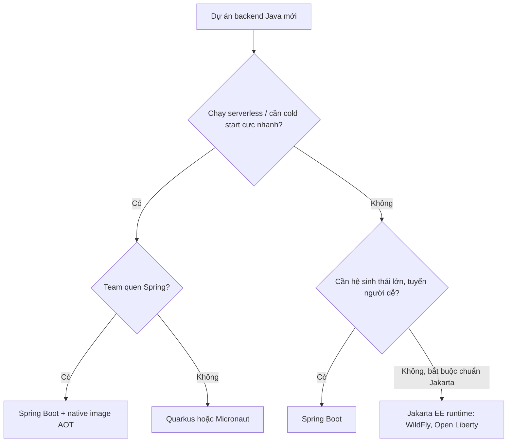

# Vì sao dùng Spring

Java có nhiều lựa chọn để viết backend: Jakarta EE (trước là Java EE), Quarkus, Micronaut, Helidon, Vert.x... Vậy vì sao Spring (và Spring Boot) vẫn là lựa chọn số một ở hầu hết doanh nghiệp? Bài này so sánh Spring với các đối thủ chính, chỉ ra ưu nhược điểm thật sự và đưa ra tiêu chí chọn framework cho từng loại dự án.

---

:::note[Ghi nhớ nhanh]

- ⭐ **Điểm mạnh lớn nhất của Spring là hệ sinh thái + cộng đồng** — gần như mọi bài toán (DB, MQ, bảo mật, cloud) đều có module chính chủ và tài liệu dồi dào.
- ⭐ **Điểm yếu kinh điển: khởi động chậm, tốn RAM hơn** so với Quarkus/Micronaut vì xử lý reflection lúc runtime — giảm được bằng GraalVM native image (Spring AOT) hoặc CDS.
- **Jakarta EE là bộ đặc tả (spec)**, Spring là một framework cụ thể — Spring dùng lại nhiều spec của Jakarta (Servlet, JPA, Bean Validation).
- **Quarkus, Micronaut** làm DI lúc build (compile-time), khởi động nhanh, hợp serverless/container nhỏ.
- **Chọn Spring khi**: dự án doanh nghiệp, team đông, cần tuyển người dễ, cần tích hợp nhiều hệ thống.

:::

---

## Mục lục

- [Vì sao Spring ra đời?](#vì-sao-spring-ra-đời)
- [Spring so với Jakarta EE](#spring-so-với-jakarta-ee)
- [Spring Boot so với Quarkus và Micronaut](#spring-boot-so-với-quarkus-và-micronaut)
- [Ưu điểm của Spring](#ưu-điểm-của-spring)
- [Nhược điểm của Spring](#nhược-điểm-của-spring)
- [Khi nào chọn framework nào](#khi-nào-chọn-framework-nào)
- [Câu hỏi phỏng vấn](#câu-hỏi-phỏng-vấn)

---

## Vì sao Spring ra đời?

**Vấn đề:** Đầu những năm 2000, chuẩn J2EE với EJB 2.x là cách "chính thống" để viết ứng dụng doanh nghiệp Java. Nó có rất nhiều nỗi đau:

- Một EJB cần **3 file Java + 1 file XML** (home interface, remote interface, bean class, `ejb-jar.xml`).
- Phải deploy vào **application server** nặng (WebLogic, WebSphere, JBoss) mới chạy được — kể cả để test.
- Code nghiệp vụ dính chặt vào API của container, khó unit test.
- Tra cứu phụ thuộc thủ công bằng JNDI.

```java
// Lấy một service thời J2EE: tra JNDI, ép kiểu, bắt exception checked
try {
    Context ctx = new InitialContext();
    Object ref = ctx.lookup("java:comp/env/ejb/OrderService");
    OrderServiceHome home = (OrderServiceHome)
            PortableRemoteObject.narrow(ref, OrderServiceHome.class);
    OrderServiceRemote service = home.create();
    service.placeOrder(order);
} catch (NamingException | CreateException | RemoteException e) {
    throw new RuntimeException(e);
}
```

**Giải pháp:** Năm 2002, Rod Johnson viết sách *Expert One-on-One J2EE Design and Development* kèm framework mẫu; năm 2004 Spring 1.0 ra đời với ý tưởng: **POJO + DI + AOP** — class nghiệp vụ là Java thuần, phụ thuộc được tiêm vào, transaction/bảo mật gắn từ ngoài.

```java
@Service
public class CheckoutService {
    private final OrderService orderService;   // được tiêm sẵn, không JNDI

    public CheckoutService(OrderService orderService) {
        this.orderService = orderService;
    }

    public void checkout(Order order) {
        orderService.placeOrder(order);
    }
}
```

Mười năm sau (2014), Spring đến lượt bị chê "cấu hình XML quá nhiều" → **Spring Boot** ra đời: starter, auto-configuration, server nhúng.

:::tip[Dùng thực tế]

- **Ngân hàng, bảo hiểm, viễn thông** ở Việt Nam phần lớn chạy backend Java/Spring — biết Spring là lợi thế tuyển dụng lớn.
- **Hệ thống microservices** dùng Spring Cloud (Gateway, Config, OpenFeign).
- **Hệ thống batch/ETL** đối soát giao dịch cuối ngày dùng Spring Batch.
- **Startup** chọn Spring Boot để nhanh có REST API + JPA + Security chuẩn chỉnh.

:::

---

## Spring so với Jakarta EE

**Jakarta EE** (đổi tên từ Java EE khi chuyển sang Eclipse Foundation năm 2017–2019; package đổi từ `javax.*` sang `jakarta.*` từ Jakarta EE 9) là **bộ đặc tả** — định nghĩa API như Servlet, JPA, CDI, JAX-RS, Bean Validation. Các **server** như WildFly, Payara, Open Liberty hiện thực các spec đó.

Spring **không phải** đối thủ toàn phần của Jakarta EE: Spring **dùng lại** nhiều spec của nó.

| Spec Jakarta EE | Spring dùng thế nào |
|-----------------|---------------------|
| Servlet | Spring MVC chạy trên Servlet (Tomcat) |
| JPA (Persistence) | Spring Data JPA dùng Hibernate (hiện thực JPA) |
| Bean Validation | `@Valid`, `@NotNull` từ `jakarta.validation` |
| CDI (DI chuẩn) | Spring có DI riêng; hỗ trợ một phần `@Inject` (JSR-330) |
| JAX-RS (REST) | Spring dùng Spring MVC thay thế |

| Tiêu chí | Spring Boot | Jakarta EE (server truyền thống) |
|----------|-------------|-----------------------------------|
| Bản chất | Framework của một công ty (VMware → Broadcom) | Spec chuẩn, nhiều nhà cung cấp |
| Triển khai | Fat JAR có server nhúng | WAR/EAR deploy vào app server (nay cũng có runtime nhẹ) |
| Tốc độ ra tính năng | Nhanh, phát hành thường xuyên | Chậm hơn, qua quy trình chuẩn hoá |
| Phụ thuộc nhà cung cấp | Gắn với Spring | Đổi server tương đối dễ |
| Hệ sinh thái | Rất lớn (Data, Security, Cloud, Batch) | Nhỏ hơn |

:::tip[Ví dụ đời thường]

Jakarta EE giống **bộ tiêu chuẩn TCVN về ổ cắm điện** — nhiều hãng sản xuất theo, cắm hãng nào cũng vừa. Spring giống **một hãng thiết bị lớn** (kiểu "hệ sinh thái nhà thông minh"): dùng đúng chuẩn ổ cắm đó, nhưng thêm vô số thiết bị tiện ích riêng, cài một app là điều khiển hết.

:::

---

## Spring Boot so với Quarkus và Micronaut

**Quarkus** (Red Hat, 2019) và **Micronaut** (Object Computing, 2018) ra đời cho thời container/serverless. Ý tưởng chung: **chuyển công việc từ runtime sang build time** — phân tích annotation, sinh code DI lúc compile thay vì dùng reflection lúc khởi động.

| Tiêu chí | Spring Boot 3 | Quarkus | Micronaut |
|----------|---------------|---------|-----------|
| DI | Runtime (reflection, proxy); có AOT cho native | Build time (ArC, dựa trên CDI) | Compile time (annotation processor) |
| Khởi động JVM | Vài giây với app vừa | Nhanh hơn rõ rệt | Nhanh hơn rõ rệt |
| Native image (GraalVM) | Hỗ trợ chính thức từ Boot 3 | Hỗ trợ từ đầu, rất mượt | Hỗ trợ tốt |
| Bộ nhớ | Cao hơn | Thấp | Thấp |
| Chuẩn API | API riêng của Spring | Jakarta EE/MicroProfile + Vert.x | API riêng, gần Spring |
| Hệ sinh thái, tài liệu | Lớn nhất | Khá | Nhỏ hơn |
| Tuyển dụng ở Việt Nam | Rất dễ | Khó hơn | Khó |
| Dev experience | DevTools hot restart | Dev mode live reload rất tốt | Tốt |

:::warning[Lỗi hay gặp]

- **Chọn Quarkus/Micronaut chỉ vì "khởi động nhanh"** cho một ứng dụng chạy 24/7 trên server — thời gian khởi động gần như không quan trọng ở đây, còn chi phí tuyển người và thiếu thư viện thì rất thật.
- **Cho rằng Spring không chạy được native** — Spring Boot 3 hỗ trợ GraalVM native image qua Spring AOT, nhưng có giới hạn (reflection động, `@Profile` được chốt lúc build, build lâu).
- **So sánh benchmark "hello world"** — app thật thường bị chi phối bởi DB và mạng, không phải framework.

:::

---

## Ưu điểm của Spring

1. **Hệ sinh thái khổng lồ** — có module chính chủ cho hầu hết bài toán: JPA, MongoDB, Redis, Kafka, RabbitMQ, OAuth2, LDAP, batch, AI.
2. **Cộng đồng và tài liệu** — câu hỏi nào cũng đã có người hỏi trên Stack Overflow; tài liệu chính thức đầy đủ tại [docs.spring.io](https://docs.spring.io).
3. **Năng suất cao với Spring Boot** — vài dòng code có ngay REST API có DB, validation, xử lý lỗi.
4. **Thiết kế tốt cho kiểm thử** — DI giúp mock dễ; `spring-test`, `@SpringBootTest`, slice test (`@WebMvcTest`, `@DataJpaTest`), Testcontainers.
5. **Ổn định, tương thích ngược** — doanh nghiệp yên tâm dùng lâu dài; có lộ trình hỗ trợ rõ ràng.
6. **Không trói buộc nhiều** — code nghiệp vụ vẫn là POJO; trừu tượng hoá tốt (transaction, cache, messaging) nên đổi hạ tầng ít đau.
7. **Sẵn sàng cho production** — Actuator, Micrometer metrics/tracing, graceful shutdown, cấu hình ngoài.

```java
// Chỉ với vài annotation: REST + validation + transaction + cache
@RestController
@RequestMapping("/api/products")
public class ProductController {
    private final ProductService service;

    public ProductController(ProductService service) {
        this.service = service;
    }

    @GetMapping("/{id}")
    public ProductResponse get(@PathVariable Long id) {
        return service.findById(id);   // service có @Cacheable, @Transactional(readOnly = true)
    }
}
```

---

## Nhược điểm của Spring

1. **"Phép thuật" khó hiểu** — auto-configuration, proxy, annotation làm nhiều thứ ngầm; khi lỗi người mới khó lần ra (cần `--debug`, condition report).
2. **Khởi động chậm, tốn bộ nhớ** hơn Quarkus/Micronaut khi chạy JVM thường — bất lợi cho serverless (cold start).
3. **Đường cong học tập dài** — Core, Boot, MVC, Data, Security mỗi phần một khối kiến thức; Spring Security đặc biệt khó.
4. **Dễ lạm dụng annotation** — logic ẩn sau `@Transactional`, `@Async`, `@Cacheable` có bẫy (self-invocation, proxy).
5. **Phụ thuộc kéo theo lớn** — fat JAR thường vài chục MB.
6. **Nâng cấp phiên bản lớn có thể đau** — Boot 2 → 3 phải đổi `javax.*` sang `jakarta.*`, bỏ `WebSecurityConfigurerAdapter`, lên Java 17.

:::tip[Ví dụ đời thường]

Spring như **xe ô tô số tự động đời mới**: lái sướng, nhiều tiện nghi, ai cũng lái được và gara nào cũng sửa được. Nhưng nặng, tốn xăng hơn xe máy (Quarkus/Micronaut cho serverless), và khi đèn báo lỗi sáng thì phải biết đọc mã lỗi (condition report) chứ không thể tự tháo máy ngay.

:::

---

## Khi nào chọn framework nào



| Tình huống | Gợi ý |
|------------|-------|
| REST API / microservices doanh nghiệp, team trung bình - lớn | **Spring Boot** |
| Hệ thống tích hợp nhiều nguồn (DB, MQ, LDAP, SOAP cũ) | **Spring Boot** + Spring Integration |
| Function serverless (AWS Lambda), container cần RAM thấp | Quarkus / Micronaut, hoặc Spring Boot native |
| Dự án kế thừa trên app server Jakarta EE sẵn có | Jakarta EE |
| Ứng dụng phản ứng nhanh, nhiều kết nối đồng thời | Spring WebFlux, Vert.x, hoặc Spring MVC + virtual threads |
| Người mới học backend Java | **Spring Boot** — tài liệu, việc làm nhiều nhất |

---

## Câu hỏi phỏng vấn

**1. Vì sao Spring ra đời? Nó giải quyết vấn đề gì của J2EE/EJB?**

<details className="qa">
<summary>Xem đáp án</summary>

EJB 2.x yêu cầu nhiều interface và XML cho mỗi component, bắt code nghiệp vụ phụ thuộc API của container, phải chạy trong application server nặng mới test được, tra cứu phụ thuộc thủ công bằng JNDI. Spring (2004) đưa ra mô hình nhẹ: class nghiệp vụ là POJO, phụ thuộc được container tiêm vào (DI), các mối quan tâm cắt ngang như transaction, bảo mật được gắn từ ngoài bằng AOP. Kết quả: code đơn giản, dễ unit test, chạy được ngoài app server.

</details>

**2. Spring và Jakarta EE có phải đối thủ hoàn toàn không?**

<details className="qa">
<summary>Xem đáp án</summary>

Không hoàn toàn. Jakarta EE là bộ đặc tả, Spring là framework. Spring dùng lại nhiều spec Jakarta: Servlet (Spring MVC chạy trên Tomcat), JPA (qua Hibernate), Bean Validation, Jakarta Mail, JMS. Chỗ cạnh tranh trực tiếp là mô hình DI (Spring DI vs CDI) và REST (Spring MVC vs JAX-RS). Từ Spring Boot 3, Spring yêu cầu Jakarta EE 9+ (package `jakarta.*`).

</details>

**3. Quarkus/Micronaut nhanh hơn Spring Boot ở điểm nào, vì sao?**

<details className="qa">
<summary>Xem đáp án</summary>

Nhanh hơn chủ yếu ở **thời gian khởi động và bộ nhớ**. Lý do: chúng xử lý DI, cấu hình, proxy lúc **build/compile** (sinh bytecode sẵn) thay vì quét classpath, đọc annotation và dùng reflection lúc runtime như Spring truyền thống. Điều này cũng giúp chúng dễ build GraalVM native image. Throughput khi đã chạy ổn định thì chênh lệch thường không lớn. Spring đã thu hẹp khoảng cách bằng Spring AOT + native image và hỗ trợ CDS (Class Data Sharing) để khởi động nhanh hơn trên JVM.

</details>

**4. Nêu 3 ưu điểm và 3 nhược điểm của Spring Boot.**

<details className="qa">
<summary>Xem đáp án</summary>

Ưu: (1) hệ sinh thái và cộng đồng lớn nhất Java; (2) năng suất cao nhờ starter, auto-configuration, server nhúng; (3) sẵn sàng production: Actuator, metrics, cấu hình ngoài, hỗ trợ test tốt.

Nhược: (1) nhiều "phép thuật" ngầm, khó debug khi không hiểu auto-configuration và proxy; (2) khởi động chậm, tốn RAM hơn các framework compile-time; (3) đường cong học tập dài, đặc biệt Spring Security; nâng cấp major version có thể tốn công.

</details>

**5. Khi nào bạn KHÔNG chọn Spring Boot?**

<details className="qa">
<summary>Xem đáp án</summary>

- Function serverless cần cold start vài chục mili giây và RAM rất thấp, team không muốn đánh đổi thời gian build native → Quarkus/Micronaut.
- Tool CLI nhỏ, script đơn giản — Spring là quá tải; dùng Java thuần hoặc Picocli.
- Tổ chức bắt buộc dùng chuẩn Jakarta EE trên app server có sẵn.
- Đội ngũ đã thành thạo stack khác (Go, Node.js) và bài toán không cần hệ sinh thái Java.

</details>

**6. Spring Boot 2 lên 3 có những thay đổi lớn nào?**

<details className="qa">
<summary>Xem đáp án</summary>

- Yêu cầu **Java 17** tối thiểu, dựa trên Spring Framework 6.
- Chuyển từ `javax.*` sang **`jakarta.*`** (Jakarta EE 9/10) — đổi import cho Servlet, JPA, Validation.
- Hỗ trợ chính thức **GraalVM native image** qua Spring AOT.
- Observability chuyển sang **Micrometer Observation / Micrometer Tracing** (Spring Cloud Sleuth ngừng phát triển).
- Spring Security 6: bỏ `WebSecurityConfigurerAdapter`, dùng bean `SecurityFilterChain` + lambda DSL, `authorizeHttpRequests`, `requestMatchers`.
- File đăng ký auto-configuration đổi từ `spring.factories` sang `META-INF/spring/org.springframework.boot.autoconfigure.AutoConfiguration.imports`.

</details>
