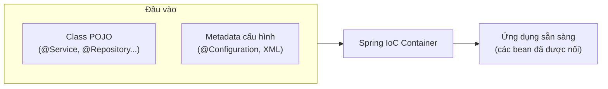
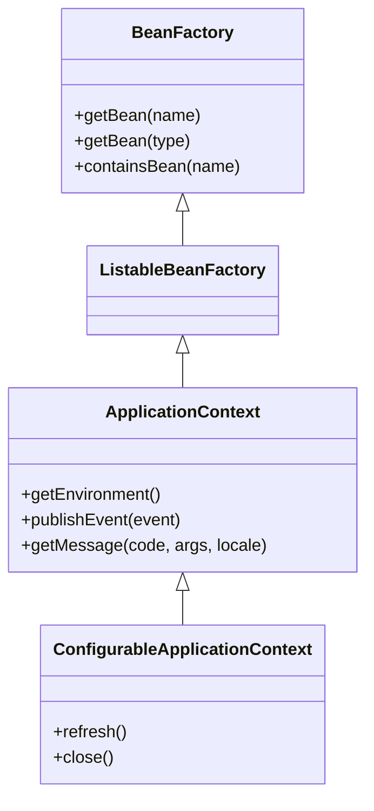
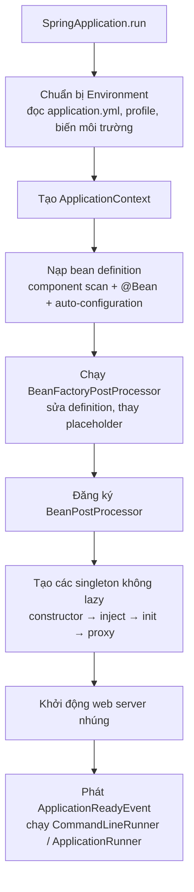

# IoC Container

IoC Container (thùng chứa đảo ngược điều khiển) là trái tim của Spring: nó đọc cấu hình, tạo object, nối các object lại với nhau và quản lý chúng từ lúc sinh đến lúc huỷ. Mọi tính năng khác — MVC, Data, Security, transaction — đều là bean nằm trong container này. Hiểu container khởi động thế nào giúp bạn đọc được log lỗi và biết vì sao một annotation "có tác dụng" hay "không có tác dụng".

---

:::note[Ghi nhớ nhanh]

- ⭐ **Container làm 3 việc: tạo bean, nối bean (DI), quản lý vòng đời** — code của bạn chỉ khai báo "cần gì", không tự `new`.
- ⭐ **Khởi động có 2 pha**: đọc bean definition (metadata) → tạo instance singleton; lỗi thiếu bean, vòng tròn phụ thuộc lộ ra ngay lúc start.
- **`ApplicationContext` là container dùng thực tế** — Spring Boot tạo nó qua `SpringApplication.run()`; `BeanFactory` chỉ là interface gốc.
- **Nguồn bean definition**: component scan (`@Component`...), method `@Bean`, XML, đăng ký bằng code.
- **Hạn chế gọi `getBean()` trong code nghiệp vụ** — đó là Service Locator, đi ngược IoC; hãy để container tiêm vào.

:::

---

## Mục lục

- [Vì sao cần IoC Container?](#vì-sao-cần-ioc-container)
- [IoC Container là gì?](#ioc-container-là-gì)
- [Các implementation của ApplicationContext](#các-implementation-của-applicationcontext)
- [Container khởi động như thế nào](#container-khởi-động-như-thế-nào)
- [Làm việc với container](#làm-việc-với-container)
- [Điểm mở rộng của container](#điểm-mở-rộng-của-container)
- [Câu hỏi phỏng vấn](#câu-hỏi-phỏng-vấn)

---

## Vì sao cần IoC Container?

**Vấn đề:** Khi không có container, mỗi class tự tạo phụ thuộc của mình. Ứng dụng lớn lên, việc "lắp ráp" trở thành mớ dây rối:

```java
public class Main {
    public static void main(String[] args) {
        // Tự tay lắp ráp toàn bộ đồ thị object — thứ tự phải đúng, sửa một chỗ lan khắp nơi
        DataSource ds = new HikariDataSource(loadConfig());
        OrderRepository orderRepo = new JdbcOrderRepository(ds);
        ProductRepository productRepo = new JdbcProductRepository(ds);
        EmailSender email = new SmtpEmailSender("smtp.gmail.com", 587);
        PaymentGateway payment = new VnPayGateway(System.getenv("VNPAY_KEY"));
        OrderService orderService = new OrderService(orderRepo, productRepo, payment, email);
        OrderController controller = new OrderController(orderService);
        // ... 50 class khác, chưa kể transaction, đóng kết nối khi tắt app
    }
}
```

Tệ hơn nữa là class tự `new` bên trong:

```java
public class OrderService {
    // Dính chặt vào hiện thực cụ thể: muốn test với gateway giả là phải sửa code
    private final PaymentGateway payment = new VnPayGateway("key-that");
}
```

**Giải pháp:** Giao việc lắp ráp cho container. Mỗi class chỉ khai báo phụ thuộc qua constructor; container tự tìm và nối.

```java
@Service
public class OrderService {
    private final PaymentGateway payment;
    private final OrderRepository orderRepo;

    public OrderService(PaymentGateway payment, OrderRepository orderRepo) {
        this.payment = payment;
        this.orderRepo = orderRepo;
    }
}

@SpringBootApplication
public class ShopApplication {
    public static void main(String[] args) {
        SpringApplication.run(ShopApplication.class, args); // container lo phần còn lại
    }
}
```

:::tip[Dùng thực tế]

- **Đổi hiện thực không sửa code dùng nó** — đổi `VnPayGateway` sang `MomoGateway` chỉ cần đổi bean.
- **Test dễ** — truyền mock vào constructor trong unit test, hoặc thay bean bằng `@MockitoBean` trong integration test.
- **Quản lý tài nguyên** — container gọi `close()` cho connection pool, thread pool khi tắt ứng dụng.
- **Gắn tính năng cắt ngang** — vì container tạo bean, nó có thể bọc proxy để thêm transaction, cache, bảo mật.

:::

---

## IoC Container là gì?

**IoC Container** là thành phần của Spring chịu trách nhiệm:

1. **Đọc cấu hình** — từ annotation, Java config, XML → tạo ra **bean definition** (bản mô tả bean).
2. **Khởi tạo bean** — gọi constructor, factory method.
3. **Tiêm phụ thuộc** — tìm bean phù hợp truyền vào constructor/setter/field.
4. **Quản lý vòng đời** — gọi callback khởi tạo (`@PostConstruct`), bọc proxy, gọi callback huỷ (`@PreDestroy`) khi đóng.



:::tip[Ví dụ đời thường]

Container giống **ban tổ chức đám cưới trọn gói**. Bạn chỉ đưa danh sách: cần MC, ban nhạc, thợ ảnh, 30 mâm cỗ (bean definition). Ban tổ chức tự liên hệ từng bên, sắp xếp thứ tự (ai đến trước dựng sân khấu thì ban nhạc mới lắp loa được — thứ tự phụ thuộc), lo cho mọi người làm việc với nhau, và cuối buổi dọn dẹp (destroy). Bạn không phải gọi điện cho từng người.

:::

### BeanFactory và ApplicationContext



`ApplicationContext` kế thừa `BeanFactory` và thêm: event, i18n, `Environment` (profile + thuộc tính), resource loading, tự đăng ký các post-processor, tạo sẵn singleton khi khởi động.

---

## Các implementation của ApplicationContext

| Class | Dùng khi |
|-------|----------|
| `AnnotationConfigApplicationContext` | Spring thuần, cấu hình bằng `@Configuration` (không web) |
| `ClassPathXmlApplicationContext` | Dự án cũ, cấu hình XML |
| `GenericApplicationContext` | Đăng ký bean bằng code (functional) |
| `AnnotationConfigServletWebServerApplicationContext` | Spring Boot ứng dụng Servlet (MVC) — Boot tự chọn |
| `AnnotationConfigReactiveWebServerApplicationContext` | Spring Boot ứng dụng WebFlux — Boot tự chọn |

Ví dụ Spring thuần (không Boot) để thấy container hoạt động ra sao:

```java
@Configuration
@ComponentScan("com.shop")
public class AppConfig {
    @Bean
    public Clock clock() {
        return Clock.systemDefaultZone();
    }
}

public class Main {
    public static void main(String[] args) {
        // try-with-resources: đóng context → gọi @PreDestroy, giải phóng tài nguyên
        try (var ctx = new AnnotationConfigApplicationContext(AppConfig.class)) {
            OrderService service = ctx.getBean(OrderService.class);
            service.placeOrder(new Order("A001"));
        }
    }
}
```

Với Spring Boot, mọi thứ gói trong một dòng:

```java
@SpringBootApplication
public class ShopApplication {
    public static void main(String[] args) {
        ConfigurableApplicationContext ctx = SpringApplication.run(ShopApplication.class, args);
        // ctx là ApplicationContext — Boot chọn loại phù hợp (Servlet/Reactive/none)
    }
}
```

---

## Container khởi động như thế nào



Các điểm quan trọng:

1. **Pha 1 — đọc metadata**: chưa có object nào được tạo, chỉ có "bản thiết kế" (`BeanDefinition`).
2. **Pha 2 — tạo bean**: container sắp thứ tự theo phụ thuộc. `OrderService` cần `OrderRepository` → tạo repository trước.
3. **Fail fast** — thiếu bean, trùng bean không rõ ràng, vòng tròn constructor → **ứng dụng không khởi động được**. Đây là ưu điểm: lỗi lộ ra lúc deploy chứ không phải lúc khách hàng bấm nút.

Chạy code sau khi container sẵn sàng:

```java
@Component
public class DataSeeder implements ApplicationRunner {
    private final ProductRepository repo;

    public DataSeeder(ProductRepository repo) {
        this.repo = repo;
    }

    @Override
    public void run(ApplicationArguments args) {
        if (repo.count() == 0) {
            repo.save(new Product("Phở bò", 50_000));
        }
    }
}
```

:::warning[Lỗi hay gặp]

- **`NoSuchBeanDefinitionException` / "required a bean of type ... that could not be found"** — class không được scan (nằm ngoài package gốc), quên annotation, hoặc bean bị loại bởi `@Profile`/`@Conditional`.
- **`NoUniqueBeanDefinitionException`** — có 2 bean cùng kiểu mà không chỉ rõ dùng cái nào; xử lý bằng `@Primary` hoặc `@Qualifier`.
- **`BeanCurrentlyInCreationException`** — vòng tròn phụ thuộc qua constructor. Spring Boot từ 2.6 cấm vòng tròn mặc định; hãy tách lại thiết kế.

:::

---

## Làm việc với container

### Lấy bean (khi thật sự cần)

```java
OrderService s1 = ctx.getBean(OrderService.class);            // theo kiểu
OrderService s2 = ctx.getBean("orderService", OrderService.class); // theo tên
Map<String, PaymentGateway> all = ctx.getBeansOfType(PaymentGateway.class);
String[] names = ctx.getBeanDefinitionNames();                // liệt kê mọi bean
```

Trong code nghiệp vụ, **đừng** inject `ApplicationContext` rồi gọi `getBean()` — đó là mẫu Service Locator, che giấu phụ thuộc. Thay vào đó inject trực tiếp, hoặc inject cả danh sách:

```java
@Service
public class PaymentRouter {
    private final Map<String, PaymentGateway> gateways; // key = tên bean

    public PaymentRouter(Map<String, PaymentGateway> gateways) {
        this.gateways = gateways;
    }

    public void pay(String method, long amount) {
        PaymentGateway gw = gateways.get(method + "Gateway"); // "vnpayGateway", "momoGateway"
        if (gw == null) {
            throw new IllegalArgumentException("Không hỗ trợ phương thức: " + method);
        }
        gw.pay(amount);
    }
}
```

### Đăng ký bean bằng code

```java
var ctx = new GenericApplicationContext();
ctx.registerBean(Clock.class, Clock::systemUTC);
ctx.registerBean(OrderService.class); // tự dò constructor
ctx.refresh();
```

### Event trong container

```java
public record OrderPlacedEvent(Long orderId, String email) { }

@Service
public class OrderService {
    private final ApplicationEventPublisher publisher;

    public OrderService(ApplicationEventPublisher publisher) {
        this.publisher = publisher;
    }

    public void placeOrder(Order order) {
        // ... lưu đơn
        publisher.publishEvent(new OrderPlacedEvent(order.getId(), order.getEmail()));
    }
}

@Component
public class EmailListener {
    @EventListener
    public void onOrderPlaced(OrderPlacedEvent event) {
        // gửi email xác nhận — OrderService không cần biết đến EmailListener
    }
}
```

---

## Điểm mở rộng của container

| Điểm mở rộng | Chạy khi nào | Ví dụ dùng |
|--------------|--------------|-----------|
| `BeanFactoryPostProcessor` | Sau khi nạp definition, **trước** khi tạo bean | `PropertySourcesPlaceholderConfigurer` thay `${...}` |
| `BeanDefinitionRegistryPostProcessor` | Sớm hơn — thêm definition mới | `ConfigurationClassPostProcessor` xử lý `@Configuration`, `@ComponentScan` |
| `BeanPostProcessor` | Quanh bước khởi tạo **từng** bean | `AutowiredAnnotationBeanPostProcessor` xử lý `@Autowired`; tạo proxy AOP |
| `ApplicationListener` / `@EventListener` | Khi có event | `ContextRefreshedEvent`, `ApplicationReadyEvent` |
| `SmartLifecycle` | Khi context start/stop | Bắt đầu/dừng consumer Kafka |

```java
@Component
public class TimingBeanPostProcessor implements BeanPostProcessor {
    private static final Logger log = LoggerFactory.getLogger(TimingBeanPostProcessor.class);

    @Override
    public Object postProcessAfterInitialization(Object bean, String beanName) {
        if (bean.getClass().isAnnotationPresent(Service.class)) {
            log.debug("Đã khởi tạo service: {}", beanName);
        }
        return bean; // có thể trả về proxy bọc bean thay vì bean gốc
    }
}
```

:::tip[Ví dụ đời thường]

`BeanFactoryPostProcessor` như **sửa bản vẽ nhà trước khi xây** (đổi cửa sổ từ gỗ sang nhôm trên giấy). `BeanPostProcessor` như **nghiệm thu từng phòng sau khi xây** — có thể lắp thêm camera (proxy) trước khi giao phòng cho chủ nhà.

:::

---

## Câu hỏi phỏng vấn

**1. IoC Container trong Spring làm những gì?**

<details className="qa">
<summary>Xem đáp án</summary>

Đọc metadata cấu hình (annotation, Java config, XML) thành bean definition; khởi tạo bean theo đúng thứ tự phụ thuộc; tiêm phụ thuộc (DI); áp dụng các `BeanPostProcessor` (xử lý `@Autowired`, tạo proxy AOP cho `@Transactional`...); gọi callback khởi tạo và huỷ; cung cấp thêm event, `Environment`, i18n, resource loading. Code ứng dụng chỉ khai báo, không tự tạo và nối object.

</details>

**2. Mô tả quá trình khởi động của `ApplicationContext`.**

<details className="qa">
<summary>Xem đáp án</summary>

Trong Spring Boot: `SpringApplication.run()` chuẩn bị `Environment` (đọc file cấu hình, profile, biến môi trường) → tạo `ApplicationContext` phù hợp → nạp bean definition (component scan, `@Bean`, auto-configuration) → gọi `refresh()`: chạy `BeanFactoryPostProcessor`, đăng ký `BeanPostProcessor`, khởi tạo mọi singleton không lazy (constructor, inject, init callback, bọc proxy) → khởi động web server nhúng → phát `ApplicationReadyEvent`, chạy `CommandLineRunner`/`ApplicationRunner`.

</details>

**3. Vì sao `ApplicationContext` tạo singleton ngay khi khởi động (eager)? Lợi gì?**

<details className="qa">
<summary>Xem đáp án</summary>

Để **phát hiện lỗi cấu hình sớm** (fail fast): thiếu bean, sai thuộc tính, vòng tròn phụ thuộc, không kết nối được DB... đều làm app không lên, thay vì nổ ở request đầu tiên của người dùng. Ngoài ra request đầu không bị chậm vì phải khởi tạo. Có thể đổi bằng `@Lazy` cho từng bean hoặc `spring.main.lazy-initialization=true` toàn cục (khởi động nhanh hơn nhưng mất fail fast).

</details>

**4. `BeanFactoryPostProcessor` và `BeanPostProcessor` khác nhau thế nào?**

<details className="qa">
<summary>Xem đáp án</summary>

- `BeanFactoryPostProcessor` làm việc với **bean definition** (metadata), chạy **trước** khi bất kỳ bean thường nào được tạo. Ví dụ: thay placeholder `${...}`, xử lý class `@Configuration`.
- `BeanPostProcessor` làm việc với **instance bean**, chạy trước/sau bước init của **từng** bean, có thể trả về object khác (proxy). Ví dụ: xử lý `@Autowired`, `@PostConstruct`, tạo proxy AOP.

</details>

**5. Vì sao không nên inject `ApplicationContext` rồi gọi `getBean()` trong service?**

<details className="qa">
<summary>Xem đáp án</summary>

Đó là mẫu Service Locator: phụ thuộc bị giấu trong thân method thay vì lộ ra ở constructor, khó đọc và khó test (phải mock cả context), dính code nghiệp vụ vào API Spring, lỗi thiếu bean chỉ lộ lúc runtime khi chạy tới dòng đó. Thay bằng constructor injection; nếu cần chọn động thì inject `Map<String, T>` hoặc `List<T>`, hoặc `ObjectProvider<T>` khi cần lấy lười/prototype.

</details>

**6. Làm sao chạy một đoạn code ngay sau khi ứng dụng Spring Boot khởi động xong?**

<details className="qa">
<summary>Xem đáp án</summary>

- Implement `CommandLineRunner` (nhận `String... args`) hoặc `ApplicationRunner` (nhận `ApplicationArguments`) và đánh `@Component`; có thể sắp thứ tự bằng `@Order`.
- Hoặc `@EventListener(ApplicationReadyEvent.class)` — chạy khi app đã sẵn sàng phục vụ.
- `@PostConstruct` chạy sớm hơn — ngay sau khi **bean đó** được tiêm phụ thuộc, lúc context chưa khởi động xong, nên không phù hợp cho việc cần toàn bộ ứng dụng sẵn sàng.

</details>
