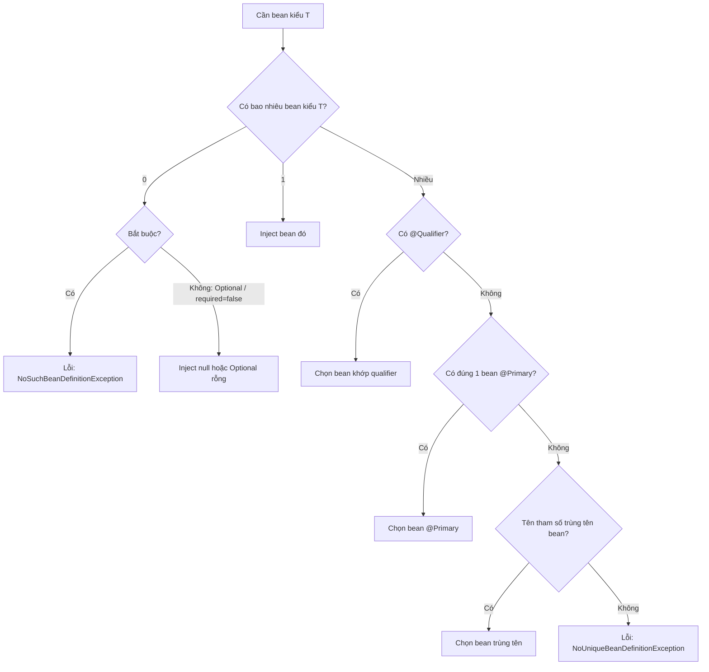

# Dependency Injection

Dependency Injection (DI — tiêm phụ thuộc) là cách Spring cung cấp cho mỗi bean những object mà nó cần, thay vì để bean tự tạo. Bài này đi qua ba kiểu injection (constructor, setter, field), cách Spring chọn bean khi có nhiều ứng viên (`@Qualifier`, `@Primary`), các kiểu inject đặc biệt (`List`, `Optional`, `ObjectProvider`) và vấn đề vòng tròn phụ thuộc. Đây là kỹ năng dùng hằng ngày và gần như chắc chắn bị hỏi khi phỏng vấn.

---

:::note[Ghi nhớ nhanh]

- ⭐ **Dùng constructor injection** — field `final`, bất biến, dễ unit test, phụ thuộc lộ rõ; class chỉ có 1 constructor thì không cần `@Autowired`.
- ⭐ **Nhiều bean cùng kiểu → `@Primary` (mặc định) hoặc `@Qualifier` (chỉ định rõ)**; `@Qualifier` thắng `@Primary`.
- **Field injection gọn nhưng nên tránh** — không `final` được, phải dùng reflection để test, che giấu số lượng phụ thuộc.
- **Setter injection cho phụ thuộc tuỳ chọn** hoặc cần thay đổi sau khi tạo.
- **Vòng tròn phụ thuộc bị cấm mặc định từ Spring Boot 2.6** — sửa thiết kế (tách class, dùng event) thay vì bật `allow-circular-references`.

:::

---

## Mục lục

- [Vì sao cần Dependency Injection?](#vì-sao-cần-dependency-injection)
- [Ba kiểu injection](#ba-kiểu-injection)
- [Spring chọn bean như thế nào](#spring-chọn-bean-như-thế-nào)
- [Qualifier và Primary](#qualifier-và-primary)
- [Inject collection, Optional và ObjectProvider](#inject-collection-optional-và-objectprovider)
- [Vòng tròn phụ thuộc](#vòng-tròn-phụ-thuộc)
- [Câu hỏi phỏng vấn](#câu-hỏi-phỏng-vấn)

---

## Vì sao cần Dependency Injection?

**Vấn đề:** Class tự tạo phụ thuộc thì **dính chặt** (tight coupling) vào hiện thực cụ thể:

```java
public class NotificationService {
    // Tự new: muốn đổi sang gửi SMS, hay test mà không gửi email thật → phải sửa class này
    private final EmailSender sender = new SmtpEmailSender("smtp.gmail.com", 587);

    public void notifyUser(String to, String message) {
        sender.send(to, message);
    }
}
```

Unit test class này sẽ **gửi email thật** — không thể thay bằng object giả.

**Giải pháp:** Phụ thuộc vào **interface**, nhận hiện thực **từ bên ngoài**:

```java
public interface MessageSender {
    void send(String to, String message);
}

@Service
public class NotificationService {
    private final MessageSender sender;

    public NotificationService(MessageSender sender) { // được tiêm vào
        this.sender = sender;
    }

    public void notifyUser(String to, String message) {
        sender.send(to, message);
    }
}

// Unit test: không cần Spring, truyền object giả
class NotificationServiceTest {
    @Test
    void guiThongBao() {
        MessageSender fake = mock(MessageSender.class);
        new NotificationService(fake).notifyUser("a@b.com", "Xin chào");
        verify(fake).send("a@b.com", "Xin chào");
    }
}
```

:::tip[Dùng thực tế]

- **Đổi nhà cung cấp** — `SmtpEmailSender` sang `SendGridSender` chỉ đổi bean, `NotificationService` không đổi một dòng.
- **Môi trường dev** dùng `LoggingMessageSender` (chỉ in log) qua `@Profile("dev")`, prod dùng gửi thật.
- **Unit test nhanh** — không cần dựng Spring context, chỉ cần `new` với mock.
- **Strategy pattern** — inject `List` các hiện thực, chọn theo điều kiện runtime.

:::

:::tip[Ví dụ đời thường]

Không có DI giống **quán cà phê tự trồng cà phê**: muốn đổi loại hạt phải phá vườn trồng lại. Có DI giống quán **nhập hạt từ nhà cung cấp**: quán chỉ yêu cầu "hạt Robusta rang mộc, 5kg" (interface), hôm nay lấy của Trung Nguyên, mai đổi sang nhà khác — pha chế vẫn y nguyên. Ngày khai trương thử món thì dùng hạt mẫu (mock).

:::

---

## Ba kiểu injection

### 1. Constructor injection (khuyến nghị)

```java
@Service
public class OrderService {
    private final OrderRepository orderRepository;
    private final PaymentGateway paymentGateway;

    // Chỉ một constructor → Spring tự dùng, không cần @Autowired (từ Spring 4.3)
    public OrderService(OrderRepository orderRepository, PaymentGateway paymentGateway) {
        this.orderRepository = orderRepository;
        this.paymentGateway = paymentGateway;
    }
}
```

Nếu dùng Lombok, `@RequiredArgsConstructor` sinh constructor cho mọi field `final`:

```java
@Service
@RequiredArgsConstructor
public class OrderService {
    private final OrderRepository orderRepository;
    private final PaymentGateway paymentGateway;
}
```

Khi class có **nhiều constructor**, phải đánh `@Autowired` lên constructor muốn Spring dùng.

### 2. Setter injection

```java
@Service
public class ReportService {
    private ReportExporter exporter = new CsvExporter(); // mặc định

    @Autowired(required = false) // có bean thì dùng, không có thì giữ mặc định
    public void setExporter(ReportExporter exporter) {
        this.exporter = exporter;
    }
}
```

### 3. Field injection

```java
@Service
public class OrderService {
    @Autowired
    private OrderRepository orderRepository; // gọn nhưng không final, khó test
}
```

### So sánh

| Tiêu chí | Constructor | Setter | Field |
|----------|-------------|--------|-------|
| Field `final` (bất biến) | ✅ | ❌ | ❌ |
| Unit test không cần Spring | ✅ `new` với mock | ⚠️ gọi setter | ❌ cần reflection |
| Phụ thuộc bắt buộc rõ ràng | ✅ thiếu thì không tạo được object | ❌ | ❌ |
| Lộ "quá nhiều phụ thuộc" (code smell) | ✅ constructor dài thấy ngay | ❌ | ❌ ẩn |
| Phụ thuộc tuỳ chọn | ⚠️ dùng `ObjectProvider`/`Optional` | ✅ | ⚠️ |
| Dùng trong | Code ứng dụng | Phụ thuộc tuỳ chọn | Test class (`@Autowired` trong `@SpringBootTest`) |

:::warning[Lỗi hay gặp]

- **Gọi phụ thuộc được field-inject trong constructor** → `NullPointerException`, vì field injection chạy **sau** constructor.
- **`new OrderService()` bằng tay** rồi thắc mắc vì sao `@Autowired` field bị `null` — object tự `new` không do Spring quản lý nên không được tiêm.
- **Inject vào field `static`** — Spring không inject field static; đừng làm vậy.

:::

---

## Spring chọn bean như thế nào

Khi cần inject một tham số kiểu `T`, Spring làm theo thứ tự:



Lưu ý: so khớp theo tên tham số cần trình biên dịch giữ tên tham số (`-parameters`) — Spring Boot plugin Maven/Gradle bật sẵn. Đừng dựa vào cơ chế này, hãy dùng `@Qualifier` cho rõ ràng.

---

## Qualifier và Primary

Giả sử có hai cổng thanh toán:

```java
public interface PaymentGateway {
    void pay(long amount);
}

@Component("vnpay")
public class VnPayGateway implements PaymentGateway {
    public void pay(long amount) { /* gọi VNPay */ }
}

@Component("momo")
@Primary // mặc định dùng Momo khi không chỉ định
public class MomoGateway implements PaymentGateway {
    public void pay(long amount) { /* gọi Momo */ }
}
```

```java
@Service
public class CheckoutService {
    private final PaymentGateway defaultGateway; // → MomoGateway (@Primary)
    private final PaymentGateway vnpayGateway;   // → VnPayGateway (@Qualifier)

    public CheckoutService(PaymentGateway defaultGateway,
                           @Qualifier("vnpay") PaymentGateway vnpayGateway) {
        this.defaultGateway = defaultGateway;
        this.vnpayGateway = vnpayGateway;
    }
}
```

Có thể tự định nghĩa qualifier annotation để tránh chuỗi "ma thuật":

```java
@Target({ElementType.FIELD, ElementType.PARAMETER, ElementType.TYPE, ElementType.METHOD})
@Retention(RetentionPolicy.RUNTIME)
@Qualifier
public @interface VnPay { }

@Component
@VnPay
public class VnPayGateway implements PaymentGateway { /* ... */ }

// Dùng
public CheckoutService(@VnPay PaymentGateway gateway) { /* ... */ }
```

| | `@Primary` | `@Qualifier` |
|---|------------|--------------|
| Đặt ở | Nơi **khai báo** bean | Nơi **dùng** (điểm inject), và có thể cả nơi khai báo |
| Ý nghĩa | "Mặc định chọn tôi" | "Tôi muốn đúng bean này" |
| Độ ưu tiên | Thấp hơn | Cao hơn — thắng `@Primary` |
| Hợp với | Một hiện thực chính, vài hiện thực phụ | Nhiều hiện thực ngang hàng |

:::warning[Lỗi hay gặp]

Đánh `@Primary` lên **hai** bean cùng kiểu → vẫn lỗi `NoUniqueBeanDefinitionException` ("more than one 'primary' bean found"). Mỗi kiểu chỉ nên có tối đa một `@Primary`.

:::

---

## Inject collection, Optional và ObjectProvider

```java
@Service
public class PaymentService {
    private final List<PaymentGateway> allGateways;          // mọi bean PaymentGateway
    private final Map<String, PaymentGateway> byName;        // key = tên bean
    private final Optional<FraudChecker> fraudChecker;        // có thể không tồn tại
    private final ObjectProvider<ReceiptPrinter> printer;     // lấy lười / tuỳ chọn

    public PaymentService(List<PaymentGateway> allGateways,
                          Map<String, PaymentGateway> byName,
                          Optional<FraudChecker> fraudChecker,
                          ObjectProvider<ReceiptPrinter> printer) {
        this.allGateways = allGateways;
        this.byName = byName;
        this.fraudChecker = fraudChecker;
        this.printer = printer;
    }

    public void pay(String method, long amount) {
        fraudChecker.ifPresent(fc -> fc.check(amount));
        PaymentGateway gw = byName.get(method);
        if (gw == null) {
            throw new IllegalArgumentException("Phương thức không hỗ trợ: " + method);
        }
        gw.pay(amount);
        printer.ifAvailable(p -> p.print(amount)); // chỉ in nếu có bean ReceiptPrinter
    }
}
```

| Kiểu inject | Khi nào dùng |
|-------------|--------------|
| `List<T>` | Áp dụng tất cả hiện thực (chuỗi validator, plugin); sắp thứ tự bằng `@Order` |
| `Map<String, T>` | Chọn hiện thực theo tên lúc runtime (strategy) |
| `Optional<T>` | Phụ thuộc có thể vắng mặt |
| `ObjectProvider<T>` | Lấy lười, tuỳ chọn, hoặc lấy instance mới của bean prototype mỗi lần gọi `getObject()` |

---

## Vòng tròn phụ thuộc

**Vòng tròn phụ thuộc** (circular dependency): A cần B, B lại cần A.

```java
@Service
public class OrderService {
    private final CustomerService customerService;
    public OrderService(CustomerService customerService) { this.customerService = customerService; }
}

@Service
public class CustomerService {
    private final OrderService orderService;
    public CustomerService(OrderService orderService) { this.orderService = orderService; }
}
```

```text
The dependencies of some of the beans in the application context form a cycle:
┌─────┐
|  orderService defined in file [.../OrderService.class]
↑     ↓
|  customerService defined in file [.../CustomerService.class]
└─────┘
```

- Với **constructor injection**, Spring không thể tạo A trước B hay B trước A → lỗi ngay khi khởi động.
- Với setter/field injection, Spring Framework có thể "lách" bằng cách đưa ra tham chiếu sớm (early reference) của bean đang tạo dở. Nhưng **Spring Boot từ 2.6 cấm vòng tròn mặc định** (`spring.main.allow-circular-references=false`).

**Cách sửa (theo thứ tự ưu tiên):**

1. **Thiết kế lại** — vòng tròn thường là dấu hiệu hai class ôm quá nhiều trách nhiệm. Tách phần dùng chung ra class thứ ba.
2. **Dùng event** — `OrderService` phát `OrderPlacedEvent`, `CustomerService` lắng nghe, không cần tham chiếu ngược.
3. **`@Lazy` trên tham số** — Spring tiêm một proxy lười, chỉ resolve khi gọi lần đầu (chữa cháy, không phải giải pháp gốc).

```java
// Cách 1: tách phần dùng chung
@Service
public class LoyaltyPointService { /* logic tích điểm cả hai cùng cần */ }

@Service
public class OrderService {
    public OrderService(LoyaltyPointService points) { /* ... */ }
}

@Service
public class CustomerService {
    public CustomerService(LoyaltyPointService points) { /* ... */ }
}
```

```java
// Cách 3: chữa cháy bằng @Lazy
@Service
public class CustomerService {
    private final OrderService orderService;
    public CustomerService(@Lazy OrderService orderService) {
        this.orderService = orderService; // thực chất là proxy
    }
}
```

:::tip[Ví dụ đời thường]

Vòng tròn phụ thuộc giống câu chuyện **"chưa có kinh nghiệm thì không được tuyển, chưa được tuyển thì không có kinh nghiệm"**. Cách giải không phải lách luật mà là thêm một bước trung gian — thực tập (class thứ ba) — để phá vòng.

:::

---

## Câu hỏi phỏng vấn

**1. Có mấy kiểu dependency injection trong Spring? Vì sao constructor injection được khuyến nghị?**

<details className="qa">
<summary>Xem đáp án</summary>

Ba kiểu: constructor, setter, field. Constructor injection được khuyến nghị vì: field có thể `final` (bất biến, thread-safe khi publish); phụ thuộc bắt buộc được đảm bảo — object không thể tồn tại ở trạng thái thiếu phụ thuộc; unit test chỉ cần `new` với mock, không cần Spring hay reflection; constructor quá dài cảnh báo class vi phạm Single Responsibility; vòng tròn phụ thuộc lộ ra ngay lúc khởi động. Từ Spring 4.3, class chỉ có một constructor không cần `@Autowired`.

</details>

**2. Có hai bean cùng implement một interface, inject sẽ lỗi gì và xử lý thế nào?**

<details className="qa">
<summary>Xem đáp án</summary>

Lỗi `NoUniqueBeanDefinitionException` khi khởi động. Cách xử lý: đánh `@Primary` lên bean mặc định; dùng `@Qualifier("tenBean")` tại điểm inject để chọn đích danh (thắng `@Primary`); đặt tên tham số trùng tên bean (dựa vào `-parameters`, không khuyến khích); hoặc inject `List`/`Map` nếu thực sự cần nhiều bean.

</details>

**3. `@Autowired` và `@Inject`, `@Resource` khác nhau thế nào?**

<details className="qa">
<summary>Xem đáp án</summary>

- `@Autowired` (Spring): resolve **theo kiểu** trước, sau đó qualifier/primary/tên; có thuộc tính `required`.
- `@Inject` (JSR-330, `jakarta.inject`): tương tự `@Autowired` nhưng không có `required`; kết hợp `@Named` để chọn tên. Cần thêm dependency `jakarta.inject-api`.
- `@Resource` (`jakarta.annotation`): resolve **theo tên** trước (thuộc tính `name` hoặc tên field), không thấy mới theo kiểu; không dùng được trên constructor.

Trong dự án Spring, thường chỉ cần constructor injection không annotation.

</details>

**4. Vì sao field `@Autowired` bị `null`?**

<details className="qa">
<summary>Xem đáp án</summary>

Các nguyên nhân phổ biến: (1) object được tạo bằng `new` chứ không lấy từ container; (2) truy cập field trong constructor — field injection chạy sau constructor; (3) field là `static`; (4) class không phải bean (quên annotation hoặc không được scan) nhưng vẫn có `@Autowired`. Cách phòng tránh tốt nhất: dùng constructor injection — nếu không có bean, ứng dụng không khởi động được thay vì `null` lúc runtime.

</details>

**5. Circular dependency là gì? Spring Boot xử lý thế nào và bạn sửa ra sao?**

<details className="qa">
<summary>Xem đáp án</summary>

Là khi bean A phụ thuộc B và B (trực tiếp hoặc gián tiếp) phụ thuộc A. Với constructor injection, Spring không thể tạo bean nào trước nên báo lỗi. Với setter/field, Spring Framework có cơ chế cache tham chiếu sớm (3 tầng cache singleton) để giải, nhưng Spring Boot 2.6+ mặc định cấm (`spring.main.allow-circular-references=false`). Sửa đúng: tách logic dùng chung ra bean thứ ba, dùng event, hoặc đảo hướng phụ thuộc qua interface; chữa cháy: `@Lazy` tại điểm inject để nhận proxy lười.

</details>

**6. Inject bean tuỳ chọn (có thể không tồn tại) như thế nào?**

<details className="qa">
<summary>Xem đáp án</summary>

- `Optional<T>` trong constructor.
- `ObjectProvider<T>` với `getIfAvailable()`, `ifAvailable(...)` — còn hỗ trợ lấy lười và lấy instance prototype mới.
- `@Autowired(required = false)` trên setter/field.
- Tham số `@Nullable`.

`ObjectProvider` linh hoạt nhất và hay được dùng trong auto-configuration.

</details>

**7. Inject `List` của một interface thì thứ tự các phần tử được quyết định thế nào?**

<details className="qa">
<summary>Xem đáp án</summary>

Mặc định theo thứ tự đăng ký bean definition (không nên dựa vào). Để kiểm soát, đánh `@Order(n)` lên class bean hoặc implement `Ordered` — số nhỏ đứng trước. Hữu ích cho chuỗi validator, filter, handler theo kiểu Chain of Responsibility.

</details>
