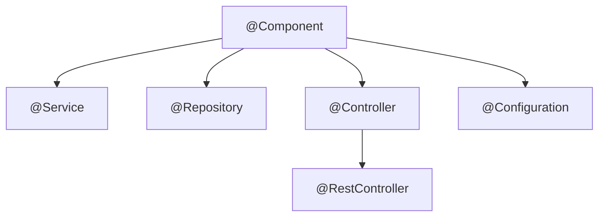

# Annotation quan trọng

Spring hiện đại gần như được "điều khiển" hoàn toàn bằng annotation. Bài này hệ thống lại các annotation lõi của Spring Core: nhóm stereotype đăng ký bean (`@Component`, `@Service`, `@Repository`, `@Controller`), nhóm cấu hình (`@Configuration`, `@Bean`, `@ComponentScan`, `@Import`), nhóm điều kiện (`@Conditional`, `@Profile`), và nhóm vòng đời (`@Lazy`, `@PostConstruct`, `@PreDestroy`, `@DependsOn`). Mục tiêu là biết mỗi annotation **thực sự làm gì** chứ không chỉ thuộc tên.

---

:::note[Ghi nhớ nhanh]

- ⭐ **`@Service`, `@Repository`, `@Controller` đều là `@Component`** — khác nhau ở ý nghĩa tầng; riêng `@Repository` có thêm dịch exception sang `DataAccessException`.
- ⭐ **`@Component` đánh lên class của bạn, `@Bean` đánh lên method** trong `@Configuration` — dùng `@Bean` cho class thư viện không sửa được.
- **`@Conditional` là nền tảng của auto-configuration** — bean chỉ được tạo khi điều kiện đúng (`@ConditionalOnProperty`, `@ConditionalOnMissingBean`...).
- **`@PostConstruct`/`@PreDestroy` nằm ở `jakarta.annotation`** (Boot 3), không còn `javax.annotation`.
- **`@Lazy`** trì hoãn tạo bean đến lần dùng đầu; dùng đúng chỗ giúp khởi động nhanh, dùng sai làm mất fail fast.

:::

---

## Mục lục

- [Vì sao Spring chuyển sang annotation?](#vì-sao-spring-chuyển-sang-annotation)
- [Nhóm stereotype](#nhóm-stereotype)
- [Nhóm cấu hình bean](#nhóm-cấu-hình-bean)
- [Nhóm điều kiện](#nhóm-điều-kiện)
- [Nhóm vòng đời và khởi tạo](#nhóm-vòng-đời-và-khởi-tạo)
- [Meta-annotation và annotation tự định nghĩa](#meta-annotation-và-annotation-tự-định-nghĩa)
- [Bảng tra nhanh](#bảng-tra-nhanh)

---

## Vì sao Spring chuyển sang annotation?

**Vấn đề:** Thời Spring 1.x/2.0, mọi bean khai báo trong XML tách rời code. Ứng dụng vài trăm bean → file XML hàng nghìn dòng, đổi tên class là phải đi sửa XML, gõ sai chỉ biết lúc chạy.

```xml
<bean id="orderService" class="com.shop.service.OrderService" init-method="init" destroy-method="cleanup">
    <constructor-arg ref="orderRepository"/>
    <property name="mailSender" ref="mailSender"/>
</bean>
<bean id="orderRepository" class="com.shop.repository.JdbcOrderRepository"/>
```

**Giải pháp:** Java 5 có annotation; Spring 2.5 cho phép đánh dấu ngay trên class, Spring 3.0 thêm Java config:

```java
@Service
public class OrderService {
    private final OrderRepository orderRepository;

    public OrderService(OrderRepository orderRepository) {
        this.orderRepository = orderRepository;
    }

    @PostConstruct
    void init() { /* thay init-method */ }

    @PreDestroy
    void cleanup() { /* thay destroy-method */ }
}
```

:::tip[Dùng thực tế]

- **Đọc code là biết vai trò class** — thấy `@Repository` là biết tầng dữ liệu.
- **Refactor an toàn** — đổi tên class, IDE đổi luôn mọi chỗ; không còn chuỗi tên class trong XML.
- **Tạo annotation riêng** gom nhiều annotation (ví dụ `@UseCase` = `@Service` + `@Transactional`).
- **Auto-configuration** của Spring Boot được xây hoàn toàn từ `@Configuration` + `@Conditional`.

:::

---

## Nhóm stereotype

**Stereotype** là các annotation đánh dấu "class này là bean, thuộc vai trò X". Component scan sẽ tìm và đăng ký chúng.



| Annotation | Tầng | Hành vi thêm |
|------------|------|--------------|
| `@Component` | Chung | — |
| `@Service` | Nghiệp vụ | Không có hành vi kỹ thuật thêm, chỉ ý nghĩa |
| `@Repository` | Dữ liệu | Dịch exception của JDBC/JPA sang `DataAccessException` (qua `PersistenceExceptionTranslationPostProcessor`) |
| `@Controller` | Web | Được `DispatcherServlet` nhận diện là handler; trả về tên view |
| `@RestController` | Web | = `@Controller` + `@ResponseBody`: trả về body JSON |
| `@Configuration` | Cấu hình | Chứa `@Bean`, được proxy CGLIB (full mode) |

```java
@Repository
public class JdbcProductRepository implements ProductRepository {
    private final JdbcClient jdbc;

    public JdbcProductRepository(JdbcClient jdbc) {
        this.jdbc = jdbc;
    }

    @Override
    public Optional<Product> findById(long id) {
        return jdbc.sql("SELECT id, name, price FROM product WHERE id = :id")
                .param("id", id)
                .query(Product.class)
                .optional();
    }
}
```

Tên bean mặc định = tên class viết thường chữ đầu (`JdbcProductRepository` → `jdbcProductRepository`); đổi bằng `@Component("ten")` hoặc `@Service("ten")`.

:::tip[Ví dụ đời thường]

Stereotype giống **đồng phục trong bệnh viện**: tất cả đều là nhân viên (`@Component`), nhưng áo blouse trắng là bác sĩ (`@Service`), áo xanh là kỹ thuật viên xét nghiệm (`@Repository` — có thêm việc "dịch" kết quả máy móc sang ngôn ngữ chung), áo lễ tân là người tiếp đón (`@Controller`). Nhìn áo là biết tìm ai.

:::

:::warning[Lỗi hay gặp]

- Dùng `@Component` cho mọi thứ — vẫn chạy, nhưng mất thông tin tầng và mất tính năng dịch exception của `@Repository`.
- Đánh `@Repository` lên interface kế thừa `JpaRepository` — không cần, Spring Data tự đăng ký.
- Đánh stereotype lên **interface** hoặc **abstract class** — Spring không tạo được instance, component scan bỏ qua.

:::

---

## Nhóm cấu hình bean

### @Configuration và @Bean

```java
@Configuration
public class JacksonConfig {

    @Bean
    public ObjectMapper objectMapper() {
        return JsonMapper.builder()
                .addModule(new JavaTimeModule())
                .disable(SerializationFeature.WRITE_DATES_AS_TIMESTAMPS)
                .build();
    }

    @Bean(name = "vnZone")
    public ZoneId vietnamZone() {
        return ZoneId.of("Asia/Ho_Chi_Minh");
    }
}
```

- Tên bean mặc định = tên method (`objectMapper`).
- Tham số của method `@Bean` được tiêm như constructor injection.
- `destroyMethod` mặc định là "suy luận": nếu object có method `close()` hoặc `shutdown()` public, Spring tự gọi khi đóng context.

### @ComponentScan

```java
@Configuration
@ComponentScan(
    basePackages = {"com.shop", "com.common.audit"},
    excludeFilters = @ComponentScan.Filter(type = FilterType.REGEX, pattern = ".*Legacy.*")
)
public class AppConfig { }
```

Trong Spring Boot, `@SpringBootApplication` đã kèm `@ComponentScan` cho package của class main. Chỉ thêm khi cần quét package nằm ngoài.

### @Import

Nạp thêm class cấu hình (hoặc class thường) mà không cần component scan:

```java
@Configuration
@Import({SecurityConfig.class, CacheConfig.class})
public class RootConfig { }
```

Các annotation `@EnableXxx` (`@EnableScheduling`, `@EnableCaching`, `@EnableAsync`) bên trong đều dùng `@Import` để đăng ký hạ tầng cần thiết.

### @Value, @Autowired, @Qualifier, @Primary

Đã trình bày ở bài Dependency Injection và Cấu hình: `@Value` đọc thuộc tính, `@Autowired` đánh dấu điểm inject, `@Qualifier` chọn bean đích danh, `@Primary` đánh dấu bean mặc định.

---

## Nhóm điều kiện

### @Profile

```java
@Bean
@Profile("dev")
public DataSource h2DataSource() {
    return new EmbeddedDatabaseBuilder().setType(EmbeddedDatabaseType.H2).build();
}
```

### @Conditional và các biến thể của Spring Boot

`@Conditional` (Spring Framework) nhận một class implement `Condition`:

```java
public class OnLinuxCondition implements Condition {
    @Override
    public boolean matches(ConditionContext ctx, AnnotatedTypeMetadata metadata) {
        String os = ctx.getEnvironment().getProperty("os.name", "");
        return os.toLowerCase().contains("linux");
    }
}

@Bean
@Conditional(OnLinuxCondition.class)
public FileWatcher inotifyWatcher() { return new InotifyWatcher(); }
```

Spring Boot cung cấp sẵn các điều kiện hay dùng (package `org.springframework.boot.autoconfigure.condition`):

| Annotation | Bean được tạo khi |
|------------|-------------------|
| `@ConditionalOnClass` | Class có trên classpath |
| `@ConditionalOnMissingClass` | Class không có trên classpath |
| `@ConditionalOnBean` | Đã có bean kiểu/tên đó |
| `@ConditionalOnMissingBean` | **Chưa** có bean kiểu đó — để người dùng ghi đè |
| `@ConditionalOnProperty` | Thuộc tính có giá trị khớp |
| `@ConditionalOnWebApplication` | Là ứng dụng web |
| `@ConditionalOnResource` | Có file resource |
| `@ConditionalOnExpression` | Biểu thức SpEL đúng |

```java
@Configuration
public class FeatureConfig {

    @Bean
    @ConditionalOnProperty(prefix = "app.feature", name = "new-checkout", havingValue = "true")
    public CheckoutFlow newCheckoutFlow() { return new NewCheckoutFlow(); }

    @Bean
    @ConditionalOnMissingBean(CheckoutFlow.class)
    public CheckoutFlow legacyCheckoutFlow() { return new LegacyCheckoutFlow(); }
}
```

:::warning[Lỗi hay gặp]

`@ConditionalOnBean`/`@ConditionalOnMissingBean` phụ thuộc **thứ tự** nạp bean definition. Dùng chúng trong class cấu hình của ứng dụng (thay vì auto-configuration) có thể cho kết quả khác mong đợi vì bean cần kiểm tra chưa được đăng ký. Tài liệu Spring Boot khuyến nghị chỉ dùng chúng trong auto-configuration.

:::

---

## Nhóm vòng đời và khởi tạo

### @PostConstruct và @PreDestroy

```java
import jakarta.annotation.PostConstruct;
import jakarta.annotation.PreDestroy;

@Component
public class ExchangeRateCache {
    private final ExchangeRateClient client;
    private volatile Map<String, BigDecimal> rates = Map.of();

    public ExchangeRateCache(ExchangeRateClient client) {
        this.client = client;
    }

    @PostConstruct          // chạy sau khi đã inject xong phụ thuộc
    void warmUp() {
        rates = Map.copyOf(client.fetchAll());
    }

    @PreDestroy             // chạy khi context đóng (chỉ với singleton)
    void shutdown() {
        rates = Map.of();
    }
}
```

### @Lazy

```java
@Service
@Lazy // chỉ tạo khi có ai đó cần lần đầu
public class HeavyReportEngine {
    public HeavyReportEngine() { /* nạp template, font... tốn vài giây */ }
}

@RestController
public class ReportController {
    private final HeavyReportEngine engine;

    // @Lazy tại điểm inject: nhận proxy, engine thật chỉ tạo khi gọi method đầu tiên
    public ReportController(@Lazy HeavyReportEngine engine) {
        this.engine = engine;
    }
}
```

Lưu ý: `@Lazy` trên class nhưng bean đó được một singleton không lazy inject trực tiếp → vẫn bị tạo ngay lúc khởi động. Cần `@Lazy` ở cả điểm inject.

### @DependsOn và @Order

```java
@Component
@DependsOn("flywayInitializer") // ép tạo sau bean flywayInitializer dù không inject trực tiếp
public class CacheWarmer { }

@Component
@Order(1) // thứ tự trong List được inject, hoặc thứ tự chạy CommandLineRunner
public class FirstValidator implements OrderValidator { }
```

### @Scope

Xem chi tiết ở bài Bean Scope: `@Scope("prototype")`, `@RequestScope`, `@SessionScope`.

:::tip[Ví dụ đời thường]

`@PostConstruct` như **nhân viên mới nhận bàn giao xong đồ nghề thì kiểm tra máy tính, đăng nhập hệ thống** trước khi nhận việc. `@PreDestroy` như **bàn giao, trả thẻ trước khi nghỉ việc**. `@Lazy` như **nhân viên thời vụ** — chỉ gọi đến khi có đơn hàng cần.

:::

---

## Meta-annotation và annotation tự định nghĩa

Annotation Spring có thể "chồng" lên nhau. Ví dụ `@RestController` chính là:

```java
@Target(ElementType.TYPE)
@Retention(RetentionPolicy.RUNTIME)
@Documented
@Controller
@ResponseBody
public @interface RestController { /* ... */ }
```

Bạn có thể tạo annotation riêng gom quy ước của team:

```java
@Target(ElementType.TYPE)
@Retention(RetentionPolicy.RUNTIME)
@Service
@Transactional(readOnly = true)
public @interface QueryService { }

@QueryService
public class ProductQueryService {
    // vừa là bean @Service, vừa mặc định transaction read-only
}
```

---

## Bảng tra nhanh

| Annotation | Đặt ở | Package | Mục đích |
|------------|-------|---------|----------|
| `@Component` | Class | `o.s.stereotype` | Đăng ký bean chung |
| `@Service` | Class | `o.s.stereotype` | Bean tầng nghiệp vụ |
| `@Repository` | Class | `o.s.stereotype` | Bean tầng dữ liệu + dịch exception |
| `@Controller` / `@RestController` | Class | `o.s.stereotype` / `o.s.web.bind.annotation` | Bean tầng web |
| `@Configuration` | Class | `o.s.context.annotation` | Class chứa `@Bean` |
| `@Bean` | Method | `o.s.context.annotation` | Khai báo bean từ method |
| `@ComponentScan` | Class | `o.s.context.annotation` | Chỉ định package quét |
| `@Import` | Class | `o.s.context.annotation` | Nạp class cấu hình khác |
| `@Profile` | Class/Method | `o.s.context.annotation` | Bean theo môi trường |
| `@Conditional` | Class/Method | `o.s.context.annotation` | Bean theo điều kiện |
| `@Lazy` | Class/Method/Tham số | `o.s.context.annotation` | Khởi tạo lười |
| `@Scope` | Class/Method | `o.s.context.annotation` | Phạm vi bean |
| `@DependsOn` | Class/Method | `o.s.context.annotation` | Ép thứ tự khởi tạo |
| `@Primary` | Class/Method | `o.s.context.annotation` | Bean mặc định |
| `@Qualifier` | Tham số/Field/Class | `o.s.beans.factory.annotation` | Chọn bean đích danh |
| `@Autowired` | Constructor/Setter/Field | `o.s.beans.factory.annotation` | Điểm inject |
| `@Value` | Tham số/Field | `o.s.beans.factory.annotation` | Inject thuộc tính |
| `@PostConstruct` / `@PreDestroy` | Method | `jakarta.annotation` | Callback vòng đời |

(`o.s` = `org.springframework`)
