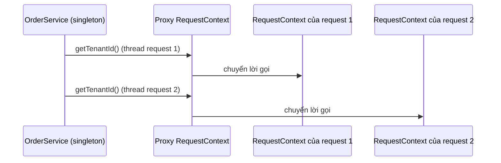
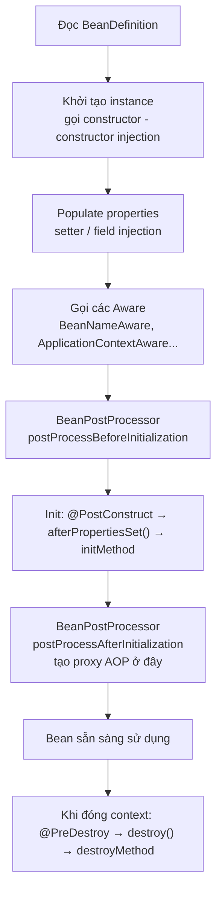

# Bean Scope và vòng đời Bean

**Scope** (phạm vi) quyết định một bean có bao nhiêu instance và sống bao lâu: một cho cả ứng dụng, một cho mỗi lần xin, một cho mỗi HTTP request hay mỗi session người dùng. **Vòng đời** (lifecycle) là chuỗi các bước container thực hiện từ lúc tạo bean đến lúc huỷ. Hiểu hai thứ này giúp tránh các lỗi khó chịu như dữ liệu người dùng này "rò" sang người dùng khác hay bean prototype "hoá" singleton.

---

:::note[Ghi nhớ nhanh]

- ⭐ **Singleton là mặc định và được chia sẻ giữa mọi thread** — không lưu trạng thái theo người dùng/request trong field của singleton.
- ⭐ **Inject prototype vào singleton chỉ xảy ra một lần** — muốn instance mới mỗi lần, dùng `ObjectProvider`, `@Lookup` hoặc scoped proxy.
- **Scope web**: `request`, `session`, `application`, `websocket` — chỉ có trong `ApplicationContext` web.
- **Vòng đời**: khởi tạo → inject → Aware → `BeanPostProcessor` before → init (`@PostConstruct`) → `BeanPostProcessor` after (proxy) → dùng → destroy (`@PreDestroy`).
- **Spring không gọi destroy cho prototype** — bạn tự giải phóng tài nguyên.

:::

---

## Mục lục

- [Vì sao cần nhiều scope?](#vì-sao-cần-nhiều-scope)
- [Các scope trong Spring](#các-scope-trong-spring)
- [Singleton và vấn đề thread-safe](#singleton-và-vấn-đề-thread-safe)
- [Inject prototype vào singleton](#inject-prototype-vào-singleton)
- [Scope web và scoped proxy](#scope-web-và-scoped-proxy)
- [Vòng đời bean](#vòng-đời-bean)

---

## Vì sao cần nhiều scope?

**Vấn đề:** Không phải object nào cũng nên dùng chung. Một giỏ hàng nếu là singleton thì mọi khách hàng dùng chung một giỏ:

```java
@Component // singleton mặc định — SAI cho dữ liệu theo người dùng
public class ShoppingCart {
    private final List<CartItem> items = new ArrayList<>();

    public void add(CartItem item) {
        items.add(item); // khách A và khách B cùng thêm vào một danh sách!
    }
}
```

Ngược lại, nếu mọi bean đều tạo mới mỗi lần dùng thì lãng phí bộ nhớ, mất kết nối pool...

**Giải pháp:** Spring cho chọn scope phù hợp từng loại bean:

```java
@Component
@SessionScope // mỗi phiên người dùng một giỏ hàng
public class ShoppingCart {
    private final List<CartItem> items = new ArrayList<>();

    public void add(CartItem item) {
        items.add(item);
    }

    public List<CartItem> items() {
        return List.copyOf(items);
    }
}
```

:::tip[Dùng thực tế]

- **Singleton**: service, repository, controller, client HTTP — không giữ trạng thái theo người dùng.
- **Prototype**: object có trạng thái, dùng một lần: builder báo cáo, parser có buffer riêng.
- **Request**: thông tin gắn theo request — request ID, tenant hiện tại.
- **Session**: dữ liệu theo phiên đăng nhập trong ứng dụng web render server (giỏ hàng, wizard nhiều bước).

:::

---

## Các scope trong Spring

| Scope | Số instance | Sống bao lâu | Có trong |
|-------|-------------|--------------|----------|
| `singleton` (mặc định) | 1 cho mỗi container | Từ khởi động đến khi đóng context | Mọi context |
| `prototype` | Mới mỗi lần được yêu cầu | Container không quản lý sau khi giao | Mọi context |
| `request` | 1 cho mỗi HTTP request | Hết request | Web |
| `session` | 1 cho mỗi HTTP session | Hết session | Web |
| `application` | 1 cho mỗi `ServletContext` | Suốt ứng dụng web | Web |
| `websocket` | 1 cho mỗi phiên WebSocket | Hết phiên WebSocket | Web + WebSocket |

```java
@Component
@Scope("prototype")                 // hoặc ConfigurableBeanFactory.SCOPE_PROTOTYPE
public class InvoiceBuilder { }

@Component
@RequestScope                       // = @Scope(value = "request", proxyMode = TARGET_CLASS)
public class RequestContext { }

@Component
@SessionScope
public class UserPreferences { }

@Component
@ApplicationScope
public class VisitorCounter { }
```

:::tip[Ví dụ đời thường]

Hình dung một **quán cà phê**:

- **Singleton** — cái **máy pha espresso**: cả quán dùng chung một cái.
- **Prototype** — **cái cốc giấy**: mỗi lần order lấy một cái mới, đưa cho khách rồi quán không quản nữa (không thu hồi = không gọi destroy).
- **Request** — **tờ phiếu order**: viết cho một lần gọi món, xong là bỏ.
- **Session** — **thẻ tích điểm** của khách trong một lần ngồi quán: đi đâu trong quán cũng mang theo, về là hết.
- **Application** — **bảng thực đơn treo tường**: một tấm cho cả quán.

:::

---

## Singleton và vấn đề thread-safe

Singleton của Spring khác pattern Singleton của GoF: Spring đảm bảo **một instance mỗi container**, không phải mỗi JVM. Và singleton được **nhiều thread request dùng đồng thời**.

```java
@Service
public class DiscountService {
    private BigDecimal lastDiscount; // ❌ trạng thái dùng chung giữa các request

    public BigDecimal calculate(Order order) {
        lastDiscount = order.total().multiply(new BigDecimal("0.1"));
        // thread khác có thể ghi đè lastDiscount ở đây
        return lastDiscount;
    }
}
```

```java
@Service
public class DiscountService {
    private final DiscountPolicy policy; // ✅ chỉ giữ phụ thuộc bất biến

    public DiscountService(DiscountPolicy policy) {
        this.policy = policy;
    }

    public BigDecimal calculate(Order order) {
        BigDecimal discount = policy.rateFor(order).multiply(order.total()); // biến cục bộ
        return discount;
    }
}
```

Nguyên tắc: singleton nên **stateless** (không trạng thái), hoặc chỉ giữ trạng thái **bất biến** / **thread-safe** (`ConcurrentHashMap`, `AtomicLong`).

:::warning[Lỗi hay gặp]

- Lưu "user hiện tại" vào field của service singleton → người dùng A thấy dữ liệu người dùng B dưới tải cao. Lỗi này hầu như không lộ khi test một mình.
- Dùng `SimpleDateFormat` (không thread-safe) làm field của singleton — dùng `DateTimeFormatter` (bất biến) thay thế.

:::

---

## Inject prototype vào singleton

Vấn đề kinh điển: singleton chỉ được tạo **một lần**, nên phụ thuộc của nó cũng chỉ được inject **một lần** — kể cả khi phụ thuộc đó là prototype.

```java
@Component
@Scope("prototype")
public class InvoiceBuilder {
    private final List<String> lines = new ArrayList<>();
    public InvoiceBuilder addLine(String l) { lines.add(l); return this; }
    public String build() { return String.join("\n", lines); }
}

@Service
public class InvoiceService {
    private final InvoiceBuilder builder; // ❌ chỉ một instance, dùng mãi mãi

    public InvoiceService(InvoiceBuilder builder) {
        this.builder = builder;
    }

    public String create(Order order) {
        return builder.addLine(order.code()).build(); // dòng hoá đơn cũ dồn lại mãi
    }
}
```

**Cách 1 — `ObjectProvider` (khuyến nghị):**

```java
@Service
public class InvoiceService {
    private final ObjectProvider<InvoiceBuilder> builderProvider;

    public InvoiceService(ObjectProvider<InvoiceBuilder> builderProvider) {
        this.builderProvider = builderProvider;
    }

    public String create(Order order) {
        InvoiceBuilder builder = builderProvider.getObject(); // instance mới mỗi lần
        return builder.addLine(order.code()).build();
    }
}
```

**Cách 2 — `@Lookup` method injection:** Spring dùng CGLIB ghi đè method trả về bean mới.

```java
@Service
public abstract class InvoiceService {
    @Lookup
    protected abstract InvoiceBuilder newBuilder();

    public String create(Order order) {
        return newBuilder().addLine(order.code()).build();
    }
}
```

**Cách 3 — scoped proxy:** `@Scope(value = "prototype", proxyMode = ScopedProxyMode.TARGET_CLASS)`. Mỗi **lời gọi method** trên proxy sẽ tạo một instance mới — dễ gây bất ngờ (`addLine()` và `build()` chạy trên hai object khác nhau), nên ít dùng với prototype.

**Cách 4 — `jakarta.inject.Provider`** (chuẩn JSR-330), tương tự `ObjectProvider`.

| Cách | Ưu | Nhược |
|------|----|-------|
| `ObjectProvider` | Rõ ràng, có `getIfAvailable` | Phụ thuộc API Spring |
| `@Lookup` | Code gọn | Class không `final`, khó hiểu với người mới |
| Scoped proxy | Trong suốt | Mỗi lời gọi một instance — hành vi khó lường với prototype |
| `Provider` (JSR-330) | Chuẩn Java | Thêm dependency |

---

## Scope web và scoped proxy

Bean `request`/`session` sống ngắn hơn singleton controller/service dùng nó. Làm sao inject vào singleton được? Spring tiêm một **scoped proxy**: proxy là singleton, mỗi lời gọi method nó tìm instance thật ứng với request/session **hiện tại**.

```java
@Component
@RequestScope
public class RequestContext {
    private String requestId;
    private String tenantId;
    // getter/setter
}

@Component
public class RequestContextFilter extends OncePerRequestFilter {
    private final RequestContext ctx; // thực chất là proxy

    public RequestContextFilter(RequestContext ctx) {
        this.ctx = ctx;
    }

    @Override
    protected void doFilterInternal(HttpServletRequest req, HttpServletResponse res, FilterChain chain)
            throws ServletException, IOException {
        ctx.setRequestId(UUID.randomUUID().toString());
        ctx.setTenantId(req.getHeader("X-Tenant-Id"));
        chain.doFilter(req, res);
    }
}

@Service
public class OrderService {
    private final RequestContext ctx; // proxy — mỗi request thấy instance của riêng nó

    public OrderService(RequestContext ctx) {
        this.ctx = ctx;
    }

    public void place(Order order) {
        String tenant = ctx.getTenantId();
        // ...
    }
}
```



:::warning[Lỗi hay gặp]

- Dùng bean `request` scope **ngoài** luồng request (trong `@Async`, `@Scheduled`, thread pool tự tạo) → lỗi `No thread-bound request found` / `ScopeNotActiveException`.
- Lưu nhiều dữ liệu vào `session` scope trong ứng dụng chạy nhiều instance → session không chia sẻ giữa các node; cần sticky session hoặc Spring Session (Redis). Với REST API stateless dùng JWT, hạn chế dùng session scope.

:::

---

## Vòng đời bean



Ba cách khai báo callback khởi tạo / huỷ:

```java
// Cách 1: annotation (khuyến nghị)
@Component
public class ConnectionManager {
    @PostConstruct
    void open() { /* mở kết nối */ }

    @PreDestroy
    void close() { /* đóng kết nối */ }
}

// Cách 2: interface của Spring (dính API Spring, ít dùng trong code ứng dụng)
@Component
public class LegacyCache implements InitializingBean, DisposableBean {
    @Override
    public void afterPropertiesSet() { /* init */ }

    @Override
    public void destroy() { /* cleanup */ }
}

// Cách 3: chỉ định trong @Bean (cho class thư viện)
@Configuration
public class ClientConfig {
    @Bean(initMethod = "start", destroyMethod = "stop")
    public MqttClientWrapper mqttClient() {
        return new MqttClientWrapper("tcp://broker:1883");
    }
}
```

Thứ tự khi dùng nhiều cách cho cùng bean: `@PostConstruct` → `afterPropertiesSet()` → `initMethod`; huỷ: `@PreDestroy` → `destroy()` → `destroyMethod`.

Các interface `Aware` cho phép bean nhận đối tượng hạ tầng (ít dùng, thường thay bằng inject trực tiếp):

```java
@Component
public class BeanNamePrinter implements BeanNameAware {
    @Override
    public void setBeanName(String name) {
        // nhận tên bean của chính mình
    }
}
```

:::tip[Ví dụ đời thường]

Vòng đời bean như **nhân viên mới vào công ty**: ký hợp đồng (constructor) → nhận laptop, thẻ từ (inject) → được giới thiệu tên với cả phòng (Aware) → HR kiểm tra hồ sơ (BeanPostProcessor before) → tự cài đặt môi trường làm việc (`@PostConstruct`) → được giao trợ lý đi kèm xử lý giấy tờ (proxy) → làm việc → bàn giao trước khi nghỉ (`@PreDestroy`). Nhân viên thời vụ (prototype) thì công ty không làm thủ tục nghỉ việc.

:::

:::warning[Lỗi hay gặp]

- Gọi method `@Transactional` của chính bean trong `@PostConstruct` — lúc này proxy chưa được tạo (proxy tạo ở bước after-initialization) và gọi `this.method()` cũng bỏ qua proxy, nên transaction **không** có hiệu lực. Dùng `ApplicationReadyEvent` thay thế.
- Mong `@PreDestroy` chạy cho bean prototype — Spring không theo dõi prototype sau khi tạo.
- Ứng dụng bị `kill -9` thì không callback huỷ nào chạy; chỉ tắt bình thường (SIGTERM) mới có.

:::
