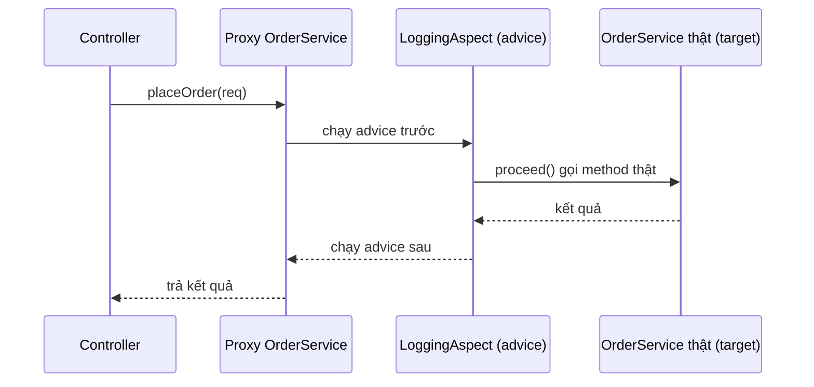
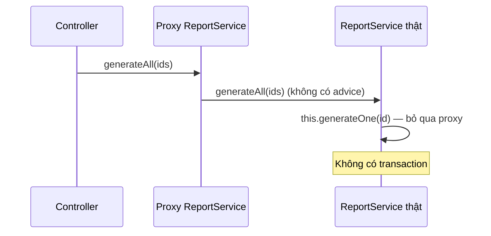

# Spring AOP

AOP (Aspect-Oriented Programming — lập trình hướng khía cạnh) giúp tách các mối quan tâm "cắt ngang" như logging, đo thời gian, transaction, bảo mật, cache ra khỏi code nghiệp vụ. Spring dùng AOP ở khắp nơi: `@Transactional`, `@Cacheable`, `@Async`, `@PreAuthorize` đều chạy nhờ proxy AOP. Bài này giải thích các khái niệm (aspect, advice, pointcut, join point), cách Spring tạo proxy (JDK vs CGLIB), bẫy self-invocation nổi tiếng và ví dụ viết aspect logging/đo thời gian.

---

:::note[Ghi nhớ nhanh]

- ⭐ **Spring AOP dựa trên proxy** — chỉ chặn được lời gọi method **public đi qua proxy** từ bean khác; không chặn được field, constructor, method `private`.
- ⭐ **Self-invocation**: gọi `this.method()` trong cùng class **bỏ qua proxy** → `@Transactional`, `@Async`, `@Cacheable` trên method đó không có tác dụng.
- **Aspect** = module cắt ngang; **Advice** = đoạn code chạy thêm (Before, After, Around...); **Pointcut** = biểu thức chọn method; **Join point** = điểm thực thi (trong Spring AOP luôn là lời gọi method).
- **JDK proxy** chỉ dùng được khi bean có interface; **CGLIB** tạo subclass — Spring Boot mặc định CGLIB (`spring.aop.proxy-target-class=true`).
- **`@Around` mạnh nhất** — bắt buộc gọi `proceed()`, nếu quên thì method thật không chạy.

:::

---

## Mục lục

- [Vì sao cần AOP?](#vì-sao-cần-aop)
- [Các khái niệm cốt lõi](#các-khái-niệm-cốt-lõi)
- [Các loại advice](#các-loại-advice)
- [Biểu thức pointcut](#biểu-thức-pointcut)
- [Proxy JDK và CGLIB](#proxy-jdk-và-cglib)
- [Bẫy self-invocation](#bẫy-self-invocation)
- [Ví dụ thực tế: logging và đo thời gian](#ví-dụ-thực-tế-logging-và-đo-thời-gian)

---

## Vì sao cần AOP?

**Vấn đề:** Logic phụ (log, đo thời gian, kiểm tra quyền, transaction) lặp lại ở mọi method, chen lẫn vào logic chính:

```java
@Service
public class OrderService {
    private static final Logger log = LoggerFactory.getLogger(OrderService.class);

    public Order placeOrder(CreateOrderRequest req) {
        long start = System.nanoTime();
        log.info("placeOrder bắt đầu: {}", req);
        try {
            checkPermission("ORDER_CREATE");
            // ===== logic nghiệp vụ thật chỉ có 3 dòng =====
            Order order = new Order(req.productId(), req.quantity());
            return orderRepository.save(order);
        } catch (Exception e) {
            log.error("placeOrder lỗi", e);
            throw e;
        } finally {
            log.info("placeOrder mất {} ms", (System.nanoTime() - start) / 1_000_000);
        }
    }
    // cancelOrder, updateOrder... lặp y hệt khối try/finally trên
}
```

Đây là **code lặp** (scattering) và **code rối** (tangling): sửa định dạng log phải sửa hàng trăm method.

**Giải pháp:** Viết logic cắt ngang **một lần** trong một aspect, khai báo áp dụng cho những method nào:

```java
@Service
public class OrderService {
    @Timed            // annotation tự định nghĩa — aspect lo phần đo thời gian
    @PreAuthorize("hasAuthority('ORDER_CREATE')")
    @Transactional
    public Order placeOrder(CreateOrderRequest req) {
        Order order = new Order(req.productId(), req.quantity());
        return orderRepository.save(order);
    }
}
```

:::tip[Dùng thực tế]

- **Transaction** — `@Transactional` mở/commit/rollback transaction quanh method.
- **Bảo mật** — `@PreAuthorize` kiểm tra quyền trước khi gọi method.
- **Cache** — `@Cacheable` trả kết quả từ cache, bỏ qua method nếu đã có.
- **Audit log, đo thời gian, retry, rate limit** — viết aspect riêng áp cho cả tầng service.

:::

---

## Các khái niệm cốt lõi

| Thuật ngữ | Nghĩa | Ví dụ |
|-----------|-------|-------|
| **Aspect** | Module chứa logic cắt ngang | Class `@Aspect` `LoggingAspect` |
| **Join point** | Một điểm trong lúc chạy chương trình có thể chèn logic; trong Spring AOP luôn là **lời gọi method** | Lời gọi `OrderService.placeOrder(...)` |
| **Advice** | Đoạn code chạy tại join point, kèm thời điểm (trước, sau, bao quanh) | Method `@Around` đo thời gian |
| **Pointcut** | Biểu thức chọn tập join point áp dụng advice | `execution(* com.shop.service..*(..))` |
| **Target** | Object gốc bị "bọc" | Instance `OrderService` thật |
| **Proxy** | Object bọc ngoài target, chạy advice rồi gọi target | Subclass CGLIB của `OrderService` |
| **Weaving** | Quá trình gắn aspect vào target | Spring: lúc runtime bằng proxy; AspectJ: lúc compile/load |



:::tip[Ví dụ đời thường]

AOP như **bảo vệ toà nhà**. Mỗi phòng ban (service) chỉ lo việc chuyên môn. Mọi người vào toà nhà (gọi method) đều phải **đi qua cổng bảo vệ** (proxy): ghi sổ ra vào (logging), kiểm tra thẻ (security), bấm giờ (timing). Các phòng ban không phải tự cử người ngồi ghi sổ. Nhưng nếu hai người **trong cùng một phòng** nói chuyện với nhau (self-invocation) thì không đi qua cổng — bảo vệ không ghi được.

:::

Bật AOP: với Spring Boot chỉ cần starter (Boot 3 dùng `spring-boot-starter-aop`; từ Boot 4 starter này được đổi tên thành `spring-boot-starter-aspectj`):

```xml
<dependency>
    <groupId>org.springframework.boot</groupId>
    <artifactId>spring-boot-starter-aop</artifactId>
</dependency>
```

Auto-configuration đã bật sẵn `@EnableAspectJAutoProxy`. Spring AOP dùng **cú pháp annotation của AspectJ** (`@Aspect`, `@Around`) nhưng **không** dùng trình biên dịch AspectJ — vẫn là proxy runtime.

---

## Các loại advice

| Advice | Chạy khi | Dùng cho |
|--------|----------|----------|
| `@Before` | Trước method | Kiểm tra quyền, validate, log đầu vào |
| `@AfterReturning` | Sau khi method trả về **thành công** | Log kết quả, audit |
| `@AfterThrowing` | Khi method **ném exception** | Log lỗi, gửi cảnh báo, dịch exception |
| `@After` | Sau method, dù thành công hay lỗi (như `finally`) | Dọn dẹp tài nguyên |
| `@Around` | **Bao quanh** — tự quyết định có gọi method hay không | Đo thời gian, transaction, cache, retry |

```java
@Aspect
@Component
public class AuditAspect {
    private static final Logger log = LoggerFactory.getLogger(AuditAspect.class);

    @Before("execution(* com.shop.order.OrderService.*(..))")
    public void before(JoinPoint jp) {
        log.info("Gọi {} với tham số {}", jp.getSignature().toShortString(), Arrays.toString(jp.getArgs()));
    }

    @AfterReturning(pointcut = "execution(* com.shop.order.OrderService.place*(..))", returning = "result")
    public void afterReturning(JoinPoint jp, Object result) {
        log.info("{} trả về {}", jp.getSignature().getName(), result);
    }

    @AfterThrowing(pointcut = "execution(* com.shop..*Service.*(..))", throwing = "ex")
    public void afterThrowing(JoinPoint jp, Exception ex) {
        log.error("{} ném lỗi: {}", jp.getSignature().toShortString(), ex.getMessage());
    }
}
```

Thứ tự khi nhiều aspect cùng áp vào một method: đánh `@Order` lên class aspect — số nhỏ hơn chạy **bọc ngoài** (vào trước, ra sau).

---

## Biểu thức pointcut

Cú pháp `execution` phổ biến nhất:

```text
execution( modifiers?  return-type  declaring-type?  method-name(params)  throws? )

execution(public * com.shop.service.*.*(..))
          │      │ │                │ │ └─ (..) mọi tham số
          │      │ │                │ └─── * mọi tên method
          │      │ │                └───── * mọi class trong package service
          │      │ └────────────────────── package
          │      └──────────────────────── * mọi kiểu trả về
          └─────────────────────────────── chỉ method public
```

| Biểu thức | Chọn |
|-----------|------|
| `execution(* com.shop.service..*(..))` | Mọi method trong package `service` và package con |
| `execution(* *..*Service.find*(..))` | Method bắt đầu bằng `find` trong class tên kết thúc `Service` |
| `within(com.shop.order..*)` | Mọi method của class trong package `order` |
| `@annotation(com.shop.aop.Timed)` | Method có annotation `@Timed` |
| `@within(org.springframework.stereotype.Service)` | Mọi method của class đánh `@Service` |
| `bean(*Service)` | Bean có tên kết thúc `Service` (riêng Spring AOP) |
| `args(Long, ..)` | Method có tham số đầu kiểu `Long` |

Tái sử dụng pointcut bằng `@Pointcut`:

```java
@Aspect
@Component
public class Pointcuts {
    @Pointcut("within(com.shop..*) && @within(org.springframework.stereotype.Service)")
    public void serviceLayer() { }

    @Pointcut("@annotation(com.shop.aop.Timed)")
    public void timedMethod() { }
}

// Dùng ở aspect khác: @Around("com.shop.aop.Pointcuts.serviceLayer()")
```

:::warning[Lỗi hay gặp]

Pointcut quá rộng như `execution(* *(..))` sẽ cố bọc proxy cho **mọi bean**, kể cả bean hạ tầng của Spring hoặc class `final` → lỗi khởi động hoặc chậm. Luôn giới hạn theo package của bạn (`within(com.shop..*)`).

:::

---

## Proxy JDK và CGLIB

Spring tạo proxy theo hai cách:

| Tiêu chí | JDK Dynamic Proxy | CGLIB |
|----------|-------------------|-------|
| Cơ chế | Tạo class implement **cùng interface** | Tạo **subclass** của class target |
| Yêu cầu | Bean phải implement interface | Class và method không được `final` |
| Inject theo | Chỉ inject được bằng **kiểu interface** | Inject được bằng kiểu class |
| Mặc định | Spring Framework (khi có interface) | **Spring Boot** (`spring.aop.proxy-target-class=true`) |

```java
public interface PaymentService { void pay(long amount); }

@Service
public class PaymentServiceImpl implements PaymentService {
    @Transactional
    public void pay(long amount) { /* ... */ }
}

// Nếu dùng JDK proxy: proxy chỉ là PaymentService, KHÔNG phải PaymentServiceImpl
// → inject bằng kiểu PaymentServiceImpl sẽ lỗi BeanNotOfRequiredTypeException.
// Spring Boot mặc định CGLIB nên cả hai cách inject đều chạy.
```

Kiểm tra một bean có phải proxy không:

```java
boolean isProxy = AopUtils.isAopProxy(bean);
boolean isCglib = AopUtils.isCglibProxy(bean);
Class<?> realClass = AopUtils.getTargetClass(bean);
```

:::warning[Lỗi hay gặp]

- Class hoặc method **`final`** (mặc định trong Kotlin) → CGLIB không ghi đè được, advice không chạy. Kotlin dùng plugin `kotlin-spring` (all-open).
- Method **`private`** hoặc **`static`** không thể bị proxy chặn. Với CGLIB, method `protected`/package-private về lý thuyết bị chặn được nhưng nên chỉ đặt `@Transactional` trên method `public` cho rõ ràng.

:::

---

## Bẫy self-invocation

Đây là lỗi AOP phổ biến nhất và là câu hỏi phỏng vấn kinh điển.

```java
@Service
public class ReportService {

    public void generateAll(List<Long> ids) {
        for (Long id : ids) {
            generateOne(id); // = this.generateOne(id) → gọi thẳng target, KHÔNG qua proxy
        }
    }

    @Transactional(propagation = Propagation.REQUIRES_NEW)
    public void generateOne(Long id) {
        // Mong mỗi báo cáo một transaction riêng — nhưng KHÔNG có transaction nào được mở!
    }
}
```



**Cách sửa:**

1. **Tách method sang bean khác** (khuyến nghị — thiết kế rõ ràng nhất):

```java
@Service
public class ReportService {
    private final SingleReportGenerator generator;

    public ReportService(SingleReportGenerator generator) {
        this.generator = generator;
    }

    public void generateAll(List<Long> ids) {
        ids.forEach(generator::generate); // gọi qua proxy của bean khác
    }
}

@Service
public class SingleReportGenerator {
    @Transactional(propagation = Propagation.REQUIRES_NEW)
    public void generate(Long id) { /* mỗi lần một transaction */ }
}
```

2. **Tự inject chính mình** qua `@Lazy` hoặc `ObjectProvider` (chạy được nhưng khó hiểu):

```java
@Service
public class ReportService {
    private final ObjectProvider<ReportService> self;

    public ReportService(ObjectProvider<ReportService> self) {
        this.self = self;
    }

    public void generateAll(List<Long> ids) {
        ids.forEach(id -> self.getObject().generateOne(id)); // đi qua proxy
    }

    @Transactional(propagation = Propagation.REQUIRES_NEW)
    public void generateOne(Long id) { /* ... */ }
}
```

3. **Dùng `TransactionTemplate`** — quản lý transaction bằng code, không phụ thuộc proxy.
4. **Chuyển sang AspectJ weaving** (compile-time / load-time) — không dùng proxy nên không có bẫy này, nhưng cấu hình phức tạp.

---

## Ví dụ thực tế: logging và đo thời gian

### Annotation đánh dấu

```java
@Target(ElementType.METHOD)
@Retention(RetentionPolicy.RUNTIME)
public @interface Timed {
    long warnThresholdMs() default 500;
}
```

### Aspect đo thời gian

```java
@Aspect
@Component
public class TimingAspect {
    private static final Logger log = LoggerFactory.getLogger(TimingAspect.class);

    @Around("@annotation(timed)") // bind annotation vào tham số để đọc thuộc tính
    public Object measure(ProceedingJoinPoint pjp, Timed timed) throws Throwable {
        long start = System.nanoTime();
        try {
            return pjp.proceed(); // BẮT BUỘC gọi, nếu không method thật không chạy
        } finally {
            long ms = (System.nanoTime() - start) / 1_000_000;
            String method = pjp.getSignature().toShortString();
            if (ms > timed.warnThresholdMs()) {
                log.warn("CHẬM {} mất {} ms", method, ms);
            } else {
                log.debug("{} mất {} ms", method, ms);
            }
        }
    }
}
```

### Aspect logging cho toàn tầng controller

```java
@Aspect
@Component
@Order(1)
public class ControllerLoggingAspect {
    private static final Logger log = LoggerFactory.getLogger(ControllerLoggingAspect.class);

    @Around("within(com.shop..*) && @within(org.springframework.web.bind.annotation.RestController)")
    public Object logRequest(ProceedingJoinPoint pjp) throws Throwable {
        String method = pjp.getSignature().toShortString();
        log.info("--> {}", method);
        try {
            Object result = pjp.proceed();
            log.info("<-- {} OK", method);
            return result;
        } catch (Exception ex) {
            log.warn("<-- {} lỗi: {}", method, ex.getMessage());
            throw ex; // không nuốt exception
        }
    }
}
```

### Sử dụng

```java
@Service
public class ProductService {
    @Timed(warnThresholdMs = 200)
    public List<ProductResponse> search(String keyword) {
        // ...
    }
}
```

:::warning[Lỗi hay gặp]

- **Quên `return pjp.proceed()`** trong `@Around` → method thật không chạy hoặc luôn trả `null`.
- **Nuốt exception** trong advice → caller tưởng thành công, transaction không rollback.
- **Log cả tham số chứa dữ liệu nhạy cảm** (mật khẩu, số thẻ) khi log toàn bộ `getArgs()`.
- Với metrics production, cân nhắc dùng sẵn Micrometer `@Timed`/`@Observed` (cần cấu hình aspect tương ứng) thay vì tự viết.

:::
