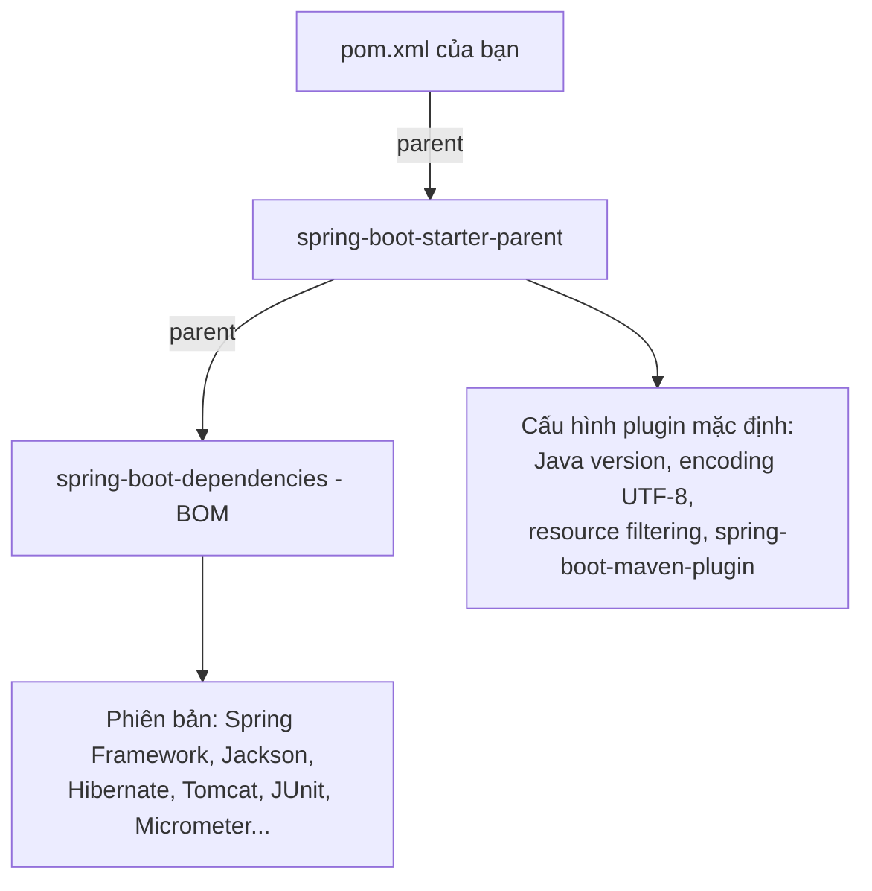

# Spring Boot Starters

Starter là cách Spring Boot giải quyết "địa ngục dependency": thay vì tự chọn hàng chục thư viện và đoán phiên bản nào hợp nhau, bạn thêm một starter như `spring-boot-starter-web` là có đủ bộ đã được kiểm thử. Bài này giới thiệu cách tạo dự án bằng Spring Initializr, các starter phổ biến, cơ chế BOM (Bill of Materials) quản lý phiên bản, và cách loại trừ hay ghi đè phiên bản khi cần.

---

:::note[Ghi nhớ nhanh]

- ⭐ **Starter = dependency gom nhóm, gần như không có code** — chỉ kéo theo các thư viện cần thiết; phần "tự cấu hình" là việc của auto-configuration.
- ⭐ **Không ghi `version` cho dependency được Boot quản lý** — phiên bản lấy từ BOM `spring-boot-dependencies`, đảm bảo tương thích.
- **Tạo dự án nhanh tại [start.spring.io](https://start.spring.io)** hoặc qua IntelliJ/VS Code.
- **Đổi phiên bản một thư viện** bằng thuộc tính (Maven: `<jackson-bom.version>` trong `properties`) thay vì ghi version lẻ.
- **Loại trừ** thư viện không muốn bằng `exclusions` (ví dụ bỏ Tomcat để dùng Jetty).

:::

---

## Mục lục

- [Vì sao Starter ra đời?](#vì-sao-starter-ra-đời)
- [Tạo dự án với Spring Initializr](#tạo-dự-án-với-spring-initializr)
- [Các starter phổ biến](#các-starter-phổ-biến)
- [BOM và quản lý phiên bản](#bom-và-quản-lý-phiên-bản)
- [Bên trong một starter](#bên-trong-một-starter)
- [Loại trừ và ghi đè dependency](#loại-trừ-và-ghi-đè-dependency)
- [Câu hỏi phỏng vấn](#câu-hỏi-phỏng-vấn)

---

## Vì sao Starter ra đời?

**Vấn đề:** Trước Spring Boot, dựng một web app Spring MVC + JSON + validation + JPA phải tự liệt kê từng thư viện **và tự chọn phiên bản**:

```xml
<dependencies>
    <dependency>
        <groupId>org.springframework</groupId>
        <artifactId>spring-webmvc</artifactId>
        <version>5.3.20</version>
    </dependency>
    <dependency>
        <groupId>com.fasterxml.jackson.core</groupId>
        <artifactId>jackson-databind</artifactId>
        <version>2.13.3</version> <!-- có hợp với spring 5.3.20 không? -->
    </dependency>
    <dependency>
        <groupId>org.hibernate.validator</groupId>
        <artifactId>hibernate-validator</artifactId>
        <version>6.2.3.Final</version>
    </dependency>
    <dependency>
        <groupId>org.hibernate</groupId>
        <artifactId>hibernate-core</artifactId>
        <version>5.6.9.Final</version>
    </dependency>
    <!-- ... thêm 10 dependency nữa, lệch phiên bản là NoSuchMethodError lúc chạy -->
</dependencies>
```

Lệch phiên bản giữa các thư viện thường không lỗi lúc compile mà nổ lúc runtime: `NoSuchMethodError`, `ClassNotFoundException`.

**Giải pháp:** Spring Boot đưa ra **starter** + **BOM**:

```xml
<parent>
    <groupId>org.springframework.boot</groupId>
    <artifactId>spring-boot-starter-parent</artifactId>
    <version>3.5.6</version>
</parent>

<dependencies>
    <dependency>
        <groupId>org.springframework.boot</groupId>
        <artifactId>spring-boot-starter-web</artifactId>
    </dependency>
    <dependency>
        <groupId>org.springframework.boot</groupId>
        <artifactId>spring-boot-starter-data-jpa</artifactId>
    </dependency>
    <dependency>
        <groupId>org.springframework.boot</groupId>
        <artifactId>spring-boot-starter-validation</artifactId>
    </dependency>
</dependencies>
```

Không có dòng `version` nào cho dependency — tất cả lấy từ BOM theo phiên bản Spring Boot.

:::tip[Dùng thực tế]

- **Khởi tạo dự án mới trong 1 phút** với Initializr, chọn starter cần dùng.
- **Nâng cấp cả bộ** chỉ bằng đổi một số phiên bản `spring-boot-starter-parent`.
- **Chuẩn hoá trong công ty** — tự viết starter nội bộ (`acme-starter-logging`) để mọi service dùng chung cấu hình.
- **Đổi server, đổi thư viện JSON** bằng `exclusions` + thêm starter khác.

:::

:::tip[Ví dụ đời thường]

Không có starter giống **tự đi chợ nấu lẩu Thái**: mua từng thứ — sả, ớt, nấm, tôm, gói gia vị — mà không biết gói gia vị hãng này có hợp nước dùng hãng kia không. Starter giống **set lẩu đóng gói của siêu thị**: một hộp có đủ nguyên liệu đã được thử nghiệm ăn cùng nhau. BOM là **bảng định lượng** in trên hộp — mỗi thứ bao nhiêu, loại nào.

:::

---

## Tạo dự án với Spring Initializr

Truy cập [start.spring.io](https://start.spring.io), chọn:

| Mục | Gợi ý |
|-----|-------|
| Project | Maven hoặc Gradle (Kotlin DSL) |
| Language | Java |
| Spring Boot | Bản ổn định mới nhất (không chọn SNAPSHOT / M / RC) |
| Group / Artifact | `vn.shop` / `order-service` |
| Packaging | Jar |
| Java | 17 hoặc 21 (LTS) |
| Dependencies | Spring Web, Spring Data JPA, Validation, PostgreSQL Driver, Lombok, Spring Boot DevTools, Actuator |

Hoặc dùng dòng lệnh:

```bash
curl https://start.spring.io/starter.zip \
  -d type=maven-project -d javaVersion=21 \
  -d groupId=vn.shop -d artifactId=order-service \
  -d dependencies=web,data-jpa,validation,postgresql,actuator \
  -o order-service.zip
```

Cấu trúc sinh ra:

```text
order-service/
├── mvnw, mvnw.cmd, .mvn/          # Maven Wrapper — không cần cài Maven
├── pom.xml
└── src/
    ├── main/
    │   ├── java/vn/shop/orderservice/OrderServiceApplication.java
    │   └── resources/application.properties
    └── test/java/vn/shop/orderservice/OrderServiceApplicationTests.java
```

```bash
./mvnw spring-boot:run       # chạy
./mvnw clean package         # build ra target/order-service-0.0.1-SNAPSHOT.jar
```

---

## Các starter phổ biến

Starter chính thức đặt tên `spring-boot-starter-*`; starter bên thứ ba đặt `*-spring-boot-starter` (ví dụ `mybatis-spring-boot-starter`).

| Starter | Kéo theo | Dùng khi |
|---------|----------|----------|
| `spring-boot-starter` | Core, auto-config, logging (Logback), YAML | Nền của mọi starter |
| `spring-boot-starter-web` | Spring MVC, Jackson, Tomcat nhúng | REST API, web MVC |
| `spring-boot-starter-webflux` | WebFlux, Reactor, Netty | Ứng dụng reactive |
| `spring-boot-starter-validation` | Hibernate Validator (Bean Validation) | `@Valid`, `@NotNull` |
| `spring-boot-starter-data-jpa` | Spring Data JPA, Hibernate, HikariCP | ORM với DB quan hệ |
| `spring-boot-starter-jdbc` | `JdbcTemplate`, `JdbcClient`, HikariCP | SQL thuần |
| `spring-boot-starter-data-mongodb` | Spring Data MongoDB | MongoDB |
| `spring-boot-starter-data-redis` | Spring Data Redis, Lettuce | Cache, session, pub/sub |
| `spring-boot-starter-security` | Spring Security | Xác thực, phân quyền |
| `spring-boot-starter-oauth2-resource-server` | Xác thực JWT bearer token | API nhận JWT |
| `spring-boot-starter-actuator` | Actuator, Micrometer | Health check, metrics |
| `spring-boot-starter-cache` | Cache abstraction | `@Cacheable` |
| `spring-boot-starter-mail` | Jakarta Mail | Gửi email |
| `spring-boot-starter-thymeleaf` | Thymeleaf | Render HTML phía server |
| `spring-boot-starter-amqp` | Spring AMQP, RabbitMQ client | RabbitMQ |
| `spring-boot-starter-test` | JUnit 5, Mockito, AssertJ, Spring Test, JsonPath | Viết test (scope `test`) |

Không phải starter nhưng hay đi kèm:

- `spring-boot-devtools` — tự restart khi đổi code, tắt cache template (chỉ dùng dev, scope `runtime`, `optional`).
- `spring-boot-configuration-processor` — sinh metadata cho gợi ý thuộc tính trong IDE.
- Driver DB: `org.postgresql:postgresql`, `com.mysql:mysql-connector-j` (scope `runtime`).
- `spring-kafka` — Kafka (không có starter riêng, auto-config nằm trong Boot).

Xem cây dependency thực tế một starter kéo theo:

```bash
./mvnw dependency:tree -Dincludes=org.springframework.boot
./gradlew dependencies --configuration runtimeClasspath
```

---

## BOM và quản lý phiên bản

**BOM** (Bill of Materials) là một file POM chỉ chứa khối `dependencyManagement` liệt kê phiên bản của hàng trăm thư viện. Spring Boot có BOM `spring-boot-dependencies`.



### Cách 1 — dùng parent (phổ biến)

```xml
<parent>
    <groupId>org.springframework.boot</groupId>
    <artifactId>spring-boot-starter-parent</artifactId>
    <version>3.5.6</version>
    <relativePath/>
</parent>

<properties>
    <java.version>21</java.version>
</properties>
```

### Cách 2 — import BOM (khi đã có parent riêng của công ty)

```xml
<dependencyManagement>
    <dependencies>
        <dependency>
            <groupId>org.springframework.boot</groupId>
            <artifactId>spring-boot-dependencies</artifactId>
            <version>3.5.6</version>
            <type>pom</type>
            <scope>import</scope>
        </dependency>
    </dependencies>
</dependencyManagement>
```

Cách 2 chỉ lấy phần quản lý phiên bản; phần cấu hình plugin của parent bạn phải tự thêm.

### Gradle

```kotlin
plugins {
    java
    id("org.springframework.boot") version "3.5.6"
    id("io.spring.dependency-management") version "1.1.7"
}

dependencies {
    implementation("org.springframework.boot:spring-boot-starter-web")
    testImplementation("org.springframework.boot:spring-boot-starter-test")
}
```

Hoặc không dùng plugin dependency-management: `implementation(platform(org.springframework.boot.gradle.plugin.SpringBootPlugin.BOM_COORDINATES))`.

### Kết hợp BOM khác

Spring Cloud có BOM riêng, phải chọn phiên bản tương thích với Spring Boot (xem bảng tương thích trên trang Spring Cloud):

```xml
<dependencyManagement>
    <dependencies>
        <dependency>
            <groupId>org.springframework.cloud</groupId>
            <artifactId>spring-cloud-dependencies</artifactId>
            <version>${spring-cloud.version}</version>
            <type>pom</type>
            <scope>import</scope>
        </dependency>
    </dependencies>
</dependencyManagement>
```

:::warning[Lỗi hay gặp]

- **Ghi `version` cứng** cho dependency đã được Boot quản lý (ví dụ `jackson-databind`) → phá vỡ sự đồng bộ, dễ lỗi lúc nâng cấp.
- **Chọn Spring Cloud không khớp Spring Boot** → lỗi khởi động khó hiểu. Luôn tra bảng tương thích.
- **Trộn Spring Boot 2 và 3** (ví dụ thư viện dùng `javax.servlet` trong app Boot 3) → `ClassNotFoundException: javax.servlet...`.

:::

---

## Bên trong một starter

Một starter chính thức thường chỉ có file `pom.xml` (và gần như không có class). Ví dụ rút gọn của `spring-boot-starter-web`:

```xml
<dependencies>
    <dependency>
        <groupId>org.springframework.boot</groupId>
        <artifactId>spring-boot-starter</artifactId>
    </dependency>
    <dependency>
        <groupId>org.springframework.boot</groupId>
        <artifactId>spring-boot-starter-json</artifactId>
    </dependency>
    <dependency>
        <groupId>org.springframework.boot</groupId>
        <artifactId>spring-boot-starter-tomcat</artifactId>
    </dependency>
    <dependency>
        <groupId>org.springframework</groupId>
        <artifactId>spring-web</artifactId>
    </dependency>
    <dependency>
        <groupId>org.springframework</groupId>
        <artifactId>spring-webmvc</artifactId>
    </dependency>
</dependencies>
```

Phần "thông minh" — tự tạo `DispatcherServlet`, `ObjectMapper`, Tomcat — nằm trong module `spring-boot-autoconfigure` (xem bài Auto-configuration). Starter chỉ đưa thư viện lên classpath để auto-configuration "nhìn thấy".

Starter tự viết của công ty thường gồm hai module:

```text
acme-audit-spring-boot-autoconfigure   # code auto-config + @ConfigurationProperties
acme-audit-spring-boot-starter         # chỉ pom: kéo autoconfigure + thư viện cần thiết
```

---

## Loại trừ và ghi đè dependency

### Loại trừ (exclusion)

Đổi Tomcat sang Jetty:

```xml
<dependency>
    <groupId>org.springframework.boot</groupId>
    <artifactId>spring-boot-starter-web</artifactId>
    <exclusions>
        <exclusion>
            <groupId>org.springframework.boot</groupId>
            <artifactId>spring-boot-starter-tomcat</artifactId>
        </exclusion>
    </exclusions>
</dependency>
<dependency>
    <groupId>org.springframework.boot</groupId>
    <artifactId>spring-boot-starter-jetty</artifactId>
</dependency>
```

Đổi Logback sang Log4j2: loại `spring-boot-starter-logging` khỏi `spring-boot-starter`, thêm `spring-boot-starter-log4j2`.

### Ghi đè phiên bản

Khi cần vá lỗ hổng bảo mật trước khi Boot ra bản mới, ghi đè **qua thuộc tính** mà BOM định nghĩa:

```xml
<properties>
    <java.version>21</java.version>
    <!-- tên thuộc tính tra trong tài liệu "Dependency Versions" của Spring Boot -->
    <postgresql.version>42.7.4</postgresql.version>
</properties>
```

```kotlin
// Gradle với plugin dependency-management
extra["postgresql.version"] = "42.7.4"
```

:::warning[Lỗi hay gặp]

Ghi đè phiên bản **lớn** (major) của thư viện lõi như Hibernate, Jackson, Spring Framework khác với phiên bản Boot đã kiểm thử → hành vi khó đoán. Chỉ ghi đè bản vá (patch) và chạy lại toàn bộ test.

:::

---

## Câu hỏi phỏng vấn

**1. Spring Boot Starter là gì? Vì sao cần nó?**

<details className="qa">
<summary>Xem đáp án</summary>

Starter là một dependency "gom nhóm" (thường chỉ có `pom.xml`) kéo theo bộ thư viện cần cho một tính năng, với phiên bản đã được kiểm thử tương thích. Nó giải quyết việc tự chọn từng thư viện và xung đột phiên bản. Ví dụ `spring-boot-starter-web` kéo Spring MVC, Jackson, Tomcat nhúng, validation API. Kết hợp với auto-configuration, thêm starter là có ngay tính năng chạy được.

</details>

**2. Vì sao trong `pom.xml` Spring Boot thường không ghi `version` cho dependency?**

<details className="qa">
<summary>Xem đáp án</summary>

Vì phiên bản được quản lý tập trung bởi BOM `spring-boot-dependencies` (thông qua parent `spring-boot-starter-parent` hoặc import BOM trong `dependencyManagement`). Maven lấy phiên bản từ `dependencyManagement` khi dependency không ghi version. Lợi ích: mọi thư viện đồng bộ với phiên bản Spring Boot đã kiểm thử; nâng cấp Boot là nâng cả bộ.

</details>

**3. `spring-boot-starter-parent` và import BOM `spring-boot-dependencies` khác nhau thế nào?**

<details className="qa">
<summary>Xem đáp án</summary>

`spring-boot-starter-parent` kế thừa `spring-boot-dependencies` (quản lý phiên bản) **và** thêm cấu hình build mặc định: Java version qua `java.version`, encoding UTF-8, cấu hình `spring-boot-maven-plugin`, resource filtering cho `application*.yml`, các plugin khác. Import BOM chỉ lấy phần quản lý phiên bản — dùng khi dự án đã có parent riêng (của công ty) vì Maven chỉ cho một parent.

</details>

**4. Làm sao thay Tomcat bằng Jetty hoặc Undertow?**

<details className="qa">
<summary>Xem đáp án</summary>

Trong dependency `spring-boot-starter-web`, thêm `exclusion` cho `spring-boot-starter-tomcat`, sau đó thêm `spring-boot-starter-jetty` (hoặc `spring-boot-starter-undertow`). Auto-configuration thấy class Jetty trên classpath và không thấy Tomcat sẽ tự dựng Jetty. Lưu ý: hỗ trợ Undertow đã bị bỏ ở Spring Boot 4 vì Undertow chưa hỗ trợ Servlet 6.1.

</details>

**5. Cần vá lỗ hổng một thư viện (ví dụ driver PostgreSQL) mà chưa có bản Spring Boot mới, làm thế nào?**

<details className="qa">
<summary>Xem đáp án</summary>

Ghi đè phiên bản qua thuộc tính mà BOM định nghĩa, ví dụ `<postgresql.version>` trong `properties` (Maven) hoặc `extra["postgresql.version"]` (Gradle với plugin dependency-management). Không ghi version trực tiếp ở dependency để tránh lệch với các module khác dùng chung. Chỉ nên nâng bản vá (patch/minor tương thích), chạy lại test, và gỡ ghi đè khi nâng Spring Boot.

</details>

**6. Đặt tên starter tự viết thế nào cho đúng quy ước?**

<details className="qa">
<summary>Xem đáp án</summary>

Tiền tố `spring-boot-starter-*` dành riêng cho starter chính thức của Spring Boot. Starter bên thứ ba/nội bộ đặt dạng `tenduan-spring-boot-starter` (ví dụ `acme-audit-spring-boot-starter`). Thông thường tách hai module: `...-spring-boot-autoconfigure` chứa code auto-configuration và `...-spring-boot-starter` chỉ là pom kéo module autoconfigure cùng thư viện cần thiết.

</details>
