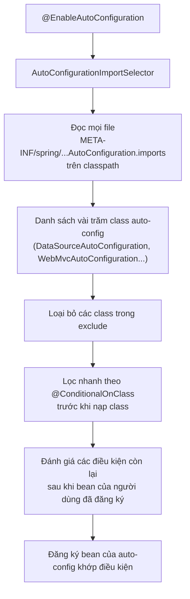

# Auto-configuration

Auto-configuration là "phép thuật" lớn nhất của Spring Boot: thêm `spring-boot-starter-data-jpa` và vài dòng cấu hình URL là có ngay `DataSource`, `EntityManagerFactory`, `TransactionManager` mà không viết một dòng `@Bean` nào. Bài này mở hộp phép thuật đó: `@SpringBootApplication` gồm những gì, Spring Boot tìm các lớp auto-configuration ở đâu, các điều kiện `@Conditional*` quyết định bean nào được tạo, cách đọc condition report, cách ghi đè và tự viết auto-configuration cho thư viện của mình.

---

:::note[Ghi nhớ nhanh]

- ⭐ **Auto-configuration "lùi lại" khi bạn tự khai báo bean** — nhờ `@ConditionalOnMissingBean`; muốn tuỳ biến thì định nghĩa bean của bạn hoặc chỉnh thuộc tính.
- ⭐ **Debug bằng condition report** — chạy với `--debug` (hoặc `debug=true`) để xem auto-config nào khớp, không khớp và vì sao.
- **`@SpringBootApplication` = `@SpringBootConfiguration` + `@EnableAutoConfiguration` + `@ComponentScan`**.
- **Danh sách auto-config nằm trong `META-INF/spring/org.springframework.boot.autoconfigure.AutoConfiguration.imports`** (Boot 2.7+/3), thay cho `spring.factories` cũ.
- **Tắt một auto-config**: `@SpringBootApplication(exclude = ...)` hoặc thuộc tính `spring.autoconfigure.exclude`.

:::

---

## Mục lục

- [Vì sao Auto-configuration ra đời?](#vì-sao-auto-configuration-ra-đời)
- [Giải phẫu @SpringBootApplication](#giải-phẫu-springbootapplication)
- [Spring Boot tìm auto-configuration ở đâu](#spring-boot-tìm-auto-configuration-ở-đâu)
- [Các annotation điều kiện](#các-annotation-điều-kiện)
- [Xem auto-configuration nào đang chạy](#xem-auto-configuration-nào-đang-chạy)
- [Ghi đè và tắt auto-configuration](#ghi-đè-và-tắt-auto-configuration)
- [Tự viết auto-configuration](#tự-viết-auto-configuration)
- [Câu hỏi phỏng vấn](#câu-hỏi-phỏng-vấn)

---

## Vì sao Auto-configuration ra đời?

**Vấn đề:** Với Spring Framework thuần, mỗi dự án đều phải viết lại cùng một đống cấu hình hạ tầng:

```java
@Configuration
@EnableTransactionManagement
@EnableJpaRepositories("com.shop")
public class PersistenceConfig {

    @Bean
    public DataSource dataSource() {
        HikariDataSource ds = new HikariDataSource();
        ds.setJdbcUrl("jdbc:postgresql://localhost:5432/shop");
        ds.setUsername("shop");
        ds.setPassword("secret");
        return ds;
    }

    @Bean
    public LocalContainerEntityManagerFactoryBean entityManagerFactory(DataSource ds) {
        var emf = new LocalContainerEntityManagerFactoryBean();
        emf.setDataSource(ds);
        emf.setPackagesToScan("com.shop");
        emf.setJpaVendorAdapter(new HibernateJpaVendorAdapter());
        return emf;
    }

    @Bean
    public PlatformTransactionManager transactionManager(EntityManagerFactory emf) {
        return new JpaTransactionManager(emf);
    }
}
// ... và tương tự cho DispatcherServlet, Jackson, Tomcat, Validation, Security...
```

Đoạn này giống nhau ở 90% dự án — chỉ khác URL và mật khẩu.

**Giải pháp:** Spring Boot đóng gói các cấu hình "chuẩn" đó thành **auto-configuration có điều kiện**. Bạn chỉ khai báo phần khác biệt:

```yaml
spring:
  datasource:
    url: jdbc:postgresql://localhost:5432/shop
    username: shop
    password: ${DB_PASSWORD}
  jpa:
    open-in-view: false
```

Thấy Hibernate và driver PostgreSQL trên classpath → Boot tự tạo `DataSource` (HikariCP), `EntityManagerFactory`, `JpaTransactionManager`, bật JPA repository.

:::tip[Dùng thực tế]

- **Thêm Redis** — thêm `spring-boot-starter-data-redis`, cấu hình host là có `RedisTemplate`, `StringRedisTemplate`.
- **Thêm Actuator** — có endpoint health kiểm tra cả DB, Redis, disk mà không cấu hình gì.
- **Viết thư viện nội bộ** (audit log, client gọi hệ thống lõi) dạng starter — service nào thêm dependency là tự có bean.
- **Đọc lỗi khởi động** — hiểu vì sao "Failed to configure a DataSource" xuất hiện khi thêm JPA mà quên URL.

:::

:::tip[Ví dụ đời thường]

Auto-configuration giống **nhà thông minh**: cắm bóng đèn mới vào (thêm thư viện) là hệ thống nhận ra và tự đưa vào app điều khiển với cài đặt mặc định. Nhưng nếu bạn đã tự lắp công tắc riêng cho phòng đó (tự khai báo bean), hệ thống **không đè lên** cài đặt của bạn.

:::

---

## Giải phẫu @SpringBootApplication

```java
@SpringBootApplication
public class ShopApplication {
    public static void main(String[] args) {
        SpringApplication.run(ShopApplication.class, args);
    }
}
```

`@SpringBootApplication` là annotation gộp:

```java
@SpringBootConfiguration      // = @Configuration: class main cũng là class cấu hình
@EnableAutoConfiguration      // bật cơ chế auto-configuration
@ComponentScan(excludeFilters = { /* bộ lọc loại auto-config khỏi component scan */ })
public @interface SpringBootApplication { }
```

| Thành phần | Vai trò |
|------------|---------|
| `@SpringBootConfiguration` | Đánh dấu class cấu hình chính; test slice dùng nó để tìm cấu hình gốc |
| `@EnableAutoConfiguration` | Import `AutoConfigurationImportSelector` → nạp danh sách auto-config và lọc theo điều kiện |
| `@ComponentScan` | Quét package của class main và package con |

`@EnableAutoConfiguration` còn được meta-annotate `@AutoConfigurationPackage` — ghi nhớ package gốc để các auto-config như JPA biết quét entity và repository ở đâu.

---

## Spring Boot tìm auto-configuration ở đâu



File `META-INF/spring/org.springframework.boot.autoconfigure.AutoConfiguration.imports` trong jar `spring-boot-autoconfigure` liệt kê từng class, mỗi dòng một class:

```text
org.springframework.boot.autoconfigure.jdbc.DataSourceAutoConfiguration
org.springframework.boot.autoconfigure.orm.jpa.HibernateJpaAutoConfiguration
org.springframework.boot.autoconfigure.web.servlet.WebMvcAutoConfiguration
org.springframework.boot.autoconfigure.jackson.JacksonAutoConfiguration
...
```

Điểm quan trọng: **auto-configuration được xử lý sau cấu hình của người dùng** (deferred import). Vì vậy khi Boot kiểm tra `@ConditionalOnMissingBean`, nó đã thấy các bean bạn tự khai báo.

Lịch sử:

| Phiên bản | Cơ chế đăng ký |
|-----------|----------------|
| Boot 1.x – 2.6 | Key `EnableAutoConfiguration` trong `META-INF/spring.factories` |
| Boot 2.7 | Thêm file `AutoConfiguration.imports` + annotation `@AutoConfiguration`; vẫn hỗ trợ cách cũ |
| Boot 3.x | **Chỉ** dùng `AutoConfiguration.imports` cho auto-config |

---

## Các annotation điều kiện

Một auto-configuration điển hình (rút gọn, minh hoạ ý tưởng):

```java
@AutoConfiguration
@ConditionalOnClass({ DataSource.class, EmbeddedDatabaseType.class })
@EnableConfigurationProperties(DataSourceProperties.class)
public class DataSourceAutoConfiguration {

    @Bean
    @ConditionalOnMissingBean(DataSource.class)
    @ConditionalOnProperty(prefix = "spring.datasource", name = "url")
    public DataSource dataSource(DataSourceProperties props) {
        return props.initializeDataSourceBuilder().build();
    }
}
```

| Annotation | Khớp khi |
|------------|----------|
| `@ConditionalOnClass` / `@ConditionalOnMissingClass` | Class có / không có trên classpath |
| `@ConditionalOnBean` / `@ConditionalOnMissingBean` | Đã có / chưa có bean (theo kiểu, tên, annotation) |
| `@ConditionalOnSingleCandidate` | Có đúng một bean kiểu đó (hoặc một `@Primary`) |
| `@ConditionalOnProperty` | Thuộc tính tồn tại / có giá trị khớp `havingValue`; `matchIfMissing` cho phép khớp khi thiếu |
| `@ConditionalOnResource` | Có resource (file) |
| `@ConditionalOnWebApplication` / `@ConditionalOnNotWebApplication` | Là / không phải ứng dụng web (có thể chỉ định `SERVLET`, `REACTIVE`) |
| `@ConditionalOnExpression` | Biểu thức SpEL đúng |
| `@ConditionalOnJava` | Phiên bản Java phù hợp |
| `@ConditionalOnCloudPlatform` | Chạy trên Kubernetes, Cloud Foundry... |
| `@ConditionalOnThreading` | Platform thread hay virtual thread (Boot 3.2+) |

Thứ tự giữa các auto-config được điều chỉnh bằng thuộc tính `before`/`after` của `@AutoConfiguration` (hoặc `@AutoConfigureBefore`/`@AutoConfigureAfter`):

```java
@AutoConfiguration(after = DataSourceAutoConfiguration.class)
public class FlywayLikeAutoConfiguration { }
```

---

## Xem auto-configuration nào đang chạy

### Condition evaluation report

```bash
java -jar shop.jar --debug
# hoặc trong application.yml:  debug: true
```

```text
============================
CONDITIONS EVALUATION REPORT
============================

Positive matches:
-----------------
   DataSourceAutoConfiguration matched:
      - @ConditionalOnClass found required classes 'javax.sql.DataSource', ... (OnClassCondition)

   JacksonAutoConfiguration matched:
      - @ConditionalOnClass found required class 'com.fasterxml.jackson.databind.ObjectMapper' (OnClassCondition)

Negative matches:
-----------------
   MongoAutoConfiguration:
      Did not match:
         - @ConditionalOnClass did not find required class 'com.mongodb.client.MongoClient' (OnClassCondition)

Exclusions:
-----------
   None
```

- **Positive matches** — auto-config đã áp dụng và lý do.
- **Negative matches** — không áp dụng và điều kiện nào không khớp.

Lưu ý `--debug` chỉ bật log debug cho một số logger lõi (container, Hibernate, Boot), không bật toàn bộ ứng dụng.

### Qua Actuator

Bật endpoint `conditions` để xem report khi app đang chạy:

```yaml
management:
  endpoints:
    web:
      exposure:
        include: health,conditions,beans
```

`GET /actuator/conditions` trả JSON tương tự report; `GET /actuator/beans` liệt kê mọi bean. Chỉ bật ở môi trường nội bộ.

:::warning[Lỗi hay gặp]

**"Failed to configure a DataSource: 'url' attribute is not specified"** — bạn thêm `spring-boot-starter-data-jpa` nhưng chưa cấu hình `spring.datasource.url` và không có DB nhúng (H2) trên classpath. Sửa: thêm URL, thêm H2 cho dev, hoặc nếu thật sự chưa cần DB thì exclude `DataSourceAutoConfiguration`.

:::

---

## Ghi đè và tắt auto-configuration

### Cách 1 — chỉnh thuộc tính (ưu tiên)

Hầu hết auto-config đọc thuộc tính qua `@ConfigurationProperties`. Thử thuộc tính trước khi viết bean:

```yaml
spring:
  jackson:
    default-property-inclusion: non_null
    time-zone: Asia/Ho_Chi_Minh
  datasource:
    hikari:
      maximum-pool-size: 20
server:
  servlet:
    context-path: /api
```

### Cách 2 — dùng customizer

Nhiều auto-config cung cấp interface `*Customizer` để chỉnh **thêm** mà không thay thế toàn bộ bean:

```java
@Configuration
public class JacksonCustomization {
    @Bean
    public Jackson2ObjectMapperBuilderCustomizer vietnamDates() {
        return builder -> builder.simpleDateFormat("dd/MM/yyyy HH:mm:ss");
    }
}
```

### Cách 3 — tự khai báo bean (auto-config lùi lại)

```java
@Configuration
public class DataSourceConfig {
    @Bean
    public DataSource dataSource() {
        // Boot thấy đã có DataSource → không tạo DataSource mặc định nữa
        HikariConfig cfg = new HikariConfig();
        cfg.setJdbcUrl(System.getenv("DB_URL"));
        return new HikariDataSource(cfg);
    }
}
```

### Cách 4 — tắt hẳn

```java
@SpringBootApplication(exclude = { DataSourceAutoConfiguration.class, SecurityAutoConfiguration.class })
public class ShopApplication { }
```

```yaml
spring:
  autoconfigure:
    exclude:
      - org.springframework.boot.autoconfigure.jdbc.DataSourceAutoConfiguration
```

:::warning[Lỗi hay gặp]

- Tự khai báo `ObjectMapper` bằng `new ObjectMapper()` → mất toàn bộ cấu hình `spring.jackson.*` và các module Boot đăng ký sẵn (JavaTimeModule...). Ưu tiên customizer.
- Đánh `@EnableWebMvc` trong ứng dụng Boot → **tắt** `WebMvcAutoConfiguration` (vì nó có `@ConditionalOnMissingBean(WebMvcConfigurationSupport.class)`), mất cấu hình static resource, converter mặc định. Muốn tuỳ biến MVC, implement `WebMvcConfigurer` mà không dùng `@EnableWebMvc`.

:::

---

## Tự viết auto-configuration

Ví dụ: thư viện nội bộ gửi audit log, service nào thêm dependency là có bean `AuditClient`.

### 1. Properties

```java
@ConfigurationProperties(prefix = "acme.audit")
public record AuditProperties(
        @DefaultValue("true") boolean enabled,
        String endpoint,
        @DefaultValue("5s") Duration timeout) { }
```

### 2. Lớp auto-configuration

```java
@AutoConfiguration
@ConditionalOnClass(AuditClient.class)
@ConditionalOnProperty(prefix = "acme.audit", name = "enabled", havingValue = "true", matchIfMissing = true)
@EnableConfigurationProperties(AuditProperties.class)
public class AuditAutoConfiguration {

    @Bean
    @ConditionalOnMissingBean // service muốn tự cấu hình AuditClient thì Boot lùi lại
    public AuditClient auditClient(AuditProperties props, RestClient.Builder builder) {
        RestClient client = builder.baseUrl(props.endpoint()).build();
        return new AuditClient(client, props.timeout());
    }
}
```

### 3. Đăng ký

```text
# src/main/resources/META-INF/spring/org.springframework.boot.autoconfigure.AutoConfiguration.imports
com.acme.audit.autoconfigure.AuditAutoConfiguration
```

### 4. Test bằng ApplicationContextRunner

```java
class AuditAutoConfigurationTest {
    private final ApplicationContextRunner runner = new ApplicationContextRunner()
            .withConfiguration(AutoConfigurations.of(
                    RestClientAutoConfiguration.class, AuditAutoConfiguration.class));

    @Test
    void taoAuditClientMacDinh() {
        runner.withPropertyValues("acme.audit.endpoint=http://audit.local")
              .run(ctx -> assertThat(ctx).hasSingleBean(AuditClient.class));
    }

    @Test
    void tatKhiEnabledFalse() {
        runner.withPropertyValues("acme.audit.enabled=false")
              .run(ctx -> assertThat(ctx).doesNotHaveBean(AuditClient.class));
    }

    @Test
    void lungLaiKhiNguoiDungTuKhaiBao() {
        runner.withBean(AuditClient.class, () -> mock(AuditClient.class))
              .run(ctx -> assertThat(ctx).hasSingleBean(AuditClient.class));
    }
}
```

:::warning[Lỗi hay gặp]

- **Để class auto-config nằm trong package được component scan** → nó bị nạp như cấu hình thường, trước bean của người dùng, làm `@ConditionalOnMissingBean` sai. Đặt auto-config ở package riêng và chỉ đăng ký qua file `.imports`.
- **Quên `@ConditionalOnMissingBean`** → người dùng không ghi đè được, hoặc bị lỗi trùng bean.
- Dùng `@Configuration` thay vì `@AutoConfiguration` — `@AutoConfiguration` đã ngầm có `proxyBeanMethods = false` và hỗ trợ `before`/`after`.

:::

---

## Câu hỏi phỏng vấn

**1. Auto-configuration trong Spring Boot hoạt động thế nào?**

<details className="qa">
<summary>Xem đáp án</summary>

`@EnableAutoConfiguration` (nằm trong `@SpringBootApplication`) import `AutoConfigurationImportSelector`. Selector đọc danh sách class từ các file `META-INF/spring/org.springframework.boot.autoconfigure.AutoConfiguration.imports` trên classpath, loại các class bị exclude, rồi đánh giá điều kiện `@Conditional*` của từng class (có trên classpath không, đã có bean chưa, thuộc tính bật chưa...). Auto-config được xử lý sau cấu hình người dùng (deferred), nên `@ConditionalOnMissingBean` thấy bean người dùng và lùi lại. Class khớp điều kiện được đăng ký như class `@Configuration`.

</details>

**2. `@SpringBootApplication` gồm những annotation nào?**

<details className="qa">
<summary>Xem đáp án</summary>

`@SpringBootConfiguration` (một dạng `@Configuration`), `@EnableAutoConfiguration` (bật auto-config, kèm `@AutoConfigurationPackage` ghi nhớ package gốc), `@ComponentScan` (quét package chứa class main và package con, có filter loại auto-config). Có thuộc tính `exclude`, `excludeName`, `scanBasePackages`, `proxyBeanMethods`.

</details>

**3. Làm sao biết auto-configuration nào đang được áp dụng và vì sao một cái không được áp dụng?**

<details className="qa">
<summary>Xem đáp án</summary>

Chạy ứng dụng với `--debug` hoặc `debug=true` để in **Conditions Evaluation Report**: Positive matches (đã áp dụng + lý do), Negative matches (không áp dụng + điều kiện không khớp), Exclusions, Unconditional classes. Khi app đang chạy có thể dùng Actuator endpoint `/actuator/conditions` và `/actuator/beans`.

</details>

**4. Làm sao ghi đè một bean do auto-configuration tạo?**

<details className="qa">
<summary>Xem đáp án</summary>

Theo thứ tự ưu tiên: (1) chỉnh thuộc tính `application.yml` mà auto-config đọc; (2) dùng bean `*Customizer` do Boot cung cấp (ví dụ `Jackson2ObjectMapperBuilderCustomizer`, `WebServerFactoryCustomizer`); (3) tự khai báo bean cùng kiểu — auto-config có `@ConditionalOnMissingBean` sẽ lùi lại; (4) exclude hẳn auto-config qua `exclude` hoặc `spring.autoconfigure.exclude`.

</details>

**5. Sự khác nhau giữa `spring.factories` và `AutoConfiguration.imports`?**

<details className="qa">
<summary>Xem đáp án</summary>

Trước Boot 2.7, auto-config được đăng ký dưới key `org.springframework.boot.autoconfigure.EnableAutoConfiguration` trong `META-INF/spring.factories` (file chung cho nhiều loại extension). Boot 2.7 giới thiệu file riêng `META-INF/spring/org.springframework.boot.autoconfigure.AutoConfiguration.imports` (mỗi dòng một class) và annotation `@AutoConfiguration`. Từ Boot 3.0, đăng ký auto-config qua `spring.factories` không còn được hỗ trợ; `spring.factories` vẫn dùng cho các extension khác như `ApplicationListener`, `EnvironmentPostProcessor`.

</details>

**6. Vì sao thêm `@EnableWebMvc` vào ứng dụng Spring Boot lại làm mất cấu hình mặc định?**

<details className="qa">
<summary>Xem đáp án</summary>

`@EnableWebMvc` import `DelegatingWebMvcConfiguration` (một `WebMvcConfigurationSupport`). `WebMvcAutoConfiguration` có điều kiện `@ConditionalOnMissingBean(WebMvcConfigurationSupport.class)`, nên khi thấy bean này nó lùi lại hoàn toàn — mất static resource mặc định, converter, formatter Boot cấu hình sẵn. Cách đúng để tuỳ biến: implement `WebMvcConfigurer` trong class `@Configuration` không có `@EnableWebMvc`.

</details>

**7. Viết một auto-configuration cho thư viện nội bộ cần những bước nào?**

<details className="qa">
<summary>Xem đáp án</summary>

(1) Tạo class `@ConfigurationProperties` cho cấu hình; (2) tạo class `@AutoConfiguration` với điều kiện phù hợp (`@ConditionalOnClass`, `@ConditionalOnProperty`) và bean có `@ConditionalOnMissingBean` để người dùng ghi đè được; (3) đăng ký class trong `META-INF/spring/org.springframework.boot.autoconfigure.AutoConfiguration.imports`; (4) đặt ở package không bị component scan; (5) viết test bằng `ApplicationContextRunner`; (6) đóng gói kèm module starter và `spring-boot-configuration-processor` để có metadata gợi ý thuộc tính.

</details>
