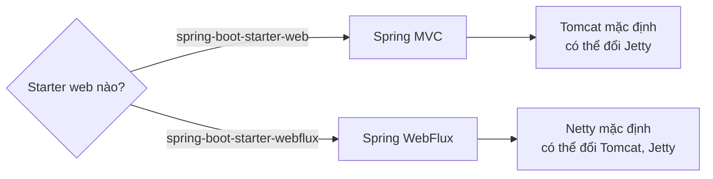
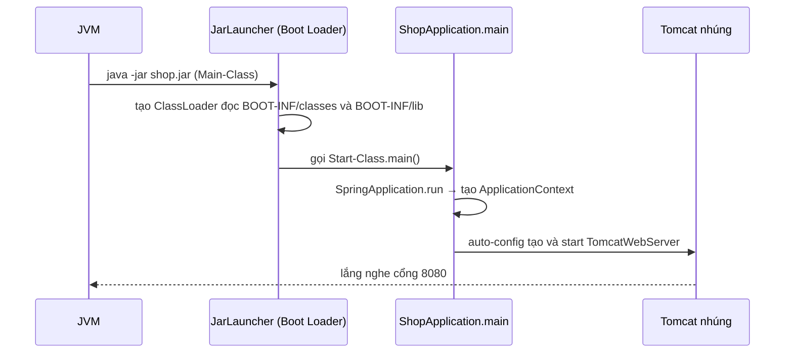

# Embedded Server

Một trong những thay đổi lớn nhất Spring Boot mang lại là **đảo ngược quan hệ giữa ứng dụng và web server**: thay vì cài Tomcat rồi "thả" file WAR vào, server được **nhúng** ngay trong ứng dụng và chạy bằng `java -jar`. Bài này giải thích embedded server là gì, so sánh Tomcat, Jetty, Undertow (và Netty cho WebFlux), cách đổi server, các cấu hình `server.*` quan trọng, cấu trúc fat jar, và khi nào vẫn cần deploy WAR.

---

:::note[Ghi nhớ nhanh]

- ⭐ **Mặc định `spring-boot-starter-web` dùng Tomcat nhúng**, `spring-boot-starter-webflux` dùng Netty; đổi server bằng exclusion + thêm starter khác.
- ⭐ **Fat jar chứa code + thư viện + server** → một file chạy mọi nơi có JVM, hợp với Docker/Kubernetes.
- **Cấu hình qua `server.*`**: `server.port`, `server.servlet.context-path`, `server.tomcat.threads.max`, `server.shutdown=graceful`, SSL...
- **`server.port=0`** chọn cổng ngẫu nhiên (hay dùng trong test); thứ tự ưu tiên cấu hình như mọi thuộc tính khác.
- **WAR vẫn dùng được** (extends `SpringBootServletInitializer`) khi tổ chức bắt buộc deploy lên app server có sẵn.

:::

---

## Mục lục

- [Vì sao cần embedded server?](#vì-sao-cần-embedded-server)
- [So sánh Tomcat, Jetty, Undertow, Netty](#so-sánh-tomcat-jetty-undertow-netty)
- [Đổi server](#đổi-server)
- [Cấu hình server thường dùng](#cấu-hình-server-thường-dùng)
- [Fat jar hoạt động thế nào](#fat-jar-hoạt-động-thế-nào)
- [So với triển khai WAR](#so-với-triển-khai-war)

---

## Vì sao cần embedded server?

**Vấn đề:** Mô hình truyền thống: cài một Tomcat/WebLogic trên server, cấu hình riêng, rồi deploy file `.war`:

```text
1. Cài JDK + Tomcat 9 trên server (phải đúng phiên bản app cần)
2. Sửa conf/server.xml (port, connector, thread pool), conf/context.xml (JNDI DataSource)
3. Copy shop.war vào webapps/
4. Khởi động lại Tomcat → app được giải nén và chạy
5. Dev local dùng Tomcat 9.0.50, server dùng 9.0.30 → "máy em chạy được mà"
```

Nỗi đau: cấu hình server nằm ngoài source code; nhiều app chung một Tomcat ảnh hưởng nhau; môi trường dev và prod khác nhau; khó đóng gói vào container.

**Giải pháp:** Spring Boot nhúng server thành **một thư viện** của ứng dụng. Ứng dụng tự khởi động server trong `main()`:

```java
@SpringBootApplication
public class ShopApplication {
    public static void main(String[] args) {
        SpringApplication.run(ShopApplication.class, args); // khởi động Tomcat nhúng trên cổng 8080
    }
}
```

```bash
./mvnw clean package
java -jar target/shop-1.0.0.jar --server.port=9090
```

```dockerfile
FROM eclipse-temurin:21-jre
COPY target/shop-1.0.0.jar /app/app.jar
ENTRYPOINT ["java", "-jar", "/app/app.jar"]
```

:::tip[Dùng thực tế]

- **Container/Kubernetes** — mỗi pod một process `java -jar`, scale bằng cách tăng số pod.
- **Microservices** — mỗi service tự mang server của mình, phiên bản độc lập.
- **Dev local** — chạy thẳng từ IDE (nút Run trên `main`), không cấu hình Tomcat trong IDE.
- **Test tích hợp** — `@SpringBootTest(webEnvironment = RANDOM_PORT)` khởi động server thật trên cổng ngẫu nhiên.

:::

:::tip[Ví dụ đời thường]

Deploy WAR giống **thuê sạp trong chợ**: chợ (Tomcat) có giờ mở cửa, quy định chung, sạp bên cạnh cháy thì sạp bạn cũng ảnh hưởng. Embedded server giống **xe bán hàng lưu động (food truck)**: bếp, bàn, điện đã gắn sẵn trên xe — chạy tới đâu (máy nào có JVM) là mở bán được ở đó, không phụ thuộc ban quản lý chợ.

:::

---

## So sánh Tomcat, Jetty, Undertow, Netty

| Tiêu chí | Tomcat | Jetty | Undertow | Netty (Reactor Netty) |
|----------|--------|-------|----------|-----------------------|
| Starter | `spring-boot-starter-tomcat` (mặc định của web) | `spring-boot-starter-jetty` | `spring-boot-starter-undertow` | `spring-boot-starter-reactor-netty` (mặc định của webflux) |
| Mô hình | Servlet, thread pool | Servlet, thread pool | Servlet, XNIO non-blocking bên dưới | Non-blocking event loop, không phải Servlet |
| Dùng với | Spring MVC (và WebFlux) | Spring MVC (và WebFlux) | Spring MVC (và WebFlux) | Spring WebFlux |
| Điểm mạnh | Phổ biến nhất, tài liệu nhiều, ổn định | Nhẹ, nhúng tốt, WebSocket/HTTP2 tốt | Hiệu năng cao, ít bộ nhớ | Rất nhiều kết nối đồng thời với ít thread |
| Ghi chú | Lựa chọn an toàn | — | **Bị bỏ ở Spring Boot 4** (chưa hỗ trợ Servlet 6.1) | Cần code reactive toàn tuyến |

Với ứng dụng CRUD thông thường, chênh lệch hiệu năng giữa Tomcat và Jetty gần như không đáng kể so với thời gian truy vấn DB. **Giữ Tomcat** trừ khi có lý do cụ thể.



---

## Đổi server

### Maven: Tomcat sang Jetty

```xml
<dependency>
    <groupId>org.springframework.boot</groupId>
    <artifactId>spring-boot-starter-web</artifactId>
    <exclusions>
        <exclusion>
            <groupId>org.springframework.boot</groupId>
            <artifactId>spring-boot-starter-tomcat</artifactId>
        </exclusion>
    </exclusions>
</dependency>
<dependency>
    <groupId>org.springframework.boot</groupId>
    <artifactId>spring-boot-starter-jetty</artifactId>
</dependency>
```

### Gradle

```kotlin
dependencies {
    implementation("org.springframework.boot:spring-boot-starter-web") {
        exclude(group = "org.springframework.boot", module = "spring-boot-starter-tomcat")
    }
    implementation("org.springframework.boot:spring-boot-starter-jetty")
}
```

Khi khởi động, log sẽ báo server đang dùng:

```text
o.s.b.web.embedded.jetty.JettyWebServer : Jetty started on port 8080 (http/1.1) with context path '/'
```

### Không cần web server

Ứng dụng batch/consumer không phục vụ HTTP:

```yaml
spring:
  main:
    web-application-type: none
```

:::warning[Lỗi hay gặp]

Thêm Jetty nhưng **quên exclude Tomcat** → cả hai cùng trên classpath, Boot vẫn ưu tiên Tomcat (thứ tự kiểm tra trong auto-config) và bạn tưởng đã đổi. Luôn kiểm tra log "... started on port" để biết server thật.

:::

---

## Cấu hình server thường dùng

```yaml
server:
  port: 8080
  servlet:
    context-path: /shop          # mọi URL có tiền tố /shop
    session:
      timeout: 30m
  shutdown: graceful             # chờ request đang xử lý xong mới tắt (mặc định graceful từ Boot 3.4)
  compression:
    enabled: true
    mime-types: application/json,text/html,text/css,application/javascript
    min-response-size: 1KB
  error:
    include-stacktrace: never    # không lộ stacktrace ra client
  forward-headers-strategy: framework  # đứng sau reverse proxy / load balancer
  tomcat:
    threads:
      max: 200                   # số thread xử lý tối đa
      min-spare: 10
    max-connections: 8192
    accept-count: 100            # hàng đợi khi hết thread
    connection-timeout: 20s
  http2:
    enabled: true

spring:
  lifecycle:
    timeout-per-shutdown-phase: 30s   # tối đa chờ khi graceful shutdown
  threads:
    virtual:
      enabled: true              # Java 21+: dùng virtual thread cho Tomcat và @Async
```

### Bật HTTPS

```yaml
server:
  port: 8443
  ssl:
    enabled: true
    key-store: classpath:keystore.p12
    key-store-password: ${KEYSTORE_PASSWORD}
    key-store-type: PKCS12
```

Thực tế production thường **kết thúc TLS ở load balancer/ingress** (Nginx, ALB) và app chạy HTTP nội bộ; khi đó cần `server.forward-headers-strategy` để app nhận đúng scheme/host gốc từ header `X-Forwarded-*`.

### Tuỳ biến bằng code

```java
@Component
public class TomcatCustomizer implements WebServerFactoryCustomizer<TomcatServletWebServerFactory> {
    @Override
    public void customize(TomcatServletWebServerFactory factory) {
        factory.addConnectorCustomizers(connector -> connector.setProperty("relaxedQueryChars", "[]|"));
    }
}
```

### Lấy cổng thực tế lúc chạy

```java
@Component
public class PortLogger {
    private static final Logger log = LoggerFactory.getLogger(PortLogger.class);

    @EventListener
    public void onReady(WebServerInitializedEvent event) {
        log.info("Server chạy trên cổng {}", event.getWebServer().getPort());
    }
}
```

:::warning[Lỗi hay gặp]

- **"Port 8080 was already in use"** — một process khác (hoặc lần chạy trước chưa tắt) đang chiếm cổng. Tìm bằng `lsof -i :8080` rồi tắt, hoặc đổi `server.port`.
- **Tăng `threads.max` lên rất cao** để "chịu tải" — thread nhiều mà DB pool chỉ 10 kết nối thì các thread vẫn xếp hàng chờ DB, chỉ tốn RAM. Tinh chỉnh cùng với `spring.datasource.hikari.maximum-pool-size`.
- **Không bật graceful shutdown** trên Kubernetes (Boot trước 3.4) → request đang xử lý bị cắt khi rolling update.

:::

---

## Fat jar hoạt động thế nào

`spring-boot-maven-plugin` (goal `repackage`) đóng gói thành **executable jar** (fat jar / uber jar):

```text
shop-1.0.0.jar
├── META-INF/
│   └── MANIFEST.MF
│         Main-Class: org.springframework.boot.loader.launch.JarLauncher
│         Start-Class: vn.shop.ShopApplication
├── org/springframework/boot/loader/...     # Spring Boot Loader
└── BOOT-INF/
    ├── classes/                            # code + application.yml của bạn
    ├── lib/                                # mọi jar phụ thuộc (spring-*, tomcat-embed-*, jackson...)
    ├── classpath.idx
    └── layers.idx                          # dùng cho Docker layer
```

Luồng chạy:



JDK chuẩn không đọc được "jar lồng trong jar", nên Spring Boot có **loader riêng** để nạp các jar trong `BOOT-INF/lib`.

```xml
<build>
    <plugins>
        <plugin>
            <groupId>org.springframework.boot</groupId>
            <artifactId>spring-boot-maven-plugin</artifactId>
        </plugin>
    </plugins>
</build>
```

Tối ưu image Docker bằng layered jar (thư viện ít đổi nằm ở layer dưới, code hay đổi nằm trên):

```bash
java -Djarmode=tools -jar target/shop-1.0.0.jar extract --layers --launcher
```

Hoặc build image không cần Dockerfile (Cloud Native Buildpacks):

```bash
./mvnw spring-boot:build-image -Dspring-boot.build-image.imageName=shop:1.0.0
```

---

## So với triển khai WAR

| Tiêu chí | Fat jar + server nhúng | WAR + server ngoài |
|----------|------------------------|--------------------|
| Chạy | `java -jar app.jar` | Copy vào `webapps/` của Tomcat/WildFly |
| Cấu hình server | Trong code/`application.yml` | `server.xml`, cấu hình của app server |
| Phiên bản server | Theo ứng dụng, kiểm soát được | Theo hạ tầng, dùng chung |
| Nhiều app | Mỗi app một process | Nhiều app chung một JVM |
| Container/cloud | Rất phù hợp | Kém phù hợp |
| Khi nào dùng | **Mặc định cho dự án mới** | Tổ chức bắt buộc dùng app server sẵn có |

Nếu vẫn cần WAR:

```xml
<packaging>war</packaging>

<dependency>
    <groupId>org.springframework.boot</groupId>
    <artifactId>spring-boot-starter-tomcat</artifactId>
    <scope>provided</scope> <!-- server ngoài cung cấp, không đóng gói vào WAR -->
</dependency>
```

```java
@SpringBootApplication
public class ShopApplication extends SpringBootServletInitializer {

    @Override
    protected SpringApplicationBuilder configure(SpringApplicationBuilder builder) {
        return builder.sources(ShopApplication.class);
    }

    public static void main(String[] args) {
        SpringApplication.run(ShopApplication.class, args); // vẫn chạy được bằng java -jar
    }
}
```

:::warning[Lỗi hay gặp]

Deploy WAR Spring Boot 3 lên **Tomcat 9** → lỗi vì Tomcat 9 dùng `javax.servlet`, còn Boot 3 cần Servlet `jakarta.servlet` (Tomcat 10.1+). Kiểm tra phiên bản server ngoài trước khi deploy.

:::
